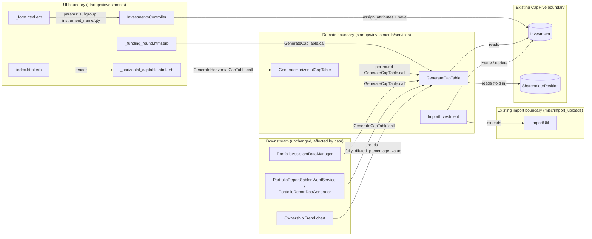
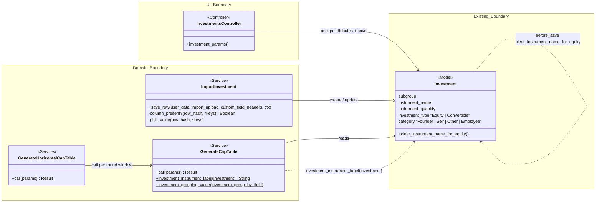
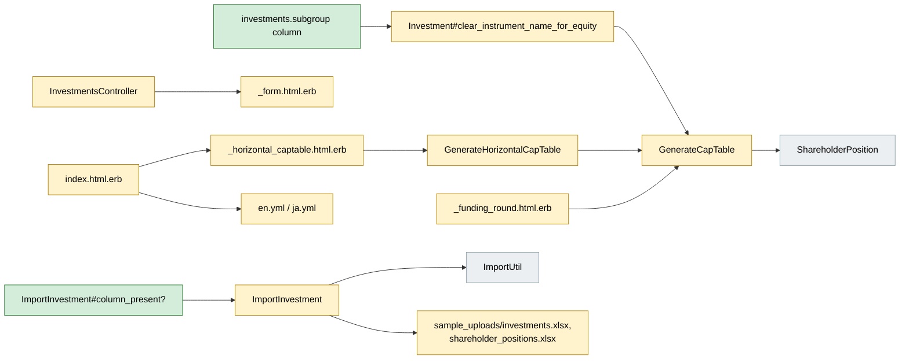
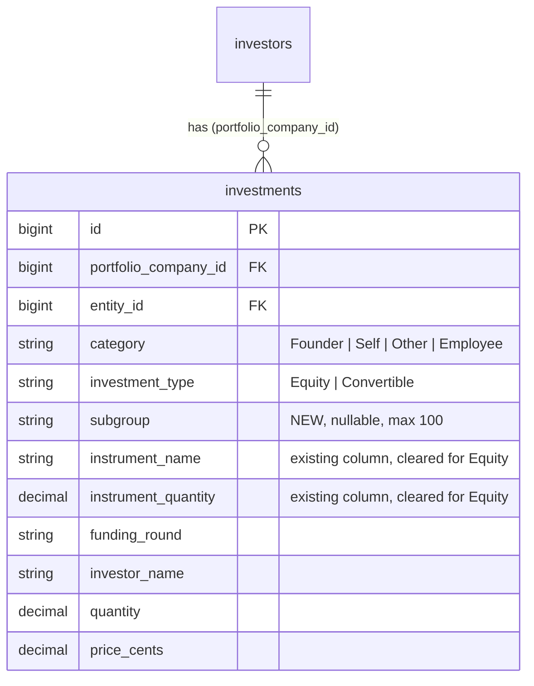
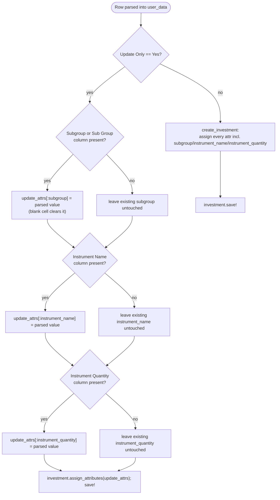
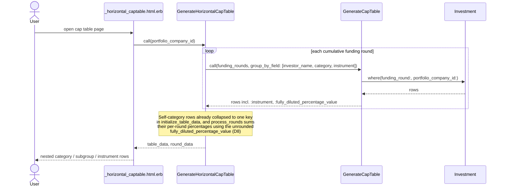
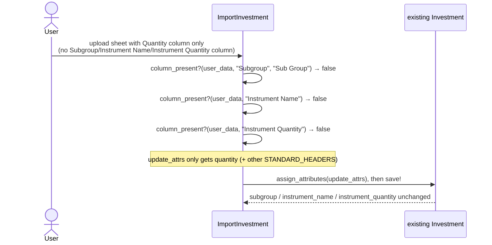
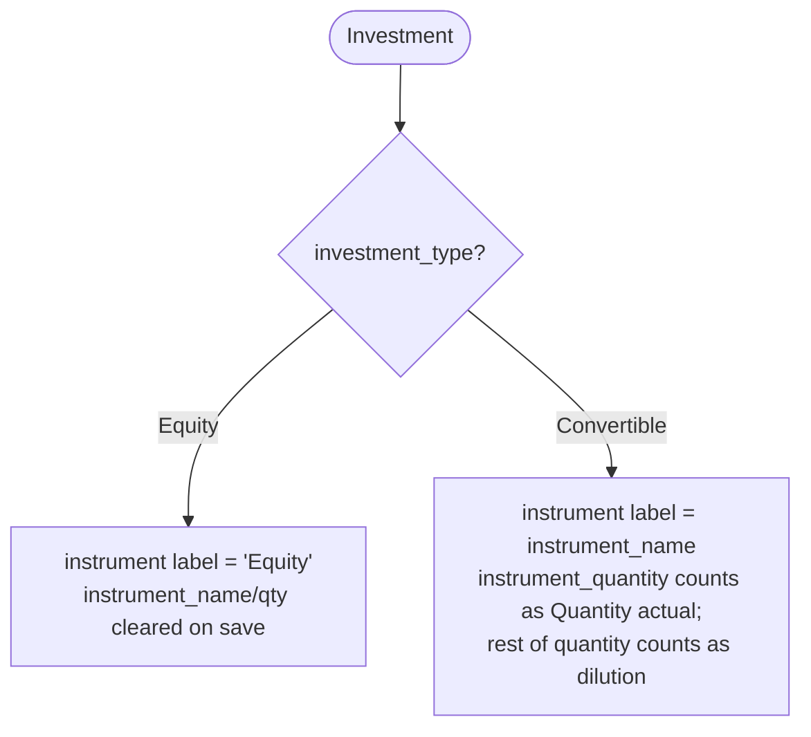
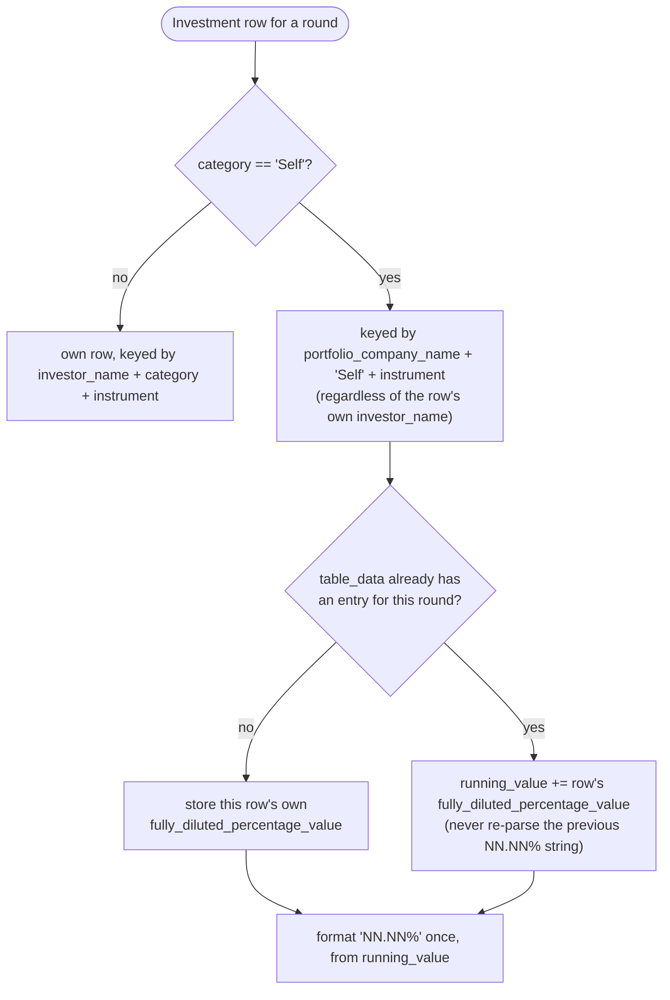
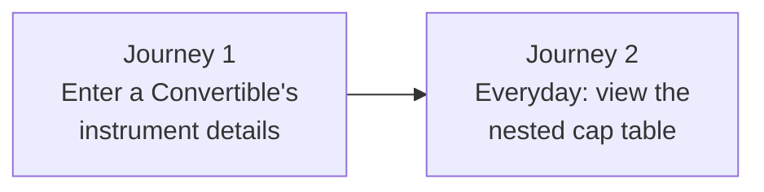

# Investment Subgroups and Cap Table Actions — Design

> **Audience:** Engineering team.
> **Companion documents:** [Proposal](proposal.md) · [Spec](specs/)

---

## Contents

- [Overview](#overview)
- [Architecture](#architecture)
  - [Component Boundaries](#component-boundaries)
  - [Class Diagram](#class-diagram)
  - [Change Footprint](#change-footprint)
- [Data Model and States](#data-model-and-states)
  - [Data Model](#data-model)
  - [State Transitions](#state-transitions)
- [Behaviour](#behaviour)
  - [Pipeline / Flow](#pipeline--flow)
  - [Sequence Diagrams](#sequence-diagrams)
  - [Worked Examples](#worked-examples)
- [Key Components](#key-components)
  - [Decision Flows](#decision-flows)
- [Controllers and Routes](#controllers-and-routes)
- [Policy](#policy)
- [UI Changes](#ui-changes)
  - [At a glance](#at-a-glance)
  - [Journey 1: Entering a Convertible's instrument details](#journey-1-entering-a-convertibles-instrument-details)
  - [Build notes (for implementers)](#build-notes-for-implementers)
- [Cross-cutting Concerns](#cross-cutting-concerns)
  - [Transactions and Queries](#transactions-and-queries)
  - [Exception Handling and Monitoring](#exception-handling-and-monitoring)
  - [Performance and Security](#performance-and-security)
- [Design Decisions](#design-decisions)
- [Testing](#testing)
- [Risks and Open Questions](#risks-and-open-questions)

---

## Overview

Adds an optional `subgroup` to `Investment`, gives Convertibles a real instrument name/quantity,
and makes `GenerateCapTable`/`GenerateHorizontalCapTable` group by investor, category and
instrument the same way ShareholderPosition-built cap tables already do. Also fixes the cap
table page's action buttons to follow the portfolio company's actual data instead of always
showing every button. No new pack: everything lives inside the existing `startups/investments`
pack, following the pack's existing `Trailblazer::Operation` service pattern.

---

## Architecture

### Component Boundaries



| From → To | Contract | Direction rule |
|---|---|---|
| `_form` → `InvestmentsController` | `subgroup`, `instrument_name`, `instrument_quantity` as permitted params | Form never writes `Investment` directly |
| `_horizontal_captable`/`_funding_round` → `GenerateCapTable`/`GenerateHorizontalCapTable` | `portfolio_company_id`, `funding_rounds`, optional `group_by_field` | Views never query `Investment`/`ShareholderPosition` directly for cap table rows |
| `GenerateHorizontalCapTable` → `GenerateCapTable` | calls it once per cumulative funding-round window with `group_by_field: %i[investor_name category instrument]` | `GenerateHorizontalCapTable` never re-derives quantity/percentage math itself |
| `ImportInvestment` → `Investment` | `assign_attributes`/`new` + `save!` | Only `subgroup`/`instrument_name`/`instrument_quantity` are conditionally included via `column_present?` on update; every other field is unconditional |
| Downstream (AI assistant, reports, Ownership chart) → `GenerateCapTable` | reads `:quantity`/`:fully_diluted`/`:fully_diluted_percentage_value` off its output | Not modified by this change; inherit the Convertible quantity-split behaviour that already existed in `GenerateCapTable#calculate_holdings` |

### Class Diagram



### Change Footprint

All new/modified code lives inside the existing `startups/investments` pack; nothing new is added
outside it.



---

## Data Model and States

### Data Model



**Indexes:** new, non-unique index on `investments.subgroup` (migration
`20260921000000_add_subgroup_to_investments`), for the Ransack subgroup filter and the
first-non-blank-subgroup lookup in `GenerateHorizontalCapTable#initialize_table_data`.

| Column | Why |
|---|---|
| `subgroup` | Free-text grouping tag (e.g. "Institutional", "Angel") set per investor, not a fixed enum — see D1 |

**Changes to existing models:**
- `Investment` gains `validates :subgroup, length: { maximum: 100 }, allow_nil: true` and adds
  `subgroup` to `ransackable_attributes`.
- `Investment` gains `before_save :clear_instrument_name_for_equity`, which nils
  `instrument_name`/`instrument_quantity` whenever `investment_type == "Equity"` — see D3.
- `instrument_name`/`instrument_quantity` columns already existed; this change is the first to
  populate them meaningfully (previously always blank/unused for the Investment path) and to read
  them back out through the cap table services.
- Nothing changes on `ShareholderPosition`; it already carries its own `subgroup`/`instrument`.

### State Transitions

N/A — no new stored or derived status/lifecycle field. `investment_type` and `category` remain
the same closed lists they were before this change (see Non-Goals in proposal.md for why `TYPES`
isn't extended here).

---

## Behaviour

### Pipeline / Flow

`ImportInvestment#save_row` branches on whether the row is a create or an "Update Only" row, and,
for update-only rows, on whether each optional column is present in the uploaded sheet at all
(not just non-blank) — see D6.



### Sequence Diagrams

**Happy path: rendering the horizontal cap table.**



**Edge case: "Update Only" import omitting an optional column.**



### Worked Examples

**ID legend:** **H** = Happy path · **E** = Edge case · **X** = Error (exception) case.

**Shared setup:**

| Record | Name | Key data |
|---|---|---|
| Entity | Startup Inc | `entity_type: "Investment Fund"` |
| Portfolio company | Startup Inc | `investor_name: "Startup Inc"`, `category: "Portfolio Company"` |

#### Happy Path

| # | Scenario | Given | When | Then | Spec scenario | Feature |
|---|---|---|---|---|---|---|
| H1 | Subgroup saved from the form | new investment form | Convertible with subgroup + instrument name/qty submitted | investment saved with subgroup and instrument; shown on its page | Subgroup saved from the form | `investment_subgroups.feature` |
| H2 | Investors nested by subgroup | Founder (no subgroup), Other/Angel, Other/Institutional | open cap table | Founder directly under "Founders"; other two under their subgroup rows in "Others" | Investors nested by subgroup | `investment_subgroups.feature` |
| H3 | Equity + Convertible, one row each | Founder holds 1,000 Equity and a 10 CCPS Convertible (→1,000 shares) in Seed | open cap table | one "Equity" row and one "CCPS" row, each 50% fully diluted | Equity and a Convertible held by the same investor | `investment_subgroups.feature` |
| H4 | Investments sample imports as-is | none | sample `investments.xlsx` uploaded for "AX" | both rows imported with correct subgroup/instrument; no custom fields created | Sample imported as-is | `captable_sample_uploads.feature` |
| H5 | Entry points follow investment data | company has investments only | open cap table page | investment actions + download shown; no shareholding actions | A company with investments offers only the investment actions, including the download | `captable_actions.feature` |

#### Edge Cases

| # | Scenario | Given | When | Then | Spec scenario | Feature |
|---|---|---|---|---|---|---|
| E1 | Subgroup on only one round | Seed investment with no subgroup, Series A investment with subgroup "Institutional", same investor | open cap table | investor listed once, under "Institutional" | Subgroup on only one round | `investment_subgroups.feature` |
| E2 | Same investor under two categories | Equity as Founder, Convertible CCPS as Other | open cap table | investor listed once under "Founders" and once under "Others" | The same investor under two categories | `investment_subgroups.feature` |
| E3 | Unapproved shareholder positions don't count as data | only unapproved shareholder positions exist | open cap table page | both "Upload Investments" and "Upload Shareholding Patterns" offered | Shareholder positions awaiting approval do not count as data yet | `captable_actions.feature` |
| E4 | Subgroup header spellings | none | investments file with `Subgroup`/`SubGroup`/`Sub Group` header uploaded | investment created with that subgroup; **no** `sub_group` custom field created | The investments import accepts the subgroup header as "\<header\>" | `captable_sample_uploads.feature` |
| E5 | Update-only omitting optional columns | existing Convertible with subgroup, instrument name, instrument quantity set | update-only row re-sends only `Quantity` | quantity changes; subgroup/instrument name/instrument quantity **unchanged** (found in review — D6) | *(not yet a formal spec scenario — see Risks/Open Questions)* | `captable_sample_uploads.feature` |
| E6 | Self row merges three investors | three Self/Equity investments (1/7 share each) + one Other (4/7) in Seed | open cap table | Self row shows `42.86%`, not the compounded-rounding `42.87%` (found in review — D8) | *(not yet a formal spec scenario — see Risks/Open Questions)* | `investment_subgroups.feature` |

#### Error Cases

| # | Scenario | Given | When | Then (what the user sees) | Spec scenario | Feature |
|---|---|---|---|---|---|---|
| X1 | Subgroup too long | new investment form | subgroup of 101 characters submitted | "too long" error shown; no investment created | Subgroup too long | `investment_subgroups.feature` |

---

## Key Components

| Component | Responsibility | Notes |
|---|---|---|
| `GenerateCapTable` | Turns `Investment` (+ matching `ShareholderPosition`) rows into cap table rows for a set of funding rounds; owns the Equity/Convertible dilution split and the instrument label rule | Pure Ruby grouping (no SQL `GROUP BY`) because `:instrument` is a derived key; called synchronously, no job/queue |
| `GenerateHorizontalCapTable` | Builds the category/subgroup-nested "% stake fully diluted" table across cumulative funding-round windows, calling `GenerateCapTable` once per window | Owns the Self-row merge and its unrounded running-percentage accumulator (D8); synchronous, no job |
| `ImportInvestment` | Bulk create/update of `Investment` rows from an uploaded sheet | Extends `ImportUtil`; owns `column_present?`/`pick_value` for the three optional columns; synchronous within `ImportUploadJob` (existing, unchanged) |

### Decision Flows





---

## Controllers and Routes

No routes added or removed. `InvestmentsController#investment_params` gains three permitted
attributes.

| Verb and path | Action | Does | Responds with |
|---|---|---|---|
| `PATCH/POST /investments` (existing) | `create`/`update` | now also permits `:subgroup`, `:instrument_name`, `:instrument_quantity` | unchanged (redirect / form re-render on error) |

---

## Policy

No change to `InvestmentPolicy` or who can perform which action; the subgroup/instrument fields
and the cap table button visibility both follow existing authorization, not new roles.

| Role | Access |
|---|---|
| Anyone who could already create/edit/import/view Investments or view the cap table | Unchanged — sees the new fields and the data-driven button set |

**Multi-tenancy:** unchanged — every query in `GenerateCapTable`/`GenerateHorizontalCapTable`/
`ImportInvestment` is already scoped by `portfolio_company_id` and/or `entity_id`, the same as
before this change.

---

## UI Changes

### At a glance

| Where in CapHive | Today | After this change | Who sees it |
|---|---|---|---|
| Investment form | "Investment Type" label, no subgroup, instrument fields always hidden | Relabelled "Instrument Type"; new Subgroup field; instrument name/quantity fields shown only for Convertible | Anyone who can create/edit an Investment |
| Investment show page | No subgroup shown | Subgroup shown | Same |
| Cap table page action row | Upload/Download Investments and Upload/Download Shareholding Patterns always all shown | Buttons follow which kind of data the company actually has; downloads hidden with no data (see D5); labels are now translation keys, not English-glued-to-`t_common` (D9) | Anyone viewing a portfolio company's cap table |
| Funding round / horizontal cap tables | One row per investor; Equity and Convertible holdings blended | One row per investor × category × instrument; "Equity" or the instrument name shown; investors nested under subgroup rows | Same |



### Journey 1: Entering a Convertible's instrument details

```
Investment form
┌────────────────────────────────────────────┐
│  Subgroup      [ Institutional         ]    │
│  ① Instrument Type  [ Convertible  ▾ ]      │
│  ② Instrument Name    [ CCPS Series A  ]    │
│  ② Instrument Quantity[ 15             ]    │
└────────────────────────────────────────────┘
```

| Step | The user… | They see |
|---|---|---|
| 1 | Picks "Convertible" in ① | ② Instrument Name and Instrument Quantity fields appear (hidden for "Equity") |
| 2 | Fills in Subgroup, Instrument Name, Instrument Quantity, saves | Investment saved with all three; instrument page shows "Subgroup: Institutional" |
| 3 | Later switches the same record's type back to "Equity" and saves | ② fields hidden again; `instrument_name`/`instrument_quantity` cleared server-side (D3), even though the submitted params still carried the old values |

### Build notes (for implementers)

| Interaction | Screen update |
|---|---|
| Choosing "Convertible" vs "Equity" in the Instrument Type select | Existing Stimulus controller toggles the instrument fields client-side; no Turbo Frame/Stream involved — full form submit as before |
| Cap table page load | Server-rendered on each request (existing `GenerateHorizontalCapTable`/`GenerateCapTable` calls); no polling or partial reload added |

---

## Cross-cutting Concerns

### Transactions and Queries

| What is read | When | N+1 risk | How it stays cheap |
|---|---|---|---|
| `Investment.where(portfolio_company_id:, funding_round:)` | Every `GenerateCapTable.call` (once per cumulative round in `GenerateHorizontalCapTable`) | No — one query per round, not per investor | `includes(portfolio_company: :entity)` already preloads the association it reads |
| `has_investments` / `has_shareholder_positions` | Every cap table page render (`investments/index.html.erb`) | No | `.exists?` (a `LIMIT 1` query), not a count or load — see D5 risk note |

| Operation | In a transaction? | Why |
|---|---|---|
| Form save / `ImportInvestment#create_investment` / `#update_investment` | No explicit transaction (single `save!`/`save!` call, same as before this change) | A single-row write; `before_save :clear_instrument_name_for_equity` runs inside that same save, no separate write to coordinate |

### Exception Handling and Monitoring

| Failure scenario | Who is alerted | Channel | Detail |
|---|---|---|---|
| Subgroup > 100 chars | User | Inline form error | Existing validation-error rendering, unchanged mechanism |
| Import row references an `Id` that doesn't exist (`update_investment`) | User (uploader) | Import results sheet | Existing `raise` → row marked failed, unchanged mechanism; not new to this change |

### Performance and Security

- No new background job, external call or N+1 introduced; `GenerateCapTable`'s Ruby-side grouping
  was already the pattern before this change (needed for the derived `:instrument` key).
- No new user input reaches SQL directly — `subgroup`/`instrument_name` go through
  `ActiveRecord` attribute assignment and Ransack's existing sanitised search, same as every
  other Investment string column.

---

## Design Decisions

Ordered as the commits landed (`git log`, oldest first): `b8b02f7530` → `b552aef9ea` →
`b5fabdf492` → `38a1570ec9` → `9a81d9fce4` → `1b9c0c7609`. D1-D4 landed in the first commit; D5-D9
are each their own later commit, three of them (D6-D8) fixes made during code review of D1-D5.

1. **D1. Subgroup: plain indexed string, "first non-blank wins" nesting** *(`b8b02f7530`)* —
   `investments.subgroup` is a plain indexed `string`, and an investor with several rows nests
   under the first non-blank subgroup found across them. Alternative considered: show every
   distinct subgroup value per investor. Rejected because: it reintroduces the "same investor
   listed more than once" problem subgroup nesting exists to solve.
2. **D2. One instrument-label method, not duplicated per view** *(`b8b02f7530`)* —
   `GenerateCapTable.investment_instrument_label` is the single source for "Equity" vs. the
   Convertible's `instrument_name`, used by every grouping key and view. Alternative considered:
   a persisted "resolved label" column. Rejected because: it's a derived value that would just
   need to stay in sync with `investment_type`, which D3's callback already does more cheaply for
   the underlying fields.
3. **D3. `clear_instrument_name_for_equity` as a model `before_save`** *(`b8b02f7530`)* — clears
   `instrument_name`/`instrument_quantity` for Equity on every write path (form, bulk create,
   bulk update). Alternative considered: a presence/absence validation instead. Rejected because:
   it would surface a confusing error on an unrelated field to a user who only meant to switch
   the type.
4. **D4. `Instrument Name`/`Instrument Quantity` as optional import columns** *(`b8b02f7530`)* —
   added alongside `Subgroup` to the optional-column family: absent from `STANDARD_HEADERS`,
   excluded from custom-field creation via `IGNORE_CF_HEADERS`.
5. **D5. Cap table entry points derived from data presence, not stored** *(`b552aef9ea`)* —
   `has_investments`/`has_shareholder_positions` are computed via `.exists?` at render time, and
   unapproved shareholder positions don't count. Alternative considered: a stored `data_source`
   flag on the portfolio company. Rejected because: it could drift from reality if data of the
   other kind is added by another path (e.g. import), where a live `.exists?` check cannot.
6. **D6. `column_present?` gates whether an update-only field is touched** *(`b5fabdf492`,
   review fix)* — distinguishes "column absent from the sheet" (leave the field alone) from
   "column present but blank" (clear it), since `pick_value` alone returns `nil` for both.
   Alternative considered: require every optional column on every update-only row. Rejected
   because: it makes narrow partial-update sheets (e.g. a price-only correction) needlessly
   fragile against older templates.
7. **D7. `IGNORE_CF_HEADERS` covers every titleized header spelling** *(`38a1570ec9`, review
   fix)* — added `"Sub Group"` (missing alongside `"Subgroup"`) and removed the dead
   lowercase/snake_case fallbacks from `pick_value`/`column_present?` calls, since
   `ImportUtil#get_headers` titleizes every header before it reaches `user_data` and those forms
   can never actually appear as keys.
8. **D8. Self-row percentage merge keeps an unrounded running total** *(`9a81d9fce4`, review
   fix)* — `fully_diluted_percentage_value` is accumulated unrounded and formatted once, instead
   of re-parsing the previous merge's rounded `"NN.NN%"` display string and adding to that (which
   compounds rounding error — three 1/7 shares would show `42.87%` instead of the correct
   `42.86%`).
9. **D9. Dedicated i18n keys for cap table button labels** *(`1b9c0c7609`, review fix)* —
   `investment.upload_investments`/`download_investments`/`download_shareholding_patterns`
   replace `t_common(:upload) + " Investments"`-style concatenation, which glued a translated
   verb to hard-coded English and couldn't be reordered for `ja` grammar.

---

## Testing

Cucumber only (no RSpec tier). New coverage: `features/startup/investment_subgroups.feature`,
`features/startup/captable_actions.feature`, `features/startup/captable_sample_uploads.feature`.
Reuses existing step files (`investment.rb`, `shareholder_position_steps.rb`) plus a new
`captable_investment_steps.rb` for cap table row/button assertions and the two review-fix
regression checks (E5, E6 above). Every run needs a random `TEST_ENV_NUMBER` and Redis up (see
AGENTS.md).

---

## Risks and Open Questions

- [A future third `investment_type` needs D2's label method and D3's clearing rule extended
  together, or they drift] → both live in `GenerateCapTable`/`Investment` as the two canonical
  points; extending `TYPES` should always touch both in the same change.
- [D6's "present-but-blank clears, absent leaves alone" rule depends on a spreadsheet-only signal
  (a key's presence in the header row) that's easy to get wrong by hand] → covered by E5's
  Cucumber scenario, which builds a sheet with the column genuinely absent, not just blank.
- [D8's fix only covers the "Self" row merge path; any other place that re-derives a percentage
  from a previously-rounded display string would have the same bug] → no other such path exists
  today; grep for `fully_diluted_percentage].to_f` before adding one.
- [E5 and E6 (the `column_present?` and Self-row-rounding fixes) are proven by Cucumber scenarios
  but aren't yet named `#### Scenario:` entries in `specs/startups/*/spec.md`] → the specs'
  behavioral requirements should eventually be extended to state them explicitly, so the spec
  alone (without this design doc) documents the guarantee; not resolved in this change since it
  only affects spec wording, not the approach or the code.

| # | Open question | Current thinking | Status |
|---|---|---|---|
| 1 | Whether to open `Investment::TYPES` beyond Equity/Convertible (e.g. SAFE, Debt) | Deferred — see proposal.md Non-Goals; a future proposal would extend D2/D3 and decide each new type's dilution treatment in `GenerateCapTable#calculate_holdings` | Deferred |
