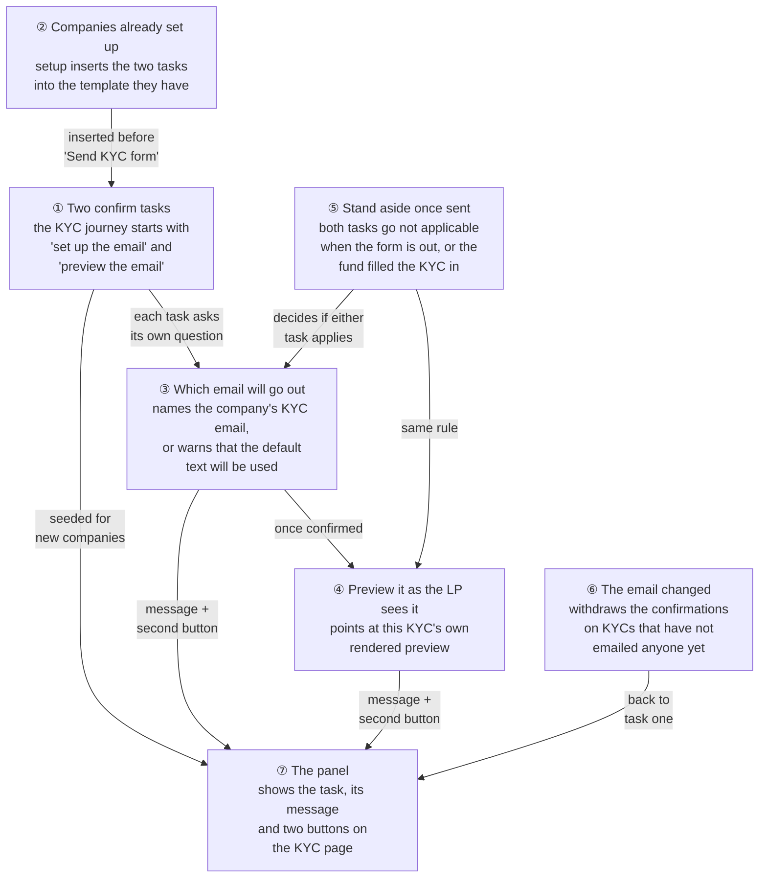
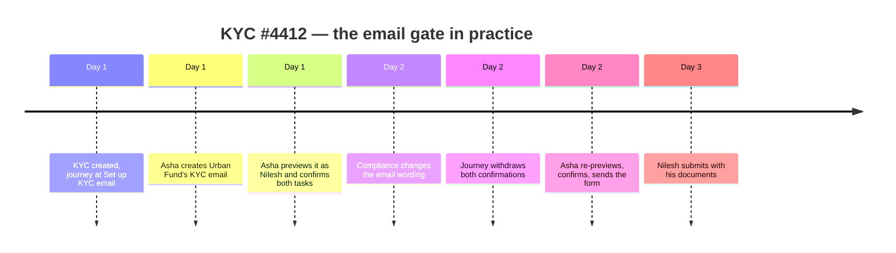
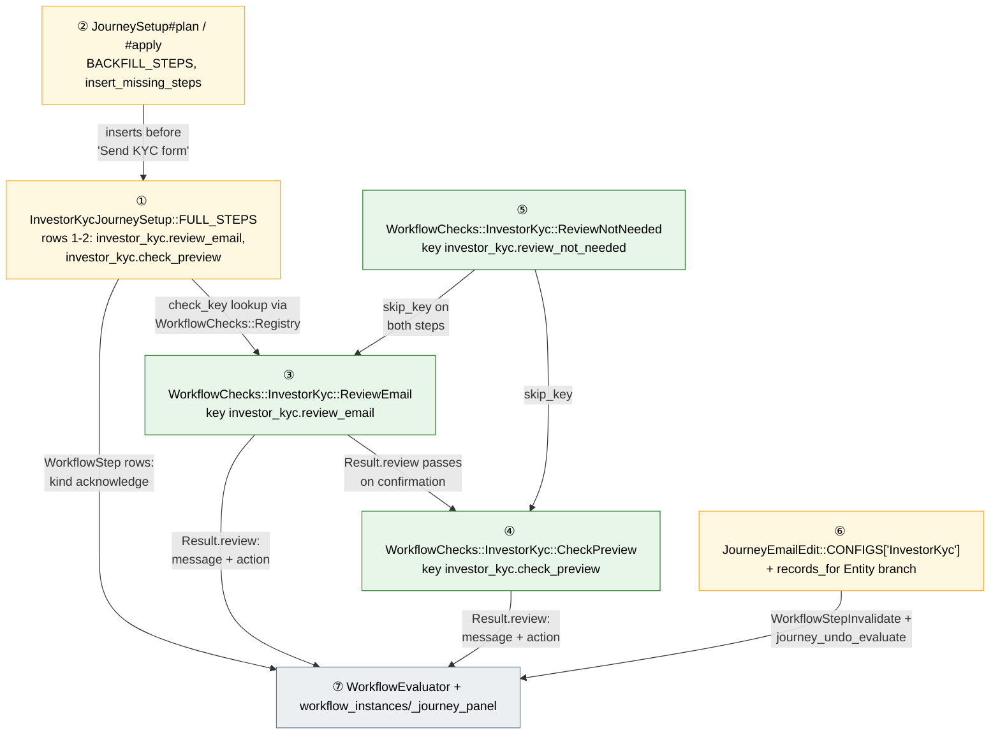
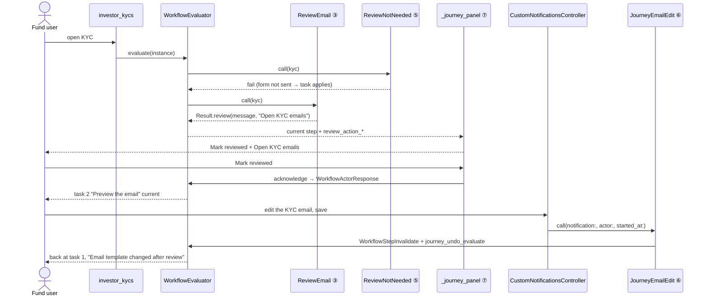
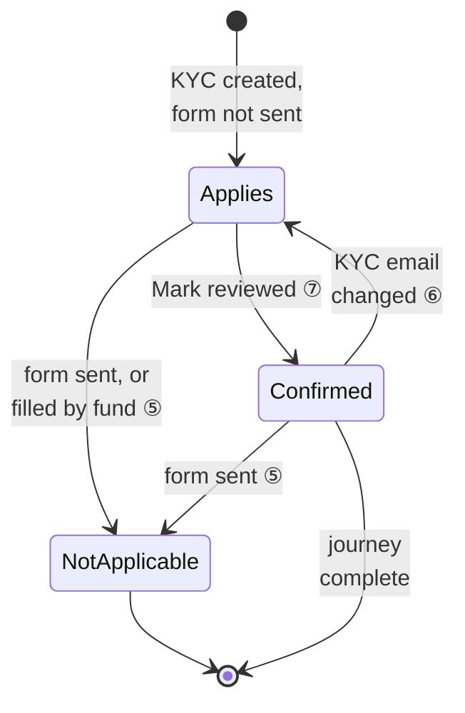
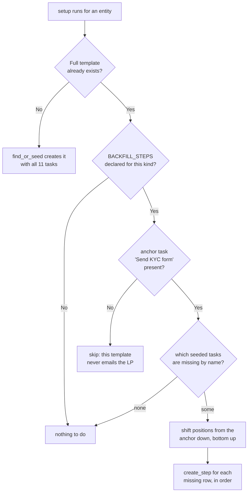
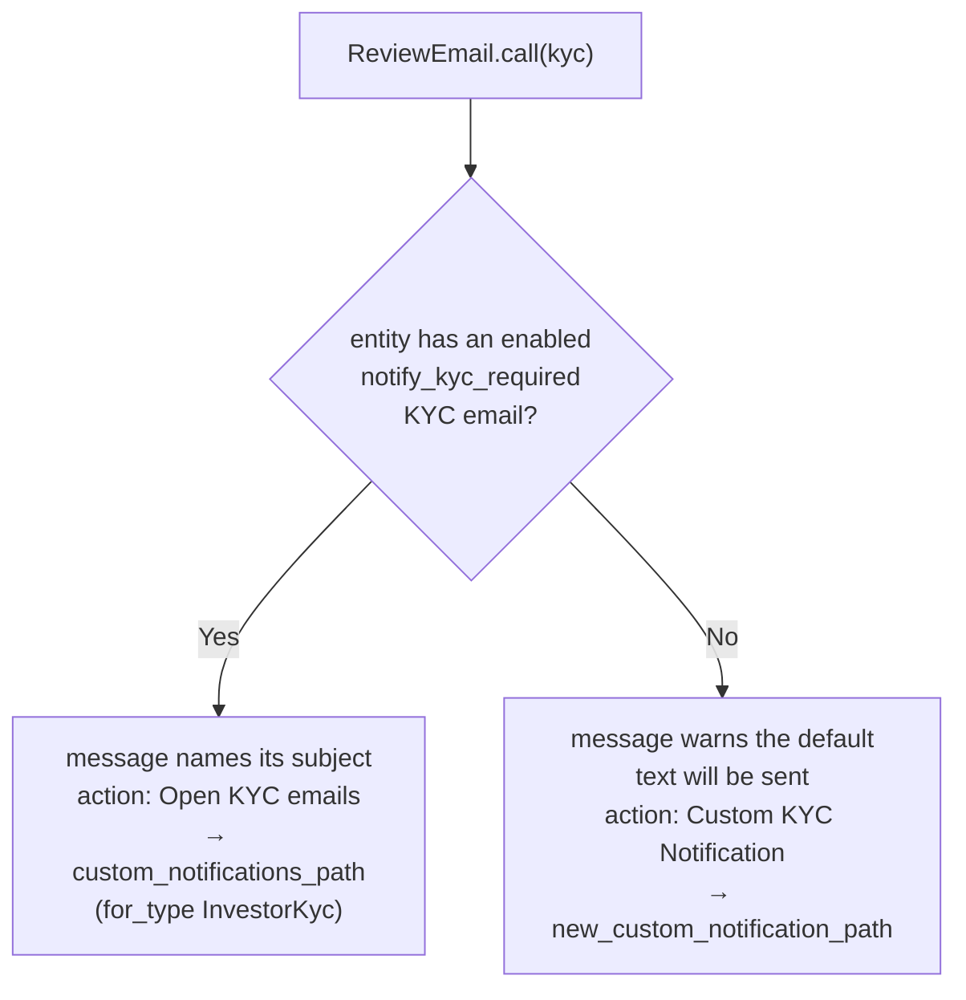
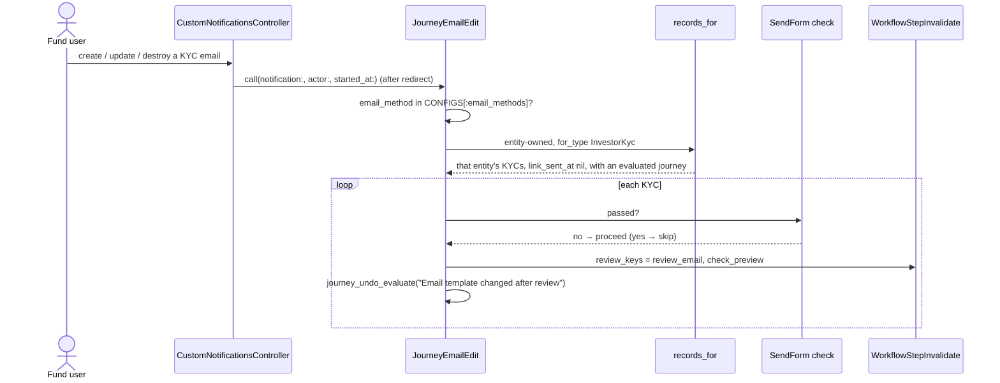
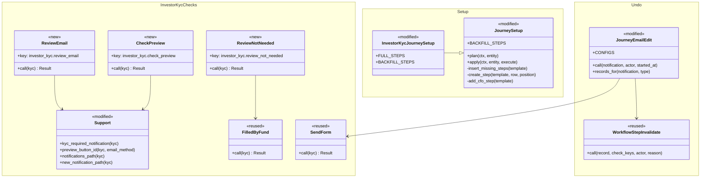

# Set up and preview the KYC email before it reaches the LP — Design

> **Audience:** Engineers implementing this change.
> **Companion document:** [Proposal](proposal.md) · [Spec delta](specs/kyc/investor-kyc-journey/spec.md)

> **Planning phase — no code changes.** This document explains how the change is built. Do not edit
> application code while writing it.

---

## Contents

- [1. The idea](#1-the-idea)
  - [What this adds](#what-this-adds)
  - [The idea in one picture](#the-idea-in-one-picture)
  - [Walkthrough: one example, start to finish](#walkthrough-one-example-start-to-finish)
  - [Key ideas](#key-ideas)
  - [FAQ — the idea](#faq--the-idea)
- [2. The same picture with real names](#2-the-same-picture-with-real-names)
  - [Picture](#picture)
  - [What each box does](#what-each-box-does)
  - [One run, end to end](#one-run-end-to-end)
  - [Lifecycles](#lifecycles)
  - [What users see](#what-users-see)
  - [Design decisions](#design-decisions)
  - [FAQ — real names](#faq--real-names)
- [3. One card per box](#3-one-card-per-box)
  - [① Two confirm tasks in the seeded journey](#-two-confirm-tasks-in-the-seeded-journey)
  - [② Adding the tasks to a template that already exists](#-adding-the-tasks-to-a-template-that-already-exists)
  - [③ Which email will go out — ReviewEmail](#-which-email-will-go-out--reviewemail)
  - [④ Preview it as the LP sees it — CheckPreview](#-preview-it-as-the-lp-sees-it--checkpreview)
  - [⑤ Standing aside once nothing can change — ReviewNotNeeded](#-standing-aside-once-nothing-can-change--reviewnotneeded)
  - [⑥ The email changed — withdrawing the confirmations](#-the-email-changed--withdrawing-the-confirmations)
  - [⑦ The panel that shows it all](#-the-panel-that-shows-it-all)
- [4. Reference](#4-reference)
  - [Class diagram](#class-diagram)
  - [Data model and schema changes](#data-model-and-schema-changes)
  - [Component contracts](#component-contracts)
  - [Transactions and queries](#transactions-and-queries)
  - [Exception handling and monitoring](#exception-handling-and-monitoring)
  - [Performance and security](#performance-and-security)
  - [Worked examples](#worked-examples)
  - [Testing](#testing)
  - [Risks and open questions](#risks-and-open-questions)
  - [FAQ — reference](#faq--reference)

---

# 1. The idea

## What this adds

Two confirm-before-you-send tasks at the top of the investor KYC journey, so a human looks at the KYC
email — and at the version of it that this LP will actually receive — before the journey tells anyone
to send the form. It is the capital call journey's "Review email" + "Check preview" pair, ported to
KYC: the same acknowledge-step kind, the same second button beside **Mark reviewed**, and the same
service that withdraws a confirmation when the email is changed afterwards.

The one genuinely new mechanism is backfill: unlike calls, the KYC journey template already exists in
set-up companies, so setup has to insert the two tasks into a template it did not just create.

## The idea in one picture



## Walkthrough: one example, start to finish

**Setup.** Urban Fund (an Investment Fund) has the investor KYC journey, AML enabled, and requires
"PAN Card, Address Proof, Photo". Nilesh Shah is an investor with one portal user. A fund operations
user, Asha, creates KYC #4412 for him. Urban Fund has **no** KYC email of its own yet.

**Legend.** `✓` done · `●` current · `○` not yet · `–` not applicable.



### Phase 1 — the gate does its job

| # | When | What happens | Behind the scenes | Result |
|---|---|---|---|---|
| 1 | Day 1, 09:10 | Asha opens KYC #4412 | ① seeded the two tasks; ⑤ says both apply (nothing sent); ③ finds no company KYC email; ⑦ renders the panel | **Set up KYC email** — "No KYC email is set up — CapHive's default text will be sent. Set one up, or mark reviewed to use the default", buttons **Mark reviewed** and **Custom KYC Notification** |
| 2 | 09:11 | She clicks **Custom KYC Notification**, writes subject "Complete your KYC for Urban Fund", saves | ⑥ runs on save: the KYC has no confirmations yet, so there is nothing to withdraw | Journey still at **Set up KYC email**, now reading `Your KYC email "Complete your KYC for Urban Fund" will be sent — check it and mark reviewed`, second button **Open KYC emails** |
| 3 | 09:13 | She clicks **Mark reviewed** | ⑦ records her confirmation against task 1; ③ passes | **Preview the email** — "Preview the email as Nilesh Shah will receive it, then mark reviewed", second button **Preview KYC Required Notification** |
| 4 | 09:14 | She clicks **Preview KYC Required Notification** | ④ hands the panel the KYC page's own Actions item; the preview opens in a new tab with Nilesh's name, Urban Fund and his 30-day link | Preview looks right |
| 5 | 09:15 | She clicks **Mark reviewed** | ④ passes | Set up KYC email ✓ · Preview the email ✓ · **Send KYC form** ● · Submit KYC ○ · Upload required documents ○ · Validate documents ○ · Run AML screening ○ · Clear AML match ○ · Review KYC ○ · Compliance sign-off – · Verify KYC ○ |

### Phase 2 — the mistake, and the undo

| # | When | What happens | Behind the scenes | Result |
|---|---|---|---|---|
| 6 | Day 2, 11:00 | Compliance edits Urban Fund's KYC email to fix the wording — before Asha sent anything | ⑥ sees the entity-owned `notify_kyc_required` email change, finds KYC #4412 (has a journey, form not sent), archives both confirmations and re-evaluates | **Set up KYC email** ● with "Email template changed after review"; Preview the email ○; Send KYC form ○ |
| 7 | 11:05 | Asha re-reads and re-previews, confirming both again | ③ then ④ pass on the new confirmations | Same as row 5 |
| 8 | 11:06 | She clicks **Send KYC Required Notification** from the panel | `InvestorKyc#send_kyc_form` sets `link_sent_at`. Her two confirmations keep their ✓ — a passed step stays passed, and the review really did happen; ⑤ only stands aside tasks nobody confirmed | Set up KYC email ✓ · Preview the email ✓ · Send KYC form ✓ · **Submit KYC** ● · rest as row 5 |
| 9 | Day 2, 14:00 | Compliance edits the email again | ⑥ skips KYC #4412: its "Send KYC form" has passed | Same as row 8 |

### Phase 3 — the stall, and a fund-filled KYC

| # | When | What happens | Behind the scenes | Result |
|---|---|---|---|---|
| 10 | Day 3 | Nilesh submits through his link with his three documents | Existing checks pass | Submit KYC ✓, Upload required documents ✓, **Validate documents** ● |
| 11 | Day 4 | A second KYC, #4413, is created for an investor with **no portal user**, and Asha fills it in herself and ticks "I confirm all details provided are complete" | ⑤ sees it submitted with `link_sent_at` nil | Set up KYC email – ("Filled in by the fund") · Preview the email – (same) · Send KYC form – (same) · **Upload required documents** ● |
| 12 | Day 4 | A third KYC, #4414, is imported already verified | The closing "Verify KYC" check closes the journey | Both email tasks – ("Verified without this step"), journey **complete** |

### The key moment (row 6 — the withdrawal)

```
┌──────────────────────────────────────────────────────────────────────────────┐
│  ① Set up KYC email  ② Preview the email  ③ Send KYC form  ④ Submit KYC  …  │
│  ●                   ○                    ○                ○                │
├──────────────────────────────────────────────────────────────────────────────┤
│  What's needed now                                                           │
│                                                                              │
│  1 of 11 · Set up KYC email            [ 1 day here ]                        │
│  Email template changed after review                                         │
│                                                                              │
│                            [ ✓ Mark reviewed ]  [ Open KYC emails → ]        │
└──────────────────────────────────────────────────────────────────────────────┘
```

**What to notice**

- The panel names the email **as the mailer will resolve it**, so the task cannot claim one thing and
  the send do another.
- The withdrawal is decided from the KYC's own data ("has the form gone out?"), not from the step's
  cached status — a KYC can be stuck at an earlier task and still have emailed nobody.
- A fund-filled KYC and an imported verified KYC both pass straight through the gate; the gate only
  exists where an email is actually going to an LP.
- Nothing in rows 1–12 blocks a button. Asha could have sent in row 1 and the tasks would simply have
  gone not applicable (worked example E8).

## Key ideas

| Idea | In one line | Card |
|---|---|---|
| Confirm, don't compute | "Someone read the email" is not in the data, so both tasks are acknowledge steps | [③](#-which-email-will-go-out--reviewemail) |
| Name the real email | The check resolves the email exactly as the mailer does, and quotes its subject | [③](#-which-email-will-go-out--reviewemail) |
| Preview this LP's copy | The second button runs the KYC page's existing preview item, so the LP's own data is rendered | [④](#-preview-it-as-the-lp-sees-it--checkpreview) |
| Stand aside, never block | Once the form is out, or the fund filled the KYC in, both tasks are not applicable | [⑤](#-standing-aside-once-nothing-can-change--reviewnotneeded) |
| An edit withdraws the review | One entity-level email change reopens every not-yet-sent KYC's two confirmations | [⑥](#-the-email-changed--withdrawing-the-confirmations) |
| Backfill, don't reseed | Setup inserts missing seeded tasks into the template a company already has | [②](#-adding-the-tasks-to-a-template-that-already-exists) |

## FAQ — the idea

| Question | Answer |
|---|---|
| Why two tasks instead of one? | A single tick cannot distinguish "I read the template" from "I previewed what this LP gets", and the two have different controls. It also keeps KYC identical to calls and distributions, so the panel, the undo and the guides read the same. |
| Why not block the Send button until both are confirmed? | The journey advises; it never gates (the same rule as approve/send on a capital call). Blocking would strand funds who legitimately send before reviewing, and the gate already sits first in the step bar where it is hard to miss. |
| Why is the gate per KYC when the email is per company? | The preview is per KYC — it renders that LP's name, fund and link — so the thing being checked really is per KYC. The template half is per company, which is why one edit reopens many KYCs (⑥). |
| Why does a KYC already waiting at "Send KYC form" move backwards? | It has emailed nobody, so the check still has value, and leaving it at "Send KYC form" would mean the very first LPs after release never get the benefit. Anything already sent is untouched. |
| Why not seed a fresh template instead of backfilling? | A fresh template would discard the approvers, removals and renames admins have already made. Backfill keeps all of it. |
| Does any of this add an email or change an email's text? | No. It adds two confirmations and one undo path. Every mailer, subject and body stays as it is. |

---

# 2. The same picture with real names

## Picture



*① declares the two tasks for every company set up from now on.*
*② puts them into the template companies already have.*
*③ names the email that will really be sent and offers the way to change it.*
*④ sends the user to the preview rendered for this LP.*
*⑤ makes both tasks not applicable once no review can change anything.*
*⑥ withdraws the confirmations when the email itself changes.*
*⑦ unchanged: renders the task, its message and its two buttons.*

## What each box does

| # | Box | Real parts | What it does | When it runs | What it decides | Details |
|---|---|---|---|---|---|---|
| ① | Seeded tasks | `InvestorKycJourneySetup::FULL_STEPS` (two new rows), `JourneySetup#find_or_seed` | Declares "Set up KYC email" and "Preview the email" as acknowledge steps with their check and skip keys | When a company's journeys are seeded | Task names, order, kind, descriptions | [card](#-two-confirm-tasks-in-the-seeded-journey) |
| ② | Backfill | `JourneySetup::BACKFILL_STEPS`, `#plan`, `#apply`, `#insert_missing_steps`, `#create_step`, `.confirm_message`, `.rollout` | Inserts missing seeded tasks before a named task in an existing template, and reports it in the dry run and the setup menu | Every setup run (rake rollout, "Set up journeys" menu, `SetupCompany`) | Whether a template is missing either task, and at which position they go | [card](#-adding-the-tasks-to-a-template-that-already-exists) |
| ③ | ReviewEmail | `WorkflowChecks::InvestorKyc::ReviewEmail`, `Support#kyc_required_notification` | Resolves the entity's `notify_kyc_required` email the way `InvestorKycMailer` does and asks for a confirmation, naming it | Each evaluation of a KYC journey | The task's message and which second button is offered | [card](#-which-email-will-go-out--reviewemail) |
| ④ | CheckPreview | `WorkflowChecks::InvestorKyc::CheckPreview`, `Support#preview_button_id` | Asks for a confirmation that the LP's own rendered email was previewed, pointing at the KYC page's preview item | Each evaluation of a KYC journey | The preview control to run (`..._custom_0_btn` vs `..._default_btn`) | [card](#-preview-it-as-the-lp-sees-it--checkpreview) |
| ⑤ | ReviewNotNeeded | `WorkflowChecks::InvestorKyc::ReviewNotNeeded`, reusing `FilledByFund` | Passes (= task not applicable) once the form has gone out or the fund filled the KYC in itself | Each evaluation, before ③ and ④ | Whether either email task applies at all, and the reason shown | [card](#-standing-aside-once-nothing-can-change--reviewnotneeded) |
| ⑥ | Email edit undo | `JourneyEmailEdit::CONFIGS["InvestorKyc"]`, `JourneyEmailEdit.records_for`, `CustomNotificationsController#invalidate_journey_reviews` | Archives both confirmations and re-evaluates the journey for the entity's not-yet-sent KYCs | After a KYC-required `CustomNotification` is created, updated or destroyed | Which KYCs are reopened, and the note "Email template changed after review" | [card](#-the-email-changed--withdrawing-the-confirmations) |
| ⑦ | Panel | `WorkflowEvaluator#acknowledge_outcome`, `workflow_instances/_journey_panel.html.erb`, `journey-action` Stimulus controller | Renders the current task, its message, **Mark reviewed** and the check's own second button | Every KYC page view and Turbo refresh | Nothing new — reused as is | [card](#-the-panel-that-shows-it-all) |

## One run, end to end



## Lifecycles

One email task's status is **derived** on every evaluation — nothing new is stored for it. The stored
inputs are the confirmation row (`workflow_actor_responses`) and the invalidation row
(`workflow_state_changes`, `to_state: "invalidated"`), both of which already exist.



## What users see

**At a glance**

| Surface | Change |
|---|---|
| KYC page step bar | Two more marks at the front; 11 tasks in all |
| KYC page "What's needed now" | Two new task messages, each with a second button (**Open KYC emails** / **Custom KYC Notification** / **Preview KYC Required Notification**) |
| KYC Actions menu | Unchanged — the panel runs its existing items |
| Custom notifications screens | Unchanged |
| "Set up journeys" confirmation and the rollout output | Say that the two tasks will be added to an existing template |
| LP's view of their own KYC | Unchanged — no journey at all |

The everyday journey, with its exact messages and mockups, is in
[proposal.md → UI Behavior](proposal.md#ui-behavior); the per-task detail is in the cards below.

| Step | The user… | They see |
|---|---|---|
| 1 | Opens a new KYC | Step bar with **Set up KYC email** current; message naming the company's KYC email, or the default warning |
| 2 | Clicks the second button | The KYC emails list, or the new-KYC-email form |
| 3 | Clicks **Mark reviewed** | **Preview the email** becomes current |
| 4 | Clicks **Preview KYC Required Notification** | A new tab with their LP's rendered email |
| 5 | Clicks **Mark reviewed** | **Send KYC form** becomes current, exactly as today |

## Design decisions

| # | Decision | Alternative | Why the alternative was rejected |
|---|---|---|---|
| D1 | Two acknowledge tasks, mirroring `capital_call.review_email` / `check_preview` | One combined task | One tick cannot evidence that the preview was opened, and it would make KYC the only journey with a different shape. Chosen by the user. |
| D2 | Reuse the panel's existing second button (`Result.review` → `review_action_*`) | A new panel element for "set up" links | The mechanism already exists and KYC's "Validate documents" already uses it; a new element would be dead weight. |
| D3 | A dedicated skip check `ReviewNotNeeded` | Reuse `SendForm`'s own pass as the skip | A skip key has to be one check, and the reason text differs ("The KYC form has already been sent" vs "Filled in by the fund"); `ReviewNotNeeded` composes `FilledByFund` instead of duplicating it. |
| D4 | Generalise `add_cfo_step` into `insert_missing_steps` driven by `BACKFILL_STEPS` | A second special case beside the CFO one | Two near-identical position-shifting methods would drift; the general one also lets calls and distributions backfill later with a constant. |
| D5 | Reset scope: the entity's KYCs with a journey and `link_sent_at` nil | Only the KYC whose page is open / every KYC in the entity | The KYC email is entity-owned, so one edit really does affect many KYCs; but a KYC that already emailed its LP must not reopen, and an unsent-only scope keeps the query small. |
| D6 | Only the `notify_kyc_required` email method triggers the reset, via a new optional `email_methods:` key in `JourneyEmailEdit::CONFIGS` | Any `for_type: "InvestorKyc"` notification triggers it | Editing the reminder or the "updates requested" email changes nothing about the email these two tasks are about; resetting then would look like a bug. |
| D7 | `ReviewEmail` resolves the email with the same call the mailer uses (`entity.custom_notification("notify_kyc_required", for_type: "InvestorKyc")`) | A simpler `exists?` check, or naming it from `latest` | `enabled` + `last` is what actually gets sent; anything else could name an email that will not be used — the exact failure this change exists to prevent. |
| D8 | `CheckPreview` sets `action_target` to the KYC page's preview item id | Link straight to `preview_investor_kyc_path` | The page item already opens in a new tab and already picks the entity's template; `action_path` stays as the fallback when the item is not rendered. |
| D9 | The end-to-end walk lives in its own feature file | Another scenario inside `investor_kyc_journey_ui.feature` | It is long and crosses two actors; its own file keeps the per-task features focused and lets it be run alone. |

## FAQ — real names

| Question | Answer |
|---|---|
| Why do both new checks return `Result.review` rather than `pass`? | `Result.review` is what makes the evaluator render **Mark reviewed** plus the check's own second button and message. The capital call checks return `pass` and therefore show no second button — KYC wants the button. |
| Does `ReviewNotNeeded` duplicate `SendForm`'s logic? | It repeats one condition (the form is out) deliberately, because the message differs, and it composes `FilledByFund` for the other. `SendForm` itself is untouched. |
| Why isn't the skip key just `filled_by_fund`? | That alone would leave the tasks current on KYCs whose form has already been sent — every KYC in flight at release would show two blocking tasks. |
| Why does `JourneyEmailEdit` need an `Entity` branch? | KYC emails are owned by the `Entity` with `for_type: "InvestorKyc"`; its existing branches only understand a record-owned or `Fund`-owned notification. |
| Could the backfill reorder an admin's own tasks? | Only by shifting their positions down by two, which is what inserting a task means; names, kinds, checks, owners and approvers are untouched. |
| What happens if a company's template has the tasks under different names? | The backfill matches by seeded name, so a renamed task is treated as missing and a second one is inserted. Admins who rename seeded tasks are documented as owning that risk (see [risks](#risks-and-open-questions)). |

---

# 3. One card per box

## ① Two confirm tasks in the seeded journey

Two new rows at the head of `InvestorKycJourneySetup::FULL_STEPS`, so every company set up from now
on seeds an 11-task "Investor KYC" template.

| Owns | Reads / receives | Produces |
|---|---|---|
| The task names, order, kind, descriptions, check and skip keys | `JourneySetup#find_or_seed` | Two `WorkflowStep` rows with `kind: "acknowledge"` and `states: WorkflowStep::ACKNOWLEDGE_STATES` |

| Row | Name | kind | check | skip | Description (seeded) |
|---|---|---|---|---|---|
| 1 | Set up KYC email | acknowledge | `review_email` | `review_not_needed` | "The email the investor will receive has been checked. Not applicable once the form has been sent." |
| 2 | Preview the email | acknowledge | `check_preview` | `review_not_needed` | "Someone previewed the KYC email as this investor will receive it. Not applicable once the form has been sent." |

The class comment above `FULL_STEPS` lists the steps and already warns that changing it means editing
the user guide's journey section; both new rows go into that list and into
`docs/user_guides/investor_kyc_user_guide.md`.

**Worked examples:** H1, H2, H6, E12, E13.

### FAQ

| Question | Answer |
|---|---|
| Why position 1 and 2 rather than after "Send KYC form"? | The whole point is to be read before the send, and the step bar is ordered: a confirmation after the send would be advice nobody acts on. |
| Does the Compliance sign-off insertion still land in the right place? | Yes — it is positioned relative to `APPROVE_STEP_NAME` ("Verify KYC"), not by absolute position. |
| Do the new rows need `unlocks`? | No. `unlocks` names a page control a task gates ("Send Notification"); these two gate nothing. |

## ② Adding the tasks to a template that already exists

`find_or_seed` only seeds steps for a template it creates, so companies already using the journey
would never see the two tasks. This box generalises the existing "add the Compliance sign-off to an
older template" path into one that can insert any missing seeded task before a named task.

| Owns | Reads / receives | Produces |
|---|---|---|
| `BACKFILL_STEPS` per journey kind, the missing-task plan, the insertion and the position shift | The entity's existing `WorkflowTemplate` (by `system_key`) and `FULL_STEPS` | New `WorkflowStep` rows, `report[:steps]`, dry-run output, the setup-menu confirmation text |



Responsibilities, in one place each:

| Part | Responsibility |
|---|---|
| `BACKFILL_STEPS` (new constant, `{}` by default) | Per kind: `{ anchor task name => [seeded task names, in order] }`. KYC declares `{ "Send KYC form" => ["Set up KYC email", "Preview the email"] }`. |
| `JourneySetup#plan` | Adds `report[:steps]`: the declared names absent from the existing Full template, `[]` when the template is new or the anchor is missing. Dry run writes nothing. |
| `JourneySetup#apply` | Calls `insert_missing_steps(full)` inside the existing per-entity transaction when `report[:steps].any?`. |
| `#insert_missing_steps` | Finds the anchor's position, shifts `position..` down by the number of inserted tasks (bottom-up, so the unique position index never collides), then creates them in order — the same approach as `add_cfo_step`. |
| `#create_step` (extracted from `find_or_seed`) | Builds one `WorkflowStep` from a `FULL_STEPS` row at a given position; used by seeding and by backfill, so the two can never disagree. |
| `.confirm_message` / `.rollout` | Mention the tasks that would be added, so the menu's confirmation and the dry-run line are honest. |

Idempotency: the plan is computed from the template's current task names, so a second run finds
nothing missing. The KYC rollout rake task is unchanged — `EXECUTE=1` still gates writes.

**Worked examples:** H6, H7, H8, E9, E10, E11, E12, E13.

### FAQ

| Question | Answer |
|---|---|
| Why match by name rather than by `check_key`? | Seeded steps are found by name everywhere in `JourneySetup` today (including the sign-off backfill), and a template an admin has edited may have its own steps with no check key at all. |
| Why insert before the anchor instead of at position 1? | Position 1 would put the email tasks ahead of an admin's own earlier tasks for no reason; the anchor expresses the real constraint — "before the send". |
| Why skip the whole backfill when the anchor is gone? | A template with no "Send KYC form" never emails the LP, so a review of that email is noise; appending them at the end would be worse than not adding them. |
| Could this run while a KYC's journey is mid-evaluation? | Yes, and that is safe: instances hold their own `snapshot_steps`, and the next evaluation picks up the new template. |
| Does an existing KYC's journey get the new tasks? | A journey instance re-reads its template's steps on evaluation, so yes — which is why a KYC waiting at "Send KYC form" becomes current at task 1 (E11). |

## ③ Which email will go out — ReviewEmail

The first confirm task. It answers "what will the LP actually receive?" by resolving the entity's
KYC-required email with the same call the mailer makes, then asks for a confirmation.

| Owns | Reads / receives | Produces |
|---|---|---|
| The task's message and second button | `kyc.entity.custom_notification("notify_kyc_required", for_type: "InvestorKyc")` | `WorkflowChecks::Result.review(message:, action_label:, action_path:)` |



- The resolution helper lives in `WorkflowChecks::InvestorKyc::Support` so ④ can reuse it, and is
  named after what it returns (`kyc_required_notification(kyc)`).
- `enabled` and `last` come from `WithCustomNotifications#custom_notification`, which is what
  `InvestorKycMailer#set_kyc` uses — a disabled email therefore reads as "none set up", exactly as it
  behaves on a send.
- Both paths are plain route helpers (`Rails.application.routes.url_helpers`), as in every other KYC
  check; the list link carries the same ransack params the KYC index's "View All Custom
  Notifications" item uses.

**Worked examples:** H1, H2, H3, E8, E14.

### FAQ

| Question | Answer |
|---|---|
| Why quote the subject rather than just saying "your KYC email"? | The subject is the one visible difference between a right and a wrong template, and it is what the mailer sends as the email's subject (`ApplicationMailer#send_mail` replaces its own subject with the notification's). |
| What if several enabled KYC emails exist? | `custom_notification` takes the last, so the check names the same one the send will use. |
| Why no `action_target` for this task? | Both of its destinations are other screens, so navigating is correct; `action_target` exists for controls on the KYC page itself. |
| Does it read anything expensive? | One indexed lookup on `custom_notifications` by owner and `email_method`. |

## ④ Preview it as the LP sees it — CheckPreview

The second confirm task: the panel hands the user the KYC page's own preview item, so what they look
at is this LP's rendered email, not a template.

| Owns | Reads / receives | Produces |
|---|---|---|
| The task's message and the preview control to run | the KYC's investor name; whether the entity has a KYC email (for the control id) | `Result.review(message:, action_label: "Preview KYC Required Notification", action_path:, action_target:)` |

- `Support#preview_button_id(kyc, email_method)` mirrors the existing `email_button_id`: the id is
  `investor_kyc_preview_<method>_custom_0_btn` when the entity has a notification for that method,
  otherwise `investor_kyc_preview_<method>_default_btn` — exactly how
  `investor_kycs/_preview_notifications.html.erb` builds its dropdown items.
- `action_path` stays `investor_kyc_path(kyc)` as the fallback the `journey-action` Stimulus
  controller uses when the item is not on the page (for example a user whose policy hides it).
- The preview itself is unchanged: `InvestorKycsController#preview` through
  `WithEmailPreview`, which already renders `notify_kyc_required` with the entity's template.

**Worked examples:** H3, H4, H5, E8.

### FAQ

| Question | Answer |
|---|---|
| Why not link directly to the preview path? | The dropdown item carries `target: "_blank"` and the right `custom_notification_id`; reproducing that in the check would duplicate view logic that already exists. |
| What if the entity has several KYC emails? | The item id ends `custom_0_btn` — the first one in the dropdown — which matches today's `email_button_id` behaviour for sending. Mismatch between "first listed" and "last enabled" is called out in [risks](#risks-and-open-questions). |
| Does the task know whether the user really opened the preview? | No, and it cannot. It is a confirmation, like "Review KYC". |

## ⑤ Standing aside once nothing can change — ReviewNotNeeded

The skip check on both email tasks. It passes — which the evaluator renders as "–" with a reason —
whenever a review can no longer change what the LP receives.

| Owns | Reads / receives | Produces |
|---|---|---|
| The two "nothing to review" conditions and their reasons | `kyc.link_sent_at`, `kyc.submission_status`, `FilledByFund` | `Result.pass(message:)` (not applicable) or `Result.fail` |

| Condition | Reason shown |
|---|---|
| `FilledByFund` passes (submitted with no form ever sent) | "Filled in by the fund" |
| `link_sent_at` present, or `submission_status != "not_sent"` | "The KYC form has already been sent" |
| otherwise | fails — the task applies |

A skip only reaches a task that is not already done: a task someone confirmed before the form went out
keeps its ✓ (the evaluator's general rule), so the journey records that the review happened rather
than rewriting history as "not applicable".

The second condition is the same data `SendForm` treats as "sent", so a KYC can never show "Send KYC
form" done while the email tasks still demand attention. Verification handles itself: the evaluator's
closing check already marks every unfinished earlier task "Verified without this step".

**Worked examples:** E1, E2, E3, E8, E11.

### FAQ

| Question | Answer |
|---|---|
| Why is "already sent" a skip rather than an automatic pass? | A pass would claim someone reviewed the email when nobody did. "Not applicable" states the truth, and it is how the capital call journey treats the same situation. |
| Why check `FilledByFund` first? | Both conditions can be true at once for a fund-filled KYC, and "Filled in by the fund" is the more informative reason. |
| Does it run an extra query? | It reuses `FilledByFund`, which reads only the KYC's own columns. |

## ⑥ The email changed — withdrawing the confirmations

`JourneyEmailEdit` already does this for calls and distributions, triggered by the custom
notifications controller. KYC joins it with one `CONFIGS` entry and one new owner branch.

| Owns | Reads / receives | Produces |
|---|---|---|
| Which KYCs an entity-level KYC email change reaches | the saved/destroyed `CustomNotification`, the acting user | `WorkflowStepInvalidate` rows + `journey_undo_evaluate` per affected KYC |



| Part | Change |
|---|---|
| `CONFIGS["InvestorKyc"]` | `review_keys: %w[investor_kyc.review_email investor_kyc.check_preview]`, `sent_key: "investor_kyc.send_form"`, `email_methods: %w[notify_kyc_required]` |
| `CONFIGS` for calls / distributions | Gain no `email_methods` key; `nil` keeps today's "any method" behaviour |
| `.call` | Skips a config whose `email_methods` is present and does not include the notification's method |
| `.records_for` | New branch: `owner_type == "Entity" && for_type == type` → that entity's records, narrowed by `link_sent_at: nil` for KYC |
| `CustomNotificationsController` | Unchanged — its `after_action` already covers create, update and destroy |

The per-KYC `sent_key` guard stays the real decision (it reads the data, not the cached step status);
`link_sent_at: nil` is there to keep the scan small.

**Worked examples:** E4, E5, E6, E7, X1, X2.

### FAQ

| Question | Answer |
|---|---|
| Why narrow by `link_sent_at: nil` when `sent_key` already filters? | Without it the loop would walk every KYC in the entity that has a journey, running a check per row; the column is indexed and the predicate matches the only rows that can be affected. |
| Why add `email_methods` instead of checking the method inside `records_for`? | `records_for` answers "which records", not "does this email matter"; keeping the two apart leaves one obvious place to change if the reminder ever gets its own review. |
| Is a `Fund`-owned `adhoc_kyc_notification` covered? | No, deliberately: that is a different email, not the one the form link is sent with. |
| What if the entity has thousands of unsent KYCs? | See [performance](#performance-and-security) — the work is bounded by unsent KYCs with a journey, in one pass, and failures are logged rather than raised into the user's save. |

## ⑦ The panel that shows it all

Entirely reused. `WorkflowEvaluator#acknowledge_outcome` already turns a `Result.review` into
`action_label: "Mark reviewed"` plus `review_action_label/_path/_target`, and
`workflow_instances/_journey_panel.html.erb` already renders that second button (`journey_review_action`)
with the `journey-action` Stimulus controller.

| Owns | Reads / receives | Produces |
|---|---|---|
| Nothing new | the evaluator's step rows for KYC | The step bar, the panel, **Mark reviewed**, the second button |

No change is needed here, which is the point of returning `Result.review` from ③ and ④. The only
KYC-specific surface is the step bar's width with 11 tasks, which already scrolls.

**Worked examples:** H1, H3, H4, X3.

### FAQ

| Question | Answer |
|---|---|
| Do calls and distributions change at all? | No. Their review checks still return `pass`, so they render exactly as before (the existing E24 scenario guards this). |
| Who may click **Mark reviewed**? | The panel renders it under `policy(record).update?`, so KYC's existing edit policy governs it; LPs never see the panel. |

---

# 4. Reference

## Class diagram



## Data model and schema changes

N/A — no table or column changes. The two tasks are `workflow_steps` rows created by setup; their
confirmations and withdrawals use the existing `workflow_actor_responses` and
`workflow_state_changes` tables.

## Component contracts

| From → To | Contract | Direction rule |
|---|---|---|
| `JourneySetup#apply` → `WorkflowTemplate` | Inserts `WorkflowStep` rows for missing seeded names before the anchor, inside the entity's transaction | Setup writes templates; it never touches journey instances |
| `InvestorKycJourneySetup::FULL_STEPS` → `JourneySetup#create_step` | `[name, kind, check, skip, unlocks, description]`, keys prefixed with `investor_kyc.` | Data only; the subclass declares, the base writes |
| `WorkflowEvaluator` → `ReviewEmail` / `CheckPreview` | `call(kyc)` → `Result.review(message:, action_label:, action_path:, action_target:)` | Checks read only; they never write |
| `WorkflowEvaluator` → `ReviewNotNeeded` | `call(kyc)` → `Result.pass` means "not applicable, with this reason" | Skip checks read only |
| `ReviewEmail` / `CheckPreview` → `Support` | `kyc_required_notification(kyc)` resolves the email as the mailer does; `preview_button_id` returns a DOM id | One resolution helper, two callers |
| `CustomNotificationsController` → `JourneyEmailEdit` | `call(notification:, actor:, started_at:)` after a successful redirect | Controller fires and forgets; the service swallows and logs its own errors |
| `JourneyEmailEdit` → `WorkflowStepInvalidate` + `Workflowable#journey_undo_evaluate` | `check_keys` + `reason`, then one evaluation per record | Undo archives confirmations, then re-evaluates |
| `WorkflowEvaluator` → `_journey_panel.html.erb` | `review_action_label/_path/_target` on the current step row | View renders; it decides nothing |

## Transactions and queries

- Backfill runs inside `JourneySetup#apply`'s existing per-entity `ActiveRecord::Base.transaction`,
  so a half-inserted pair is impossible; one entity's failure does not stop the rollout's others.
- Position shifting is done bottom-up (`reorder(position: :desc)`), as `add_cfo_step` does, so the
  unique index on `(workflow_template_id, position)` never collides mid-shift.
- `JourneyEmailEdit` keeps its per-record `find_each`; each KYC's invalidate-and-evaluate is its own
  unit of work, and the controller's save has already been committed.
- The new checks add one indexed `custom_notifications` lookup per evaluation and read only the KYC's
  own columns otherwise.

## Exception handling and monitoring

`JourneyEmailEdit` already wraps its whole body in `rescue StandardError`, logging
`[JourneyEmailEdit] notification <id>` and reporting to `ExceptionNotifier`; the KYC branch inherits
that, so a failure while reopening journeys can never 500 a notification save (X1). A check that
raises is already rendered as an errored step with no action by the evaluator. No `Noticed`
notification is added by this change.

## Performance and security

- **Per evaluation:** one `custom_notifications` lookup (`owner`, `email_method`, `enabled`) plus the
  existing KYC column reads. No new N+1 and no cross-KYC reads.
- **Per email edit:** bounded by the entity's KYCs that have an evaluated journey and
  `link_sent_at IS NULL`; each runs one `SendForm` check and, when it applies, one invalidate plus one
  evaluation. On the largest production entity this is tens of rows, not thousands, because sent KYCs
  are excluded.
- **No new large-table scans:** nothing here touches `account_entries` or any other high-volume table.
- **Access:** both tasks are confirmed through the existing `acknowledge_workflow_instance_path`,
  which the panel only renders under `policy(record).update?`; the panel itself is fund-user only, so
  an LP on their own KYC sees nothing (X3). `records_for` scopes strictly by the notification's own
  `owner_id` (the entity), so one company's edit can never reach another's KYCs. The preview route is
  the existing authorised `InvestorKycsController#preview`.

## Worked examples

**Shared setup.** Entity "Urban Fund" (Investment Fund, `enable_kycs`, AML enabled, required
individual documents "PAN Card, Address Proof, Photo") with the Investor KYC journey seeded.
Investor "Nilesh Shah" with one portal user. KYC #4412, individual, `submission_status: "not_sent"`.
"The company email" means a `CustomNotification` owned by the entity, `for_type: "InvestorKyc"`,
`email_method: "notify_kyc_required"`, `enabled`, subject "Complete your KYC for Urban Fund".

### Happy path

| # | Scenario | Given | When | Then | Spec scenario | Feature |
|---|---|---|---|---|---|---|
| H1 | New KYC starts at the email gate | the company email exists | KYC #4412's journey is evaluated | current task "Set up KYC email", message `Your KYC email "Complete your KYC for Urban Fund" will be sent — check it and mark reviewed`, second button "Open KYC emails"; "Send KYC form" not yet | Entity has its own KYC email; A new KYC starts at the email tasks | investor_kyc_journey.feature |
| H2 | No company email yet | no KYC email for the entity | the journey is evaluated | message "No KYC email is set up — CapHive's default text will be sent. Set one up, or mark reviewed to use the default", second button "Custom KYC Notification" | Entity has no KYC email | investor_kyc_journey.feature |
| H3 | Both confirmations reach the send task | the company email exists | a fund user marks "Set up KYC email" then "Preview the email" reviewed | both ✓, "Send KYC form" current with "The KYC form has not been sent — send it, or fill it in and tick complete" | Confirming both tasks reaches the send task | investor_kyc_journey_ui.feature |
| H4 | The preview button runs the page's own item | "Set up KYC email" confirmed, no company email | the panel renders "Preview the email" | second button "Preview KYC Required Notification" clicks `investor_kyc_preview_notify_kyc_required_default_btn` | Preview opens this KYC's own email | investor_kyc_journey_ui.feature |
| H5 | Fund and LP walk the whole journey | the company email exists, AML enabled, documents required | the fund user confirms both email tasks, sends the form; the LP opens their link and submits with all three documents; the fund user marks documents validated, an AML "No Match" result arrives, marks Review KYC reviewed, signs off and verifies | every task ✓ or "–" in order and the journey is complete; the LP never sees a step bar | Fund user and investor walk one KYC to verified | investor_kyc_journey_end_to_end.feature (new) |
| H6 | A new company is seeded | an Investment Fund entity with no KYC journey | setup runs with EXECUTE | the "Investor KYC" template has 11 tasks, the two email tasks first, plus the catch-all rule | Setting up an entity | investor_kyc_journey.feature |
| H7 | An existing template is backfilled | an entity whose "Investor KYC" template has the previous nine tasks | setup runs with EXECUTE | 11 tasks, "Set up KYC email" at 1, "Preview the email" at 2, "Send KYC form" at 3, the rest shifted and otherwise untouched | Existing template gains the tasks | investor_kyc_journey.feature |
| H8 | Dry run reports the backfill | the same entity | the rollout runs without EXECUTE | output names both tasks as additions and the template still has nine tasks | Dry run | investor_kyc_journey.feature |

### Edge cases

| # | Scenario | Given | When | Then | Spec scenario | Feature |
|---|---|---|---|---|---|---|
| E1 | Form already sent | KYC #4412 with `link_sent_at` set | the journey is evaluated | both email tasks "–" with "The KYC form has already been sent"; current task "Submit KYC" | Form already sent | investor_kyc_journey.feature |
| E2 | Filled in by the fund | KYC submitted with `link_sent_at` nil | the journey is evaluated | both email tasks and "Send KYC form" "–" with "Filled in by the fund" | Filled in by the fund | investor_kyc_journey.feature |
| E3 | Imported and verified | an imported KYC, verified, no documents, no AML result | the journey is evaluated | both email tasks "–" with "Verified without this step" and the journey complete | Verified early; Imported verified KYC | investor_kyc_journey.feature |
| E4 | Email edited before sending | both email tasks confirmed, form not sent | a user edits the company email | journey back at "Set up KYC email" with "Email template changed after review" | Email edited before sending | investor_kyc_journey.feature |
| E5 | Email edited after sending | the form was sent and later tasks are in progress | a user edits the company email | the journey is unchanged | Email edited after sending | investor_kyc_journey.feature |
| E6 | The first company email is created | both email tasks confirmed with no company email, form not sent | a user creates the company email | journey back at "Set up KYC email", message now names the new email | A new KYC email is created | investor_kyc_journey.feature |
| E7 | A different KYC email is edited | both email tasks confirmed, form not sent | a user edits the entity's `kyc_required_reminder` email | no journey moves back | Another KYC email is edited | investor_kyc_journey.feature |
| E8 | Sending without confirming | neither email task confirmed | the fund user sends the KYC form | the form is sent and both email tasks become "–" ("The KYC form has already been sent") | Sending is never blocked | investor_kyc_journey.feature |
| E9 | Setup is idempotent | the tasks were already backfilled | setup runs again | the template still has them once and the report lists no tasks | Re-running setup does not duplicate | investor_kyc_journey.feature |
| E10 | The anchor task was removed | an entity whose template has no "Send KYC form" | setup runs with EXECUTE | neither email task is added | Admin removed the send task | investor_kyc_journey.feature |
| E11 | A KYC waiting to be sent | a KYC current at "Send KYC form" | the tasks are backfilled and the journey is evaluated | the KYC is current at "Set up KYC email" | A KYC waiting to be sent moves to the email tasks | investor_kyc_journey.feature |
| E12 | Admin edits survive the backfill | the admin picked a Compliance sign-off approver and removed "Run AML screening" | setup runs with EXECUTE | the two tasks are added, the approver and the removal are kept, nothing is duplicated | Re-running setup keeps edits | investor_kyc_journey.feature |
| E13 | Entity already has its own KYC rule | an entity with its own KYC auto-assignment rule and no template | setup runs | the 11-task template is created, no rule is added, the dry run says so | Entity already has a KYC rule | investor_kyc_journey.feature |
| E14 | A disabled company email reads as none | the company email exists but is disabled | the journey is evaluated | the task shows the "no KYC email is set up" message and "Custom KYC Notification" | Entity has no KYC email | investor_kyc_journey.feature |

### Error cases

| # | Scenario | Given | When | Then | Spec scenario | Feature |
|---|---|---|---|---|---|---|
| X1 | The undo raises | a KYC whose journey evaluation raises during the undo | a user saves the company email | the save still succeeds and redirects, the error is logged and reported, other KYCs are still processed | Email edited before sending | investor_kyc_journey.feature |
| X2 | Many unsent KYCs | 40 KYCs in the entity, 20 already sent, all with journeys | a user edits the company email | only the 20 unsent journeys move back, in one pass | Email edited after sending | investor_kyc_journey.feature |
| X3 | The LP sees no journey | KYC #4412 at "Set up KYC email" | the LP opens their own KYC through their signed link | no step bar, no panel, no Mark reviewed | Fund user and investor walk one KYC to verified | investor_kyc_journey_end_to_end.feature (new) |

## Testing

Cucumber only. Existing features gain the rows above: `features/core/investor_kyc_journey.feature`
(checks, skips, setup, backfill and the undo) and `features/core/investor_kyc_journey_ui.feature`
(panel, buttons, confirmations); their `Background` already seeds the journey, AML and required
documents, so only the company-email steps are new. `features/core/investor_kyc_journey_end_to_end.feature`
is new and holds H5 and X3 as one two-actor walk. New steps go in
`features/step_definitions/investor_kyc_journey_steps.rb`, reusing the LP-side steps from
`investor_kyc_send_workflow_steps.rb` (signed-link visits, "I am logged in as the investor user") and
the notification steps from `custom_notifications.feature`'s step files. Run with
`TEST_ENV_NUMBER=$RANDOM bundle exec cucumber <feature>`, Redis up on 6379.

## Risks and open questions

- **A company that renamed a seeded task gets a duplicate.** Backfill matches by seeded name, so a
  template whose "Send KYC form" was renamed is skipped (no tasks added), and one whose email tasks
  were renamed later would get a second pair. Mitigation: match the anchor by name *and* accept its
  `check_key` (`investor_kyc.send_form`) when the name does not match, and treat an existing task with
  either new `check_key` as present — the check keys are what setup owns.
- **"First listed" vs "last enabled" email.** `preview_button_id` targets `..._custom_0_btn`, the
  dropdown's first item, while the send and ③ use the last enabled notification. With several enabled
  KYC emails the preview could render a different one. Mitigation: a company with one KYC email (the
  norm) is unaffected; the fallback `action_path` opens the KYC page where every preview item is
  listed. Narrowing both to one resolution is a follow-up, not this change.
- **KYCs in flight move backwards.** Covered by ⑤ for anything sent; only KYCs that have emailed
  nobody move, which is intended (E11) and documented in the proposal's FAQ.
- **The base spec is still in an unarchived change.** `kyc/investor-kyc-journey` lives in the
  in-flight `investor-kyc-journey` change, so that change must be synced or archived before this one,
  or the MODIFIED requirement has nothing to match.
- No open questions.

## FAQ — reference

| Question | Answer |
|---|---|
| Why no schema change? | Tasks are template rows, confirmations are `workflow_actor_responses`, withdrawals are `workflow_state_changes` — all existing. |
| How is this rolled out? | `bin/rails investor_kyc_journeys:rollout` (dry run), then `EXECUTE=1`, per environment — IN and US are independent. The task itself needs no change; it already calls `JourneySetup.rollout`. |
| What does QA need beyond the checklist? | A company with the journey already seeded, so the backfill path is exercised rather than fresh seeding. |
| Does anything need re-indexing or a job run? | No. The next page view or the periodic evaluation picks the new tasks up. |
