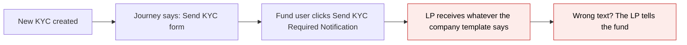
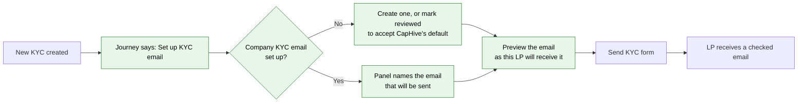
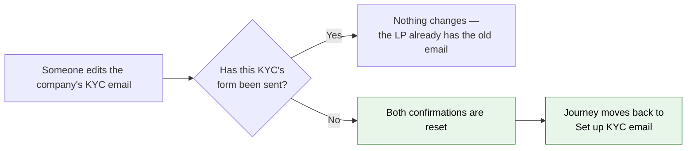

# Set up and preview the KYC email before it reaches the LP — Proposal

> **Audience:** Business team, product, QA, support — non-technical.
> **Companion document:** [Design](design.md)

> **Planning phase — no code changes.** This document proposes and explains the change. Do not
> edit application code while writing it; implementation happens later, in the tasks phase.

---

## Why

The investor KYC journey's very first task is "Send KYC form", so the first thing the journey asks a
fund user to do is email the LP — and nothing in the journey asks anyone to check what that email
says first. The KYC-required email is one company-level template (Actions → "Custom KYC
Notification"), so a wrong subject, a stale placeholder or an unreplaced `{{investor_name}}` goes to
every LP, and the fund usually hears about it from the LP. The capital call and capital distribution
journeys already gate their investor email behind "Review email" and "Check preview"; KYC is the one
investor-facing journey without that gate.

## What Changes

- The **Investor KYC** journey gains two tasks at the top, before "Send KYC form" (9 → 11 tasks):
  1. **Set up KYC email** — a "mark reviewed" task. The panel names the email that will actually go
     out ("Your KYC email *Complete your KYC for Urban Fund* will be sent"), or warns that none is
     set up and CapHive's default text will be used. A second button next to **Mark reviewed** opens
     the company's KYC emails, or creates one when there is none.
  2. **Preview the email** — a "mark reviewed" task whose second button opens the **preview of that
     LP's own email**, with their name, their fund and their link filled in — the same preview that
     already exists under Actions → "Preview KYC Required Notification".
- Both tasks are **not applicable** once the form has already gone out, and when the fund filled the
  KYC in itself (nothing is emailed) — reviewing after sending cannot change what the LP received, so
  it must never hold a KYC up.
- **Changing the KYC email undoes the review.** Creating, editing or deleting the company's
  KYC-required email resets both confirmations on every KYC that has not emailed its LP yet, and
  those journeys move back to "Set up KYC email" with the reason "Email template changed after
  review". KYCs whose form has already gone out are untouched.
- Companies that **already have** the journey get the two tasks inserted by the rollout, before their
  "Send KYC form" task, keeping every edit they have made to the template.
- No action is blocked. "Send KYC Required Notification" still works at any time, with or without the
  reviews — the journey advises, it does not gate.
- A new **end-to-end test** walks one KYC from creation to verified, with the fund user and the LP
  each doing their own part (fund sets up and previews the email and sends the form; LP opens their
  link, uploads documents and submits; fund validates, screens, reviews, signs off and verifies).

### Flow Diagram

Before — the journey's first nudge is to email the LP:



After — two confirmations stand between a new KYC and the LP's inbox:



Undo — changing the email after someone confirmed it:



---

## User Stories

### US-1: Check the email before the first LP sees it

**As a** fund operations user,
**I want** the KYC journey to ask me to set up and preview the KYC email before it tells me to send
the form,
**So that** an LP never receives a half-written or wrongly addressed KYC request.

**Acceptance criteria:**
- A new KYC in a set-up company has **Set up KYC email** as its current task, not "Send KYC form".
- When the company has no KYC-required email, the panel says the default CapHive text will be sent and
  offers a **Custom KYC Notification** button that opens the new-email form.
- When the company has one, the panel names it by subject and offers an **Open KYC emails** button.
- Clicking **Mark reviewed** moves the journey to **Preview the email**.
- On **Preview the email**, the second button is **Preview KYC Required Notification** and opens that
  KYC's own preview in a new tab; **Mark reviewed** moves the journey to "Send KYC form".
- The step bar shows all 11 tasks in order, both new ones before "Send KYC form".

### US-2: A wrong template is caught and fixed

**As a** fund operations user who previewed the email and found a mistake,
**I want** my confirmations to be withdrawn when the email is changed,
**So that** nobody sends on the strength of a review of the old text.

**Acceptance criteria:**
- After both tasks are marked reviewed, editing the company's KYC-required email returns every
  not-yet-sent KYC's journey to **Set up KYC email**.
- The panel's message is "Email template changed after review".
- A KYC whose form has already been sent keeps its journey exactly as it was.
- Creating a KYC email, and deleting one, have the same effect as editing one.

### US-3: The fund fills the KYC in itself

**As a** fund user entering an LP's KYC on their behalf,
**I want** the email tasks to stand aside,
**So that** a KYC that never emails anyone is not held up by an email review.

**Acceptance criteria:**
- A KYC submitted or verified without a form ever being sent shows both tasks as **–** with the
  reason "Filled in by the fund".
- An imported, already verified KYC shows them as **–** with "Verified without this step" and its
  journey is complete.

### US-4: A KYC already in flight

**As a** fund user with KYCs already out with LPs when this is released,
**I want** the new tasks not to reopen them,
**So that** nothing that is already with an LP goes backwards.

**Acceptance criteria:**
- A KYC whose form has been sent (or that the LP has started or submitted) shows both tasks as **–**
  with the reason "The KYC form has already been sent".
- A KYC still waiting at "Send KYC form" when the rollout runs becomes current at **Set up KYC
  email** — it has emailed nobody yet, so the gate still applies.

### US-5: One KYC, end to end, fund and LP

**As** QA,
**I want** a single automated test that walks one KYC through all 11 tasks with both the fund user
and the LP acting,
**So that** the journey is known to work as a whole, not only task by task.

**Acceptance criteria:**
- The test covers, in order: KYC created → Set up KYC email → Preview the email → form sent to the LP
  → **the LP opens their own link, uploads the required documents and submits** → documents validated
  → AML screening → Clear AML match → Review KYC → Compliance sign-off → Verify KYC → journey
  complete.
- The LP's part runs as the LP (their own link/login), not as the fund user.
- At each handover the test asserts what the step bar and panel show.

---

## UI Behavior

### The KYC page — "What's needed now" panel at task 1

```
┌──────────────────────────────────────────────────────────────────────────────┐
│  ① Set up KYC email  ② Preview the email  ③ Send KYC form  ④ Submit KYC  …   │
│  ●                   ○                    ○                ○                 │
├──────────────────────────────────────────────────────────────────────────────┤
│  What's needed now                                                            │
│                                                                               │
│  1 of 11 · Set up KYC email            [ 0 days here ]                        │
│  No KYC email is set up — CapHive's default text will be sent.                │
│  Set one up, or mark reviewed to use the default.                             │
│                                                                               │
│                            [ ✓ Mark reviewed ]  [ Custom KYC Notification → ] │
└──────────────────────────────────────────────────────────────────────────────┘
```

With a company KYC email already set up, the message and second button change:

```
│  1 of 11 · Set up KYC email                                                   │
│  Your KYC email "Complete your KYC for Urban Fund" will be sent —             │
│  check it and mark reviewed.                                                  │
│                                                                               │
│                            [ ✓ Mark reviewed ]  [ Open KYC emails → ]         │
```

### The KYC page — "What's needed now" panel at task 2

```
│  2 of 11 · Preview the email                                                  │
│  Preview the email as Nilesh Shah will receive it, then mark reviewed.        │
│                                                                               │
│            [ ✓ Mark reviewed ]  [ Preview KYC Required Notification → ]       │
```

**Behavior notes:**
- The second button is the existing "second button beside Mark reviewed" already used by KYC's
  "Validate documents" task — no new panel layout.
- **Preview KYC Required Notification** runs the KYC page's own Actions item, so the preview opens in
  a new tab exactly as it does today; **Open KYC emails** and **Custom KYC Notification** navigate.
- Both tasks are ordinary "mark reviewed" tasks: any fund user who may edit the KYC can confirm them,
  and the confirmation is recorded against them with a timestamp.
- An LP looking at their own KYC sees no step bar and no panel (unchanged).

---

## What This Feature Does NOT Cover

| Excluded | Covered In |
|---|---|
| A separate review of the KYC **reminder** email (`kyc_required_reminder`) | Not planned — the reminder repeats an email already reviewed |
| A per-KYC email template (today the KYC email is company-level) | Not planned |
| Blocking "Send KYC Required Notification" until both tasks are done | Out of scope — the journey advises, never blocks (same as calls) |
| A review of the **agreement** notification ("Send Document") | Not planned |
| Reviewing the email on the KYC **bulk send** path | Not planned — the journey is per KYC |
| Changing what the default CapHive KYC email says | Not in scope |

---

## Validation Rules

| Field | Rule | Default |
|---|---|---|
| Set up KYC email (task) | Confirmed by Mark reviewed only; no data can complete it | Not confirmed |
| Preview the email (task) | Confirmed by Mark reviewed only; no data can complete it | Not confirmed |
| Both tasks | Not applicable when the form has been sent, or the fund filled the KYC in itself | Applicable |
| Both tasks | Confirmation is withdrawn when the company's KYC-required email is created, edited or deleted, unless the form has already gone out | — |

---

## Behavior Rules

| Scenario | What User Sees |
|---|---|
| New KYC, company has no KYC email | Task 1 current: "No KYC email is set up — CapHive's default text will be sent. Set one up, or mark reviewed to use the default", with **Custom KYC Notification** |
| New KYC, company has a KYC email | Task 1 current: "Your KYC email "&lt;subject&gt;" will be sent — check it and mark reviewed", with **Open KYC emails** |
| Task 1 marked reviewed | Task 2 current: "Preview the email as &lt;LP name&gt; will receive it, then mark reviewed", with **Preview KYC Required Notification** |
| Both marked reviewed | Task 3 current: "The KYC form has not been sent — send it, or fill it in and tick complete" (unchanged) |
| Form already sent | Tasks 1 and 2 show **–** "The KYC form has already been sent" |
| LP has started or submitted the form | Tasks 1 and 2 show **–** "The KYC form has already been sent" |
| Fund filled the KYC in itself | Tasks 1 and 2 show **–** "Filled in by the fund" |
| Imported, already verified KYC | Tasks 1 and 2 show **–** "Verified without this step"; journey complete |
| Company's KYC email edited after both reviews, form not sent | Journey back at task 1, message "Email template changed after review" |
| Company's KYC email edited, form already sent | Nothing changes |
| A different KYC email is edited (e.g. the reminder) | Nothing changes — only the KYC-required email drives these tasks |
| Rollout on a company that already has the journey | Both tasks appear before "Send KYC form"; every other edit to the template is kept |
| Rollout on a company whose admin removed "Send KYC form" | Neither task is added — that template never emails the LP |

---

## Resolved Design Decisions

| # | Decision | Resolution |
|---|---|---|
| 1 | One combined task or two? | **Two** — "Set up KYC email" and "Preview the email", matching the capital call and distribution journeys, so the panel, the undo and the user guide all read the same way. One tick could not tell anyone whether the email was actually previewed. |
| 2 | Should a review after sending block the journey? | No. Both tasks are not applicable once the form is out: the LP already has the email, so a review cannot change anything (same rule as the capital call journey). |
| 3 | Which email changes withdraw the confirmations? | Only the company's **KYC-required** email (the one the form link is sent with). Editing the reminder or any other KYC email leaves the journey alone. |
| 4 | Can data complete these tasks (like "Validate documents" can)? | No. "Someone read it" is not in the data, so both are confirm-only. |
| 5 | What happens on a template an admin has edited? | The two tasks are inserted immediately before that template's "Send KYC form"; nothing else is touched. If the admin removed "Send KYC form", nothing is added. |
| 6 | Whose reviews are reset, given the KYC email is company-level? | Every KYC in that company that has a journey and has not emailed its LP yet. |
| 7 | Does the LP see any of this? | No. LPs never see the step bar or the panel (unchanged). |

---

## Capabilities

### New Capabilities

None — this extends the existing investor KYC journey capability.

### Modified Capabilities

- `kyc/investor-kyc-journey`: the seeded task list gains two tasks; new rules for when they are not
  applicable, what withdraws a confirmation, how the rollout adds them to an existing template, and
  end-to-end coverage of the whole journey.

---

## Impact

- **The KYC page's journey** — step bar and "What's needed now" panel: two more tasks, one more
  second-button variant. No layout change.
- **The company's KYC emails screen** (Actions → Custom KYC Notification / View All Custom
  Notifications): no change to the screens themselves, but saving or deleting a KYC-required email now
  also withdraws the matching confirmations on not-yet-sent KYCs.
- **The journey rollout** (the "Set up journeys" menu and the KYC journey rake task): reports and adds
  the two tasks for companies that already have the journey; dry run says what it would add.
- **The investor KYC user guide**: journey section, task table and FAQs.
- **Automated tests**: KYC journey features plus a new end-to-end feature covering the whole journey
  with both the fund user and the LP.
- Nothing changes for capital calls, distributions, documents or any other record type.

---

## Benefits

1. An LP's first impression — the KYC request email — is checked by a human before it is sent, with
   that LP's own details rendered in the preview.
2. A fund that never set up a KYC email finds out at the moment it matters, instead of after CapHive's
   default text has gone out under their name.
3. Fixing the email automatically withdraws the old approval, so nobody sends on a stale review.
4. KYCs already with LPs are left alone, so the change cannot reopen work in flight.
5. The whole KYC journey, fund side and LP side, is covered end to end by one automated test.

---

## FAQ

| Question | Answer |
|---|---|
| Does this stop anyone sending the KYC form? | No. "Send KYC Required Notification" works exactly as it does today, whether or not the two tasks are confirmed. The journey tells you what is outstanding; it never blocks. |
| What happens to KYCs that are already out with LPs? | Nothing. Both new tasks show as not applicable ("The KYC form has already been sent"), so those journeys stay where they are. |
| What about a KYC that is sitting at "Send KYC form" right now? | It moves back to "Set up KYC email". It has emailed nobody yet, so the check is still worth doing. |
| We have no custom KYC email — are we stuck? | No. The task says CapHive's default text will be sent and you can mark it reviewed to accept that, or create your own email from the same panel. |
| Who can confirm these tasks? | Any fund user who can edit the KYC — the same people who can confirm "Validate documents" and "Review KYC" today. LPs cannot. |
| We edited our KYC email — do we have to re-confirm every KYC? | Only KYCs that have not emailed their LP yet. Each one shows "Email template changed after review" and needs the two confirmations again. |
| Do LPs see these tasks? | No. The step bar and panel are only shown to fund users. |
| Will our own edits to the journey template survive the rollout? | Yes. The two tasks are inserted before "Send KYC form"; renamed tasks, removed tasks, owners and approvers are all kept. |
| Does this change any email that LPs receive? | No. It adds no email and changes no email text. It only asks someone to look before sending. |
| Does it cost anything or need a new permission? | No. It uses the journey and notification screens the company already has. |
| How do we roll it out? | The existing KYC journey rake task, run per environment with a dry run first. See [design.md](design.md). |

---

## Design Principle for the Next Phase

Reuse, do not invent. The capital call journey already has "Review email" + "Check preview", the
`JourneyEmailEdit` service already withdraws those confirmations when an email changes, and the panel
already renders a second button beside **Mark reviewed** (KYC's "Validate documents" uses it). The
design must add KYC to those three mechanisms rather than grow parallel ones, and the one genuinely
new piece — inserting seeded tasks into a template that already exists — should generalise the
existing "add the Compliance sign-off to an older template" code instead of sitting beside it as a
second special case. The KYC email being **company-level** (unlike a call's own email) is the one
asymmetry to handle explicitly: it decides which KYCs a single edit reaches.
