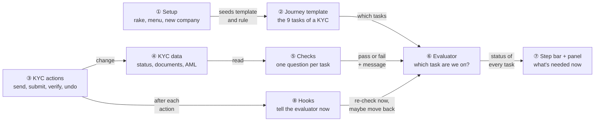
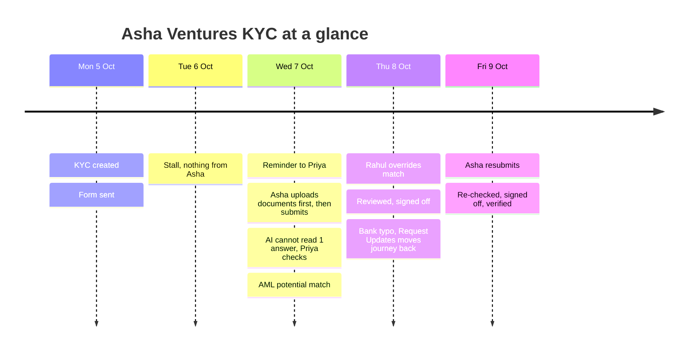
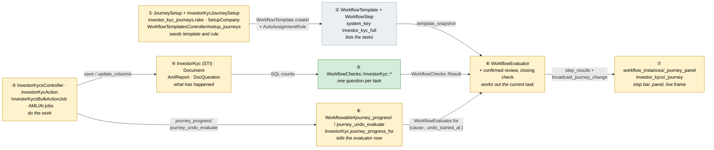
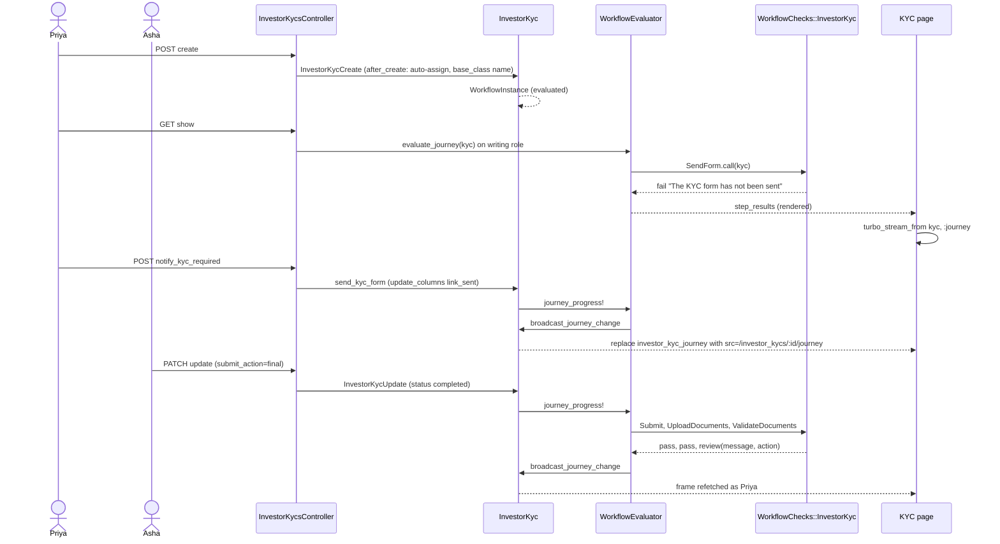
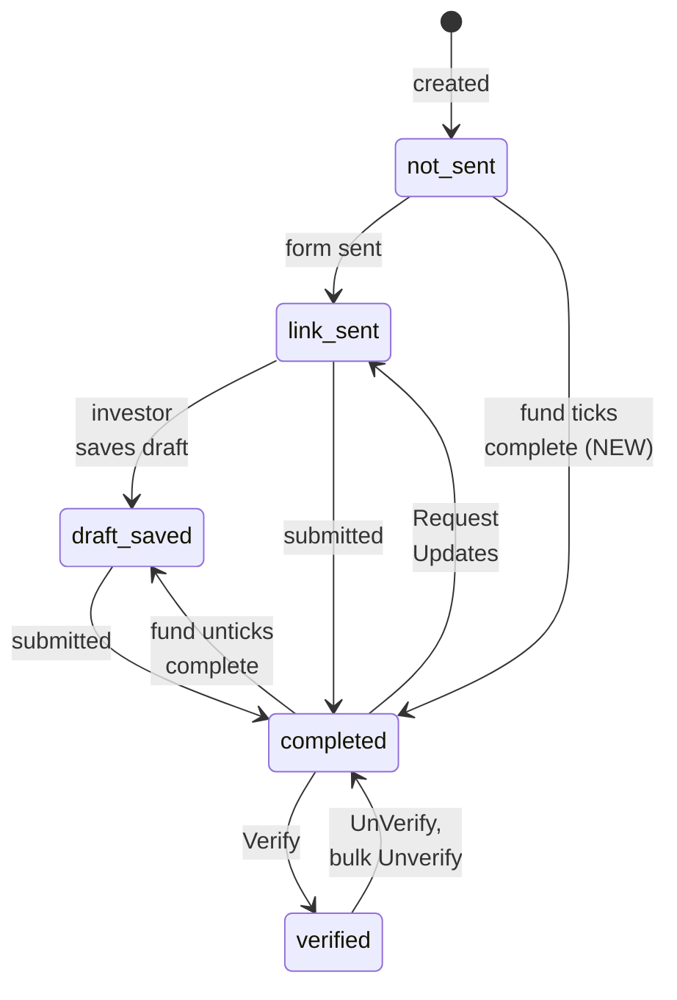
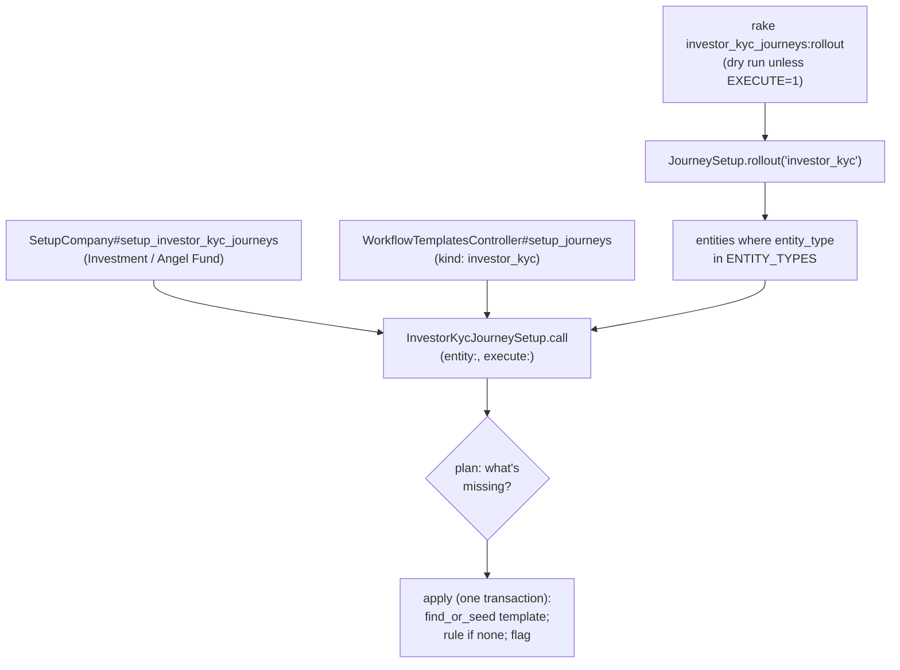
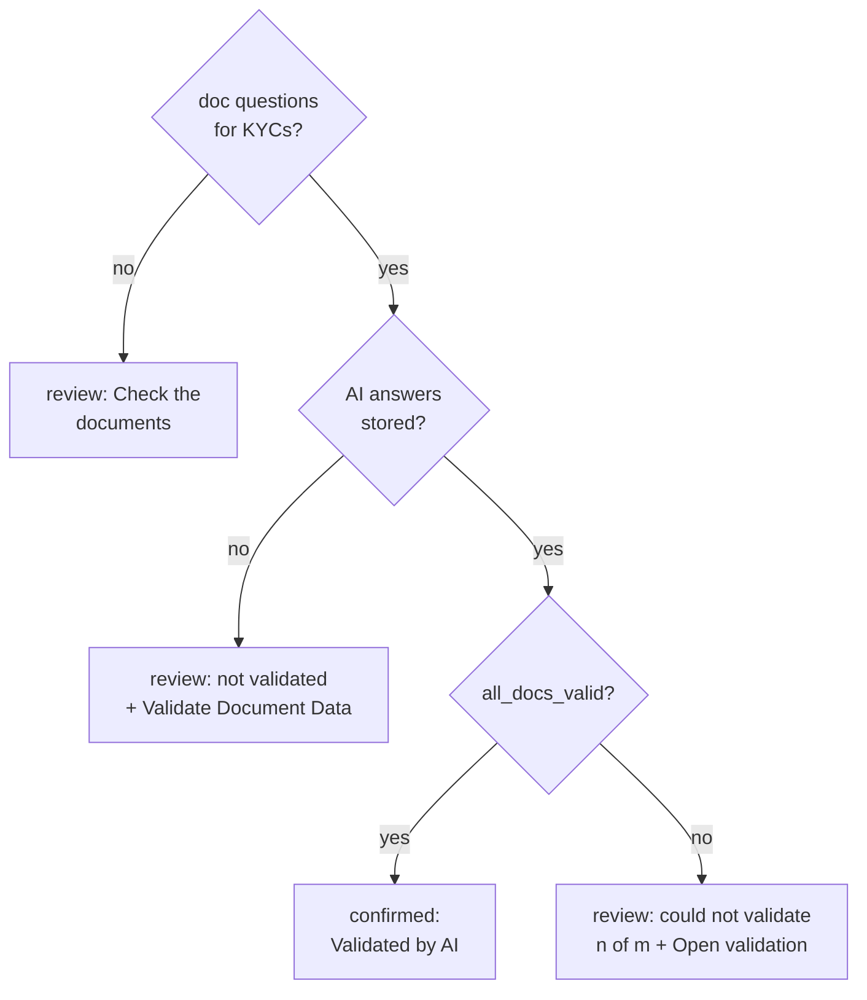
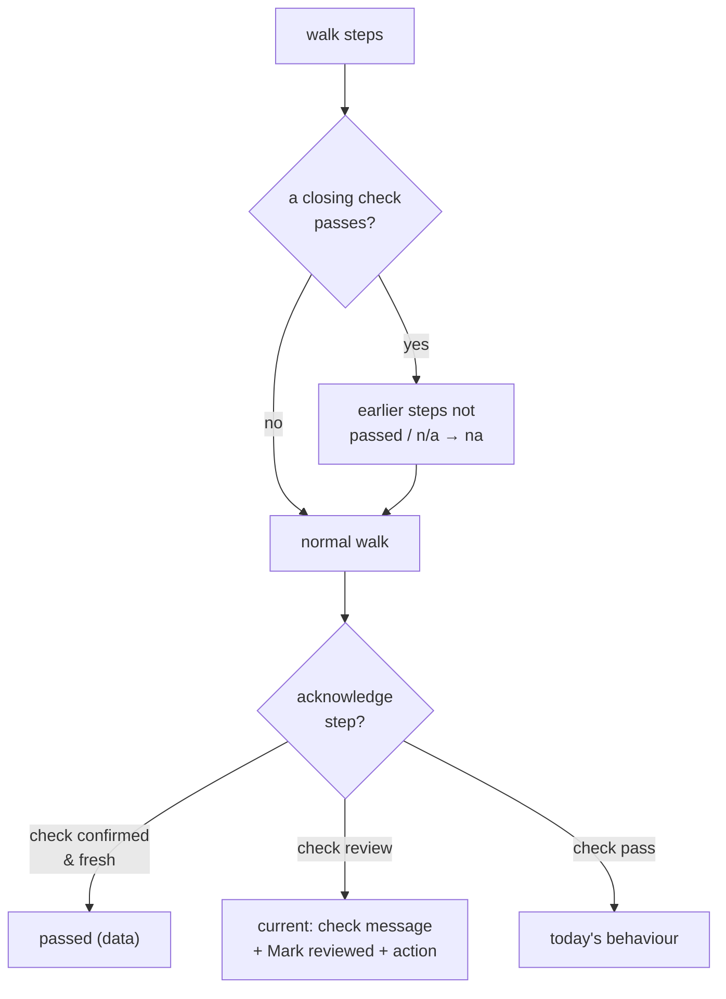
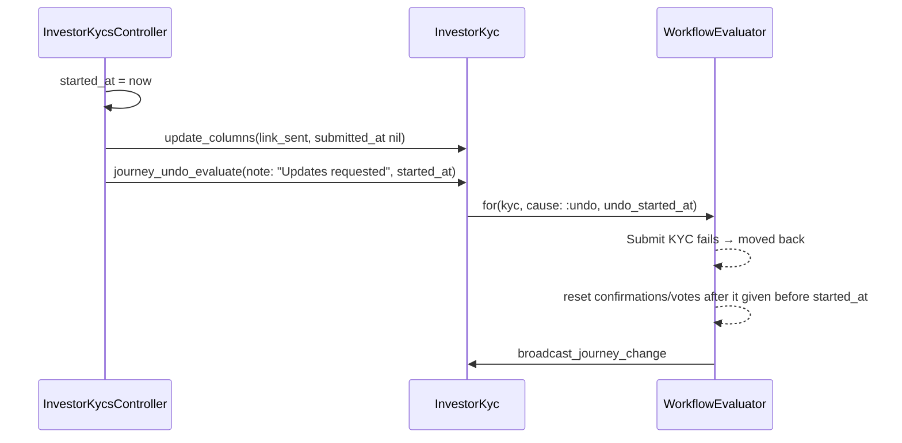
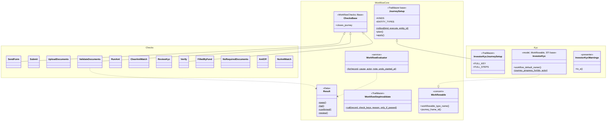

# Investor KYC Journey — Design

> **Audience:** Engineering team.
> **Companion documents:** [Proposal](proposal.md) · [Spec](specs/) · [LLD](lld.md) · [QA checklist](qa-checklist.md)

> **Planning phase — no code changes.** This document explains HOW the proposal will be built.
> Do not edit application code while writing it; implementation happens later, in the tasks phase.

> **Builds on** the capital call journey ([design](../archive/2026-10-02-capital-call-journey/design.md))
> and the capital distribution journey ([design](../archive/2026-10-02-capital-distribution-journey/design.md)),
> which made the panel, setup, model concern, controller concern and policy methods shared. This document
> covers what a third record type adds, two small engine additions, and the STI fix KYCs need.

---

## Contents

- [1. The idea](#1-the-idea)
  - [What this adds](#what-this-adds)
  - [The idea in one picture](#the-idea-in-one-picture)
  - [Walkthrough: one KYC, start to finish](#walkthrough-one-kyc-start-to-finish)
  - [Key ideas](#key-ideas)
- [2. The same picture with real names](#2-the-same-picture-with-real-names)
  - [Picture](#picture)
  - [What each box does](#what-each-box-does)
  - [One KYC, end to end](#one-kyc-end-to-end)
  - [Lifecycles](#lifecycles)
  - [What users see](#what-users-see)
  - [Design decisions](#design-decisions)
- [3. One card per box](#3-one-card-per-box)
  - [① Setup](#①-setup)
  - [② Journey template](#②-journey-template)
  - [③ KYC actions](#③-kyc-actions)
  - [④ KYC data and ⑤ Checks](#④-kyc-data-and-⑤-checks)
  - [⑥ Evaluator](#⑥-evaluator)
  - [⑦ Step bar and panel](#⑦-step-bar-and-panel)
  - [⑧ Hooks](#⑧-hooks)
- [4. Reference](#4-reference)
  - [Class diagram](#class-diagram)
  - [Data model and schema changes](#data-model-and-schema-changes)
  - [Component contracts](#component-contracts)
  - [Cross-cutting concerns](#cross-cutting-concerns)
  - [Worked examples](#worked-examples)
  - [Testing](#testing)
  - [Risks and open questions](#risks-and-open-questions)

---

## 1. The idea

### What this adds

Investor KYCs get the same data-driven journey calls and distributions have: one seeded template, one
read-only check per task, the shared evaluator working out the current task, and the step bar + "What's
needed now" panel on the KYC page, kept live over Turbo Streams. Two small, opt-in engine additions make
it fit: a review task the data can complete (an AI document pass), and a closing task (Verify KYC) that
finishes the journey even when earlier tasks were skipped. The shared workflow code also learns to treat
`IndividualKyc` / `NonIndividualKyc` as `InvestorKyc`.

### The idea in one picture



### Walkthrough: one KYC, start to finish

**The setup.** Acme Capital has run setup (①). Its admin picked **Rahul** (compliance) as the approver on
the **Compliance sign-off** step. Acme has AML enabled, requires "PAN Card", "Address Proof" and "Photo"
for individuals, and has 8 AI document questions. Priya (ops) creates an individual KYC for **Asha
Ventures**, whose investor user is Asha.

**How to read the step bar.** Every task is listed by name with its mark:

| Mark | Means |
|---|---|
| ✓ | done |
| **●** | **we are here**: waiting on this task, it is *not* done yet |
| ○ | later; not reached yet |
| – | not applicable to this KYC |
| **↺** | **back here**: this task was done, but something was undone |

Circled numbers in "Behind the scenes" are the picture's boxes: setup (①), template (②), actions (③), data
(④), checks (⑤), evaluator (⑥), panel (⑦) and hooks (⑧).



#### Day 1–3: form, stall, submission

| # | When | What happens | Behind the scenes | Step&nbsp;bar&nbsp;after&nbsp;&nbsp;&nbsp;&nbsp;&nbsp;&nbsp;&nbsp;&nbsp;&nbsp;&nbsp;&nbsp;&nbsp;&nbsp;&nbsp; |
|---|---|---|---|---|
| 1 | Mon 09:00 | Priya saves the new KYC | The auto-assign rule launches the template (②). The page asks the evaluator (⑥); the checks (⑤) see status "not sent" | **●&nbsp;Send&nbsp;KYC&nbsp;form**<br>○&nbsp;Submit&nbsp;KYC<br>○&nbsp;Upload&nbsp;required&nbsp;documents<br>○&nbsp;Validate&nbsp;documents<br>○&nbsp;Run&nbsp;AML&nbsp;screening<br>○&nbsp;Clear&nbsp;AML&nbsp;match<br>○&nbsp;Review&nbsp;KYC<br>○&nbsp;Compliance&nbsp;sign-off<br>○&nbsp;Verify&nbsp;KYC |
| 2 | Mon 09:05 | Priya clicks the panel's "Send KYC Required Notification" | The panel (⑦) opens KYC Actions and clicks the real item (③). `send_kyc_form` writes "link sent" with `update_columns`, so its hook (⑧) calls the evaluator explicitly | ✓&nbsp;Send&nbsp;KYC&nbsp;form<br>**●&nbsp;Submit&nbsp;KYC** — "Waiting for the investor — form sent on 05/10/2026"<br>rest ○ |
| 3 | Mon–Tue | **Stall.** Asha does nothing | The 15-minute tick re-checks with the same result, so nothing is written or broadcast | Same as row 2 |
| 4 | Wed 00:30 | Reminder | The step has been current 2 days; the engine emails its owner — Priya, the KYC's creator (an Acme employee, so she qualifies) | Same as row 2 |
| 5 | Wed 14:00 | Asha opens the emailed link and uses the documents-first form: uploads PAN, address proof, photo; the AI pre-fills her form | Documents and pre-filled fields are saved (④); status stays "link sent", so Submit KYC still fails. The document hook (⑧) has nothing to invalidate (Validate documents never passed) | Same as row 2 |
| 6 | Wed 14:20 | Asha submits | The controller's update sets "completed"; its hook (⑧) re-checks: 3 of 3 required documents present | ✓&nbsp;Send&nbsp;KYC&nbsp;form<br>✓&nbsp;Submit&nbsp;KYC<br>✓&nbsp;Upload&nbsp;required&nbsp;documents<br>**●&nbsp;Validate&nbsp;documents** — "Documents not validated yet — run AI validation or check them and mark reviewed"<br>rest ○ |

#### Day 3–4: validation, AML, a mistake

| # | When | What happens | Behind the scenes | Step&nbsp;bar&nbsp;after&nbsp;&nbsp;&nbsp;&nbsp;&nbsp;&nbsp;&nbsp;&nbsp;&nbsp;&nbsp;&nbsp;&nbsp;&nbsp;&nbsp; |
|---|---|---|---|---|
| 7 | Wed 15:00 | Priya clicks the panel's "Validate Document Data" | `DocLlmValidationJob` runs; its hook (⑧) re-checks. The PAN scan is blurry: 1 of 8 answers fails, so `all_docs_valid` is false and the check (⑤) asks for a review | … **●&nbsp;Validate&nbsp;documents** — "AI could not validate 1 of 8 answers — check them and mark reviewed" |
| 8 | Wed 15:10 | Priya opens the PAN, sees it matches, clicks **Mark reviewed** | Acknowledge confirmation recorded (⑥) | … ✓&nbsp;Validate&nbsp;documents ("Reviewed by Priya")<br>**●&nbsp;Run&nbsp;AML&nbsp;screening** |
| 9 | Wed 15:12 | Panel → "Generate AML Report" | The async AML job writes `aml_status = potential_match`; its hook (⑧) | … ✓&nbsp;Run&nbsp;AML&nbsp;screening<br>**●&nbsp;Clear&nbsp;AML&nbsp;match** — "AML found a potential match — …" |
| 10 | Thu 10:00 | Rahul reads the report (a namesake), overrides to no match with a reason | `override_aml_status` hook (⑧) | … ✓&nbsp;Clear&nbsp;AML&nbsp;match<br>**●&nbsp;Review&nbsp;KYC** |
| 11 | Thu 10:30 | Priya marks Review KYC reviewed; Rahul signs off | Acknowledge, then a human vote (⑥) | … ✓&nbsp;Review&nbsp;KYC<br>✓&nbsp;Compliance&nbsp;sign-off<br>**●&nbsp;Verify&nbsp;KYC** |
| 12 | Thu 11:00 | **Mistake.** Priya spots a typo in the bank account number and clicks **Request Updates** | `request_updates` takes `started_at`, writes "link sent" with `update_columns`, then `journey_undo_evaluate` (⑧). Submit KYC fails, so the evaluator (⑥) moves back and resets every confirmation and sign-off after it that predates the request | ✓&nbsp;Send&nbsp;KYC&nbsp;form<br>**↺&nbsp;Submit&nbsp;KYC** — "Moved back — Updates requested by Priya"<br>○&nbsp;Upload&nbsp;required&nbsp;documents<br>○&nbsp;Validate&nbsp;documents (reset)<br>○&nbsp;Run&nbsp;AML&nbsp;screening<br>○&nbsp;Clear&nbsp;AML&nbsp;match<br>○&nbsp;Review&nbsp;KYC (reset)<br>○&nbsp;Compliance&nbsp;sign-off (reset)<br>○&nbsp;Verify&nbsp;KYC |

#### Day 5: verified

| # | When | What happens | Behind the scenes | Step&nbsp;bar&nbsp;after&nbsp;&nbsp;&nbsp;&nbsp;&nbsp;&nbsp;&nbsp;&nbsp;&nbsp;&nbsp;&nbsp;&nbsp;&nbsp;&nbsp; |
|---|---|---|---|---|
| 13 | Fri 09:00 | Asha fixes the bank number and resubmits | Controller update hook (⑧). Documents and AML still pass from data; Validate documents was reset, and the AI result is still 1 of 8 | … ✓&nbsp;Upload&nbsp;required&nbsp;documents<br>**●&nbsp;Validate&nbsp;documents** — "AI could not validate 1 of 8 answers — …" |
| 14 | Fri 09:30 | Priya marks Validate documents and Review KYC reviewed; Rahul signs off again | Each confirmation re-runs the evaluator (⑥) | … ✓&nbsp;Compliance&nbsp;sign-off<br>**●&nbsp;Verify&nbsp;KYC** |
| 15 | Fri 12:00 | Rahul clicks the panel's "Verify" | Panel (⑦) clicks `#investor_kyc_toggle_verified_btn` (③); `toggle_verified` hook (⑧) | All ✓ — journey complete |

**The key moment (row 12)** as Priya sees it:

```
┌ ↺ Moved back to "Submit KYC" — Updates requested by Priya on 08/10/2026 11:00. ─────────┐
│ ⌁ Journey  Investor KYC                                       1 of 8 done  12%  [View]  │
│ ✓ Send KYC form ─ ↺ Submit KYC ─ ○ Upload required documents ─ ○ Validate documents ─ … │
│ What's needed now: Submit KYC — Waiting for the investor — form sent on 08/10/2026      │
│                                                        [ Send KYC Reminder → ]          │
└─────────────────────────────────────────────────────────────────────────────────────────┘
```

**What to notice**
- Nothing about the KYC was stored for the journey: every mark comes from status, documents, AI answers
  and AML results (④), so the tracker can't drift from reality.
- The documents-first upload (row 5) changed nothing visible: Submit KYC is still the task, and pre-filling
  is not validation.
- The AI could not decide (row 7), so a person did, and the journey recorded who (row 8). On a full AI
  pass the same task would have ticked itself.
- Undo (row 12) reset Priya's manual validation and Rahul's sign-off, because they were given before the
  request and sit after the task that moved back.
- The stall (row 3) wrote nothing; the reminder (row 4) went to Priya, never to the investor.

### Key ideas

| # | Idea | In one line | Card |
|---|---|---|---|
| 1 | Same engine, third type | KYC checks plug into the registry; the panel, setup and hooks are the shared ones | [⑥](#⑥-evaluator) |
| 2 | Review by AI or by hand | An acknowledge check may say "the data already confirms this" — a full AI pass — or ask for review with its own message and button | [④⑤](#④-kyc-data-and-⑤-checks), [⑥](#⑥-evaluator) |
| 3 | Verify closes the journey | When the closing task passes, every unfinished earlier task is "–" "Verified without this step" | [⑥](#⑥-evaluator) |
| 4 | One template, two ways in | "Send KYC form" is n/a once the fund filled the KYC in, so fund-filled and investor-filled KYCs share it | [②](#②-journey-template) |
| 5 | KYCs are STI | Shared workflow code uses the base class name (`InvestorKyc`), so rules, tabs and frames match | [③](#③-kyc-actions) |
| 6 | `update_columns` paths need explicit hooks | Send form, Request Updates and the status sync skip callbacks; each calls the evaluator itself | [⑧](#⑧-hooks) |

**FAQ**

| Question | Answer |
|---|---|
| Does anything block users? | No. Verify works at any point; the journey advises only. The two ride-along fixes change what the "complete" tick and bulk Unverify *do*, not who may do them. |
| Why not a Full / Light pair like calls? | Imports and fund-filled KYCs fit the same tasks: "Send KYC form" is n/a when the fund filled it in, and the closing Verify finishes an imported verified KYC at once (user decision). |
| Do investors see any of this? | No. The panel is rendered only for non-investor users; investors on the emailed link never reach `show`'s journey code. |
| What if a company never runs setup? | Nothing changes for them; KYCs launch no journey. |

---

## 2. The same picture with real names

### Picture



Colour = footprint: **green** new, **amber** modified, **grey** reused unchanged. Exact files are in
[lld.md File Map](lld.md#file-map).

### What each box does

| # | Box | Real parts | What it does | When it runs | What it decides | Details |
|---|---|---|---|---|---|---|
| ① | Setup | `JourneySetup` (single-template, entity types, sign-off name), `InvestorKycJourneySetup`, rake, `SetupCompany`, `WorkflowTemplatesController#setup_journeys` | Seeds the template, one rule, the permission | Rake, new fund company, menu item | What's missing for this entity | [①](#①-setup) |
| ② | Journey template | `WorkflowTemplate`, `WorkflowStep` (existing) | Holds the 9 tasks and their check keys | At launch (snapshotted) | Task order and kinds | [②](#②-journey-template) |
| ③ | KYC actions | KYC controller, `InvestorKycAction`, bulk job, AML and AI jobs, `Workflowable` STI fix | Changes data; two fixes and the STI fix live here | User clicks, jobs | What the "complete" tick and bulk Unverify do | [③](#③-kyc-actions) |
| ④⑤ | Data + checks | 9 task checks + 4 skip checks + `InvestorKycWarnings` | Answer "is this task done?" from data | Every evaluation | Pass/fail, message, button target | [④⑤](#④-kyc-data-and-⑤-checks) |
| ⑥ | Evaluator | `WorkflowEvaluator` + `WorkflowChecks::Result` additions | Walks tasks, writes `step_results`, history, broadcasts | Page view, hooks, tick | Current task, closing, moved back, resets | [⑥](#⑥-evaluator) |
| ⑦ | Step bar + panel | Shared `_journey_panel` (secondary review button), `investor_kycs/_journey` wrapper, `journey` route | Draws the journey; live via `turbo_stream_from` | Page render, broadcast refetch | What the fund user sees | [⑦](#⑦-step-bar-and-panel) |
| ⑧ | Hooks | `journey_progress!`, `journey_undo_evaluate`, `journey_invalidate(only_if_passed:)`, `journey_progress_for` | Re-check after every action | End of each action/job | Progress vs undo vs invalidate | [⑧](#⑧-hooks) |

### One KYC, end to end



### Lifecycles

Task and journey status are the engine's, unchanged — see the call design's
[Lifecycles](../archive/2026-10-02-capital-call-journey/design.md#lifecycles). The KYC's own status is the
**stored** `submission_status` enum (the booleans `completed_by_investor` / `verified` are synced from it).
This change adds two transitions (green in the table) and changes one:



| Transition | Today | After |
|---|---|---|
| not_sent / link_sent / draft_saved → completed by a fund user's tick | Tick discarded by `sync_boolean_fields_from_status` | **New**: `InvestorKycAction#save` sets completed + `submitted_at` |
| verified → ? by bulk Unverify | link_sent | **Changed**: completed (same as single UnVerify) |
| everything else | — | Unchanged |

The journey's derived "where is it" follows the tasks in [②](#②-journey-template); none of it is stored on
the KYC.

### What users see

**At a glance**

| Where in CapHive | Today | After this change | Who sees it |
|---|---|---|---|
| KYC page | Details + KYC Actions | Step bar + panel above the details (only with a journey); action items get DOM ids | Fund users who can view the KYC |
| KYC form (fund user) | "I confirm … complete" tick ignored | Tick marks the KYC submitted | Fund users |
| KYC list → bulk Unverify | KYCs go to "link sent" | KYCs go to "completed" | Users with KYC approve |
| KYC page → Workflow tab | Lists no templates (STI bug) | Lists KYC templates | Company admins |
| Workflow Templates → Set up journeys | Calls, distributions | + "Set up investor KYC journeys" | Company admins of Investment / Angel Funds |
| Workflow Templates → a template | Edit, Delete | + Duplicate | Company admins |
| Auto-assignment rule form (KYC) | JSON conditions only | + "KYC form type" select | Company admins |

**Journey 2: Ops takes a KYC to verified**

```
┌ Asha Ventures — Individual KYC ───────────── [Edit] [Verify] [KYC Actions ▾]③ ┐
│ ┌ ⌁ Journey  Investor KYC      4 of 8 done ▓▓▓▓▓░░░░░ 50%  [View]①          ┐ │
│ │ ✓ Send KYC form ─ ✓ Submit KYC ─ ✓ Upload required documents ─            │ │
│ │ ● Validate documents ─ ○ Run AML screening ─ … ─ ○ Verify KYC        ②    │ │
│ │ What's needed now: Validate documents — AI could not validate 1 of 8      │ │
│ │ answers — check them and mark reviewed  [✓ Mark reviewed]④ [Open validation →]⑤ │
│ │ ⚠ Bank account verification failed                              ⑥         │ │
│ └───────────────────────────────────────────────────────────────────────────┘ │
│ Attributes …   [Documents] [Validation] [Workflow]⑦                           │
└───────────────────────────────────────────────────────────────────────────────┘
```

| Step | The user… | They see |
|---|---|---|
| J2.1 | opens a new KYC | ① header and progress, ② the step bar |
| J2.2 | leaves the page open while the investor submits | the bar moves on without a reload |
| J2.3 | clicks ⑤ "Open validation" | the Validation tab opens on the same page |
| J2.4 | clicks ④ Mark reviewed | the bar moves to Run AML screening |
| J2.5 | clicks the panel's "Generate AML Report" | KYC Actions ③ opens, the item flashes and runs |
| J2.6 | reads ⑥ | warnings until the KYC is verified |
| J2.7 | opens ⑦ (admin) | the journey's workflow instance |

### Design decisions

| # | Choice | Alternative | Why rejected |
|---|---|---|---|
| 1 | Reuse every shared journey piece (`has_journey`, `WithJourneyPanel`, `WorkflowablePolicyMethods`, `_journey_panel`, `JourneySetup`) | KYC-specific copies | The distribution change made them shared for exactly this |
| 2 | One template, no Light; rule with no conditions | Full + Light (fund-filled / imported) | User decision: "Send KYC form" n/a covers fund-filled; closing Verify covers imported |
| 3 | `JourneySetup` gains optional `LIGHT_KEY` (nil = one template, one rule), `ENTITY_TYPES` (default `["Investment Fund"]`) and `SIGN_OFF_NAME` / `SIGN_OFF_DESCRIPTION` / `SIGN_OFF_BEFORE` (defaults = today's CFO values) | Copy `plan`/`apply` into the KYC subclass | ~80 duplicated lines; defaults keep calls/distributions byte-identical |
| 4 | Acknowledge checks get two opt-in results: `Result.confirmed` (data completes the step, ✓ with the check's message) and `Result.review` (current with the check's message and a second button) | Two paired tasks (AI / manual); or use a skip (shows "–") | User decision: one task, shown ✓. `Result.pass` keeps today's meaning, so call and distribution acknowledge checks are untouched |
| 5 | A closing check (`self.closes_journey = true` on `WorkflowChecks::InvestorKyc::Verify`): when it passes, every earlier step neither passed nor n/a is "na" "Verified without this step" | A "verified" skip key on every step | A skip outranks a pass, so verified KYCs would show "–" for tasks that were really done, and it cannot express "human step not voted". One flag, no schema change, no admin-visible field |
| 6 | Shared workflow code uses `workflowable.class.base_class.name` (new `Workflowable#workflowable_type_name`) and `journey_frame_id` / journey path from the base class | Override in `InvestorKyc` | 10 call sites use `class.name`; for STI records rules never match and the Workflow tab is empty today. `base_class == class` for calls/distributions, so no change for them |
| 7 | `WorkflowStepInvalidate` gains `only_if_passed:` | Hook checks step status itself | Mirrors the existing `only_if_not_passed:`; keeps "document uploaded before validation" from recording a move back |
| 8 | Bulk Unverify → completed | Keep link_sent | User decision; Request Updates reopens for the investor |
| 9 | Fund "complete" tick → completed + `submitted_at` | Treat Verify as submit | User decision; mirrors the existing untick → draft rule in the same method |
| 10 | `InvestorKyc#workflow_default_owner` = creator only when the creator is a user of the KYC's entity | Default creator | An investor-created KYC's creator is the investor; reminders about fund tasks must not go to them |
| 11 | PAN/bank failures, no investor users, expired KYC are **warnings** | Tasks | Not every KYC has PAN/bank; user chose not to make them tasks |
| 13 | One seeded template + catch-all rule (the default); a per-form-type journey = a duplicated template + a higher-priority rule `form_type_id eq <id>`; new `WorkflowTemplatesController#duplicate`; rule form gets a "KYC form type" select that writes that condition | A `workflow_template_id` setting on `form_types`; seeding per-type templates; per `kyc_type` only | User decision: per form type (an entity can have several Individual form types, e.g. tags "Fund IV", "GIFT IV" — prod entity 5632 has 4), default otherwise. `WorkflowAutoAssignmentRule#matches?` already reads `form_type_id` (a column) and orders by `priority`; a setting on the form type would be a second routing mechanism and a migration |
| 12 | Validate documents' freshness = the newest audit that changed `all_docs_valid` or `doc_question_answers` | New `validated_at` column | No migration; audits exist (`Trackable`) and calls already read approval times the same way |

**FAQ**

| Question | Answer |
|---|---|
| Will the engine additions change call or distribution journeys? | No. Neither type returns `Result.confirmed`/`Result.review`, sets `closes_journey`, or uses `only_if_passed:`; their features are the regression guard. |
| Why is the STI fix in this change? | Without it the KYC rule never fires, so no KYC would ever get a journey. |
| Why not make "closes journey" a template field admins can tick? | It is a property of what the check means ("verified = done"), not an admin choice; a column would need a migration and UI for one use. |
| Why AI validation time from audits, not `updated_at`? | Any save bumps `updated_at`, so an unrelated edit would look like a fresh validation after an invalidation. |

---

## 3. One card per box

### ① Setup

**What it is.** The shared setup base, now able to seed a single template for more entity types, and a KYC
subclass that declares constants only.

| Owns | Reads / receives | Produces |
|---|---|---|
| Template + rule seeding, permission flag | `entity`, `execute:` | `ctx[:report]` `{templates:, rules:, flag:, cfo:}`; records when executing |



| Constant | KYC value | Base default (calls, distributions) |
|---|---|---|
| `WORKFLOWABLE_TYPE` | `InvestorKyc` | — |
| `KEY_PREFIX` | `investor_kyc.` | — |
| `FULL_KEY` / `FULL_NAME` | `investor_kyc_full` / "Investor KYC" | — |
| `LIGHT_KEY` | `nil` → no Light template, one rule `all_to_full` | required today |
| `ENTITY_TYPES` | `["Investment Fund", "Angel Fund"]` | `["Investment Fund"]` |
| `SIGN_OFF_NAME` / `SIGN_OFF_BEFORE` | "Compliance sign-off" / "Verify KYC" | "CFO sign-off" / `APPROVE_STEP_NAME` |

| Concern | Decision |
|---|---|
| Idempotency | `find_or_seed` by `[entity_id, system_key]`; rule only when the entity has no `InvestorKyc` rule |
| Access | `WorkflowTemplatePolicy#setup_journeys?(kind)` = `create?` and the user's entity type is in that kind's `ENTITY_TYPES`; the menu renders only permitted kinds |
| Existing human-only KYC rule | No rule added; dry run prints "rules: none (entity already has a KYC rule)" |
| Per-form-type journey | Admin: Duplicate → edit copy → new rule for the copy, pick "KYC form type" (writes `form_type_id eq <id>`), priority < 100. Setup never touches copies (no `system_key`) nor adds rules once any KYC rule exists |
| Form type picker | `workflow_auto_assignment_rules/_form`: when type is `InvestorKyc`, a select of `entity.form_types.where(name: %w[IndividualKyc NonIndividualKyc InvestorKyc])` labelled "Individual — <tag>"; merged into `conditions` on save by the rules controller; the JSON box stays for other conditions |
| Duplicate | `WorkflowTemplatesController#duplicate` (POST member), policy `duplicate?` = `create?`; one transaction; copies `workflow_steps` (all columns but ids) and `workflow_step_actors`; name "Copy of <name>", `system_key` nil, no rules |

**Worked examples:** H1, H11, E19, E20, E25, E26, E27, X3.

**FAQ**

| Question | Answer |
|---|---|
| Why Angel Funds? | Production has 48 Angel Fund KYCs this year; calls/distributions stay Investment Fund only. |
| What does an Angel Fund admin see in the menu? | Only the KYC item: the menu filters kinds by entity type. |
| Does setup touch existing KYCs? | No; rules fire only on create. |

### ② Journey template

**What it is.** The seeded tasks, prefix `investor_kyc.`, `reminder_interval_days: 2`, `unlocks` empty.

| Owns | Reads / receives | Produces |
|---|---|---|
| Task order, kind, check/skip keys, descriptions | Admin edits | `template_snapshot` at launch |

| # | Task | Kind | check_key | skip_key |
|---|---|---|---|---|
| 1 | Send KYC form | system | `send_form` | `filled_by_fund` |
| 2 | Submit KYC | system | `submit` | — |
| 3 | Upload required documents | system | `upload_documents` | `no_required_documents` |
| 4 | Validate documents | acknowledge | `validate_documents` | — |
| 5 | Run AML screening | system | `run_aml` | `aml_off` |
| 6 | Clear AML match | system | `clear_aml_match` | `no_aml_match` |
| 7 | Review KYC | acknowledge | `review_kyc` | — |
| 8 | Compliance sign-off | human | — (no approver → n/a, engine) | — |
| 9 | Verify KYC | system | `verify` (closing) | — |

**Worked examples:** H1, H2, E9.

**FAQ**

| Question | Answer |
|---|---|
| Why is AML after documents? | AML screens the investor's name and details, which are only reliable once submitted and documents checked; it also matches the existing page order. |
| Can admins remove AML or the sign-off? | Yes, in Workflow Templates; checks don't depend on order or neighbours. |

### ③ KYC actions

**What it is.** Existing controllers, services and jobs; this change adds DOM ids, hooks (⑧), the two
fixes and the STI fix.

| Owns | Reads / receives | Produces |
|---|---|---|
| What each action changes; who may do it (unchanged) | User requests, job args | Changed ④; a hook call |

**DOM ids** (existing unless marked): `investor_kyc_notify_kyc_required_default_btn`,
`investor_kyc_kyc_required_reminder_default_btn`, `investor_kyc_edit_btn`, `investor_kyc_validate_docs_with_ai_btn`,
`investor_kyc_generate_new_aml_report_btn`, `investor_kyc_view_aml_reports_btn`, `investor_kyc_toggle_verified_btn`;
tabs `#docs-tab`, `#docs-validation-tab`. The KYC Actions toggle is `#kyc_actions`.

**Fixes**

| Fix | Where | Decision |
|---|---|---|
| Fund "complete" tick | `InvestorKycAction#save` | `!investor_user && !completed_by_investor_was && completed_by_investor` and status not completed/verified → `submission_status = "completed"`, `submitted_at = now` |
| Bulk Unverify | `InvestorKycsBulkActionJob` `unverify` | status `completed` (was `link_sent`), `verified_by_id` cleared, as `toggle_verified` |
| STI type name | `Workflowable#workflowable_type_name` used by auto-assignment service, `WorkflowTemplate`, `WorkflowInstancesController`, `_workflow_tab`, `WorkflowMailer`, `WithJourneyPanel`, `journey_frame_id`, `broadcast_journey_change` | `self.class.base_class.name`; journey path via `becomes(base_class)` so it is `/investor_kycs/:id/journey` |

**Access** (unchanged rules; listed for the panel)

| Role | View journey | Mark reviewed | Verify | Setup item |
|---|---|---|---|---|
| Company admin with `investor_kyc_approve` | ✓ | ✓ (when `update?`, i.e. unverified) | ✓ | ✓ |
| Employee with KYC update, no approve | ✓ | ✓ | ✗ (button absent → panel link) | ✗ |
| Employee read-only | ✓ | ✗ | ✗ | ✗ |
| Investor (login or signed link) | ✗ (panel not rendered) | ✗ | ✗ | ✗ |
| Other entity | ✗ (`journey?` = `show?`, entity-scoped by `InvestorKycPolicy`) | ✗ | ✗ | ✗ |

**Worked examples:** H3, H5, E10, E11, E21, X1, X2, X4.

**FAQ**

| Question | Answer |
|---|---|
| Can Mark reviewed be given on a verified KYC? | No — `update?` requires unverified; on a verified KYC the journey is complete anyway. |
| Does the tick fix affect investors? | No; investors complete via Submit KYC (`submit_action=final`), unchanged. |

### ④ KYC data and ⑤ Checks

**What it is.** Read-only check classes in `app/packs/core/investor_kycs/workflow_checks/investor_kyc/`,
namespace `WorkflowChecks::InvestorKyc` (the model is `::InvestorKyc` inside it), registered in
`config/initializers/workflow_checks.rb`.

| Owns | Reads / receives | Produces |
|---|---|---|
| The rule per task | ④ via columns and SQL counts | `WorkflowChecks::Result` |

| Check | Pass rule | Fail message (example) | Button (label → target) |
|---|---|---|---|
| `send_form` | `link_sent_at` present or status in link_sent / draft_saved / completed / verified | "The KYC form has not been sent — send it, or fill it in and tick complete" / "The investor has no users to send the form to — add one, or fill it in yourself" | "Send KYC Required Notification" → `investor_kyc_notify_kyc_required_default_btn` / "Edit" → `investor_kyc_edit_btn` |
| `submit` | status completed or verified (`passed_since` = `submitted_at`) | "Waiting for the investor — form sent on 05/10/2026" / "The investor saved a draft on … but has not submitted" / "Not submitted yet — fill it in and tick complete" | "Send KYC Reminder" → `…_kyc_required_reminder_default_btn` / "Edit" |
| `upload_documents` | required names ⊆ distinct `documents.name` for the KYC (one `distinct.pluck(:name)` on the KYC's documents) | "2 required documents missing: PAN Card, Address Proof" | "Upload documents" → `#docs-tab` |
| `validate_documents` | `confirmed` when `doc_question_answers` present and `all_docs_valid` (`passed_since`/`fresh_since` from audit); else `review` | "Documents not validated yet — run AI validation or check them and mark reviewed" / "AI could not validate 1 of 8 answers — check them and mark reviewed" / "Check the documents and mark reviewed" | "Validate Document Data" → `investor_kyc_validate_docs_with_ai_btn` / "Open validation" → `#docs-validation-tab` / none |
| `run_aml` | `aml_status` present (`passed_since` = newest `aml_reports.created_at`) | "AML report requested — waiting for the result" / "No AML report yet" | "Generate AML Report" → `investor_kyc_generate_new_aml_report_btn` |
| `clear_aml_match` | `aml_manual_override` and `aml_status = no_match` | "AML found a potential match — review the report and override it if it is a false positive" / "AML match confirmed — this KYC should not be verified" | "View AML Reports" → `investor_kyc_view_aml_reports_btn` |
| `review_kyc` | `Result.review` always (Mark reviewed decides) | "Check the KYC details and mark reviewed" | "Open the details" → `#docs-tab` |
| `verify` (closing) | status verified (`passed_since` = latest verify audit) | "Not verified yet" | "Verify" → `investor_kyc_toggle_verified_btn` |
| `filled_by_fund` (skip) | status completed/verified and `link_sent_at` nil | "Filled in by the fund" | — |
| `no_required_documents` (skip) | required names empty | "No documents are required" | — |
| `aml_off` (skip) | `!entity.entity_setting.aml_enabled` | "AML screening is not enabled" | — |
| `no_aml_match` (skip) | `aml_off` passes, or `aml_status = no_match` and not overridden | "No AML match" / "AML screening is not enabled" | — |

Required names (`Support#required_document_names`) = the entity's `individual_kyc_doc_list` or
`non_individual_kyc_doc_list` (by `kyc_type`, split and stripped — same as `InvestorKycConcern#docs_completed?`)
∪ the form type's required File custom fields (`label.presence || name.humanize`, same as
`check_required_file_type_custom_fields`). AI "n of m" counts come from the stored `doc_question_answers`
JSON on the one KYC row — no extra queries.



Warnings (`WorkflowChecks::InvestorKycWarnings`, until verified): PAN verification failed
(`pan_verification_status` failed), bank verification failed, investor has no `approved_users`, `expired?`.

**Worked examples:** H2–H9, E1–E9, E12.

**FAQ**

| Question | Answer |
|---|---|
| Why not use the cached `docs_completed` column? | It only covers the entity list, not required form fields, and is only refreshed on document change. |
| Why is `clear_aml_match` a fail on "confirmed" match rather than n/a? | A confirmed match is exactly what the journey should keep in front of people; Verify still works (advisory). |
| Why does `send_form` count draft_saved without a link? | An investor who logs in and starts their own KYC has the form without a sent link. |

### ⑥ Evaluator

**What it is.** `WorkflowEvaluator`, with three opt-in additions; everything else unchanged — see the call
design's [④ Evaluator](../archive/2026-10-02-capital-call-journey/design.md#④-evaluator).

| Owns | Reads / receives | Produces |
|---|---|---|
| Current task, history, resets, broadcast | snapshot, check results, `cause`, `undo_started_at` | `step_results`, `ctx[:changed]`, `broadcast_journey_change` |

| Addition | Where | Behaviour |
|---|---|---|
| `Result.confirmed(message:, passed_since:, fresh_since:)` | `WorkflowChecks::Result` (new `review` field: `nil` / `:confirmed` / `:requested`) | In `judge_acknowledge`: passed with the check's message, if `fresh_since` is newer than the step's last invalidation; else falls through to confirmation |
| `Result.review(message:, action_label:, action_path:, action_target:)` | same | Current with the check's message instead of "Not confirmed yet", and the action passed through as `review_action_*` for the panel |
| Closing check | `WorkflowChecks::Base.closes_journey` (default false) | Before the walk, the last step whose check `closes_journey` and passes marks every earlier step that is neither passed nor n/a as `na` "Verified without this step" (message from the check class, `closing_note`) |



**Worked examples:** H4, H9, H10, E5, E6, E13.

**FAQ**

| Question | Answer |
|---|---|
| Does closing reset sign-offs? | No; it only marks unresolved earlier steps n/a. A real confirmation or vote keeps its ✓. |
| What happens on UnVerify? | The closing check fails, the walk is normal again, and the first unfinished step is current (a move back, with resets, because UnVerify is an undo). |
| Does the 15-minute tick pick KYCs up? | Yes; `WorkflowEvaluateJob` evaluates every live evaluated instance regardless of type. |

### ⑦ Step bar and panel

**What it is.** The shared partial with one small addition, a 3-line KYC wrapper, the `journey` endpoint and
the stream.

| Owns | Reads / receives | Produces |
|---|---|---|
| Rendering, live refresh | `record`, `journey`, `instance`, `frame_id`, `warnings`, `warning_tip` | HTML in `turbo_frame_tag "investor_kyc_journey"` |

| Piece | Decision |
|---|---|
| Shared partial | When the current acknowledge step carries `review_action_label`, render it as a second (outline) button next to Mark reviewed, using the same `journey-action` controller; absent → today's markup |
| Wrapper | `investor_kycs/_journey.html.erb`: `frame_id: "investor_kyc_journey"`, `noun: "KYC"`, warnings `InvestorKycWarnings`, tip "Check these before verifying" |
| Route | `get 'journey', on: :member` on `investor_kycs` (journey path built from the base class, so the STI resources need no route) |
| Show | `@journey = evaluate_journey(@investor_kyc) unless current_user.curr_role_investor?`; render wrapper + `turbo_stream_from @investor_kyc, :journey` when `@journey.present?`. Signed-link requests have no `current_user` and skip it |
| Broadcast | `has_journey` on `InvestorKyc`; frame id and path from the base class |

**Worked examples:** H3, H6, E14, E15, X5, X6.

**FAQ**

| Question | Answer |
|---|---|
| Why refetch rather than broadcast HTML? | The panel depends on the viewer's rights (Verify, Mark reviewed). |
| Will the call panel show a second button now? | No; only `Result.review` sets `review_action_label`. |

### ⑧ Hooks

**What it is.** One call at the end of every action that can change a task.

| Owns | Reads / receives | Produces |
|---|---|---|
| Progress vs undo vs invalidate per action | KYC(s), actor, `started_at` | evaluator run |

| Action | Where | Hook |
|---|---|---|
| Created / updated (fund, investor incl. submit, CKYC/KRA compare, import, **Verify / UnVerify** and **bulk Verify / Unverify**, which all go through these services) | `InvestorKycAction#journey_hook`, last step of `InvestorKycCreate` and `InvestorKycUpdate` (`started_at` taken in `save`) | status left `verified` → `journey_undo_evaluate("Unverified")`; completed/verified → draft/link sent → `journey_undo_evaluate("Marked incomplete")`; any non-bookkeeping column changed on an existing KYC → `journey_invalidate(review_kyc, …, only_if_passed: review_kyc)` + `journey_undo_evaluate("KYC details changed after review")`; else `journey_progress!` |
| Form sent / reminder (page, bulk, `KycReminderJob` — all via `send_kyc_form`) | `InvestorKyc#send_kyc_form` (after its `update_columns`) | `journey_progress!` |
| Request Updates | controller `request_updates` (`started_at` first) | `journey_undo_evaluate("Updates requested")` |
| Document uploaded | `InvestorKycConcern#document_changed` (from `Document#update_owner`) | `journey_invalidate(validate_documents, "Documents changed after validation", only_if_passed:)` + `journey_undo_evaluate`; Generated documents ignored |
| Document file replaced | `Document` `after_update_commit :kyc_document_replaced` (KYC owners, `file_data` changed) | same as uploaded |
| Document deleted | `document_changed` (document no longer exists — documents are soft-deleted) | `journey_undo_evaluate("Document deleted")` only (the remaining documents stay validated) |
| AI validation done | `DocLlmValidationJob` end (model is an `InvestorKyc`) | `journey_progress!` |
| Data extracted (fund, after review) | controller `extract_docs_data`, `KycDocExtractorJob` | same as "details changed" |
| AML result | `AmlReportAsyncDownloadJob` after the KYC save | potential match → `journey_undo_evaluate("New AML result")`; else progress. Checks normalise `aml_status` ("No Match" from this job, `no_match` from overrides) |
| AML override | controller `override_aml_status` | progress, or undo when overridden to potential match |



**Worked examples:** H6, H7, H8, E10–E18, E21.

**FAQ**

| Question | Answer |
|---|---|
| Why explicit hooks for send form and Request Updates? | Both write with `update_columns`, which skips callbacks; nothing else would tell the evaluator. |
| Do hooks slow down actions on old KYCs? | `journey_progress!` returns after one indexed lookup when there's no instance; bulk paths filter ids in SQL first. |
| Could a missed hook leave the page stale? | Only until the 15-minute tick. |

---

## 4. Reference

### Class diagram



Also changed: `InvestorKycAction#save`, `InvestorKycsBulkActionJob`, `InvestorKycsController`
(`journey`, show, hooks), `InvestorKycConcern#document_changed`, `DocLlmValidationJob`,
`AmlReportAsyncDownloadJob`, `WorkflowTemplatePolicy#setup_journeys?`, `SetupCompany`, the shared
`_journey_panel`, and the 10 `class.name` call sites.

### Data model and schema changes

N/A — no tables or columns change. Journey state lives in the existing `workflow_templates`,
`workflow_steps`, `workflow_instances` and `workflow_auto_assignment_rules` rows with
`workflowable_type = "InvestorKyc"`; KYC state is the existing `investor_kycs` columns.

### Component contracts

| From → To | Contract | Direction rule |
|---|---|---|
| ① → ② | `JourneySetup#apply` creates template/steps/rule | Only when missing |
| ② → ⑥ | `template_snapshot` frozen at launch | Read-only |
| ③ → ④ | Existing saves/`update_columns` | Unchanged except the two fixes |
| ③ → ⑧ | `journey_progress!(actor:)` / `journey_undo_evaluate(note:, started_at:, actor:)` / `journey_invalidate(check_keys:, reason:, only_if_passed:)` / `journey_progress_for(ids, actor:)` | Never raise into the action |
| ④ → ⑤ | Columns and SQL on one KYC | Read-only, deterministic |
| ⑤ → ⑥ | `WorkflowChecks::Result(passed, review, message, action_*, passed_since, fresh_since)` | `review` only from acknowledge checks |
| ⑧ → ⑥ | `WorkflowEvaluator.for(record, cause:, actor:, note:, undo_started_at:)` | — |
| ⑥ → ⑦ | `step_results` (+ `review_action_*`); `broadcast_journey_change` only when `ctx[:changed]` | Viewer refetches |

### Cross-cutting concerns

#### Transactions and queries

- Setup: one transaction per entity. Hooks run after the action's own save.
- Checks read the one `investor_kycs` row, its `documents` names (`distinct.pluck(:name)` on
  `owner_type/owner_id`, indexed), the newest `aml_reports` row and one audit lookup — no unbounded loads.
- Bulk hooks pass the job's id list to `journey_progress_for`, which filters to KYCs with a journey in SQL.

#### Exception handling and monitoring

Hooks never raise (engine contract); failures go to `ExceptionNotifier`. A check error shows "Could not
check this step — support has been notified" (engine). No new `Noticed` notifications; reminders reuse the
engine's and go only to entity users (Decision 10).

#### Performance and security

- KYCs without a journey: one indexed `workflow_instances` lookup per hook; `documents` (large table) is
  only read by `owner` for KYCs with a journey.
- `kind` param whitelisted; checks registered at boot, never constantized from input.
- The `journey` endpoint authorizes `journey?` (= `show?`), entity-scoped by `InvestorKycPolicy`; the panel
  is never rendered for investors or signed-link visitors.

### Worked examples

**ID legend:** **H** = Happy path · **E** = Edge case · **X** = Error (exception) case.

**Shared setup:**

| Record | Name | Key data |
|---|---|---|
| Entity | Acme Capital (Investment Fund), set up | AML enabled; individual doc list "PAN Card, Address Proof, Photo"; 8 KYC doc questions |
| Users | Priya — company_admin, `investor_kyc_approve`; Rahul — compliance, approver on Compliance sign-off; Ken — employee with KYC update, no approve | |
| Investor | Asha Ventures, approved user Asha | Individual KYC |
| Second entity | Bharat Angels (Angel Fund), not set up | |

#### Happy Path

| # | Scenario | Given | When | Then | Spec scenario | Feature |
|---|---|---|---|---|---|---|
| H1 | Rake seeds an entity | Acme not set up | rollout dry run, then `EXECUTE=1` | dry run writes nothing; execute creates "Investor KYC" (9 steps), 1 rule, flag | Setting up an entity; Dry run | investor_kyc_journey_rollout |
| H2 | New KYC gets the journey | Acme set up | Priya creates Asha's KYC | journey launched; ● Send KYC form "The KYC form has not been sent …" | Setting up an entity | investor_kyc_journey |
| H3 | Panel sends the form | H2 | Priya clicks the panel's "Send KYC Required Notification" | ✓ Send KYC form; ● Submit KYC "Waiting for the investor — form sent on <date>" | Form sent | investor_kyc_journey_ui |
| H4 | Investor submits, docs present | form sent, 3 docs uploaded | Asha submits | ✓ Submit KYC, ✓ Upload required documents, ● Validate documents; open page updated | Investor submits | investor_kyc_journey_ui |
| H5 | AI full pass | at Validate documents | `DocLlmValidationJob` runs, all 8 answers pass | ✓ "Validated by AI", no click; ● Run AML screening | AI full pass; Data confirms the step | investor_kyc_journey |
| H6 | AML no match | at Run AML | AML job returns no_match | ✓ Run AML; Clear AML match "–" "No AML match"; ● Review KYC | AML report arrives | investor_kyc_journey_ui |
| H7 | Review + sign-off | at Review KYC | Priya marks reviewed; Rahul signs off | ● Verify KYC | Review, sign-off and verify | investor_kyc_journey |
| H8 | Verify from panel | at Verify | Priya clicks the panel's "Verify" | journey complete | Verify from the panel | investor_kyc_journey_ui |
| H9 | Fund fills it in | new KYC | Priya fills it in, ticks complete, saves | status completed; "Send KYC form" "–" "Filled in by the fund"; ✓ Submit KYC | Fund fills in the KYC | investor_kyc_fixes |
| H10 | Override clears match | potential match | Rahul overrides to no_match "Namesake, DOB differs" | ✓ "Overridden by Rahul: Namesake, DOB differs" | Override clears match | investor_kyc_journey |
| H11 | Setup from UI | Acme not set up | Priya clicks "Set up investor KYC journeys", confirms | notice per spec; item disabled "✓ Investor KYC journeys set up" | Setup from the UI | investor_kyc_journey_rollout |

#### Edge Cases

| # | Scenario | Given | When | Then | Spec scenario | Feature |
|---|---|---|---|---|---|---|
| E1 | Missing documents | only "Photo" uploaded, submitted | open page | "2 required documents missing: PAN Card, Address Proof", button opens `#docs-tab` | Missing documents | investor_kyc_journey |
| E2 | Nothing required | entity without doc list or required file fields | open page | Upload required documents "–" "No documents are required" | Nothing required | investor_kyc_journey |
| E3 | AI could not validate | 1 of 8 answers fails | job ends; Priya marks reviewed | current with "AI could not validate 1 of 8 answers …" + "Open validation"; then ✓ "Reviewed by Priya" | AI could not validate; Check message shown while waiting | investor_kyc_journey_ui |
| E4 | No doc questions | entity has none | at Validate documents | "Check the documents and mark reviewed", Mark reviewed only | No document questions | investor_kyc_journey |
| E5 | Document replaced after AI pass | H5 done | PAN replaced | ↺ Validate documents "Documents changed after validation"; passes again only after a newer AI pass or Mark reviewed | Document replaced after validation; Data confirmation older than an invalidation | investor_kyc_journey |
| E6 | Imported verified KYC | Acme set up | import a verified KYC with no documents, no AML | journey complete; missing tasks "–" "Verified without this step" | Imported verified KYC; Verified before earlier tasks | investor_kyc_journey |
| E7 | Potential match | AML enabled | AML job returns potential_match | ● Clear AML match with potential-match message, "View AML Reports" | Potential match | investor_kyc_journey |
| E8 | AML off | entity AML disabled | open page | both AML tasks "–" "AML screening is not enabled" | AML not enabled | investor_kyc_journey |
| E9 | No sign-off approver | approver not picked | KYC reaches sign-off | "–" "No approver set — …"; Verify current | Review, sign-off and verify | investor_kyc_journey |
| E10 | Request Updates | at Compliance sign-off, reviewed | Priya requests updates | ↺ Submit KYC "Updates requested by Priya"; Review KYC + sign-off reset; Rahul notified | Request Updates | investor_kyc_journey |
| E11 | UnVerify | journey complete | Priya clicks UnVerify | ↺ Verify KYC "Unverified by Priya"; with documents missing, ↺ Upload required documents instead | UnVerify; Closing check fails again | investor_kyc_journey |
| E12 | Edit after review | Review KYC confirmed | Priya edits address | ↺ Review KYC "KYC details changed after review" | Edit after review | investor_kyc_journey |
| E13 | Upload before validation reached | at Submit KYC | document uploaded | no move back, no history entry | Document uploaded before validation is reached | investor_kyc_journey |
| E14 | Documents-first | form sent | Asha uploads first, form pre-filled, not submitted | ● Submit KYC unchanged; no task passes from pre-fill | Documents uploaded first | investor_kyc_journey |
| E15 | Live: colleague bulk-verifies | page open at Verify | colleague bulk-verifies | ✓ Verify KYC without reload | Colleague bulk-verifies | investor_kyc_journey_ui |
| E16 | Fund unticks complete | completed KYC | Priya unticks complete | draft; ↺ Submit KYC "Marked incomplete" | Fund unticks complete | investor_kyc_fixes |
| E17 | Bulk Unverify | 3 verified KYCs with journeys | bulk Unverify | each completed; investor can't edit; each ↺ Verify KYC | Bulk Unverify | investor_kyc_fixes |
| E18 | No journey, no work | KYC created before setup | verify, bulk verify | as today; no evaluation | KYC created before setup; Existing KYC; Entity not set up | investor_kyc_journey |
| E19 | Re-run keeps edits | approver picked, AML step removed | setup again | no duplicates, edits kept | Re-running setup keeps edits | investor_kyc_journey_rollout |
| E20 | Existing KYC rule | entity has a human-only KYC rule | setup | template created, no rule; dry run says so | Entity already has a KYC rule | investor_kyc_journey_rollout |
| E21 | Delete with journey | unverified KYC with journey | Delete | KYC deleted | Delete with journey | investor_kyc_journey |
| E22 | Bank warning | bank verification failed | open page | "Bank account verification failed" until verified | Bank verification failed warning | investor_kyc_journey_ui |
| E23 | Investor-created KYC owner | Asha creates her own KYC | step stalls 2 days | no reminder to Asha; owner unavailable shown only if the template names none | Investor submits | investor_kyc_journey |
| E25 | Default journey, then one per form type | Acme set up with form types Individual — Default, Individual — Fund IV, Non Individual — Default | create one KYC of each; then duplicate, rename "Investor KYC — Fund IV", add a rule for it picking "Individual — Fund IV", priority 50; create one of each again | first three all "Investor KYC"; then only the Fund IV KYC gets the copy | One journey for all form types; Specific journey for one form type | investor_kyc_journey_rollout |
| E27 | Form type list | Acme has 3 KYC form types; another entity has its own | Priya opens New rule, type Investor KYC | list shows exactly Acme's 3 form types; saving with "Individual — Fund IV" stores `form_type_id eq <id>` | Form type list on the rule form | investor_kyc_journey_rollout |
| E26 | Duplicate a template | "Investor KYC" seeded | Priya clicks Duplicate; setup re-run | "Copy of Investor KYC" with 9 identical steps; setup reports "already set up", copy unchanged | Duplicate a template | investor_kyc_journey_rollout |
| E24 | Call acknowledge unchanged | a capital call at Review email | open call page | Mark reviewed only, "Not confirmed yet", no second button | Existing acknowledge steps unchanged; Journeys without a closing check | capital_call_journey_ui (existing) |

#### Error Cases

| # | Scenario | Given | When | Then (what the user sees, who is alerted) | Spec scenario | Feature |
|---|---|---|---|---|---|---|
| X1 | Investor opens their KYC | Asha logged in | opens KYC page | no step bar, panel or warnings | Investor opens their KYC | investor_kyc_journey_ui |
| X2 | Ken clicks panel Verify | Ken (no approve) at Verify | clicks panel button | Verify control absent → plain link to the KYC; no change | Verify from the panel | investor_kyc_journey_ui |
| X3 | Non-admin setup | Ken | opens Workflow Templates; posts setup_journeys kind=investor_kyc | no item; refused | Not offered to others | investor_kyc_journey_rollout |
| X4 | Angel Fund setup | Bharat Angels admin | opens Set up journeys | only the KYC item is offered; setting up calls is refused | Setup from the UI | investor_kyc_journey_rollout |
| X5 | Other entity | user of another entity | GET journey URL | access denied | Other entity | investor_kyc_journey_ui |
| X6 | Check error | `validate_documents` raises (bad JSON) | open page | "Could not check this step — support has been notified"; error reported | Panel for fund users only | investor_kyc_journey |

### Testing

Cucumber only. Shared setup in `features/step_definitions/investor_kyc_journey_steps.rb` (new), reusing the
call journey's generic steps (step bar table, panel, Mark reviewed, live-update marker, spy pattern) and
`investor_kyc` steps. Four features: `investor_kyc_journey`, `_ui`, `_rollout`, `investor_kyc_fixes`.
Regression: the call and distribution journey features and `investor_kyc*.feature`. AI and AML jobs are
stubbed with `define_singleton_method`.

### Risks and open questions

- **STI fix touches every workflowable** → `base_class == class` for all non-STI types; the call,
  distribution and folder workflow features run in phase 1 before KYC work.
- **Engine additions could change existing journeys** → all three are opt-in; E24 plus the existing call
  and distribution features guard it.
- **Bulk Unverify is BREAKING** for users who used it to reopen KYCs → release note; Request Updates is the
  documented path.
- **`update_columns` paths are easy to miss** → hook table in ⑧ is exhaustive for status writes found by
  grep (`submission_status` writers); the 15-minute tick is the safety net.
- **AI validation freshness relies on audits** → if `doc_question_answers` is excluded from auditing, the
  LLD falls back to the audit of `all_docs_valid` and, failing both, treats an invalidated AI pass as
  needing Mark reviewed (never a false ✓).

**FAQ**

| Question | Answer |
|---|---|
| Where do I start reviewing? | ⑥ (engine additions) and ③ (STI fix): they are the only shared-code changes; everything else is KYC-local. |
| Why no migration? | Every fact the checks need exists; times come from existing columns and audits. |
