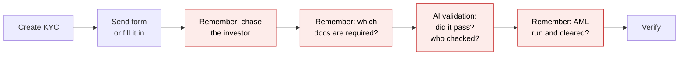
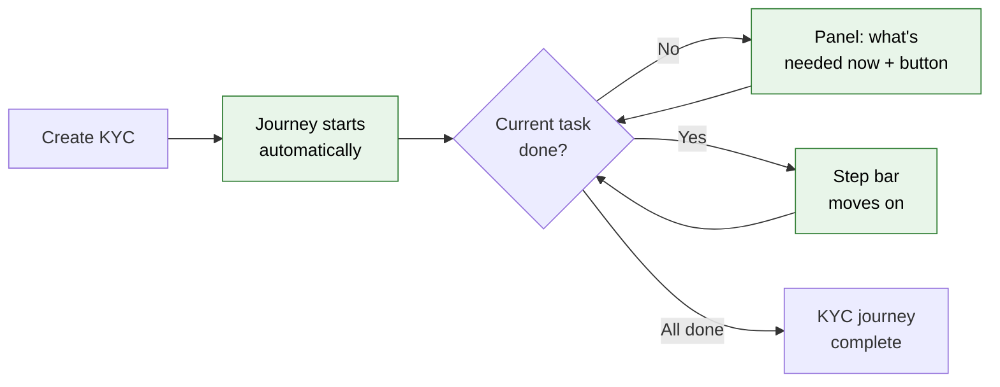
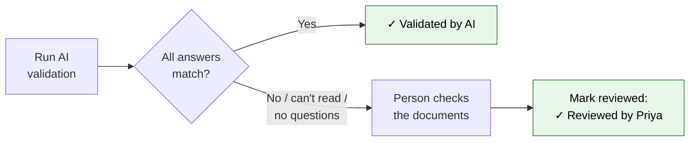
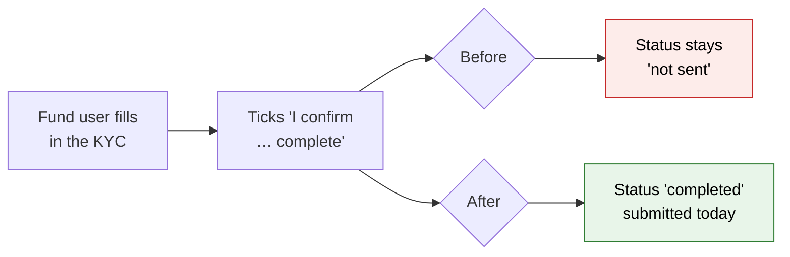

# Investor KYC Journey — Proposal

> **Audience:** Business team, product, QA, support — non-technical.
> **Companion document:** [Design](design.md)

> **Planning phase — no code changes.** This document proposes and explains the change. Do not
> edit application code while writing it; implementation happens later, in the tasks phase.

---

## Why

Getting an investor's KYC from "created" to "verified" means sending the form, chasing the investor,
collecting the required documents, checking them (by AI or by hand), running AML screening, clearing any
match, reviewing and verifying. Nothing on the KYC page says which of these is done or what comes next. In
production, of the 113 KYCs created since July (not imported), 50 are still unverified, and only 9 of the 213
KYCs run through AI document validation since January passed it fully — the rest needed a person to check, with
nothing recording that anyone did. Capital calls and distributions already have a journey that solves exactly
this; KYCs do not.

## What Changes

The journey that capital calls and distributions have (step bar + "What's needed now" panel, worked out
from the record's own data) is extended to investor KYCs. The engine, screens and setup are the same ones
calls and distributions use.

- **One ready-made KYC journey is seeded per company**, with 9 tasks:

  | # | Task | Done when | Not applicable (–) when |
  |---|---|---|---|
  | 1 | Send KYC form | The KYC form link has been emailed to the investor | The fund filled the KYC in itself |
  | 2 | Submit KYC | The investor submitted it, or a fund user ticked "complete" | — |
  | 3 | Upload required documents | Every document the company requires is uploaded | The company requires none |
  | 4 | Validate documents | AI validation passed every answer, **or** someone checked them and clicked Mark reviewed | — |
  | 5 | Run AML screening | An AML result exists | AML is not enabled for the company |
  | 6 | Clear AML match | A potential match was overridden | AML found no match |
  | 7 | Review KYC | Someone clicked Mark reviewed | — |
  | 8 | Compliance sign-off | The picked approver signed off | No approver picked yet |
  | 9 | Verify KYC | The KYC is verified | — |

  Every new KYC gets it — created by the fund, by the investor, or imported. Admins can edit it in
  Workflow Templates (e.g. pick the Compliance sign-off approver, remove AML).
- **One default journey, plus a specific journey per KYC form type when wanted.** Setup seeds a single
  journey used by every KYC. A company can give any KYC form type (e.g. "Individual — Fund IV") its own
  journey: duplicate the template (new **Duplicate** action on Workflow Templates), edit the copy, and add
  an auto-assignment rule picking that form type from a new **KYC form type** list on the rule form. Any
  KYC whose form type has no specific journey uses the default.
- **The KYC page gets the step bar and "What's needed now" panel**, with a button that runs the real
  control on the page (Send KYC Required Notification, Send KYC Reminder, Edit, Validate Document Data,
  Generate AML Report, View AML Reports, Verify).
- **"Validate documents" works with or without AI.** If the AI validated every answer, it ticks itself.
  If the AI could not read a document, flagged a mismatch, or the company has no document questions, a
  person checks the documents and clicks **Mark reviewed**.
- **A KYC verified early still finishes.** Tasks skipped on the way show "–" with "Verified without this
  step", so an imported, already-verified KYC shows a complete journey at once, and a gap stays visible.
- **The page updates by itself** when the investor submits, a document is uploaded, AI validation or the
  AML report finishes, or a colleague verifies — including from bulk actions.
- **Undoing moves the journey back**: UnVerify (single or bulk), Request Updates, unticking "complete",
  deleting or replacing a document after it was validated, and editing the KYC after it was reviewed.
- **Set up three ways**, all running the same setup: a rake task (dry run by default), automatically for
  new fund companies, and a **"Set up investor KYC journeys"** item in the Workflow Templates page's
  **Set up journeys** menu.
- **Two fixes to the existing KYC screens** (agreed with product):
  1. **A fund user ticking "I confirm all details provided are complete…" now marks the KYC submitted.**
     Today the tick is silently thrown away; unticking already moves it back to draft.
  2. **Bulk Unverify now behaves like the single UnVerify**: the KYC goes back to "completed", not to
     "link sent". **BREAKING** for anyone who used bulk Unverify to reopen KYCs for investors — they use
     Request Updates instead.
- **The journey engine learns one small thing**: a "Mark reviewed" task can also be completed by the
  record's data (here, a full AI pass). Call and distribution journeys are unaffected.
- **Existing KYCs are untouched.** Only KYCs created after setup get a journey.

### Flow Diagram

Getting a KYC verified: before, the user works out the order from the page and the actions menu.



After: the page shows the current task, what it needs and a button that does it.



Validating documents: before, an AI result that was not a full pass left no record of who checked it.



A fund user filling the KYC in: before, the "complete" tick was thrown away.



---

## User Stories

### US-1: See where the KYC is

**As a** fund operations or compliance user,
**I want** the KYC page to show which task the KYC is on and what it needs,
**So that** I don't have to remember the order or check five places.

**Acceptance criteria:**
- The page shows every task by name with a mark: ✓ done, ● current, ○ not yet, – not applicable,
  ↺ moved back.
- The "What's needed now" panel names the current task, a specific message (e.g. "2 required documents
  missing: PAN Card, Address Proof") and a button.
- The button runs the control on the page that does the work (e.g. it opens KYC Actions and clicks "Send
  KYC Reminder", which runs as usual).

### US-2: Fill a KYC in for the investor

**As a** fund operations user who collects KYC details offline,
**I want** to tick "complete" when I've filled the KYC in,
**So that** the journey skips "Send KYC form" and moves on to documents.

**Acceptance criteria:**
- Ticking "I confirm all details provided are complete…" and saving, as a fund user, sets the KYC to
  completed with today as the submitted date.
- "Send KYC form" then shows "–" "Filled in by the fund" (when no form was ever sent) and "Submit KYC" ✓.

### US-3: Validate documents with or without AI

**As a** compliance user,
**I want** the document check to pass by itself when the AI validated everything, and to let me confirm by
hand otherwise,
**So that** blurry scans and companies without document questions don't block the KYC.

**Acceptance criteria:**
- AI ran and every answer matched → "✓ Validated by AI", no click needed.
- AI could not validate some answers → "AI could not validate 2 of 12 answers — check them and mark
  reviewed", with "Open validation" and **Mark reviewed**.
- Company has no document questions → "Check the documents and mark reviewed", with **Mark reviewed**.
- A document uploaded, replaced or deleted after the task passed → the task moves back with "Documents
  changed after validation".

### US-4: AML gate

**As a** compliance user in a company with AML enabled,
**I want** a potential AML match to hold the KYC until someone overrides it,
**So that** nobody verifies a KYC with an unreviewed match.

**Acceptance criteria:**
- Before the report: "Run AML screening" is current with "Generate AML Report".
- Potential match: "Clear AML match" is current with "AML found a potential match — review the report
  and override it if it is a false positive", button "View AML Reports".
- No match: "Clear AML match" shows "–" "No AML match".
- AML not enabled: both tasks show "–" "AML screening is not enabled".

### US-5: Live updates

**As a** fund user with the KYC open,
**I want** the step bar to update when the investor submits, a background job finishes or a colleague acts,
**So that** I never act on a stale page.

**Acceptance criteria:**
- When the AML report arrives, the bar moves from "Run AML screening" without a reload.
- When a colleague bulk-verifies from the KYC list, the open KYC page shows "Verify KYC" ✓.

### US-6: Undo moves the journey back

**As a** compliance user,
**I want** the journey to move back when a KYC is reopened and say why,
**So that** earlier reviews and sign-offs are not counted for details that changed.

**Acceptance criteria:**
- Request Updates puts the journey back to "Submit KYC" and shows "Moved back to "Submit KYC" — Updates
  requested by Priya …"; the Review KYC confirmation and Compliance sign-off are reset.
- UnVerify (single or bulk) puts it back to "Verify KYC" (or earlier, if an earlier task no longer passes).

### US-7: Set up KYC journeys for my company

**As a** company admin of a fund company,
**I want** a "Set up investor KYC journeys" item in the Set up journeys menu on Workflow Templates,
**So that** I don't need a developer to turn the feature on.

**Acceptance criteria:**
- The confirmation lists what will be added; afterwards a notice says what was added.
- Once set up, the item shows "✓ Investor KYC journeys set up", disabled.
- Non-admins and companies that are not Investment Funds or Angel Funds don't see it.

### US-8: Bulk Unverify matches UnVerify

**As a** compliance user,
**I want** bulk Unverify to put KYCs back to "completed", like the single UnVerify,
**So that** the two give the same result and investors are not unexpectedly able to edit.

**Acceptance criteria:**
- After bulk Unverify, each KYC's status is "completed" and the investor cannot edit it.
- To reopen a KYC for the investor, Request Updates is used (unchanged).

---

## UI Behavior

### KYC page — journey panel

```
┌────────────────────────────────────────────────────────────────────────────────────┐
│ ⌁ Journey  Investor KYC                                  4 of 8 done  50%  [View]   │
│                                                                                    │
│ ✓ Send KYC form ─ ✓ Submit KYC ─ ✓ Upload required documents ─                       │
│ ● Validate documents ─ ○ Run AML screening ─ ○ Clear AML match ─ ○ Review KYC ─      │
│ – Compliance sign-off ─ ○ Verify KYC                                                 │
│                                                                                    │
│ ┌ What's needed now ───────────────────────────────────────────────────────────┐    │
│ │ Validate documents: AI could not validate 2 of 12 answers — check them and    │    │
│ │ mark reviewed                          [ ✓ Mark reviewed ] [ Open validation → ]│    │
│ └──────────────────────────────────────────────────────────────────────────────┘    │
│ ⚠ Bank account verification failed                                                  │
└────────────────────────────────────────────────────────────────────────────────────┘
```

**Behavior notes:**
- Shown only on KYCs that have a journey, and only to fund users. Investors (logged in or via the emailed
  link) never see it. Older KYCs look exactly as today.
- The panel button opens the KYC Actions menu when needed, highlights the control and clicks it, so its own
  confirmation runs. A control the user may not use (e.g. Verify without the KYC approve permission) is not
  on the page, so the button falls back to a plain link.
- Mark reviewed is shown only to users who can edit the KYC.
- Warnings (PAN or bank verification failed, investor has no users to email, KYC expiry date passed) show
  until the KYC is verified.

### Workflow Templates page — Set up journeys menu

```
┌──────────────────────────────────────────────────────────────────────────┐
│ Workflow Templates     ⓘ   [Set up journeys ▾]  [New Template]           │
│                            ├ ✓ Capital call journeys set up              │
│                            ├ ✓ Capital distribution journeys set up      │
│                            └ Set up investor KYC journeys                │
└──────────────────────────────────────────────────────────────────────────┘
```

**Behavior notes:**
- One item per journey kind, each with its own confirm and its own "✓ set up" state (existing menu).

---

## What This Feature Does NOT Cover

| Excluded | Covered In |
|---|---|
| KYC expiry and renewal (no renewal action exists today) | Later change |
| Journeys on KYCs created before setup | Not planned |
| Choosing a call/distribution journey per fund, and notification recipients from fund custom fields | Separate change: journey-fund-overrides |
| Seeding a journey per form type | Not planned (supported via Duplicate + form-type rule) |
| Blocking Verify until earlier tasks are done | A later phase for all journeys |
| PAN and bank verification as tasks (shown as warnings only) | Not planned |
| A journey for the investor's own view of their KYC | Not planned |
| CKYC / KRA fetch as a task (optional, India only) | Not planned |
| Changing how AI validation decides a pass | Not planned |

---

## Validation Rules

| Field | Rule | Default |
|---|---|---|
| "I confirm … complete" (fund user) | Ticking it and saving sets the KYC to completed with today's submitted date; unticking (existing) sets draft | Unticked |
| Bulk Unverify | Sets the KYC to completed (same as single UnVerify) | — |
| Mark reviewed | Only users who can edit the KYC | — |
| Setup menu item | Company admin of an "Investment Fund" or "Angel Fund" company | — |

---

## Behavior Rules

| Scenario | What User Sees |
|---|---|
| New KYC, nothing sent | "Send KYC form: The KYC form has not been sent — send it, or fill it in and tick complete", button "Send KYC Required Notification" |
| Investor has no users to email | Same task, "The investor has no users to send the form to — add one, or fill it in yourself", button "Edit" |
| Form sent, investor hasn't saved | "Submit KYC: Waiting for the investor — form sent on 05/10/2026", button "Send KYC Reminder" |
| Investor saved a draft | "Submit KYC: The investor saved a draft on 06/10/2026 but has not submitted" |
| Fund filled it in and ticked complete | "Send KYC form" "–" "Filled in by the fund"; "Submit KYC" ✓ |
| 2 required documents missing | "Upload required documents: 2 required documents missing: PAN Card, Address Proof", button opens the Documents tab |
| Company requires no documents | "Upload required documents" "–" "No documents are required" |
| AI validated everything | "Validate documents" ✓ "Validated by AI" |
| AI not run yet, doc questions exist | "Validate documents: Documents not validated yet — run AI validation or check them and mark reviewed", buttons "Validate Document Data" and Mark reviewed |
| No doc questions | "Validate documents: Check the documents and mark reviewed", Mark reviewed |
| AML not enabled | "Run AML screening" and "Clear AML match" "–" "AML screening is not enabled" |
| AML report requested, not back | "Run AML screening: AML report requested — waiting for the result" |
| Potential match | "Clear AML match: AML found a potential match — review the report and override it if it is a false positive", button "View AML Reports" |
| Match overridden to no match | "Clear AML match" ✓ "Overridden by Priya: <reason>" |
| Match confirmed by override | "Clear AML match: AML match confirmed — this KYC should not be verified" |
| No Compliance sign-off approver picked | "Compliance sign-off" "–" "No approver set — pick one on this step in the journey template" |
| Verified before a task was done | That task "–" "Verified without this step" |
| Request Updates | Amber banner "Moved back to "Submit KYC" — Updates requested by Priya on 07/10/2026 11:20." |
| Bulk Unverify | Each KYC: back to "Verify KYC", status completed |
| Setup clicked | "Investor KYC journeys set up: KYC journey, auto-assignment rule. New KYCs will get a journey." |
| Setup already done | Disabled "✓ Investor KYC journeys set up" |
| Duplicate a workflow template | New template "Copy of Investor KYC" with the same tasks, checks, owners and approvers; not linked to setup |
| New rule for KYCs | Rule form shows "KYC form type" listing e.g. "Individual — Default", "Individual — Fund IV", "Non Individual — Fund IV"; picking one sets the condition; blank = no form-type condition |

---

## Resolved Design Decisions

| # | Decision | Resolution |
|---|---|---|
| 1 | Separate journeys for fund-filled and investor-filled KYCs? | No — one journey. "Send KYC form" is not applicable once the fund has filled it in, so a fund can switch method at any time. |
| 2 | Extra tasks beyond the basic flow? | Add a Compliance sign-off (no approver until an admin picks one), as calls and distributions have a CFO sign-off. PAN/bank and AI validation are not separate tasks. |
| 3 | Imported KYCs? | Same journey. One imported as verified shows complete at once ("Verified without this step" on anything missing). |
| 4 | Bulk Unverify sets "link sent", single UnVerify sets "completed" — which is right? | "Completed" for both. Reopening for the investor is what Request Updates is for. |
| 5 | AI validation sometimes can't validate — how is the document check done? | One "Validate documents" task: AI full pass completes it automatically, otherwise a person marks it reviewed. |
| 6 | Show an AI pass as ✓ or as "–"? | ✓ "Validated by AI" — the engine learns that a review task can be completed by data. |
| 7 | The fund's "complete" tick is thrown away today | Fixed: ticking it as a fund user marks the KYC submitted. |
| 9 | Separate journeys per KYC kind? | Per **form type** (a company can have several Individual form types, e.g. per fund), not just Individual / Non Individual. Supported, not seeded: one default journey; a form-type rule picks a specific one. Chosen on the rule form, not on the form type. |
| 10 | Per-fund journey choice and notification recipients from fund custom fields | Split into a separate change (journey-fund-overrides) covering calls, distributions and KYC. |
| 8 | Which companies? | Investment Fund and Angel Fund companies (both create KYCs in production). |

---

## Capabilities

### New Capabilities

- `kyc/investor-kyc-journey`: the KYC journey (tasks, not-applicable rules, panel, live updates, undo,
  setup) and the two fixes to the fund "complete" tick and bulk Unverify.

### Modified Capabilities

- `workflows/evaluated-workflow-steps`: an acknowledge step's check may complete the step from the
  record's data, with no confirmation click; the check's message is shown while the step waits.

---

## Impact

- The KYC page (panel, KYC Actions button ids, Workflow tab already there).
- The KYC form (fund "complete" tick) and the KYC list's bulk Unverify.
- Background work for sending forms, reminders, AI validation, AML reports, document uploads, imports and
  bulk actions — each tells the journey when it finishes.
- The shared journey engine (one addition for review tasks; calls and distributions unaffected).
- The Workflow Templates page (third setup item), new-company setup, and a rollout task.
- User guide for investor KYC.

---

## Benefits

1. Users see at a glance where every new KYC stands and what to do next.
2. Manual document checks are recorded — who checked and when — instead of disappearing.
3. Potential AML matches can't be overlooked on the way to Verify.
4. Fund-filled KYCs are no longer stuck looking "not sent".
5. The page stays current without reloading, including when investors submit or colleagues act.

---

## FAQ

| Question | Answer |
|---|---|
| Who sees the journey? | Fund users who can view the KYC. Investors never see it. Buttons still follow each user's rights. |
| Does it block anything? | No. It advises only. Verify still works at any point. |
| What happens to existing KYCs? | Nothing. Only KYCs created after setup get a journey. |
| Do I have to set anything up? | A company admin clicks "Set up investor KYC journeys" once, or support runs the rollout. New fund companies get it automatically. |
| Will investors get extra emails? | No. Reminders about stalled tasks go to the task owner (the KYC's creator), not the investor. |
| We already have a human approval workflow on KYCs. What happens? | Setup adds the journey template but no auto-assignment rule while you already have one; the admin decides which to launch. |
| What if we don't use AML? | Both AML tasks show as not applicable. |
| What if we never set up document questions? | "Validate documents" becomes a manual check with Mark reviewed. |
| Does the "documents first" form (investor uploads documents, AI pre-fills the form) change anything? | No. Uploading first only adds documents; the KYC is still waiting for the investor to submit, which happens on the normal form. Pre-filling is not validation, so it never ticks "Validate documents". The investor never sees the journey. |
| Who loses anything from the bulk Unverify fix? | Anyone who used bulk Unverify to let investors edit again; they now use Request Updates. |
| Can we change the tasks? | Yes, in Workflow Templates. See [design](design.md). |
| Can one KYC form type follow a different journey? | Yes. Duplicate "Investor KYC", change the copy, then add an auto-assignment rule for it and pick the form type (e.g. "Individual — Fund IV"). KYCs of every other form type keep the default journey. |

---

## Design Principle for the Next Phase

Reuse, don't copy. The panel, helper, setup base, model concern, controller concern and policy methods are
already shared by calls and distributions; KYC should need only its checks, a setup table, hooks, button
ids and a 3-line `_journey` wrapper. Risky items to address explicitly: (a) the engine addition for
data-completed review tasks must not change call or distribution journeys; (b) the "Verified without this
step" rule must not multiply into one hand-written class per task; (c) several KYC actions write with
`update_columns`, which skips callbacks — every such path needs an explicit journey hook; (d) setup's base
assumes a Full + Light pair, Investment Funds only, and a "CFO sign-off" — it must take a single template,
Angel Funds and a differently named sign-off without copying the base.
