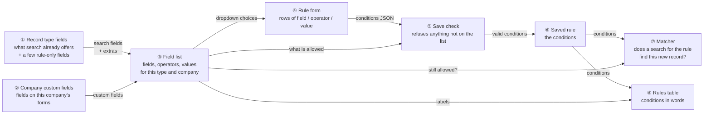
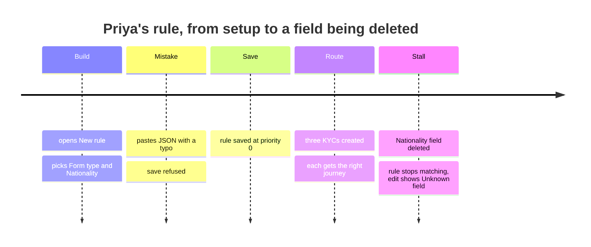
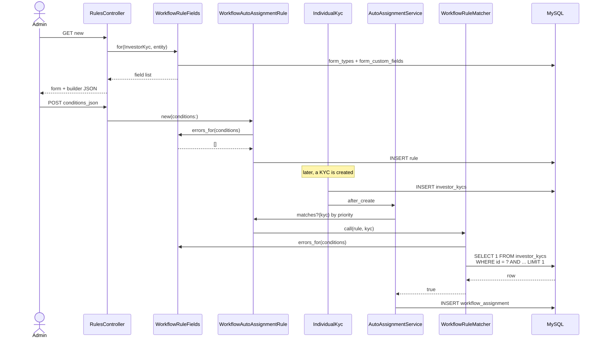
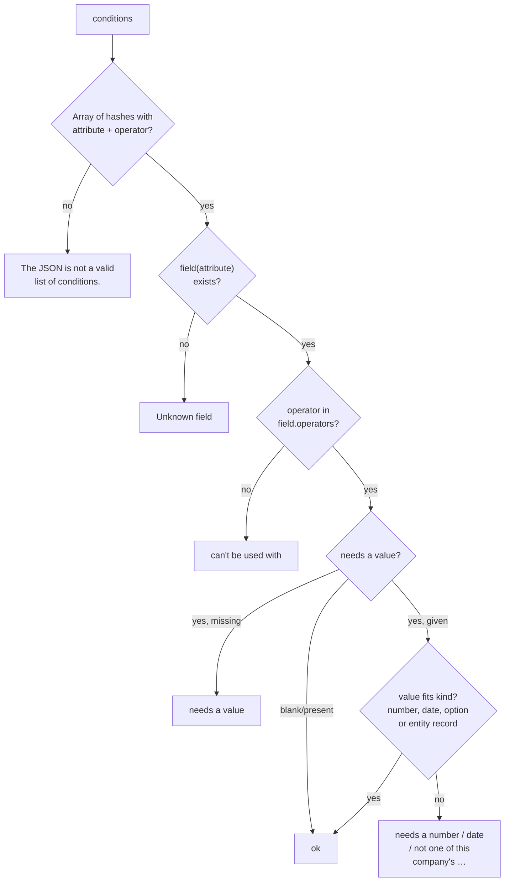
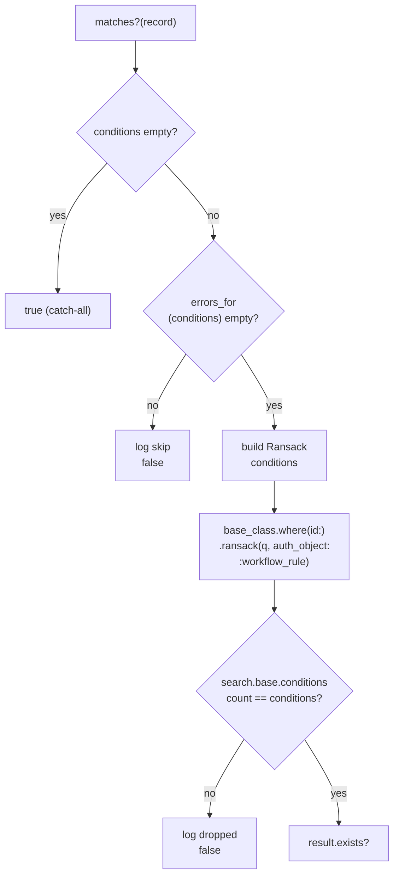
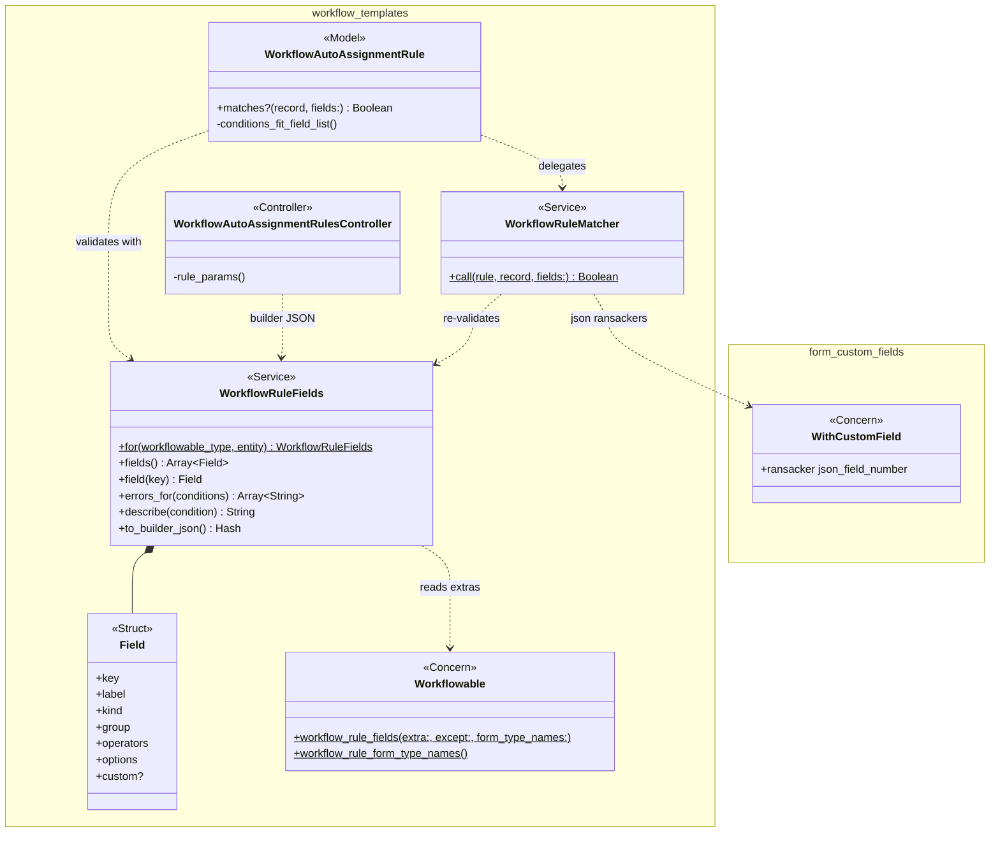
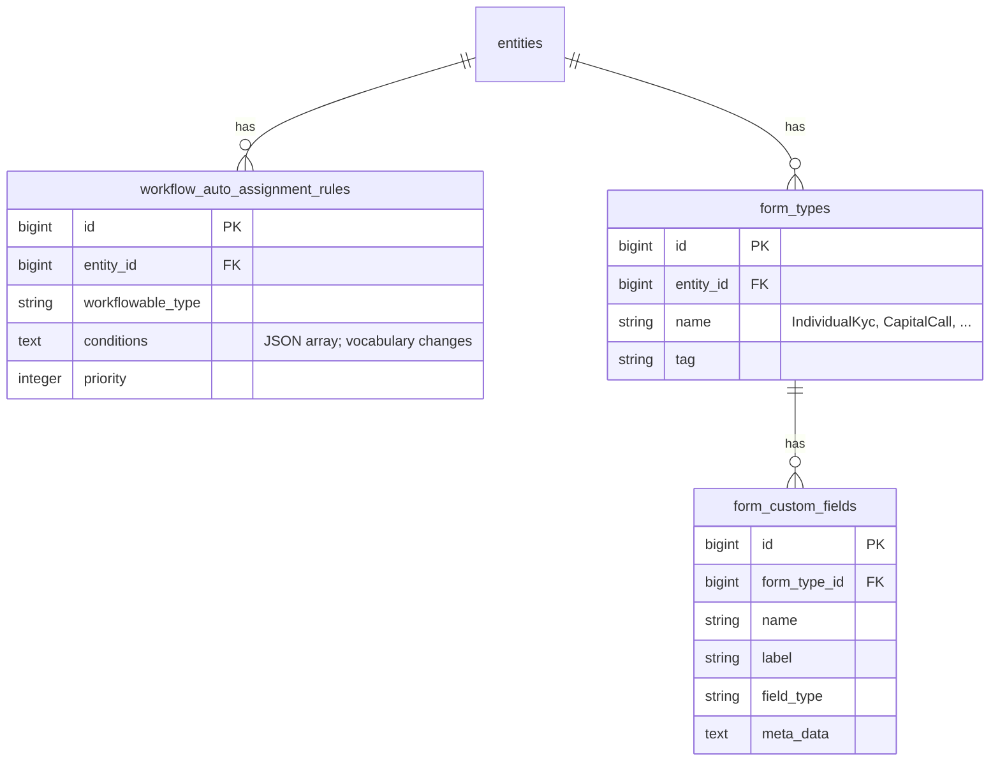

# Workflow Rule Condition Builder — Design

> **Audience:** Engineering team.
> **Companion documents:** [Proposal](proposal.md) · [Spec](specs/) · [LLD](lld.md)

> **Planning phase — no code changes.** This document explains HOW the proposal will be built.
> Do not edit application code while writing it; implementation happens later, in the tasks phase.

---

## Contents

- [1. The idea](#1-the-idea)
  - [What this adds](#what-this-adds)
  - [The idea in one picture](#the-idea-in-one-picture)
  - [Walkthrough: one example, start to finish](#walkthrough-one-example-start-to-finish)
  - [Key ideas](#key-ideas)
- [2. The same picture with real names](#2-the-same-picture-with-real-names)
  - [Picture](#picture)
  - [What each box does](#what-each-box-does)
  - [One run, end to end](#one-run-end-to-end)
  - [Lifecycles](#lifecycles)
  - [What users see](#what-users-see)
  - [Design decisions](#design-decisions)
- [3. One card per box](#3-one-card-per-box)
  - [① Record type fields](#-record-type-fields)
  - [② Company custom fields](#-company-custom-fields)
  - [③ Field list](#-field-list)
  - [④ Rule form](#-rule-form)
  - [⑤ Save check](#-save-check)
  - [⑥ Saved rule](#-saved-rule)
  - [⑦ Matcher](#-matcher)
  - [⑧ Rules table](#-rules-table)
- [4. Reference](#4-reference)
  - [Class diagram](#class-diagram)
  - [Data model and schema changes](#data-model-and-schema-changes)
  - [Component contracts](#component-contracts)
  - [Cross-cutting concerns](#cross-cutting-concerns)
  - [Worked examples](#worked-examples)
  - [Testing](#testing)
  - [Risks and open questions](#risks-and-open-questions)

---

## 1. The idea

### What this adds

A per-company **field list** for each workflowable type, built from what the model already exposes
to Ransack plus the company's form custom fields. One list drives three things: the rule form's
dropdowns, the save-time checks, and the plain-words description on the template page. Matching a
rule becomes **"does a Ransack search for these conditions find this one record?"**. This is the
same mechanism list pages use, replacing the hand-written column comparison in
`WorkflowAutoAssignmentRule#matches?`. It follows the MCP ontology pattern from `CLAUDE.md`: one
declared surface generates both what a client is offered and what it is allowed to send.

### The idea in one picture



### Walkthrough: one example, start to finish

**Setup.** Acme Capital (an Investment Fund) has the seeded "Investor KYC" journey and its
catch-all rule at priority 100. Acme has two individual KYC forms: "Individual — Default" and
"Individual — Fund IV". Both carry a Select custom field **Nationality** (India, USA, UK). Priya,
Acme's fund admin, duplicated the journey as "Investor KYC — Fund IV (domestic)". She wants it
only for Fund IV KYCs of Indian nationals.

**Legend.** In the Result column, a rule row reads `priority · conditions → template`. A KYC row
reads `KYC → journey it got`. "—" means no change.



**Phase 1 — building the rule**

| # | When | What happens | Behind the scenes | Result |
|---|---|---|---|---|
| 1 | Priya opens New rule on the copy | Form shows the conditions area with "+ Add condition" | The field list (③) is built from the KYC record type fields (①) and Acme's custom fields (②), then handed to the rule form (④) | No rows yet: "No conditions = applies to every new KYC" |
| 2 | She adds a row and picks Form type | Operator offers is / is not / is one of / is not one of. Value lists Acme's three KYC forms | The rule form (④) reads Form type's kind and options from the field list (③) | Row 1: Form type is ▢ |
| 3 | She picks "Individual — Fund IV" | Value set | Stored in the row as the form type's id | Row 1: Form type is Individual — Fund IV |
| 4 | She adds Nationality and picks India | Value list comes from the field's options | Custom field, so the key is `json_fields.nationality` | Row 2: Nationality is India |

**Phase 2 — a mistake, then saving**

| # | When | What happens | Behind the scenes | Result |
|---|---|---|---|---|
| 5 | She opens View as JSON and retypes the key as `nationalty`, then saves | Form re-renders with "Condition 2: Unknown field "nationalty"." | The save check (⑤) looks the key up in the field list (③) and does not find it | Not saved |
| 6 | She fixes the typo and saves | Redirect to the template page | The save check (⑤) passes, and the saved rule (⑥) stores two conditions | 0 · Form type is Individual — Fund IV and Nationality is India → Fund IV (domestic) |

**Phase 3 — KYCs arrive**

| # | When | What happens | Behind the scenes | Result |
|---|---|---|---|---|
| 7 | KYC A: Fund IV form, Nationality India | Gets the Fund IV (domestic) journey | The matcher (⑦) runs one search on investor_kycs for A's id with both conditions. It finds A, so priority 0 wins | KYC A → **Investor KYC — Fund IV (domestic)** |
| 8 | KYC B: Fund IV form, Nationality USA | Gets the default journey | The matcher (⑦) finds nothing for priority 0. The catch-all at 100 matches | KYC B → **Investor KYC** |
| 9 | KYC C: Default form, Nationality India | Gets the default journey | The Form type condition fails, so priority 0 is skipped | KYC C → **Investor KYC** |

**Phase 4 — a field is deleted (stall)**

| # | When | What happens | Behind the scenes | Result |
|---|---|---|---|---|
| 10 | Someone deletes Nationality from both forms | Nothing visible yet | — | Same as row 6 |
| 11 | KYC D: Fund IV form; its JSON still holds `nationality: "India"` from an import | Gets the default journey | The matcher (⑦) re-checks the rule against the field list (③). `json_fields.nationality` is gone, so the rule is skipped and logged rather than searched | KYC D → **Investor KYC** |
| 12 | Priya edits the rule | Row 2 is red: "Unknown field: nationality". Save is refused until she removes it | The rule form (④) cannot find the key in the field list (③), and the save check (⑤) agrees | Rule unchanged until fixed |

Snapshot at row 12:

```
  Conditions — a new KYC gets this template when ALL of these match
  ┌──────────────────────┬──────────┬───────────────────────┬───┐
  │ Form type          ▼ │ is     ▼ │ Individual — Fund IV ▼│ ✕ │
  │ ⚠ Unknown field: nationality — remove or change           │ ✕ │
  └──────────────────────┴──────────┴───────────────────────┴───┘
  + Add condition                                 View as JSON
```

**What to notice**

- The field list (③) is consulted at four moments: drawing the form, saving, matching and
  describing. This is why the UI, the save check and the matcher cannot disagree.
- Matching is a search. The custom-field and amount handling is the same code list pages use.
- A rule fails closed (rows 5, 11, 12). An invalid condition never makes a rule match more.
- Nothing about the stored row changed shape. It is still a JSON array of
  `{attribute, operator, value}`; only the allowed vocabulary changed.

### Key ideas

| # | Idea | In one line | Card |
|---|---|---|---|
| 1 | Search fields are the base | A rule can use what Ransack already exposes for the model, plus declared rule-only extras | [①](#-record-type-fields) |
| 2 | Custom fields join per company | Every option, text, number or date custom field on this company's forms for the type | [②](#-company-custom-fields) |
| 3 | One field list | Fields, kinds, operators and options in one object used by the form, save, matcher and table | [③](#-field-list) |
| 4 | Matching is a one-row search | `Model.where(id:).ransack(q, auth_object: :workflow_rule).result.exists?` | [⑦](#-matcher) |
| 5 | Fail closed | Unknown field, disallowed operator or a dropped Ransack condition all mean "no match" | [⑤](#-save-check), [⑦](#-matcher) |

**FAQ**

| Question | Answer |
|---|---|
| Why not keep the Ruby comparison and just add custom fields to it? | It would need its own money conversion, type casting and JSON handling, which Ransack already does for list pages. Two engines drift. |
| Does a record get re-routed when a rule changes? | No. Same trigger points as today: `after_create`, and `after_update` while unassigned. |
| What about OR? | Out of scope. Use two rules. |
| Does this expose new fields to list search? | No. Rule-only fields are added only when Ransack is called with `auth_object: :workflow_rule`. |

---

## 2. The same picture with real names

### Picture

```mermaid
flowchart LR
    classDef new fill:#d4edda,stroke:#2e7d32,color:#000
    classDef mod fill:#fff3cd,stroke:#b8860b,color:#000
    classDef reuse fill:#eceff1,stroke:#90a4ae,color:#000
    F1["① Model.ransackable_attributes<br/>+ Workflowable.workflow_rule_fields<br/><i>declares search + rule-only fields</i>"]:::mod
    F2["② FormType + FormCustomField<br/><i>this entity's custom fields</i>"]:::reuse
    L["③ WorkflowRuleFields<br/><i>builds the field list</i>"]:::new
    U["④ workflow_auto_assignment_rules/_form<br/>+ workflow_rule_conditions_controller.js<br/><i>row editor</i>"]:::mod
    S["⑤ WorkflowAutoAssignmentRule<br/>validate :conditions_fit_field_list<br/><i>rejects invalid conditions</i>"]:::mod
    R["⑥ workflow_auto_assignment_rules.conditions<br/><i>JSON array, unchanged column</i>"]:::reuse
    M["⑦ WorkflowRuleMatcher<br/><i>one-row Ransack search</i>"]:::new
    T["⑧ workflow_templates/show<br/><i>rules table in words</i>"]:::mod
    F1 -- "ransackable_attributes<br/>(:workflow_rule)" --> L
    F2 -- "form_custom_fields" --> L
    L -- "#to_builder_json" --> U
    U -- "conditions_json param" --> S
    L -- "#errors_for" --> S
    S -- "conditions array" --> R
    R -- "rule.conditions" --> M
    L -- "#errors_for" --> M
    R -- "rule.conditions" --> T
    L -- "#describe" --> T
    click F1 "#-record-type-fields" "Open card ①"
    click F2 "#-company-custom-fields" "Open card ②"
    click L "#-field-list" "Open card ③"
    click U "#-rule-form" "Open card ④"
    click S "#-save-check" "Open card ⑤"
    click R "#-saved-rule" "Open card ⑥"
    click M "#-matcher" "Open card ⑦"
    click T "#-rules-table" "Open card ⑧"
```



Colour = footprint: **green** new, **amber** modified, **grey** reused unchanged. Exact files are in
[lld.md File Map](lld.md#file-map).

### What each box does

| # | Box | Real parts | What it does | When it runs | What it decides | Details |
|---|---|---|---|---|---|---|
| ① | Record type fields | `ransackable_attributes` on the 7 models; `Workflowable.workflow_rule_fields` macro | Adds rule-only extras to the Ransack allowlist when `auth_object == :workflow_rule` | Class load | Which non-custom fields a rule may use | [card ①](#-record-type-fields) |
| ② | Company custom fields | `FormType`, `FormCustomField` | Supplies the entity's custom fields for the type's form names | When ③ is built | Nothing; read only | [card ②](#-company-custom-fields) |
| ③ | Field list | `WorkflowRuleFields` | Builds fields with kind, label, operators and options; validates and describes conditions | Form render, save, match, show page | Is a condition allowed; how it reads | [card ③](#-field-list) |
| ④ | Rule form | `_form.html.erb`, `workflow_rule_conditions_controller.js`, `WorkflowAutoAssignmentRulesController` | Row editor that serialises to `conditions_json` | Request | Nothing server-side; UX only | [card ④](#-rule-form) |
| ⑤ | Save check | `WorkflowAutoAssignmentRule` validation | Runs ③'s `errors_for` on save | `valid?` | Save or refuse | [card ⑤](#-save-check) |
| ⑥ | Saved rule | `workflow_auto_assignment_rules.conditions` (text, JSON coder) | Stores the array | — | — | [card ⑥](#-saved-rule) |
| ⑦ | Matcher | `WorkflowRuleMatcher`; callers `WorkflowAutoAssignmentRule#matches?` → `WorkflowAutoAssignmentService`, `WorkflowTemplate#eligible_for?` | Re-validates, builds the Ransack query, runs `exists?` | `after_create` / `after_update` of a workflowable; template eligibility | Does this rule match this record | [card ⑦](#-matcher) |
| ⑧ | Rules table | `workflow_templates/show.html.erb` | Prints `describe` per condition | Show page | — | [card ⑧](#-rules-table) |

### One run, end to end



### Lifecycles

N/A. No stored or derived status is added. A rule has no state beyond its columns.

### What users see

**At a glance**

| Where in CapHive | Today | After this change | Who sees it |
|---|---|---|---|
| Workflow template → New / Edit auto-assignment rule | JSON textarea (+ "KYC form type" select on KYC rules) | Row builder with "+ Add condition" and a View as JSON toggle | Users who can edit the template |
| Workflow template page → Auto-assignment rules table | `form_type_id eq 412` in `<code>` | "Form type is Individual — Fund IV" | Users who can view the template |

**Everyday journey: add a KYC rule by form type and custom field**

```
┌──────────────────────────────────────────────────────────────┐
│ New Auto-Assignment Rule                                     │
│ Applies to [InvestorKyc]   Priority [0]   [ ] Auto-launch     │
│ Conditions — ALL of these match                              │
│ ① [Form type ▼]  ② [is ▼]  ③ [Individual — Fund IV ▼]  ④ ✕   │
│    [Nationality ▼]   [is ▼]   [India ▼]                  ✕   │
│ ⑤ + Add condition                          ⑥ View as JSON    │
│ [Save] [Cancel]                                              │
└──────────────────────────────────────────────────────────────┘
```

| Step | The user… | They see |
|---|---|---|
| 1 | clicks ⑤ + Add condition | a new row with Field ① empty |
| 2 | picks a field in ① | ② fills with that field's operators; ③ becomes the right input (select, number, date, text) |
| 3 | picks an operator in ② | ③ hides for is blank / is present, and becomes multi-value for is one of |
| 4 | picks or types a value in ③ | the row is complete |
| 5 | clicks ④ on a row | the row disappears |
| 6 | clicks ⑥ | rows swap for a JSON textarea holding the same conditions; clicking again swaps back |
| 7 | clicks Save | the template page, or the form again with numbered condition errors |

### Design decisions

1. **Match with Ransack, not Ruby.** Choice: `WorkflowRuleMatcher` runs a one-row Ransack search.
   Alternative: extend `evaluate_condition` with JSON and money handling. Rejected because it
   duplicates `RansackerAmounts` and the `json_fields` ransacker, and the two would drift.
2. **Rule-only fields via `auth_object`.** Choice: `ransackable_attributes(:workflow_rule)`
   returns the normal list plus declared extras (`form_type_id`, `manual_generation`, `json_fields`,
   `json_field_number`). Alternative: add them to the plain `ransackable_attributes`. Rejected:
   that changes what list-page search accepts, and the grid's custom-field bug fix (see
   [Risks](#risks-and-open-questions)) deserves its own change and tests.
3. **Keep the `{attribute, operator, value}` array.** Choice: same column and shape; the operator
   vocabulary becomes Ransack predicate names. Alternative: store a Ransack params hash. Rejected:
   rows map 1:1 to conditions, and the hash form is awkward to edit and describe.
4. **No backward compatibility.** Rules are not in production use (user decision). Old operators
   `gte` / `lte` become invalid. Seeded `LIGHT_CONDITIONS` (`manual_generation eq true`) are
   already valid Ransack and stay as they are.
5. **Re-validate at match time.** Choice: the matcher calls `errors_for` before searching.
   Alternative: trust the save check. Rejected: a custom field can be deleted after the rule is
   saved, and Ransack would then search a key that no form defines.
6. **Exclude unbounded reference fields.** `investor_id`, `investor_kyc_id`, `folio_id` and
   similar are left out of the field list. A dropdown of every investor does not scale, and a raw
   id defeats the point. `form_type_id` and `fund_id` are offered as entity-scoped selects.
7. **Number custom fields get a cast ransacker.** `json_fields ->> '$.x'` is text, so `"9" > "10"`.
   A sibling `json_field_number` ransacker casts to decimal; text, option and date fields keep the
   existing `json_fields` ransacker (dates are stored ISO, which sorts correctly as text).
8. **Remove the KYC form type picker.** `with_kyc_form_type`, `kyc_form_types` and
   `WorkflowAutoAssignmentRule#kyc_form_type_id` go. Form type is an ordinary reference field.

**FAQ**

| Question | Answer |
|---|---|
| Why a new class rather than reusing `McpOntology`? | The ontology is a static, hand-written YAML per entity for AI clients. Rules need per-company custom fields and entity-scoped options, which the ontology does not model. The pattern is shared: one declared surface drives both UI and validation. |
| Why `auth_object` and not a separate allowlist constant? | Ransack already asks the model for its allowlist with the auth object. Using that hook means the matcher's search is checked by Ransack itself, not just by our list. |
| Why not filter disabled templates in the matcher? | Unchanged behaviour owned by `WorkflowAutoAssignmentService` and the in-flight disabled-template change. The matcher answers only "do the conditions hold". |
| Why one query per rule rather than one for all rules? | Rules are few per entity and type (single digits). Priority order and per-rule logging are simpler. |

---

## 3. One card per box

> Same order and numbers as the picture.

### ① Record type fields

The seven workflowable models already declare `ransackable_attributes` for list search. A new class
macro on `Workflowable`, `workflow_rule_fields`, declares the few extra columns rules need. It also
names the form types whose custom fields apply, and prepends a `ransackable_attributes` override
that adds the extras only for `auth_object == :workflow_rule`.

| Owns | Reads / receives | Produces |
|---|---|---|
| Per-model extras and form type names | The model's existing `ransackable_attributes` | `ransackable_attributes(:workflow_rule)`; `workflow_rule_form_type_names` |

| Model (`workflowable_type`) | Extras added for rules | Form type names for custom fields | Excluded from the field list |
|---|---|---|---|
| `InvestorKyc` | `form_type_id`, `json_fields`, `json_field_number` | `IndividualKyc`, `NonIndividualKyc`, `InvestorKyc` | `PAN`, `bank_account_number`, `ifsc_code`, `address` (identifiers); rolled-up `committed_amount`, `call_amount`, `collected_amount`, `distribution_amount` |
| `CapitalCall` | `manual_generation`, `json_fields`, `json_field_number` | `CapitalCall` | rolled-up `call_amount`, `collected_amount`, `capital_fee`, `other_fee` |
| `CapitalDistribution` | `manual_generation`, `json_fields`, `json_field_number` | `CapitalDistribution` | `updated_at`; rolled-up `distribution_amount`, `gross_amount` |
| `CapitalCommitment` | `form_type_id`, `json_fields`, `json_field_number` | `CapitalCommitment` | `investor_id`, `investor_kyc_id`, `folio_id`, `esign_emails`, `updated_at`; computed `units_amount_minus_collected`, `foreign_currency_commitment`; rolled-up `call_amount`, `collected_amount`, `distribution_amount`, `total_units_amount` |
| `Approval` | `json_fields`, `json_field_number` (and a new base `ransackable_attributes`: `title approved due_date locked response_status owner_type`) | `Approval` | — |
| `Investor` | `json_fields`, `json_field_number` | `Investor` | `investor_access_count`, `unapproved_investor_access_count` |
| `Folder` | none | none (no `WithCustomField`) | — |

`json_fields` and `json_field_number` are Ransack plumbing for custom fields. They are allowed in
the search but never listed as fields themselves; see ③.

**Worked examples:** H1, H4, E1, E7, E8

**FAQ**

| Question | Answer |
|---|---|
| Why does `Approval` get a base `ransackable_attributes`? | It has none today. Ransack 4 refuses to search a model with no allowlist, and approvals without fields would only have custom fields. The list is small and harmless for search. |
| Why leave out call amount, a KYC's committed amount and similar totals? | They are counter-cache rollups (`counter_culture … execute_after_commit`) from remittances, commitments and payments. On a new record they are 0 when `after_create` checks the rules, and the later rollup writes use `update_all`, so `after_update` never re-checks. A rule on them would save and never fire (E8). |
| Why exclude PAN and bank numbers? | They identify one investor; a rule on them is a mistake. Excluded via the macro's `except:` list. |
| What does an STI KYC use? | Rules are stored under the base class (`workflowable_type_name`). The macro is declared on `InvestorKyc`, and `IndividualKyc` / `NonIndividualKyc` inherit it. |

### ② Company custom fields

Reused unchanged. `FormCustomField` rows of the entity's `FormType`s whose `name` is in the model's
form type names.

| Owns | Reads / receives | Produces |
|---|---|---|
| — | `entity.form_types.where(name:)` → `form_custom_fields` | Custom fields with `name`, `label`, `field_type`, `meta_data` |

| `field_type` | Kind in ③ | Ransacker used | Options |
|---|---|---|---|
| `Select`, `Radio`, `DataList` | option | `json_fields` | `parse_options(meta_data)` |
| `MultiSelect` | option (only `cont`) | `json_fields` | `parse_options(meta_data)` |
| `TextField`, `TextArea` | text | `json_fields` | — |
| `NumberField`, `Money` | number | `json_field_number` | — |
| `DateField` | date | `json_fields` | — |
| `CheckBox` | boolean | `json_fields` | Yes / No (stored `"true"` / `"false"`) |
| `File`, `Header`, `GridColumns`, `Calculation` | excluded | — | — |

When two forms define the same `name`, the field is listed once, labelled from the first form
ordered by `form_types.id`.

**Worked examples:** H2, E2, E3, E5

**FAQ**

| Question | Answer |
|---|---|
| What if two forms give the same field different types? | The first form's kind wins; noted in [Risks](#risks-and-open-questions). It is rare, and the field is then validated as that kind. |
| Calculation fields hold values too — why exclude? | They are recomputed on save, after the auto-assignment callback in some paths, so matching on them is unreliable. |

### ③ Field list

`WorkflowRuleFields.for(workflowable_type, entity)` builds and memoises (per instance) the list of
fields. It is the only place that knows kinds, operators, options and labels.

| Owns | Reads / receives | Produces |
|---|---|---|
| Operator vocabulary per kind; labels; option sources | ① and ② | `fields`, `field(key)`, `errors_for(conditions)`, `describe(condition)`, `to_builder_json` |

**Field kinds and operators** (stored operator = Ransack predicate):

| Kind | Source | Operators (stored → shown) | Value |
|---|---|---|---|
| text | string/text columns, text custom fields | `eq` is, `not_eq` is not, `cont` contains, `in` is one of, `blank` is blank, `present` is present | string; array for `in` |
| number | integer/decimal columns, ransackers of `RansackerAmounts` (amount), number custom fields | `eq`, `not_eq`, `gt` greater than, `gteq` at least, `lt` less than, `lteq` at most | numeric string |
| date | date/datetime columns, date custom fields | same as number | ISO date |
| boolean | boolean columns, CheckBox | `eq` is | `"true"` / `"false"` |
| reference | `form_type_id`, `fund_id` | `eq`, `not_eq`, `in`, `not_in` | id string(s) of this entity's records |
| option | option custom fields | `eq`, `not_eq`, `in`, `not_in`, `blank`, `present` (MultiSelect: `cont`, `blank`, `present`) | option string(s) |

**Reference option sources:** `form_type_id` → `entity.form_types.where(name: form type names)`,
labelled `"<Individual|Non Individual|Any type> — <tag>"` (moved from the old picker);
`fund_id` → `entity.funds`, labelled by name.

**Key naming:** model fields use the attribute name (`form_type_id`). Custom fields use
`json_fields.<name>` for every kind; the matcher picks the ransacker from the kind.

**`errors_for(conditions)` decision flow** (one message per bad condition, 1-based index):



**`describe(condition)`** → `"<label> <operator words> <value label>"`. A reference or option shows
its option label, a boolean shows Yes/No, and `in` joins labels with ", ". An unknown field reads
`"Unknown field: <attribute>"`.

**Worked examples:** H1, H2, H3, E2, E4, X1, X2, X3, X4, X5

**FAQ**

| Question | Answer |
|---|---|
| Why memoise per instance and not cache globally? | Custom fields change through the form-type screens. A per-request instance is always fresh, and the service builds one per evaluation pass. |
| Why are operator labels here and not in JS? | `describe` on the server (⑧) and the builder (④) must use the same words. They ship to JS inside `to_builder_json`. |
| Why not `null` / `not_null`? | `blank` / `present` cover both nil and empty string, which matches how custom-field values are stored. |

### ④ Rule form

The JSON textarea is replaced by a Stimulus row editor. The controller hands it
`WorkflowRuleFields#to_builder_json`; the editor writes the conditions array into the hidden
`conditions_json` field on every change.

| Owns | Reads / receives | Produces |
|---|---|---|
| Row UI state, JSON toggle | `data-workflow-rule-conditions-fields-value` (field list JSON), `conditions_json` initial value | `workflow_auto_assignment_rule[conditions_json]` |

**Routes** (unchanged):

| Verb and path | Action | Does | Responds with |
|---|---|---|---|
| GET `/workflow_templates/:id/workflow_auto_assignment_rules/new` | `new` | builds rule + field list | form |
| POST `/workflow_templates/:id/workflow_auto_assignment_rules` | `create` | parses `conditions_json`, saves | redirect / 422 form |
| GET `…/:rule_id/edit`, PATCH `…/:rule_id` | `edit`, `update` | same | same |

**Build notes**

- `rule_params` keeps `conditions_json` parsing and drops `kyc_form_type_id` and
  `with_kyc_form_type`. A `JSON::ParserError` becomes the "not a valid list" error on the rule
  instead of a 500.
- Value inputs: reference/option → `<select>` (`multiple` for `in` / `not_in`); number →
  `type=number step=any`; date → the existing `locale-date` pattern (display input + hidden ISO,
  as `date_field_tag` renders; the JS builds the same two inputs and connects `locale-date`);
  text → `type=text`, comma-separated for `in`; boolean → Yes/No select.
- Unknown-field rows render read-only in red with only ✕. The server refuses them anyway (⑤).
- With JS disabled, the hidden `conditions_json` textarea is visible and usable (progressive
  fallback). The toggle simply un-hides it.

**Worked examples:** H1, H2, E4, E5, E6, X5

**FAQ**

| Question | Answer |
|---|---|
| Why client-side rows and not nested form fields? | Conditions are one JSON column, not records. Nested params would need a translation layer and still end up as the same array. |
| Does the form validate in the browser? | Only shape (required selects). The server's ⑤ is authoritative and its errors render above the builder. |

### ⑤ Save check

`WorkflowAutoAssignmentRule` replaces `conditions_are_valid_json_array` with
`conditions_fit_field_list`, which adds each `WorkflowRuleFields.for(workflowable_type, entity).errors_for(conditions)`
message to `errors[:conditions]`. The `OPERATORS` constant and `evaluate_condition` are removed.

| Owns | Reads / receives | Produces |
|---|---|---|
| Model validation | `conditions`, `workflowable_type`, `entity` | `errors[:base]` messages "Condition N: …" |

Applies to every write path: the form, `JourneySetup` seeds, console and Cucumber `Given` steps. A
seed with an invalid condition fails loudly, which is the point.

**Worked examples:** X1, X2, X3, X4, X5, H4

**FAQ**

| Question | Answer |
|---|---|
| Why on the model and not only the controller? | The old silent-no-match bug can come from any write path. |
| Why `errors[:base]`? | Messages already carry "Condition N:", and a `Conditions …` prefix would read badly. |

### ⑥ Saved rule

Unchanged column: `workflow_auto_assignment_rules.conditions` (text, `serialize coder: JSON`). Only
the vocabulary changes; see [Data model](#data-model-and-schema-changes).

| Owns | Reads / receives | Produces |
|---|---|---|
| Stored array | validated conditions | `rule.conditions` |

**Worked examples:** H1, H4

**FAQ**

| Question | Answer |
|---|---|
| Do existing rows need rewriting? | No (user decision: not in production use). Dev or test rules with `gte` / `lte` will show as invalid on edit. |

### ⑦ Matcher

`WorkflowRuleMatcher.call(rule, record)` answers whether every condition holds for the saved record.
`WorkflowAutoAssignmentRule#matches?` delegates to it, so `WorkflowAutoAssignmentService#find_matching_rule`
and `WorkflowTemplate#eligible_for?` are untouched.

| Owns | Reads / receives | Produces |
|---|---|---|
| Condition → Ransack translation; the dropped-condition guard | rule, record, `WorkflowRuleFields` | `true` / `false`, a log line on skip |



**Translation** (one Ransack condition per rule condition):

| Condition | Ransack condition |
|---|---|
| model field `form_type_id` `eq` `"412"` | `form_type_id_eq: "412"` |
| amount `committed_amount` `gteq` `"5000000"` (commitment) | `committed_amount_gteq: "5000000"` (the `RansackerAmounts` ransacker divides cents by 100) |
| custom text/option/date `json_fields.nationality` `eq` `"India"` | grouping via `json_fields_query`: attribute `json_fields`, `ransacker_args: "nationality"`, predicate `eq` |
| custom number `json_fields.ticket` `gteq` `"5"` | same grouping with attribute `json_field_number` |

**Responsibilities**

| Concern | Decision |
|---|---|
| Transaction | Runs inside the workflowable's save transaction (`after_create` / `after_update`), on the same connection, so the new row is visible |
| Queries | One `SELECT 1 … LIMIT 1` per rule evaluated, plus ③'s two queries once per evaluation pass |
| Idempotency | Read-only |
| Failure | Any `StandardError` → log and `false` (same as today's `evaluate_condition` rescue) |

**Worked examples:** H1, H2, H3, H4, E1, E2, E3, E5, E7, X6

**FAQ**

| Question | Answer |
|---|---|
| Why the conditions-count guard? | `Ransack.options[:ignore_unknown_conditions]` is `true`, and a condition outside the allowlist is dropped silently. A dropped condition would make the rule match more records than intended. The guard makes it match none. |
| Why re-validate if the save already did? | A custom field or form type can be deleted after the rule is saved (walkthrough row 11). |
| How is the field list shared across rules in one pass? | `WorkflowAutoAssignmentService` builds one `WorkflowRuleFields` per call and passes it in. `eligible_for?` does the same per template. |

### ⑧ Rules table

`workflow_templates/show.html.erb` builds one `WorkflowRuleFields` for the template's type and
entity, and prints `describe(c)` for each condition, joined by "and". `Always (catch-all)` is
unchanged.

| Owns | Reads / receives | Produces |
|---|---|---|
| Presentation | rules, field list | words |

**Worked examples:** H5, E6

**FAQ**

| Question | Answer |
|---|---|
| What about templates with no `workflowable_type`? | No rules can exist for them; the table is not rendered. |

---

## 4. Reference

### Class diagram



### Data model and schema changes

No schema change. `workflow_auto_assignment_rules.conditions` keeps its type and coder.



**Indexes:** existing `form_types.entity_id`, `form_custom_fields.form_type_id`; no new indexes.

**Schema changes:** none.

**Changes to existing models:**
- `WorkflowAutoAssignmentRule`: `OPERATORS`, `KYC_FORM_TYPE_NAMES`, `kyc_form_type_id`,
  `evaluate_condition` and `conditions_are_valid_json_array` removed; `matches?` delegates to
  `WorkflowRuleMatcher`; new validation `conditions_fit_field_list`.
- `Workflowable`: new class macro `workflow_rule_fields`.
- `WithCustomField`: new `json_field_number` ransacker (cast to decimal).
- `Approval`: new `ransackable_attributes` / `ransackable_associations` (empty associations).
- The 7 workflowable models: one `workflow_rule_fields` declaration each.

### Component contracts

| From → To | Contract | Direction rule |
|---|---|---|
| ① → ③ | `Model.ransackable_attributes(:workflow_rule)`, `Model.workflow_rule_form_type_names`, `Model.workflow_rule_excluded` | ③ reads; models never call ③ |
| ② → ③ | `entity.form_types.where(name:).includes(:form_custom_fields)` | read only |
| ③ → ④ | `to_builder_json` → `{fields: [{key,label,kind,group,operators:[{value,label}],options:[{value,label}]}]}` | controller passes it into a data attribute |
| ④ → ⑤ | `workflow_auto_assignment_rule[conditions_json]` string | parsed in `rule_params` |
| ③ → ⑤ | `errors_for(conditions) → Array<String>` | model calls ③ |
| ⑤ → ⑥ | `conditions` array of `{"attribute","operator","value"}` | ActiveRecord save |
| ⑥ → ⑦ | `rule.conditions` | matcher reads |
| ③ → ⑦ | `errors_for`, `field(key).kind` | matcher calls ③ |
| ⑥ → ⑧, ③ → ⑧ | `describe(condition) → String` | view calls ③ |

### Cross-cutting concerns

#### Transactions and queries

- Matcher: one indexed primary-key lookup per evaluated rule, inside the record's save transaction.
  No large-table reads; none of the 7 tables is in the CLAUDE.md large-table list.
- `WorkflowRuleFields`: `form_types` for the entity and names, with `form_custom_fields` preloaded
  (2 queries). Reference options (form types, funds) load only for `to_builder_json` and for
  validating a reference value, via `exists?`-style id checks scoped to the entity.
- Show page: one `WorkflowRuleFields` for the template, not one per rule.

#### Exception handling and monitoring

| Failure | Who is alerted | Channel | Detail |
|---|---|---|---|
| Rule skipped: condition no longer valid | Nobody (logged) | `Rails.logger.warn` `[WorkflowRuleMatcher] Rule <id> skipped for <Class>#<id>: <errors>` | Admin sees it on edit as Unknown field |
| Ransack dropped a condition | Nobody (logged) | `Rails.logger.error` with the rule id and expected/actual counts | Indicates a missing `workflow_rule_fields` extra; a bug |
| Unexpected exception in the matcher | Nobody (logged) | `Rails.logger.error`, rule treated as non-matching | Same as today |

No `Noticed` notification: the failures are configuration states visible on the rule form, not
events a user must act on now.

#### Performance and security

- Volume: rules per entity and type are single digits. The matcher adds one PK query per rule on
  create, and on update only while the record is unassigned and rules exist (existing guard).
- Tenant isolation: the field list is built from `rule.entity` / `current_user.entity`. Reference
  values are validated against the entity's records, so another entity's id is rejected (X3).
- Injection: custom-field keys reach SQL only through the existing `json_fields` ransacker
  (`Arel::Nodes.build_quoted`) or the new `json_field_number` ransacker, which quotes the key the
  same way. Keys are also restricted to names that exist on the entity's forms.
- Search surface: list-page Ransack calls do not pass `:workflow_rule`, so nothing new is
  searchable there (E7).

### Worked examples

**ID legend:** **H** = Happy path · **E** = Edge case · **X** = Error (exception) case.

**Shared setup:**

| Record | Name | Key data |
|---|---|---|
| Entity | Acme Capital | Investment Fund; `enable_workflow_templates`; KYC journeys seeded (catch-all "Investor KYC", priority 100) |
| Form types | Individual — Default, Individual — Fund IV, Non Individual — Default | Acme's KYC forms; both Individual forms have Select "Nationality" (India, USA, UK), NumberField "Ticket size", File "Passport copy", Calculation "Age" |
| Template | Investor KYC — Fund IV (domestic) | Duplicate of Investor KYC |
| Fund | Acme Fund IV | Acme's fund; capital call journeys seeded (Light rule `manual_generation eq true` at 10, Full catch-all at 100) |
| Template | Commitment — Large | A CapitalCommitment template |
| Other entity | Beta Partners | KYC form type id 999 "Individual — Beta"; custom field "Tax residency" |
| User | Priya | Acme fund admin, can edit templates |

#### Happy Path

| # | Scenario | Given | When | Then | Spec scenario | Feature |
|---|---|---|---|---|---|---|
| H1 | Form type rule routes only that form type | Shared setup | Priya adds a rule to Fund IV (domestic) via the builder: Form type is Individual — Fund IV, priority 0; then KYCs are created on Fund IV and Default forms | Fund IV KYC → Fund IV (domestic); Default KYC → Investor KYC | Form type rule routes only that form type; Form type values are the company's KYC form types | `features/core/workflow_rule_conditions.feature` |
| H2 | Custom option field routes by value | Rule Nationality is India on Fund IV (domestic), priority 0 | KYCs created with Nationality India, USA, none | India → Fund IV (domestic); USA and none → Investor KYC | Custom field rule routes by value; Option custom field offers its options | `features/core/workflow_rule_conditions.feature` |
| H3 | Amount in currency units | Rule on Commitment — Large: Committed amount at least 5000000 | Commitments of 6,000,000 and 2,000,000 created in Acme Fund IV | 6,000,000 → Commitment — Large; 2,000,000 → no template | Amount compared in currency units | `features/core/workflow_rule_conditions.feature` |
| H4 | Seeded imported rule still routes | Call journeys seeded | An imported call and a normal call are created | Imported → Light; normal → Full | Seeded imported rule still routes imported calls | `features/core/workflow_rule_conditions.feature` |
| H5 | Rules table in words | H1 and H2 rules saved as one rule with both conditions | Priya opens the template page | Row reads "Form type is Individual — Fund IV and Nationality is India" | Conditions read as words | `features/core/workflow_rule_conditions_ui.feature` |

#### Edge Cases

| # | Scenario | Given | When | Then | Spec scenario | Feature |
|---|---|---|---|---|---|---|
| E1 | Field list contents | Shared setup | Priya opens New rule on a KYC template | KYC fields include Form type, Verified, Expiry date; Custom fields include Nationality, Ticket size; not Passport copy, Age, Tax residency, PAN, Committed amount | KYC rule offers search fields, form type and custom fields; Another company's custom fields are not offered; Excluded custom field types are not offered | `features/core/workflow_rule_conditions_ui.feature` |
| E8 | Rolled-up totals not offered | Shared setup | Field lists built for CapitalCall, InvestorKyc and CapitalCommitment | Call amount absent on calls; Committed amount absent on KYCs, present on commitments | Rolled-up totals are not offered | `features/core/workflow_rule_conditions.feature` |
| E2 | Number custom field compares numerically | Rule Ticket size at least 10 | KYCs with Ticket size 9 and 25 | 25 matches, 9 does not (no text comparison "9" > "10") | Custom field rule routes by value | `features/core/workflow_rule_conditions.feature` |
| E3 | Blank needs no value | Rule Nationality is blank | KYCs with no nationality and with India | No nationality matches; India does not | Blank and present need no value | `features/core/workflow_rule_conditions.feature` |
| E4 | Saved rule loads as rows | Rule from H5 | Priya edits it | Two rows with fields, operators and values selected; no "KYC form type" control | Saved rule loads as rows; No KYC form type control | `features/core/workflow_rule_conditions_ui.feature` |
| E5 | JSON round trip | New rule with one row Nationality is India | Priya toggles View as JSON, changes India to UK, toggles back, saves | Row shows UK; saved condition value is "UK" | Round trip through View as JSON | `features/core/workflow_rule_conditions_ui.feature` |
| E6 | Deleted custom field | Rule Form type is Fund IV and Nationality is India; Nationality then deleted from both forms | A Fund IV KYC with json `nationality: India` is created; Priya edits the rule | KYC → Investor KYC; skip logged; edit shows "Unknown field: nationality" and save is refused until removed | Unappliable condition never widens the match; Deleted custom field shows as unknown | `features/core/workflow_rule_conditions_ui.feature` |
| E7 | Rule-only field not searchable on lists | Shared setup | KYC list searched with `q[form_type_id_eq]` | Result is unfiltered, as before | Rule-only fields stay out of list search | `features/core/workflow_rule_conditions.feature` |

#### Error Cases

| # | Scenario | Given | When | Then (what the user sees, who is alerted) | Spec scenario | Feature |
|---|---|---|---|---|---|---|
| X1 | Unknown field | New KYC rule | JSON `[{"attribute":"json_fields.nationalty","operator":"eq","value":"India"}]` saved | "Condition 1: Unknown field "nationalty"."; not saved | Unknown field is rejected | `features/core/workflow_rule_conditions_ui.feature` |
| X2 | Wrong operator | New KYC rule | Form type `gt` 412 saved via JSON | "Condition 1: "greater than" can't be used with Form type."; not saved | Wrong operator for the field is rejected | `features/core/workflow_rule_conditions_ui.feature` |
| X3 | Other entity's form type | New KYC rule | Form type `eq` 999 saved via JSON | "Condition 1: Form type 999 is not one of this company's form types."; not saved | Another company's form type is rejected | `features/core/workflow_rule_conditions_ui.feature` |
| X4 | Non-number and missing value | New KYC rule | `[{json_fields.ticket_size gteq "abc"}, {json_fields.nationality eq ""}]` | "Condition 1: Ticket size needs a number." and "Condition 2: Nationality needs a value."; not saved | Non-number amount is rejected; Missing value is rejected | `features/core/workflow_rule_conditions_ui.feature` |
| X5 | Malformed JSON | New KYC rule | View as JSON holds `{"attribute":"verified"}` | "The JSON is not a valid list of conditions."; not saved; no 500 | Malformed JSON is rejected | `features/core/workflow_rule_conditions_ui.feature` |
| X6 | Ransack drops a condition | A rule saved with `update_column` naming `investor_name_eq` where the extras were removed from the allowlist (simulated) | A KYC is created | Rule does not match; error logged with the rule id | Unappliable condition never widens the match | `features/core/workflow_rule_conditions.feature` |

### Testing

Cucumber only. Two new features: `workflow_rule_conditions.feature` (matching; model-level setup
via existing `investor_kyc_journey_steps.rb` / `capital_call_journey_steps.rb` givens) and
`workflow_rule_conditions_ui.feature` (`@javascript`, builder and errors). New steps go in
`features/step_definitions/workflow_rule_conditions_steps.rb`. Existing features that set
conditions or used the picker are updated: E27 and the "picker + JSON" scenario in
`investor_kyc_journey_rollout.feature` move to the builder, and `workflow_auto_assignment.feature`
keeps its `name eq` / `not_eq` conditions, which stay valid.

### Risks and open questions

- Ransack silently dropping a condition → the count guard in ⑦ plus X6.
- A custom field with the same name but different types across forms → first form's kind wins;
  documented in the builder's help text, and rare in practice.
- Date custom fields are compared as ISO text → verify during phase 1 that `DateField` values are
  stored `YYYY-MM-DD`. If not, add a cast ransacker like `json_field_number`.
- `json_field_number` must work on both MySQL (production) and SQLite (Cucumber) → cast via
  `CAST(... AS DECIMAL(20,4))` on MySQL and `CAST(... AS REAL)` on SQLite, branching on the
  connection's `adapter_name`. The existing `search_custom_fields` scope branches on
  `Rails.env.test?`, but the adapter is the real distinction, and the MySQL path must stay
  byte-identical.
- **Found while designing (separate bug, not fixed here):** list-page custom-field search via
  `json_fields_query` is silently dropped on these models. `json_fields` is not in their
  `ransackable_attributes`, so `InvestorKyc.ransack(json_fields_query("json_fields.nationality_eq" => "India"))`
  returns every KYC. This was verified on the dev DB: the generated SQL has no JSON predicate. It
  should get its own bugfix change.

| # | Open question | Current thinking | Status |
|---|---|---|---|
| — | none | — | — |

**FAQ**

| Question | Answer |
|---|---|
| Where do I start reviewing? | Card ⑦ (the matcher and its guard), then card ③'s operator table, then the lld's Method Contracts. |
| What breaks if `workflow_rule_fields` is forgotten on a new workflowable? | The type has only its search fields and no custom fields. Nothing silently matches more; the builder just offers less. |
| Is the cross-template rules overview designed here? | No, it is a follow-up change. |
