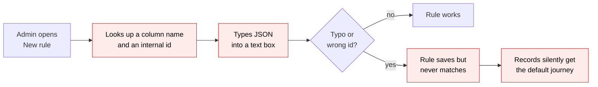
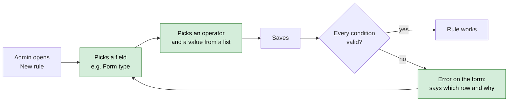
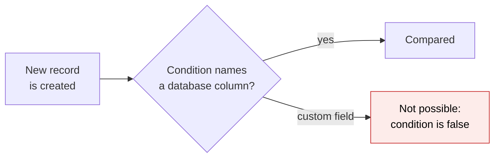
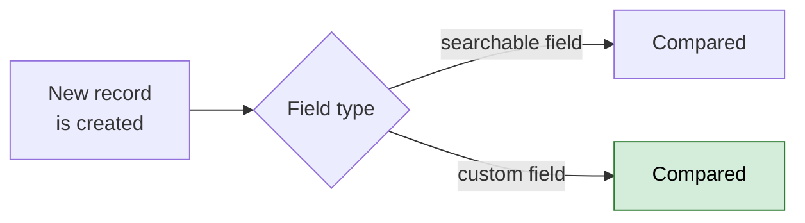

# Workflow Rule Condition Builder — Proposal

> **Audience:** Business team, product, QA, support — non-technical.
> **Companion document:** [Design](design.md)

> **Planning phase — no code changes.** This document proposes and explains the change. Do not
> edit application code while writing it; implementation happens later, in the tasks phase.

---

## Why

An auto-assignment rule decides which workflow template (journey) a new KYC, capital call,
distribution, commitment, folder, approval or investor gets. Today an admin writes the rule's
conditions as raw JSON with database column names and internal ids, like
`[{"attribute":"form_type_id","operator":"eq","value":"412"}]`. A typo, a wrong id or a column
the rule cannot read never shows an error. The rule just never matches, and every record falls
through to the default journey without anyone noticing.

The KYC rule form already patched one case: a "KYC form type" dropdown that writes the
`form_type_id` condition for the admin. Every other condition still goes through the JSON box,
and the custom fields admins actually care about ("Nationality", "Investor category", "Fund
close") cannot be used at all. The rule engine only reads plain database columns.

## What Changes

Think of it as the filter bar on a spreadsheet. Instead of writing a formula, the admin picks a
column, picks "is / is not / greater than", and picks or types a value.

- The JSON textarea on the rule form is replaced by a **condition builder**: one row per
  condition, each with a **Field**, an **Operator** and a **Value**. All rows must match (AND).
  "+ Add condition" adds a row, and ✕ removes one. No rows means the rule applies to every new
  record (catch-all), as today.
- **Which fields are offered:** the fields CapHive already lets users search on for that record
  type (the same list the record's search and filters use), **plus every custom field** defined
  on that record type's forms for this company. A few rule-only fields that search does not
  offer are added where journeys need them: **Form type** on KYCs, and **Imported** on capital
  calls and distributions.
- **Values match the field.** Form type, fund and investor fields offer a dropdown of this
  company's own records. Yes/no fields offer Yes/No. Custom fields with a fixed option list
  (Select, Radio) offer those options. Numbers and amounts take a number. Dates use the date
  picker. Text takes text.
- **Operators match the field.** Text: is, is not, contains, is one of, is blank, is present.
  Numbers, amounts and dates: is, is not, greater than, at least, less than, at most. Yes/no:
  is. Dropdowns: is, is not, is one of, is not one of (custom-field dropdowns also: is blank, is
  present).
- **Amounts are in normal units.** "Committed amount at least 5,000,000" means five million in
  the fund's currency, not in paise or cents.
- **Totals that are filled in later are not offered.** Some amounts are added up from other
  records after a record is created: a capital call's call amount, fees and collected amount; a
  KYC's committed, called, collected and distributed amounts; a commitment's called, collected
  and distributed amounts; a distribution's distribution and gross amounts. They are always 0 at
  the moment a rule is checked, so a rule on them could never fire, and they are left out.
- **The KYC-only "KYC form type" dropdown is removed.** Form type is now just a field in the
  builder.
- **Saving checks every condition.** An unknown field, an operator that does not fit the field,
  or a form type, fund or investor from another company is rejected with a clear message,
  instead of saving a rule that silently never matches.
- **"View as JSON"** stays as a toggle for power users and support. Editing the JSON and
  switching back redraws the rows.
- **The rules list on the template page shows conditions in words**: "Form type is Individual —
  Fund IV and Nationality is India" instead of `form_type_id eq 412`.
- **BREAKING (internal only):** the stored condition format changes to use the same operator
  names as search ("at least" is stored as `gteq`, not `gte`). Rules are not in production use
  yet, so no existing rules are migrated. The journey setup that seeds rules for capital calls,
  distributions and KYCs is updated to the new format.

### Flow Diagram

Before: setting up a per-form-type KYC journey, or any other condition.



After: the same rule built from dropdowns and checked on save.



Before: what a rule can look at when a record is created.



After: searchable fields and custom fields are both checked.



---

## User Stories

### US-1: Route KYCs by form type without knowing ids

**As a** fund admin,
**I want** to pick "Form type is Individual — Fund IV" from dropdowns,
**So that** Fund IV KYCs get the Fund IV journey without me finding a form type id.

**Acceptance criteria:**
- On a rule for a KYC template, the Field dropdown includes **Form type**.
- The Value dropdown lists only this company's KYC form types, labelled like
  "Individual — Fund IV".
- After saving, a new KYC created with that form type gets this rule's template. A KYC with any
  other form type does not.

### US-2: Route by a custom field

**As a** fund admin,
**I want** a rule like "Nationality is India" using our KYC custom field,
**So that** domestic and foreign investors go through different KYC journeys.

**Acceptance criteria:**
- The Field dropdown lists this company's custom fields for the record type, under a
  **Custom fields** heading, by their label.
- A Select or Radio custom field offers its option list as values.
- A new KYC whose Nationality is India gets the rule's template. A KYC with another nationality,
  or no nationality, does not.

### US-3: Route commitments by amount

**As a** fund admin,
**I want** "Committed amount at least 5,000,000",
**So that** large commitments get the journey with the extra review.

**Acceptance criteria:**
- Committed amount is offered on commitment rules with the number operators.
- Call amount is not offered on capital call rules (it is always 0 when a call is created).
- The value is entered in the fund's currency units, not cents.
- A new commitment of 6,000,000 gets the rule's template. One of 2,000,000 does not.

### US-4: Mistakes are caught on save

**As a** fund admin,
**I want** the form to refuse a condition that can never work,
**So that** I don't find out weeks later that the rule never fired.

**Acceptance criteria:**
- Each case in [Validation Rules](#validation-rules) shows its message and keeps the form open
  with what I entered.
- Nothing is saved until every condition is valid.

### US-5: Edit an existing rule

**As a** fund admin,
**I want** to open a saved rule and see its conditions as rows,
**So that** I can change one condition without rewriting the rest.

**Acceptance criteria:**
- Every saved condition appears as a row with its field, operator and value pre-selected.
- The journey-setup rules (for example "Imported is Yes" on capital calls) open as rows too.

### US-6: Read rules at a glance

**As a** fund admin or support person,
**I want** the template page's rules table to describe conditions in words,
**So that** I can tell what a rule does without reading JSON.

**Acceptance criteria:**
- Each condition reads "<field label> <operator words> <value label>", for example
  "Form type is Individual — Fund IV".
- A rule with no conditions reads "Always (catch-all)", as today.

---

## UI Behavior

### New / Edit Auto-Assignment Rule

```
┌──────────────────────────────────────────────────────────────────────────┐
│  New Auto-Assignment Rule                                                │
│                                                                          │
│  Applies to        [ InvestorKyc                                ] (read) │
│  Priority          [ 0  ]  lower number runs first                       │
│  [ ] Automatically launch a workflow instance after assigning            │
│                                                                          │
│  Conditions — a new KYC gets this template when ALL of these match       │
│  ┌──────────────────────┬──────────────────┬───────────────────────┬───┐ │
│  │ Form type          ▼ │ is             ▼ │ Individual — Fund IV ▼│ ✕ │ │
│  │ Nationality        ▼ │ is             ▼ │ India                ▼│ ✕ │ │
│  │ Ticket size        ▼ │ at least       ▼ │ [ 5000000          ] │ ✕ │ │
│  └──────────────────────┴──────────────────┴───────────────────────┴───┘ │
│  + Add condition                                       View as JSON      │
│  No conditions = applies to every new KYC (catch-all).                   │
│                                                                          │
│  [ Save ]  [ Cancel ]                                                    │
└──────────────────────────────────────────────────────────────────────────┘
```

The Field dropdown is grouped:

```
  ┌───────────────────────────┐
  │ KYC fields                │
  │   Form type               │
  │   KYC type                │
  │   Verified                │
  │   Expiry date             │
  │   …                       │
  │ Custom fields             │
  │   Nationality             │
  │   Investor category       │
  └───────────────────────────┘
```

**Behavior notes:**
- Changing the Field resets that row's Operator to the field's first operator and clears the
  Value.
- "is one of" and "is not one of" turn the Value into a multi-select (dropdown fields) or a
  comma-separated box (text and number fields).
- "is blank" and "is present" hide the Value input.
- "View as JSON" swaps the rows for a text box holding the same conditions. "View as rows"
  swaps back. If the JSON cannot be read, the toggle stays on JSON and shows "The JSON is not a
  valid list of conditions."
- A saved condition whose field no longer exists (for example a deleted custom field) shows as
  a red row reading "Unknown field: <name>". The admin must remove or change it before saving.
- Everything happens in the browser. Nothing is saved until Save is clicked.

### Template page — Auto-assignment rules table

```
┌──────────┬───────────────────────────────────────────────┬──────────────┐
│ Priority │ Conditions                                    │ Auto-launch? │
├──────────┼───────────────────────────────────────────────┼──────────────┤
│ 0        │ Form type is Individual — Fund IV             │ Yes          │
│          │ and Nationality is India                      │              │
│ 100      │ Always (catch-all)                            │ Yes          │
└──────────┴───────────────────────────────────────────────┴──────────────┘
```

---

## What This Feature Does NOT Cover

| Excluded | Covered In |
|---|---|
| A page listing every rule across all templates for one record type | Follow-up change (rules overview) |
| Warnings for a rule that can never win because a broader rule runs first | Follow-up change (rules overview) |
| "Test a record": see which rule a given KYC or call would get | Follow-up change (rules overview) |
| OR between conditions, or nested groups | Not planned; use two rules |
| Conditions on related records (e.g. the investor's city on a KYC) | Not planned |
| Re-routing records that already have a journey when a rule changes | Unchanged: rules apply to new records, and to records still without a journey when they are saved |
| Fixing custom-field search on list pages (the same gap found during this design) | Separate bug fix — see [design.md](design.md#risks-and-open-questions) |

---

## Validation Rules

| Field | Rule | Message on the form |
|---|---|---|
| Condition field | Must be one of the fields offered for this record type and company | "Condition 2: Unknown field \"nationalty\"." |
| Operator | Must be one the field allows | "Condition 1: \"greater than\" can't be used with Form type." |
| Value (dropdown fields) | Must be this company's record (form type, fund, investor) | "Condition 1: Form type 999 is not one of this company's form types." |
| Value (number / amount) | Must be a number | "Condition 3: Ticket size needs a number." |
| Value (date) | Must be a date | "Condition 2: Commitment date needs a date." |
| Value | Required unless the operator is "is blank" or "is present" | "Condition 1: Nationality needs a value." |
| Conditions JSON (View as JSON) | Must be a list of `{attribute, operator, value}` | "The JSON is not a valid list of conditions." |
| Priority | Whole number, 0 or more (unchanged) | "Priority must be greater than or equal to 0" |

Default: no conditions, which makes the rule a catch-all.

---

## Behavior Rules

| Scenario | What User Sees |
|---|---|
| New KYC matches a rule's every condition | It gets that rule's template (and an instance, if Auto-launch is ticked) |
| New KYC misses one condition | That rule is skipped; the next rule by priority is tried |
| Custom-field condition, and the record's form has no such field | The condition does not match (the record has no value) |
| Amount condition | Compared in the fund's currency units |
| Rule saved before a custom field was deleted | The rule stops matching. On edit, the row shows "Unknown field: <name>" and must be fixed to save |
| Two rules match | Lowest priority number wins (unchanged) |
| The winning rule's template is disabled | No template is assigned (unchanged) |
| Rules table on the template page | Conditions described in words |

---

## Resolved Design Decisions

| # | Decision | Resolution |
|---|---|---|
| 1 | Which fields can a rule use? | The record type's searchable fields, plus its custom fields for this company, plus a short list of rule-only fields journeys need (Form type on KYCs, Imported on calls and distributions) |
| 2 | Keep the "KYC form type" dropdown? | No. Form type becomes a normal field in the builder |
| 3 | Keep old rules working? | No migration. Rules are not in production use; seeded journey rules are written in the new format |
| 4 | Amounts in cents or currency units? | Currency units, the same as search |
| 5 | OR / nested groups? | No. All conditions are AND; use two rules for OR |
| 6 | Keep raw JSON? | Yes, as a "View as JSON" toggle, validated the same way |
| 7 | Scope of this change | The builder, its field list and save-time checks. The cross-template overview is a follow-up |

---

## Capabilities

### New Capabilities

- `workflows/auto-assignment-rule-conditions`: which fields, operators and values an
  auto-assignment rule's conditions may use, how they are validated on save, how they are
  matched against a new record (including custom fields and amounts), and how they are shown.

### Modified Capabilities

None. `workflows/evaluated-workflow-steps`, `funds/capital-call-journey` and
`funds/capital-distribution-journey` keep their requirements. Their seeded "imported" rule
still routes imported calls and distributions to the Light journey; only its stored spelling
changes.

---

## Impact

- The **New / Edit auto-assignment rule** form (all record types).
- The **Auto-assignment rules** table on the workflow template page.
- How a rule is **matched** when a KYC, call, distribution, commitment, folder, approval or
  investor is created or saved without a journey.
- The **journey setup** that seeds capital call, distribution and KYC rules.
- The record types' **search field lists** gain nothing users can see; rule-only fields are
  offered to rules only.
- No new screens, emails, permissions or settings. No data migration.

---

## Benefits

1. Admins build rules from dropdowns, without column names, ids or JSON.
2. Custom fields, the data admins actually route on, can drive journeys.
3. A rule that can never work is refused on save instead of failing silently for weeks.
4. Support can read what a rule does from the template page.
5. One field list drives search, rules and their validation, so they cannot drift apart.

---

## FAQ

| Question | Answer |
|---|---|
| Who can create or edit rules? | Unchanged: whoever can edit the workflow template |
| What happens to rules that exist today? | Rules are not used in production, so none are migrated. Journey setup writes its rules in the new format. A leftover old-format rule shows its unreadable rows as "Unknown field" until fixed |
| Will existing KYCs or calls change journey? | No. Rules only apply to new records, and to records with no journey yet when they are next saved |
| Which custom fields appear? | Every custom field on any of this company's forms for that record type, except File, Header, Grid columns and Calculation fields |
| Can a rule look at a field on another record, like the investor's city on a KYC? | No, only the record's own fields. See [What This Feature Does NOT Cover](#what-this-feature-does-not-cover) |
| Are amounts compared in paise/cents? | No, in the fund's currency units, as in search |
| Does this change search on list pages? | No. The rule-only fields are offered to rules only |
| Can I still paste JSON? | Yes, through "View as JSON". It is checked the same way on save |
| Any billing, notification or permission change? | No |

---

## Design Principle for the Next Phase

- **Reuse search, don't build a second matcher.** The searchable-field lists, the amount
  conversion and the custom-field search already exist. Matching a rule should be "does a
  search for these conditions find this one record?", not a new hand-written comparison
  engine. The design must state how a condition the search would silently ignore is caught,
  because search ignores unknown conditions without an error.
- **One field list.** The builder's dropdowns, the save-time checks and the words on the rules
  table must all come from the same list, so the UI cannot offer something the server refuses.
- **Keep the rule-only additions tiny.** A record type declares only the few extra fields
  journeys need; everything else comes from what it already exposes to search.
- **Risk to address explicitly:** a custom field exists per form, and a KYC company may have
  several KYC forms. The design must say how the field list is built across forms and what a
  record on a form without the field does (it does not match).
