# Fund Financial Statements from Account Entries — Design

> **Audience:** Engineering team.
> **Companion documents:** [Proposal](proposal.md) · [Spec](specs/)

> **Planning phase — no code changes.** This document explains HOW the proposal will be built.
> Do not edit application code while writing it; implementation happens later, in the tasks phase.

> **Design, not code.** Explain the design with mermaid diagrams and tables. Do NOT paste Ruby/JS
> class bodies, migrations, route blocks or policy code. Put real class, method, table and path
> names inside the diagrams and tables instead.

> **Zoom one picture.** The whole design hangs off ONE numbered picture. Part 1 draws it in plain
> words. Part 2 redraws the SAME picture, same shape and same numbers, with real names. Part 3 has
> one card per box, in the same order. Part 4 is reference material that spans several boxes.

---

## Contents

- [1. The idea](#1-the-idea)
  - [What this adds](#what-this-adds)
  - [The idea in one picture](#the-idea-in-one-picture)
  - [Walkthrough: one example, start to finish](#walkthrough-one-example-start-to-finish)
  - [Key ideas](#key-ideas)
- [2. The same picture with real names](#2-the-same-picture-with-real-names)
  - [Picture](#picture)
  - [What each box does](#what-each-box-does)
  - [One run, end to end](#one-run-end-to-end)
  - [Lifecycles](#lifecycles)
  - [What users see](#what-users-see)
  - [Design decisions](#design-decisions)
- [3. One card per box](#3-one-card-per-box)
  - [① Mapping](#①-mapping)
  - [② AI draft](#②-ai-draft)
  - [③ Calculator](#③-calculator)
  - [④ Statements run](#④-statements-run)
  - [⑤ Statement record](#⑤-statement-record)
  - [⑥ Output](#⑥-output)
  - [⑦ Unlock guard](#⑦-unlock-guard)
- [4. Reference](#4-reference)
  - [Class diagram](#class-diagram)
  - [Data model and schema changes](#data-model-and-schema-changes)
  - [Component contracts](#component-contracts)
  - [Notifications](#notifications)
  - [Cross-cutting concerns](#cross-cutting-concerns)
  - [Worked examples](#worked-examples)
  - [Testing](#testing)
  - [Risks and open questions](#risks-and-open-questions)

---

## 1. The idea

### What this adds

A per-fund set of **statements** (Balance Sheet, Profit & Loss, Changes in Partners' Capital, plus
optional schedules), a per-fund **mapping** from fund-level account entries to typed **statement
accounts** laid out on those statements, a pure
**calculator** that turns mapping + entries into statement figures and checks, and a new fund
formula type that writes those figures back as account entries inside a **separate statements
allocation run**. It follows the existing `GeneratePortfolioNumbersForFund` pattern (a formula
evaluated once per fund) and the allocation-run lock/unlock model; nothing in `AccountEntry`
changes.

### The idea in one picture

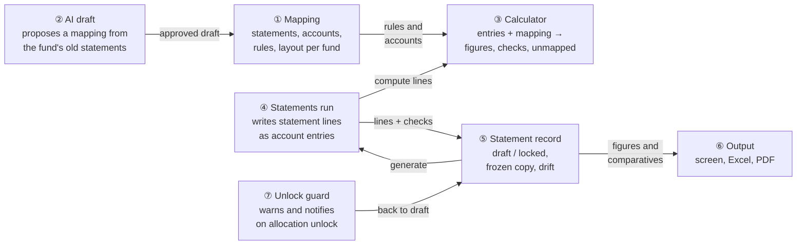

### Walkthrough: one example, start to finish

**Setup.** Alpha Fund I (USD, calendar year) has been on CapHive since 2025. Its Q3 2026
accounting run #3331 (1 Jul–30 Sep 2026) is **locked**. The fund admin, Meera, wants its Q3 2026
statements; the accountant, Ravi (tagged *FundAccounting*), reviews and locks them.

**Legend:** ✓ done · ● we are here: waiting on this, not done yet · ○ not started · ⚠ warning.
Statement steps are tasks: *Build mapping*, *Generate statements*, *Review checks*, *Lock*.

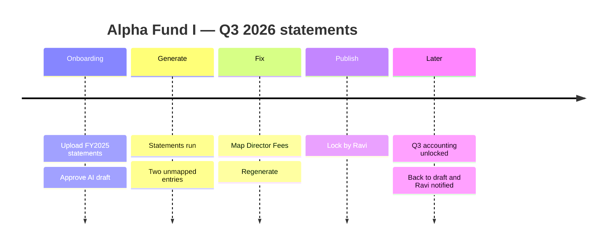

**Phase 1 — mapping**

| # | When | What happens | Behind the scenes | Result |
|---|---|---|---|---|
| 1 | 1 Oct | Meera uploads the FY2025 audited statements (PDF) — any period will do | the AI draft (②) reads the PDF and proposes 38 accounts, the layout and 22 rules | Build&nbsp;mapping&nbsp;●<br>Generate&nbsp;statements&nbsp;○<br>Review&nbsp;checks&nbsp;○<br>Lock&nbsp;○ |
| 2 | 1 Oct | Draft shows 37 lines Mapped, 1 line "No entries yet", and "Tax · TDS" under entries not used | the AI draft (②) validates the AI's answer against the fund's entry list — no amounts are compared | Same as row 1 |
| 3 | 1 Oct | Meera adds "Tax · TDS" to Other expenses from the line's list; no gaps left; she approves | the mapping (①) saves accounts, layout, rules | **Build&nbsp;mapping&nbsp;✓**<br>Generate&nbsp;statements&nbsp;○<br>Review&nbsp;checks&nbsp;○<br>Lock&nbsp;○ |

**Phase 2 — generate, a mistake, fix**

| # | When | What happens | Behind the scenes | Result |
|---|---|---|---|---|
| 4 | 8 Oct | Meera clicks **Generate statements** for 1 Jul–30 Sep 2026 | the statement record (⑤) finds run #3331 (Success, locked — allowed), creates a Draft and starts a statements run (④) | Build&nbsp;mapping&nbsp;✓<br>**Generate&nbsp;statements&nbsp;●**<br>Review&nbsp;checks&nbsp;○<br>Lock&nbsp;○ |
| 5 | 8 Oct | Run finishes; draft shows 2 unmapped entries, Lock disabled | the statements run (④) asked the calculator (③) for lines, wrote 52 "Financial Statement" entries; the record (⑤) stored checks and unmapped = 2 | Build&nbsp;mapping&nbsp;✓<br>Generate&nbsp;statements&nbsp;✓<br>**Review&nbsp;checks&nbsp;●**&nbsp;⚠&nbsp;2&nbsp;unmapped<br>Lock&nbsp;○ |
| 6 | 8 Oct | Meera maps "Director Fees" (8,000) to Professional fees, clicks **Regenerate** | mapping (①) saved; statements run (④) deletes only its own 52 entries and rewrites them | Build&nbsp;mapping&nbsp;✓<br>Generate&nbsp;statements&nbsp;✓<br>**Review&nbsp;checks&nbsp;●**<br>Lock&nbsp;○ |
| 7 | 8 Oct | All 4 checks pass, unmapped 0 | calculator (③) checks stored on the record (⑤) | Same as row 6 |

**Phase 3 — lock, then a later unlock**

| # | When | What happens | Behind the scenes | Result |
|---|---|---|---|---|
| 8 | 9 Oct | Ravi clicks **Lock** | the record (⑤) freezes every figure, mapping and checks, locks the statements run | Build&nbsp;mapping&nbsp;✓<br>Generate&nbsp;statements&nbsp;✓<br>Review&nbsp;checks&nbsp;✓<br>**Lock&nbsp;✓** |
| 9 | 20 Oct | Ops unlocks run #3331 to fix a fee; popup warns "Q3 2026 statements back to Draft" | the unlock guard (⑦) finds the locked statement; on confirm all overlapping runs unlock, the record (⑤) returns to Draft (frozen copy kept), Ravi is notified | Build&nbsp;mapping&nbsp;✓<br>Generate&nbsp;statements&nbsp;✓<br>**Review&nbsp;checks&nbsp;●**&nbsp;⚠&nbsp;changed&nbsp;since&nbsp;locked<br>Lock&nbsp;○ |
| 10 | 21 Oct | Run rerun with the fixed fee; Meera regenerates; Ravi locks again | statements run (④) rewrites lines; lock (⑤) overwrites the frozen copy | Build&nbsp;mapping&nbsp;✓<br>Generate&nbsp;statements&nbsp;✓<br>Review&nbsp;checks&nbsp;✓<br>**Lock&nbsp;✓** |

**Stall:** had Meera clicked Generate on 8 Oct while ops were re-running Q2, the record (⑤) would
refuse ("An allocation run is in progress…") and nothing would be created.

**Key moment (row 5):**

```
┌ Q3 2026 statements — Profit & Loss        Draft  [Regenerate] [Lock ⛔] ┐
│ [Balance Sheet] [P&L ●] [Changes in Capital] [Sch. Expenses]          │
│ Built from accounting run #3331 (locked)                             │
│ ⚠ 2 unmapped entries — Lock disabled   [View]                        │
│ Checks: ✓ Balance ✓ NAV tie-out ✗ Capital tie-out (8,000) ✓ Roll-fwd  │
└──────────────────────────────────────────────────────────────────────┘
```

**What to notice**
- The accounting run stayed locked throughout; the statements run only ever touched its own entries.
- One calculator served the AI draft, the run and (later) the drift banner — the figures can't disagree.
- Unmapped entries and failed checks block locking; nothing drops out silently.
- Unlocking didn't destroy evidence: the frozen copy kept what was published until re-locked.

### Key ideas

| # | Idea | In one line | Card |
|---|---|---|---|
| 1 | Everything is an account entry | Non-entry figures are brought in by existing formulas; the calculator only reads entries | [③](#③-calculator) |
| 2 | Mapping, not a ledger | (entry type, name) → typed account, exact beats any-name, Excluded is explicit | [①](#①-mapping) |
| 3 | One calculator, four callers | Preview, AI check, statements run, drift banner | [③](#③-calculator) |
| 4 | Separate statements run | Own allocation run, tag "Financial Statements", deletes only its own entries | [④](#④-statements-run) |
| 5 | Frozen copy is the published truth | Lock copies figures; comparatives and drift read the copy | [⑤](#⑤-statement-record) |
| 6 | Risk accepted, guarded | Unlock still allowed — warns, demotes to Draft, notifies | [⑦](#⑦-unlock-guard) |

**FAQ**

| Question | Answer |
|---|---|
| Why write statement lines as account entries at all, if the calculator can compute them? | So they live inside the run lock model, are usable in existing Sablon templates / MCP / AE screens, and can later be allocated to folios for LP statements. |
| Does any existing allocation behaviour change? | Two small things: ordinary runs skip the new formula type, and Unlock warns/notifies when locked statements exist. |
| Does it block anything users do today? | No. Unlock and rerun stay allowed. |

---

## 2. The same picture with real names

### Picture

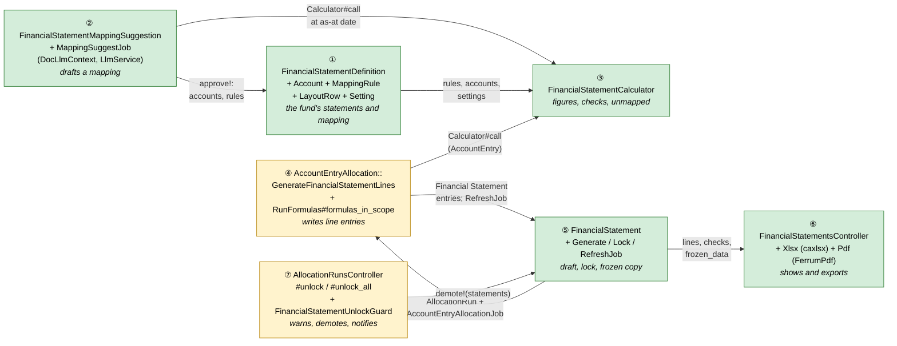

Colour = footprint: **green** new, **amber** modified, **grey** reused unchanged. Exact files are in
[lld.md File Map](lld.md#file-map).

### What each box does

Each box below lists its real parts, when it runs, what it **does** and what it **decides**. Its
card in section 3 has the full detail.

#### ① Mapping — the fund's statements and how entries reach them
**Real parts:** `financial_statement_settings`, `_definitions`, `_accounts`, `_mapping_rules`, `_layout_rows`; `FinancialStatementSetup`; the Mapping, Layout and Settings tabs.
**Runs:** on request, when a user edits the mapping or saves the first account/settings.

What it does:
- Creates the setup on first save: settings row (financial year defaulted from the fund), the three core statements with starter layouts (sections, totals, net result, opening/closing capital), and the statement formula.
- Stores statement accounts with a type (asset, liability, partners' capital, income, expense, gain/loss) and a behaviour (balance or movement).
- Stores mapping rules: entry type + optional exact name → account, or Excluded.
- Places a new account automatically under its section on the Balance Sheet or P&L (capital accounts also on the Changes statement).
- Lets users rename core statements, add schedules, reorder rows, add headings and subtotals.
- Shows the Unmapped list and a live preview of every line for a chosen period (through ③).

What it decides:
- Which account an (entry type, name) feeds: exact-name rule first, then any-name rule, else Unmapped.
- Whether an entry is deliberately left out (Excluded) or just missing (Unmapped, blocks locking).
- What prints on each statement, in which order, and what each subtotal adds up.
- Which entries the NAV and partners' capital checks compare against, and when the financial year starts.
- Whether a delete is allowed (no: account still used by a rule or row; core statement).

#### ② AI draft — a first mapping from last year's statements
**Real parts:** `FinancialStatementMappingSuggestion`, `FinancialStatementMappingSuggestJob`, `FinancialStatementMappingPrompt`, `LlmService.ruby_llm_chat`, the draft review page.
**Runs:** a background job after an upload or Retry; review edits and Approve on request.

What it does:
- Reads the uploaded PDF/Excel (any period) as text and lists every fund-level entry the fund has up to today.
- Asks the AI for the statements, lines (type, behaviour, subtotals) and the entries feeding each line — mapping by meaning.
- Validates the answer and drops anything that names an entry the fund doesn't have.
- Works out each line's sign from the entries, and turns an unfed accumulated / net-result line into the calculated net result row.
- Shows the mapping only — **never compares printed amounts with CapHive figures** (the upload is a sample of the layout, usually for another period; figures are tested by the statements' checks after generating).
- Lets the reviewer add entries to unfed lines and move entries between lines or to Excluded.
- On Approve, writes accounts, layouts, rules and statement names into ① in one transaction.

What it decides:
- Each line's status: Mapped, No entries yet, Calculated, or Mapped on another statement.
- Which entries no line uses (mapping gaps) and which of the AI's rules were invalid (Dropped).
- Whether each line is New, Changed or Same compared with an existing mapping.
- Nothing is saved before Approve; Discard leaves ① untouched.

#### ③ Calculator — the only place figures are computed
**Real parts:** `FinancialStatementCalculator` → `Result(figures, checks, unmapped, warnings)`.
**Runs:** inline (preview, AI reconcile, drift, comparatives) and inside the statements run. Never writes.

What it does:
- Sums fund-level entries with grouped SQL (never loading rows), leaving out folio rows, soft-deleted rows and its own "Financial Statement" lines.
- Works out five figures per account: this period, year to date, balance at the end, opening balance, opening balance for the year.
- Applies each account's sign flip.
- Adds the P&L result since inception to partners' capital, so the Balance Sheet balances without a retained-earnings entry.
- Runs the four checks: Balance, NAV tie-out, partners' capital tie-out, roll-forward.
- Lists Unmapped entries (non-zero, no rule) and warns about entries stored both ways (cumulative and periodic).

What it decides:
- Whether an entry is read as a running total (cumulative: latest value at a date) or as movements (periodic: summed).
- Each account's figures and each check's Passed / Failed / Skipped with the difference (pass when under 1.00).
- Whether a check is skipped (NAV or capital entry not configured, no NAV entry yet, no rows on the Changes statement).

#### ④ Statements run — writes the statement lines as account entries
**Real parts:** rule type `GenerateFinancialStatementLines` (in `FundFormula::TYPES` and `RunFormula`), `RunFormulas#formulas_in_scope`, step `refresh_financial_statements`.
**Runs:** inside `AccountEntryAllocationJob`, in its own allocation run tagged "Financial Statements".

What it does:
- Runs once per fund (not per investor), asks ③ for the figures and writes three "Financial Statement" entries per account, dated the statement end date.
- Uses the engine's existing delete step first, which removes only this formula's lines on that date, then its existing insert and migrate steps.
- Keeps statement formulas out of every run not tagged "Financial Statements".
- After a successful run, queues the refresh that stores the set's checks and unmapped count (⑤).

What it decides:
- Which formulas a run includes: an ordinary accounting run never creates or deletes statement lines.
- Which period the lines cover: the period of the statement set this run belongs to, or the run's dates when the formula is run by hand.
- Nothing about accounting entries: the run touches only its own lines.

#### ⑤ Statement record — a statement set's lifecycle
**Real parts:** `FinancialStatement`, `FinancialStatementGenerate`, `FinancialStatementLock`, `FinancialStatementRefreshJob`.
**Runs:** on request (Generate, Regenerate, Lock), and the refresh job after a run.

What it does:
- Checks the guards and starts a new statements run on Generate; reuses the Draft on Regenerate.
- Records which accounting run the statements were built from.
- Shows Generating → Ready (or Failed with the run's error) as the run progresses.
- Stores checks and the unmapped count from the refresh job.
- On Lock, freezes every figure, the rendered statements, the mapping and the checks, and locks the statements run.
- Builds comparatives from the frozen copy of earlier locked sets, and works out drift for locked sets.

What it decides:
- Whether Generate may run: not locked, no other set on the same end date, no run in progress, an accounting run covers the period, the formula is enabled, no locked statements run on that date.
- Whether Lock is allowed: ready, nothing unmapped, every check passed or skipped.
- Where a comparative comes from: "As locked", "As locked — changed since locked", or "Not locked — computed".
- Which lines show a "Changed since locked" warning (difference of 1.00 or more).

#### ⑥ Output — what people see and download
**Real parts:** `FinancialStatementsController`, `FinancialStatementPresenter`, `FinancialStatementXlsx` (caxlsx), `FinancialStatementPdf` (FerrumPdf, headless Chrome — as the fund dashboard PDF; wkhtmltopdf has no binary for newer Ubuntu), views.
**Runs:** on request.

What it does:
- Renders each statement from its layout rows with the right columns, in one structure used by the screen, Excel, PDF and the frozen copy.
- Shows the statement switcher, the Checks panel, the unmapped count (with a link to fix it) and the drift banner.
- Exports Excel (one sheet per statement) and PDF (one section per statement, DRAFT watermark on drafts).

What it decides:
- Which columns a statement shows (at a date: end and prior year-end; for a period: period, year to date, last year's year to date).
- How a row's value is shown: expenses and liabilities in brackets, subtotals as the sum of the values shown.
- Whether to read live figures (Draft) or the frozen copy (Locked).

#### ⑦ Unlock guard — protects published statements when runs are unlocked
**Real parts:** `AllocationRunsController#unlock` / `#unlock_all`, the popup in `funds/_allocation_runs`, `FinancialStatementUnlockGuard`, `FinancialStatementNotifier`.
**Runs:** on request, when someone unlocks allocation runs.

What it does:
- Shows a confirm popup before unlocking when locked statement sets overlap the period.
- After the unlock, returns those sets to Draft (keeping their frozen copy) and unlocks their statements runs.
- Sends one email and in-app alert to the fund's Fund accounting users, naming who unlocked and the periods.
- Changes nothing when no locked statements are affected.

What it decides:
- Which locked statement sets an unlock touches: overlapping the run's period, or every set for Unlock all.
- Who is told: active users tagged "FundAccounting" who can see the fund.

### One run, end to end

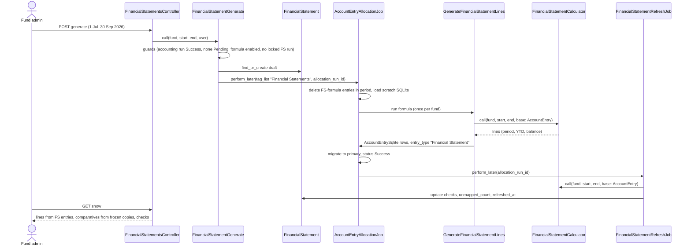

### Lifecycles

**FinancialStatement** — `status` is **stored** (`draft` | `locked`); the sub-states inside Draft
are **derived** from the statements run's status and `refreshed_at`; *Drifted* is **derived** on
read by comparing the calculator against `frozen_data`.

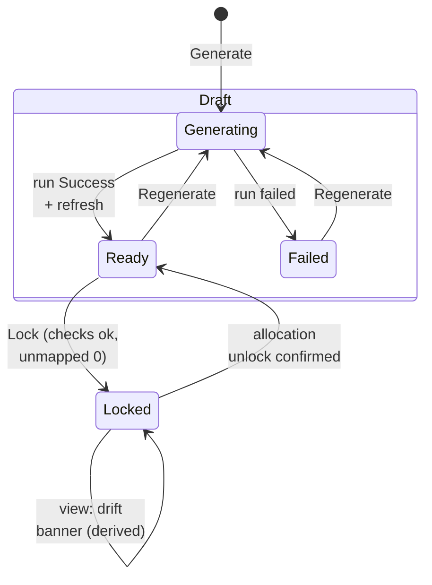

**FinancialStatementMappingSuggestion** — `status` stored.

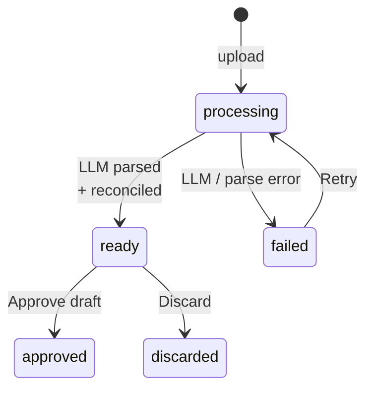

### What users see

**At a glance**

| Where in CapHive | Today | After this change | Who sees it |
|---|---|---|---|
| Fund › Actions › Financial Statements | — | New page: Statements, Mapping, Layout tabs | Employees with fund read access |
| Fund › Allocation runs › Unlock / Unlock All | Plain confirm | Action-summary popup when locked statements overlap | Users who can unlock |
| Notifications (in-app + email) | — | "Financial statements unlocked" | FundAccounting-tagged users |
| Fund formulas list | — | New formula type "GenerateFinancialStatementLines" (auto-created) | Fund admins |

**Main everyday journey — generate, review, lock** (mockups in the [proposal](proposal.md#ui-behavior))

```
┌ Alpha Fund I › Financial Statements ─────────────────────────────┐
│ [Statements] [Mapping] [Layout]            ① [Generate statements]│
│ ② 01 Jul 26 – 30 Sep 26  Draft  3/4 ✗  2 unmapped     [Open]      │
│   └ ③ Statement view: [Regenerate] ④ [Lock]  [Excel] [PDF]        │
└──────────────────────────────────────────────────────────────────┘
```

| Step | The user… | They see |
|---|---|---|
| ① | clicks Generate statements, picks a period | A Draft row "Generating…" (Turbo-streamed to Ready/Failed) |
| ② | opens the Draft | Checks summary and unmapped count |
| ③ | fixes mapping from the Unmapped link, clicks Regenerate | Figures replaced, checks re-run |
| ④ | clicks Lock | "Locked on … by …"; Regenerate hidden |

### Design decisions

1. **Statement lines stored as entries via a formula (B), not computed on read (A).** Alternative: read-side engine only. Rejected because lines would be invisible to templates/MCP/allocation and the user wants "everything is AEs"; the run-rerun cost is removed by the separate tagged run.
2. **Separate statements run, new `AllocationRun` per generation.** Alternative: `AllocationRun#rerun!`. Rejected: `rerun!` refuses whenever a locked overlapping run owns entries — always true here (the locked accounting run).
3. **Untagged runs exclude the new rule type** (`formulas_in_scope`). Alternative: rely on users tagging. Rejected: an untagged run takes every formula, so statement lines would silently regenerate with every accounting run.
4. **No change to `AllocationRun.locked_and_overlapping` / `FundsController#allocate`.** Statements runs are started by `FinancialStatementGenerate`, which applies its own guards; the allocate screen's lock check stays byte-identical.
5. **Per-fund mapping tables** rather than an entity chart with overrides. Decided with the user; simpler, no inheritance rules.
6. **Partners' capital closes P&L in the calculator.** The calculator adds "Accumulated net result" (since-inception Income − Expense + Gain/Loss) to partners' capital, so funds don't need a separate retained-earnings entry. Alternative: require an AE for it — rejected, few funds have one.
7. **`frozen_data` copied on lock**, because the allocation lock does not stop edits/deletes of entries (`AccountEntryPolicy#update?`/`#destroy?`) and unlock cascades.
8. **v1 accepts unlock risk** — warn + demote + notify; no versioning, no independent lock (user decision).
9. **Reuse `EvergreenRecipients#tagged("FundAccounting")`** for recipients rather than a new recipient class; it is fund-generic despite its name.

**FAQ**

| Question | Answer |
|---|---|
| Why a new rule type instead of `GenerateAccountEntry`? | `GenerateAccountEntry` evaluates per commitment and only reaches fund level through roll-up; statements need one evaluation per fund over fund-level entries. |
| Why not put mapping logic into hand-written formulas? | It loses the Unmapped control: a new name not referenced by any formula would silently vanish. |
| Can someone run the statement formula from the allocate screen? | Only by selecting the "Financial Statements" tag; it then behaves like a regenerate without updating the statement record, and the allocate screen's lock check still applies. |

---

## 3. One card per box

### ① Mapping

The fund's statements, statement accounts, mapping rules, layout and check settings, edited on the
Mapping and Layout tabs.

| Owns | Reads / receives | Produces |
|---|---|---|
| `financial_statement_definitions`, `financial_statement_accounts`, `financial_statement_mapping_rules`, `financial_statement_layout_rows`, `financial_statement_settings` | Approved drafts from ②; user edits | Rules/accounts/layout/settings for ③; preview requests to ③ |

**Rule resolution**

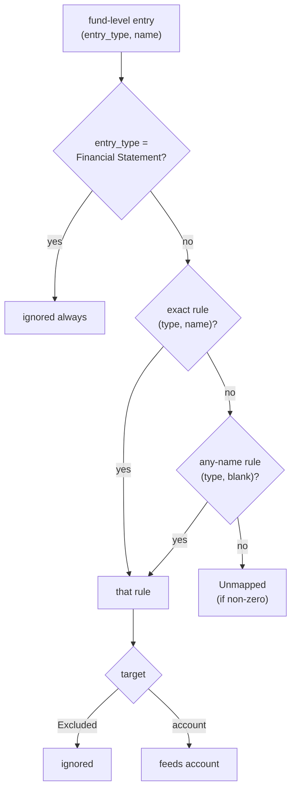

**Settings** (`financial_statement_settings`, one row per fund, created with the first account):
fiscal-year start month (default 1), NAV entry (type + name, fund level) for the NAV tie-out,
capital entry (type + name, folio level) for the partners' capital tie-out. Blank NAV/capital
settings make that check *Skipped — not configured*.

**Statements:** `financial_statement_definitions` rows. The three core rows (`kind` balance_sheet,
profit_and_loss, changes_in_capital) are created with the settings row and can be renamed, never
deleted; schedules (`kind` schedule) are added freely with a `column_style` (at_date | for_period).
Core statements use the fixed column style of their kind. A subtotal lists signed row ids (negative = subtract), so the starter Balance Sheet's "Total liabilities and partners' capital" = closing capital − Total liabilities (printed in brackets) equals Total assets; every Balance Sheet also renders a foot line "Assets = Liabilities + Partners' capital" per column (screen, PDF, Excel) with ✓ / ✗. Example schedules the proposal lists:
Schedule of Fund Expenses, Schedule of Investment Income, cost-vs-fair-value summary,
Commitments summary, Management fee computation.

**First save** of any account creates the settings row, the core statements and the fund's
statement formula (④) if missing, tagged
"Financial Statements", `sequence` last, enabled.

**Routes**

| Verb and path | Action | Does | Responds with |
|---|---|---|---|
| GET `/funds/:fund_id/financial_statement_mapping` | `FinancialStatementMappingsController#show` | Mapping tab: rules, unmapped, preview for `?period=` | HTML |
| POST/PATCH/DELETE `/financial_statement_mapping_rules` | CRUD | Save rule; re-render rules + preview frames | Turbo Stream |
| POST/PATCH/DELETE `/financial_statement_accounts` | CRUD | Account CRUD; delete refused if referenced | Turbo Stream |
| GET/PATCH `/funds/:fund_id/financial_statement_layout` | `#edit`/`#update` | Ordered rows per statement; ↑ / ↓ buttons (the app has no drag-and-drop library) | HTML / Turbo Stream |
| PATCH `/financial_statement_settings/:id` | `#update` | Fiscal year, NAV and capital entries | Turbo Stream |

**Access**

| Role | View | Edit |
|---|---|---|
| Employee with `FundPolicy#show?` | ✓ | — |
| Employee with `FundPolicy#update?` | ✓ | ✓ |
| Investor / advisor | — | — |

Every model carries `entity_id` + `fund_id`; policies scope through `fund.entity_id == user.entity_id` like `FundFormulaPolicy`.

**Build notes:** reuse the fund-page tab/table/form styling; Unmapped **Map** pre-fills the rule
form via query params and **Exclude** creates an Excluded rule in one click; the preview is recomputed on
every page load (the tab returns to itself, period kept, after each save).

**Worked examples:** H1, H2, H3, H21, H22, H23, X17, H4, H5, H6, H7, H8, E2, E3, E17, E22, X5, X6, X14

**FAQ**

| Question | Answer |
|---|---|
| Why "any name" instead of regex? | Entry type + exact name covered every case in the prod data (portco-named deal expenses are caught by type); regex adds a failure mode with no observed need. |
| Why can't two rules exist for the same (type, name)? | One entry must land on one line; a unique index makes double counting impossible. |
| What happens to rules when an account is deleted? | Delete is refused while rules or layout rows reference it. |

### ② AI draft

Reads any of the fund's existing statements and proposes a mapping. The AI proposes **structure only**
(lines, types, which entries feed which line); CapHive validates it against the fund's entry list.
The draft is **mapping only — no amounts are compared**: users upload whatever statement they have,
usually for another period than the entries, so a comparison would flag every line. Whether the
figures add up is tested later by the statements' checks (balance, NAV, capital, roll-forward).

| Owns | Reads / receives | Produces |
|---|---|---|
| `financial_statement_mapping_suggestions` (+ uploaded `Document`, owner = suggestion) | Upload, as-at date, optional P&L period start; distinct fund-level (type, name, totals) at that date | `proposal` JSON (statements, lines, rules, unplaced, dropped, per-line match); on approve, rows in ① |

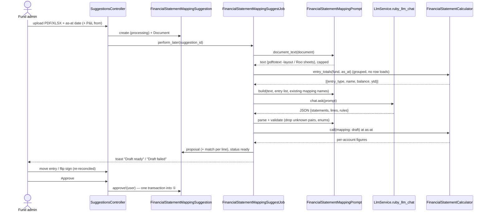

**Step by step**

| # | Step | Detail | Failure → user sees |
|---|---|---|---|
| 1 | Upload | `.pdf`, `.xlsx`, `.xls` ≤ 20 MB; no dates asked (the entry list is taken up to today). Stored as a `Document` owned by the suggestion | Wrong type/size → "Upload a PDF or Excel file" (X7) |
| 2 | Read text | PDF: `pdftotext -layout` (keeps columns so "Professional fees ..... 88,400 ..... 71,000" stays on one line). Excel: every sheet via Roo as CSV. Text capped at 60,000 characters | No text (scanned PDF) → Failed "We couldn't read any text from this file. Upload a text PDF or the Excel version." (X18) |
| 3 | Entry list | `FinancialStatementCalculator.entry_totals(fund, as_at, period_start)`: every fund-level (entry type, name) except "Financial Statement", with **balance** at as-at (periodic since inception, or latest cumulative) and **period** total (period start..as-at). One grouped query set; capped at 400 pairs, largest absolute first | — |
| 4 | Prompt | Built by `FinancialStatementMappingPrompt`: role ("you map a fund's account entries to its printed financial statements"), the rules below, the allowed enums, the entry list as `entry_type \| name \| balance \| period` lines, the existing account names (so it reuses them), then the statement text. Asks for JSON only, matching the schema below | — |
| 5 | Call | `LlmService.ruby_llm_chat(entity: fund.entity).ask(prompt)` — the entity's own keys/model when set. One call per upload or Retry. Outside any DB transaction | Error/timeout → Failed with the message; Retry (X12) |
| 6 | Parse & validate | `parse_llm_json` (existing `LlmResponseParser`); then: `account_type`, `behaviour`, `statement` must be in the enums (else line dropped and noted); each rule must name an (entry type, name) **in the entry list** (else dropped into `dropped` with reason "not an entry of this fund", E27); a pair claimed by two lines keeps the first; labels trimmed to 100 chars | Unparseable → Failed "The AI's answer could not be read" + Retry |
| 7 | Normalise | Signs worked out from the entries (not the AI's `flip_sign`, E34); an unfed accumulated / net-result line becomes the calculated net result row (E33); a label shown on two statements shares one account. No amounts compared | — |
| 8 | Compare to existing | If the fund has accounts: line label matches an existing account name → **Same** when type/behaviour/feeding rules agree, else **Changed**; otherwise **New** (E20) | — |
| 9 | Review | Intro (① lines from your statement → ② account entries → ③ what you do), four counts, **Mapping gaps** list. Per statement: ① line · ② entries that will feed it · Status badge (Mapped / No entries yet / Calculated / Mapped on another statement) · ③ what to do — **+ Add an entry** on unfed lines, a dimmed **Move … to** list per entry on mapped lines (full strength on hover). The mapping is on two tabs showing the same data in opposite directions — **By statement line** (line ← entries; the per-statement tables) and **By account entry** (entry → line, with badges Mapped → line / Excluded / Not used, not-used first) — the open tab is kept across edits (`tab` param). Below: **Parts of the AI's answer CapHive ignored**. No printed or computed amounts shown | — |
| 10 | Approve | `approve!(user)` in one transaction with `suggestion.lock!`: `FinancialStatementSetup.ensure!`; rename core statements to the printed titles; create schedules found; upsert accounts by name (one account per label even if it appears on several statements); replace layout rows of each touched statement in printed order (section → heading row, line → account row, subtotal → subtotal row with `subtotal_of` = its children's row ids); upsert rules by (entry type, name); Excluded rules for entries the reviewer moved to Excluded. Status `approved` | Not `ready` → refused |
| 11 | Discard | Status `discarded`; nothing in ① touched (E19) | — |

**Rules given to the AI** (in the prompt)
- Use only the (entry type, name) pairs in the list; never invent one.
- One pair feeds at most one line. Pairs that are working figures (per-investor allocations, NAV, units) go under `excluded`.
- Prefer one rule per entry type with `name: ""` (any name) when every name of that type belongs to the same line, so that names added later are caught.
- Mark `flip_sign: true` when the entries are stored with the opposite sign to how the line is printed (e.g. distributions stored negative, printed positive).
- Map by meaning: the statement may be for another period than the entries, so amounts need not agree.
- Report subtotals ("Total expenses", "Net assets") as `subtotal_of` the lines they add up, not as rules.
- Reuse an existing account name when the line means the same thing.

**Response schema** (validated in step 6)

```json
{
  "statements": [{"kind": "balance_sheet|profit_and_loss|changes_in_capital|schedule", "title": "Statement of Operations", "column_style": "at_date|for_period"}],
  "lines": [{"key": "l7", "statement_title": "Statement of Operations", "section": "Expenses",
             "label": "Professional fees", "account_type": "asset|liability|capital|income|expense|gain_loss",
             "behaviour": "balance|movement", "flip_sign": false, "printed": -88400.0, "subtotal_of": []}],
  "rules": [{"entry_type": "Non Deal Expense", "name": "Audit Fees", "line": "l7"}],
  "excluded": [{"entry_type": "Portfolio Allocation", "name": ""}]
}
```

**Stored `proposal`** = the response plus, per line, `change` (`new|changed|same`); and `entries`
(the entry list sent), `unplaced`, `dropped` and `ai_answer` (kept for re-validation).

**Privacy and cost:** the prompt holds the uploaded statement's text and fund-level entry types,
names and totals — no investor, folio or user data. One LLM call per upload/Retry; no background
retries.

| Component | Queue | Retries | Idempotency | Transaction |
|---|---|---|---|---|
| `FinancialStatementMappingSuggestJob` | `default` | 0 automatic; user Retry | Runs only from `processing`; re-run overwrites `proposal` | — (LLM call outside any txn) |
| Review edits (`#move`, `#flip`) | inline | — | Only while `ready`; recompute from scratch each time | single `update!` |
| `#approve!` | inline | — | Only from `ready`; `suggestion.lock!` | One transaction: settings, statements, accounts, layout, rules |

**Worked examples:** H11, E18, E19, E20, E27, E32, E33, E34, X7, X12, X18

**FAQ**

| Question | Answer |
|---|---|
| Are the uploaded figures imported? | No — they are only used for the match column. |
| Why give the AI the entry list? | It must propose rules over real (type, name) pairs, not invent names; CapHive drops any pair not in the list. |
| Why not trust the AI's own arithmetic? | The calculator recomputes every line from the entries; the AI never supplies a CapHive figure. |
| What if the uploaded statements are quarterly? | Set "P&L period from" to the quarter start so movement lines compare with the quarter. |
| What if the AI returns malformed JSON? | Status `failed` with the parser error; Retry re-runs. |
| Can the reviewer fix the draft before saving? | Yes — move entries between lines, exclude them or flip a sign; the match column recalculates each time. |

### ③ Calculator

The single place that turns mapping + entries into figures. Pure: no writes.

| Owns | Reads / receives | Produces |
|---|---|---|
| Figure and check rules | `fund`, `start_date`, `end_date`, `base` relation (`AccountEntry` or `AccountEntrySqlite`), optional draft mapping | `Result(lines, checks, unmapped, warnings)` |

**Queries** (all `GROUP BY entry_type, name`, `SUM(amount_cents)`; never row loads; fund-level =
`capital_commitment_id IS NULL`):

| # | Query | Used for |
|---|---|---|
| Q1 | periodic sums in `start..end` | Movement (periodic) |
| Q2 | periodic sums in `fy_start..end` | YTD (periodic) |
| Q3 | periodic sums `..end` (since inception) | Balance (periodic), accumulated net result |
| Q4 | latest cumulative value per pair at `end`, at `start − 1`, at `fy_start − 1` (max date then sum) | Balance / Movement / YTD (cumulative) |
| Q5 | folio-level capital entry, latest per commitment at `end` | Partners' capital tie-out |
| Q6 | NAV entry latest at `end` | NAV tie-out |

**Figure rules:** each account sums its mapped pairs; a pair with any cumulative rows uses
cumulative logic only (warning `mixed_cumulative` if it also has periodic rows); `flip_sign`
negates. Partners' capital total = Σ capital accounts + accumulated net result (Q3/Q4 since
inception of Income − Expense + Gain/Loss).

**Checks** (tolerance: |diff| < 1.00 passes; exactly 1.00 fails):

| Check | Formula | Skipped when |
|---|---|---|
| Balance | Σ Asset − Σ Liability − Partners' capital total | never |
| NAV tie-out | Partners' capital total − NAV entry | NAV setting blank or no entry at `end` |
| Capital tie-out | Partners' capital total − Σ folio capital balances | capital setting blank |
| Roll-forward | opening capital (at `start − 1`) + Σ account rows of the `changes_in_capital` statement − closing capital | that statement has no account rows |

**How the checks are computed** — every check works on the same account figures the statements
show; partners' capital always includes the P&L result since inception:

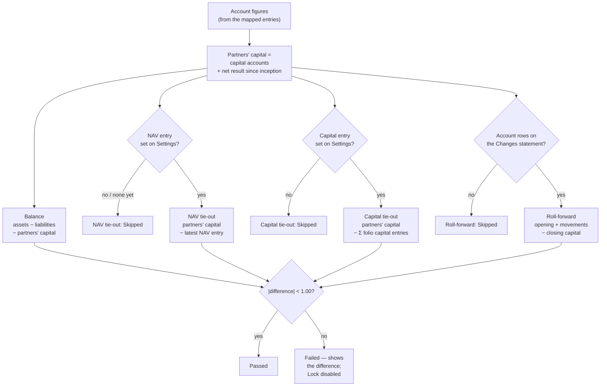

Worked on the demo fund, Q3 2026 (01/07–30/09/2026):

| Check | Arithmetic | Result |
|---|---|---|
| Balance | 9,796,700 assets − 30,000 liabilities − 9,766,700 partners' capital (10,000,000 − 400,000 + 166,700) | 0 → Passed |
| NAV tie-out | 9,766,700 − NAV / NAV Post Carry 9,766,700 | 0 → Passed |
| Capital tie-out | No capital entry set | Skipped |
| Roll-forward | 10,053,800 opening + 0 contributions − 400,000 distributions + 112,900 net result (16,100 − 303,200 + 400,000) − 9,766,700 closing | 0 → Passed |
| Same, before *Director Fees* (8,000) was mapped | Cash already paid it, no line shows it, so the P&L and partners' capital are 8,000 too high | Balance and NAV fail by 8,000; Unmapped = 1 |

**Reading a failed check's difference** — the amount points at the cause:

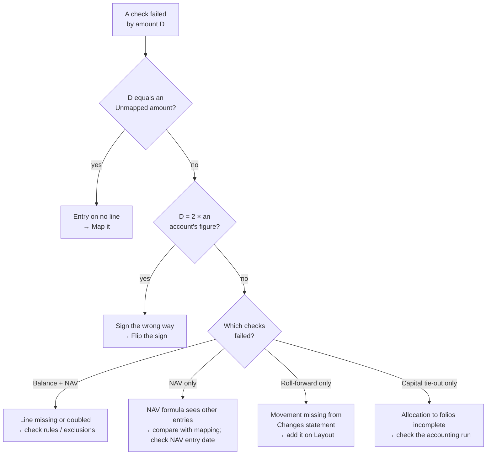

**Completeness warnings** (stored with the checks as `status: "warning"`; they never block Lock, but
the Lock popup lists them for confirmation):

| Warning | Rule | Example note |
|---|---|---|
| `stale_balance` (V10) | A cumulative pair feeding an account has its latest row before `start_date` (and a non-zero value) | "Cash: last value 30/06/2026 (520,000); nothing dated in the period" |
| `no_entries` (V11) | An account placed on a statement has no pair assigned to it at all | "Accrued expenses: no entries feed this line" |
| `mixed_cumulative` (V12) | A pair has both cumulative and periodic rows (cumulative used) | "Income · Interest: stored both as a running total and as movements" |

The full validation list (V1–V14: guards, blocking checks, warnings) is in the
[proposal](proposal.md#how-do-we-know-a-statement-is-right-every-validation).

**Worked examples:** H9, H10, E4, E5, E6, E7, E13, E14, E21, E24, E29, E30, X10

**FAQ**

| Question | Answer |
|---|---|
| Why accept a `base` relation? | Kept for a later direct path; today every caller uses `AccountEntry` (card ④ rule 2). |
| Isn't roll-forward a tautology? | Only if the Changes layout includes every capital movement; it catches layout gaps. |
| Why ignore "Financial Statement" entries? | They are the calculator's own output; including them would double every line. |

### ④ Statements run

**In one line:** statement lines are produced by an ordinary allocation run that contains exactly
one formula, a new rule type `GenerateFinancialStatementLines`. It asks the calculator (③) for every
account's figures and writes them as account entries. Nothing else in the engine changes how it works.

| Owns | Reads / receives | Produces |
|---|---|---|
| Rule type `GenerateFinancialStatementLines`; `formulas_in_scope` exclusion; step `refresh_financial_statements` | Run ctx (fund, run dates, allocation run); the run's `FinancialStatement` (period start); ③ figures from the live DB | Fund-level `account_entries` with `entry_type "Financial Statement"`, `generated`, `fund_formula_id`, `allocation_run_id`, `json_fields {fs_account_id, column}` |

#### How the engine works today, and the four places it changes

The engine (`AccountEntryAllocationJob` → `Engine` → `RunFormulas`) takes a fund, two dates and an
optional tag list, picks the fund's enabled formulas, deletes those formulas' entries for the
period, runs each formula (`RunFormula` dispatches on `rule_type`), inserts the entries into a
scratch SQLite DB and migrates them to MySQL. A statements run goes through exactly this path.

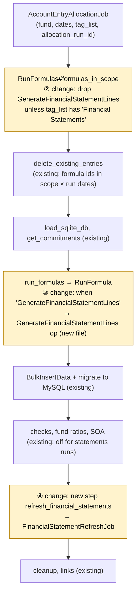

| # | File | Change | Lines | Effect on runs without statements |
|---|---|---|---|---|
| ① | `funds/funds/models/fund_formula.rb` | `TYPES` += `GenerateFinancialStatementLines`; constant `FINANCIAL_STATEMENTS_TAG = "Financial Statements"` | 4 | None: a constant |
| ② | `allocation_engine/account_entry_allocation/run_formulas.rb` `#formulas_in_scope` | Unless the run's tag list includes "Financial Statements", drop formulas of the new type (keeping legacy NULL `rule_type` rows) | 5 | Funds without a statement formula: identical query result. Funds with one: the statement formula is left out, so an ordinary run never runs **or deletes** statement lines (E12) |
| ③ | `allocation_engine/account_entry_allocation/run_formula.rb` | One `when "GenerateFinancialStatementLines"` branch calling the new op | 3 | None: no other formula has that type |
| ④ | `allocation_engine/account_entry_allocation/run_formulas.rb` | New step `refresh_financial_statements` after `generate_soa`: if a statement set points at this run, queue `FinancialStatementRefreshJob`. Always returns true and rescues errors | 15 | One `EXISTS` query per run; no-op otherwise |
| new | `allocation_engine/account_entry_allocation/generate_financial_statement_lines.rb` | The op | ~70 | — |

```ruby
# ② RunFormulas#formulas_in_scope
unless tag_list.to_s.split(",").map(&:strip).include?(FundFormula::FINANCIAL_STATEMENTS_TAG)
  formulas = formulas.where("fund_formulas.rule_type IS NULL OR fund_formulas.rule_type <> ?",
                            "GenerateFinancialStatementLines")
end

# ③ RunFormula#run_formula_internal
when "GenerateFinancialStatementLines"
  AccountEntryAllocation::GenerateFinancialStatementLines.call(ctx)
```

#### What the new rule type does, step by step

Modelled on `GeneratePortfolioNumbersForFund`: one evaluation per fund, fund-level entries only.
Its formula text (`"true"`) is never evaluated; the mapping is the "formula".

| Step | What happens | Why |
|---|---|---|
| 1 | Find the statement set whose `statements_allocation_run_id` is this run; take its `start_date`. Fall back to `ctx[:start_date]` when the formula is run by hand from the allocate screen | The run's own dates are the end date only (rule 1 below) |
| 2 | `FinancialStatementCalculator.call(fund:, start_date:, end_date:)` on `AccountEntry` (live DB) | Rule 2 below |
| 3 | For every account, build three entry hashes named "FS · …" and dated the end date (table below) with `fund_formula_id`, `allocation_run_id`, `generated: true`, `json_fields {fs_account_id, column}` and an explanation line | Read back by `FinancialStatement#figures`; the other two figures of each account are derived |
| 4 | Append them to `ctx[:bulk_insert_records]` | The existing `BulkInsertData` inserts them and the engine migrates them to MySQL like any formula's output |

**Entries written per account** (reporting date = statement end):

| Behaviour | Entry name | Column in `json_fields` | cumulative |
|---|---|---|---|
| Movement | "FS · <account>" | period | false |
| Movement | "FS · YTD <account>" | ytd | false |
| Movement | "FS · Since Inception <account>" | balance | true |
| Balance | "FS · <account>" | balance | true |
| Balance | "FS · Opening <account>" | opening | true |
| Balance | "FS · YTD Opening <account>" | ytd_opening | true |

**Why the "FS · " prefix (stored rows only).** Fund ratios (`FundPortfolioCalcs`, `FundRatioMultiFundCalcs`)
and the fund / investor document templates (`fund_account_entries`) look fund-level entries up **by
name** in the live database. Without a prefix, an account named like one of the fund's own entries
(e.g. "Cash In Hand") would put a second "Cash In Hand" entry on the end date, and those readers could
pick the statement line. With it, no statement line can share a name with an input entry, and no
existing code had to change. The prefix exists **only on the stored account entry rows**: the
statements on screen, in the previews, Excel, PDF and the frozen copy print the layout label / account
name, because the renderer reads each figure by `json_fields.fs_account_id`, never by entry name.
Inputs are untouched: rules still match the fund's own entries by their existing entry type and name.
An account name may not itself start with "FS ·" (X19). The statement view says where the lines live
and links to them; the account form and the Mapping tab's explainer say how they are named.

**Example** — Alpha Fund I, Q3 2026 statements run #3412 (dates 30 Sep–30 Sep), 1 Jul–30 Sep 2026:

| Entry type | Name | Amount | Column |
|---|---|---|---|
| Financial Statement | FS · Professional fees | 45,200 | period |
| Financial Statement | FS · YTD Professional fees | 101,300 | ytd |
| Financial Statement | FS · Since Inception Professional fees | 150,000 | balance |
| Financial Statement | FS · Cash | 640,000 | balance |
| Financial Statement | FS · Opening Cash | 702,000 | opening |
| Financial Statement | FS · YTD Opening Cash | 520,000 | ytd_opening |

#### Two rules found while building (checked against the engine code)

1. **The statements run's own dates are the statement's end date only** (`start_date = end_date =`
   statement end). The engine's delete step removes the formula's entries with a reporting date
   inside the run's dates, and statement lines are dated on the end date. With the full period as
   the run's dates, regenerating FY 2026 (1 Jan–31 Dec) would delete the Q1–Q3 statement lines dated
   31 Mar, 30 Jun and 30 Sep. With one-day dates it touches only lines on its own end date. Two
   statement sets can therefore not share an end date (E28): Generate refuses, and the existing set's
   year-to-date column already covers the longer period.
2. **The calculator reads the live database (`AccountEntry`), not the scratch SQLite.** A fund with
   incremental allocation (`CommitmentAccountEntry.incremental_since_inception?`) copies only recent
   entries into the scratch DB (`AE_COPY_FROM`), so since-inception balances computed there would be
   wrong. Primary is correct here because the statements run writes no other entries, and its delete
   step has already removed only its own lines before the op runs.

#### One statements run, end to end

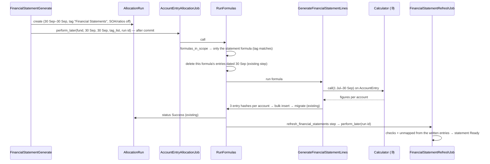

**Who can start a statements run:** only `FinancialStatementGenerate` (Generate / Regenerate on the
Financial Statements page), which applies its own guards. Running the formula from the allocate
screen needs the "Financial Statements" tag selected; it then replaces the lines like a Regenerate
but no statement set is updated, and the allocate screen's existing lock check still applies
(`FundsController#allocate` and `AllocationRun.locked_and_overlapping` are unchanged).

| Component | Queue | Retries | Idempotency | Transaction |
|---|---|---|---|---|
| Op inside `AccountEntryAllocationJob` | existing `high` | existing (0) | The delete step removes this formula's lines on the end date first (existing) | existing bulk insert |
| `refresh_financial_statements` → `FinancialStatementRefreshJob.perform_later(run.id)` | `default` | 3 | Ignores a run that isn't the set's current statements run, or didn't succeed | single `update!` |

**Worked examples:** H12, H13, H14, E12, E16, E28, X4, X11

**FAQ**

| Question | Answer |
|---|---|
| Does it load commitments? | The engine's shared steps still do; the op itself writes fund-level rows only. |
| Why a new rule type instead of `GenerateAccountEntry`? | `GenerateAccountEntry` evaluates per commitment; statements need one evaluation per fund over the mapping, and must catch Unmapped entries. |
| Why not skip the scratch DB? | Reusing the engine path keeps delete/insert/migrate identical; skipping the scratch load for statement-only runs is a later optimisation. |
| Why one-day run dates? | So the delete step can't remove another statement set's lines (rule 1). |
| What if the formula is deleted or disabled? | Generate refuses (X15); saving an account or settings recreates a deleted formula. |
| Does an ordinary accounting run change? | Only by leaving the statement formula out (change ②). Funds that never use statements see no difference at all. |

### ⑤ Statement record

The `financial_statements` row: generation guards, checks, lock with frozen copy, comparatives
and drift.

| Owns | Reads / receives | Produces |
|---|---|---|
| `financial_statements`; `FinancialStatementGenerate`, `FinancialStatementLock`, `FinancialStatementRefreshJob` | Generate/Lock requests; ④ completion; ⑦ demote | Runs (via ④); `checks`, `unmapped_count`, `frozen_data` |

**Generate guards (in order):**

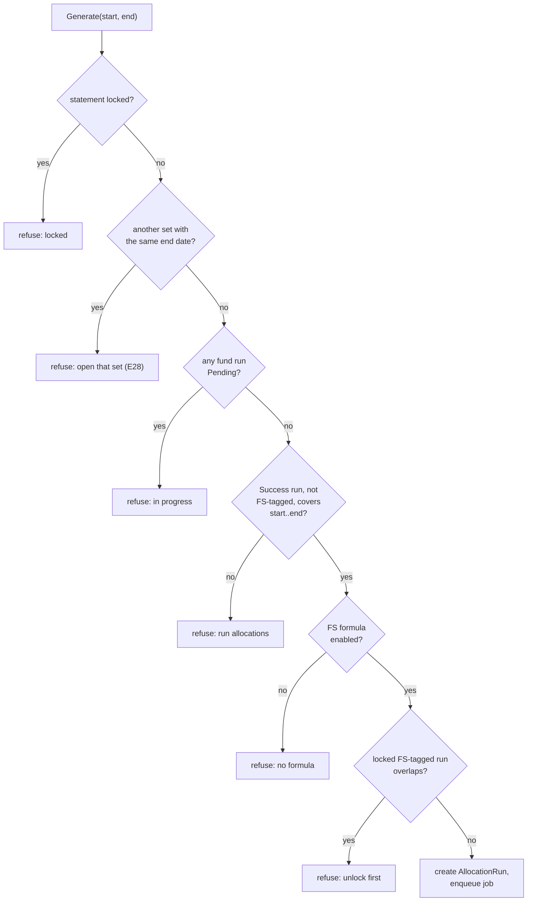

**Lock:** allowed when status draft, refresh done for the latest run, every check passed/skipped,
`unmapped_count = 0`. One transaction: `frozen_data` = {columns of lines from the FS entries,
mapping + layout snapshot, checks}, `status locked`, `locked_by_id`, `locked_at`, statements
`AllocationRun#locked = true`.

**Comparatives:** prior columns come from the `frozen_data` of the locked statement whose
`end_date` matches (prior FY end for at-date statements; same date last year for YTD of for-period statements). No match →
calculator on MySQL, headed "Not locked — computed". Drift for a comparative source uses the same
comparison as the banner.

**Drift:** on show/export of a locked statement, `FinancialStatementCalculator` on MySQL vs
`frozen_data`; lines differing by ≥ 1.00 are listed. Computed per request (one grouped query set),
not stored.

**Access:** show/export — `FundPolicy#show?`; generate/lock/regenerate — `FundPolicy#update?`;
`FinancialStatementPolicy` scopes by `entity_id`.

**Worked examples:** H12, H15, H18, E1, E8, E9, E10, E11, E25, E26, E28, X1, X2, X3, X8, X9, X13, X15, X16

**FAQ**

| Question | Answer |
|---|---|
| Why a new `AllocationRun` per Generate? | `rerun!` is blocked by the locked accounting run (decision 2). Old statements runs remain in the run list like any run. |
| Why keep `frozen_data` when demoted to Draft? | It is the record of what was published, and comparatives/drift keep using it until re-lock overwrites it. |
| Why derive drift instead of storing it? | Data can change at any time; storing would go stale. |

### ⑥ Output

Screen, Excel and PDF of the statement set — every statement of the fund (core + schedules) — with columns and checks; a switcher moves between statements.

| Owns | Reads / receives | Produces |
|---|---|---|
| `FinancialStatementsController#index/#show`, `FinancialStatementXlsx`, `FinancialStatementPdf`, views | ⑤ record, its FS entries (draft) or `frozen_data` (locked), layout | HTML, `.xlsx`, `.pdf` |

| Verb and path | Action | Does | Responds with |
|---|---|---|---|
| GET `/funds/:fund_id/financial_statements` | `#index` | Statements tab list | HTML |
| POST `/funds/:fund_id/financial_statements` | `#create` | Generate (⑤) | Turbo Stream / redirect with alert |
| GET `/financial_statements/:id` | `#show` | Statement view | HTML |
| POST `/financial_statements/:id/regenerate` | `#regenerate` | ⑤ Generate same period | Turbo Stream |
| PATCH `/financial_statements/:id/lock` | `#lock` | ⑤ Lock | Turbo Stream |
| GET `/financial_statements/:id.xlsx` / `.pdf` | `#show` | Export; Draft watermark | file |

**Build notes:** amounts formatted with existing money helpers in fund currency; dates via
`l(...)`; locked view/exports always read `frozen_data`; draft reads FS entries for the latest
statements run (`fund_formula_id` + `reporting_date` + `json_fields.column`).

**Worked examples:** H19, H20, H24

**FAQ**

| Question | Answer |
|---|---|
| Why not a Sablon template? | Layout is data-driven per fund; caxlsx/FerrumPdf render the layout rows directly. Templates can still read FS entries. |

### ⑦ Unlock guard

Warns before an allocation-run unlock touches a period with locked statements, demotes them and
notifies.

| Owns | Reads / receives | Produces |
|---|---|---|
| `FinancialStatementUnlockGuard`, `FinancialStatementNotifier`, popup in `funds/_allocation_runs` | Unlock / Unlock all requests; locked statements overlapping | Statements → draft; one notification per unlock action |

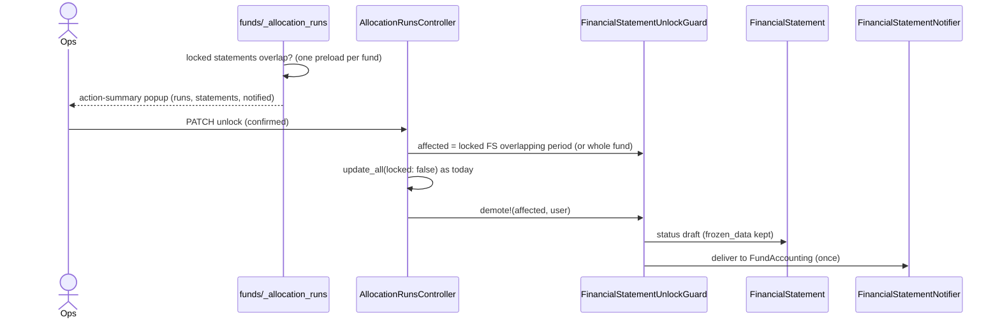

No locked statements → popup and guard are skipped; controller behaviour is byte-identical.

**Worked examples:** H16, H17, E8, E15, E23

**FAQ**

| Question | Answer |
|---|---|
| Why not stop the cascade? | Accepted v1 risk; changing unlock semantics affects every fund. |
| What if the popup is bypassed (direct PATCH)? | Demote + notify still run server-side; only the warning is UI. |

---

## 4. Reference

### Class diagram

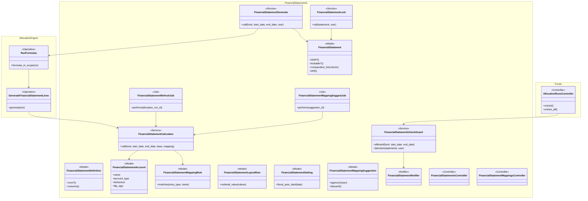

### Data model and schema changes

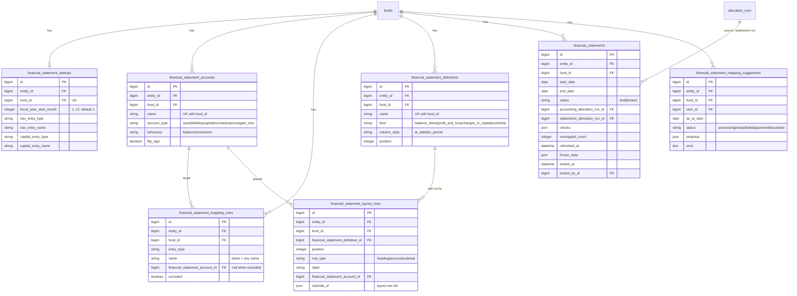

**Indexes:** settings `fund_id` unique · definitions `[fund_id, name]` unique · accounts `[fund_id, name]` unique · rules `[fund_id, entry_type, name]` unique · layout `[fund_id, statement, position]` · statements `[fund_id, start_date, end_date]` unique, `statements_allocation_run_id` · suggestions `fund_id` · `entity_id` on all.

**Schema changes**

**`financial_statement_settings`** (new): fund-level settings the checks and YTD need; funds have no fiscal year column today.

| Column / index | What changed | Why it's needed |
|---|---|---|
| `entity_id`, `fund_id` | Added FKs; `fund_id` unique | Tenant scoping; one row per fund |
| `fiscal_year_start_month` | Added integer, default 1 | YTD and prior-year-end comparatives |
| `nav_entry_type`, `nav_entry_name` | Added strings | Which fund-level entry is the NAV for the NAV tie-out |
| `capital_entry_type`, `capital_entry_name` | Added strings | Which folio-level entry is each investor's capital balance |

**`financial_statement_accounts`** (new): the typed statement accounts.

| Column / index | What changed | Why it's needed |
|---|---|---|
| `entity_id`, `fund_id` | Added FKs | Scoping; per-fund mapping |
| `name` + unique `[fund_id, name]` | Added | Line label; FS entry name; uniqueness per fund |
| `account_type` | Added string enum | Checks and P&L close need the type |
| `behaviour` | Added string enum | Balance vs Movement computation |
| `flip_sign` | Added boolean, default false | Normalises funds that store expenses negative |

**`financial_statement_mapping_rules`** (new): entry → account rules.

| Column / index | What changed | Why it's needed |
|---|---|---|
| `entity_id`, `fund_id` | Added FKs | Scoping |
| `entry_type`, `name` + unique `[fund_id, entry_type, name]` | Added | Match key; blank name = any; one rule per key |
| `financial_statement_account_id` | Added nullable FK | Target account |
| `excluded` | Added boolean | Explicit exclusion (not Unmapped) |

**`financial_statement_definitions`** (new): the statements a fund produces — three core plus any schedules.

| Column / index | What changed | Why it's needed |
|---|---|---|
| `entity_id`, `fund_id` | Added FKs | Scoping |
| `name` + unique `[fund_id, name]` | Added string | Title on screen and in exports; core ones renamable |
| `kind` | Added string enum balance_sheet \| profit_and_loss \| changes_in_capital \| schedule | Core statements are found by kind (checks, columns); only `schedule` can be deleted |
| `column_style` | Added string enum at_date \| for_period | Which columns a schedule shows; fixed for core kinds |
| `position` | Added integer | Order of tabs/sheets/PDF sections |

**`financial_statement_layout_rows`** (new): ordered statement layout.

| Column / index | What changed | Why it's needed |
|---|---|---|
| `entity_id`, `fund_id` | Added FKs | Scoping |
| `financial_statement_definition_id` | Added FK | Which statement the row belongs to |
| `position` + index `[fund_id, statement, position]` | Added | Order |
| `row_type`, `label` | Added | Heading/account/subtotal and display text |
| `financial_statement_account_id` | Added nullable FK | Account rows |
| `subtotal_of` | Added JSON | Rows summed by a subtotal |

**`financial_statements`** (new): one statement per fund and period.

| Column / index | What changed | Why it's needed |
|---|---|---|
| `entity_id`, `fund_id`, `start_date`, `end_date` + unique | Added | Identity; one statement per period |
| `status` | Added string, default draft | Draft/Locked |
| `accounting_allocation_run_id` | Added FK | "Built from run #…" |
| `statements_allocation_run_id` + index | Added FK | Which run's FS entries to show; refresh job lookup; lock it |
| `checks`, `unmapped_count`, `refreshed_at` | Added | Lock gating and display without recomputing |
| `frozen_data` | Added JSON | Published figures, mapping/layout snapshot, checks |
| `locked_at`, `locked_by_id` | Added | Who/when locked |

**`financial_statement_mapping_suggestions`** (new): AI drafts.

| Column / index | What changed | Why it's needed |
|---|---|---|
| `entity_id`, `fund_id`, `user_id` | Added FKs | Scoping; who uploaded |
| `as_at_date` | Added date | Date for reconciliation |
| `status`, `proposal`, `error` | Added | Lifecycle, draft content, failure reason |

**Changes to existing models:**
- `FundFormula::TYPES` gains `GenerateFinancialStatementLines` (constant only; no column).
- `AccountEntry`, `AllocationRun`, `Fund`: **no schema change**. FS entries use existing columns (`json_fields` holds `fs_account_id`, `column`).

### Component contracts

| From → To | Contract | Direction rule |
|---|---|---|
| ② → ① | `FinancialStatementMappingSuggestion#approve!(user)` writes settings/accounts/layout/rules in one transaction | ② never writes ① before approve |
| ② → ③ | `FinancialStatementCalculator.call(fund:, start_date: as_at, end_date: as_at, base: AccountEntry, mapping: draft)` | Read-only |
| ① → ③ | Calculator loads rules/accounts/settings by `fund_id` (or takes a draft mapping) | ③ never writes ① |
| ⑤ → ④ | `AllocationRun.create!(start_date: end, end_date: end, tag_list: "Financial Statements", generate_soa: false, fund_ratios: false)` + `AccountEntryAllocationJob.perform_later(..., allocation_run_id:)` | Only `FinancialStatementGenerate` starts statements runs |
| ④ → ③ | `Calculator.call(..., base: AccountEntry)` on the live DB (see card ④ rule 2) | Read-only |
| ④ → ⑤ | FS entries in `account_entries`; post-run `FinancialStatementRefreshJob.perform_later(run.id)` | ④ never writes `financial_statements` directly |
| ⑤ → ⑥ | `FinancialStatement` + FS entries / `frozen_data` | ⑥ read-only |
| ⑦ → ⑤ | `FinancialStatementUnlockGuard#demote!(statements, user)` | Only status → draft; never touches `frozen_data` |

### Notifications

Investors: **none** — statements are fund-team only in v1. Internal:

| Notification | Trigger | Recipients | Channel | Customisable | Default | Sent once? |
|---|---|---|---|---|---|---|
| Financial statements unlocked | Unlock / Unlock all confirmed and ≥ 1 locked statement demoted | Users tagged `FundAccounting` (`User::NOTIFICATION_TAGS`) who pass `FundPolicy#show?` (via `EvergreenRecipients#tagged`) | Email + in-app (`FinancialStatementNotifier < BaseNotifier`) | No | Always on | Yes — one delivery per unlock request, listing every demoted statement; a second unlock finds none locked and sends nothing |
| Mapping draft ready / failed | Suggest job finishes | The uploading user | In-app toast (existing `notify` broadcast, like allocation runs) | No | Always on | Yes — job runs once per upload/retry |
| Statements run finished | Existing allocation-run completion notification | Run user (existing) | Existing | Existing | Existing | Existing |

### Cross-cutting concerns

#### Transactions and queries

- Calculator: ≤ 8 grouped queries per call over indexed `fund_id`, `reporting_date`; no N+1 (rules/accounts loaded once).
- Approve draft and Lock: single DB transaction each.
- Unlock popup: one query per fund page for locked statements, matched to rows in memory.

#### Exception handling and monitoring

| Failure | Who is alerted | Channel | Detail |
|---|---|---|---|
| Statements run formula error | Run user | Existing run failure notification + `AllocationRunReport` | Statement shows Failed with run link |
| LLM / parse error | Uploader | In-app toast; suggestion `failed` | Error text stored |
| Refresh job error | Engineering | Existing exception notifier | Statement stays Generating; Regenerate retries |

#### Performance and security

- Grouped SQL only; `account_entries` never materialised (CLAUDE.md). Q4/Q5 use max-date subqueries per pair/commitment on indexed columns.
- All tables carry `entity_id`; controllers authorise via `FundPolicy` and scope by `entity_id`; uploads limited to PDF/XLSX/XLS ≤ 20 MB; LLM uses entity keys via `LlmService`.

### Worked examples

**ID legend:** **H** = Happy path · **E** = Edge case · **X** = Error (exception) case.

**Shared setup:**

| Record | Name | Key data |
|---|---|---|
| Entity | Alpha Capital | employee Meera (update), Ravi (update, tag FundAccounting), Priya (read-only) |
| Fund | Alpha Fund I | USD; settings: FY start Jan; NAV entry "NAV / NAV Post Carry"; capital entry "Capital / Closing Capital" |
| Accounts | Professional fees (expense, movement), Other expenses (expense), Transaction costs (expense), Interest income (income), Cash (asset, balance), Investments at FV (asset), Payables (liability), Contributions (capital), Distributions (capital, flip) | |
| Statements | Balance Sheet, Profit & Loss, Statement of Changes in Partners' Capital (core); Schedule of Fund Expenses (for a period) | |
| Rules | Non Deal Expense/Audit Fees → Professional fees; Non Deal Expense/Legal Fees → Professional fees; Deal Expense/(any) → Transaction costs; Portfolio Allocation/(any) → Excluded | |
| Entries Q3 2026 | Audit Fees 30,000; Legal Fees 15,200; Deal Expense/Acme Ltd 62,400; Director Fees 8,000 (unmapped) | fund-level, periodic |
| Runs | #3331 accounting 1 Jul–30 Sep 2026, Success, locked | |

#### Happy Path

| # | Scenario | Given | When | Then | Spec scenario | Feature |
|---|---|---|---|---|---|---|
| H1 | Create account | Alpha Fund I | Meera adds "Professional fees", Expense | Saved, behaviour Movement, statement formula auto-created | mapping: Create an expense account | `financial_statement_mapping.feature` |
| H2 | Subtotal | P&L layout: Total expenses = Mgmt fees (-250,000) + Prof fees (-45,200) | Preview | Total expenses -295,200 | mapping: Subtotal sums its rows | `financial_statement_mapping.feature` |
| H21 | Core statements created | Alpha Fund I with no accounts | Meera saves first account | Balance Sheet, Profit & Loss, Statement of Changes in Partners' Capital exist | mapping: Core statements created | `financial_statement_mapping.feature` |
| H22 | Rename core | Core statements | Rename "Profit & Loss" → "Statement of Operations" | New name on screen and PDF | mapping: Core statement renamed | `financial_statement_mapping.feature` |
| H23 | Add schedule | Core statements | Add "Schedule of Fund Expenses", For a period | Appears in Layout and next statement set | mapping: Add a schedule | `financial_statement_mapping.feature` |
| H24 | Account on two statements | Audit fees on P&L and expense schedule | Generate Q3 | Both show 30,000 | mapping: Account on two statements | `financial_statement_generation.feature` |
| H3 | Reorder | Layout rows | Move Prof fees up (↑) above Mgmt fees | Order saved and used in preview | mapping: Reorder rows | `financial_statement_mapping.feature` |
| H4 | Any-name rule catches new name | Deal Expense (any) → Transaction costs | Upload Deal Expense/Acme Ltd 62,400 | Transaction costs preview 62,400 | mapping: Entry-type rule catches new names | `financial_statement_mapping.feature` |
| H5 | Exact rule wins | Non Deal Expense (any) → Other expenses; Audit Fees exact → Prof fees | Preview Q3 | Audit Fees only in Prof fees | mapping: Exact rule wins | `financial_statement_mapping.feature` |
| H6 | Unmapped listed | Director Fees 8,000, no rule | Open Mapping for Q3 | Unmapped row "Non Deal Expense · Director Fees · 8,000" | mapping: New unmapped name appears | `financial_statement_mapping.feature` |
| H7 | Map from list | H6 | Map → Prof fees | Row gone; Prof fees preview +8,000 | mapping: Map from the list | `financial_statement_mapping.feature` |
| H8 | Preview updates | Tax/TDS 1,150 Excluded | Change to Other expenses | Other expenses +1,150; no entry created | mapping: Preview updates on rule change | `financial_statement_mapping.feature` |
| H9 | Movement from cumulative | Interest income cumulative 7,800 @30 Jun, 11,900 @30 Sep | Preview Q3 | 4,100 | mapping: Movement from cumulative entries | `financial_statement_calculator.feature` |
| H10 | Balance from periodic | Cash periodic 100,000 / -20,000 / 5,000 (Q1–Q3) | Preview @30 Sep | 85,000 | mapping: Balance from periodic entries | `financial_statement_calculator.feature` |
| H11 | AI draft maps lines | PDF prints Prof fees (LLM stubbed) | Suggest | Professional fees fed by Audit Fees + Legal Fees; status Mapped; no amounts compared on the page | mapping: Draft maps printed lines to account entries | `financial_statement_ai_draft.feature` |
| H12 | Generate | Mapping complete, #3331 locked | Generate Q3 2026 | Draft created; FS entries for each account dated 30 Sep 2026; "Built from accounting run #3331"; no folio FS entries | generation: Lines written as account entries; generation: Source run recorded; statements: Generate creates a draft | `financial_statement_generation.feature` |
| H13 | Accounting untouched | H12 | Run completes | Every non-FS entry for Q3 unchanged (ids and amounts) | generation: Accounting entries untouched by a statements run | `financial_statement_generation.feature` |
| H14 | Allowed over locked run | #3331 locked | Generate Q3 | Statements run starts | generation: Locked accounting run | `financial_statement_generation.feature` |
| H15 | Lock | Draft, checks pass, unmapped 0 | Ravi locks | "Locked on … by Ravi"; frozen_data set; statements run locked | statements: Lock succeeds | `financial_statements.feature` |
| H16 | Unlock warning | Q3 locked | Ops clicks Unlock on #3331 | Popup: Q3 2026 back to Draft, FundAccounting notified | statements: Warning shown | `financial_statement_unlock_guard.feature` |
| H17 | Confirmed unlock | H16 | Confirm | Runs unlocked; Q3 Draft; Ravi gets 1 email + in-app | statements: Confirmed unlock | `financial_statement_unlock_guard.feature` |
| H18 | Prior year from frozen copy | Q3 2025 set locked (YTD Prof fees 88,400); a 2025 Audit Fees entry later edited | Generate Q3 2026 | P&L last-year YTD column 88,400, headed "As locked — changed since locked" | statements: Prior year from frozen copy | `financial_statements.feature` |
| H19 | Draft PDF / Excel | Q3 Draft | Download PDF and Excel | PDF pages watermarked DRAFT; Excel has one sheet per statement (4 with the expense schedule) | statements: Draft PDF | `financial_statements.feature` |
| H20 | Read-only user | Priya | Opens Financial Statements | Can view/download; no Generate/Lock/editors | statements: Read-only user | `financial_statements.feature` |

#### Edge Cases

| # | Scenario | Given | When | Then | Spec scenario | Feature |
|---|---|---|---|---|---|---|
| E1 | Same period twice | Q3 Draft exists | Generate Q3 again | Same record regenerated; one row | statements: Duplicate period | `financial_statement_generation.feature` |
| E2 | Excluded | Portfolio Allocation/(any) Excluded | Preview | Not in any line, not Unmapped | mapping: Excluded entries | `financial_statement_mapping.feature` |
| E3 | Folio entries ignored | Folio F-102 Audit Fees 500 | Preview | Prof fees unchanged | mapping: Folio-level entries ignored | `financial_statement_mapping.feature` |
| E4 | Rounding pass | Balance diff 0.40 | Generate | Balance ✓ | generation: Rounding tolerated | `financial_statement_calculator.feature` |
| E5 | Exactly 1.00 | Balance diff 1.00 | Generate | Balance ✗ 1.00 | generation: Balance check fails | `financial_statement_calculator.feature` |
| E6 | No NAV entry | NAV setting set, no NAV entry @30 Sep | Generate | "Skipped — no NAV entry"; lockable | generation: No NAV entry | `financial_statement_calculator.feature` |
| E7 | Capital not configured | capital setting blank | Generate | Capital tie-out "Skipped — not configured" | generation: Capital tie-out not configured | `financial_statement_calculator.feature` |
| E8 | Unlock with no locked statements | Q3 Draft only | Unlock #3331 | Plain confirm as today; no notification | statements: No locked statements | `financial_statement_unlock_guard.feature` |
| E9 | No drift | Q2 locked, nothing edited | Open Q2 | No banner | statements: No drift | `financial_statements.feature` |
| E10 | Drift banner | Q2 locked, Audit Fees 30,000 → 32,700 | Open Q2 | "Professional fees 45,200 → 47,900"; PDF uses 45,200 | statements: Edited entry behind a locked statement | `financial_statements.feature` |
| E11 | First year | No FY2025 statement | Open Q3 2026 | Prior column "Not locked — computed" | statements: First year on CapHive | `financial_statements.feature` |
| E12 | Ordinary run skips FS | FS formula enabled | Untagged run Q2 2026 (unlocked) | No FS entries created or deleted | generation: Ordinary run skips statement formulas | `financial_statement_generation.feature` |
| E13 | Mixed cumulative | Interest income has cumulative and periodic rows | Preview | Cumulative used; warning shown | mapping: Movement from cumulative entries | `financial_statement_calculator.feature` |
| E14 | Dates on boundaries | Entries 1 Jul, 30 Sep, 30 Jun | Preview Q3 | 1 Jul and 30 Sep included; 30 Jun excluded | mapping: Balance and movement figures | `financial_statement_calculator.feature` |
| E15 | Unlock all, two periods | Q2, Q3 locked | Unlock All | Both Draft; one notification listing both | statements: Confirmed unlock | `financial_statement_unlock_guard.feature` |
| E16 | Regenerate replaces | Draft with 52 FS entries | Regenerate after mapping change | Old FS entries deleted; new ones written; count matches accounts × columns | generation: Accounting entries untouched by a statements run | `financial_statement_generation.feature` |
| E17 | FS entries never mapped | FS entries exist | Open Mapping Unmapped | No "Financial Statement" rows | mapping: Excluded entries | `financial_statement_mapping.feature` |
| E18 | Unused entry | AI leaves Tax · TDS unplaced | Suggest; move TDS to Other expenses | Listed as a mapping gap (not used); after the move Other expenses is fed by Bank Fees + TDS and no entry is unused | mapping: Draft maps printed lines to account entries | `financial_statement_ai_draft.feature` |
| E19 | Discard draft | Ready suggestion | Discard | Mapping unchanged | mapping: Nothing saved before approval | `financial_statement_ai_draft.feature` |
| E20 | Draft vs existing mapping | Fund has mapping | Suggest | Lines shown as added/changed; approve updates by name | mapping: Draft maps printed lines to account entries | `financial_statement_ai_draft.feature` |
| E21 | April fiscal year | FY start month 4 | Generate Q3 2026 | YTD from 1 Apr 2026 | statements: Prior year from frozen copy | `financial_statement_calculator.feature` |
| E22 | Zero total not unmapped | Unmapped pair sums to 0 in Q3 | Open Mapping | Not listed | mapping: New unmapped name appears | `financial_statement_mapping.feature` |
| E23 | Cancel unlock | Q3 locked | Unlock → Cancel | Runs and statement stay locked; no notification | statements: Warning shown | `financial_statement_unlock_guard.feature` |
| E24 | Flip sign | Distributions stored positive (400,000), flip on | Preview | Capital figure −400,000, shown (400,000) on the Changes statement; roll-forward passes | generation: Balance check fails | `financial_statement_calculator.feature` |
| E25 | Double-click Generate | — | Two POSTs | Second refused (run Pending); one run | generation: Run in progress | `financial_statement_generation.feature` |
| E27 | AI names an entry the fund lacks | LLM rule for "Non Deal Expense / Audit Fee" (no such entry) | Suggest | Rule dropped, listed under "Dropped by CapHive"; line computed without it | mapping: Draft maps printed lines to account entries | `financial_statement_ai_draft.feature` |
| E28 | Same end date, different period | Q3 2026 statements (1 Jul–30 Sep) exist | Generate 1 Jan–30 Sep 2026 | Refused: "Statements ending 30/09/2026 already exist (01/07/2026 – 30/09/2026). Open them instead; their year-to-date column covers this period." | generation: One statement set per end date | `financial_statement_generation.feature` |
| E29 | Stale balance | Cash uploaded as a running total, latest row 30 Jun 2026 (520,000) | Generate Q3 2026 | Cash shows 520,000; warning "Cash: last value 30/06/2026…"; Lock asks to confirm it | generation: Completeness warnings | `financial_statement_calculator.feature` |
| E30 | Account with no entries | "Accrued expenses" on the Balance Sheet, no rule matches anything | Preview Q3 | Line shows 0; warning "Accrued expenses: no entries feed this line" | generation: Completeness warnings | `financial_statement_calculator.feature` |
| E31 | Statement line not allocated | AllocateAccountEntry-Name formula "Professional fees" and a statement account of the same name | Generate Q3, then an ordinary run | No folio "Professional fees" entries: the scratch load skips "Financial Statement" entries | generation: Ordinary run skips statement formulas | `financial_statement_generation.feature` |
| E32 | Statement from another period | Statement for another period than the fund's latest entries | Suggest | Every entry the AI names is kept (the entry list covers everything up to today); amounts are never compared | mapping: Draft maps printed lines to account entries | `financial_statement_ai_draft.feature` |
| E33 | Accumulated net result on the draft | AI returns "Accumulated net result" as an empty capital account | Suggest | Turned into the calculated net result row (status Calculated) | mapping: Draft maps printed lines to account entries | `financial_statement_ai_draft.feature` |
| E34 | AI sign wrong | AI sets flip_sign on an expense stored positive | Suggest | CapHive sets the sign from the entries and printed figure (not flipped); a reviewer's own Flip sign is kept | mapping: Draft maps printed lines to account entries | `financial_statement_ai_draft.feature` |
| E26 | Re-lock after unlock | H17 then regenerate | Ravi locks | frozen_data overwritten with new figures | statements: Lock succeeds | `financial_statements.feature` |

#### Error Cases

| # | Scenario | Given | When | Then (what the user sees, who is alerted) | Spec scenario | Feature |
|---|---|---|---|---|---|---|
| X1 | No accounting run | No Success run covering Q4 | Generate Q4 | "Run and complete the fund's allocations for this period first." | generation: No accounting run | `financial_statement_generation.feature` |
| X2 | Run in progress | A run Pending | Generate | "An allocation run is in progress for this fund…" | generation: Run in progress | `financial_statement_generation.feature` |
| X3 | Regenerate locked | Q3 locked | POST regenerate | "These statements are locked." | generation: Locked statements run | `financial_statement_generation.feature` |
| X4 | Ordinary run still blocked | #3331 locked | Allocate Q3 from allocate screen | Existing locked alert | generation: Ordinary run still blocked | `financial_statement_generation.feature` |
| X5 | Duplicate account | Prof fees exists | Add Prof fees | "Name has already been taken" | mapping: Duplicate account name rejected | `financial_statement_mapping.feature` |
| X17 | Delete core statement | Balance Sheet | Delete | "Core statements can be renamed but not deleted" | mapping: Core statement cannot be deleted | `financial_statement_mapping.feature` |
| X6 | Delete account in use | Rule → Prof fees | Delete Prof fees | Refused naming the rule | mapping: Account in use cannot be deleted | `financial_statement_mapping.feature` |
| X7 | Unsupported file | — | Upload .docx | "Upload a PDF or Excel file" | mapping: Unsupported file | `financial_statement_ai_draft.feature` |
| X8 | Lock with unmapped | 2 unmapped | View | Lock disabled "Map or exclude 2 entries before locking" | statements: Lock disabled by unmapped entries | `financial_statements.feature` |
| X9 | Lock with failed check (direct PATCH) | Capital tie-out ✗ | PATCH lock | Refused; stays Draft | statements: Lock disabled by unmapped entries | `financial_statements.feature` |
| X10 | Balance fails | A 10,000,000, L 200,000, C 9,798,800 | Generate | Balance ✗ 1,200 | generation: Balance check fails | `financial_statement_calculator.feature` |
| X11 | Run fails | FS formula raises | Generate | Statement "Failed" with run link; run user gets existing failure notice | generation: Lines written as account entries | `financial_statement_generation.feature` |
| X12 | LLM failure | LLM stub raises | Suggest | Suggestion Failed with error; Retry offered; uploader toast | mapping: Draft maps printed lines to account entries | `financial_statement_ai_draft.feature` |
| X13 | Read-only lock attempt | Priya | PATCH lock | Not authorised | statements: Read-only user | `financial_statements.feature` |
| X14 | Other entity | Statement of another entity | GET by id | Not found | statements: Read-only user | `financial_statements.feature` |
| X15 | Formula disabled | FS formula disabled | Generate | "Enable the fund's financial statement formula first." | generation: No accounting run | `financial_statement_generation.feature` |
| X18 | Scanned PDF | PDF with no text layer | Suggest | Failed: "We couldn't read any text from this file…"; Retry offered | mapping: Unsupported file | `financial_statement_ai_draft.feature` |
| X19 | Account name with the statement prefix | — | Add account "FS · Professional fees" | "Name can't start with \"FS ·\" — CapHive adds that to the stored statement lines itself" | mapping: Duplicate account name rejected | `financial_statement_mapping.feature` |
| X16 | Locked statements run overlaps | FS run locked from allocation list, statement Draft | Generate | "Unlock the statements run for this period first." | generation: Locked statements run | `financial_statement_generation.feature` |

### Testing

Cucumber only. New step file `features/step_definitions/financial_statement_steps.rb` with the
shared setup above (fund, accounts, rules, entries via factories; run #3331 created as Success and
locked); `LlmService` stubbed for ②; reuse existing allocation-run and notification steps. Every
scenario carries a comment `# H1 — …` naming its ID and path, and code comments name the IDs of
the paths they implement.

### Risks and open questions

- Statements run reloads the full scratch SQLite for ~50 rows → acceptable v1; calculator already takes a `base`, so a direct-MySQL path is a small later change.
- Unlock cascade can demote published statements → warn, notify, keep `frozen_data` (accepted v1 risk).
- Entries edited in locked periods → drift banner; protection is a separate change touching `AccountEntry`.
- Sign conventions vary by fund → `flip_sign` per account, proposed by the AI draft, validated by the Balance check.
- LLM misreads → every rule validated against the fund's entry list, mapping gaps listed for review, nothing saved before approval; figures tested by the statements' checks after generating.

| # | Open question | Current thinking | Status |
|---|---|---|---|
| 1 | Cash Flow / Schedule of Investments | Later phase | Deferred |

**FAQ**

| Question | Answer |
|---|---|
| Where do I start reviewing? | Card ③ (calculator rules) and card ④ (the only engine change). |
| What is the smallest engine footprint? | One `TYPES` entry, one `when` in `RunFormula`, one exclusion in `formulas_in_scope`, one post-run enqueue. |
| What breaks if the statement formula is deleted? | Generate refuses (X15); the formula is recreated on the next account save. |
