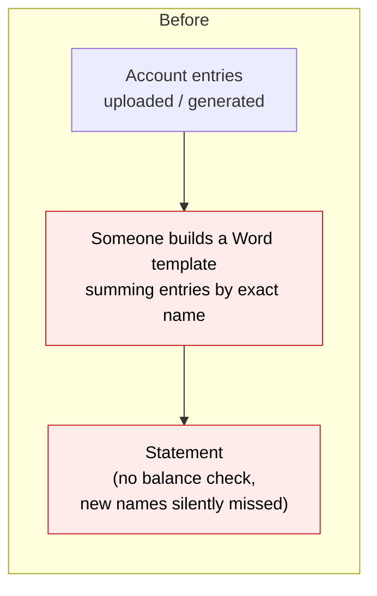
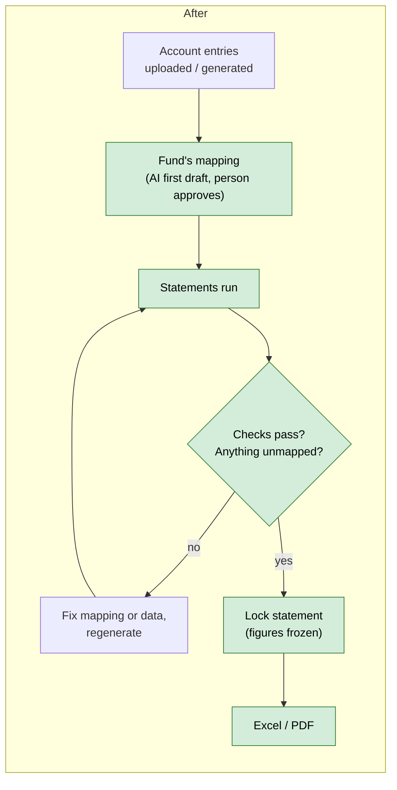
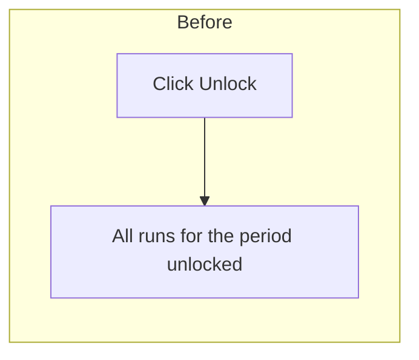
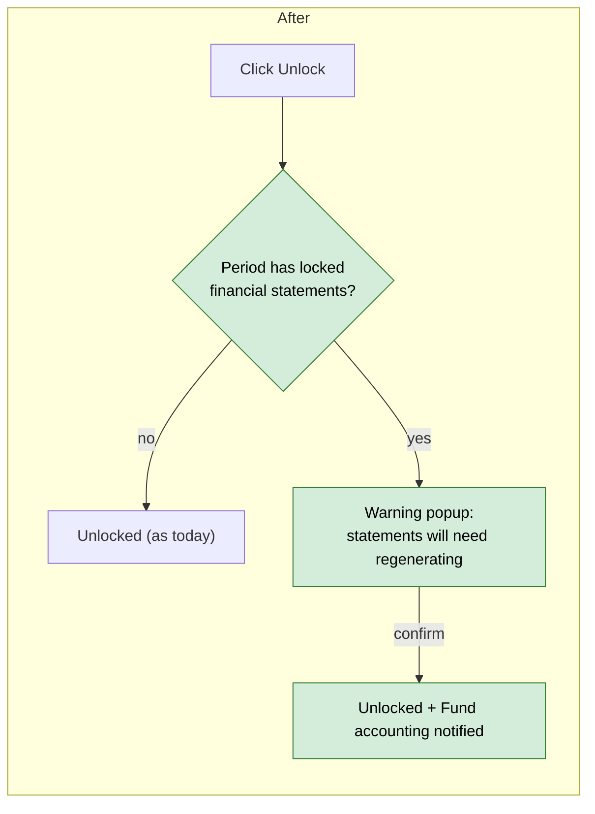
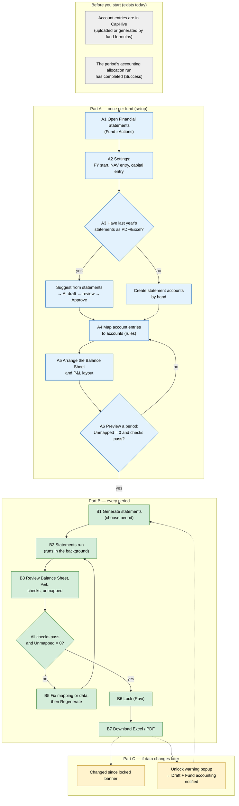
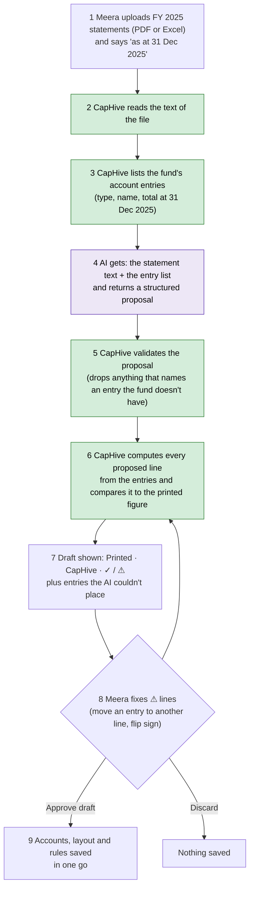

# Fund Financial Statements from Account Entries — Proposal

> **Audience:** Business team, product, QA, support — non-technical.
> **Companion document:** [Design](design.md)
> **New to this? Start with the [Workflow Journey](#workflow-journey--every-action-to-get-a-balance-sheet-and-pl)** — every action, in order, to get a Balance Sheet and P&L.

> **Planning phase — no code changes.** This document proposes and explains the change. Do not
> edit application code while writing it; implementation happens later, in the tasks phase.

---

## Why

Funds want their **Balance Sheet** and **Profit & Loss (P&L)** — plus the Statement of Changes
in Partners' Capital and supporting schedules — out of CapHive. Today the numbers are already in
CapHive as **account entries** (uploaded by the fund admin or generated by fund formulas), but the
only way to get a statement is a hand-built Word template that sums entries by their exact names —
it breaks the moment a fund names an expense differently, and nothing checks that the Balance
Sheet balances.

This is the **lightweight alternative** to the full double-entry ledger scoped in
`docs/modules/accounting/fund_ledger_requirements_questions.md`: no debits/credits, no journals —
the statements are built from the account entries the fund already has, through a per-fund
**mapping** and **integrity checks**.

## What Changes

Think of it as a **seating plan**. The account entries are the guests (hundreds of names per
fund: "Audit Fees", "Custody Fees", one "Deal Expense" per portfolio company…). The statement is
the table plan (a few dozen lines: "Professional fees", "Investments at fair value"…). The
**mapping** says which guest sits at which table; anyone without a seat shows up on an
**Unmapped** list instead of silently going missing.

- **Everything comes from account entries.** Anything a statement needs that isn't an account
  entry yet (contributions, distributions, investments at fair value) is pulled in with the fund
  formulas the fund already uses.
- **Per-fund mapping screen.** Each fund has its own **statement accounts** (e.g. *Professional
  fees*, typed as an expense) and **mapping rules** (e.g. *every "Non Deal Expense" named "Audit
  Fees"* → *Professional fees*; *every "Deal Expense"* → *Transaction costs*; *every "Portfolio
  Allocation"* → *excluded*). A live preview shows each line's figure as rules change.
- **AI first draft of the mapping.** Upload the fund's last financial statements (PDF/Excel). The
  AI proposes the accounts, layout and rules, then **checks its own proposal against the printed
  figures** — any line that doesn't match is flagged for the reviewer. Nothing is saved until a
  person approves.
- **Statements are produced by a "statements run".** A new kind of fund formula turns the mapping
  into statement-line account entries. It runs in its **own allocation run**, separate from the
  fund's accounting run, so it can be generated (and regenerated) after the accounting run is
  locked, without touching any other numbers.
- **Statements you choose.** Balance Sheet, P&L and Changes in Partners' Capital come with every
  fund; schedules (expenses, income, investments, commitments, fees…) are added as needed — see
  [Statements a fund can generate](#statements-a-fund-can-generate).
- **Built-in checks** on every set of statements: the Balance Sheet balances (assets − liabilities =
  partners' capital); partners' capital = the fund's NAV; sum of investor capital accounts =
  partners' capital; opening capital + movements = closing capital.
- **Locking a statement freezes a copy** of every figure. Later edits to the underlying data are
  shown as a **"changed since locked"** warning, and next year's comparative columns use the
  frozen copy, not recomputed numbers.
- **Excel and PDF** download of each statement.
- **Allocation-run unlocks warn first** when the period has locked financial statements, and the
  fund's accounting team is notified.

### Statements a fund can generate

Every fund gets the three core statements; it can add any number of **schedules** of its own. Each
statement is just a layout over the same mapped accounts, so adding one needs no new data.

| Statement | Also called | Shows | Columns | Typical lines |
|---|---|---|---|---|
| **Balance Sheet** (core) | Statement of Assets, Liabilities and Partners' Capital; Statement of Net Assets | What the fund owns and owes at the period end | At period end · prior financial year-end | Investments at fair value, Cash, Receivables, Accrued expenses, Payable to manager, Partners' capital |
| **Profit & Loss** (core) | Statement of Operations; Income Statement | Income, expenses and gains for the period | This period · year to date · same period last year | Dividend income, Interest income, Management fees, Professional fees, Fund expenses, Realised gain, Change in unrealised gain, Net increase from operations |
| **Statement of Changes in Partners' Capital** (core) | Statement of Changes in Net Assets | How partners' capital moved from opening to closing | This period · year to date · same period last year | Opening capital, Contributions, Distributions, Net increase from operations, Closing capital |
| Schedule of Fund Expenses (optional) | Expense note | Every expense line in detail | This period · year to date | Audit fees, Legal fees, Custody fees, Bank charges, Director fees, Organisation costs |
| Schedule of Investment Income (optional) | Income note | Income by source | This period · year to date | Dividends by portfolio company, Interest on temporary investments |
| Schedule of Investments – cost vs fair value (optional) | Portfolio summary | Cost and fair value of holdings at the date | At period end | Cost of investments, Unrealised gain, Investments at fair value |
| Commitments summary (optional) | Unfunded commitments note | Commitments, called and uncalled capital | At period end | Total commitments, Capital called, Unfunded commitments |
| Management fee computation (optional) | Fee note | How the period's fee was arrived at | This period · year to date | Fee base, Management fee, Fee offsets, Net management fee |

A schedule can only show figures that exist as account entries (directly or via a fund formula), so
the last four depend on the fund already producing those entries — which most funds do today
(e.g. *Portfolio FMV*, *Commitment*, *Management fees*).

### Flow Diagram

**Producing a fund's financial statements** — today a hand-built template sums exact names;
after, a mapping turns all entries into checked statements.





**Unlocking an allocation run** — today unlocking is silent; after, a period with locked
statements warns first and tells the accounting team.





---

## Workflow Journey — every action to get a Balance Sheet and P&L

> **Read this first.** This section follows one fund from "nothing set up" to a locked, downloaded
> Balance Sheet and P&L. It lists every action a person takes, where they click, what CapHive does
> in response, and what they see. Everything else in this document gives more detail on a step here.

### Who is involved

| Person | Role | What they do in the journey |
|---|---|---|
| **Meera** | Fund admin (update access to the fund) | Sets up the mapping once, then generates the statements each quarter |
| **Ravi** | Accountant (update access, tagged *Fund accounting*) | Reviews the statements and locks them |
| **Priya** | Read-only fund user | Views and downloads; can't change anything |
| **Ops** | Allocation operator | Runs allocations as today; sees a warning if they unlock a period that has locked statements |

### The journey on one page

There are two loops. **Part A** is done **once per fund**: it teaches CapHive how the fund's
account entries become statement lines. **Part B** is repeated **every period** (quarter or year):
generate, review, fix, lock, download. **Part C** covers what happens if data changes after a lock.



### Before you start — the account entries a Balance Sheet and P&L need

A statement can only show what exists as an account entry. Before setup, check that the fund has
**fund-level** entries (not per investor) for each row below. Anything missing is added with a
fund formula the same way funds already create entries today (e.g. a formula that sums
remittances into a "Contribution" entry).

| Needed for | Statement line | Example account entry (entry type / name) | Usually comes from |
|---|---|---|---|
| Balance Sheet — assets | Investments at fair value | Portfolio FMV / Investments at FMV | Fund formula over portfolio valuations |
| Balance Sheet — assets | Cash | Cash / Bank Balance | Upload from bank / fund admin |
| Balance Sheet — liabilities | Accrued expenses | Payable / Audit Fee Payable | Upload |
| Balance Sheet — partners' capital | Contributions | Capital Remittance / Contribution | Fund formula over capital remittances |
| Balance Sheet — partners' capital | Distributions | Capital Distribution / Distribution | Fund formula over distributions |
| P&L — income | Dividend income, Interest income | Income / Dividend, Income / Interest | Upload or formula |
| P&L — expenses | Management fees | Fees / Management Fee | Existing fee formulas |
| P&L — expenses | Professional fees | Non Deal Expense / Audit Fees, Non Deal Expense / Legal Fees | Upload |
| P&L — gains | Change in unrealised gain | Portfolio FMV / Unrealised Gain | Fund formula over valuations |
| Check only | (NAV tie-out) | NAV / NAV Post Carry | Existing NAV formula |
| Check only | (Partners' capital tie-out) | Capital / Closing Capital (per investor) | Existing capital account formulas |

**Retained profit is not an entry you need.** On the Balance Sheet, partners' capital =
contributions − distributions **+ every period's P&L result since the fund started**. CapHive adds
that last part itself from the P&L accounts, so the Balance Sheet can balance without a
"retained earnings" entry.

### Part A — once per fund: set up the mapping

| Step | Who | Where | Action | What CapHive does | What you see |
|---|---|---|---|---|---|
| **A1** | Meera | Fund page › **Actions** › **Financial Statements** | Opens the page | First visit only: nothing yet | Tabs **Statements**, **Mapping**, **Layout**; an empty Mapping tab with a *Suggest from statements* button |
| **A2** | Meera | Mapping › **Settings** | Sets **FY start month** (January), **NAV entry** (NAV / NAV Post Carry), **capital entry** (Capital / Closing Capital) | Saves the fund's statement settings. Creates the three core statements (Balance Sheet, P&L, Changes in Partners' Capital) and the fund's hidden **statement formula** tagged "Financial Statements" | Settings saved. If NAV or capital entry is left blank, that check will show *Skipped — not configured* |
| **A3** (route 1) | Meera | Mapping › **Suggest from statements** | Uploads FY 2025 audited statements (PDF), "as at 31 Dec 2025" | AI reads the PDF and proposes accounts, layout and rules, then computes each line from CapHive's entries at 31 Dec 2025 and compares | A draft: each line with **Printed** figure, **CapHive** figure and ✓ / ⚠. She fixes the ⚠ lines and clicks **Approve draft**. Nothing is saved before that |
| **A3** (route 2) | Meera | Mapping › **+ Add account** | Creates accounts one by one: name, type, behaviour (see the table below) | Saves each account | The account list grows |
| **A4** | Meera | Mapping › **+ Add rule** (or **Map** next to an Unmapped row) | Picks an entry type, optionally a name, and a target account or **Excluded** | Saves the rule. Recomputes the preview for the chosen period at once | The rule's **Preview** figure appears; the entry disappears from **Unmapped** |
| **A5** | Meera | **Layout** › Balance Sheet, then Profit & Loss | Adds section headings, places accounts, adds subtotals, drags to reorder | Saves the order | The statement skeleton (see below) |
| **A6** | Meera | Mapping › Preview period **Q3 2026** | Looks at **Unmapped** and **Checks** | Computes every line and the four checks from the live entries; writes nothing | Unmapped (0), checks ✓. If not, back to A4 |

### How the AI first draft works (step A3, route 1)

**In one line:** the AI reads last year's printed statements, sees the list of account entries the
fund has in CapHive, and proposes "these entries make up this printed line". CapHive then **checks
the proposal against the printed numbers** before anyone saves it.

The AI never invents figures, and nothing it reads is imported. It only proposes the mapping.
Every figure on the draft comes from CapHive's own account entries.



| Step | What happens | Example (Alpha Fund I, FY 2025) |
|---|---|---|
| 1 Upload | One PDF or Excel file, up to 20 MB, plus the date the statements are "as at" | `Alpha Fund I FY2025 audited.pdf`, as at 31 Dec 2025 |
| 2 Read the file | CapHive extracts the text (PDF keeps column layout; Excel reads every sheet). A scanned PDF with no text fails here with a clear message | The P&L page reads "Professional fees ..... 88,400" |
| 3 List the entries | CapHive lists every fund-level entry type + name with its total **at the as-at date** (balance since inception, and the year-to-date total). Statement lines CapHive generated itself are left out | `Non Deal Expense · Audit Fees · year to date 60,000`, `Non Deal Expense · Legal Fees · 28,400`, `Cash · Bank Balance · 520,000` … |
| 4 Ask the AI | The AI gets the statement text, the entry list and strict instructions. It returns, as structured data: the statements it found (and their printed titles), every printed line with its section, type (asset, expense…), behaviour (balance or movement), printed amount, which lines are subtotals of which, and which entries feed each line | "Professional fees": Expense, Movement, printed 88,400, fed by *Audit Fees* + *Legal Fees* |
| 5 Validate | CapHive rejects malformed answers, drops any rule naming an entry the fund doesn't have (the AI can't invent names), and keeps types and statement names to the allowed list | A rule for "Audit Fee" (no such entry) is dropped and noted on the draft |
| 6 Reconcile | CapHive computes each proposed line with the same calculator the statements use, at the as-at date, and compares it to the printed figure. A difference under 1.00 is a match | Professional fees: 60,000 + 28,400 = 88,400 → ✓. Other expenses: printed 12,800, CapHive 11,650 → ⚠ diff 1,150 |
| 7 Draft | A review page per statement: line, printed, CapHive, ✓ / ⚠, the entries feeding it, and a list of entries the AI left unplaced. If the fund already has a mapping, each line is tagged **New**, **Changed** or **Same** | 36 lines ✓, 2 ⚠, *Tax · TDS (1,150)* unplaced |
| 8 Fix | Meera moves an entry to a line (or Excluded) or flips a line's sign; the match column recalculates straight away. She can also leave a ⚠ and approve: the mismatch stays visible and the balance checks will catch it later | She moves *Tax · TDS* to Other expenses → 11,650 + 1,150 = 12,800 ✓ |
| 9 Approve | One step saves the accounts, the layout of each statement (headings, lines, subtotals in printed order), the mapping rules and the renamed core statements (e.g. "Statement of Operations"). Accounts and rules that already exist are updated, not duplicated | 38 accounts, 4 statements, 22 rules saved |

**What the AI sees and doesn't see:** the uploaded file's text, and the fund's entry types, names
and totals. It does not see investor names, folios or anything else. It runs with the fund
entity's own AI keys when the entity has them.

**When the AI gets it wrong:** every wrong line shows ⚠ because CapHive recomputes it. A wrong
answer can't slip through unnoticed. If the AI fails outright (service down, unreadable answer),
the draft shows **Failed** with the reason and a **Retry** button, and Meera gets an in-app alert.

**Accounts Meera ends up with (Balance Sheet + P&L only):**

| Statement account | Type | Behaviour | Fed by (mapping rules) |
|---|---|---|---|
| Investments at fair value | Asset | Balance (value at the date) | Portfolio FMV / Investments at FMV |
| Cash | Asset | Balance | Cash / *(any name)* |
| Accrued expenses | Liability | Balance | Payable / *(any name)* |
| Contributions | Partners' capital | Balance | Capital Remittance / Contribution |
| Distributions | Partners' capital | Balance | Capital Distribution / Distribution |
| Dividend income | Income | Movement (change over the period) | Income / Dividend |
| Interest income | Income | Movement | Income / Interest |
| Management fees | Expense | Movement | Fees / Management Fee |
| Professional fees | Expense | Movement | Non Deal Expense / Audit Fees; Non Deal Expense / Legal Fees |
| Director fees | Expense | Movement | Non Deal Expense / Director Fees |
| Change in unrealised gain | Gain/Loss | Movement | Portfolio FMV / Unrealised Gain |
| *(excluded)* | — | — | Portfolio Allocation / *(any name)* — per-investor allocation working, not a statement line |

**Layout Meera builds (A5):**

```
BALANCE SHEET                             PROFIT & LOSS
Assets                                    Investment income
  Investments at fair value                 Dividend income
  Cash                                      Interest income
  = Total assets                            = Total income
Liabilities                               Expenses
  Accrued expenses                          Management fees
  = Total liabilities                       Professional fees
= Net assets                                Director fees
Partners' capital                           = Total expenses
  Contributions                           = Net investment loss
  Distributions                           Change in unrealised gain
  Accumulated net result (automatic)      = Net increase from operations
= Total partners' capital
```

Setup is finished when the preview shows **Unmapped 0** and all checks ✓. It is not repeated each
period. Meera only comes back to it when a new kind of entry appears (it shows up under
**Unmapped**).

### Part B — every period: generate, review, lock, download

| Step | Who | Where | Action | What CapHive does | What you see |
|---|---|---|---|---|---|
| **B0** | Ops | Fund › **Allocate** (as today) | Runs and completes the Q3 accounting allocation run (#3331); may lock it | Existing allocation engine; nothing new | Run #3331 *Success* (locked or not, either is fine) |
| **B1** | Meera | Financial Statements › Statements › **Generate statements** | Enters period **01 Jul 2026 – 30 Sep 2026** and confirms | Checks first: a successful accounting run covers the period; no allocation run in progress; the statement formula exists and is enabled. Then creates a **Draft** record and starts a **statements run**: a separate allocation run tagged "Financial Statements" that contains only the statement formula | A new row *Q3 2026 — Generating…*. If a check fails, an error message and nothing is created (see Behavior Rules) |
| **B2** | — | (background) | — | The statements run computes every line of every statement from the mapping and writes them as "Financial Statement" account entries. It touches nothing else; run #3331 and its entries are unchanged even if locked. It then stores the check results and the unmapped count on the Draft | The row turns *Draft* with checks (e.g. 4/4 ✓) and an Unmapped count, without a page reload |
| **B3** | Meera, Ravi | Click **Open** on the row | Switch between **Balance Sheet** and **P&L** (also Changes in Capital and schedules) | Shows the stored lines with comparatives (this period, YTD and last year for the P&L; period end and prior year-end for the Balance Sheet) | The statements below, a **Checks** panel and the Unmapped count |
| **B4** | Meera | Same page | Decides whether anything needs fixing | — | **Lock** is disabled if any check fails or anything is unmapped, with the reason shown |
| **B5** | Meera | Unmapped **[View]** › **Map**, or fix the data | (a) New entry name → maps it (same as A4). (b) Wrong figure → fixes the account entry, or asks Ops to unlock, correct and rerun the accounting run. Then clicks **Regenerate** | Regenerate re-runs only the statements run for the same Draft. It deletes only its own "Financial Statement" entries for the period and writes them again | Updated figures; checks and Unmapped refreshed |
| **B6** | Ravi | Statement view › **Lock** | Locks the set | Saves a **frozen copy** of every figure, the mapping and layout used, and the check results. Records who and when. Locks the statements run | "Locked on 09/10/2026 by R. Iyer". Figures are now fixed for investors, auditors and next year's comparatives |
| **B6a** | — | Statement view | — | — | A note says the figures are also saved as account entries of type *Financial Statement* named **"FS · <line>"** (e.g. "FS · Professional fees"), with **View statement lines**. The statements themselves print plain names |
| **B7** | Anyone with access (incl. Priya) | Statement view › **Excel** / **PDF** | Downloads | Excel: one sheet per statement. PDF: one section per statement. A Draft is watermarked "DRAFT". A Locked set uses the frozen figures | The files |

**What Meera and Ravi see at B3 (Alpha Fund I, Q3 2026):**

```
BALANCE SHEET as at 30 Sep 2026            30 Sep 2026
Assets
  Investments at fair value                  9,200,000
  Cash                                         640,000
  Total assets                               9,840,000
Liabilities
  Accrued expenses                             (30,000)
  Total liabilities                            (30,000)
Net assets                                   9,810,000
Partners' capital
  Contributions                             10,000,000
  Distributions                               (400,000)
  Accumulated net result                       210,000
  Total partners' capital                    9,810,000
```

```
PROFIT & LOSS, 1 Jul – 30 Sep 2026        This period
Investment income
  Dividend income                               12,000
  Interest income                                4,100
  Total income                                  16,100
Expenses
  Management fees                             (250,000)
  Professional fees  (audit 30,000 + legal 15,200)  (45,200)
  Director fees                                 (8,000)
  Total expenses                              (303,200)
Net investment loss                           (287,100)
Change in unrealised gain                      400,000
Net increase from operations                   112,900
```

*(YTD and last-year columns omitted here for width.)*

**How the checks are worked out for these figures:**

| Check | Arithmetic | Result |
|---|---|---|
| Balance | Assets 9,840,000 − Liabilities 30,000 = **9,810,000** net assets. Partners' capital = 10,000,000 − 400,000 + 210,000 = **9,810,000**. Difference 0 | ✓ Passed |
| NAV tie-out | Partners' capital 9,810,000 − NAV entry "NAV / NAV Post Carry" at 30 Sep 9,810,000 = 0 | ✓ Passed |
| Partners' capital tie-out | Partners' capital 9,810,000 − sum of every investor's "Capital / Closing Capital" at 30 Sep (9,810,000) = 0 | ✓ Passed |
| Roll-forward | Opening capital 1 Jul (9,697,100) + contributions 0 − distributions 0 + net increase 112,900 = 9,810,000 = closing capital | ✓ Passed |

The **accumulated net result (210,000)** is the sum of every P&L result since the fund started:
income 110,000 − expenses 1,900,000 + unrealised gains 2,000,000. It is not a mapped account; it is
how the P&L flows into the Balance Sheet.

**If a check fails**, the panel shows the difference. Example: Director Fees not yet mapped means
the P&L is missing 8,000 of expenses. The Balance Sheet's accumulated net result is then 8,000
too high, so Balance shows ✗ (diff 8,000) and the Unmapped count shows 1. Mapping it (B5) and
regenerating fixes both.

### Part C — after locking: if the data changes

| Situation | What happens | What you do |
|---|---|---|
| Someone edits or deletes an account entry in a locked period | Opening the locked statement recomputes it and shows a yellow **Changed since locked** banner with old → new per line. Downloads still use the frozen figures | Decide whether to restate: ask Ops to unlock (below), then regenerate and lock again |
| Ops clicks **Unlock** / **Unlock all** on allocation runs covering a locked statement's period | A popup first lists the affected statements. On **Unlock anyway**, the runs unlock, those statements go back to **Draft** (frozen copy kept until re-locked), and every *Fund accounting* user gets an email and in-app alert | After the accounting rerun, Meera regenerates (B1), Ravi locks again (B6) |
| Next period is generated | The P&L's last-year column and the Balance Sheet's prior year-end column come from the **frozen copy** of the locked statements. If those drifted, the column is marked ⚠ | Nothing; or restate the earlier period if needed |

### How do we know a statement is right? Every validation

Three kinds of safeguard stand between the account entries and a locked statement. **Blocking**
ones disable Lock until fixed. **Warnings** don't block, but Lock asks the reviewer to confirm each
one. **Guards** stop a run from starting at all.

**What if something the Balance Sheet needs wasn't uploaded or generated for the period?**

| What's missing | What CapHive does | What you see |
|---|---|---|
| A running-total entry (e.g. *Cash / Bank Balance*, uploaded as a balance each quarter) has no value dated in the period | Uses its latest earlier value, and raises a **Stale balance** warning | "Cash: last value 30/06/2026 (520,000); nothing dated 01/07/2026 – 30/09/2026" |
| A statement line has no entries at all (no rule matches anything) | Shows 0, and raises a **No entries** warning | "Accrued expenses: no entries feed this line" |
| A movement entry (e.g. *Audit Fees*) simply wasn't uploaded for the quarter | The line is lower than it should be. Usually the **Balance** or **NAV tie-out** check fails, because the NAV formula and investor capital accounts include the fee | "✗ NAV tie-out (diff 30,000)" |
| A new kind of entry was uploaded with no rule | Kept off every line and listed under **Unmapped**; Lock disabled | "Map or exclude 1 entry before locking" |
| The period's accounting allocations haven't been run | Generate refuses | "Run and complete the fund's allocations for this period first." |

**The full list**

| # | Validation | Kind | Passes when | Catches |
|---|---|---|---|---|
| V1 | Accounting run covers the period | Guard | A successful accounting run covers start–end | Statements built before the period's allocations |
| V2 | Nothing in progress | Guard | No allocation run is running on the fund | Statements built from half-written data |
| V3 | One statement set per end date | Guard | No other set ends on the same date | One set silently replacing another's lines |
| V4 | Statements run succeeded | Blocking | The run finished with Success and the checks were stored | Missing or partial lines |
| V5 | Nothing unmapped | Blocking | Every non-zero fund-level entry has a rule (an account or Excluded) | New expense names silently dropping out |
| V6 | Balance | Blocking | Assets − liabilities − partners' capital is under 1.00 | Missing, double-counted or wrongly signed lines |
| V7 | NAV tie-out | Blocking (skipped if not set up, or no NAV entry yet) | Partners' capital − the fund's NAV entry is under 1.00 | Statements that disagree with the NAV the fund reports |
| V8 | Partners' capital tie-out | Blocking (skipped if not set up) | Partners' capital − the sum of every investor's capital account is under 1.00 | Statements that disagree with investor statements |
| V9 | Roll-forward | Blocking (skipped if the Changes statement has no account rows) | Opening capital + every movement on the Changes statement − closing capital is under 1.00 | A Changes statement missing a movement (e.g. distributions) |
| V10 | Stale balance | Warning | Every running-total entry feeding a line has a value dated in the period | Balances not updated this period |
| V11 | No entries | Warning | Every account placed on a statement is fed by at least one entry | Lines that will always print 0 |
| V12 | Mixed running total / movements | Warning | No entry is uploaded both ways | Double counting from inconsistent uploads |
| V13 | Changed since locked | Warning on a locked set | Current data still gives the locked figures | Edits behind published statements |
| V14 | Comparative source | Shown on the column | The prior column comes from a locked set that hasn't changed | Comparatives that aren't what was published |

A **Skipped** check is shown as skipped, never as passed, so a reviewer can see what wasn't tested.

### Summary: the minimum actions, start to finish

| # | Action | Who | How often |
|---|---|---|---|
| 1 | Make sure every line the statements need exists as a fund-level account entry (add fund formulas if not) | Meera / Ops | Once, plus when a new data source appears |
| 2 | Set FY start, NAV entry, capital entry | Meera | Once |
| 3 | Create accounts and mapping rules: AI draft from last year's statements, or by hand | Meera | Once |
| 4 | Arrange the Balance Sheet and P&L layout | Meera | Once |
| 5 | Complete the period's accounting allocation run | Ops | Every period (as today) |
| 6 | **Generate statements** for the period | Meera | Every period |
| 7 | Review the Balance Sheet, P&L and checks; map anything Unmapped; **Regenerate** | Meera | Every period, as needed |
| 8 | **Lock** | Ravi | Every period |
| 9 | Download **Excel / PDF** | Anyone with access | As needed |


---

## User Stories

### US-1: Set up statement accounts and layout

**As a** fund admin or accountant,
**I want** to define my fund's statement accounts and the order they print in,
**So that** the statements look like the ones my fund already publishes.

**Acceptance criteria:**
- The fund's Actions menu (next to Allocate) opens a **Financial Statements** page with tabs **Statements**, **Mapping** and
  **Layout**.
- Each statement account has a name, a type (Asset, Liability, Partners' capital, Income,
  Expense, Gain/Loss) and a behaviour (**Balance** = value at the date, **Movement** = change over
  the period).
- Every fund starts with the three core statements — **Balance Sheet**, **Profit & Loss** and
  **Statement of Changes in Partners' Capital** — which can be renamed (e.g. "Statement of
  Operations") but not deleted.
- **Add schedule** creates an extra statement (e.g. "Schedule of Fund Expenses") with a name and a
  column style: **At a date** (like the Balance Sheet) or **For a period** (like the P&L).
- The Layout tab lists, per statement, sections, accounts and subtotals in order; rows can be
  reordered by drag and drop.
- An account can be used by more than one statement (e.g. *Net increase from operations* on the
  P&L and on Changes in Partners' Capital; *Audit fees* on the P&L total and in the Schedule of
  Fund Expenses).

### US-2: Map account entries to statement accounts

**As a** fund admin or accountant,
**I want** to say which account entries feed each statement account,
**So that** every entry lands on exactly one line, or is deliberately excluded.

**Acceptance criteria:**
- A rule matches by **entry type** and optionally an **exact name**. "Entry type only" catches
  every name of that type, including names added later.
- A rule either points to a statement account or **Excludes** the entries.
- When an entry matches several rules, the **exact-name** rule wins over the entry-type-only rule.
- The **Unmapped** panel lists every fund-level entry type + name that has amounts in the chosen
  period but no rule, with its total, and a **Map** button.
- A **Preview** column shows each account's figure for a chosen period, updating as rules change
  without running anything.

### US-3: AI first draft of the mapping

**As a** fund admin onboarding a fund,
**I want** to upload the fund's last statements and have the mapping proposed for me,
**So that** I don't build it line by line.

**Acceptance criteria:**
- **Suggest from statements** accepts one PDF or Excel file and a "statements as at" date.
- The result is a **draft**: proposed accounts, layout and rules, each with a **Printed figure**
  (from the upload), a **CapHive figure** (from the account entries) and a ✓ / ⚠ match marker.
- Nothing is saved until **Approve draft**; **Discard** throws it away.
- If the fund already has a mapping, the draft is shown as additions/changes against it.

### US-4: Generate statements for a period

**As a** fund admin or accountant,
**I want** to generate the fund's statements for a quarter or year,
**So that** I can review and publish them.

**Acceptance criteria:**
- **Generate statements** asks for a period (start/end date) and creates a **Draft statement set**
  for that period: the Balance Sheet, P&L, Changes in Partners' Capital and every schedule the
  fund has, generated together so they agree with each other.
- It is refused, with a message, when: there is no successful accounting run covering the
  period; any allocation run is in progress on the fund; the fund has no statement formula.
- The set opens on the Balance Sheet with a statement switcher (Balance Sheet · P&L · Changes in
  Partners' Capital · schedules). Period statements (P&L, Changes, period schedules) show
  **this period / year to date / same period last year**; date statements (Balance Sheet, date
  schedules) show **at period end / prior financial year-end**.
- A **Checks** panel shows each integrity check as Passed / Failed with the difference.
- An **Unmapped** count is shown; a draft with unmapped entries can be viewed but **not locked**.
- **Regenerate** replaces a draft's figures; earlier figures are not kept for drafts.

### US-5: Lock a statement

**As an** accountant,
**I want** to lock a reviewed statement,
**So that** its figures are fixed for investors, auditors and next year's comparatives.

**Acceptance criteria:**
- **Lock** is enabled only when all checks pass and nothing is unmapped.
- Locking freezes a copy of every figure, the mapping used and the check results.
- A locked statement shows "Locked on 15 Oct 2026 by …".
- **Download Excel** and **Download PDF** are available on drafts (watermarked "DRAFT") and
  locked statements.

### US-6: See when locked figures no longer match the data

**As an** accountant,
**I want** to be told when data behind a locked statement has changed,
**So that** I'm never surprised by numbers that moved.

**Acceptance criteria:**
- Opening or downloading a locked statement recomputes it from current data; if any line
  differs, a yellow banner lists the lines, old → new figures.
- Generating the next period flags any comparative column whose source statement has drifted.

### US-7: Unlocking a period with locked statements

**As an** accountant,
**I want** a warning before an allocation-run unlock touches a period whose statements are locked,
**So that** published statements aren't changed by accident.

**Acceptance criteria:**
- Unlock / Unlock all shows a confirm popup listing the affected locked statements.
- After confirming, the statements go back to **Draft** and Fund accounting is notified.

---

## UI Behavior

### Fund › Financial Statements › Statements

```
┌────────────────────────────────────────────────────────────────────────────┐
│ Alpha Fund I  ›  Financial Statements                                       │
│ [Statements] [Mapping] [Layout]                       [Generate statements] │
│                                                                            │
│  Period                 Status   Checks      Unmapped  Locked by            │
│  01 Jul 26 – 30 Sep 26  Draft    3/4 ✗       2         —            [Open]  │
│  01 Apr 26 – 30 Jun 26  Locked   4/4 ✓       0         R. Iyer      [Open]  │
│  01 Jan 26 – 31 Mar 26  Locked ⚠ 4/4 ✓       0         R. Iyer      [Open]  │
└────────────────────────────────────────────────────────────────────────────┘
```

### Statement view

```
┌────────────────────────────────────────────────────────────────────────────┐
│ Q3 2026 statements                           Draft   [Regenerate] [Lock]    │
│ [Balance Sheet] [P&L ●] [Changes in Capital] [Sch. Expenses] [Sch. Income]  │
│ Profit & Loss (Statement of Operations)                                     │
│ Built from accounting run #3331 (locked)     [Excel] [PDF]                  │
│ ⚠ 2 unmapped entries — Lock disabled   [View]                               │
│                                                                            │
│                              QTD Q3 26    YTD 2026    YTD 2025 (as locked)  │
│ Investment income                                                          │
│   Dividend income              12,000       30,500          18,200          │
│   Interest income               4,100       11,900           9,050          │
│ Expenses                                                                   │
│   Management fees            (250,000)    (750,000)       (750,000)         │
│   Professional fees           (45,200)    (101,300)        (88,400)         │
│ Net investment loss          (279,100)    (808,900)       (811,150)         │
│ ...                                                                        │
│ Checks: ✓ Balance  ✓ NAV tie-out  ✗ Partners' capital tie-out (diff 1,200)  │
│         ✓ Roll-forward                                                      │
└────────────────────────────────────────────────────────────────────────────┘
```

### Mapping

```
┌────────────────────────────────────────────────────────────────────────────┐
│ Mapping                     Preview period: [Q3 2026 ▾]  [Suggest from      │
│                                                           statements]       │
│  Entry type          Name           →  Statement account     Preview        │
│  Non Deal Expense    Audit Fees     →  Professional fees      30,000        │
│  Non Deal Expense    Legal Fees     →  Professional fees      15,200        │
│  Deal Expense        (any)          →  Transaction costs      62,400        │
│  Portfolio Allocation (any)         →  Excluded                  —          │
│                                                     [+ Add rule]            │
│ Unmapped (2)                                                               │
│  Non Deal Expense    Director Fees        8,000                     [Map]   │
│  Tax                 TDS                  1,150                     [Map]   │
└────────────────────────────────────────────────────────────────────────────┘
```

**Behavior notes:**
- The preview updates in place (Turbo Frame) when a rule is added, edited or deleted.
- **Map** opens the add-rule form pre-filled with the entry type and name.
- Tables, tabs and forms reuse the existing fund-page styling.

### Unlock warning (allocation runs)

```
┌───────────────────────────────────────────────────┐
│ Unlock allocation runs for 01 Jul – 30 Sep 2026?  │
│ ┌───────────────┐ ┌───────────────┐ ┌───────────┐ │
│ │ 2 runs        │ │ Q3 2026       │ │ Fund      │ │
│ │ unlocked      │ │ statements    │ │ accounting│ │
│ │               │ │ back to Draft │ │ notified  │ │
│ └───────────────┘ └───────────────┘ └───────────┘ │
│                         [Cancel]  [Unlock anyway] │
└───────────────────────────────────────────────────┘
```

---

## What This Feature Does NOT Cover

| Excluded | Covered In |
|---|---|
| Debits/credits, journals, trial balance, period close | Full fund ledger (`docs/modules/accounting/fund_ledger_requirements_questions.md`) |
| Cash Flow Statement; full Schedule of Investments (each holding, industry, % of net assets); notes text | Later phase (a cost-vs-fair-value summary schedule *is* possible in v1) |
| Statements per investor (LP's share) | Later phase — by allocating statement lines with existing formulas |
| Keeping several versions of a locked statement ("as restated") | Later phase; v1 keeps only the latest frozen copy |
| A statement lock independent of allocation-run unlocks | Later phase; v1 warns instead |
| Stopping edits/deletes of account entries in locked periods | Separate change (would alter account entries) |
| Pushing statements to Xero/Tally | `xero-pull-sync` / ledger phase 2 |
| Bulk generation across funds | Later phase |

---

## Validation Rules

| Field | Rule | Default |
|---|---|---|
| Statement name | Required, unique within the fund, ≤ 100 chars; the three core statements can be renamed, not deleted | Balance Sheet / Profit & Loss / Statement of Changes in Partners' Capital |
| Schedule column style | At a date, or For a period | For a period |
| Statement account name | Required, unique within the fund, ≤ 100 chars | — |
| Statement account type | One of Asset, Liability, Partners' capital, Income, Expense, Gain/Loss | — |
| Statement account behaviour | Balance or Movement | Asset/Liability/Partners' capital → Balance; others → Movement |
| Mapping rule entry type | Required | — |
| Mapping rule name | Optional; blank = all names of that entry type | blank |
| Mapping rule target | A statement account of this fund, or Excluded | — |
| Mapping rule uniqueness | Only one rule per (entry type, name) per fund | — |
| Financial-year start month | 1–12 | 1 (January) |
| NAV entry / Capital entry (for checks) | Optional entry type + name; blank = that check is skipped | blank |
| Statement period | Start ≤ end; no other statement for the fund with the same period | — |
| Lock | All checks passed and Unmapped = 0 | — |
| Suggest upload | One PDF/XLSX/XLS file, ≤ 20 MB | — |

---

## Behavior Rules

| Scenario | What User Sees |
|---|---|
| Generate with no successful accounting run covering the period | "Run and complete the fund's allocations for this period first." |
| Generate while an allocation run is in progress on the fund | "An allocation run is in progress for this fund. Try again when it finishes." |
| Generate on a period whose accounting run is locked | Allowed — the statements run only replaces statement lines |
| Generate a period ending on the same date as existing statements (e.g. 1 Jan–30 Sep when 1 Jul–30 Sep exists) | "Statements ending 30/09/2026 already exist (01/07/2026 – 30/09/2026). Open them instead; their year-to-date column covers this period." |
| Statement lines saved as account entries | Entry type *Financial Statement*, names "FS · <line>" ("FS · YTD …", "FS · Opening …") so they never clash with the fund's own entries; statements, Excel and PDF print plain names |
| Account name starting with "FS ·" | "Name can't start with "FS ·" — CapHive adds that to the stored statement lines itself" |
| Uploaded statement is a scanned image (no text) | Draft fails: "We couldn't read any text from this file. Upload a text PDF or the Excel version." with Retry |
| AI proposes a rule for an entry name the fund doesn't have | Rule dropped and listed under "Dropped by CapHive" on the draft |
| Ordinary (untagged) allocation run | Does not produce or delete statement lines |
| New expense name uploaded after the mapping was built, type already mapped by "any name" rule | Included automatically |
| New expense name with no matching rule | Appears under Unmapped; Lock disabled |
| Entry type mapped by "any name" rule and one name mapped exactly | Exact rule wins for that name |
| Check fails | Statement viewable and downloadable as draft; Lock disabled; failing check shows the difference |
| Account entry behind a locked statement edited/deleted | Yellow "changed since locked" banner on the statement listing changed lines |
| Allocation run unlock covering a locked statement's period | Confirm popup; on confirm statement → Draft, Fund accounting notified |
| Prior-period statement not available for comparatives | Column computed from current data and headed "Not locked — computed" |
| Prior-period statement drifted | Comparative shows locked figures with ⚠ "changed since locked" |
| AI suggestion line doesn't match printed figure | Line marked ⚠ with both figures; reviewer must fix or accept before approve |

---

## Resolved Design Decisions

| # | Decision | Resolution |
|---|---|---|
| 1 | Ledger or mapping? | Mapping over account entries; no double entry. |
| 2 | Where do non-entry figures (contributions, FMV) come from? | Pulled into account entries by existing fund formulas. |
| 3 | Mapping per entity or per fund? | **Per fund.** |
| 4 | How is the mapping maintained? | In the UI; AI drafts the first one from existing statements. |
| 5 | Compute statement lines on read, or store them? | Stored as account entries by a new statement formula, in a **separate statements run**. |
| 6 | Statements run vs the fund's locked accounting run | Separate runs; the statements run is allowed on a period whose other runs are locked. |
| 7 | Comparatives | From the prior statement's **frozen copy**, never recomputed. |
| 8 | Protection against historical data changes | v1 accepts the risk; guards: frozen copy, drift banner, unlock warning, notification. |
| 9 | Accounting standard | Layout is the fund's own; US GAAP-style statement names used in examples only. |

---

## Capabilities

### New Capabilities

- `funds/financial-statement-mapping`: per-fund statement accounts, layout, mapping rules,
  unmapped list, live preview, AI-drafted mapping from uploaded statements.
- `funds/financial-statement-generation`: statement formula rule type, separate statements run,
  run guards, integrity checks.
- `funds/financial-statements`: statement records, lock with frozen copy, comparatives, drift
  warning, unlock warning and notification, Excel/PDF output.

### Modified Capabilities

<!-- None: allocation runs have no spec under openspec/specs; their changed guards are specified
     in funds/financial-statement-generation. -->

---

## Impact

- **Fund page**: new Financial Statements page (statements, mapping, layout), opened from the fund's Actions menu.
- **Fund formulas**: one new formula type for statement lines; ordinary allocation runs skip it.
- **Allocation runs**: the "period is locked" block lets statement-only runs through; unlock
  shows a warning when locked statements exist.
- **Account entries**: unchanged. New statement-line entries appear with entry type
  "Financial Statement".
- **AI**: one new document-reading prompt for the mapping draft.
- **Notifications**: one new internal notification to Fund accounting.

---

## Benefits

1. Statements from data the fund already has, without a parallel bookkeeping system.
2. New expense names can't silently drop out — they're caught as Unmapped.
3. Every statement is checked to balance and to tie to NAV and investor capital accounts.
4. Onboarding a fund's mapping takes minutes with the AI draft, verified against its own
   published figures.
5. Published figures and comparatives can't silently change; any later change is flagged.

---

## FAQ

| Question | Answer |
|---|---|
| Who can use this? | Employees with access to the fund; editing the mapping and locking need update rights on the fund. |
| Does it change existing account entries or allocations? | No. Ordinary allocation runs work exactly as today and skip statement formulas. |
| What happens to existing data? | Nothing to migrate. A fund starts using it by creating a mapping. |
| Do investors see these statements? | Not in v1 — fund team only. |
| Is it a replacement for the fund's accounting system? | No. It produces management/investor-facing statements from CapHive's data. |
| What if someone unlocks and reruns allocations after statements are locked? | It's allowed; they get a warning first, the statement goes back to Draft, and Fund accounting is notified. The frozen copy still shows what was published. |
| Are uploaded statements used for anything else? | Only to draft the mapping. Their figures are not imported. |
| Notifications? | One internal alert to Fund accounting when a locked statement's period is unlocked. See design. |

---

## Design Principle for the Next Phase

Keep it DRY and simple:
- **One calculator** computes statement figures for the preview, the AI check, the statements
  run and the drift check — never four separate implementations.
- The statement formula should follow `GeneratePortfolioNumbersForFund` (runs once per fund);
  the allocation engine otherwise stays untouched.
- Aggregate account entries in SQL (`GROUP BY`), never load rows — the table is very large.
- Reuse fund-page tabs/tables, existing confirm-popup cards, `DocLlmContext` / `LlmService`,
  existing XLSX/PDF generation, and the existing notifier base.
- Risk to address head-on: the **lock-check change** for statement-only runs and the
  **unlock cascade** — keep both as small, explicit rules.
