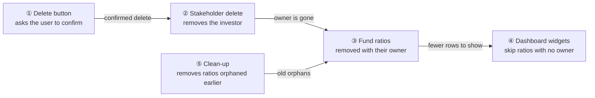
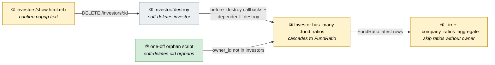
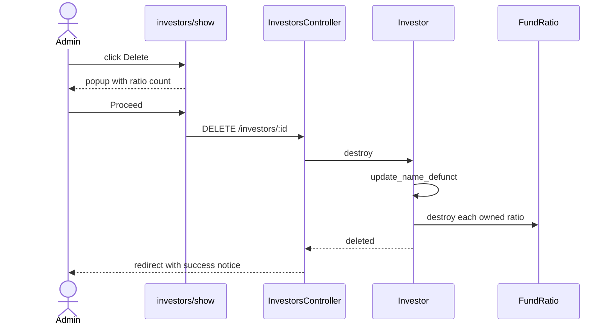
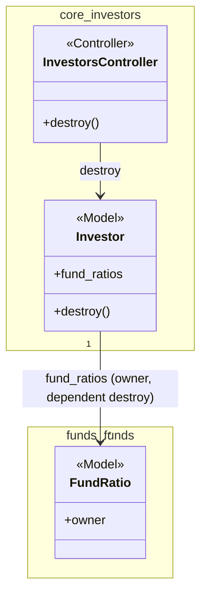

# Cascade-delete Fund Ratios with Investor — Design

> **Audience:** Engineering team.
> **Companion documents:** [Proposal](proposal.md) · [Spec](specs/)

> **Planning phase — no code changes.** This document explains HOW the proposal will be built.
> Do not edit application code while writing it; implementation happens later, in the tasks phase.

> **Design, not code.** Explain the design with mermaid diagrams and tables. Put real class, method, table and path names inside the diagrams and tables instead of code.

> **Scale to the change.** This is a small change: five boxes, short cards, no schema change.

---

## Contents

- [1. The idea](#1-the-idea)
  - [What this adds](#what-this-adds)
  - [The idea in one picture](#the-idea-in-one-picture)
  - [Walkthrough: one example, start to finish](#walkthrough-one-example-start-to-finish)
  - [Key ideas](#key-ideas)
- [2. The same picture with real names](#2-the-same-picture-with-real-names)
  - [Picture](#picture)
  - [What each box does](#what-each-box-does)
  - [One run, end to end](#one-run-end-to-end)
  - [Lifecycles](#lifecycles)
  - [What users see](#what-users-see)
  - [Design decisions](#design-decisions)
- [3. One card per box](#3-one-card-per-box)
  - [① Delete button and popup](#①-delete-button-and-popup)
  - [② Stakeholder delete](#②-stakeholder-delete)
  - [③ Fund ratio cascade](#③-fund-ratio-cascade)
  - [④ Widget guard](#④-widget-guard)
  - [⑤ Orphan clean-up](#⑤-orphan-clean-up)
- [4. Reference](#4-reference)
  - [Class diagram](#class-diagram)
  - [Data model and schema changes](#data-model-and-schema-changes)
  - [Component contracts](#component-contracts)
  - [Cross-cutting concerns](#cross-cutting-concerns)
  - [Worked examples](#worked-examples)
  - [Testing](#testing)
  - [Risks and open questions](#risks-and-open-questions)

---

## 1. The idea

### What this adds

`Investor` gains a declared association to the fund ratios it owns, with `dependent: :destroy`, following the pattern already used for `tasks`, `valuations` and `notes` (polymorphic `owner`). The delete button gains the existing `confirm#popup` confirmation, and two dashboard widgets stop dereferencing a missing owner.

### The idea in one picture



### Walkthrough: one example, start to finish

Setup: investor "Pepkit Media Pvt. Ltd." owns 4 fund ratios (IRR and MOIC for two fund periods). Legend: ● we are here, ✓ done.

| # | When | What happens | Behind the scenes | Result |
|---|---|---|---|---|
| 1 | Admin opens the stakeholder page | Clicks Delete | The button (①) opens the popup showing "4 ratios" | **Confirm deletion ●** |
| 2 | Admin clicks Cancel | Nothing changes | The popup (①) closes without submitting | Same as row 1, nothing deleted |
| 3 | Admin clicks Proceed | The stakeholder is deleted | The button (①) submits to stakeholder delete (②) | Investor ✓ deleted |
| 4 | Immediately after | Ratios disappear with it | Stakeholder delete (②) triggers the ratio cascade (③) | 4 fund ratios ✓ soft-deleted |
| 5 | Admin opens the fund dashboard | Widget loads | The widgets (④) list only ratios that have an owner | Dashboard ✓ loads |
| 6 | A ratio was orphaned before this change | The dashboard still loads | The guard (④) skips it; the clean-up (⑤) later removes it | Dashboard ✓ loads, orphan ✓ removed |

```
Delete Pepkit Media Pvt. Ltd.?
Deleting this investor will also delete its 4 associated fund ratios. Proceed?
                                              [Cancel] [Proceed]
```

**What to notice**
- The cascade is the fix; the guard and clean-up deal with data that predates it.
- Nothing new is built: each box reuses an existing mechanism.
- Soft deletion keeps the ratios recoverable together with the investor.

### Key ideas

| # | Idea | In one line | Card |
|---|---|---|---|
| 1 | Cascade through the owner association | `dependent: :destroy` on a polymorphic `as: :owner` has_many | [③](#③-fund-ratio-cascade) |
| 2 | Reuse the global confirmation modal | Only `data-title` and `data-msg` are set on the button | [①](#①-delete-button-and-popup) |
| 3 | Guard, not just fix | Orphans already exist, so the widgets skip them | [④](#④-widget-guard) |
| 4 | Clean-up is a script, not a migration | Production data, reviewed and run once | [⑤](#⑤-orphan-clean-up) |

**FAQ**

| Question | Answer |
|---|---|
| Does anything block deletion? | No; the cascade runs inside the delete. |
| Why not only the guard? | It hides the symptom but leaves stale rows that other queries and exports still read. |

---

## 2. The same picture with real names

### Picture



Colour = footprint: **green** new, **amber** modified, **grey** reused unchanged. Exact files are in [lld.md File Map](lld.md#file-map).

### What each box does

| # | Box | Real parts | What it does | When it runs | What it decides | Details |
|---|---|---|---|---|---|---|
| ① | Delete button and popup | `investors/show.html.erb`, `confirm_controller.js`, `#confirmModal` | Shows the warning with the ratio count, submits on Proceed | Click on Delete | Nothing; text only | [card ①](#①-delete-button-and-popup) |
| ② | Stakeholder delete | `InvestorsController#destroy`, `Investor#update_name_defunct` | Renames to "Defunct N", soft-deletes the investor | Request | Whether delete succeeds | [card ②](#②-stakeholder-delete) |
| ③ | Fund ratio cascade | `Investor.fund_ratios`, `FundRatio` | Soft-deletes each owned ratio | Inside investor destroy | Which ratios: `owner_type = Investor`, `owner_id = investor.id` | [card ③](#③-fund-ratio-cascade) |
| ④ | Widget guard | `_irr.html.erb`, `_company_ratios_aggregate.html.erb`, `PortfolioHelper#portfolio_last_xirr` | Drops ratios whose owner is nil before grouping or mapping | Dashboard render | Skip vs show | [card ④](#④-widget-guard) |
| ⑤ | Orphan clean-up | one-off script (console / rake) | Soft-deletes existing orphaned ratios | Once, by an engineer | Which rows are orphans | [card ⑤](#⑤-orphan-clean-up) |

### One run, end to end



### Lifecycles

N/A — no new stored or derived status. Ratios gain only the existing `deleted_at` soft-delete mark.

### What users see

| Where in CapHive | Today | After this change | Who sees it |
|---|---|---|---|
| Stakeholder page, Delete | Generic "permanently delete this item" popup | Popup titled "Delete <name>?" naming fund ratios and their count | Users allowed to delete stakeholders |
| Fund dashboard ratio widgets | Error if an orphaned ratio exists | Loads, orphans omitted | Everyone with the dashboard |

Main journey is the wireframe in the [proposal](proposal.md#ui-behavior); messages stay there.

### Design decisions

1. **Association with `dependent: :destroy`** — chosen. Alternative: a `before_destroy` callback deleting ratios by query. Rejected: the association is the existing pattern for `tasks`, `valuations`, `notes` and runs FundRatio's own callbacks (documents, audit trail).
2. **Cascade, not `restrict_with_error`** — the user chose cascade; ratios are derived data recomputed by ratio jobs.
3. **Soft delete** — `FundRatio` is soft-deletable via `Trackable`, so `destroy` is recoverable; no extra work.
4. **Filter in Ruby with `.select(&:owner)`** — the owner is already preloaded by `.includes(:owner)`, so no extra queries. Alternative: SQL join on investors, awkward over a polymorphic owner.
5. **Clean-up as a script, not a migration** — it deletes production data; it should be reviewed and run deliberately.

**FAQ**

| Question | Answer |
|---|---|
| Why does the widget break at all? | `.includes(:owner)` on a polymorphic owner returns nil when the soft-deleted investor is hidden by its default scope, then `fr.owner.name` raises. |
| Why guard two widgets? | `_company_ratios_aggregate` calls `fr.owner.name` unguarded too; `_fund_ratio_aggregate` already uses `&.`. |

---

## 3. One card per box

> Same order and numbers as the picture.

### ① Delete button and popup

The Delete button in `investors/show.html.erb` already triggers `confirm#popup`; it now also passes `data-title` and `data-msg` so the popup names the investor and ratio count.

| Owns | Reads / receives | Produces |
|---|---|---|
| Popup title and message | `@investor.investor_name`, `@investor.fund_ratios.count` | Same DELETE form submit as today |

The count is one `COUNT` query per page render of a user with delete permission, using `owner_type + owner_id` (indexed: `index_fund_ratios_on_owner`). The button remains guarded by `policy(@investor).destroy?`.

**Worked examples:** H1, E1, E2

**FAQ**

| Question | Answer |
|---|---|
| Why show the count? | The user asked the popup to say what is deleted; the count makes the impact concrete. |
| Does the message get HTML-escaped? | `confirm#popup` writes `msg` with `.html()`; the count and name must be escaped by the ERB attribute encoding, and the investor name is user data, so it goes only in `title` (set with `.text()`). |

### ② Stakeholder delete

Unchanged. `InvestorsController#destroy` calls `@investor.destroy`; `before_destroy :update_name_defunct` renames the record.

| Owns | Reads / receives | Produces |
|---|---|---|
| Delete and redirect | DELETE request | Success notice or error alert |

**Worked examples:** H1, E3

**FAQ**

| Question | Answer |
|---|---|
| Is the ratio delete in the same transaction? | Yes; `destroy` and its `dependent: :destroy` children run in one transaction, so a failure rolls both back. |

### ③ Fund ratio cascade

One new line in `Investor`: a has_many `fund_ratios`, `class_name: "FundRatio"`, `as: :owner`, `dependent: :destroy`.

| Owns | Reads / receives | Produces |
|---|---|---|
| Which ratios belong to an investor | Investor destroy | Soft-deleted `FundRatio` rows (and their documents, via `FundRatio has_many :documents, dependent: :destroy`) |

Only rows with `owner_type = "Investor"` are matched; ratios owned by a `Fund` or with no owner (cross-portfolio runs) are never touched.

**Worked examples:** H1, H2, E3, E4

**FAQ**

| Question | Answer |
|---|---|
| Does it use `has_many through`? | No; a direct polymorphic has_many. |
| Many ratios, slow delete? | `destroy` loads and destroys each; investors have tens of ratios, not thousands. Revisit with `delete_all` only if that changes. |

### ④ Widget guard

`_irr.html.erb` adds `.select(&:owner)` before `group_by`. `_company_ratios_aggregate.html.erb` filters its ratio list the same way before mapping `fr.owner.name`.

| Owns | Reads / receives | Produces |
|---|---|---|
| Skipping ownerless ratios | Preloaded `owner` on each ratio | Grouped / mapped rows without nils |

Note `.select(&:owner)` turns the relation into an Array, so it must come after `.order` and be the last relation call in `_irr`. In `_company_ratios_aggregate` the list is a relation consumed by `.where(...).map`, so the filter goes at the `.map` step.

**Worked examples:** E5, E6

**FAQ**

| Question | Answer |
|---|---|
| Why not fix only the data? | The widget is the user-facing failure; a guard keeps it safe against any future orphan. |

### ⑤ Orphan clean-up

A one-off script soft-deletes `FundRatio` rows with `owner_type = "Investor"` whose owner is not among the active investors, which covers both soft-deleted and hard-missing owners.

| Owns | Reads / receives | Produces |
|---|---|---|
| Finding and deleting orphans | `fund_ratios`, active `investors` ids | A count of rows deleted |

The query uses `where.not(owner_id: Investor.select(:id))`; `Investor`'s default scope already excludes soft-deleted investors, so no `with_deleted` is needed. Engineer runs a dry-run count first. Ships as a documented snippet, not application code.

**Worked examples:** E7

**FAQ**

| Question | Answer |
|---|---|
| Why not a migration? | It deletes data and should be a deliberate, reviewed run per environment. |

---

## 4. Reference

### Class diagram



### Data model and schema changes

N/A — no schema change. `fund_ratios` already has `owner_type`, `owner_id`, `deleted_at` and the index `index_fund_ratios_on_owner`.

**Changes to existing models:** `Investor` gains the `fund_ratios` association.

### Component contracts

| From → To | Contract | Direction rule |
|---|---|---|
| ① → ② | Standard DELETE form submit to `/investors/:id` | View never deletes directly |
| ② → ③ | `Investor#destroy` runs `dependent: :destroy` on `fund_ratios` | Investor knows about FundRatio, not the reverse |
| ③ → ④ | `FundRatio.latest` rows with `owner` preloaded | Widgets only read |
| ⑤ → ③ | Reads `fund_ratios` and active `Investor` ids | One-off, outside the request path |

### Cross-cutting concerns

#### Transactions and queries

The cascade runs inside `destroy`'s transaction. Reads: one COUNT in ① (indexed); widgets add no queries.

#### Exception handling and monitoring

N/A — no new failure modes beyond `destroy` failing, which the controller already handles with an alert.

#### Performance and security

- Volume is small (ratios per investor). Delete runs inline.
- Tenant isolation: the investor is already scoped and authorized (`policy(@investor).destroy?`); the cascade touches only that investor's ratios.
- The popup message carries only a number; the investor name appears only in the title, rendered with `.text()`.

### Worked examples

**ID legend:** **H** = Happy path · **E** = Edge case · **X** = Error (exception) case.

**Shared setup:**

| Record | Name | Key data |
|---|---|---|
| Entity | Fund Co | Investment Fund, funds enabled |
| Fund | Fund A | belongs to Fund Co |
| Investor | Pepkit Media Pvt. Ltd. | owns 4 fund ratios (IRR, MOIC × 2 periods) for Fund A |
| Investor | Other Co | owns 2 fund ratios for Fund A |

#### Happy Path

| # | Scenario | Given | When | Then | Spec scenario | Feature |
|---|---|---|---|---|---|---|
| H1 | Delete with confirmation | Pepkit has 4 ratios | Admin clicks Delete and Proceed | Popup showed "its 4 associated fund ratios"; investor and its 4 ratios are deleted; "Stakeholder was successfully deleted." | Popup shows the warning and count; Confirm deletes; Ratios removed with the stakeholder | features/fund/investor_fund_ratio_cleanup.feature |
| H2 | Ratios soft-deleted | Pepkit has 4 ratios | Pepkit is deleted | The 4 ratios have `deleted_at` set and are recoverable | Soft delete | features/fund/investor_fund_ratio_cleanup.feature |

#### Edge Cases

| # | Scenario | Given | When | Then | Spec scenario | Feature |
|---|---|---|---|---|---|---|
| E1 | Cancel keeps data | Pepkit has 4 ratios | Admin clicks Delete then Cancel | Investor and 4 ratios remain | Cancel keeps everything | features/fund/investor_fund_ratio_cleanup.feature |
| E8 | One ratio | An investor with 1 ratio | Admin opens the popup | It says "Deleting this investor will also delete its associated fund ratio. Proceed?" | Single ratio uses the singular wording | features/fund/investor_fund_ratio_cleanup.feature |
| E2 | No ratios | An investor with no ratios | Admin opens the popup | It says "This will permanently delete this item. Proceed?"; deletion succeeds | Stakeholder without ratios | features/fund/investor_fund_ratio_cleanup.feature |
| E3 | Other investor untouched | Pepkit and Other Co have ratios | Pepkit is deleted | Other Co's 2 ratios remain | Other ratios untouched | features/fund/investor_fund_ratio_cleanup.feature |
| E4 | Fund-owned ratio untouched | A ratio owned by Fund A | Pepkit is deleted | The fund-owned ratio remains | Other ratios untouched | features/fund/investor_fund_ratio_cleanup.feature |
| E5 | Orphan in IRR widget | A ratio whose investor is deleted | Admin opens the fund dashboard | Page loads; the orphan is not listed | Orphaned ratio present | features/fund/investor_fund_ratio_cleanup.feature |
| E6 | Orphan in company ratios widget | Same orphan | Admin opens the company ratios widget | Widget loads; orphan not listed | Orphaned ratio present | Manual only (QA E6): the widget lists only the owner ids it is given, so it could not be reached from a feature |
| E7 | Existing orphan clean-up | An orphaned ratio | The clean-up snippet is run | The orphan is soft-deleted; others untouched | Soft delete | features/fund/investor_fund_ratio_cleanup.feature |

#### Error Cases

| # | Scenario | Given | When | Then (what the user sees, who is alerted) | Spec scenario | Feature |
|---|---|---|---|---|---|---|
| — | None specific | | | The existing destroy failure path is unchanged | | |

### Testing

Cucumber only. One new feature, `features/fund/investor_fund_ratio_cleanup.feature`, using the existing login/entity/investor/fund steps and the `fund_ratio` factory; a few new steps for "the investor has N fund ratios" and deletion via the UI popup. The Feature column above is the mapping.

### Risks and open questions

- Many ratios on an investor make the cascading destroy slow → expected volume is small; switch to bulk delete if profiling shows otherwise.
- Clean-up deletes the wrong rows → dry-run count and per-investor grouping first, review before deleting.
- `.select(&:owner)` returns an Array → keep it as the last call in the chain.

| # | Open question | Current thinking | Status |
|---|---|---|---|
| — | None | | |

**FAQ**

| Question | Answer |
|---|---|
| Where do I start reviewing? | [③ Fund ratio cascade](#③-fund-ratio-cascade), then [④ Widget guard](#④-widget-guard). |
