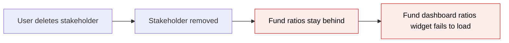
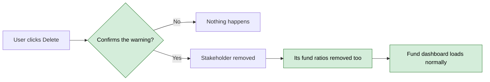

# Cascade-delete Fund Ratios with Investor — Proposal

> **Audience:** Business team, product, QA, support — non-technical.
> **Companion document:** [Design](design.md)

> **Planning phase — no code changes.** This document proposes and explains the change. Do not
> edit application code while writing it; implementation happens later, in the tasks phase.

---

## Why

When a stakeholder (investor or portfolio company) is deleted, the IRR and MOIC figures that were calculated for it are left behind with nothing to belong to. The fund dashboard's ratios widget then fails to load, because it tries to show the name of a stakeholder that no longer exists (seen with "Pepkit Media Pvt. Ltd. Defunct 3505", investor 4841).

## What Changes

- Deleting a stakeholder now also deletes every fund ratio calculated for it. The ratios are soft-deleted, the same way the stakeholder is, so they can be recovered by the same route.
- The **Delete** button on the stakeholder page now asks for confirmation and says that the stakeholder's fund ratios will be deleted too, with how many.
- The fund dashboard ratios widgets ignore any ratio whose stakeholder no longer exists, instead of failing. This protects the dashboard from ratios already orphaned before this change.
- A one-off clean-up removes ratios that are already orphaned in production.

### Flow Diagram

Deleting a stakeholder, before:



Deleting a stakeholder, after:



---

## User Stories

### US-1: Warned before deleting

**As a** fund admin,
**I want** to be told that deleting a stakeholder also deletes its fund ratios,
**So that** I do not remove calculated figures by accident.

**Acceptance criteria:**
- Clicking **Delete** on a stakeholder page opens a confirmation popup instead of deleting at once.
- The popup says all of the stakeholder's fund ratios will be deleted and shows how many.
- Cancelling the popup leaves the stakeholder and its ratios untouched.

### US-2: No orphaned ratios

**As a** fund admin,
**I want** a deleted stakeholder's fund ratios to disappear with it,
**So that** no dashboard shows or trips over figures for a stakeholder that is gone.

**Acceptance criteria:**
- After confirming deletion, none of the stakeholder's fund ratios appear anywhere (fund dashboard, ratio lists).
- Ratios of other stakeholders are untouched.

### US-3: Dashboard survives old orphans

**As a** fund admin,
**I want** the fund dashboard to load even if old orphaned ratios exist,
**So that** a past deletion cannot break my dashboard.

**Acceptance criteria:**
- The IRR/MOIC widget and the company ratios widget load, and simply leave out ratios without a stakeholder.

---

## UI Behavior

### Stakeholder page — Delete

```
+-----------------------------------------------------+
|  Delete Pepkit Media Pvt. Ltd.?                    x |
|                                                     |
|  Deleting this investor will also delete its       |
|  4 associated fund ratios. Proceed?                 |
|                                                     |
|                         [ Cancel ]   [ Proceed ]    |
+-----------------------------------------------------+
```

**Behavior notes:**
- Uses the standard confirmation popup already used elsewhere in the app.
- The count is the number of fund ratios currently attached to that stakeholder; with exactly one ratio the message is singular and shows no number. A stakeholder with no fund ratios gets the standard popup instead: "This will permanently delete this item. Proceed?".
- After Proceed, the user lands on the stakeholders list with the existing "Stakeholder was successfully deleted." message.

---

## What This Feature Does NOT Cover

| Excluded | Covered In |
|---|---|
| Other records owned by a stakeholder (documents, fund units, fees, reminders and similar) that may also lack a cleanup | Not planned; the audit needs production data |
| Restoring a deleted stakeholder together with its ratios | Existing recovery process; ratios are soft-deleted so they stay recoverable |
| Recomputing ratios | Existing ratio jobs |

---

## Validation Rules

| Field | Rule | Default |
|---|---|---|
| Delete confirmation | Deletion only proceeds after the user confirms the popup | Popup shown |

---

## Behavior Rules

| Scenario | What User Sees |
|---|---|
| Delete a stakeholder that has ratios and confirm | Popup text: "Deleting this investor will also delete its N associated fund ratios. Proceed?", then "Stakeholder was successfully deleted." |
| Delete a stakeholder with exactly 1 ratio | Popup text: "Deleting this investor will also delete its associated fund ratio. Proceed?" |
| Delete a stakeholder with no ratios | The standard popup, "This will permanently delete this item. Proceed?"; deletion proceeds normally |
| Cancel the popup | Stakeholder and ratios unchanged |
| Open fund dashboard when an orphaned ratio exists | Dashboard loads; the orphaned ratio is not listed |

---

## Resolved Design Decisions

| # | Decision | Resolution |
|---|---|---|
| 1 | Scope: all stakeholder-owned records or only fund ratios | Fund ratios only |
| 2 | Hard or soft deletion of ratios | Soft (ratios are soft-deletable like stakeholders), so recoverable |
| 3 | Block deletion or cascade | Cascade, with a confirmation popup |
| 4 | Dashboard behavior with existing orphans | Skip ratios without a stakeholder |
| 5 | Which widgets get the guard | The IRR/MOIC widget and the company ratios widget; the other ratio widget already tolerates a missing stakeholder |

---

## Capabilities

### New Capabilities

- `funds/investor-fund-ratio-cleanup`: deleting a stakeholder deletes its fund ratios, warns the user first, and dashboards tolerate ratios whose stakeholder is gone.

### Modified Capabilities

None.

---

## Impact

- The stakeholder page (Delete button and its popup).
- Stakeholder deletion behavior.
- The fund dashboard IRR/MOIC widget and the company ratios widget.
- Production data: a one-off clean-up of already orphaned ratios, run by an engineer.

---

## Benefits

1. The fund dashboard no longer breaks after a stakeholder is deleted.
2. Users are told what deleting a stakeholder removes before it happens.
3. No stale figures for deleted stakeholders linger in the system.

---

## FAQ

| Question | Answer |
|---|---|
| Can deleted ratios be brought back? | Yes, they are soft-deleted just like the stakeholder; recovery follows the existing process. |
| What about the orphans that already exist? | The dashboard now ignores them, and a one-off clean-up removes them. |
| Does anyone get an email or notification? | No. |
| Does this affect other things a stakeholder owns? | No, only fund ratios; see "Does NOT Cover". |
| How is it built? | See [design.md](design.md). |

---

## Design Principle for the Next Phase

Keep it simple: one association declaration, one popup using the existing confirmation component, and a one-line filter in each of two widgets. No new classes or jobs. The only risk is the clean-up of existing orphans, which touches production data and should be a reviewed, one-off script rather than a migration.
