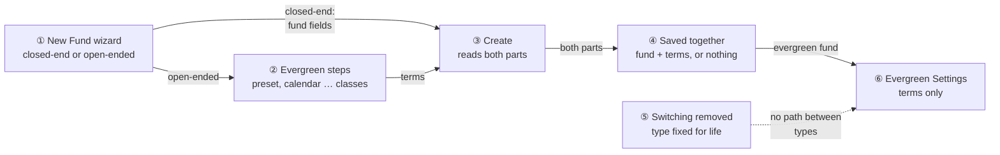
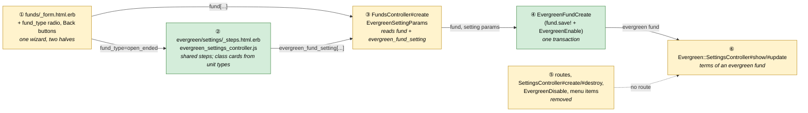
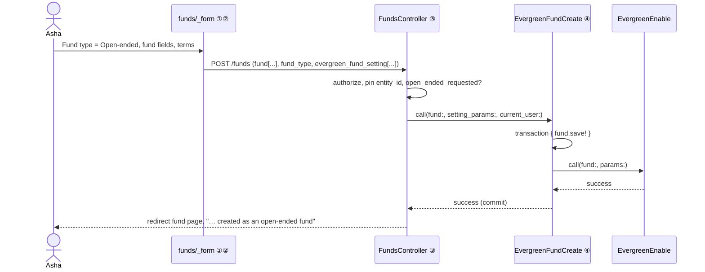
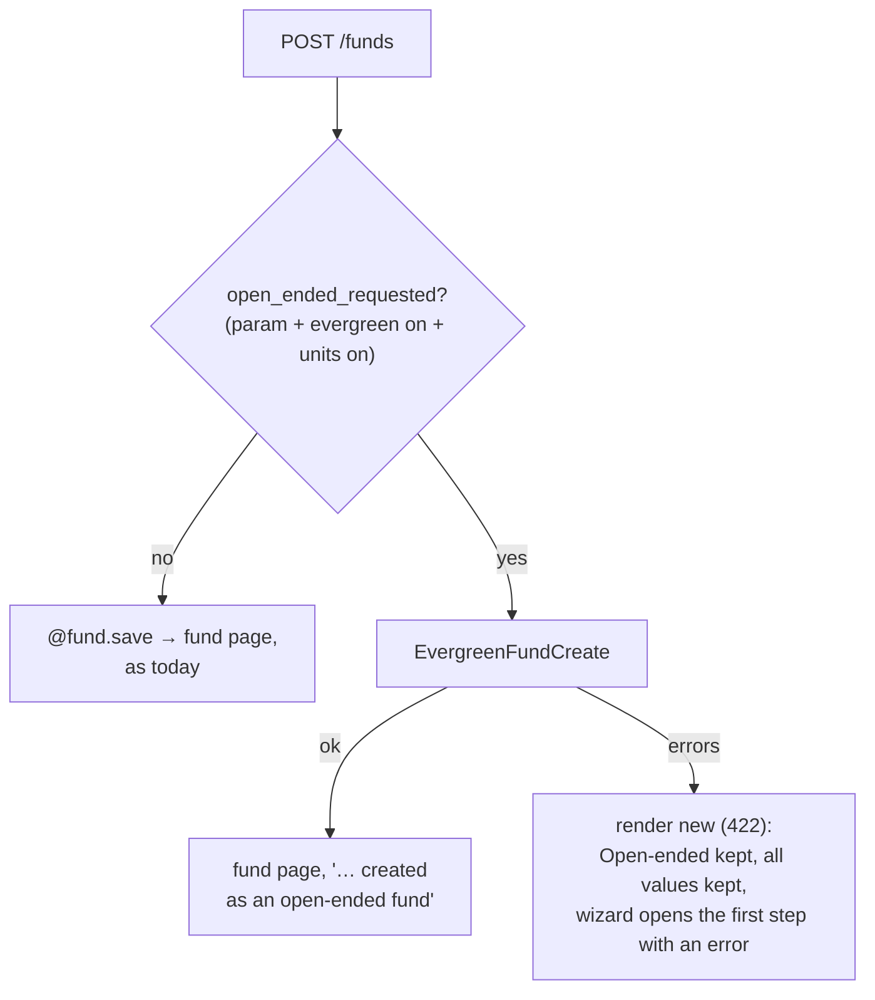
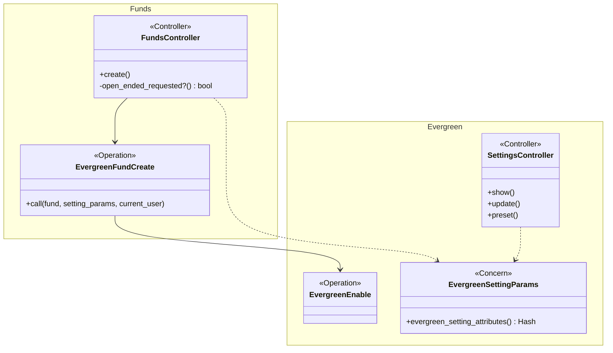

# Choose Closed-end or Open-ended When Creating a Fund — Design

> **Audience:** Engineering team.
> **Companion documents:** [Proposal](proposal.md) · [Spec](specs/)

> **Planning phase — no code changes.** This document explains HOW the proposal will be built.

> **Zoom one picture.** ①–⑥ mean the same box everywhere.

---

## Contents

- [1. The idea](#1-the-idea)
  - [What this adds](#what-this-adds)
  - [The idea in one picture](#the-idea-in-one-picture)
  - [Walkthrough: one example, start to finish](#walkthrough-one-example-start-to-finish)
  - [Key ideas](#key-ideas)
- [2. The same picture with real names](#2-the-same-picture-with-real-names)
- [3. One card per box](#3-one-card-per-box)
  - [① New Fund wizard](#①-new-fund-wizard)
  - [② Evergreen steps](#②-evergreen-steps)
  - [③ Create](#③-create)
  - [④ Fund and terms saved together](#④-fund-and-terms-saved-together)
  - [⑤ Switching removed](#⑤-switching-removed)
  - [⑥ Evergreen Settings (terms only)](#⑥-evergreen-settings-terms-only)
- [4. Reference](#4-reference)

---

## 1. The idea

### What this adds

- **The type is chosen once, when the fund is created.** For an open-ended fund, New Fund becomes
  one wizard: the existing fund steps, then the existing evergreen steps, ending in a single
  **Create fund** that saves the fund and its terms in one transaction.
- **Every switch is removed.** That means "Make this fund evergreen", "Make closed-end again", and
  the routes and services behind them.
- **Built from what exists:** the fund form's two-step wizard and the evergreen settings wizard
  already share one wizard controller.
- **Also:** the fund wizard gets the Back button it was missing (business request, 9 Oct 2026).

### The idea in one picture

### Walkthrough: one example, start to finish

**Legend:** ✓ done · ● we are here (waiting on this, not done yet) · ○ not started.

| # | When | What happens | Behind the scenes | Result |
|---|---|---|---|---|
| 1 | 10:00 | Asha opens New Fund, chooses Open-ended | The New Fund wizard (①) reveals the evergreen steps (②); the step bar grows to 11 | **●&nbsp;Fund&nbsp;details** ○&nbsp;Evergreen&nbsp;terms ○&nbsp;Create |
| 2 | 10:02 | Types Unit Types "A, B", goes Next, Next, then Back to fix a signatory | The Back button (①) moves to the previous step; the class cards (②) are rebuilt for A and B | Same as row 1 |
| 3 | 10:05 | Picks a preset, sets Class A ₹10,000, leaves B blank, clicks Create fund | Create (③) runs; the save (④) fails on Class B and rolls back | ✓&nbsp;Fund&nbsp;details **●&nbsp;Evergreen&nbsp;terms** ○&nbsp;Create |
| 4 | 10:06 | The wizard reopens at Classes with "Class B needs a starting price"; she enters ₹10,000 and creates | Create (③) succeeds; fund and terms are saved together (④) | ✓&nbsp;Fund&nbsp;details ✓&nbsp;Evergreen&nbsp;terms ✓&nbsp;Create |
| 5 | Later | Ravi looks for a way to make an old closed-end fund evergreen | There is none (⑤); a direct POST to the old address is refused | "A fund's type is chosen when it is created and can't be changed" |

**What to notice**
- One wizard, two halves, one transaction. A fund never exists half-set-up.
- The evergreen steps are the same partial as Evergreen Settings (⑥), so there's one copy.
- Switching isn't hidden; it's gone.

### Key ideas

| # | Idea | In one line | Card |
|---|---|---|---|
| 1 | One wizard | Fund steps + evergreen steps, shown or hidden by Fund type | [①](#①-new-fund-wizard) |
| 2 | Shared steps partial | `evergreen/settings/_steps` used by New Fund and by Evergreen Settings | [②](#②-evergreen-steps) |
| 3 | All or nothing | `EvergreenFundCreate` wraps the fund save and `EvergreenEnable` in one transaction | [④](#④-fund-and-terms-saved-together) |
| 4 | No switching | Routes, actions, menu items and `EvergreenDisable` removed | [⑤](#⑤-switching-removed) |

**FAQ**

| Question | Answer |
|---|---|
| Why not create the fund first and then open the wizard? | The fund would exist closed-end until the wizard finished, and with switching gone an abandoned wizard would leave it stuck. Saving both together avoids that. |
| Is a new model or column needed? | No. A fund is open-ended when it has an `evergreen_fund_setting`, as today. |

---

## 2. The same picture with real names

### Picture

### What each box does

| # | Box | Real parts | What it does | When it runs | What it decides | Details |
|---|---|---|---|---|---|---|
| ① | New Fund wizard | `funds/new`, `funds/_form`, `fund_type_controller.js` | Fund type radio at the top of step 1; Back on every step after the first; renders ② when open-ended is available | New / failed create | Which steps are linked | [card ①](#①-new-fund-wizard) |
| ② | Evergreen steps | `evergreen/settings/_steps` (extracted from `settings/show`), `evergreen_settings_controller.js` | The preset … review steps; rebuilds class cards from Unit Types | Client side | Class cards | [card ②](#②-evergreen-steps) |
| ③ | Create | `FundsController#create`, `EvergreenSettingParams` (moved out of `SettingsController`) | Closed-end: today's save. Open-ended: hands off to ④ | POST /funds | Which path | [card ③](#③-create) |
| ④ | Saved together | `EvergreenFundCreate` (Trailblazer) | `fund.save!`, then `EvergreenEnable`; roll back on any failure | POST /funds | Success or errors | [card ④](#④-fund-and-terms-saved-together) |
| ⑤ | Switching removed | `config/routes/fund.rb`, `SettingsController`, `EvergreenDisable`, `funds/show`, `evergreen/funds/_actions`, `settings/show` | Removes every switch path | — | — | [card ⑤](#⑤-switching-removed) |
| ⑥ | Evergreen Settings | `SettingsController#show/#update`, `settings/show` | Edits terms of an evergreen fund only | GET/PATCH | — | [card ⑥](#⑥-evergreen-settings-terms-only) |

### One run, end to end

### Lifecycles

N/A. The type has no lifecycle: it is set once.

### What users see

| Where | Today | After | Who |
|---|---|---|---|
| New Fund | 2 steps, Save | Fund type at top; Closed-end: 2 steps; Open-ended: 11 steps, Create fund; Back buttons | Fund admins |
| Edit Fund | — | "Fund type: Closed-end" / "Open-ended (evergreen)", read-only | Fund admins |
| Fund › Actions | "Make this fund evergreen" | Removed; evergreen funds keep "Evergreen Settings" | Fund admins |
| Evergreen Settings | "Make closed-end again" | Removed | Fund admins |

### Design decisions

1. **Terms captured in New Fund, saved in one transaction.** Alternative: create, then redirect to
   the wizard. Rejected because the business asked for it, and because without switching an
   abandoned wizard would strand the fund.
2. **One shared steps partial.** Alternative: copy the steps into the fund form. Rejected: two
   copies drift.
3. **Remove the switch code, not just hide it.** `SettingsController#create/#destroy`, their
   routes and `EvergreenDisable` are deleted. `EvergreenEnable` stays as the internal step used by
   ④ and by test setup.
4. **No new column.** A fund is open-ended exactly when it has an `evergreen_fund_setting`, as
   today.

**FAQ**

| Question | Answer |
|---|---|
| Does closed-end creation change at all? | Only the Back button on step 2, and the Fund type radio (for evergreen companies). The save path is unchanged. |
| What happens to `Evergreen::SettingsController#preset`? | It stays. The preset picker in ② calls it with the fund id, or with no fund on New Fund (a collection route). |

---

## 3. One card per box

### ① New Fund wizard

| Owns | Reads / receives | Produces |
|---|---|---|
| The `fund_type` radio (`closed_end` / `open_ended`), the step bar, Back buttons | `fund.new_record?`, `enable_evergreen_funds?`, `enable_units?` | The form post |

- **Radio:**
  - top of step 1, only on new funds of companies with evergreen and units on;
  - outside `fund[...]`, so `fund_params` is unchanged and nothing is mass-assigned.
- **Step bar:** the fund form's step bar is hidden today, and its step links drive navigation. The
  evergreen step links are added after step 2. The `fund-type` controller parks them outside the
  bar while the fund is closed-end, because the wizard moves to the next linked step on submit, and
  Save must save. It puts them back for open-ended, then re-runs the wizard's binding (the choice is
  made on step 1, where the wizard restarts). Step 2 shows Save (closed-end) or Next (open-ended);
  the last step's button is Create fund.
- **Back:** `button.prevBtn` ("Back") on every step except the first, using the wizard
  controller's existing handler. This applies to closed-end funds too (H3).
- **Edit form:** shows `Fund type: <Closed-end | Open-ended (evergreen)>` as read-only text (E5).

**Worked examples:** H1, H2, H3, E1, E4, E5

**FAQ**

| Question | Answer |
|---|---|
| Why not separate pages for each type? | One page keeps the shared fund fields in one place and lets the user change their mind before saving. |

### ② Evergreen steps

| Owns | Reads / receives | Produces |
|---|---|---|
| `evergreen/settings/_steps.html.erb` (extracted unchanged from `settings/show`), class-card template | The setting (new or persisted), the fund's currency, Unit Types | `evergreen_fund_setting[...]` fields |

- **Extracting the partial:** `settings/show` renders the same partial, so the edit page doesn't
  change.
- **Class cards:**
  - On New Fund, the Classes step renders a `<template>` for one card.
  - `evergreen_settings_controller.js#syncClasses` (re)builds the cards when Unit Types changes:
    split on commas, trim, deduplicate. Values typed into a card are kept if its class remains.
  - On the edit page, the cards are server-rendered as today.
- **Preset route:** the preset lookup moves to a collection route (`/evergreen/presets/:name`), so
  it works before a fund exists.

**Worked examples:** H1, E2, E3

### ③ Create

| Owns | Reads / receives | Produces |
|---|---|---|
| The branch on `open_ended_requested?` | `params[:fund_type]`, permissions | Fund page or re-rendered wizard |

- **`EvergreenSettingParams`:** a concern holding today's `SettingsController#permitted` and
  `#setting_attributes` parsing, used by both controllers.
- **Policy and scoping:** `authorize(@fund)` (`create?`) and the `entity_id` pin are unchanged.

**Worked examples:** H1, H2, E1, X1, X2, X3

### ④ Fund and terms saved together

`EvergreenFundCreate` (Trailblazer operation).

| Owns | Reads / receives | Produces |
|---|---|---|
| The transaction boundary | Fund, setting params, user | Saved fund and setting, or errors and a rollback |

- **Steps:**
  1. `check_unit_types`: refuse with "Add at least one unit class for an open-ended fund" (X1).
  2. Inside `ActiveRecord::Base.transaction`: `fund.save!`, then
     `EvergreenEnable.call(fund:, current_user:, params:)`. If that fails, raise `Rollback`.
- **Errors:** fund errors go on `@fund`; evergreen errors come back as
  `ctx[:evergreen_fund_setting]` errors, for the wizard to show.
- **After commit:** the evergreen journeys that `EvergreenEnable` seeds are created inside the
  transaction, so they roll back too.

**Worked examples:** H1, X1, X2, X3

**FAQ**

| Question | Answer |
|---|---|
| Fund callbacks (folders, access rights) in a rolled-back transaction? | They are DB writes in the same transaction, so they roll back. Any after-commit jobs don't fire. |

### ⑤ Switching removed

| Removed | Where |
|---|---|
| "Make this fund evergreen" / "Evergreen Settings" link for non-evergreen funds | `funds/show.html.erb`; evergreen funds keep their link in `evergreen/funds/_actions` |
| "Make closed-end again" block | `evergreen/settings/show.html.erb` |
| `SettingsController#create`, `#destroy` | Controller |
| `create`, `destroy` on `resource :settings` | `config/routes/fund.rb` → `only: %i[show update]` |
| `EvergreenDisable` | Service deleted |
| `SettingsController#show` for a non-evergreen fund | Redirects to the fund with "A fund's type is chosen when it is created and can't be changed" |

A direct POST or DELETE to the old address now has no route (404), and a GET for a closed-end fund
redirects with the message (X4, X5).

**Retired worked examples in open-ended-funds** (design rows marked "Retired — evergreen-fund-on-create"; scenarios removed):

| ID | Was | Now |
|---|---|---|
| H1 | Make an existing fund evergreen from settings | Replaced by this change's H1 |
| X1 | "Add a unit class first" on the settings page | Replaced by this change's X1 |
| X4 | Can't switch back after a confirmed dealing date | Retired: switching gone |
| E138 | Switch back while empty | Retired |
| X83 | Pending order blocks switching back | Retired |

**Worked examples:** X4, X5

### ⑥ Evergreen Settings (terms only)

`show` and `update` only, for evergreen funds. The page renders `_steps` with the setting
persisted, so the wizard steps are free to navigate (as today). The step-1 heading reads "Preset"
instead of "Fund type", since the type is no longer chosen here.

**Worked examples:** E6

---

## 4. Reference

### Class diagram

### Data model and schema changes

N/A. No tables or columns change.

### Component contracts

| From → To | Contract | Direction rule |
|---|---|---|
| ① → ② | `fund_type` radio toggles the steps client-side | Presentation only |
| ① → ③ | `fund[...]`, `fund_type` | `fund_type` read only when evergreen and units are on |
| ② → ③ | `evergreen_fund_setting[...]` (same names as today's wizard) | Parsed by `EvergreenSettingParams` |
| ③ → ④ | `EvergreenFundCreate.call(fund:, setting_params:, current_user:)` | Transaction owned by ④ |
| ④ → ⑥ | Evergreen fund (`evergreen_fund_setting` present) | ⑥ refuses non-evergreen funds |

### Notifications

Nothing is added or changed:
- **Investors:** a new fund has no investors.
- **Internal users:** creating a fund sends what it sends today. `EvergreenEnable` sends nothing.
- **Removed:** the switch-back action, which sent nothing either.

### Cross-cutting concerns

#### Transactions and queries

- **Transaction:** one, covering the fund insert, the evergreen setting, the class terms and the
  seeded journeys.
- **Queries:** no new list reads.

#### Exception handling and monitoring

`ActiveRecord::RecordInvalid` inside ④ is rescued into form errors. Anything else propagates
as today.

#### Performance and security

- **Security:** the `create?` policy, the `entity_id` pin, and `fund_type` kept out of
  mass-assignment.
- **Removed routes:** dropping them shrinks the attack surface.

### Worked examples

**ID legend:** **H** = Happy path · **E** = Edge case · **X** = Error case. IDs are local to this
change.

**Shared setup:** company "Caphive Demo" (Investment Fund), with evergreen funds and units switched
on unless stated; Asha, a company admin.

#### Happy Path

| # | Scenario | Given | When | Then | Spec scenario | Feature |
|---|---|---|---|---|---|---|
| H1 | Create an open-ended fund | Evergreen on | New Fund: Open-ended, "Alpha Long-Short Fund", INR, Unit Types "A, B", preset Indian Cat III, Class A and B ₹10,000, Create fund | Fund page with evergreen tabs, "Alpha Long-Short Fund created as an open-ended fund"; the fund is evergreen with both classes priced ₹10,000 | An open-ended fund… › Create | evergreen_fund_on_create.feature |
| H2 | Create a closed-end fund | Evergreen on | New Fund: Closed-end, fill, Save | "Fund was successfully created."; not evergreen | Fund type… › Closed-end | evergreen_fund_on_create.feature |
| H3 | Back button | Any company | New Fund, Next to step 2, click Back | Step 1 again, values kept | (wizard usability) | evergreen_fund_on_create.feature |
| H4 | Edit an open-ended fund | Open-ended fund with class A | Edit Fund, unit types "A, B", Next into the open-ended terms, Class B ₹12,000, Save fund | Fund and terms saved together: class A kept, class B added at ₹12,000; a saved class card is never removed by the unit-type sync | (edit matches create) | evergreen_fund_on_create.feature |
| H5 | Type page first | Evergreen on | New Fund | A "What kind of fund is this?" page: Closed-ended and Open-ended cards, each describing the type; Continue disabled until one is picked; Continue opens the fund details showing the chosen type with Change; Back returns to the cards with the pick kept. Not on Edit Fund, nor for companies without evergreen; after a failed create the form reopens at the fund details | (type chosen knowingly) | evergreen_fund_on_create.feature |

#### Edge Cases

| # | Scenario | Given | When | Then | Spec scenario | Feature |
|---|---|---|---|---|---|---|
| E1 | Company without evergreen | Evergreen off | Open New Fund; POST with fund_type=open_ended | No Fund type field; the POST creates a closed-end fund | Fund type… › Company without evergreen | evergreen_fund_on_create.feature |
| E2 | Class cards follow Unit Types | Open-ended | Unit Types "A, B", go to Classes, back to step 1, change to "A" | Classes shows only Class A; A's typed price kept | An open-ended fund… › Class cards follow | evergreen_fund_on_create.feature |
| E3 | Duplicate / spaced unit types | Open-ended | Unit Types " A, B, A " | Two cards: A and B | An open-ended fund… › Class cards follow | evergreen_fund_on_create.feature |
| E4 | Switch type before saving | On New Fund | Choose Open-ended, then Closed-end, Save | A closed-end fund; evergreen fields ignored | Fund type… › Closed-end | evergreen_fund_on_create.feature |
| E5 | Edit form shows the type | An evergreen fund and a closed-end fund | Edit each | "Fund type: Open-ended (evergreen)" / "Closed-end", read-only | Type can't be switched › Edit form | evergreen_fund_on_create.feature |
| E6 | Evergreen Settings still edit terms | An evergreen fund | Change the gate to 10%, Save settings | Saved, forward only (as today); no "Make closed-end again" | Type can't be switched › Evergreen fund | evergreen_fund_on_create.feature |

#### Error Cases

| # | Scenario | Given | When | Then (what the user sees) | Spec scenario | Feature |
|---|---|---|---|---|---|---|
| X1 | No unit types | Open-ended, Unit Types blank | Next from step 2 into the open-ended terms; and a direct request | The form returns to step 1 with "Add at least one unit type for an open-ended fund" (the Classes step is never reached empty; if it is, it explains where classes come from); a direct request gets "Add at least one unit class for an open-ended fund", 422, nothing saved | An open-ended fund… › No unit types | evergreen_fund_on_create.feature |
| X2 | Invalid evergreen term | Open-ended | Class B starting price blank, Next on Classes | Wizard stays at Classes with Class B's starting price marked "Required"; no fund and no setting saved; values kept. A request that bypasses the browser gets the server's "Class B needs a starting price" (422) | An open-ended fund… › Invalid evergreen term | evergreen_fund_on_create.feature |
| X3 | Invalid fund field | Open-ended, Name blank | Create fund | Step 1 shows the name error; nothing saved; Open-ended still chosen | An open-ended fund… | evergreen_fund_on_create.feature |
| X4 | No make-evergreen for an existing fund | An existing closed-end fund | Open Actions; POST the old settings address directly; open its settings URL | No menu item; POST has no route; GET redirects with "A fund's type is chosen when it is created and can't be changed" | Type can't be switched › Existing closed-end fund | evergreen_fund_on_create.feature |
| X5 | No switch-back for an evergreen fund | An evergreen fund | Open Evergreen Settings; DELETE the old address directly | No "Make closed-end again"; DELETE has no route; fund still evergreen | Type can't be switched › Evergreen fund | evergreen_fund_on_create.feature |

### Testing

- **Feature:** `features/fund/evergreen/evergreen_fund_on_create.feature`, with steps in
  `features/step_definitions/evergreen_fund_on_create_steps.rb`.
- **Test setup:** `make_fund_evergreen` (`EvergreenEnable` on a fresh fund) stays for other
  features. It is test setup, not a user path.
- **Rework:** `settings.feature` loses H1, X1, X4, E138 and X83 (retired, see card ⑤), and its
  remaining scenarios open the settings of an evergreen fund. `evergreen_edge_nav_steps.rb` drops
  its `EvergreenDisable` step.
- **Regression net:** the full evergreen suite and the fund creation features, green.

### Risks and open questions

- **The step-bar toggle and class-card sync are new JavaScript** → keep them small, and cover
  them with E2 and E3 in the browser.
- **Fund callbacks during the transaction** → covered by X2: nothing remains after a failed
  create.
- **Docs** → the user guide's "Making a Fund Evergreen" becomes "Creating an open-ended fund", and
  business rules section 2 is updated.

| # | Open question | Current thinking | Status |
|---|---|---|---|
| — | None | — | — |
