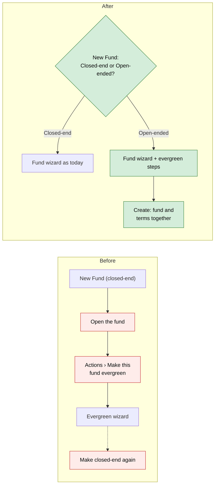
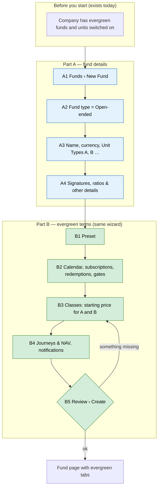

# Choose Closed-end or Open-ended When Creating a Fund — Proposal

> **Audience:** Business team, product, QA, support — non-technical.
> **Companion document:** [Design](design.md)
> **New to this? Start with the [Workflow Journey](#workflow-journey)** — every action, in order, from start to the outcome.

> **Planning phase — no code changes.** This document proposes and explains the change.

---

## Why

Today an evergreen (open-ended) fund can't be created as one:
- **How it works now:** you create an ordinary fund, then find **Actions › Make this fund
  evergreen**. Later, **Make closed-end again** can switch it back.
- **Why that's wrong:** whether a fund is closed-end or open-ended is decided when the fund is set
  up, in its offering documents. It is never a setting you toggle afterwards, and the switch only
  invites mistakes.

The business decided (9 Oct 2026) to choose the type up front, capture every detail when the fund
is created, and remove switching entirely.

## What Changes

- **New Fund asks Closed-end or Open-ended first.** The **Fund type** choice sits at the top of the
  New Fund wizard, and Closed-end is the default.
  - It shows only to companies that have evergreen funds and units switched on.
  - **Closed-end:** the wizard is exactly as today: Fund Details, then Signatures, Ratios & Other
    Details, then Save.
  - **Open-ended:** the same wizard carries on into the evergreen steps: preset, dealing calendar,
    subscriptions, redemptions, gates, classes, journeys & NAV, notifications, review. The class
    step builds a card for each unit type typed in Fund Details.
- **One Create button for an open-ended fund.** It creates the fund and its evergreen terms
  together. If anything is wrong (for example, a class with no starting price), nothing is saved
  and the wizard shows what to fix.
- **Switching is removed:**
  - no **Make this fund evergreen** for existing funds;
  - no **Make closed-end again** for evergreen funds.
- **A Back button on every step** of the New Fund wizard (after the first), for closed-end and
  open-ended funds alike. It's missing today.
- **Fund type is fixed once the fund exists.** The edit form shows it as read-only text.
- **Evergreen Settings** stays for open-ended funds. Their terms can still be changed (forward
  only, as today), but never the type.

**BREAKING (behaviour):**
- An existing closed-end fund can no longer be made evergreen in the app.
- An evergreen fund can no longer be made closed-end.

Evergreen isn't released yet, so no customer loses a feature. Moving a real open-ended fund that's
recorded as closed-end today becomes a support task.

### Flow Diagram



*Caption:* the type is chosen once, at the start, and an open-ended fund is created complete; the
switches are gone.

---

## Workflow Journey

### Who is involved

| Person | Role | What they do in the journey |
|---|---|---|
| Asha | Fund admin (can create funds) | Creates Alpha Long-Short Fund as open-ended |

### The journey on one page



### Before you start

| Needed | Why | Where it comes from |
|---|---|---|
| Evergreen funds switched on for the company | The Fund type choice only shows then | CapHive support |
| Units switched on for the company | Open-ended funds are built on unit classes | Existing company setting |
| Permission to create funds | As today | Existing role |

### Part A — fund details

| Step | Who | Where | Action | What the system does | What you see |
|---|---|---|---|---|---|
| A1 | Asha | Funds › New Fund | Opens the form | — | **Fund type: Closed-end / Open-ended** at the top of step 1; Closed-end selected; step bar shows 2 steps |
| A2 | Asha | New Fund | Chooses **Open-ended** | The wizard adds the evergreen steps | Step bar grows to 11 steps; Unit Types becomes required |
| A3 | Asha | Step 1 Fund Details | Name "Alpha Long-Short Fund", INR, Unit Types "A, B" | — | As today |
| A4 | Asha | Step 2 | Signatories etc. › Next | — | As today, but Next instead of Save |

### Part B — evergreen terms

| Step | Who | Where | Action | What the system does | What you see |
|---|---|---|---|---|---|
| B1 | Asha | Preset | Picks "Indian Cat III AIF (open-ended)" | Fills the next steps | As in today's wizard |
| B2 | Asha | Calendar … Gates | Adjusts or accepts | — | As today |
| B3 | Asha | Classes | Sets Class A ₹10,000 and Class B ₹10,000 | — | One card per unit type from step 1 |
| B4 | Asha | Journeys & NAV, Notifications | Accepts defaults | — | As today |
| B5 | Asha | Review › **Create fund** | Creates | Saves the fund and its terms together | Fund page with evergreen tabs; "Alpha Long-Short Fund created as an open-ended fund" |
| B5x | Asha | Review › Create fund | (failing path) Class B has no starting price | Nothing is saved | The wizard returns to Classes with "Class B needs a starting price"; everything typed is kept |

### What you see

```
┌──────────────────────────────────────────────────────────────┐
│ New Fund                                                      │
│ ① ─ ② ─ ③ ─ ④ ─ ⑤ ─ ⑥ ─ ⑦ ─ ⑧ ─ ⑨ ─ ⑩ ─ ⑪                    │
│ Fund Details                                                  │
│ Fund type   ( ) Closed-end   (•) Open-ended (evergreen)  ⓘ    │
│ Name        [ Alpha Long-Short Fund        ]                  │
│ Currency    [ INR ▾ ]                                         │
│ Unit Types  [ A, B                          ]  required       │
│                                                [ Next ]       │
└──────────────────────────────────────────────────────────────┘
```

### What goes wrong

**A class has no starting price.** On Create, nothing is saved. The wizard opens the Classes step
with "Class B needs a starting price", and every field keeps its value. Asha enters ₹10,000 and
clicks Create fund again.

### Summary: the minimum actions

| # | Action | Who | How often |
|---|---|---|---|
| 1 | New Fund › Open-ended › through the wizard › Create fund | Fund admin | Once per fund |

---

## User Stories

### US-1: Create an open-ended fund in one flow

**As a** fund admin, **I want** to choose Open-ended when creating a fund and enter its terms in
the same wizard, **so that** the fund is complete when it's created.

**Acceptance criteria:**
- **The choice:** New Fund shows Fund type (Closed-end / Open-ended) at the top of step 1 when the
  company has evergreen funds and units on; otherwise it isn't shown.
- **Closed-end:** the wizard and save are exactly as today.
- **Open-ended:**
  - the wizard continues into the evergreen steps;
  - Unit Types is required;
  - the Classes step has one card per unit type entered;
  - Create fund saves the fund and its evergreen terms together.
- **On any error:** nothing is saved, the wizard shows the error on its step, and every value is
  kept.

### US-2: The type can't be switched

**As a** fund manager, **I want** a fund's type fixed once created, **so that** no one converts a
live fund by mistake.

**Acceptance criteria:**
- **Menus:** an existing closed-end fund offers no way to become evergreen, and an evergreen fund
  offers no way to become closed-end.
- **Direct requests:** requests to the old switch addresses are refused.
- **Edit form:** it shows the fund type as read-only text.

---

## UI Behavior

### Funds › New Fund (wizard)

- **Fund type:**
  - a radio pair at the top of step 1, with a tooltip: "Open-ended (evergreen) funds stay open:
    investors subscribe and redeem on dealing dates at NAV. Chosen once; it can't be changed later.";
  - choosing it shows or hides the evergreen steps in the step bar;
  - the last button reads **Save** for closed-end and **Create fund** for open-ended.
- **Classes step:** the cards follow the Unit Types field. Typing "A, B" makes two cards, and
  removing B removes its card.

### Funds › Edit

- **Fund type:** read-only, "Closed-end" or "Open-ended (evergreen)".

### Fund page › Actions

- **Removed:** "Make this fund evergreen".
- **Evergreen funds:** keep "Evergreen Settings" for editing terms. The settings page has no "Make
  closed-end again".

---

## What This Feature Does NOT Cover

| Excluded | Covered In |
|---|---|
| Moving an existing open-ended fund recorded as closed-end | Support-run data migration, case by case |
| Closing an evergreen fund to new money or suspending dealing | Not planned; a separate feature if needed |
| Changing evergreen terms after creation | Unchanged: Evergreen Settings (forward only) |

---

## Validation Rules

| Field | Rule | Default |
|---|---|---|
| Fund type | Closed-end or Open-ended; only on create; only when evergreen and units are on | Closed-end |
| Unit Types (open-ended) | At least one | — |
| Evergreen terms (open-ended) | The existing wizard rules (starting price per class, gate 0–100, at least one redemption form, …) | Preset values |

---

## Behavior Rules

| Scenario | What User Sees |
|---|---|
| Closed-end chosen | Today's wizard and save; "Fund was successfully created." |
| Open-ended, everything valid | Fund page with evergreen tabs; "Alpha Long-Short Fund created as an open-ended fund" |
| Open-ended, no unit types | Step 1 shows "Add at least one unit class for an open-ended fund"; nothing saved |
| Open-ended, an evergreen term invalid | The wizard opens that step with the message; nothing saved; values kept |
| Open-ended, a fund field invalid (e.g. no name) | Step 1 shows the error; nothing saved; Open-ended still chosen |
| Old switch address requested | Refused: "A fund's type is chosen when it is created and can't be changed" |
| Company without evergreen | No Fund type field; a sent value is ignored and the fund is closed-end |

---

## Resolved Design Decisions

| # | Decision | Resolution |
|---|---|---|
| 1 | Where are evergreen terms entered? | In the New Fund wizard itself, as extra steps (business decision, 9 Oct 2026) |
| 2 | Can a fund's type be switched? | No, in either direction. Switching is removed (business decision, 9 Oct 2026) |
| 3 | Partial creation? | No. The fund and its terms are saved together or not at all |

---

## Capabilities

### New Capabilities

- `funds/evergreen-fund-on-create`: choosing closed-end or open-ended on New Fund, creating an
  open-ended fund complete, and the type being fixed afterwards.

### Modified Capabilities

None. The open-ended-funds change isn't archived yet; its switching worked examples are retired
in its design.

---

## Impact

- **Screens:**
  - New Fund (the wizard grows for open-ended);
  - Edit Fund (read-only type);
  - the fund Actions menu (one item removed);
  - Evergreen Settings (no switch-back button; reachable only for evergreen funds).
- **Removed:** the make-evergreen and switch-back actions.
- **Docs:** the evergreen user guide's "Making a Fund Evergreen" section, and the business rules
  (section 2).
- **No change:** stored data, closed-end fund creation, and evergreen terms editing.

---

## Benefits

1. An open-ended fund is created complete, in one flow.
2. No one can convert a live fund by accident.
3. One clear question at the start matches how funds are actually set up.

---

## FAQ

| Question | Answer |
|---|---|
| What if I picked the wrong type? | While the fund is empty, delete it and create it again. Once it has activity, it's a support case. |
| Can I change an open-ended fund's terms later? | Yes, on Evergreen Settings, forward only, as today. |
| Why don't I see Fund type? | Your company needs evergreen funds (ask CapHive support) and units switched on. |
| What about funds made evergreen during testing? | They stay evergreen; only new switching is removed. |

---

## Design Principle for the Next Phase

- **Reuse the existing evergreen wizard steps**, as one shared partial for New Fund and for
  Evergreen Settings, so there's one copy.
- **One operation creates the fund and its terms** in a transaction, reusing `EvergreenEnable`.
- **Risk: the Classes step on New Fund must follow the Unit Types typed in step 1.** That's new
  client-side behaviour; keep it small.
