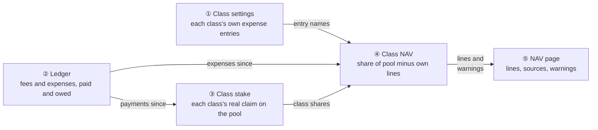
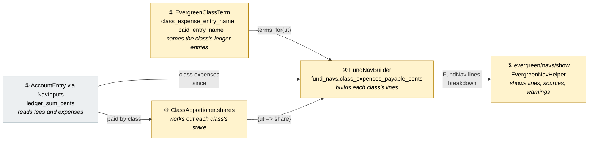
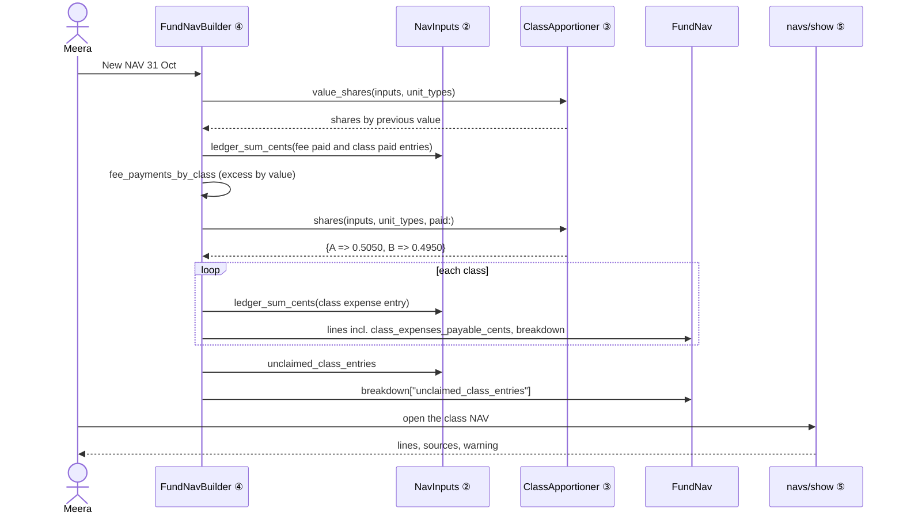
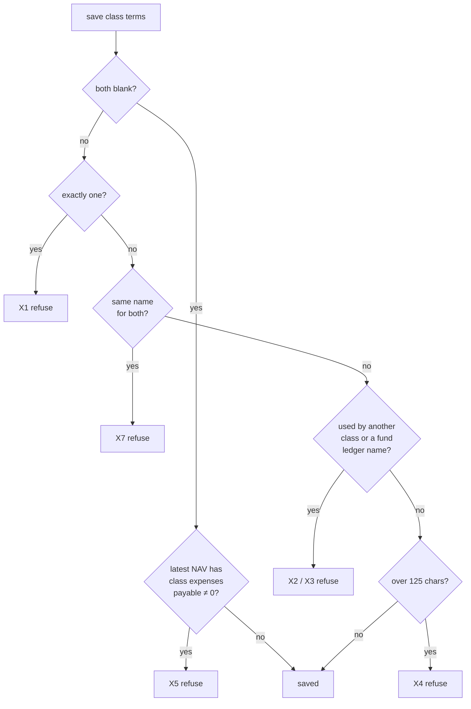
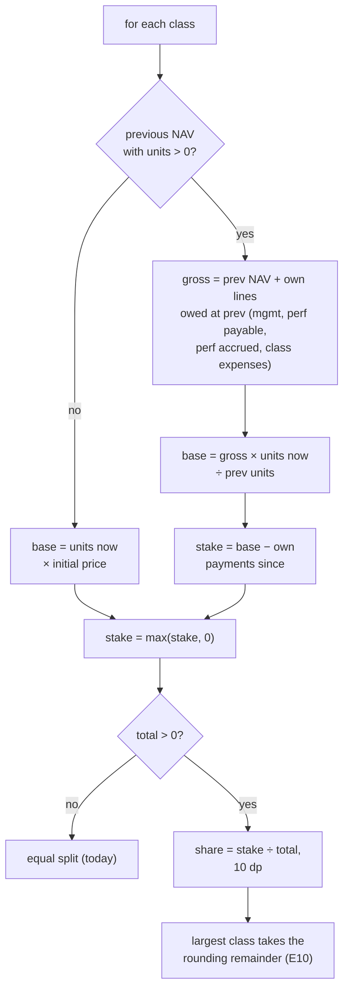
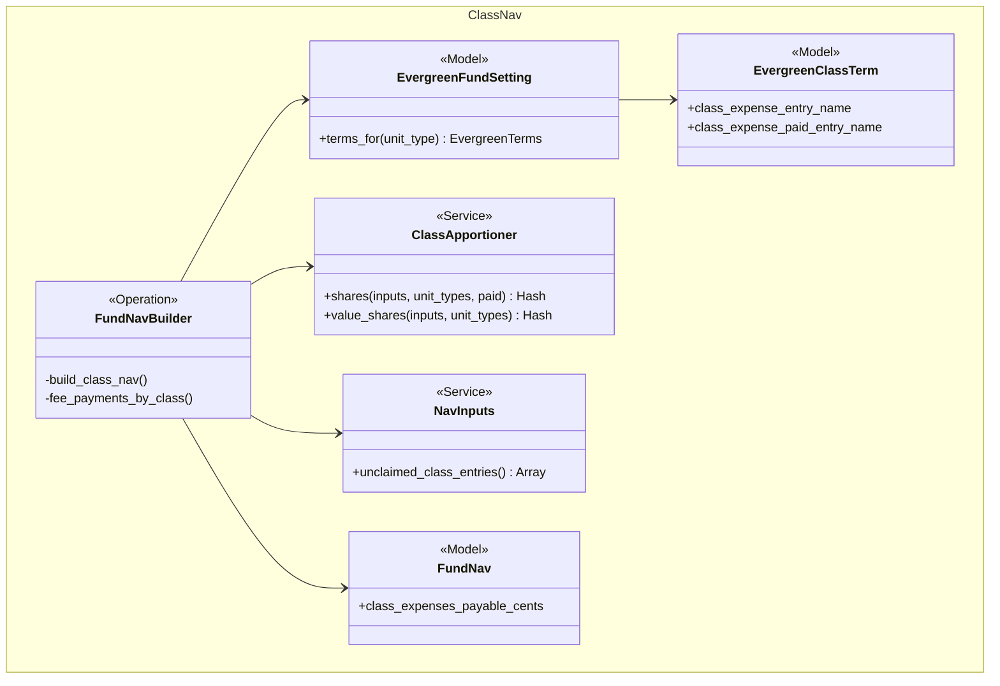
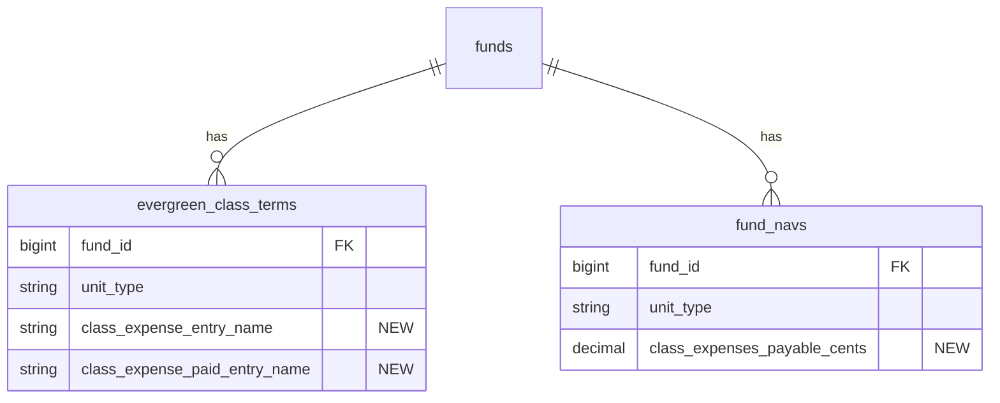

# Share Classes: Fair Split and Class-Only Expenses — Design

> **Audience:** Engineering team.
> **Companion documents:** [Proposal](proposal.md) · [Spec](specs/)

> **Planning phase — no code changes.** This document explains HOW the proposal will be built.

> **Zoom one picture.** Part 1 draws the picture in plain words, Part 2 redraws it with real names,
> Part 3 has one card per box, and Part 4 is reference. ①–⑤ mean the same box everywhere.

---

## Contents

- [1. The idea](#1-the-idea)
  - [What this adds](#what-this-adds)
  - [The idea in one picture](#the-idea-in-one-picture)
  - [Walkthrough: one example, start to finish](#walkthrough-one-example-start-to-finish)
  - [Key ideas](#key-ideas)
- [2. The same picture with real names](#2-the-same-picture-with-real-names)
  - [Picture](#picture)
  - [What each box does](#what-each-box-does)
  - [One run, end to end](#one-run-end-to-end)
  - [Lifecycles](#lifecycles)
  - [What users see](#what-users-see)
  - [Design decisions](#design-decisions)
- [3. One card per box](#3-one-card-per-box)
  - [① Class settings](#①-class-settings)
  - [② Ledger](#②-ledger)
  - [③ Class stake](#③-class-stake)
  - [④ Class NAV](#④-class-nav)
  - [⑤ NAV page](#⑤-nav-page)
- [4. Reference](#4-reference)
  - [Class diagram](#class-diagram)
  - [Data model and schema changes](#data-model-and-schema-changes)
  - [Component contracts](#component-contracts)
  - [Notifications](#notifications)
  - [Cross-cutting concerns](#cross-cutting-concerns)
  - [Worked examples](#worked-examples)
  - [Testing](#testing)
  - [Risks and open questions](#risks-and-open-questions)

---

## 1. The idea

### What this adds

- **A corrected split.** The shared NAV lines are split between classes by each class's stake.
- **A class-only expense line.** One class can carry an expense the others don't.

Both reuse the fee machinery `FundNavBuilder` already has: a rolling payable, with each payment
taken off the class that owed it (`fee_payments_by_class`, decision of 8 Oct 2026).

### The idea in one picture



### Walkthrough: one example, start to finish

**Setup.** Alpha Evergreen has Class A and Class B, each with 50,000 units. At the 30 Sep NAV:
- **Class A:** NAV ₹50 Cr, after a ₹1 Cr management fee it still owes. Its stake is ₹51 Cr.
- **Class B:** NAV ₹50 Cr. It owes nothing.
- **Shared pool:** ₹101 Cr. The market doesn't move in this example.

**Legend:** ✓ done · ● we are here (waiting on this, not done yet) · ○ not started.

| # | When | What happens | Behind the scenes | Result |
|---|---|---|---|---|
| 1 | 2 Oct | Meera names Class B's entries "Class B Servicing Fee" and "Class B Servicing Fee Paid" | The class settings (①) check both names: unique, and not a fund ledger name | ✓&nbsp;Set&nbsp;up&nbsp;class&nbsp;expenses<br>**●&nbsp;Draft&nbsp;October&nbsp;NAV**<br>○&nbsp;Approve |
| 2 | 2 Oct | She types Class A's entry name into Class B by mistake | The class settings (①) refuse it as already used by Class A (X2); she corrects it | Same as row 1 |
| 3 | 20 Oct | Meera records "Class B Servicing Fee" ₹40,00,000 in the ledger (②) | — | Same as row 1 |
| 4 | 31 Oct | Meera drafts the NAV | Class stake (③): A = 50 + 1 owed = ₹51 Cr; B = ₹50 Cr. Class NAV (④): A gets 51/101 and B 50/101 of ₹101 Cr, then each takes off its own lines. The old rule would have split 50:50 and leaked ₹50 lakh from A to B | ✓&nbsp;Set&nbsp;up&nbsp;class&nbsp;expenses<br>✓&nbsp;Draft&nbsp;October&nbsp;NAV<br>**●&nbsp;Approve** |
| 5 | 5 Nov | A's ₹1 Cr fee and B's ₹40 lakh are paid from cash, so the pool falls to ₹99.6 Cr | Class stake (③): A = 50 + 1 − 1 = ₹50 Cr; B = 49.6 + 0.4 − 0.4 = ₹49.6 Cr | Both NAVs are unchanged by the payments |
| 6 | 30 Nov | A stray entry "Class C Legal" exists, and the fund has no Class C | The NAV page (⑤) warns that the entry looks class-specific but no class uses it | The warning stays until the entry is named or removed |

**Snapshot: Class B on the 31 Oct NAV page**

```
┌──────────────────────────────────────────────────────────────┐
│ NAV 31 Oct 2026 — Class B                     Draft            │
│ Share of shared lines   49.5050%   ₹50,00,00,000.00           │
│ Management fee payable                  −₹0.00                │
│ Class expenses payable           −₹40,00,000.00  ⓘ "Class B   │
│                                                Servicing Fee"  │
│ NAV                             ₹49,60,00,000.00              │
│ Units outstanding                     50,000.0000             │
│ NAV per unit                            ₹9,920.00             │
└──────────────────────────────────────────────────────────────┘
```

**What to notice**
- The stake (③) counts what a class still owes, so an unpaid fee never shifts value to the other
  classes.
- A payment comes off the stake of the class it was for. Shared cash falls for everyone, and the
  stake makes up for it.
- Class expenses (④) are just another class line, so the NAV page (⑤) shows them like the fees.

### Key ideas

| # | Idea | In one line | Card |
|---|---|---|---|
| 1 | Stake, not previous NAV | Split the pool by previous NAV + own lines still owed − own payments since, scaled for units | [③](#③-class-stake) |
| 2 | Class expenses are fee-like | Rolling payable = previous + expensed − paid, charged to one class | [④](#④-class-nav) |
| 3 | Named ledger entries, no ledger change | Classes point at entries by name, as the fund already does for cash | [①](#①-class-settings) |

**FAQ**

| Question | Answer |
|---|---|
| Why not split simply by value before fees? | It goes wrong once a fee is paid: shared cash falls for every class while only the paying class's payable falls. The stake subtracts payments since the previous NAV, which fixes both cases (H3). |
| Do NAVs change for funds that owe nothing? | No. With nothing owed and nothing paid, the stake equals the previous NAV, which is today's rule (H1, E8). |

---

## 2. The same picture with real names

### Picture



Colour = footprint: **green** new, **amber** modified, **grey** reused unchanged. Exact files are in
[lld.md File Map](lld.md#file-map).

### What each box does

| # | Box | Real parts | What it does | When it runs | What it decides | Details |
|---|---|---|---|---|---|---|
| ① | Class settings | `EvergreenClassTerm`, `EvergreenFundSetting` (cross-class checks), settings wizard step 6 | Names each class's expense entries and validates them | Settings save | Which entries belong to which class | [card ① →](#①-class-settings) |
| ② | Ledger | `NavInputs#ledger_sum_cents`, fund account entries | Sums entries by name in a window | NAV draft | — | [card ② →](#②-ledger) |
| ③ | Class stake | `ClassApportioner.shares` | Works out each class's stake and its share | NAV draft | How the pool is split | [card ③ →](#③-class-stake) |
| ④ | Class NAV | `FundNavBuilder`, `FundNav` | Builds the lines, incl. class expenses payable; finds unclaimed "Class …" entries | NAV draft | Each class's NAV | [card ④ →](#④-class-nav) |
| ⑤ | NAV page | `evergreen/navs/show`, `EvergreenNavHelper::LINE_LABELS` | Shows the new line, its source and the warning | NAV page view | — | [card ⑤ →](#⑤-nav-page) |

### One run, end to end



### Lifecycles

N/A. No new status. `FundNav` keeps draft → approved → reopened.

### What users see

**At a glance**

| Where in CapHive | Today | After this change | Who sees it |
|---|---|---|---|
| Evergreen settings › Classes › Customise | — | Two entry-name fields | Fund users with update rights |
| NAV › class page | — | A "Class expenses payable" line and an unclaimed-entry warning | Fund users |
| NAV figures in multi-class funds with unpaid fees | Drift between classes | No drift | Everyone who sees the NAV |

**Main journey: reading a class NAV**

```
┌──────────────────────────────────────────────────────────────┐
│ ① NAV 31 Oct 2026 — Class B                     Draft          │
│ ② Share of shared lines   ₹50,00,00,000.00  ⓘ source          │
│ ③ Class expenses payable   −₹40,00,000.00  ⓘ "Class B …"      │
│ ④ NAV per unit                  ₹9,920.00                     │
│ ⑤ ⚠ Ledger entry "Class C Legal" looks class-specific …       │
└──────────────────────────────────────────────────────────────┘
```

| Step | The user… | They see |
|---|---|---|
| 1 | opens the NAV tab and the Class B draft | ① the header with the class |
| 2 | hovers the ⓘ on the new line | ③ the entry names it was built from |
| 3 | reads NAV per unit | ④ the class's own figure |
| 4 | sees the warning | ⑤ and names the entry on a class, or removes it, then drafts again |

### Design decisions

1. **The stake includes payments since the previous NAV.** Alternative: value before fees only.
   Rejected: a payment would then leak between classes.
2. **Class expenses are two named ledger entries per class.** One is summed for expenses, one for
   payments, mirroring `mgmt_fee_paid_entry_name`.
   - Alternative: tag `AccountEntry` rows with a class. Rejected: it changes `AccountEntry`, the
     largest table, and every upload into it.
   - Alternative: a single balance entry. Rejected: a balance can't tell a payment from a new
     expense, and the stake needs the payments.
3. **No re-split of approved NAVs.** They are what investors dealt on. The new rule applies from
   the next draft (E9).
4. **The unclaimed-entry check runs at draft time.** It is stored in the breakdown, not run on
   page view. This keeps `account_entries` queries off the NAV page.

**FAQ**

| Question | Answer |
|---|---|
| Why not let a class have several expense lines? | One line keeps the NAV readable. All of a class's expense types are booked to its one entry. |
| Does this touch closed-end funds? | No. Everything here is in the evergreen pack. |

---

## 3. One card per box

### ① Class settings

Two optional columns on `evergreen_class_terms`, edited inside **Customise this class** on step 6
of the settings wizard.

| Owns | Reads / receives | Produces |
|---|---|---|
| `class_expense_entry_name`, `class_expense_paid_entry_name`, their validations | The fund setting's ledger names; the other classes' names | Valid entry names for ④ |



- **Where the cross-class checks live:** on `EvergreenFundSetting`, beside its existing class-terms
  validation, because they need every class at once.
- **Permit list:** `CLASS_FIELDS` in `Evergreen::SettingsController` gains the two names.
- **`EvergreenTerms`** gains both fields, so `terms_for(ut)` returns them.

**Worked examples:** H6, X1–X5, X7

**FAQ**

| Question | Answer |
|---|---|
| Why refuse clearing while an amount is owed? | Clearing would silently drop the payable from the next NAV, creating value from nothing. |
| Can two classes share one entry? | No (X2). One class has to own it, or it would be counted twice. |

### ② Ledger

Reused unchanged. `NavInputs#ledger_sum_cents(name, from_exclusive, to)` already sums fund-level
entries in a window, and `NavStaleness` already fingerprints every fund-level entry, so a new class
expense flags the NAV as out of date (E24).

| Owns | Reads / receives | Produces |
|---|---|---|
| — | `fund.fund_account_entries` | Sums |

**New read:** `NavInputs#unclaimed_class_entries` returns the names of fund-level entries on or
before the NAV date that start with "Class " and aren't used by any class's expense entries.
- The query is `distinct.pluck(:name)`, fund-scoped.
- It is called once per draft.

**Worked examples:** E22, E23, E24

**FAQ**

| Question | Answer |
|---|---|
| Is the LIKE query safe on `account_entries`? | It is fund-scoped (indexed `fund_id`), returns distinct names only, and runs once per draft. |

### ③ Class stake

`ClassApportioner.shares(inputs, unit_types, paid:)` returns `{ut => share}`.

| Owns | Reads / receives | Produces |
|---|---|---|
| The stake rule | The previous approved NAV per class, units now, own payments since (`paid`) | Shares summing to 1 |



**The order inside `FundNavBuilder#build_navs`:**
1. `fee_payments_by_class` splits fee payments by what each class owed. Any excess is shared by
   `ClassApportioner.value_shares`, today's rule (value at the previous NAV), so open-ended-funds
   E199 and E200 are unchanged. Class expense payments go straight to their own class.
2. Shares are computed with `paid:` = management + performance + class expense payments per class.
3. A single-class fund short-circuits to 100%, as today.

**Worked examples:** H1, H2, H3, E1–E13

**FAQ**

| Question | Answer |
|---|---|
| Why use the previous gross per unit for new units? | Units issued since were bought at roughly that price. It matches today's rule, which uses the previous NAV per unit. |
| Why clamp at 0? | A fully redeemed class with a payment since would otherwise go negative and take value from the others (E3). |
| Uploaded previous NAV? | Its own-line columns are 0, so gross = NAV, the same as today (E5). |

### ④ Class NAV

`FundNavBuilder#build_class_nav` gains one line.

| Owns | Reads / receives | Produces |
|---|---|---|
| `class_expenses_payable_cents` on `FundNav`, its breakdown text, `breakdown["unclaimed_class_entries"]` | ① names, ② sums, ③ shares | Class NAV |

- **The line:** class expenses payable = previous payable + `ledger_sum(expense entry, prev,
  date)` − `ledger_sum(paid entry, prev, date)`, rounded to 2 dp. It is 0 when the class has no
  entries named.
- **`FundNav::LIABILITY_LINES`** gains `class_expenses_payable`, so it flows through
  `recompute_totals!`, overrides, the negative-NAV check (X6) and staleness with no extra code.
- **Performance fee:** the expense reduces NAV before the performance fee, like the management fee.
- **Uploaded NAVs** are untouched (E20).

**Worked examples:** H4, H5, E14–E21, X6

**FAQ**

| Question | Answer |
|---|---|
| Why a separate line, not inside other liabilities? | Other liabilities is shared. This line belongs to one class. |
| Does the performance fee see the expense? | Yes. Investors don't pay a performance fee on money the class spent. |

### ⑤ NAV page

`EvergreenNavHelper::LINE_LABELS` adds "Class expenses payable". `navs/show` renders the row only
when the class has entries named or the value is non-zero, and renders
`#unclaimed_class_entries_warning` from the breakdown, using the existing `evergreen_cash_warning`
alert pattern.

| Owns | Reads / receives | Produces |
|---|---|---|
| The line row, the warning | `FundNav`, its breakdown | HTML |

**Worked examples:** H4, E16, E22, E23

**FAQ**

| Question | Answer |
|---|---|
| Why store the warning on the draft? | It keeps the page free of `account_entries` queries. The draft is re-run when inputs change anyway (staleness). |

---

## 4. Reference

### Class diagram



### Data model and schema changes



**Indexes:** none new. The names are validated in Ruby across a handful of classes.

**Schema changes**

**`evergreen_class_terms`** (changed): names the class's own expense entries.

| Column / index | What changed | Why it's needed |
|---|---|---|
| `class_expense_entry_name` | Added: string, limit 125, null | Ledger entry summed as this class's expenses |
| `class_expense_paid_entry_name` | Added: string, limit 125, null | Ledger entry summed as payments of those expenses |

**`fund_navs`** (changed): one new class line.

| Column / index | What changed | Why it's needed |
|---|---|---|
| `class_expenses_payable_cents` | Added: decimal(20,2), default 0, not null | The class-only liability, rolled forward NAV to NAV like the fee payables |

**Changes to existing models:**
- **`EvergreenClassTerm`, `FundNav`:** both are new in the open-ended-funds branch.
- **`AccountEntry`:** unchanged.

### Component contracts

| From → To | Contract | Direction rule |
|---|---|---|
| ① → ④ | `setting.terms_for(ut)` exposes both entry names | ④ reads ① |
| ② → ③ | Payments per class, worked out in `FundNavBuilder` from `ledger_sum_cents` | ③ makes no queries of its own beyond `inputs` |
| ② → ④ | `ledger_sum_cents(name, prev_date, nav_date)` | Aggregates only, never rows |
| ③ → ④ | `{unit_type => BigDecimal share}` summing to 1 | — |
| ④ → ⑤ | `FundNav` columns + `breakdown` keys `class_expenses_payable`, `unclaimed_class_entries` | ⑤ never queries the ledger |

### Notifications

Nothing is added, removed or changed, for investors or internal users:
- **Investors:** the NAV figures they see, and the NAV update email, come from the approved NAV as
  today. A corrected figure reaches them through the same emails.
- **Internal users:** the NAV-drafted alert to approvers (`EvergreenAlerts.nav_drafted`) still fires
  after each draft. The unclaimed-entry warning is on-page only, with no alert, because it doesn't
  block approval.

| Notification | Trigger | Recipients | Channel | Customisable | Default | Sent once? |
|---|---|---|---|---|---|---|
| NAV drafted (existing) | `FundNavBuilder` | Approver role (unchanged) | Email + in-app | No | On | Per draft, as today |
| NAV update to investors (existing) | Approval | Investors and approved advisors (unchanged) | Email | Yes | As set | As today |

### Cross-cutting concerns

#### Transactions and queries

- **Extra queries per draft:** two `ledger_sum_cents` calls per class and one `distinct.pluck`.
  Both are indexed aggregates.
- **Transaction:** everything runs inside the existing `build_navs` transaction.

#### Exception handling and monitoring

N/A. There are no new jobs or external calls. Errors surface through the existing settings and NAV
error paths.

#### Performance and security

- **Performance:** three aggregate queries per draft.
- **Security:** the entry names sit behind the existing evergreen settings policy (fund update).
  They are used only as bound equality filters within the fund's own entries.

### Worked examples

**ID legend:** **H** = Happy path · **E** = Edge case · **X** = Error (exception) case. These IDs are
local to this change.

**Shared setup:**

| Record | Name | Key data |
|---|---|---|
| Fund | Alpha Evergreen | Classes A and B, each 50,000 units, previous approved NAV (30 Sep) ₹50 Cr each, nothing owed unless stated |
| Ledger | Fund level | Cash In Hand ₹100 Cr on 30 Sep (shared pool), unless stated |
| Users | Meera (fund update), Raj (approver) | — |

#### Happy Path

| # | Scenario | Given | When | Then | Spec scenario | Feature |
|---|---|---|---|---|---|---|
| H1 | Split with nothing owed | A ₹10,000 × 60,000, B ₹20,000 × 20,000; pool ₹110 Cr | Draft 31 Oct | Shares 60% / 40%; A ₹66 Cr, B ₹44 Cr before class lines | One NAV per class › Two classes, different fees | class_nav.feature |
| H2 | Unpaid fee doesn't drift | A owes ₹1 Cr at 30 Sep (NAV ₹49 Cr), B ₹50 Cr; pool ₹100 Cr (the unpaid fee is still in cash); no change | Draft 31 Oct | A ₹49 Cr, B ₹50 Cr | Stake › An unpaid fee does not move value | class_nav.feature |
| H3 | Fee paid from cash | H2, then "Management Fee Paid" ₹1 Cr on 5 Nov, cash −₹1 Cr | Draft 30 Nov | A ₹49 Cr (payable ₹0), B ₹50 Cr | Stake › Paying a fee from shared cash | class_nav.feature |
| H4 | Class expense charged | Class B entries named; "Class B Servicing Fee" ₹40,00,000 on 20 Oct | Draft 31 Oct | B "Class expenses payable" −₹40,00,000 with its source; B NAV −₹40,00,000; A as without it | Class-only expenses › Expense charged to one class | class_expenses.feature |
| H5 | Class expense paid | H4, then "Class B Servicing Fee Paid" ₹40,00,000 on 10 Nov, cash −₹40,00,000 | Draft 30 Nov | B payable ₹0; B NAV same as 31 Oct; A unchanged | Class-only expenses › Expense paid | class_expenses.feature |
| H6 | Name class entries | Settings › Classes › Class B › Customise | Enter both names, save | Saved; shown on the Review step | Class expense entry names are validated | class_expenses.feature |

#### Edge Cases

| # | Scenario | Given | When | Then | Spec scenario | Feature |
|---|---|---|---|---|---|---|
| E1 | One class | Single class | Draft | 100%, unchanged from today | One NAV per class › One class | class_nav.feature |
| E2 | New class, no previous NAV | Class C, first subscription 1,000 units, initial price ₹10,000 | Draft | C stake ₹1 Cr (units × initial price) | Shared lines split by each class's stake | class_nav.feature |
| E3 | Fully redeemed class with payment since | Class B 0 units now, its fee ₹10,00,000 paid since | Draft | B stake clamped to 0; A 100%; B shows initial price, "No units outstanding" | Shared lines split by each class's stake | class_nav.feature |
| E4 | Units issued since the previous NAV | A 50,000 → 55,000 units dealt 1 Oct; previous gross per unit ₹10,200 | Draft | A base = ₹10,200 × 55,000 = ₹56.1 Cr | Stake › Units issued since the previous NAV | class_nav.feature |
| E5 | Previous NAV uploaded | Both previous NAVs uploaded | Draft | Shares = uploaded NAVs scaled, less payments; equal to today's split when nothing paid | Stake › Previous NAV uploaded | class_nav.feature |
| E6 | Overpaid fee (excess) | Payment ₹1.5 Cr when A owed ₹1 Cr | Draft | Excess ₹50 lakh shared by value at the previous NAV (as today); each stake falls by its part; no class gains | Stake › Paying a fee from shared cash | class_nav.feature |
| E7 | Crystallised performance fee unpaid | B crystallised ₹20,00,000 at 30 Sep, unpaid | Draft 31 Oct | B's stake includes it; no drift to A | Stake › An unpaid fee does not move value | class_nav.feature |
| E8 | Fees owed in proportion | A and B each owe 1% of NAV | Draft | Same result as the old rule (regression sanity) | Stake › An unpaid fee does not move value | class_nav.feature |
| E9 | Approved NAVs untouched | 30 Sep NAV approved under the old rule | Draft 31 Oct | 30 Sep figures unchanged; 31 Oct uses the new rule | Stake › Approved NAVs are not re-split | class_nav.feature |
| E10 | Three classes, rounding | A/B/C stakes 1:1:1; pool ₹100 Cr | Draft | Shares sum to exactly 1 (the largest class takes the rounding remainder); the class NAVs add up to ₹100 Cr to the paisa | Shared lines split by each class's stake | class_nav.feature |
| E11 | No units anywhere | All classes 0 units | Draft | Equal split, as today | Shared lines split by each class's stake | class_nav.feature |
| E12 | Overridden fee line at the previous NAV | A's 30 Sep management fee payable overridden to ₹80,00,000 | Draft | Stake uses ₹80,00,000 | Stake › An unpaid fee does not move value | class_nav.feature |
| E13 | Payment on the previous NAV date | Payment dated 30 Sep (= previous NAV date) | Draft 31 Oct | Not counted again (the window starts after the previous NAV) | Stake › Paying a fee from shared cash | class_nav.feature |
| E14 | Expense and payment in the same window | ₹40,00,000 expensed and paid in October | Draft 31 Oct | B payable ₹0; B NAV −₹40,00,000 via its stake | Class-only › Expense paid | class_expenses.feature |
| E15 | Overpaid class expense | Paid ₹50,00,000 on ₹40,00,000 | Draft | B payable −₹10,00,000; A unchanged | Class-only › Overpaid | class_expenses.feature |
| E16 | Class without entries | Class A has none | Draft | No "Class expenses payable" row for A | Class-only expenses (no line) | class_expenses.feature |
| E17 | Dates around the NAV date | Expenses on 31 Oct and 1 Nov | Draft 31 Oct | 31 Oct counted, 1 Nov not | Class-only › Expense charged to one class | class_expenses.feature |
| E18 | Reversal entry | −₹40,00,000 expense entry after H4 | Draft | Payable back to ₹0 | Class-only › Expense charged to one class | class_expenses.feature |
| E19 | Override class expenses payable | Override to ₹35,00,000, reason "per admin" | Re-draft | Override kept | Class-only › Override | class_expenses.feature |
| E20 | Uploaded NAV | Class B NAV uploaded | — | No class expense line added | Class-only expenses (uploaded) | class_expenses.feature |
| E21 | Entries named after the expenses exist | Expense recorded 20 Oct, entries named 25 Oct | Draft 31 Oct | Expense counted (window is by entry date) | Class-only › Expense charged to one class | class_expenses.feature |
| E22 | Unclaimed "Class " entry | "Class C Legal" in the ledger, no class uses it | Draft | Warning shown; naming it on a class and re-drafting clears it | Unclaimed entries flagged | class_expenses.feature |
| E23 | Fund-wide name starting "Class " | "Class Action Settlement" | Draft | Warning shown (harmless); NAV figures unaffected | Unclaimed entries flagged | class_expenses.feature |
| E24 | Expense after drafting | Expense added after the draft | View NAV | Flagged out of date | Class-only › Expense charged to one class | class_expenses.feature |

#### Error Cases

| # | Scenario | Given | When | Then (what the user sees, who is alerted) | Spec scenario | Feature |
|---|---|---|---|---|---|---|
| X1 | Only one entry named | Class B expense entry only | Save settings | "Class B needs both a class expenses entry and a class expenses paid entry, or neither" | Names validated › Only one entry named | class_expenses.feature |
| X2 | Name used by another class | B uses A's name | Save | "Class B's expense entry 'Class A Servicing Fee' is already used by Class A — each class needs its own entries" | Names validated › Name used by another class | class_expenses.feature |
| X3 | Name is a fund ledger name | B uses "Cash In Hand" | Save | "Class B's expense entry 'Cash In Hand' is already one of the fund's ledger settings" | Class expense entry names are validated | class_expenses.feature |
| X4 | Name too long | 126 characters | Save | "Class expenses entry is too long (maximum is 125 characters)" | Class expense entry names are validated | class_expenses.feature |
| X5 | Clearing with an amount owed | B's latest NAV payable ₹40,00,000 | Blank both, save | "Class B still owes ₹40,00,000.00 of class expenses on its latest NAV — pay or reverse it before removing its expense entries" | Class expense entry names are validated | class_expenses.feature |
| X6 | Expense makes the NAV negative | B's expense larger than B's share | Draft | The existing negative-NAV refusal; nothing saved | Class-only › Expense charged to one class | class_expenses.feature |
| X7 | Same entry for expenses and payments | Both B entries "Class B Servicing Fee" | Save | "Class B's class expenses entry and class expenses paid entry must be different" (found during apply: the payable would never move) | Class expense entry names are validated | class_expenses.feature |

### Testing

- **Cucumber only.** New features: `features/fund/evergreen/class_nav.feature` and
  `features/fund/evergreen/class_expenses.feature`.
- **Step files:** existing evergreen steps are reused (fund, classes, NAV draft, ledger entries).
  The new step file is `features/step_definitions/evergreen_class_nav_steps.rb`.
- **Traceability:** every scenario carries `# ID — Happy path|Edge case|Error case: …`, and code
  comments name the IDs they implement.
- **Regression net:** the full evergreen suite stays green. Scenarios whose figures change only
  because a class owed unpaid fees get new figures and a comment saying why.

### Risks and open questions

- **The new split changes NAVs in live multi-class funds** → it applies to new drafts only (E9). A
  release note tells GPs that multi-class funds with unpaid fees will see a small, correct shift.
- **Existing tests assert old split figures** (open-ended-funds E7, E197–E200) → where nothing is
  owed the figures are identical. Others are re-baselined, with the reason in the scenario comment.

| # | Open question | Current thinking | Status |
|---|---|---|---|
| — | None | — | — |

**FAQ**

| Question | Answer |
|---|---|
| Where do I start reviewing? | Card ③ (the correctness fix). |
| What happened to the "shares" wording? | It is a separate change on its own branch (business decision, 9 Oct 2026). |
