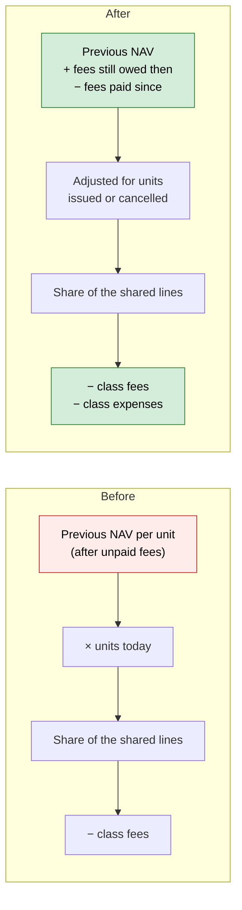
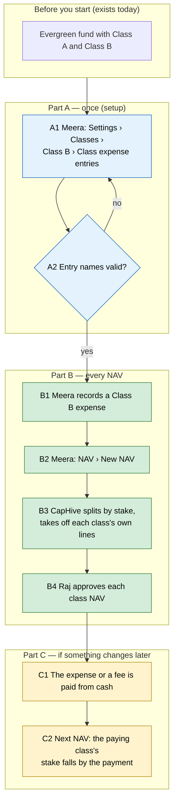

# Share Classes: Fair Split and Class-Only Expenses — Proposal

> **Audience:** Business team, product, QA, support — non-technical.
> **Companion document:** [Design](design.md)
> **New to this? Start with the [Workflow Journey](#workflow-journey)** — every action, in order, from start to the outcome.

> **Planning phase — no code changes.** This document proposes and explains the change.

---

## Why

Business review of evergreen funds (9 Oct 2026) asked for a correct, separate NAV for each class.
CapHive already drafts one NAV per class, but two things are wrong or missing:
1. **Unpaid fees distort the split.** While one class owes a fee it hasn't paid, the split of the
   shared portfolio drifts in favour of the other classes.
2. **No class-only expenses.** There is no way to charge an expense, such as a servicing fee, to
   one class only.

This change covers items 1 and 3 of `docs/modules/funds/evergreen_share_classes_plan.md`. Calling
holdings "shares" for US companies (item 2) is a **separate change**, built on its own branch. The
large items are listed under [Later — TBD](#later--tbd-not-built-in-this-change).

## What Changes

1. **Fair class split.**
   - The shared lines are split by each class's real stake: its previous NAV, plus the fees it
     still owed then, minus the fees paid for it since.
   - An unpaid fee no longer moves value from one class to another, and neither does paying it.
2. **Class-only expenses.**
   - Each class can name two ledger entries: one for its own expenses, one for paying them.
   - Those amounts come off that class's NAV only, as a new line, **Class expenses payable**.

Nothing is **BREAKING**:
- Approved NAVs stay as they are.
- A one-class fund, or a fund where no class owes unpaid fees, gets the same figures as today.
- A class with no expense entries named works as today.

### Later — TBD (not built in this change)

These are the large items from the plan. They are listed so the business sees the whole picture.
Each is **TBD**: it is designed and built only when a client needs it, as its own change.

| # | Item | What it would add | Why it's large | Status |
|---|---|---|---|---|
| 4 | **A class in another currency, incl. hedged classes** | A USD class in an INR fund (or EUR in a USD fund); NAV per unit, orders, payments and documents in the class's currency, converted at the NAV-date rate; a hedged class bears its own hedge gains and costs | Reaches orders, payments, contract notes, statements and reports; hedging builds on class-only expenses | **TBD** |
| 5 | **Classes that pay out income** | A distributing class pays income per unit on set dates (optionally reinvested); its NAV falls by the payout; accumulating classes stay as today | New distribution flow per class, reinvestment, notices | **TBD** |
| 6 | **A high-water mark per investor (series or equalisation)** | Each subscription gets its own mark, so late joiners neither escape nor overpay a performance fee | Changes how performance fees are worked out, booked and reported; already parked as Decision 3 | **TBD** |

### Flow Diagram

**Splitting the shared lines between classes**



*Caption:* the split now follows each class's real stake, and a class's own expenses come off only
that class.

---

## Workflow Journey

### Who is involved

| Person | Role | What they do in the journey |
|---|---|---|
| Meera | Fund accountant (fund update rights) | Names Class B's expense entries, records expenses, drafts NAVs |
| Raj | Approver | Approves the class NAVs |
| Priya | Investor in Class B | Deals at Class B's NAV per unit |

### The journey on one page



### Before you start

| Needed | Why | Where it comes from |
|---|---|---|
| An evergreen fund with two or more classes | The split and class expenses only matter with several classes | Fund › Make this fund evergreen |
| Ledger entries for the class's expenses | The NAV reads them by name, like Cash In Hand | The fund's accounting entries (upload or formulas) |

### Part A — once (setup)

| Step | Who | Where | Action | What the system does | What you see |
|---|---|---|---|---|---|
| A1 | Meera | Fund › Evergreen settings › Classes › Class B › Customise this class | Enters **Class expenses entry** "Class B Servicing Fee" and **Class expenses paid entry** "Class B Servicing Fee Paid" | Checks the names | Saved |
| A2 | — | — | (failing path) Meera enters a name Class A already uses | Refuses | "Class B's expense entry 'Class A Servicing Fee' is already used by Class A — each class needs its own entries" |

### Part B — every NAV

| Step | Who | Where | Action | What the system does | What you see |
|---|---|---|---|---|---|
| B1 | Meera | Fund › Ledger (or upload) | Records "Class B Servicing Fee" ₹40,00,000 on 20 Oct | — | The entry |
| B2 | Meera | Fund › NAV › New NAV, 31 Oct | Drafts | Splits the shared lines by stake; takes off Class B's ₹40,00,000 | Two drafts; Class B shows "Class expenses payable" −₹40,00,000 with its source |
| B3 | Raj | NAV › Approve | Approves both classes | — | Status Approved |

### Part C — if something changes later

| Step | Who | Where | Action | What the system does | What you see |
|---|---|---|---|---|---|
| C1 | Meera | Fund › Ledger | Records "Class B Servicing Fee Paid" ₹40,00,000; cash falls by the same | — | — |
| C2 | Meera | NAV › New NAV, 30 Nov | Drafts | Class B's stake falls by ₹40,00,000 and its payable to ₹0 | Class A's NAV is unchanged by Class B's payment |

### What you see

Class A and Class B each have 50,000 units, with a previous NAV of ₹50 Cr each. Class A still owes
a ₹1 Cr management fee, so its stake is ₹51 Cr. The shared pool is ₹101 Cr.

```
┌──────────────────────────────────────────────────────────────┐
│ NAV 31 Oct 2026 — Class B                     Draft            │
│ Share of shared lines   49.5050%   ₹50,00,00,000.00           │
│ Management fee payable                  −₹0.00                │
│ Class expenses payable           −₹40,00,000.00  ⓘ "Class B   │
│                                                Servicing Fee"  │
│ NAV                             ₹49,60,00,000.00              │
│ Units outstanding                     50,000.0000             │
│ NAV per unit                            ₹9,920.00             │
└──────────────────────────────────────────────────────────────┘
```

Arithmetic:
- **Stakes:** A 51 Cr and B 50 Cr, so B's share is 50/101 = 49.5050%, which is ₹50 Cr.
- **Class B:** ₹50 Cr − ₹40 lakh = ₹49.60 Cr ÷ 50,000 = **₹9,920** a unit.
- **Class A:** ₹51 Cr − ₹1 Cr owed = ₹50 Cr.
- **Under today's rule:** the split would be 50:50, giving A ₹49.5 Cr and B ₹50.1 Cr, so ₹50 lakh
  leaks from A to B.

### What goes wrong

**The expense is booked, but no class names its entry.**
- **What happens:** Meera records "Class B Servicing Fee" without naming it on Class B first.
- **The check:** the NAV draft warns: *"Ledger entry 'Class B Servicing Fee' looks class-specific
  but no class uses it — name it on the class or it is ignored."*
- **The fix:** Meera names it on Class B and drafts again.

### Summary: the minimum actions

| # | Action | Who | How often |
|---|---|---|---|
| 1 | Name a class's expense entries | Fund accountant | Once per class that has its own expenses |
| 2 | Record class expenses and payments in the ledger | Fund accountant | As they happen |
| 3 | Draft and approve NAVs | Accountant and approver | Every NAV, as today |

---

## User Stories

### US-1: A fair split while fees are unpaid

**As a** fund accountant, **I want** an unpaid fee in one class not to change the other classes'
NAVs, **so that** each class's investors get exactly their own result.

**Acceptance criteria:**
- **Setup:** two classes of ₹50 Cr each in a ₹100 Cr pool. Class A owes ₹1 Cr in unpaid fees and
  nothing changes.
  - The next NAV gives Class A ₹49 Cr and Class B ₹50 Cr. Today it gives ₹48.49 Cr and ₹50.51 Cr.
  - After Class A's fee is paid from cash, the next NAV still gives ₹49 Cr and ₹50 Cr.
- A one-class fund is unchanged. An uploaded previous NAV splits as today.

### US-2: Expenses for one class only

**As a** fund accountant, **I want** to charge an expense to Class B only, **so that** Class A's
investors don't pay for it.

**Acceptance criteria:**
- **Naming the entries:** each class can name a **Class expenses entry** and a **Class expenses
  paid entry**.
  - Both are optional, but naming one requires the other.
  - Each must be unique across the classes and the fund's own ledger settings.
- **On the NAV:** Class B's NAV shows **Class expenses payable** = the previous payable + the
  expenses since − the payments since.
- **When paid:** a payment reduces only Class B's stake.
- **Other paths:**
  - **Override:** the line can be overridden with a reason.
  - **Upload:** uploaded NAVs ignore it.
  - **Classes without entries:** a class with no entries shows no line.

---

## UI Behavior

### Fund › Evergreen settings › Classes › Customise this class

```
┌──────────────────────────────────────────────────────────────────┐
│ Class B                                    Customise this class   │
│ Performance fee  [Above HWM ▾]  Fee % [20]  Hurdle % [0] ...      │
│ Class expenses entry ⓘ        [Class B Servicing Fee       ]     │
│ Class expenses paid entry ⓘ   [Class B Servicing Fee Paid  ]     │
└──────────────────────────────────────────────────────────────────┘
```

**Behavior notes:**
- Uses the same layout and tooltips as the other class overrides.
- Errors appear on the Review step.

### NAV › Class page

**Behavior notes:**
- **Class expenses payable** shows only when the class has entries named, with a source naming
  them.
- The unclaimed-entry warning sits with the other NAV warnings.

---

## What This Feature Does NOT Cover

| Excluded | Covered In |
|---|---|
| Calling holdings "shares" for US companies | Separate change, on its own branch |
| A class in another currency, or a hedged class | **TBD**: [Later](#later--tbd-not-built-in-this-change), item 4 |
| A class that pays out income | **TBD**: [Later](#later--tbd-not-built-in-this-change), item 5 |
| A high-water mark per investor (series or equalisation) | **TBD**: [Later](#later--tbd-not-built-in-this-change), item 6 (Decision 3) |
| Re-splitting NAVs that are already approved | Not planned |
| Moving an investor from one class to another | Not planned |

---

## Validation Rules

| Field | Rule | Default |
|---|---|---|
| Class expenses entry | Up to 125 characters; required if the paid entry is set; unique across classes and the fund's ledger settings | Blank |
| Class expenses paid entry | Up to 125 characters; required if the expenses entry is set; unique, as above | Blank |
| Clearing both entries | Refused while the class's latest NAV still shows class expenses payable | — |
| Class expenses payable (override) | Reason required, up to 255 characters | — |

---

## Behavior Rules

| Scenario | What User Sees |
|---|---|
| A class owes a fee and nothing else changes | The other classes' NAVs don't move |
| A class's fee is paid from cash | Only the paying class's stake falls; the other classes don't move |
| Units issued since the previous NAV | The class's stake grows by the new units at the previous price |
| A class with no units | Its starting price, as today |
| An expense in a class's expense entry | That class only: a "Class expenses payable" line |
| An expense recorded with no class using its entry | Warning on the NAV draft |
| Paying more than the class owes | Its payable goes negative (money owed back); no other class is touched |

---

## Resolved Design Decisions

| # | Decision | Resolution |
|---|---|---|
| 1 | How are class expenses entered? | By naming ledger entries on the class, like Cash In Hand on the fund. The ledger itself doesn't change |
| 2 | An overpaid class expense | Stays on that class as a negative payable. It is never shared |
| 3 | Re-split approved NAVs? | No. The fix applies from the next draft |
| 4 | "Shares" wording | Split out into its own change and branch (business decision, 9 Oct 2026) |

---

## Capabilities

### New Capabilities

- `funds/evergreen-class-nav`: how each class's NAV is built: the stake-based split, the class's own
  lines and class expenses.

### Modified Capabilities

None.

---

## Impact

- **Evergreen:**
  - the NAV draft (class split, new line, warning);
  - the settings wizard's class step;
  - the NAV page.
- **Docs:** the business rules doc and the user guide.
- **No change:** the ledger, closed-end funds, or how approved NAVs read.

---

## Benefits

1. **Fair split:** each class's investors get exactly their class's result, whether fees are paid
   or not.
2. **Class expenses:** costs that belong to one class stay in that class.

---

## FAQ

| Question | Answer |
|---|---|
| Do approved NAVs change? | No. The fairer split applies to NAVs drafted from now on. |
| Will our NAVs move when this is installed? | Only in multi-class funds where a class owes an unpaid fee, and only from the next draft. |
| Do investors get new emails? | No. |
| Can one class have several expense types? | Record them all under the class's one expense entry. |

---

## Design Principle for the Next Phase

- **Reuse the fee machinery for class expenses.** They are a fee-like class line: previous payable,
  plus accrued, minus paid, with the payment taken off that class's stake.
- **Keep the class split in one place.** The stake calculation stays in the class split, using the
  payments the NAV builder already works out per class.
