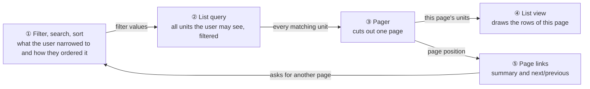
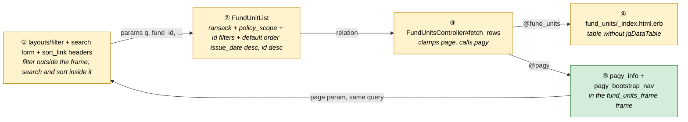
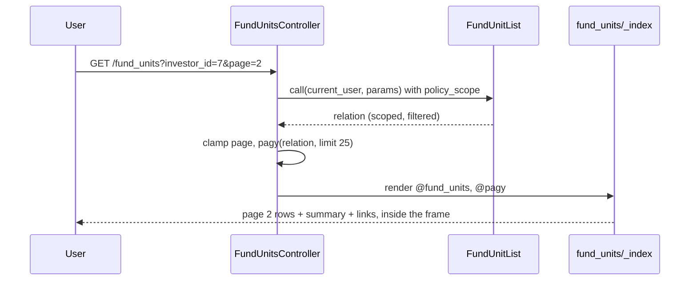
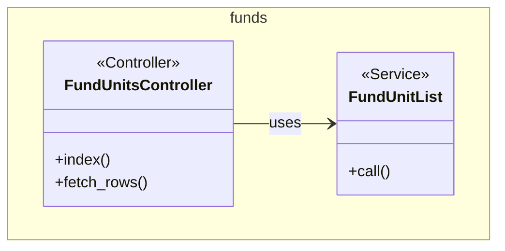

# Fund Units Pagination — Design

> **Audience:** Engineering team.
> **Companion documents:** [Proposal](proposal.md) · [Spec](specs/)

> **Planning phase — no code changes.** This document explains HOW the proposal will be built.
> Do not edit application code while writing it; implementation happens later, in the tasks phase.

> **Design, not code.** Explain the design with mermaid diagrams and tables. Do NOT paste Ruby/JS
> class bodies, migrations, route blocks or policy code. Put real class, method, table and path
> names inside the diagrams and tables instead.

> **Scale to the change.** This is a small, view-and-controller change with no schema work, so
> the parts below are short and several conditional sections are `N/A`.

---

## Contents

- [1. The idea](#1-the-idea)
  - [What this adds](#what-this-adds)
  - [The idea in one picture](#the-idea-in-one-picture)
  - [Walkthrough: one example, start to finish](#walkthrough-one-example-start-to-finish)
  - [Key ideas](#key-ideas)
- [2. The same picture with real names](#2-the-same-picture-with-real-names)
  - [Picture](#picture)
  - [What each box does](#what-each-box-does)
  - [One run, end to end](#one-run-end-to-end)
  - [Lifecycles](#lifecycles)
  - [What users see](#what-users-see)
  - [Design decisions](#design-decisions)
- [3. One card per box](#3-one-card-per-box)
  - [① Filter and ② List query](#①-filter-and-②-list-query)
  - [③ Pager](#③-pager)
  - [④ List view and ⑤ Page links](#④-list-view-and-⑤-page-links)
- [4. Reference](#4-reference)
  - [Class diagram](#class-diagram)
  - [Data model and schema changes](#data-model-and-schema-changes)
  - [Component contracts](#component-contracts)
  - [Cross-cutting concerns](#cross-cutting-concerns)
  - [Worked examples](#worked-examples)
  - [Testing](#testing)
  - [Risks and open questions](#risks-and-open-questions)

---

## 1. The idea

### What this adds

The Fund Units list asks the database for one page of rows instead of all of them, and shows a page summary and page links under the table. It follows the app's existing server-side paging approach (pagy, as in the KPI and access-rights lists, and in Fund Unit Settings), and removes the table's browser-side paging so there is a single set of page controls.

### The idea in one picture



### Walkthrough: one example, start to finish

**Setup.** Investor "Asha Rao" has 62 fund units across two funds. The Fund Units section sits on her investor screen. **Legend:** ① to ⑤ are the boxes in the picture above.

| #   | When                                             | What happens                                        | Behind the scenes                                                                           | Result                                              |
| --- | ------------------------------------------------ | --------------------------------------------------- | ------------------------------------------------------------------------------------------- | --------------------------------------------------- |
| 1   | Asha's screen opens                              | The Fund Units section loads in place               | The list query (②) finds 62 units; the pager (③) cuts units 1-25                            | Rows 1-25 shown, "Showing 1-25 of 62", links 1 2 3  |
| 2   | User clicks "2"                                  | Only that section changes                           | The page links (⑤) request page 2 with the investor filter kept; the pager (③) cuts 26-50   | Rows 26-50 shown, "Showing 26-50 of 62"             |
| 3   | User picks fund "Alpha" in the filter            | List narrows to 30 units, back to page 1            | The filter (①) sends no page value, so the pager (③) starts at 1                            | Rows 1-25 of 30, links 1 2                          |
| 4   | User bookmarked page 3, then narrows to 30 units | Page 3 no longer exists                             | The pager (③) clamps to the last valid page instead of failing                              | Rows 26-30 shown (page 2)                           |
| 5   | User clicks Download                             | Excel with all 62 units                             | The download request is marked "all", so the pager (③) is skipped                           | One file with 62 rows                               |
| 6   | User types a folio in Search                     | Page 1 of that folio's units, counted across all 62 | The search form (①) sends `search`; the list query (②) applies it before the pager (③)      | Rows 1-N of the matches, page links keep the search |
| 7   | User clicks the Quantity header                  | All matches sorted by quantity, page 1              | The `sort_link` (①) sends `q[s]`; the list query (②) orders everything before the pager (③) | Lowest quantities of the whole list first           |

```
  Showing 26-50 of 62            < 1 [2] 3 >
```

**What to notice**

- Access rules and filters are applied before the page is cut, so paging never changes what a user may see.
- A request marked "all" (the download) bypasses the pager entirely.
- A page number that no longer exists is clamped, not an error.
- Page links reuse the current filters because they are built from the current request.

### Key ideas

| #   | Idea                 | In one line                                                 | Card                                     |
| --- | -------------------- | ----------------------------------------------------------- | ---------------------------------------- |
| 1   | Page after filtering | Scope, filters, then pager, in that order                   | [① and ②](#①-filter-and-②-list-query)    |
| 2   | Clamp bad pages      | An out-of-range page shows the nearest valid page           | [③](#③-pager)                            |
| 3   | One pager            | Remove the browser table paging when server paging is added | [④ and ⑤](#④-list-view-and-⑤-page-links) |
| 4   | Frame-targeted links | Page links update only the Fund Units section               | [④ and ⑤](#④-list-view-and-⑤-page-links) |

**FAQ**

| Question                                           | Answer                                                              |
| -------------------------------------------------- | ------------------------------------------------------------------- |
| Does paging change what a user can see?            | No. `policy_scope` and the filters run first.                       |
| Why not keep the browser paging and just cap rows? | The cost is loading and drawing every row; capping would hide data. |

---

## 2. The same picture with real names

### Picture



Colour = footprint: **green** new, **amber** modified, **grey** reused unchanged. Exact files are listed in the tasks phase.

### What each box does

| #   | Box                  | Real parts                                                                           | What it does                                                             | When it runs              | What it decides                       | Details                               |
| --- | -------------------- | ------------------------------------------------------------------------------------ | ------------------------------------------------------------------------ | ------------------------- | ------------------------------------- | ------------------------------------- |
| ①   | Filter, search, sort | `layouts/filter` partial, search form and `sort_link` headers in `fund_units/_index` | Submits filters, a search term, or a sort                                | On submit or header click | Nothing about paging; sends no `page` | [card](#①-filter-and-②-list-query)    |
| ②   | List query           | `FundUnitList`                                                                       | Builds the scoped, filtered relation, latest issue date first by default | Each index request        | Which units are visible               | [card](#①-filter-and-②-list-query)    |
| ③   | Pager                | `FundUnitsController#fetch_rows`, `pagy`                                             | Clamps the page and cuts one page                                        | HTML index requests only  | Whether to paginate at all            | [card](#③-pager)                      |
| ④   | List view            | `fund_units/_index.html.erb`                                                         | Draws this page's rows                                                   | Each HTML render          | Hides pager when empty                | [card](#④-list-view-and-⑤-page-links) |
| ⑤   | Page links           | pagy nav helpers                                                                     | Summary and links inside the frame                                       | Each HTML render          | Frame target of the links             | [card](#④-list-view-and-⑤-page-links) |

### One run, end to end



### Lifecycles

N/A — no stored or derived status is added.

### What users see

| Where in CapHive                                                  | Today                                | After this change                                                      | Who sees it                        |
| ----------------------------------------------------------------- | ------------------------------------ | ---------------------------------------------------------------------- | ---------------------------------- |
| Fund Units list                                                   | All rows, browser paging and sorting | 25 rows, a Search box, sortable column headers, summary and page links | Everyone with access to Fund Units |
| Investor / commitment / remittance / distribution payment screens | Same, embedded                       | Same paging, in place                                                  | Same as today                      |

```
  Unit Type | Folio | Issue Date | Qty | ...
  ...rows of this page...
  (2) Showing 26-50 of 62      (3) < 1 [2] 3 >
```

| Step | The user…          | They see                          |
| ---- | ------------------ | --------------------------------- |
| 1    | Opens the list     | First 25 rows, summary ②, links ③ |
| 2    | Clicks a page link | Only the list area refreshes      |
| 3    | Changes a filter   | Page 1 of the new results         |

### Design decisions

1. **Server-side pagy, not browser paging.** Alternative: keep `jqDataTable` and cap rows. Rejected: it still loads all rows, and capping hides data.
2. **Hand-built pager markup, not `RansackTable`.** Alternative: move the table to `RansackTable`, which brings the pager and sorting. Rejected (search and header sort links are added by hand instead): it would require rebuilding the `cols: all` columns and custom row partial; not worth it for this change.
3. **Drop `jqDataTable`.** Alternative: keep it with its paging off. Rejected: its search and sorting only see the rows on the visible page. The import upload page used to render the partial with a plain list; it now loads the index action in a lazy `fund_units_frame` like the other models there, so the partial is always server-paged.
4. **Clamp out-of-range pages ourselves.** Pagy 9.4 raises on a page outside range and the overflow extra is not enabled. Follows `ReportBuilderController` and `AccountEntryPivot`.
5. **Search as its own `search` param, not a ransack condition.** The filter panel renders every `q` condition as an editable row, so a combined search predicate in `q` would show up there as a confusing filter. `FundUnitList` turns `params[:search]` into a ransack `_or_..._cont` predicate on a second ransack object and merges its result. Alternative: put it under `q`. Rejected: leaks into the filter panel.
6. **Sorting with ransack `sort_link`.** Already used in the app (investments, ai_rules); it sorts the whole relation, so paging and sorting compose. Alternative: client-side sorting. Rejected: only covers the visible page.
7. **Drop `data-controller="datatable"`.** It only initialises `.jqDataTable` tables, which the list no longer has, and the row action is a plain link with no dropdowns or tooltips.
8. **Paginate HTML only.** json and xlsx keep returning all matching units so existing consumers and the download are unchanged.

**FAQ**

| Question                                        | Answer                                                                                        |
| ----------------------------------------------- | --------------------------------------------------------------------------------------------- |
| Why not turn on pagy's overflow extra globally? | It would change behaviour of every list in the app.                                           |
| Why 25?                                         | Units lists are usually longer than settings lists (10). It is a constant and easy to change. |

---

## 3. One card per box

> Same order and numbers as the picture.

### ① Filter and ② List query

The filter panel is unchanged. It is rendered outside the turbo frame ([index.html.erb](../../../app/packs/funds/funds/views/fund_units/index.html.erb)) and submits `q[...]` and id params without `page`. `FundUnitList` applies the policy scope and the id filters as before and gains a default order of `issue_date desc, id desc`, applied only when the user has not chosen a sort. `id` breaks ties between units with the same issue date, so paging is stable.

| Owns                     | Reads / receives                        | Produces        |
| ------------------------ | --------------------------------------- | --------------- |
| Visibility and filtering | `params[:q]`, id params, `current_user` | Scoped relation |

**Worked examples:** H3, H6, H7, H8, E3, E7.

**FAQ**

| Question                                            | Answer                                                                                                                   |
| --------------------------------------------------- | ------------------------------------------------------------------------------------------------------------------------ |
| Does `FundUnitList` need to change?                 | Only for ordering: default `issue_date desc, id desc` when no sort is given. Paging itself is applied in the controller. |
| Why order in `FundUnitList` and not the controller? | Every caller (index, xlsx, json) gets the same order, and the pager relies on a stable order.                            |
| Does the `includes` still help?                     | Yes, it preloads for the 25 rows that remain.                                                                            |

### ③ Pager

Cuts one page from the relation. Applies only to HTML requests that are not marked `all`.

| Owns                    | Reads / receives                                                               | Produces                       |
| ----------------------- | ------------------------------------------------------------------------------ | ------------------------------ |
| Page clamping and limit | Relation, `params[:page]`, `params[:per_page]`, `params[:all]`, request format | `@pagy`, page of `@fund_units` |

| Condition                                   | Behaviour                    |
| ------------------------------------------- | ---------------------------- |
| `params[:all]` present, or format json/xlsx | No paging; `@pagy` is nil    |
| `page` missing, non-numeric or below 1      | Page 1                       |
| `page` above last page                      | Last page                    |
| `per_page` missing or not positive          | 25                           |
| Zero matching rows                          | One empty page, pager hidden |

**Worked examples:** H1, H2, H4, E1, E2, E3, X1.

**FAQ**

| Question              | Answer                                                                               |
| --------------------- | ------------------------------------------------------------------------------------ |
| Why a count query?    | Pagy needs the total for the summary. It is a single `COUNT` on the scoped relation. |
| Is `per_page` capped? | Yes, at 500.                                                                         |

### ④ List view and ⑤ Page links

The table loses the `jqDataTable` class. Below it, when at least one unit matches, the view renders the summary and nav, with `data-turbo-frame` set to `with_frame("fund_units_frame")` so links update only the section. Same markup pattern as `kpis/_index` and the retired `RansackTable` nav.

| Owns                            | Reads / receives                 | Produces      |
| ------------------------------- | -------------------------------- | ------------- |
| Table rows, summary, page links | `@fund_units`, `@pagy`, frame id | Rendered list |

| Verb and path                   | Action  | Does               | Responds with                            |
| ------------------------------- | ------- | ------------------ | ---------------------------------------- |
| GET `/fund_units?page=N&...`    | `index` | Pages the list     | HTML inside the `fund_units_frame` frame |
| GET `/fund_units.xlsx?all=true` | `index` | Exports everything | xlsx                                     |

**Build notes**

- The embedded sections on investor, commitment, remittance and distribution-payment screens use the frame id `fund_units_frame` with `src: fund_units_path(...)`; the nav links reuse the current request's params, so the embed's id filters carry across pages.
- Check `with_frame` for report and widget pages, which suffix the frame id.
- The search form lives inside the frame so it also appears on the embedded screens. It is a GET form targeted at the frame; hidden fields carry the current query (filters, `cols`, id filters) but not `page` or `search`.
- Header links come from `sort_link(@q, :column)` with `data-turbo-frame` set from `with_frame`, and must drop `page`.
- The partial no longer has a client-side fallback: the import upload page loads the index action (`import_upload_id` is already an accepted filter), so it pages, searches and sorts on the server (decisions 3 and 7).

**Worked examples:** H1, H2, H5, H7, H8, E4, E5, E6, E7, E8.

**FAQ**

| Question                                                  | Answer                                            |
| --------------------------------------------------------- | ------------------------------------------------- |
| What if the list is embedded in two places on one screen? | Frame id is shared today; verified as part of H5. |
| What about `cols=all`?                                    | Unrelated to paging; preserved through the links. |

---

## 4. Reference

### Class diagram



`FundUnitsController#fetch_rows` changes (paging) and `FundUnitList#call` changes (default order).

### Data model and schema changes

N/A — no tables or columns change.

### Component contracts

| From → To | Contract                                             | Direction rule                           |
| --------- | ---------------------------------------------------- | ---------------------------------------- |
| ① → ②     | ransack `q` and id params                            | Filter never sends `page`                |
| ② → ③     | An unloaded `ActiveRecord::Relation`, already scoped | Pager must not load the relation first   |
| ③ → ④     | `@fund_units` (one page)                             | View never re-queries                    |
| ③ → ⑤     | `@pagy`                                              | nil means no pager                       |
| ⑤ → ①     | `page` plus the current query string                 | Links are built from the current request |

### Cross-cutting concerns

#### Transactions and queries

One `COUNT` plus one `LIMIT/OFFSET` select on the scoped relation. `includes(:fund, capital_commitment: :investor_kyc)` keeps the row render free of N+1 for the page.

#### Exception handling and monitoring

N/A — out-of-range pages are clamped, so no new failure mode is alerted.

#### Performance and security

- Rows loaded and rendered fall from all matching units to at most 25.
- `policy_scope` is applied before paging, so tenant isolation by `entity_id` is unchanged. Page links carry only the same params the user already sent.

### Worked examples

**ID legend:** **H** = Happy path · **E** = Edge case · **X** = Error (exception) case.
Spec scenario names below are provisional until the specs artifact is written; keep them in sync.

**Shared setup:**

| Record      | Name         | Key data                             |
| ----------- | ------------ | ------------------------------------ |
| Entity user | Fund manager | Can see all fund units of the entity |
| Fund        | Alpha        | 30 units                             |
| Fund        | Beta         | 32 units                             |
| Investor    | Asha Rao     | Owns all 62 units across both funds  |

#### Happy Path

| #   | Scenario                     | Given                                                                     | When                                                | Then                                            | Spec scenario                  | Feature                                    |
| --- | ---------------------------- | ------------------------------------------------------------------------- | --------------------------------------------------- | ----------------------------------------------- | ------------------------------ | ------------------------------------------ |
| H1  | First page                   | 62 units                                                                  | Open Fund Units                                     | 25 rows, "Showing 1-25 of 62", page links       | Default page shows 25          | features/fund/fund_unit_pagination.feature |
| H2  | Next page                    | 62 units                                                                  | Click page 2                                        | Rows 26-50, summary updated                     | Page links move between pages  | features/fund/fund_unit_pagination.feature |
| H3  | Filter keeps working         | Alpha 30, Beta 32                                                         | Filter by fund Alpha                                | 25 rows of 30, page 1                           | Filters apply before paging    | features/fund/fund_unit_pagination.feature |
| H4  | Download exports all         | 62 units                                                                  | Request xlsx with all                               | 62 data rows                                    | Download is not paginated      | features/fund/fund_unit_pagination.feature |
| H7  | Search spans all pages       | 63 units; one old unit with reason "Needle in haystack" falls past page 2 | Search that text                                    | Page 1 with exactly that unit                   | Search finds units on any page | features/fund/fund_unit_pagination.feature |
| H8  | Sort spans all pages         | 62 units with distinct quantities                                         | Click the Quantity header                           | Page 1 holds the 25 lowest quantities of all 62 | Sort covers every page         | features/fund/fund_unit_pagination.feature |
| H5  | Embedded list pages in place | Investor with 62 units                                                    | Click page 2 inside the investor Fund Units section | Only that section changes                       | Embedded list pages in place   | features/fund/fund_unit_pagination.feature |
| H6  | Latest issue date first      | Units issued 01/04/2025 (A), 01/07/2025 (B), 01/10/2025 (C)               | Open list                                           | C, B, A shown top to bottom                     | Latest issue date first        | features/fund/fund_unit_pagination.feature |

#### Edge Cases

| #   | Scenario                               | Given                                      | When                                 | Then                                                     | Spec scenario                                | Feature                                    |
| --- | -------------------------------------- | ------------------------------------------ | ------------------------------------ | -------------------------------------------------------- | -------------------------------------------- | ------------------------------------------ | ----------------------------- | ------------------------------------------ |
| E1  | 25 or fewer units                      | 10 units                                   | Open list                            | All 10 rows, summary "Showing 10 of 10", no page links   | Summary without page links for a single page | features/fund/fund_unit_pagination.feature |
| E2  | No units                               | 0 units                                    | Open list                            | Empty table, no summary or links                         | No pager for an empty list                   | features/fund/fund_unit_pagination.feature |
| E3  | Filter shrinks the list                | On page 3 of 62                            | Filter to Alpha (30)                 | Page 1 shown                                             | Filter change returns to page 1              | features/fund/fund_unit_pagination.feature |
| E5  | Search with no match                   | 62 units                                   | Search text that matches none        | Empty table, no summary or links                         | Search with no match                         | features/fund/fund_unit_pagination.feature |
| E6  | Page links keep the search             | 30 units match a search                    | Click page 2                         | Rows 26-30, all matching                                 | Page links keep the search                   | features/fund/fund_unit_pagination.feature |
| E7  | Sort keeps search and resets to page 1 | Search active, on page 2                   | Click a header                       | Page 1 of the matches sorted by it, search still applied |
| E8  | Embedded list searches in place        | Investor screen with 35 units, 30 matching | Search inside the Fund Units section | Only that section changes, 25 matching rows              | Embedded list pages in place                 | features/fund/fund_unit_pagination.feature | Sort keeps search and filters | features/fund/fund_unit_pagination.feature |
| E4  | Link keeps filters                     | Alpha filter, 30 units                     | Click page 2                         | Rows 26-30 of 30, Alpha only                             | Page links keep filters                      | features/fund/fund_unit_pagination.feature |

#### Error Cases

| #   | Scenario          | Given    | When           | Then (what the user sees, who is alerted)    | Spec scenario                     | Feature                                    |
| --- | ----------------- | -------- | -------------- | -------------------------------------------- | --------------------------------- | ------------------------------------------ |
| X1  | Out-of-range page | 30 units | Request page 9 | Last page (page 2), no error, nobody alerted | Out-of-range page shows last page | features/fund/fund_unit_pagination.feature |

### Testing

Cucumber only. New feature `features/fund/fund_unit_pagination.feature`; reuse the setup steps in `features/step_definitions/fund_unit.rb`, adding a step to create N units and one to assert the pager text. Existing `features/fund/fund_unit.feature` scenarios that assume every row is visible need a re-check.

### Risks and open questions

- Existing scenarios or the jQuery table assume all rows are present → re-run `features/fund/fund_unit.feature` and fund-unit step files after the change.
- Two pagers if `jqDataTable` is left in → removed in ④; covered by H1 asserting a single pager.
- Nav links navigate the whole page instead of the frame → `data-turbo-frame` set from `with_frame`; covered by H5.
- Out-of-range page raises in pagy → clamped in ③; covered by X1.

| #   | Open question     | Current thinking            | Status    |
| --- | ----------------- | --------------------------- | --------- |
| 1   | Default page size | 25                          | Confirmed |
| 2   | Cap on `per_page` | Clamp to 500                | Confirmed |
| 3   | Column sorting    | Included via `sort_link`    | Confirmed |
| 4   | Search columns    | Unit type, reason, folio id | Confirmed |

**FAQ**

| Question                    | Answer                               |
| --------------------------- | ------------------------------------ |
| Where do I start reviewing? | ③ Pager, then the markup in ④ and ⑤. |
