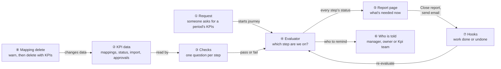
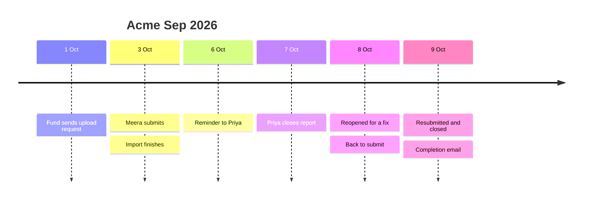
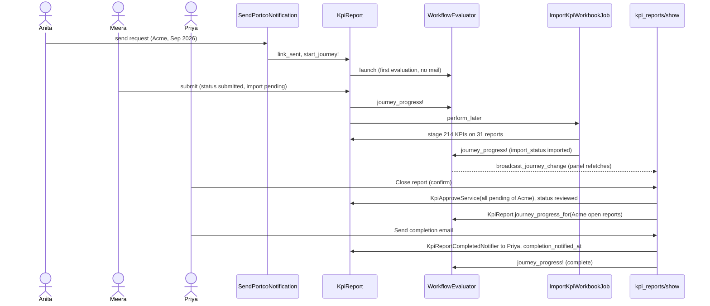
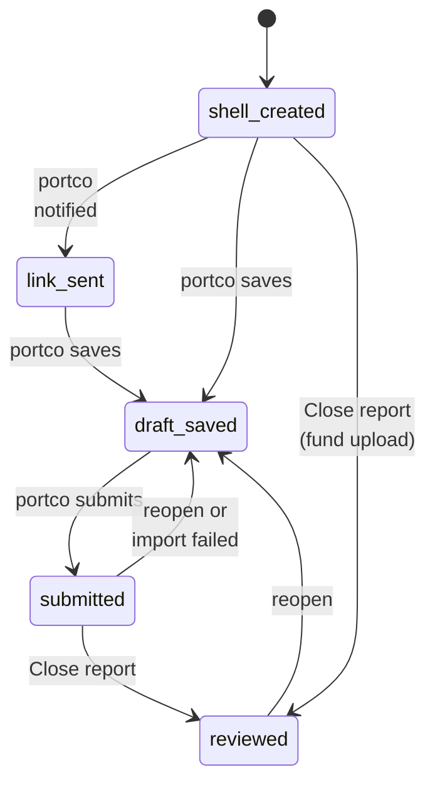
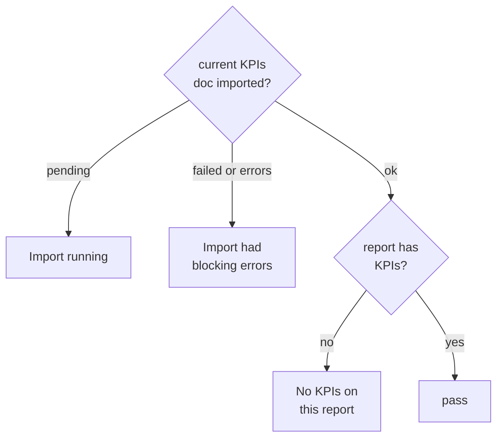
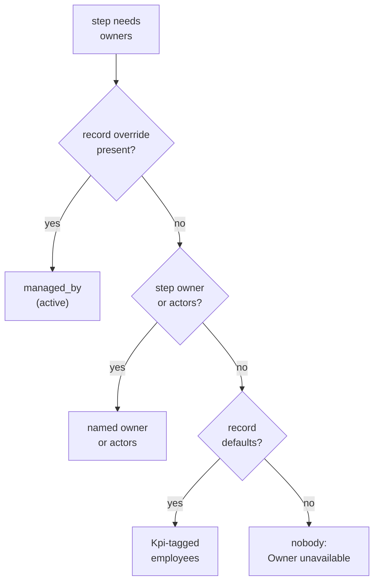
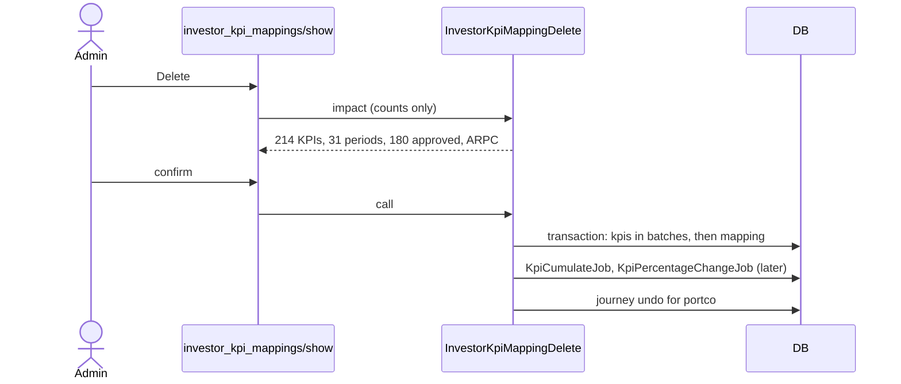
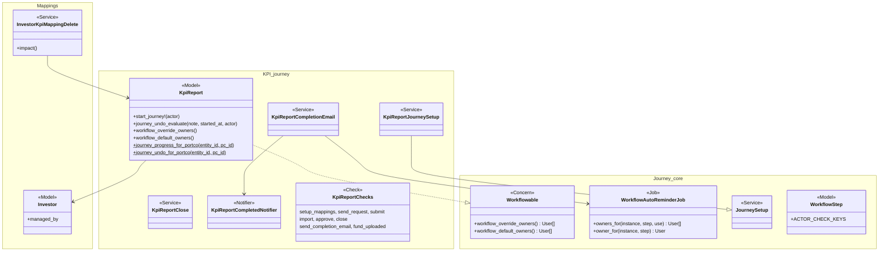
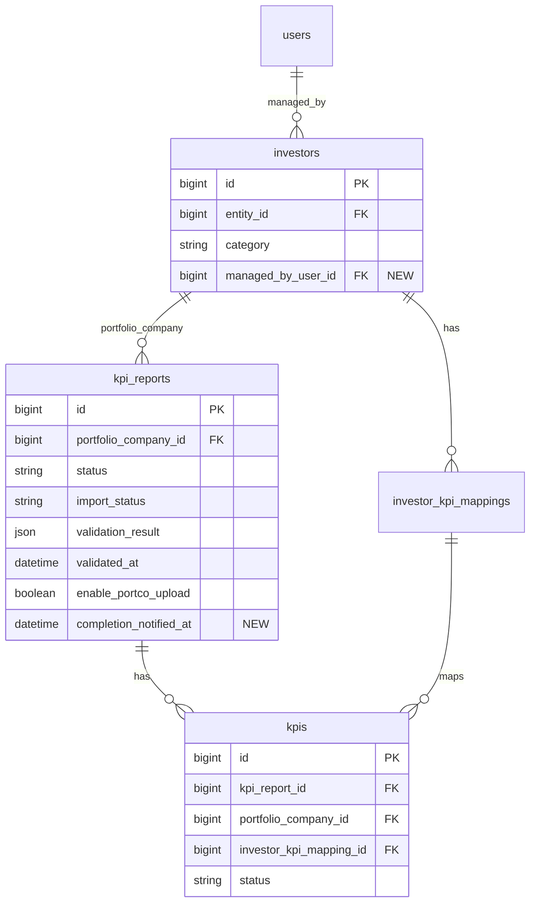

# KPI Report Journey — Design

> **Audience:** Engineering team.
> **Companion documents:** [Proposal](proposal.md) · [Spec](specs/) · [LLD](lld.md) · [QA checklist](qa-checklist.md)

> **Planning phase — no code changes.** This document explains HOW the proposal will be built.

> **Zoom one picture.** Part 1 draws the idea in plain words; Part 2 redraws the same picture with real
> names; Part 3 has one card per box; Part 4 is reference. ①②③ mean the same box everywhere.

---

## Contents

- [1. The idea](#1-the-idea)
  - [What this adds](#what-this-adds)
  - [The idea in one picture](#the-idea-in-one-picture)
  - [Walkthrough: one example, start to finish](#walkthrough-one-example-start-to-finish)
  - [Key ideas](#key-ideas)
- [2. The same picture with real names](#2-the-same-picture-with-real-names)
  - [Picture](#picture)
  - [What each box does](#what-each-box-does)
  - [One run, end to end](#one-run-end-to-end)
  - [Lifecycles](#lifecycles)
  - [What users see](#what-users-see)
  - [Design decisions](#design-decisions)
- [3. One card per box](#3-one-card-per-box)
  - [① Request](#①-request)
  - [② KPI data](#②-kpi-data)
  - [③ Checks](#③-checks)
  - [④ Evaluator](#④-evaluator)
  - [⑤ Report page](#⑤-report-page)
  - [⑥ Who is told](#⑥-who-is-told)
  - [⑦ Hooks: forward and back](#⑦-hooks-forward-and-back)
  - [⑧ Mapping delete](#⑧-mapping-delete)
- [4. Reference](#4-reference)
  - [Class diagram](#class-diagram)
  - [Data model and schema changes](#data-model-and-schema-changes)
  - [Component contracts](#component-contracts)
  - [Cross-cutting concerns](#cross-cutting-concerns)
  - [Worked examples](#worked-examples)
  - [Testing](#testing)
  - [Risks and open questions](#risks-and-open-questions)

---

## 1. The idea

### What this adds

A fourth journey kind, `kpi_report`, built exactly like the capital call, distribution and investor KYC
journeys: a seeded template of data checks, evaluated by the existing `WorkflowEvaluator`, shown on the
KPI report page in the shared journey panel. Two things are new to journeys: the journey starts only on
**requested** reports (never on the many reports an import creates as a by-product), and step owners can
come **from the record** (the portfolio company's *Managed by*) and be **several people** (everyone tagged
Kpi). Two KPI fixes ride along: a **Close report** button for the orphaned `mark_reviewed` action, and a
warned delete for KPI mappings in use.

### The idea in one picture



### Walkthrough: one example, start to finish

**Setup.** Kaveri Ventures (a fund) tracks **Acme Pvt Ltd**. Acme's *Managed by* is **Priya**. KPI
journeys are set up, and the admin added **Send completion email** to the template with **Rahul** as
actor. Acme has 40 KPI mappings. Acme's portco user is **Meera**.

**Legend:** ✓ done · **●** we are here: waiting on this, not done yet · ○ later · n/a not applicable ·
↺ moved back.



**Phase 1 — asking and submitting**

| # | When | What happens | Behind the scenes | Result&nbsp;&nbsp;&nbsp;&nbsp;&nbsp;&nbsp;&nbsp;&nbsp;&nbsp;&nbsp;&nbsp;&nbsp;&nbsp;&nbsp; |
|---|---|---|---|---|
| 1 | 1 Oct | Anita sends Acme a KPI request for Sep 2026 | The request (①) creates the report and starts its journey; the evaluator (④) asks the checks (③) | ✓&nbsp;Set&nbsp;up&nbsp;KPI&nbsp;mappings<br>✓&nbsp;Send&nbsp;upload&nbsp;request<br>**●&nbsp;Submit&nbsp;KPIs**<br>○&nbsp;Import&nbsp;workbook<br>○&nbsp;Approve&nbsp;or&nbsp;reject&nbsp;KPIs<br>○&nbsp;Close&nbsp;report<br>○&nbsp;Send&nbsp;completion&nbsp;email |
| 2 | 3 Oct 10:00 | Meera uploads a workbook with 31 periods and submits | The submit hook (⑦) re-evaluates; import is pending | ✓&nbsp;Set&nbsp;up&nbsp;KPI&nbsp;mappings<br>✓&nbsp;Send&nbsp;upload&nbsp;request<br>✓&nbsp;Submit&nbsp;KPIs<br>**●&nbsp;Import&nbsp;workbook**&nbsp;("Import running")<br>○&nbsp;Approve&nbsp;or&nbsp;reject&nbsp;KPIs<br>○&nbsp;Close&nbsp;report<br>○&nbsp;Send&nbsp;completion&nbsp;email |
| 3 | 3 Oct 10:02 | The import creates 30 more reports (other months, YTD, Budget) and stages 214 KPIs | The 30 by-product reports get **no** journey (①). The import job's hook (⑦) re-evaluates Sep 2026; Priya's open page updates live (⑤) | ✓&nbsp;Set&nbsp;up&nbsp;KPI&nbsp;mappings<br>✓&nbsp;Send&nbsp;upload&nbsp;request<br>✓&nbsp;Submit&nbsp;KPIs<br>✓&nbsp;Import&nbsp;workbook<br>**●&nbsp;Approve&nbsp;or&nbsp;reject&nbsp;KPIs**&nbsp;("214 KPIs across 31 periods await a decision")<br>○&nbsp;Close&nbsp;report<br>○&nbsp;Send&nbsp;completion&nbsp;email |

**Phase 2 — a stall, then closing**

| # | When | What happens | Behind the scenes | Result |
|---|---|---|---|---|
| 4 | 6 Oct 00:30 | Nobody has looked for 3 days (2-day interval) | The reminder job asks who is told (⑥): Acme has *Managed by* Priya, so only Priya is reminded, even though the template owner is Rahul | Same as row 3 |
| 5 | 7 Oct | Priya rejects 4 wrong KPIs on the grid, then clicks **Close report** and confirms "Approve 210 KPIs across 31 periods" | Close report (⑤) approves all of Acme's pending KPIs and marks Sep 2026 reviewed; the hook (⑦) re-evaluates | ✓&nbsp;Set&nbsp;up&nbsp;KPI&nbsp;mappings<br>✓&nbsp;Send&nbsp;upload&nbsp;request<br>✓&nbsp;Submit&nbsp;KPIs<br>✓&nbsp;Import&nbsp;workbook<br>✓&nbsp;Approve&nbsp;or&nbsp;reject&nbsp;KPIs<br>✓&nbsp;Close&nbsp;report<br>**●&nbsp;Send&nbsp;completion&nbsp;email** |

**Phase 3 — an undo, then the email**

| # | When | What happens | Behind the scenes | Result |
|---|---|---|---|---|
| 6 | 8 Oct | Meera reports a wrong figure; Anita clicks **Reopen & ask to re-upload** | `reopen_for_portco!` runs inside a journey undo (⑦): status `draft_saved`, the link is re-sent; the evaluator (④) records the move back | ✓&nbsp;Set&nbsp;up&nbsp;KPI&nbsp;mappings<br>✓&nbsp;Send&nbsp;upload&nbsp;request<br>↺&nbsp;**●&nbsp;Submit&nbsp;KPIs**<br>○&nbsp;Import&nbsp;workbook<br>○&nbsp;Approve&nbsp;or&nbsp;reject&nbsp;KPIs<br>○&nbsp;Close&nbsp;report<br>○&nbsp;Send&nbsp;completion&nbsp;email |
| 7 | 9 Oct | Meera resubmits; the import stages 12 changed values; Priya clicks **Close report** again | As rows 2, 3 and 5 | ✓ all six<br>**●&nbsp;Send&nbsp;completion&nbsp;email** |
| 8 | 9 Oct | Priya clicks **Send completion email** in the panel | The panel button clicks the real button (⑤); recipients come from who is told (⑥): Priya (manager wins over Rahul, the step actor). The sent time is stored; the hook (⑦) re-evaluates | ✓&nbsp;every&nbsp;step — journey complete |

**The key moment (row 3) on Priya's screen:**

```
┌───────────────────────────────────────────────────────────────────────────┐
│ Acme Pvt Ltd - 30/09/2026                        [Edit] [Close report]    │
│ ✓ Set up KPI mappings ✓ Send upload request ✓ Submit KPIs                 │
│ ✓ Import workbook ● Approve or reject KPIs ○ Close report ○ Send email    │
│ What's needed now — Approve or reject KPIs              Owner: Priya S.   │
│ 214 KPIs across 31 periods await a decision     [Review pending KPIs]     │
└───────────────────────────────────────────────────────────────────────────┘
```

**What to notice**

- Only Sep 2026 has a journey; the 30 reports the import made do not (Decision 1).
- "Approve or reject KPIs" counts the whole portco's pending KPIs, not just Sep 2026's (Decision 4).
- Priya, the portco's manager, beats the template's owner and actor (Decision 6).
- A correction goes through Reopen, which is an undo: the journey moves back and the email can be sent again (card ⑦).
- The completion email is a button; the journey never sends mail by itself (Decision 7).

### Key ideas

| # | Idea | In one line | Card |
|---|---|---|---|
| 1 | Explicit start | Only request entry points start a journey; KPI reports never auto-assign on create or update | [①](#①-request) |
| 2 | Portco-wide approval | Pending KPIs are counted per portfolio company, matching **Approve all** | [③](#③-checks) |
| 3 | Owners from the record | *Managed by* → template owner → Kpi-tagged employees; owners are a list | [⑥](#⑥-who-is-told) |
| 4 | Data says "closed" | Close report = status `reviewed`; only Reopen takes it back | [⑦](#⑦-hooks-forward-and-back) |
| 5 | Email by button | `completion_notified_at` is the evidence; undos clear it | [⑤](#⑤-report-page) |

**FAQ**

| Question | Answer |
|---|---|
| Does anything block users? | No. Journeys are advisory; every KPI button works as today. |
| Why the report and not the portfolio company? | The work is per period. A company-level workflow can't say "Sep is done, Dec is waiting". |
| Why not auto-assign on create, like the other journeys? | By-product reports are created by the same `KpiReport` model in the same way; only the caller knows it is a request (Decision 1). |
| What do portco users see? | Nothing new. The panel is for fund users with access to the report. |

---

## 2. The same picture with real names

### Picture

```mermaid
flowchart LR
    classDef new fill:#d4edda,stroke:#2e7d32,color:#000
    classDef mod fill:#fff3cd,stroke:#b8860b,color:#000
    classDef reuse fill:#eceff1,stroke:#90a4ae,color:#000
    R["① KpiReport#start_journey!<br/>KpiReportsController#create, KpiReportCreateShell,<br/>SendPortcoNotification, ImportKpiWorkbookJob<br/><i>starts a journey on a requested report</i>"]:::mod
    D["② kpi_reports, kpis,<br/>investor_kpi_mappings, investors.managed_by_user_id<br/><i>what has actually happened</i>"]:::mod
    C["③ WorkflowChecks::KpiReport::*<br/><i>one data rule per step</i>"]:::new
    E["④ WorkflowEvaluator<br/><i>works out the current step</i>"]:::reuse
    P["⑤ kpi_reports/show + _journey<br/>mark_reviewed, send_completion_email<br/><i>panel and the two buttons</i>"]:::mod
    W["⑥ WorkflowAutoReminderJob.owners_for<br/>KpiReport#workflow_override_owners<br/><i>resolves who is told</i>"]:::mod
    H["⑦ journey_progress! / journey_undo<br/>in KPI jobs and controllers<br/><i>tells the evaluator</i>"]:::mod
    M["⑧ InvestorKpiMappingDelete<br/><i>warned delete with KPIs</i>"]:::new
    R -- "WorkflowAutoAssignmentService" --> E
    D -- "count / exists? SQL" --> C
    C -- "WorkflowChecks::Result" --> E
    H -- "WorkflowEvaluator.call" --> E
    M -- "delete KPIs, mapping" --> D
    E -- "step_results, broadcast" --> P
    E -- "owner_mail" --> W
    P -- "PATCH mark_reviewed,<br/>send_completion_email" --> H
    click R "#①-request" "Open card ①"
    click D "#②-kpi-data" "Open card ②"
    click C "#③-checks" "Open card ③"
    click E "#④-evaluator" "Open card ④"
    click P "#⑤-report-page" "Open card ⑤"
    click W "#⑥-who-is-told" "Open card ⑥"
    click H "#⑦-hooks-forward-and-back" "Open card ⑦"
    click M "#⑧-mapping-delete" "Open card ⑧"
```



Colour = footprint: **green** new, **amber** modified, **grey** reused unchanged. Exact files are in
[lld.md File Map](lld.md#file-map).

### What each box does

| # | Box | Real parts | What it does | When it runs | What it decides | Details |
|---|---|---|---|---|---|---|
| ① | Request | `KpiReport#start_journey!`, its 4 callers | Runs the auto-assignment rules for one report | Request create, notification send, workbook import on that report | Whether this report is a request | [card ①](#①-request) |
| ② | KPI data | `kpi_reports`, `kpis`, `investor_kpi_mappings`, `investors.managed_by_user_id`, `kpi_reports.completion_notified_at` | Holds the evidence | — | — | [card ②](#②-kpi-data) |
| ③ | Checks | 6 step checks + 1 skip + optional completion check | Answers "is this step done?" from SQL | Every evaluation | Pass / fail / n/a and the panel text | [card ③](#③-checks) |
| ④ | Evaluator | `WorkflowEvaluator`, `WorkflowEvaluateJob` (15-min tick) | Walks the steps, records moves, broadcasts | On hooks and every 15 min | The current step | [card ④](#④-evaluator) |
| ⑤ | Report page | `kpi_reports/show`, `kpi_reports/_journey`, `KpiReportsController#mark_reviewed` (Close report), `#send_completion_email`, `#journey` | Shows the panel; does Close report and the email | Page view / click | Which buttons show | [card ⑤](#⑤-report-page) |
| ⑥ | Who is told | `WorkflowAutoReminderJob.owners_for`, `Workflowable#workflow_override_owners` / `#workflow_default_owners`, `KpiReport` overrides, `KpiReportCompletedNotifier` | Resolves reminder owners and email recipients | Reminder run, step change, email click | Who gets mail | [card ⑥](#⑥-who-is-told) |
| ⑦ | Hooks | `journey_progress!`, `journey_progress_for`, `journey_undo` calls in KPI jobs/controllers | Tells the evaluator about work done or undone | After each KPI action | Forward vs undo | [card ⑦](#⑦-hooks-forward-and-back) |
| ⑧ | Mapping delete | `InvestorKpiMappingDelete`, `InvestorKpiMappingsController#destroy`, delete popup | Warns, then deletes KPIs and mapping | Admin clicks Delete | Popup or plain delete | [card ⑧](#⑧-mapping-delete) |

### One run, end to end



### Lifecycles

**Report status** (stored, `kpi_reports.status`). The only new transitions are the two in bold.



| Transition | Trigger | New? |
|---|---|---|
| `shell_created → reviewed` | **Close report** on a fund-uploaded report (no code path moves a fund upload off `shell_created`; the trial data in prod shows the same) | **New** (button is new; the action existed with no button) |
| others | unchanged | — |

**Journey step** (derived each evaluation, stored in `workflow_instances.step_results`): ○ later → ●
current → ✓ passed, or n/a; ✓ → ↺ on undo. Same as every journey.

**Completion email** (stored, `kpi_reports.completion_notified_at`): `nil → time` on click; `time → nil`
on any undo in [card ⑦](#⑦-hooks-forward-and-back).

### What users see

**At a glance**

| Where in CapHive | Today | After this change | Who sees it |
|---|---|---|---|
| KPI report page | Status and import badges only | Journey panel; **Close report**; **Send completion email** when current | Fund users with access |
| Portfolio company form | — | **Managed by** dropdown | Fund users who can edit investors |
| KPI mapping page | Delete → error page when in use | Delete → warning popup → deleted | Fund admins |
| Workflow Templates → Set up journeys | Capital call, distribution, KYC | + **KPI report journeys** | Fund admins |
| Step editor | Actors only for human steps | Actors also for the completion check | Fund admins |
| Email | — | "KPIs for Acme — Sep 2026 are complete"; reminders to the manager | Recipients |

**Main journey — Priya closes Acme's period**

```
┌───────────────────────────────────────────────────────────────────────────┐
│ Acme Pvt Ltd - 30/09/2026                     ①[Close report]  [Delete]   │
│ ✓ … ✓ Import workbook ● Approve or reject KPIs ○ Close report ○ Send email │
│ What's needed now — Approve or reject KPIs              Owner: Priya S.   │
│ 214 KPIs across 31 periods await a decision   ②[Review pending KPIs]      │
└───────────────────────────────────────────────────────────────────────────┘
```

| Step | The user… | They see |
|---|---|---|
| 1 | opens the reminder email link | the report page with the panel on "Approve or reject KPIs" |
| 2 | clicks ② | Acme's pending grid (`view_unapproved=true`), rejects 4 wrong values |
| 3 | clicks ① and confirms | the popup's two cards, then "Reviewed"; the panel moves to "Send completion email" |
| 4 | clicks **Send completion email** in the panel | the panel shows the journey complete |

### Design decisions

1. **Start the journey explicitly from request entry points** — `KpiReport` overrides
   `apply_workflow_auto_assignment` and `apply_workflow_auto_assignment_on_update` to do nothing, and
   `KpiReport#start_journey!` runs `WorkflowAutoAssignmentService` from the four request entry points.
   Alternative: a transient `skip_journey` flag set by the importers. Rejected: by-product reports are
   later updated through ordinary saves, and the update hook would then launch on them; and
   `SendPortcoNotificationJob` can turn an *existing* by-product report into a request (no create
   callback fires). Alternative: a persisted `requested` column. Rejected: an extra column for what
   four call sites already know. Rule matching still runs, so the D2C/fintech follow-up is just a rule.
2. **One template, skip checks for fund uploads** — the user asked for one workflow per entity. Skip
   check `fund_uploaded` (`enable_portco_upload = false`) makes steps 2–3 n/a. Alternative: Full/Light
   templates with two rules. Rejected per the user.
3. **Review merged into approval** — one system step; no acknowledge "Review KPIs". User choice.
4. **Approval counted per portfolio company** — the pending KPIs of an upload sit on many reports; the
   check counts `kpis` with `status = unapproved` for `(entity_id, portfolio_company_id)`, exactly the set
   `KpisController#approve_all` acts on. Alternative: per report. Rejected: 95% of staged values are on
   by-product reports — an import creates one report per period it finds (the trial data in prod: 898 reports with KPIs, 46 with a workbook).
5. **"Closed" is the status** — Close report sets `reviewed`; only Reopen & ask to re-upload takes it back
   (a new workbook is never uploaded on a reviewed report — corrections go through Reopen). Alternative: a
   `reviewed_at` column compared with the import time. Rejected: not needed for a flow that doesn't happen.
6. **Owners: record override → step owner → record defaults, as a list** — generic in `Workflowable` /
   `WorkflowAutoReminderJob`, default behaviour identical for existing journeys. Alternative: KPI-only
   reminder code. Rejected: duplicates the reminder job; the user also wants the same for other journeys.
7. **Completion email is a button, not engine mail** — `kpi_report.send_completion_email` passes on
   `completion_notified_at`; the button lives on the page (`action_target`). Alternative: a generic
   "notify" step kind sent by the evaluator. Rejected by the user (they want a person to decide).
8. **Managed by is a column, not a custom field** — `investors.managed_by_user_id`. Validated employee,
   survives email changes, rule-ready. Alternative: `json_fields["managed_by"]` with an email. Rejected
   with the user.
9. **Mapping delete deletes its KPIs** — popup then batched delete in one transaction. Alternative:
   refuse while in use. Rejected by the user; the in-flight `kpi-hard-delete-no-audit` change lists the
   friendly message as a follow-up, which this covers.
10. **Remove `launch_portfolio_company_workflow`** — no client uses it (KPIs in production are trial
    data; 0 Investor templates); the journey replaces it. Its demo seed scenario and feature steps go with it.

**FAQ**

| Question | Answer |
|---|---|
| Can the rules still pick a different template later? | Yes. `start_journey!` runs the normal rule matcher; a D2C rule only needs a rule field (follow-up). |
| Why not reuse `user_id` as the creator/owner? | It is overwritten with the portco user on every portco save, and shells stamp `entity.employees.first`. `KpiReport` has no audits. |
| Does the generic owner change affect capital calls? | No. With no override and the default `[creator]`, `owners_for` returns exactly what `owner_for` returned. |
| Why both Close report and a separate approve step? | Approving on the grid (row by row or Approve all) passes step 5 without closing; Close report is the deliberate "period done". |

---

## 3. One card per box

### ① Request

The only place a KPI report journey starts. `KpiReport#start_journey!(actor)` does nothing when the
report has no portfolio company, is not a "Portfolio Company" investor, or already has an assignment;
otherwise it calls `WorkflowAutoAssignmentService` (rule match + launch, first evaluation silent).

| Owns | Reads / receives | Produces |
|---|---|---|
| The "is this a request?" decision, by call site | A saved `KpiReport`, the acting user | A `WorkflowAssignment` + evaluated `WorkflowInstance` |

| Caller | Why it is a request |
|---|---|
| `KpiReportsController#create` | A fund user created this period on the New screen |
| `KpiReportCreateShell` (used by `GeneratePeriodicKpiReportsJob`) | A shell is a request for a portco upload. Built change: it now records `status: link_sent` / `link_sent_at` when it emails the link (it emailed without recording it before), so **Send upload request** reads true data |
| `SendPortcoNotification` | Asking a portco for a period, including an existing by-product report |
| `ImportKpiWorkbookJob` — for its own `kpi_report` only | A workbook was uploaded on this report; siblings it creates are not started |

**Never callers:** `KpiWorkbookReader#find_or_create_kpi_report`, `KpiCumulative` roll-ups, `ImportKpi`.

**No rollout onto existing reports.** Setup only seeds the template and rule; existing reports get no
journey (KPIs hold only trial data in production), exactly as other journeys behave.

**Worked examples:** H1, H3, E1, E2, E3, E4, E18

**FAQ**

| Question | Answer |
|---|---|
| What if a request is made twice? | `start_journey!` is a no-op once an assignment exists; the launch service also refuses a second active instance. |
| Re-uploading on an old by-product report starts a journey — intended? | Yes: someone deliberately uploaded on it, so it is now "the report uploaded on". |
| Why is `start_journey!` called after save, not in a callback? | Callbacks can't tell request from by-product (Decision 1). |

### ② KPI data

The evidence. Two new columns (see [schema](#data-model-and-schema-changes)): `investors.managed_by_user_id`
and `kpi_reports.completion_notified_at`. Everything else is existing data.

| Owns | Reads / receives | Produces |
|---|---|---|
| Columns read by checks | Writes from KPI services | — |

| Step | Evidence |
|---|---|
| Set up KPI mappings | `investor_kpi_mappings` for the portco, `autofill` not `compute` |
| Send upload request | `link_sent_at` or `status` past `link_sent` |
| Submit KPIs | `status IN (submitted, reviewed)` |
| Import workbook | `import_status` (`pending`/`failed`/`imported`), `validation_result.source` in (`import`, `document`) with `document_id` = the current "KPIs" document (the edit page's re-check of the same document can overwrite the job's verdict — found by the end-to-end feature), `validation_result.ok`, the current "KPIs" document's `created_at`, `kpis` exist on the report |
| Approve or reject KPIs | count of `kpis` `unapproved` for `(entity_id, portfolio_company_id)` and distinct `kpi_report_id` |
| Close report | `status = reviewed` |
| Send completion email | `completion_notified_at` present |

**Worked examples:** H4, H9, E5

**FAQ**

| Question | Answer |
|---|---|
| Why not `import_status = imported` alone? | Only the portco-submit path sets it; fund uploads leave it NULL. The stored verdict covers both paths. |
| Why the document timestamp? | A new "KPIs" document replaces the old one; until its import writes a verdict, the step must say "Import running". |

### ③ Checks

Seven classes under `app/packs/startups/kpis/workflow_checks/kpi_report/`, registered in
`config/initializers/workflow_checks.rb`, `workflowable_type = "KpiReport"`, key prefix `kpi_report.`.
Read-only, SQL counts only.

| Owns | Reads / receives | Produces |
|---|---|---|
| Step rules and panel text | ② | `WorkflowChecks::Result` (pass/fail, message, `passed_since`, `action_*`) |

| Key | Pass | Fail message | Action |
|---|---|---|---|
| `kpi_report.setup_mappings` | ≥1 non-compute mapping | "No KPI mappings — imports will find nothing" | link "Open KPI mappings" → investor page, `tab: kpi-mappings-tab` |
| `kpi_report.send_request` | link sent / past it | "Upload link not sent to <portco> yet" | target `#kpi_report_send_request_btn` (sends for this report); falls back to the link → the portco's KPI grid |
| `kpi_report.submit` | submitted/reviewed | "Waiting for <portco> to submit" or "Import failed — reopened for the portco" | — |
| `kpi_report.import` | verdict ok for current document and ≥1 KPI | "Import running" · "Import had blocking errors" · "No KPIs on this report — they were rejected, or the workbook had no column for this period" | link "Edit report" |
| `kpi_report.approve` | 0 pending for the portco | "214 KPIs across 31 periods await a decision" | link "Review pending KPIs" → `kpi_reports_path(portfolio_company_id:, view_unapproved: true, grid_view: true, journey_report_id:)`, **new tab** (`Result.fail(new_tab: true)` → `action_new_tab`); the grid shows a banner back to the report |
| `kpi_report.close` | `reviewed` | "Not closed yet" | target `#kpi_report_close_btn` |
| `kpi_report.send_completion_email` | `completion_notified_at` | "Completion email not sent" | target `#kpi_report_send_completion_btn` |
| `kpi_report.fund_uploaded` (skip) | `enable_portco_upload = false` | — ("Uploaded by the fund") | — |



**Worked examples:** H4, H14, H15, E5, E6, E14

**FAQ**

| Question | Answer |
|---|---|
| Is `step_results` deterministic? | Yes: counts and fixed paths only; no random ransack keys. |
| Why is the approve count portco-wide on every open report of the portco? | It is the same pending set; approving it moves them all, which is why ⑦ calls `journey_progress_for` once for all of them. |
| Can the completion check be added to other journeys? | It is registered for `KpiReport` only. |

### ④ Evaluator

Reused unchanged except one line: `owner_mail` loops over `owners_for` instead of one `owner_for`. First
evaluations are silent; `journey_complete` and `review_needed` mails go to the resolved owners.

| Owns | Reads / receives | Produces |
|---|---|---|
| Current step, history, broadcasts | Snapshot, check results, hooks | `step_results`, `workflow_state_changes`, Turbo broadcast |

**Worked examples:** H9, E12, E13

**FAQ**

| Question | Answer |
|---|---|
| What about the 15-minute tick on a big portco? | Each check is a handful of indexed counts (`index_kpis_on_entity_pc_status_name`). |

### ⑤ Report page

`kpi_reports/show` renders `kpi_reports/_journey` (frame `kpi_report_journey`, noun "report") and
subscribes with `turbo_stream_from @kpi_report, :journey`. `KpiReportsController` includes
`WithJourneyPanel`.

| Owns | Reads / receives | Produces |
|---|---|---|
| Panel, Close report, Send completion email | `@journey`, report data | `PATCH` actions, flash |

| Verb and path | Action | Does | Responds with |
|---|---|---|---|
| `GET /kpi_reports/:id/journey` | `journey` | `render_journey_panel` | frame HTML |
| `PATCH /kpi_reports/:id/mark_reviewed` | `mark_reviewed` (button label: Close report) | `KpiReportClose`: all pending of the portco (a company's own report, without a portfolio company: only its own KPIs — found in review) → `KpiApproveService`; status `reviewed`; `journey_progress_for_portco` | redirect + notice |
| `PATCH /kpi_reports/:id/send_completion_email` | `send_completion_email` | `KpiReportCompletionEmail`: idempotent send, set `completion_notified_at`, `journey_progress!` | redirect + notice |

**Buttons (on the page, not only in the panel):**

| Button | id | Shown when | Confirm |
|---|---|---|---|
| Close report | `kpi_report_close_btn` | `mark_reviewed?` policy, report imported (import check data), not `reviewed` | action-summary popup: "Approve pending KPIs — N across M periods for Acme", "Mark reviewed — Sep 2026 is closed" |
| Send completion email | `kpi_report_send_completion_btn` | `update?` policy, `reviewed`, `completion_notified_at` nil, the live template has a `kpi_report.send_completion_email` step | popup card: "Email — Priya S." (resolved recipients) |

**Build notes.** Visibility uses report data, never the journey's state (journey state stays in the
panel, per the skill rule). `journey_action_controller.js` clicks the real button so its confirm runs.
The step editor (`workflow_steps/_form`) shows the Actors picker for `kpi_report.send_completion_email`
(a `ACTOR_CHECK_KEYS` list on `WorkflowStep`, generic).

**Worked examples:** H5, H8, E6, E10, E11, H9

**FAQ**

| Question | Answer |
|---|---|
| Why keep the `mark_reviewed` name? | The action exists with no button; reusing it avoids a second route. Only its scope (portco-wide) changes and a button is added. |
| Why can Close report run before the journey reaches it? | Advisory journeys never gate buttons; closing early simply passes both steps. |

### ⑥ Who is told

Generic owner resolution, with `KpiReport` supplying the record side.

| Owns | Reads / receives | Produces |
|---|---|---|
| Owner and recipient lists | step owner/actors (live template), record overrides/defaults | `[User]`, active only |



| Method | Default (all journeys) | `KpiReport` |
|---|---|---|
| `workflow_override_owners` | `[]` | `[portfolio_company.managed_by]` when set |
| `workflow_default_owners` | `[workflow_default_owner].compact` (creator) | active employees of `entity` tagged `Kpi` |
| `WorkflowAutoReminderJob.owners_for(instance, step, use: :owner \| :actors)` | override → step owner (or actors) → defaults, active only | same |
| `owner_for` | kept as `owners_for(...).first` for single-name displays | — |

Reminder job and `owner_mail` send one mail per owner. The panel shows "Owner: Priya S." or
"Owners: Anita R., Vikram K.". `KpiReportCompletedNotifier` (Noticed, `KpiReportsMailer#completed`) uses
`owners_for(use: :actors)`.

**Worked examples:** H6, H7, E7, E8, E9, E17, X1, X3

**FAQ**

| Question | Answer |
|---|---|
| A manager who left? | Inactive users are dropped before the next level is tried, so an inactive manager falls through to the step owner, then the Kpi team (X3). "Owner unavailable" shows only when every level is empty. |
| Why actors for the email but owner for reminders? | The email step's recipients are chosen in the step editor's Actors picker (user's request); reminders use the existing owner field. |

### ⑦ Hooks: forward and back

| Owns | Reads / receives | Produces |
|---|---|---|
| Every call into the evaluator from KPI code | KPI actions | `journey_progress!` / `journey_progress_for` / `journey_undo` |

| Where | Kind | Scope |
|---|---|---|
| `SendPortcoNotification#notify_users` | forward | report |
| `KpiReportsController#update` (submit) | forward | report |
| `ImportKpiWorkbookJob` end (imported) | forward | report + `journey_progress_for` portco's open reports |
| `KpiReport#reopen_after_failed_import!` | **undo** | report |
| `KpiReport#reopen_for_portco!` | **undo** | report |
| `KpisController#approve` / `#reject` / `#approve_all` | forward | `journey_progress_for` portco |
| `Kpi#unapprove!` (via `KpisController#unapprove`) | **undo** | portco's open reports |
| `KpiReportsController#update` with `delete_kpis` | **undo** | report |
| `mark_reviewed` (Close report), `send_completion_email` | forward | report / portco |
| Mapping create/import (`InvestorKpiMappingsController#create`, `ImportInvestorKpiMapping`) | forward | portco |
| `InvestorKpiMappingDelete` | **undo** | portco |

Every undo also clears `completion_notified_at` (inside the `KpiReport#journey_undo_evaluate` override, which every undo path ends in, calling
`super`). Portco-scope helpers live on `KpiReport`: `journey_progress_for_portco(entity_id, pc_id, actor:)` and `journey_undo_for_portco(entity_id, pc_id, note:, started_at:, actor:)`.

**Worked examples:** H9, H10, E12, E13, E16, X4

**FAQ**

| Question | Answer |
|---|---|
| A missed hook? | The 15-minute tick catches up; only live update is lost. |
| Why undo for unapprove across the portco? | The approve step is portco-wide; every open report's step 5 can move back. |

### ⑧ Mapping delete

`InvestorKpiMappingDelete` (Trailblazer op) and a popup on the mapping page.

| Owns | Reads / receives | Produces |
|---|---|---|
| Impact counts, the delete | mapping, its KPIs, sibling compute formulas, child mappings | popup data; refusal for parents; deletion; recompute jobs |



| Responsibility | Detail |
|---|---|
| Transaction | One transaction; `Kpi.where(investor_kpi_mapping_id:).in_batches(of: 1000).delete_all`, then `destroy!` |
| Failure | Rescue, rollback, flash "Could not delete Revenue — nothing was changed" |
| Formulas | Compute mappings of the same investor whose `compute_formula` contains the name (Ruby match over that small set) |
| Children | A mapping with children (`InvestorKpiMapping#children`) is refused before anything else: Delete button disabled with a tooltip, and the op returns Failure "Move or delete Enterprise, Retail first" (server-side guard too). User choice: refuse, not orphan or cascade |
| Popup | `confirm#popup` with action-summary cards (≤4) built by `InvestorKpiMappingsHelper#delete_action_summary` |

**Worked examples:** H11, H12, H13, E15, E16, X2, X5

**FAQ**

| Question | Answer |
|---|---|
| Why `delete_all`, skipping callbacks? | Per-KPI callbacks cascade RAG recomputes 214 times; one recompute job after is correct and cheap. |
| Big portco? | Batched; counts are `count`/`distinct count` in SQL. |

---

## 4. Reference

### Class diagram



### Data model and schema changes



**Indexes:** `index_investors_on_managed_by_user_id`; FK `investors.managed_by_user_id → users.id`
(nullify on user delete is not needed — users are not hard-deleted).

**Schema changes**

**`investors`** (changed): a portfolio company needs a named employee who owns its KPI follow-up.

| Column / index | What changed | Why it's needed |
|---|---|---|
| `managed_by_user_id` | Added: bigint, null, FK `users` | The per-portco owner for reminders and the completion email (Decision 8) |
| `index_investors_on_managed_by_user_id` | Added | FK index; lets a future rule/report filter portcos by manager |

**`kpi_reports`** (changed): the completion email needs evidence the check can read.

| Column / index | What changed | Why it's needed |
|---|---|---|
| `completion_notified_at` | Added: datetime, null | Passes `kpi_report.send_completion_email`; cleared by undos so it can be re-sent (Decision 7) |

**Changes to existing models:**

- `Investor`: `belongs_to :managed_by, class_name: "User", optional: true`; validation that it is an
  employee of `entity_id`; permitted in `InvestorsController` params; shown on the form for Portfolio
  Company investors.
- `KpiReport`: `include Workflowable`, `has_journey`; overrides above; `launch_portfolio_company_workflow`
  removed.
- `InvestorKpiMapping`: none (delete logic is in the service).
- `WorkflowStep`: `ACTOR_CHECK_KEYS` (actors offered for these non-human check keys).
- `JourneySetup`: `KINDS` gains `kpi_report`; sign-off seeding/backfill skipped when `SIGN_OFF_NAME` is
  nil.

### Component contracts

| From → To | Contract | Direction rule |
|---|---|---|
| ① → ④ | `WorkflowAutoAssignmentService.call(workflowable:)` via `start_journey!` | Only the four callers; never callbacks |
| ② → ③ | SQL `exists?` / `count` | Checks never write |
| ③ → ④ | `WorkflowChecks::Result` | Deterministic |
| ⑦ → ④ | `journey_progress!`, `journey_progress_for(ids)`, `journey_undo(note:, actor:)`, `KpiReport.journey_progress_for_portco` / `journey_undo_for_portco` | Never raise into the caller |
| ⑧ → ② | Transactional delete | Recompute jobs after commit |
| ④ → ⑤ | `broadcast_journey_change` (empty frame with `src`) | Never broadcast rendered HTML |
| ④ → ⑥ | `owners_for(instance, step)` | Active users only |
| ⑤ → ⑦ | `PATCH mark_reviewed`, `PATCH send_completion_email` | Policy-checked, entity-scoped |

### Cross-cutting concerns

#### Transactions and queries

- Close report: `KpiApproveService` per KPI is existing behaviour (one transaction per KPI); approval of
  hundreds runs inside the request as `approve_all` does today. Status update after; hooks after commit.
- Approve check: one grouped count `SELECT COUNT(*), COUNT(DISTINCT kpi_report_id) FROM kpis WHERE
  entity_id=? AND portfolio_company_id=? AND status='unapproved'` — covered by
  `index_kpis_on_entity_pc_status_name`.
- Mapping delete: one transaction, batched `delete_all`; recompute jobs enqueued after commit.
- Setup: one transaction per entity (existing `JourneySetup`).

#### Exception handling and monitoring

| Failure | Who is alerted | Detail |
|---|---|---|
| Check raises | Support via `ExceptionNotifier` (existing evaluator path) | Step shows "Could not check this step — support has been notified" |
| `start_journey!` fails | Logged, never raised (as `launch_portfolio_company_workflow` did) | The request itself succeeds |
| Completion email delivery | Noticed delivery log | Column set only after `deliver_later` is enqueued |
| Mapping delete fails | User flash | Transaction rolled back |

#### Performance and security

- Volume: KPIs are not yet live for clients; journeys exist only on requested reports (tens per
  quarter per fund once live). The tick cost is negligible.
- Tenant isolation: all counts filter `entity_id`; `managed_by` validated to the investor's entity;
  `mark_reviewed` / `send_completion_email` authorise through `KpiReportPolicy` (`mark_reviewed?`,
  `update?`); policy scope as today. Portco (magic-link) users never see the panel (`journey?` policy).

### Worked examples

**ID legend:** **H** = Happy path · **E** = Edge case · **X** = Error (exception) case.

**Shared setup:**

| Record | Name | Key data |
|---|---|---|
| Fund | Kaveri Ventures | Investment Fund; KPI report journeys set up |
| Employees | Priya, Rahul, Anita, Vikram | Anita and Vikram tagged `Kpi` |
| Portfolio company | Acme Pvt Ltd | 40 mappings (1 compute: ARPC = `Revenue/Cycles`); Managed by Priya |
| Portfolio company | Beta Foods | no Managed by |
| Portco user | Meera | Acme's KPI user |
| Report | Acme Sep 2026 | Quarter, Actual, `enable_portco_upload` true |
| Workbook | acme_kpis.xlsx | 31 periods, 214 KPIs |
| Template | KPI Report Review | 6 seeded steps; admin added "Send completion email" (actor Rahul); "Approve or reject KPIs" owner Rahul |

#### Happy Path

| # | Scenario | Given | When | Then | Spec scenario | Feature |
|---|---|---|---|---|---|---|
| H1 | Setup seeds | Kaveri has no KPI rule | setup runs (rake EXECUTE=1) | template with 6 steps + catch-all rule; flag on | Setup seeds the template and rule | kpi_report_journey_setup |
| H3 | One journey per upload | Acme Sep 2026 requested | acme_kpis.xlsx imported | Sep 2026 has a journey; 30 new reports none | Upload creates many reports, one journey | kpi_report_journey |
| H4 | Pending across periods | H3 done | evaluate | step 5 "214 KPIs across 31 periods await a decision", link to pending grid | Pending across periods | kpi_report_journey |
| H5 | Close report | H4 | Priya clicks Close report, confirms | 214 approved, `reviewed`, steps 5–6 pass | Close approves everything pending | kpi_report_journey_page |
| H6 | Pick a manager | Acme without manager | admin sets Managed by = Priya | saved, shown | Pick a manager | kpi_report_journey_owners |
| H7 | Manager wins | H4, 3 days stalled, interval 2 | reminder job | only Priya reminded (not Rahul) | Manager wins over template; Record override wins | kpi_report_journey_owners |
| H8 | Completion email | H5, completion step present | Priya clicks Send completion email | Priya emailed "KPIs for Acme — Sep 2026 are complete"; journey complete | Send the email | kpi_report_journey_page |
| H9 | Live update on import | page open on "Import workbook" | import job finishes | step bar on step 5 without reload | Import finishes while the page is open | kpi_report_journey_page |
| H10 | Approve all from grid | Acme Sep and Dec 2026 journeys open | Approve all for Acme | both re-evaluated once (`journey_progress_for`) | Approval on the grid | kpi_report_journey |
| H11 | Delete unused mapping | "Headcount" unused | Delete | deleted, no popup | Unused mapping | kpi_mapping_deletion |
| H12 | Popup counts | "Revenue" used by 214 KPIs | click Delete | popup: 214 / 31 / 180 approved / ARPC uses Revenue | Popup shows counts | kpi_mapping_deletion |
| H13 | Confirmed delete | H12 | confirm | mapping + 214 KPIs gone; recompute queued; journeys re-evaluated | Confirmed delete | kpi_mapping_deletion |
| H14 | Fund upload n/a | fund creates Acme Sep 2026 on New screen, no portco upload | evaluate | steps 2–3 "n/a — Uploaded by the fund" | Fund upload skips the portco steps | kpi_report_journey |
| H15 | No mappings | Beta has 0 mappings | report requested | step 1 current, "Open KPI mappings" | No KPI mappings yet | kpi_report_journey |
| H16 | End to end: portco upload | TestStartup, portco user, Managed by Priya, completion task added; no mappings | fund requests Jun 2026 → adds 4 mappings on the form → portco uploads `01_success_realistic_mis.xlsx` and submits on the magic link → Close report → Send completion email | step bar after each task: ● mappings → ● Submit KPIs → ● Approve or reject KPIs (other periods: no journey) → ● Send completion email → complete; Priya gets the email | Upload creates many reports, one journey; Close approves everything pending; Send the email | kpi_report_journey_end_to_end |
| H17 | End to end: fund upload | TestStartup with 4 mappings; no completion task | fund creates Jun 2026 on the New KPI Report screen with `02_success_template_shape.xlsx` → Close report | ✓ mappings, n/a request, n/a submit, ✓ import, ● approve → after Close: complete, all KPIs approved | Fund upload skips the portco steps; Not added | kpi_report_journey_end_to_end |
| H18 | Send from the report page | Acme Sep 2026 Quarter, portco upload, PortCoUser approved | panel **Send upload request** → popup → Proceed | link emailed for this report (its id is sent), no new report, `link_sent_at` set; bar on "Submit KPIs"; a second click emails nobody | Send the request from the report page | kpi_report_journey_page |
| H19 | Approvals in a new tab | Acme submitted, 4 KPIs pending | panel **Review pending KPIs** → new tab → Approve All Staged | grid tab banner "4 KPIs pending" → "All KPIs decided — next: Close report" with **Back to the report**; the report tab (never reloaded) shows ✓ Approve or reject KPIs, ● Close report | Approvals open in a new tab | kpi_report_journey_page |

#### Edge Cases

| # | Scenario | Given | When | Then | Spec scenario | Feature |
|---|---|---|---|---|---|---|
| E1 | Setup idempotent | admin renamed a step, added completion step | setup runs again | nothing added or changed; no CFO step added | Setup is idempotent and keeps edits | kpi_report_journey_setup |
| E2 | By-product edited | a report created by H3's import | user edits its notes | still no journey | Editing a by-product report later | kpi_report_journey |
| E3 | Company's own report | report without portfolio company | created | no journey | Company's own report | kpi_report_journey |
| E4 | Existing reports untouched | Acme Sep 2026 `link_sent`, created before setup | setup runs | no journey; no email | Setup leaves existing reports alone | kpi_report_journey_setup |
| E5 | All rejected | every KPI on Sep 2026 rejected | evaluate | step 4 "No KPIs on this report…" | Everything rejected | kpi_report_journey |
| E6 | No Close before import | report not imported | open page | no Close report button | Not shown before import | kpi_report_journey_page |
| E7 | Template owner | Beta report stalled, step owner Rahul | reminder job | Rahul reminded | Template owner when no manager | kpi_report_journey_owners |
| E8 | Kpi-tagged fallback | Beta, step without owner | reminder job | Anita and Vikram each reminded once | Kpi-tagged fallback; Several default owners | kpi_report_journey_owners |
| E9 | Nobody | Beta, no owner, nobody tagged | reminder job | no mail; panel "Owner unavailable" | Nobody resolves | kpi_report_journey_owners |
| E10 | Double click | H8 done | click again | no second mail | Double click | kpi_report_journey_page |
| E11 | No completion step | template without it | close report | journey complete, no button | Not added | kpi_report_journey_page |
| E12 | Reopen after close | H8 done | Reopen & ask to re-upload | back on "Submit KPIs"; `completion_notified_at` nil; history entry | Reopen after close | kpi_report_journey_undo |
| E13 | Unapprove | journey complete | unapprove one Acme KPI | back on step 5 "1 KPI across 1 period…" | Unapprove a KPI | kpi_report_journey_undo |
| E14 | No portco workflow | Acme has an Investor template assigned | import | no instance on Acme | Import with an Investor template assigned | kpi_report_journey |
| E15 | Cancel delete | H12 popup | Cancel | nothing deleted | Cancel | kpi_mapping_deletion |
| E16 | Last mapping | Beta's only mapping deleted | confirm | Beta's journeys back on step 1 | Last mapping deleted | kpi_mapping_deletion |
| E17 | Capital calls unchanged | capital call step stalled, no override | reminder job | creator reminded exactly as before | Owner reminded; Step completed while nobody was looking; No interval, no reminder | capital_call_journey (existing) |
| E18 | Request on by-product | Jun 2026 created by an import | fund sends notification for Jun 2026 | Jun 2026 gets a journey | Asking the portco for an existing report | kpi_report_journey |
| E19 | No portal user | Acme Sep 2026 Quarter, portco upload, no approved portal user | open the report | **Send upload request** disabled, tooltip "Acme Pvt Ltd has no approved portal user for KPI requests — add one under Stakeholders first"; bar stays on it | No portal user | kpi_report_journey_page |

#### Error Cases

| # | Scenario | Given | When | Then (what the user sees, who is alerted) | Spec scenario | Feature |
|---|---|---|---|---|---|---|
| X1 | Outsider manager | user from another entity | Managed by set to them via request | "must be an employee of this organisation" | Outsider refused | kpi_report_journey_owners |
| X2 | Delete fails | DB error mid-delete | confirm | nothing deleted; flash "Could not delete Revenue — nothing was changed" | Delete fails | kpi_mapping_deletion |
| X3 | Manager left | Priya inactive | reminder | falls through to Rahul (step owner); panel shows Rahul | Owner left the company | kpi_report_journey_owners |
| X5 | Parent mapping | "Net Sales" is the parent of Enterprise and Retail | Delete requested | nothing deleted; "Move or delete Enterprise, Retail first"; button disabled with that tooltip | Parent mapping | kpi_mapping_deletion |
| X4 | Import fails | Meera's submission import errors | job | back on "Submit KPIs": "Import failed — reopened for the portco" | Import fails | kpi_report_journey_undo |

### Testing

Cucumber only. New features: `features/startup/kpi_report_journey.feature`, `…_page.feature`,
`…_undo.feature`, `…_owners.feature`, `…_setup.feature`, `kpi_mapping_deletion.feature`; steps in
`features/step_definitions/kpi_report_journey_steps.rb`, reusing the capital-call journey steps
(panel, step bar, marker survival) and the portco workflow steps. `ImportKpiWorkbookJob` runs inline with a
fixture workbook. Remove the KPI-launch scenarios from `investor_workflow_auto_assignment.feature`.

### Risks and open questions

- A missed request entry point → reports without journeys. Mitigation: H3/E18 cover each caller; the
  start is idempotent, so a missed caller can be fixed and the report re-requested.
- Close report on a portco with thousands pending runs inline → slow request. Mitigation: same as today's
  Approve all; move to a job if a live portco exceeds ~2,000 pending.
- The generic owner change touches every journey's reminders. Mitigation: E17 + existing capital-call,
  distribution and KYC features re-run.
- `kpi-hard-delete-no-audit` (KPIs and reports hard-deleted, no soft-deleted rows left) is already merged
  (#1752); only its release and QA tasks remain. ⑧ builds on it and delivers its "friendly message"
  follow-up.

| # | Open question | Current thinking | Status |
|---|---|---|---|
| 1 | Template per portco tag (D2C vs fintech) | Add a portco-tag rule field to `KpiReport` | Deferred (follow-up) |

**FAQ**

| Question | Answer |
|---|---|
| Where do I start reviewing? | Decisions 1, 4, 6 and card ⑥ — they are the parts unlike earlier journeys. |
| What did the prod dump show? | Trial data only (KPIs are not live for clients): 986 reports, 2 portco-requested, 46 with workbooks, 898 with KPIs; 0 Investor workflow templates. It confirmed the code's behaviour, not client usage. |
