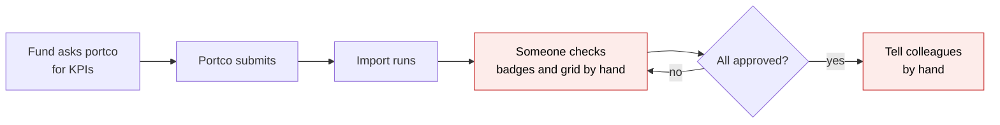
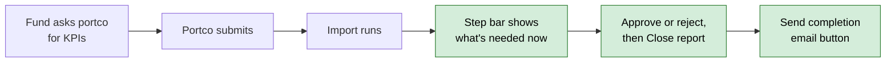
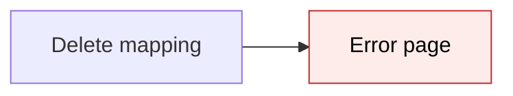
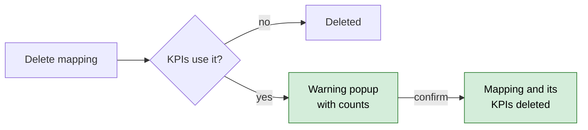

# KPI Report Journey — Proposal

> **Audience:** Business team, product, QA, support — non-technical.
> **Companion document:** [Design](design.md)

> **Planning phase — no code changes.** This document proposes and explains the change. Do not
> edit application code while writing it; implementation happens later, in the tasks phase.

---

## Why

A fund collecting KPIs from its portfolio companies has no single place that says where each
period's report stands: are the KPI mappings set up, has the portco been asked, did it submit, did the
workbook import, has someone approved the values, is it closed? Today that is spread across a status
badge, an import badge, the pending-KPIs grid and people's inboxes. Capital calls, distributions and
KYCs already have a **journey** — a step bar with "What's needed now" — and KPI reports should get
the same.

Today a separate, hand-built "portfolio company review" workflow can be launched on the portco after
each import. No client uses it (KPIs in production hold only trial data), it sits on the company rather than on the
period's report, and it is replaced by this journey.

## What Changes

- Every **requested** KPI report (one someone created or asked a portco for) gets a journey: a step bar
  and a "What's needed now" panel on the report page that updates live.
- Reports that an import creates as a by-product (one per historical period found in the workbook, plus
  Quarter/YTD/Year roll-ups) **never** get a journey — a first upload can create 30+ of them.
- The steps, in order:
  1. **Set up KPI mappings** — the portco has at least one KPI mapping.
  2. **Send upload request** — the portco has been sent the upload link. *Not applicable when the fund
     uploads the KPIs itself.*
  3. **Submit KPIs** — the portco has submitted. *Not applicable when the fund uploads.*
  4. **Import workbook** — the workbook imported without blocking errors.
  5. **Approve or reject KPIs** — no KPI for that portco is still waiting for a decision.
  6. **Close report** — someone clicked **Close report** on the report.
  7. *(optional — an admin adds it to the template)* **Send completion email** — someone clicked the
     button and the "KPIs for Acme — Sep 2026 are complete" email went out.
- A new standard field **Managed by** on a portfolio company names the employee who looks after it.
  That person gets the reminders and the completion email for the portco's reports. When it is empty,
  the template's named owner/actors are used, then every employee tagged **Kpi**.
- **Close report** is a new button on the KPI report page. It approves every KPI still pending for the
  portco (across all periods of the upload) and marks the report reviewed. Today the "mark reviewed"
  action exists but has no button, and it only approved the KPIs on that one report.
- **Deleting a KPI mapping that KPIs use** now shows a warning popup with the counts and deletes the
  mapping and its KPIs together. Today it shows an error page.
- **BREAKING:** the hand-built "Portfolio Company KPI Report Review" workflow is no longer launched after
  each import, and its demo seed is removed. No client uses it.

### Flow Diagram

Before: tracking one period's KPI report.



After: the same flow, tracked.



Before / after: deleting a KPI mapping that KPIs use.





---

## User Stories

### US-1: See where a KPI report stands

**As a** fund KPI user,
**I want** a step bar on each requested KPI report,
**So that** I know what is needed next without checking badges, the grid and email.

**Acceptance criteria:**
- The report page shows the step bar and a "What's needed now" panel with one button for the current
  step (e.g. **Open KPI mappings**, **Send upload request**, **Review pending KPIs**, **Close report**).
- The panel text is specific, e.g. "214 KPIs across 31 periods await a decision".
- When the portco submits or the import finishes, an open report page updates without a reload.

### US-2: No journey for by-product reports

**As a** fund KPI user uploading a workbook with three years of history,
**I want** only the report I uploaded on to get a journey,
**So that** I am not flooded with 30 journeys and 30 sets of reminders.

**Acceptance criteria:**
- Reports created by the import for other periods, Budget columns or roll-ups show no step bar.
- Editing one of those reports later still does not start a journey.

### US-3: Fund uploads skip the portco steps

**As a** fund user uploading a portco's workbook myself,
**I want** "Send upload request" and "Submit KPIs" to show as not applicable,
**So that** the journey reflects what really happened.

**Acceptance criteria:**
- Both steps show "n/a — Uploaded by the fund" when the report is not set up for portco upload.

### US-4: The right person is reminded

**As a** fund that assigns each portco to a different employee,
**I want** to set **Managed by** on a portfolio company,
**So that** reminders and the completion email for its reports go to that person.

**Acceptance criteria:**
- **Managed by** is an optional dropdown of the fund's employees on the portfolio company form.
- When set, that employee owns every step of the portco's KPI journeys and receives the completion
  email, even if the template names someone else.
- When empty, the template's step owner (reminders) or step actors (completion email) are used; when
  those are empty too, every employee tagged **Kpi**.
- When nobody resolves, nobody is emailed and the panel shows "Owner unavailable".

### US-5: Close the report in one click

**As a** fund KPI user,
**I want** a **Close report** button,
**So that** I can approve everything still pending for the portco and close the period in one step.

**Acceptance criteria:**
- The button appears once the report's workbook has been imported and the report is not yet reviewed.
- A confirm popup says how many pending KPIs will be approved, across how many periods.
- After confirming, every pending KPI for that portco is approved and the report shows "Reviewed".

### US-6: Send a completion email

**As a** fund admin,
**I want** to add a **Send completion email** step to the KPI template and pick its actors,
**So that** someone is told when a portco's period is fully done.

**Acceptance criteria:**
- The step is not in the seeded template; an admin adds it from the step editor, where the Actors
  picker is shown for it.
- When it is current, the panel shows **Send completion email**; clicking it emails the recipients
  (see US-4) and the step passes.
- If the report is later reopened and completed again, the button comes back.

### US-7: Delete a mapping that KPIs use

**As a** fund admin,
**I want** to delete a wrong KPI mapping with a clear warning,
**So that** I don't hit an error page and I know what will be lost.

**Acceptance criteria:**
- A mapping no KPI uses deletes as today.
- A mapping in use shows a warning popup with the number of KPIs and periods, how many are approved,
  and any computed KPI whose formula uses the mapping's name.
- Confirming deletes the mapping and its KPIs; open journeys for that portco update.

### US-8: Moving back

**As a** fund KPI user,
**I want** the journey to move back when something is undone,
**So that** a closed report never looks finished after it was reopened.

**Acceptance criteria:**
- Reopen & ask to re-upload, and a failed import → back to **Submit KPIs**.
- Unapproving a KPI → back to **Approve or reject KPIs**.
- Deleting all KPIs on the report → back to **Import workbook**.
- Deleting the portco's last KPI mapping → back to **Set up KPI mappings**.
- Each move back resets later sign-offs and lets the completion email be sent again.

---

## UI Behavior

### KPI report page — journey panel

```
┌──────────────────────────────────────────────────────────────────────────────┐
│ Acme Pvt Ltd - 30/09/2026                     [Edit] [Close report] [Delete] │
│                                                                              │
│  ✓ Set up KPI mappings  ✓ Send upload request  ✓ Submit KPIs                 │
│  ✓ Import workbook  ● Approve or reject KPIs  ○ Close report                 │
│                                                                              │
│  What's needed now — Approve or reject KPIs                Owner: Priya S.   │
│  214 KPIs across 31 periods await a decision                                 │
│  [Review pending KPIs]                                                       │
└──────────────────────────────────────────────────────────────────────────────┘
```

**Behavior notes:**
- ✓ done, ● current (waiting on this, not done yet), ○ later, n/a not applicable (greyed).
- The panel's button either clicks the real button on this page (**Close report**, **Send completion
  email**) or opens another screen (**Open KPI mappings**, **Review pending KPIs**).
- The panel refreshes itself when the data changes (submission, import, approval), without a reload.
- By-product reports and reports created before journeys were set up show no panel.

### Close report popup

```
┌──────────────────────────────────────────────────────────────┐
│ Close report                                              ✕  │
│ Immediate Actions                                            │
│ The following will happen when you click Close report        │
│  ✔ Approve pending KPIs  214 KPIs across 31 periods for Acme │
│  ✔ Mark reviewed         Sep 2026 is closed                  │
│                                     [Cancel] [Close report]  │
└──────────────────────────────────────────────────────────────┘
```

### Portfolio company form — Managed by

```
┌──────────────────────────────────────────────┐
│ Managed by   [ Priya Sharma            ▾ ]   │
│ Gets KPI reminders and completion emails     │
│ for this company. Leave empty to use the     │
│ KPI journey template / employees tagged Kpi. │
└──────────────────────────────────────────────┘
```

### Delete KPI mapping popup (mapping in use)

```
┌──────────────────────────────────────────────────────────────┐
│ Delete KPI mapping "Revenue"                              ✕  │
│ Immediate Actions                                            │
│  ✖ Deletes KPIs       214 KPIs across 31 periods (180 approved)│
│  ⚠ Formulas break     ARPC uses Revenue                      │
│  ⚠ Cannot be undone   Rename the mapping to keep the history │
│                                       [Cancel] [Delete]      │
└──────────────────────────────────────────────────────────────┘
```

---

## What This Feature Does NOT Cover

| Excluded | Covered In |
|---|---|
| Choosing a different KPI template by portco tag (e.g. D2C vs fintech) | Follow-up: add "portfolio company tag" as a rule field |
| Journeys on reports that exist before setup | Not planned — KPIs are not yet live for clients; only reports requested after setup get one |
| Blocking any action because a step isn't done | Not planned — journeys are advisory |
| Deleting a whole portfolio company that has KPIs (same database rule) | Unchanged |
| KPI reports for a company's own KPIs (no portfolio company) | Not planned — no journey |
| Sending the completion email automatically | Not planned — it is a button by design |

---

## Validation Rules

| Field | Rule | Default |
|---|---|---|
| Managed by | Optional; must be an employee of the fund that owns the portfolio company | empty |
| Send completion email step actors | Must be employees of the organisation (as for every step) | none |
| Close report | Only once the workbook has been imported and the report is not already reviewed | — |
| Delete KPI mapping | Refused while it has child mappings ("Move or delete Enterprise, Retail first"); when KPIs use it, only after confirming the popup | — |

---

## Behavior Rules

| Scenario | What User Sees |
|---|---|
| Portco has no KPI mappings | Step 1 current: "No KPI mappings — imports will find nothing", button **Open KPI mappings** |
| Report created by the fund (not a portco request) | Steps 2 and 3 show "n/a — Uploaded by the fund" |
| Import failed | Back on **Submit KPIs**: "Import failed — reopened for the portco" |
| Every KPI on the report rejected | **Import workbook**: "No KPIs on this report — they were rejected, or the workbook had no column for this period" |
| Pending KPIs on other periods of the portco | Counted in **Approve or reject KPIs** for every open report of the portco |
| Managed by set to someone who has left | Panel shows "Owner unavailable"; nobody is emailed |
| Completion email clicked twice | Second click does nothing; the step is already passed |
| Report reopened after the completion email | Journey moves back; the button returns once complete again |
| First upload creates 30 historical reports | Only the report uploaded on has a journey |

---

## Resolved Design Decisions

| # | Decision | Resolution |
|---|---|---|
| 1 | Which record carries the journey? | The KPI report (one per portco × period × tag) |
| 2 | Which reports get one? | Only requested reports; never by-product reports from an import |
| 3 | Fund uploads | Same template; portco steps show n/a ("one workflow per entity") |
| 4 | Review vs approve | One step "Approve or reject KPIs", then "Close report" |
| 5 | Final email | Optional template step with a button; recipients as in decision 7 |
| 6 | Existing portco workflow launch | Removed (no client uses it) |
| 7 | Who is reminded / emailed | Managed by → template owner/actors → employees tagged Kpi → nobody |
| 8 | Managed by | A standard field on the portfolio company, not a custom field |
| 9 | Approval scope | All pending KPIs for the portco (the whole upload), as **Approve all** does |
| 10 | Close report (formerly mark reviewed) | Approves all the portco's pending KPIs, then marks reviewed |
| 11 | Rollout | Only reports requested after setup; existing reports get none (KPIs hold only trial data today) |
| 12 | Deleting a mapping in use | Allowed with a warning popup; deletes its KPIs too |
| 13 | Deleting a parent mapping | Refused until its children are moved or deleted |

---

## Capabilities

### New Capabilities

- `startups/kpi-report-journey`: the KPI report journey — its steps, which reports get one, recipients,
  Close report, the completion email and undo behaviour.
- `startups/kpi-mapping-deletion`: deleting a KPI mapping that KPIs use, with a warning.

### Modified Capabilities

- `workflows/evaluated-workflow-steps`: step owners may come from the record before the template, and the
  default owner may be several people.

---

## Impact

- KPI report page (journey panel, new **Close report** and **Send completion email** buttons).
- Portfolio company form (new **Managed by** field).
- KPI mapping page (delete popup).
- Workflow templates page (**Set up journeys** gets a KPI report entry; the step editor shows Actors for
  the completion step).
- KPI import and approval background jobs (tell the journey when they finish).
- Journey reminders (can go to several people).
- The demo workflow seed task loses its portco scenario.

---

## Benefits

1. One place shows where every period's KPI report stands and what is needed next.
2. Portco managers get reminders for their own portcos only.
3. Closing a period is one click instead of approving period by period.
4. The right people are told when a portco's period is done.
5. Deleting a wrong mapping no longer ends in an error page.

---

## FAQ

| Question | Answer |
|---|---|
| Who sees the step bar? | Fund users who can see the KPI report. Portco users do not. |
| Does it block anything? | No. It shows what's needed; every button works as before. |
| Will a first upload create lots of journeys? | No. Only the report you uploaded on (or asked the portco for) gets one. |
| What happens to existing reports? | Nothing. Only reports requested after journeys are set up get one; setting up emails nobody. |
| Who gets reminders? | The portco's **Managed by** employee; else the template's step owner; else every employee tagged Kpi. |
| Is the completion email automatic? | No. An admin adds the step if wanted; someone clicks the button. |
| What if I don't use Managed by? | Nothing changes for you; reminders go to the template owner or the Kpi-tagged team. |
| Can different portcos use different templates? | Not yet. It is a planned follow-up (by portco tag). |
| What happened to the portco review workflow? | It stops being launched. No client was using it. |
| Can I undo a mapping delete? | No. The popup says so; rename the mapping instead to keep history. |

---

## Design Principle for the Next Phase

- Reuse the journey engine, `JourneySetup`, the shared panel and the existing KPI services
  (`KpiApproveService`, `SendPortcoNotification`, `ImportKpiWorkbookJob`); add no new engine concepts
  except the owner list.
- **Risk — by-product reports:** the "requested only" rule must not depend on a column that by-product
  reports also have (they are created as `shell_created` too). The design must pick the marker explicitly.
- **Risk — portco-wide approval:** one approval clears steps on several reports; every open journey of the
  portco must hear about it, in one bulk call.
- **Risk — owner list:** a generic change to the reminder engine; other journeys must behave exactly as now.
- **Risk — mapping delete:** deletes many KPI rows; must batch and recompute dependent values.
