# Evergreen (Open-Ended) Funds — Design

> **Audience:** Engineering team.
> **Companion documents:** [Proposal](proposal.md) · [Spec](specs/) · [LLD](lld.md) · [QA checklist](qa-checklist.md) · Background: [docs/modules/funds/open_ended_funds.md](../../../docs/modules/funds/open_ended_funds.md)

> **Planning phase — no code changes.** This document explains HOW the proposal will be built.
> Do not edit application code while writing it; implementation happens later, in the tasks phase.

> **Design, not code.** Diagrams and tables only; real class, table and path names sit inside them.

> **Zoom one picture.** Part 1 draws one numbered picture in plain words. Part 2 redraws the same picture with real names. Part 3 has one card per box. Part 4 is reference material. ①–⑨ mean the same box everywhere, and match the proposal's [How the System Changes](proposal.md#how-the-system-changes). Card ⑩ (notifications) was added later; it listens to boxes ②–⑦ and is drawn on its own in its card rather than in the one picture.

> **Backward compatible by construction.** Nothing changes for closed-end funds. All schema is additive (new tables only), and every touch on existing code is guarded so that the guard is false for every existing record. See [Backward compatibility](#backward-compatibility).

---

## Contents

- [1. The idea](#1-the-idea)
  - [What this adds](#what-this-adds)
  - [The idea in one picture](#the-idea-in-one-picture)
  - [Walkthrough: one example, start to finish](#walkthrough-one-example-start-to-finish)
  - [Key ideas](#key-ideas)
- [2. The same picture with real names](#2-the-same-picture-with-real-names)
  - [Picture](#picture)
  - [What each box does](#what-each-box-does)
  - [One run, end to end](#one-run-end-to-end)
  - [Lifecycles](#lifecycles)
  - [What users see](#what-users-see)
  - [Design decisions](#design-decisions)
  - [What is reused from closed-end funds](#what-is-reused-from-closed-end-funds)
- [3. One card per box](#3-one-card-per-box)
  - [① Fund settings](#①-fund-settings)
  - [② Orders](#②-orders)
  - [③ NAV builder](#③-nav-builder)
  - [④ NAV approval](#④-nav-approval)
  - [⑤ Dealing date](#⑤-dealing-date)
  - [⑥ Settlement](#⑥-settlement)
  - [⑦ Unit register](#⑦-unit-register)
  - [⑧ Fee formulas](#⑧-fee-formulas)
  - [⑨ Screens, documents, journeys](#⑨-screens-documents-journeys)
  - [⑩ Notifications](#⑩-notifications)
- [4. Reference](#4-reference)
  - [Class diagram](#class-diagram)
  - [Data model and schema changes](#data-model-and-schema-changes)
  - [Component contracts](#component-contracts)
  - [Backward compatibility](#backward-compatibility)
  - [Notifications](#notifications)
  - [Cross-cutting concerns](#cross-cutting-concerns)
  - [Worked examples](#worked-examples)
  - [Testing](#testing)
  - [Risks and open questions](#risks-and-open-questions)

---

## 1. The idea

### What this adds

An **evergreen layer** on top of CapHive's closed-end machinery. New records hold the evergreen terms, orders, NAVs and dealing dates. A dealing date turns priced orders into ordinary capital calls and distributions, so payment recording, bank reconciliation, the ledger and the unit engine are reused. Evergreen-only screens, labels, documents and journeys sit in front, chosen by the fund's flag.

The workflow follows the **journey pattern** of the capital call, distribution and KYC journeys: a step bar and "What's needed now", evaluated from data. It has two new journey types: one per dealing date and, optionally, one per order.

### The idea in one picture

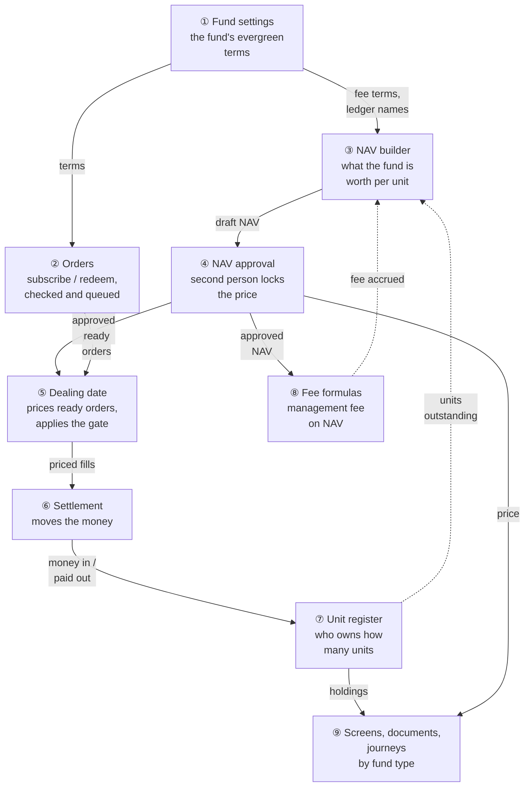

### Walkthrough: one example, start to finish

**Setup.** *Alpha Long-Short Fund* (INR) has been evergreen since 2025 and has one class, A:
- 1,00,000 units at 31 Oct 2026.
- High-water mark ₹10,400, crystallised 31 Dec 2025. Performance fee 20 %; management fee 1.5 %.
- Monthly subscriptions and redemptions on the first business day, paid **before dealing** with a 5-day cut-off.
- 30-day notice, 12-month hard lock-up, 5 % gate per dealing date (FIFO).
- Order journeys on for subscriptions.
- No contract-note or redemption-advice template, so the two document steps are not applicable (—) and each contract note and advice is emailed the moment its units move. The [variant after Phase 4](#walkthrough-one-example-start-to-finish) replays the end with templates.

People:
- **Asha** is the fund admin who prepares NAVs.
- **Ravi** is the approver.
- Investors A Ltd, B LLP and C HUF want to redeem; P Family Trust and Q Capital want to subscribe.

The dealing date 2 Nov 2026 (a Monday; 1 Nov is a Sunday) has cut-off 28 Oct.

**Legend.** The Result column lists the dealing date's steps. ✓ done · **●** *we are here: waiting on this, not done yet* · ○ not started · ↺ undone · — not applicable.

Timeline at a glance: **Sep** A, B, C ask to redeem → **20–25 Oct** P subscribes and pays; Q subscribes and never pays → **28 Oct** cut-off → **1 Nov** NAV for 31 Oct drafted → **2 Nov** NAV approved, dealing confirmed → **10–12 Nov** redemptions paid → **13 Nov** dealing date closed.
**Phase 1 — orders arrive (September–October)**

| # | When | What happens | Behind the scenes | Result&nbsp;(dealing&nbsp;date&nbsp;2&nbsp;Nov&nbsp;steps) |
|---|---|---|---|---|
| 1 | 10–19 Sep | A Ltd, B LLP and C HUF ask to redeem ₹3 Cr, ₹2.5 Cr and ₹1 Cr | The orders box (②) checks free units, lock-up and notice, and gives them dealing date 2 Nov at queue positions 1, 2, 3. The dealing date (⑤) for 2 Nov already exists, generated from the calendar in the fund settings (①) | **●&nbsp;Collect&nbsp;subscription&nbsp;money**<br>○&nbsp;Approve&nbsp;NAV<br>○&nbsp;Review&nbsp;and&nbsp;confirm&nbsp;dealing<br>○&nbsp;Allot&nbsp;units<br>○&nbsp;Pay&nbsp;redemptions<br>○&nbsp;Cancel&nbsp;units<br>—&nbsp;Generate&nbsp;documents<br>—&nbsp;Approve&nbsp;and&nbsp;send&nbsp;documents<br>○&nbsp;Close&nbsp;dealing&nbsp;date |
| 2 | 20 Oct | P Family Trust subscribes ₹5 Cr in the portal wizard | The orders box (②) opens folio F-101. Settlement (⑥) adds a subscription payment for P to "Subscription settlement — 2 Nov 2026". The documents box (⑨) emails the acknowledgement with payment instructions. P's order journey starts at *Collect signed subscription form*, because KYC is already approved | Same as row 1 |
| 3 | 21 Oct | P uploads the signed form; Ravi clicks **Accept** | P's order journey moves to *Collect subscription money* | Same as row 1 |
| 4 | 22 Oct | **Mistake:** Asha records ₹50,00,000 instead of ₹5,00,00,000 | The payment lands on P's subscription payment in settlement (⑥). It is not the full amount, so P's journey stays at *Collect subscription money* | Same as row 1 |
| 5 | 23 Oct | **Undo:** Asha deletes the wrong payment and records ₹5,00,00,000 | Settlement (⑥) re-totals; the tracker's **Record payment** also verifies it. P's journey reaches *Ready to deal* | Same as row 1 |
| 6 | 25 Oct | Q Capital subscribes ₹2.5 Cr and never pays | The orders box (②) opens folio F-102 and adds Q's subscription payment, which stays unpaid | Same as row 1 |
| 7 | 28 Oct 23:59 | Cut-off passes | The dealing date's journey (⑤) sees the cut-off has passed. Q is marked "not paid by cut-off" | ✓&nbsp;Collect&nbsp;subscription&nbsp;money<br>**●&nbsp;Approve&nbsp;NAV**<br>○&nbsp;Review&nbsp;and&nbsp;confirm&nbsp;dealing<br>○&nbsp;Allot&nbsp;units<br>○&nbsp;Pay&nbsp;redemptions<br>○&nbsp;Cancel&nbsp;units<br>—&nbsp;Generate&nbsp;documents<br>—&nbsp;Approve&nbsp;and&nbsp;send&nbsp;documents<br>○&nbsp;Close&nbsp;dealing&nbsp;date |

**Phase 2 — the price (1–2 November)**

| # | When | What happens | Behind the scenes | Result&nbsp;(dealing&nbsp;date&nbsp;2&nbsp;Nov&nbsp;steps) |
|---|---|---|---|---|
| 8 | 1 Nov | **Failure:** Asha clicks **New NAV** for 31 Oct and gets "No valuation for Pharma Co on or before 31 Oct 2026 — add one or upload the NAV" | The NAV builder (③) asks the portfolio for fair value as of 31 Oct; a holding has no valuation, so no draft is saved | Same as row 7 |
| 9 | 1 Nov | Asha adds Pharma Co's valuation and drafts again. NAV ₹102.2 Cr, ₹10,220.00 per unit. She overrides *Management fee payable* to ₹50,00,000 "per admin stmt" | The NAV builder (③) reads fair value ₹95 Cr, Cash In Hand ₹8 Cr and Other Liabilities ₹30 L, plus 1,00,000 units from the unit register (⑦). NAV per unit ₹10,220 is below the ₹10,400 mark, so no performance fee | Same as row 7 |
| 10 | 2 Nov 09:00 | **Stall:** Asha opens the dealing date. Confirm is disabled: "Approve the NAV for Class A dated 31 Oct 2026 first". Approve is hidden from her: "Needs a different approver" | The dealing date (⑤) asks NAV approval (④) for an approved NAV; there is none yet. NAV approval (④) refuses the preparer | Same as row 7 |
| 11 | 2 Nov 10:00 | Ravi approves the NAV | NAV approval (④) locks the NAV; 31 Oct is not a crystallisation date, so nothing is crystallised | ✓&nbsp;Collect&nbsp;subscription&nbsp;money<br>✓&nbsp;Approve&nbsp;NAV<br>**●&nbsp;Review&nbsp;and&nbsp;confirm&nbsp;dealing**<br>○&nbsp;Allot&nbsp;units<br>○&nbsp;Pay&nbsp;redemptions<br>○&nbsp;Cancel&nbsp;units<br>—&nbsp;Generate&nbsp;documents<br>—&nbsp;Approve&nbsp;and&nbsp;send&nbsp;documents<br>○&nbsp;Close&nbsp;dealing&nbsp;date |

**Phase 3 — dealing (2 November)**

| # | When | What happens | Behind the scenes | Result&nbsp;(dealing&nbsp;date&nbsp;2&nbsp;Nov&nbsp;steps) |
|---|---|---|---|---|
| 12 | 2 Nov 10:30 | Asha reviews pricing. P gets 4,892.3679 units; Q is listed "Not paid by cut-off — will roll to 1 Dec 2026". Gate 5 % × ₹102.2 Cr = ₹5.11 Cr, FIFO: A ₹3 Cr in full, B ₹2.11 Cr (₹39 L carried), C ₹0 (₹1 Cr carried) | The dealing date (⑤) prices ready orders at the approved NAV (④), and its gate allocator fills A, B, C in queue order | Same as row 11 |
| 13 | 2 Nov 10:35 | Asha confirms; the popup shows three cards (allot to 1 investor, pay 2 redemptions ₹5.11 Cr, carry ₹1.39 Cr) | The dealing date (⑤) stores one fill per order. Settlement (⑥) sets unit prices on the subscription settlement and creates "Redemption settlement — 2 Nov 2026" with A's and B's payments, due 16 Nov. P is already paid, so the unit register (⑦) allots 4,892.3679 units straight away. Alpha has no contract-note template, so the documents box (⑨) emails P's contract note at once (figures in the email, no PDF), and sends gate notices to B and C. Q's order rolls to 1 Dec, and its subscription payment moves to the 1 Dec settlement | ✓&nbsp;Collect&nbsp;subscription&nbsp;money<br>✓&nbsp;Approve&nbsp;NAV<br>✓&nbsp;Review&nbsp;and&nbsp;confirm&nbsp;dealing<br>✓&nbsp;Allot&nbsp;units<br>**●&nbsp;Pay&nbsp;redemptions**<br>○&nbsp;Cancel&nbsp;units<br>—&nbsp;Generate&nbsp;documents<br>—&nbsp;Approve&nbsp;and&nbsp;send&nbsp;documents<br>○&nbsp;Close&nbsp;dealing&nbsp;date |

What Asha sees at row 13:

```
┌───────────────────────────────────────────────────────────────────────────┐
│ Dealing date 2 Nov 2026                                                   │
│ ✓ Collect ✓ NAV ✓ Confirm ✓ Allot units ● Pay redemptions ○ Cancel ○ Close│
│ What's needed now: pay 2 redemptions (₹5.11 Cr) by 16 Nov 2026.           │
│ P Family Trust  F-101  4,892.3679 units  ✓ Allotted ✓ Contract note sent  │
│ A Ltd   F-012  ₹3,00,00,000  2,935.4207 u  ● Awaiting payment [Mark paid] │
│ B LLP   F-031  ₹2,11,00,000  2,064.5793 u  ● Awaiting payment [Mark paid] │
└───────────────────────────────────────────────────────────────────────────┘
```

**Phase 4 — settlement (10–13 November)**

| # | When | What happens | Behind the scenes | Result&nbsp;(dealing&nbsp;date&nbsp;2&nbsp;Nov&nbsp;steps) |
|---|---|---|---|---|
| 14 | 10 Nov | Asha marks A Ltd paid | Settlement (⑥) completes A's redemption payment. The unit register (⑦) cancels exactly 2,935.4207 units and the documents box (⑨) emails the redemption advice straight away (no template) | Same as row 13 |
| 15 | 12 Nov | Asha marks B LLP paid | Same for B: 2,064.5793 units cancelled. All redemptions are now paid, cancelled and advised | ✓&nbsp;Collect&nbsp;subscription&nbsp;money<br>✓&nbsp;Approve&nbsp;NAV<br>✓&nbsp;Review&nbsp;and&nbsp;confirm&nbsp;dealing<br>✓&nbsp;Allot&nbsp;units<br>✓&nbsp;Pay&nbsp;redemptions<br>✓&nbsp;Cancel&nbsp;units<br>—&nbsp;Generate&nbsp;documents<br>—&nbsp;Approve&nbsp;and&nbsp;send&nbsp;documents<br>**●&nbsp;Close&nbsp;dealing&nbsp;date** |
| 16 | 13 Nov | Asha closes the dealing date | The dealing date (⑤) records the close; its step bar is complete | ✓&nbsp;Collect&nbsp;subscription&nbsp;money<br>✓&nbsp;Approve&nbsp;NAV<br>✓&nbsp;Review&nbsp;and&nbsp;confirm&nbsp;dealing<br>✓&nbsp;Allot&nbsp;units<br>✓&nbsp;Pay&nbsp;redemptions<br>✓&nbsp;Cancel&nbsp;units<br>—&nbsp;Generate&nbsp;documents<br>—&nbsp;Approve&nbsp;and&nbsp;send&nbsp;documents<br>✓&nbsp;Close&nbsp;dealing&nbsp;date |

**Phase 4, variant — the same dealing date with templates.** Suppose Alpha had uploaded a "Contract Note Template" and a "Redemption Advice Template" to its documents. Rows 13–15 then allot and cancel the same units but email nothing; the documents become two steps of their own.

| # | When | What happens | Behind the scenes | Result&nbsp;(dealing&nbsp;date&nbsp;2&nbsp;Nov&nbsp;steps) |
|---|---|---|---|---|
| 15a | 12 Nov 15:00 | Asha opens **Actions → Generate documents** | The documents part of ⑨ finds three settled fills with a template and no document (P's contract note, A's and B's advices) and generates them in a background job from the Word templates. Each PDF is saved **unapproved** on its folio, so investors can't see it yet. The approvers (Ravi, and Asha who also holds the role) get "3 documents awaiting approval" (⑩) | ✓&nbsp;Collect&nbsp;subscription&nbsp;money<br>✓&nbsp;Approve&nbsp;NAV<br>✓&nbsp;Review&nbsp;and&nbsp;confirm&nbsp;dealing<br>✓&nbsp;Allot&nbsp;units<br>✓&nbsp;Pay&nbsp;redemptions<br>✓&nbsp;Cancel&nbsp;units<br>✓&nbsp;Generate&nbsp;documents<br>**●&nbsp;Approve&nbsp;and&nbsp;send&nbsp;documents**<br>○&nbsp;Close&nbsp;dealing&nbsp;date |
| 15b | 12 Nov 15:20 | **Mistake:** Asha views B LLP's advice, sees a wrong heading, fixes the template and clicks **Regenerate** on B's row | ⑨ replaces B's unapproved document with a new one from the corrected template; an approved document could not be regenerated | Same as row 15a |
| 15c | 12 Nov 16:00 | Ravi clicks **Approve & send**. The popup's card reads "Approve 1 contract note and 2 redemption advices, and email them to investors"; he confirms | ⑨ approves the three documents and emails P, A and B their document with the PDF attached; each fill's sent time is recorded so nothing is sent twice | ✓&nbsp;Collect&nbsp;subscription&nbsp;money<br>✓&nbsp;Approve&nbsp;NAV<br>✓&nbsp;Review&nbsp;and&nbsp;confirm&nbsp;dealing<br>✓&nbsp;Allot&nbsp;units<br>✓&nbsp;Pay&nbsp;redemptions<br>✓&nbsp;Cancel&nbsp;units<br>✓&nbsp;Generate&nbsp;documents<br>✓&nbsp;Approve&nbsp;and&nbsp;send&nbsp;documents<br>**●&nbsp;Close&nbsp;dealing&nbsp;date** |

**Phase 5 — the next cycle (end of November)**

| # | When | What happens | Behind the scenes | Result&nbsp;(dealing&nbsp;date&nbsp;1&nbsp;Dec&nbsp;steps) |
|---|---|---|---|---|
| 17 | 30 Nov | Asha runs the fee formula for November: ₹12,60,000 accrued, split by units held | Fee formulas (⑧) read the 31 Oct approved NAV from NAV approval (④) and write management-fee ledger entries | **●&nbsp;Collect&nbsp;subscription&nbsp;money**<br>○&nbsp;Approve&nbsp;NAV<br>○&nbsp;Review&nbsp;and&nbsp;confirm&nbsp;dealing<br>○&nbsp;Allot&nbsp;units<br>○&nbsp;Pay&nbsp;redemptions<br>○&nbsp;Cancel&nbsp;units<br>—&nbsp;Generate&nbsp;documents<br>—&nbsp;Approve&nbsp;and&nbsp;send&nbsp;documents<br>○&nbsp;Close&nbsp;dealing&nbsp;date |
| 18 | 1 Dec | The 30 Nov NAV is drafted and approved: ₹101.5 Cr over 99,892.3679 units = ₹10,160.94. B's 381.6047 units and C's 978.4736 units head the 1 Dec queue | The NAV builder (③) reads units from the unit register (⑦) and fee accruals from fee formulas (⑧). The orders box (②) keeps B and C at queue positions 1 and 2 by their original received times | Same as row 17, with Approve NAV ✓ once approved |

**What to notice**
- **Prices come only from an approved NAV.** The stall at row 10 is deliberate: maker-checker sits in front of every dealing date (④).
- **Mistakes are undone with existing actions.** Row 5 deletes and re-records a payment through the existing settlement records; the order journey simply re-evaluates (②, ⑥).
- **A dealing date is a journey evaluated from data.** Every Result column above is derived. Nothing is ticked by hand except Close (⑤).
- **Units move only through the existing unit engine.** Units are allotted at confirmation because P had already paid (pre-funded), and cancelled exactly when payments are marked paid (⑦).
- **Documents are a step only when the fund has templates.** Without one, the contract note or advice is an email sent the moment units move. With one, nothing reaches the investor until Generate documents and Approve & send (rows 15a–15c), and Close waits for both (⑤, ⑨).
- **Closed-end screens never appear.** Asha never opened a capital call or distribution. They exist underneath, labelled *Subscription settlement* and *Redemption settlement* (⑥, ⑨).

### Key ideas

| # | Idea | In one line | Card |
|---|---|---|---|
| 1 | Settings are data | Every evergreen term is a fund setting, with per-class overrides and presets, so one model fits Cat III, tender-offer, interval and hedge-fund-style funds | [①](#①-fund-settings) |
| 2 | Orders gate themselves | An order is priced only when it is *ready to deal*: valid, paid if pre-funded, and at the end of its optional journey | [②](#②-orders) |
| 3 | One approved price | Every dealing uses an approved NAV prepared by one person and approved by another | [③](#③-nav-builder) · [④](#④-nav-approval) |
| 4 | Dealing date as a journey | The dealing date's steps are worked out from data, with step lists for pre-funded and pay-after-dealing funds | [⑤](#⑤-dealing-date) |
| 5 | Reuse settlement, rename it | Money moves through capital calls and distributions, which evergreen users only see as *Subscription settlement* / *Redemption settlement* | [⑥](#⑥-settlement) |
| 6 | Exact units | Allotment reuses the unit engine; redemptions cancel the exact dealt units through a new engine method used only by dealing dates | [⑦](#⑦-unit-register) |
| 7 | Guarded switch points | Closed-end funds take exactly today's path: every touch on existing code is behind a guard that is false for them | [Backward compatibility](#backward-compatibility) |
| 8 | Documents on approval | With a template, contract notes and advices are generated as a dealing-date step and reach investors only after an approver's Approve & send; without one, the email goes straight away | [⑨](#⑨-screens-documents-journeys) |

**FAQ**

| Question | Answer |
|---|---|
| Why not build a separate ledger for evergreen money? | Calls and distributions already handle payment recording, bank reconciliation, ledger entries and units. A second ledger would duplicate all of it and drift. We keep their records, hide their vocabulary, and drive them from dealing dates. |
| Does anything block closed-end users? | No. Closed-end funds never have evergreen settings, so every guard is false for them and they take today's code path. See [Backward compatibility](#backward-compatibility). |
| Why is a dealing date a record and not just a date? | It owns the step bar, the confirmed snapshot (prices, gate, fills), the links to its settlement records, and the close. Those must survive later changes to settings and NAVs. |
| What happens if nobody approves the NAV? | Nothing is priced. The dealing date stays at *Approve NAV*. Orders stay pending and can still be cancelled. |

---

## 2. The same picture with real names

### Picture

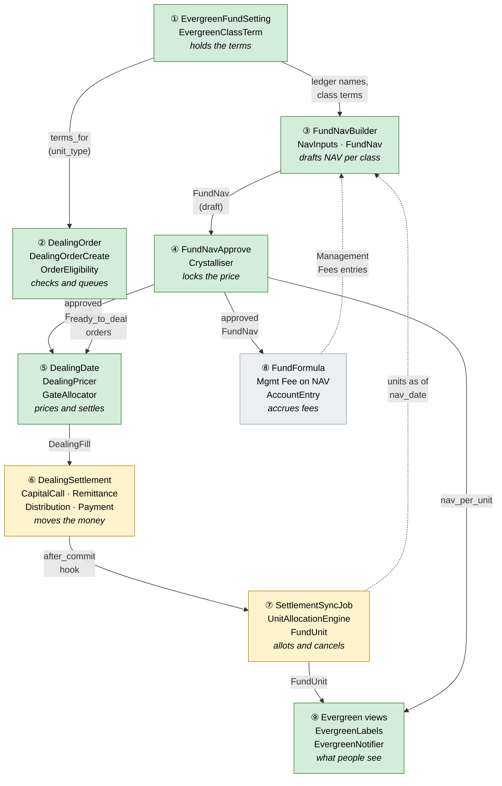

Colour = footprint: **green** new, **amber** existing code touched behind a guard, **grey** reused unchanged (⑧ only gains a seeded formula record). Exact files are in [lld.md File Map](lld.md#file-map).

### What each box does

| # | Box | Real parts | What it does | When it runs | What it decides | Details |
|---|---|---|---|---|---|---|
| ① | Fund settings | `EvergreenFundSetting`, `EvergreenClassTerm`, `EvergreenPresets`, `EvergreenEnable` | Stores every evergreen term; is the fund's evergreen flag | Admin edits Settings | Whether a fund is evergreen; each class's effective terms | [card ①](#①-fund-settings) |
| ② | Orders | `DealingOrder`, `DealingOrderCreate`, `DealingOrderCancel`, `OrderEligibility`, `DealingCalendar`, `ImportDealingOrder`, order journey (`DealingOrderJourneySetup` + checks) | Validates, dates and queues subscriptions and redemptions; opens folios and payment rows for pre-funded funds | Portal wizard, admin entry, upload | Accept or reject; dealing date; queue position; ready to deal | [card ②](#②-orders) |
| ③ | NAV builder | `FundNavBuilder`, `NavInputs`, `ClassApportioner`, `PerformanceFeeCalculator`, `NavStaleness`, `ImportFundNav`, `FundNav` | Drafts or imports a NAV per class per date, with per-line sources and overrides | **New NAV**, **Upload NAV**, **Recalculate** | Every NAV line, units, NAV per unit, accrued performance fee, staleness | [card ③](#③-nav-builder) |
| ④ | NAV approval | `FundNavApprove`, `FundNavReopen`, `Crystalliser` | Maker-checker approval, reopen, crystallisation | Approver clicks | Whether a NAV can price; whether the high-water mark moves | [card ④](#④-nav-approval) |
| ⑤ | Dealing date | `DealingDate`, `DealingPricer`, `GateAllocator`, `DealingConfirm`, `DealingUndo`, `DealingRoll`, `DealingFill`, dealing-date journey | Prices ready orders, applies gates, confirms, rolls, undoes, closes | Workspace actions; calendar job | Fills, carry-forward, step bar | [card ⑤](#⑤-dealing-date) |
| ⑥ | Settlement | `DealingSettlement` driving `CapitalCall`, `CapitalRemittance`, `CapitalDistribution`, `CapitalDistributionPayment`, `CapitalCommitmentCreate`, `AdjustmentCreate` | Creates and updates the existing settlement records for a dealing date | Order acceptance (pre-funded), confirm, roll, undo | Which records exist and their amounts | [card ⑥](#⑥-settlement) |
| ⑦ | Unit register | `EvergreenSettlementHooks`, `DealingSettlementSyncJob`, `DefaultUnitAllocationEngine` (`allocate_remittance`, new `allocate_dealing_redemption`), `FundUnit` | Allots units on paid and confirmed subscriptions; cancels exact units on paid redemptions | After commit of settlement records; at confirm | When units move and how many | [card ⑦](#⑦-unit-register) |
| ⑧ | Fee formulas | Seeded `FundFormula` "Management Fee on NAV", `Fund#evergreen_nav_per_unit`, `AccountEntry` | Accrues the management fee on NAV per folio by units | Allocation runs, as today | Fee amount per folio and period | [card ⑧](#⑧-fee-formulas) |
| ⑨ | Screens, documents, journeys | `Evergreen::*` controllers and views, `EvergreenLabels`, `EvergreenNotifier`/`EvergreenMailer`, `EvergreenDealingDocuments`, `EvergreenDocumentsJob`, `EvergreenDocTemplateGenerator`, `SoaGenerator` evergreen context, journey setups | GP and investor screens by fund flag; labels; emails; contract notes and advices from the fund's templates, generated and approved per dealing date | Every request; on events; **Generate documents** and **Approve & send** | Which screen and label; who is emailed; whether a contract note or advice is emailed at once (no template) or waits for approval (template) | [card ⑨](#⑨-screens-documents-journeys) |

### One run, end to end

The main happy path is the walkthrough's rows 2–15, for a pre-funded fund.

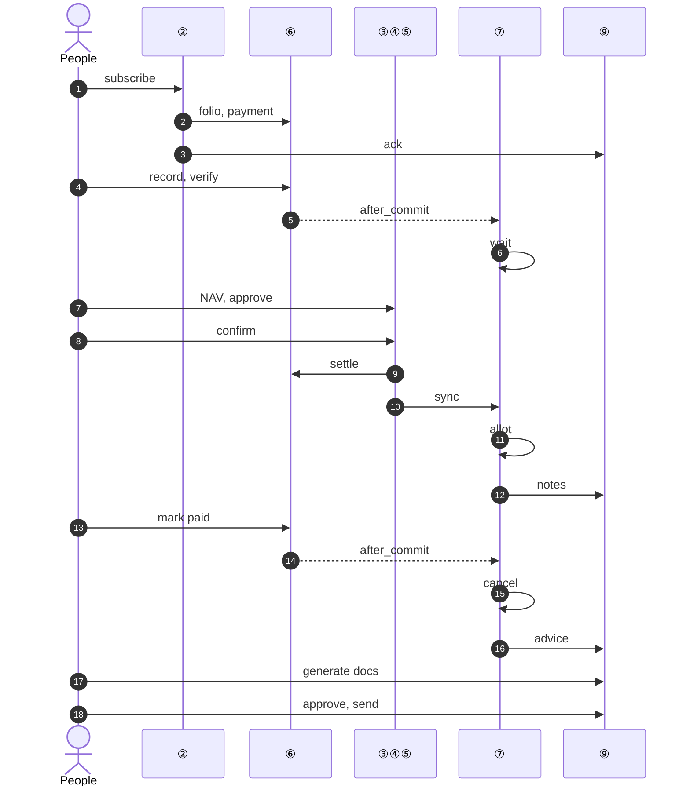

Participants: People = P, Asha, Ravi · ② `DealingOrderCreate` · ⑥ `DealingSettlement` and the existing remittance/payment services · ③④⑤ `FundNavBuilder`, `FundNavApprove`, `DealingPricer`, `DealingConfirm` · ⑦ `DealingSettlementSyncJob` → `DefaultUnitAllocationEngine` (`allocate_remittance`, `allocate_dealing_redemption`) · ⑨ `EvergreenNotifier`, `EvergreenDealingDocuments`. Without a template of that kind, steps 12 and 16 email the contract note / advice at once and steps 17–18 do not apply. With a template, steps 12 and 16 send nothing; step 17 (`EvergreenDocumentsJob`) generates the PDFs and step 18 (**Approve & send**) approves and emails them.

### Lifecycles

**FundNav** (stored `status`; `stale` is derived on read):

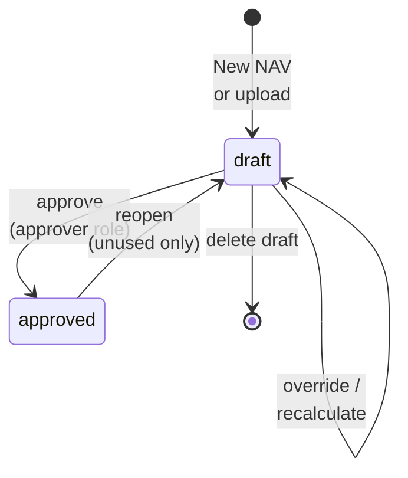

**DealingOrder** (stored `status`; *ready to deal* is derived; a roll keeps `pending` with a new dealing date):

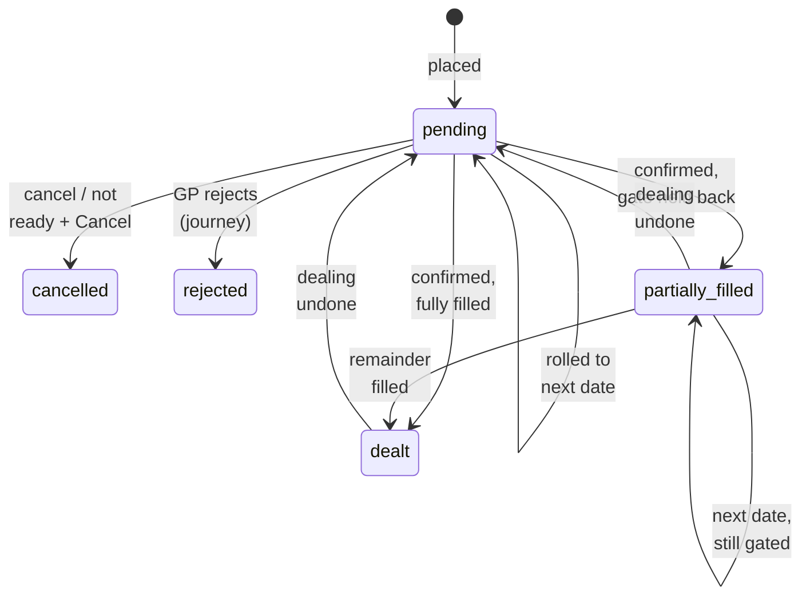

**DealingDate** (stored `status`; the step bar is derived):

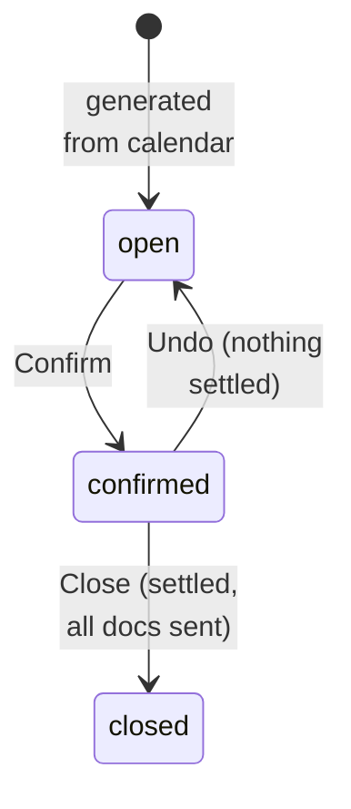

**DealingFill** (one per order per dealing date; every state is derived from its links: `fund_unit_id`, `document_id` + `documents.approved`, `document_sent_at`):

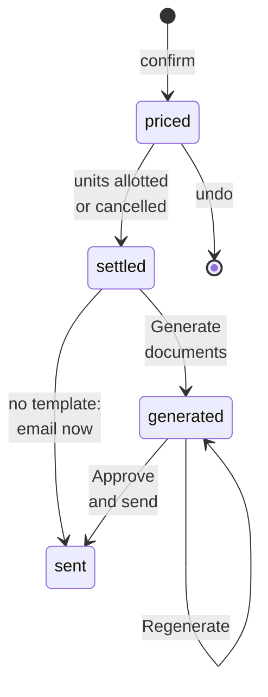

| State | Derived from | Who moves it |
|---|---|---|
| settled | `fund_unit_id` present, `document_id` and `document_sent_at` empty | The sync job (⑦) |
| generated | `document_id` present, that `Document` not `approved` | **Generate documents** (job) or **Regenerate** (row) |
| sent | `document_sent_at` present (with an approved document, or none when there is no template) | ⑦ straight away (no template) or **Approve & send** (template) |

### What users see

**At a glance**

| Where in CapHive | Today | After this change | Who sees it |
|---|---|---|---|
| Fund page (GP) | Closed-end tabs for every fund | Evergreen funds: Overview, Dealing, Orders, NAV, Investors, Fees, Portfolio, Ledger, Documents, Settings. Closed-end unchanged | Fund admins, approvers |
| Funds list | Commitment card | Evergreen card with NAV figures and badge | Fund admins |
| Investor landing page | Commitment card | Evergreen card: value, units, NAV per unit, next dealing | Investors |
| Investor fund page | Commitments, remittances, distributions… | Holding, Transactions, Requests, NAV history, Documents; Subscribe/Redeem wizards | Investors |
| Capital call / distribution pages | Shown for all funds | Evergreen settlement records redirect to an evergreen settlement page with evergreen labels | Fund admins (audit) |
| Emails | Call / distribution notices | Evergreen funds: acknowledgements, payment instructions, contract notes, gate notices, redemption advices; plus switchable reminders and updates ([card ⑩](#⑩-notifications)). Contract notes and advices go at once when the fund has no template, or with the PDF after **Approve & send** when it has one | Investors |
| Dealing date (GP) | — | **Actions → Generate documents** and **Approve & send** (template funds only); tracker rows gain View · Regenerate; two new steps before Close ([card ⑨](#⑨-screens-documents-journeys)) | Fund admins; Approve & send for approvers |
| In-app notifications and team email | No evergreen alerts | Evergreen team alerts (new order, NAV awaiting approval, cut-off summary, gate applied, overdue settlement, …) to roles; switches in a new *Notifications* settings step | Fund ops, accounting, compliance, approvers, relationship managers |

**Main everyday journey — running a dealing date** (full screens: [proposal GP-3](proposal.md#gp-3-dealing-date-workspace))

```
┌───────────────────────────────────────────────────────────────────────────┐
│ Dealing date 2 Nov 2026          NAV Class A 31 Oct 26 ✓ ₹10,220.00/unit  │
│ ① ✓ Collect money ✓ Approve NAV ● Review and confirm ○ Allot units ...    │
│ ② What's needed now: review pricing and the gate, then confirm.           │
│ ③ Subscriptions (paid by cut-off) · Not paid by cut-off — roll to 1 Dec   │
│ ④ Redemptions   Gate 5% = 5,11,00,000 · FIFO · filled 78.6%               │
│ ⑤                                        [Cancel]  [Confirm dealing]      │
│ ⑥ Settlement tracker (after confirm)  ·  Settlement records (audit)       │
└───────────────────────────────────────────────────────────────────────────┘
```

| Step | The user… | They see |
|---|---|---|
| ① | Opens the dealing date from Dealing or the Overview | The step bar for the fund's payment timing |
| ② | Reads what's needed | One sentence naming the current step's task |
| ③ | Checks subscriptions | Ready orders priced at the approved NAV; not-paid and not-ready orders listed apart with their fate (roll or cancel) |
| ④ | Checks redemptions | Queue order, requested, filled and carried amounts, and the gate maths |
| ⑤ | Confirms | A popup of three action-summary cards, then the settlement tracker |
| ⑥ | Records payments, marks redemptions paid; with templates, clicks **Generate documents**, then an approver clicks **Approve & send**; closes | Each row moves through its statuses. No template: the contract note / advice email goes as units move. Template: rows show Generated → Approved → Sent, and Close waits for every document to be sent |

### Design decisions

1. **Settle through existing calls and distributions.** Alternative: a new subscription/redemption ledger. Rejected because it would duplicate payment recording, bank reconciliation, ledger entries, statements and the unit engine, and drift from them.
2. **One subscription settlement per dealing date, created when the first order arrives (pre-funded) or at confirm (pay-after-dealing).** Alternative: one call per order. Rejected because it floods call lists and reports, and the spec defines one per dealing date. Pre-funded money must land somewhere before dealing, so the call is created early, with no unit prices until confirm.
3. **Evergreen screens are new views behind a few switch points; existing views are not relabelled in place.** Alternative: add `if evergreen?` label branches throughout the existing call, distribution and commitment views. Rejected because it risks closed-end rendering and spreads the flag everywhere. Instead, existing call and distribution show pages redirect evergreen settlement records to a new evergreen settlement page.
4. **Labels live in one place (`EvergreenLabels`, an i18n scope `evergreen.labels`).** Alternative: hard-coded strings in each evergreen view. Rejected because emails, exports and screens would drift.
5. **Dealing-date and order workflows are journeys on the existing framework** (`Workflowable`, `WorkflowEvaluator`, workflow checks, `JourneySetup`). Alternative: a custom state machine. Rejected for DRY reasons and because users already know the step bar. Two payment timings are modelled as two seeded templates, not as code branches.
6. **Order journey templates are launched directly from the fund's settings, not via auto-assignment rules.** Alternative: per-entity rules. Rejected because the choice is per fund; `WorkflowInstanceLaunch` with the configured template is simpler.
7. **Exact redemption units via a new engine method, `allocate_dealing_redemption`, plus an early return in `allocate_distribution_payment` for dealing payments.** Alternative: back-calculate the amount so that amount ÷ price gives the units. Rejected because rounding to paise can yield 1,999.9999 units.
8. **Units move from an after-commit hook on settlement records (`EvergreenSettlementHooks`)**, not only from tracker buttons. Alternative: only tracker actions. Rejected because money also arrives by bank reconciliation, outside the tracker.
9. **Verification stays a human step.** Bank reconciliation can record a payment, but the tracker's **Verify** (or **Record payment**, which verifies) confirms money received. Alternative: auto-verify on full payment. Rejected because it would remove the existing control.
10. **The gate is one allocator with explicit inputs** (level, period, method, investor cap, consumed so far). Alternative: separate FIFO and pro-rata code paths per option. Rejected because the options multiply; one pure function is testable against worked examples.
11. **No columns added to existing tables.** Links run from new tables to existing records (`dealing_dates.subscription_call_id`, `dealing_fills.capital_remittance_id`, …). Alternative: a `dealing_date_id` on `capital_calls`. Rejected because it touches the existing schema and its imports and exports.
12. **An entity switch gates the whole feature** (`enable_evergreen_funds`, appended to the entity permissions bitmask). Alternative: per-fund only. Rejected because entities that never enable it should see no new option at all.
13. **The management fee reuses the formula engine.** Alternative: a dedicated fee calculator. Rejected because allocation runs, explain and statements already handle formula output.
14. **Contract notes and advices from the fund's own Word templates, generated and approved as a dealing-date step.** Alternative: a built-in PDF layout generated and emailed automatically at allotment and payment (what phase 6 first built). Rejected because funds issue these on their own letterhead and want someone to check them before investors do; the built-in layout is retired. Generation reuses the existing pipeline (tagged templates, folio override via `CapitalCommitment#templates(tag)`, Sablon → PDF, unapproved "Generated" documents hidden from investors) rather than a new one.
15. **Templates are optional, per kind.** Alternative: require both templates before a fund can deal. Rejected because many funds are happy with an email; a kind without a template just sends its email at once, and the two document steps are skipped when the fund has neither.

**FAQ**

| Question | Answer |
|---|---|
| Why redirect existing call and distribution pages instead of reusing them? | Their views, menus and buttons (Allocate units, notices, journeys) are closed-end. A redirect is one guarded line per controller; relabelling would be dozens of branches in closed-end views. |
| Can an evergreen settlement record still be edited through old screens? | Only from the evergreen settlement page, which offers the actions evergreen needs (record payment, verify, mark paid) through the existing services. Old edit and bulk screens are not linked. |
| Why does the subscription settlement exist before dealing for pre-funded funds? | Payments and bank reconciliation attach to remittances. Without one, money arriving before the cut-off has nowhere to go. |
| What stops a closed-end call getting an evergreen hook? | The hook first checks whether a `DealingDate` or `DealingFill` points at the record; no closed-end record is ever pointed at. |
| Why not generate the contract note automatically at allotment, now that templates exist? | Allotments trickle in (pre-funded at confirm, pay-after as money arrives, redemptions as they are paid). One **Generate documents** run per dealing date gives the approver one batch to check, and the same run picks up late settlements when it is clicked again. Funds without a template still get the instant email. |
| Why journeys for orders at all, if they're optional? | Funds with onboarding rules (KYC, signed forms, GP acceptance) need a gate before pricing. The journey framework gives it, with the same step bar and actor notifications as other journeys. |

### What is reused from closed-end funds

**Short answer:** yes, remittances and distributions are used. Every evergreen money movement is an ordinary closed-end record underneath:
- A subscription is paid into a `CapitalRemittance`.
- A redemption is paid out through a `CapitalDistributionPayment`.
- A folio is a `CapitalCommitment`.
- A further subscription is a "Top Up" `CommitmentAdjustment`.
- Units are `FundUnit` rows written by the existing `DefaultUnitAllocationEngine`.

What evergreen adds is the layer that decides **when** and **how much**: orders, NAVs, dealing dates and fills. It then drives the closed-end records through their existing services, never with raw writes. What it drops is the closed-end *process* around those records: calling a percentage of commitments, call and distribution notices and journeys, waterfalls, and the "Allocate units" buttons.

Checked against the code on 10 Oct 2026: `DealingSettlement`, `FolioOpener`, `EvergreenAllotment`, `EvergreenPayments`, `EvergreenAcceptReceived`, `DefaultUnitAllocationEngine` and the guarded switch points.

**The mapping in one picture**

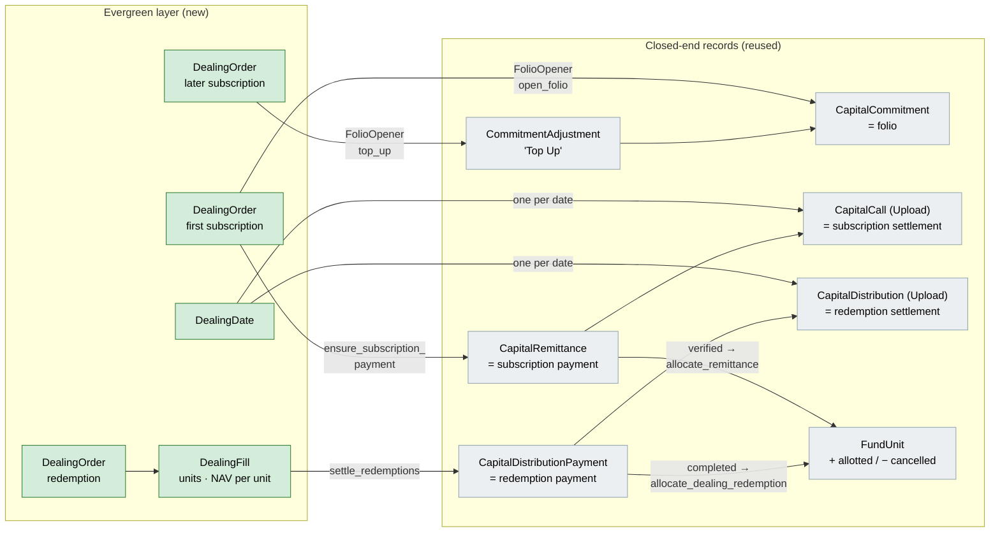

Green is new. Grey is an existing closed-end model, created and updated only through its existing service (`CapitalCommitmentCreate`, `AdjustmentCreate`, `CapitalCallCreate`, `CapitalRemittanceCreate`, `CapitalRemittancePaymentCreate`, `CapitalRemittanceVerify`, `CapitalDistributionCreate`, `CapitalDistributionPaymentCreate`, `CapitalDistributionPaymentUpdate`).

#### Commitments, top-ups and units

| Evergreen idea | Closed-end record | Created by | When | How it differs from closed-end use |
|---|---|---|---|---|
| **Folio** (label "Folio", `EvergreenLabels` `capital_commitment`) | `CapitalCommitment` | `FolioOpener.open_folio` → `CapitalCommitmentCreate` | The investor's first subscription in a class. Pre-funded: at order acceptance (`DealingOrderCreate`). Pay-after: at confirm (`DealingSettlement.settle_subscriptions`) | `folio_committed_amount` = the first order's amount. `folio_id` is generated as `F-<n>` (never below F-101). `fund_close` is the single close name from ① (default "Evergreen"). `unit_type` is the order's class. `investor_kyc_id` is the order's KYC. Notes read "Opened by evergreen subscription", so a reversal can tell it apart |
| **Further subscription** | `CommitmentAdjustment`, type **"Top Up"**, `owner` = the `DealingOrder` | `FolioOpener.top_up` → `AdjustmentCreate` | A subscription on a folio that already exists | Ownership by the order is what lets cancel, roll and undo reverse exactly that top-up (`FolioOpener.reverse` → `AdjustmentDestroy`) |
| **Accept received amount** (part-paid subscription) | A **negative** "Top Up" `CommitmentAdjustment` for the shortfall | `EvergreenAcceptReceived#reduce_folio` | GP accepts the money received in place of the order amount | The remittance's `call_amount` drops to what was received, so the folio's subscribed amount stays equal to the money actually in |
| **Subscribed amount** (label for `committed_amount`) | `CapitalCommitment#committed_amount` | Rolled up by the existing commitment and adjustment callbacks | — | **Gross money ever subscribed.** A redemption does **not** reduce it: no negative adjustment is booked on redemption. It is shown on the folio page and the dealing-date list, and is never used to work out a holding |
| **Units held** | `FundUnit` rows of the folio | `DefaultUnitAllocationEngine` | Allot: the subscription remittance is verified, fully paid, and its dealing date is confirmed (`EvergreenAllotment.allot`). Cancel: the redemption payment is completed (`EvergreenAllotment.cancel`) | **The holding is Σ `FundUnit.quantity`** (`EvergreenUnitRegister`, `EvergreenLots`, `NavInputs`, `EvergreenStatement`), not committed minus distributed. Allotment uses `allocate_remittance` unchanged (amount ÷ the call's `unit_prices`). Cancellation uses the new `allocate_dealing_redemption`, which writes `−fill.units` exactly instead of amount ÷ price |
| **Lot** (lock-up, exit load) | One positive `FundUnit` and its `issue_date` | Same | Same | Redemptions are matched against the oldest lots first (`EvergreenLots`). Closed-end funds have no lots |

**Worked example: one folio's life.** P Family Trust, Class A. The first two rows are from the [walkthrough](#walkthrough-one-example-start-to-finish).

| # | Event | Closed-end records touched | Subscribed amount | Units (Σ `FundUnit`) |
|---|---|---|---|---|
| 1 | 20 Oct: subscribes ₹5,00,00,000 (pre-funded) | `CapitalCommitment` F-101 opened (committed ₹5 Cr). `CapitalRemittance` ₹5 Cr in "Subscription settlement — 2 Nov 2026" | ₹5,00,00,000 | 0 |
| 2 | 2 Nov: confirmed at ₹10,220.00, already paid | Call `unit_prices` = {A: 10220.00}. `allocate_remittance` → `FundUnit` +4,892.3679 | ₹5,00,00,000 | 4,892.3679 |
| 3 | 15 Nov: subscribes ₹1,00,00,000 more | `CommitmentAdjustment` "Top Up" +₹1 Cr (owner = the order). New `CapitalRemittance` in "Subscription settlement — 1 Dec 2026" | ₹6,00,00,000 | 4,892.3679 |
| 4 | 1 Dec: confirmed at ₹10,160.94, paid | `FundUnit` +984.1609 (₹1,00,00,000 ÷ 10,160.94, to 4 dp) | ₹6,00,00,000 | 5,876.5288 |
| 5 | 4 Jan: redeems 1,000 units at ₹10,300.00 and is marked paid | `CapitalDistributionPayment` ₹1,03,00,000 in "Redemption settlement — 4 Jan 2027". `allocate_dealing_redemption` → `FundUnit` −1,000.0000 | **₹6,00,00,000** (unchanged) | 4,876.5288 |

Row 5 is why the holding comes from units, not from the commitment. Closed-end arithmetic (committed − distributed) would give ₹6 Cr − ₹1.03 Cr = ₹4.97 Cr, which is not a meaningful number in an evergreen fund. The holding's value is 4,876.5288 × the latest approved NAV per unit.

#### Remittances and distributions

| Evergreen idea | Closed-end record | Settings that keep it evergreen-only | Differs from closed-end |
|---|---|---|---|
| **Subscription settlement** (one per dealing date) | `CapitalCall` | `call_basis: "Upload"`, `percentage_called: 0`, `generate_remittances: false`, `manual_generation: true`, `approved: true`, `send_call_notice_flag: false`, `send_payment_notification_flag: false`, `evergreen_settlement_flag` → `skip_journey?` | Remittances are **not** generated from commitments by a percentage. One is added per subscription order. `unit_prices` (`{class => {price: NAV per unit, premium: "0"}}`) are written at confirm, not entered by hand |
| **Subscription payment** | `CapitalRemittance` (`created_by: "Evergreen"`) | `call_amount` = `folio_call_amount` = order amount, no call fees | Created at acceptance (pre-funded) or at confirm (pay-after). A roll moves it to the next date's call (`update_columns(capital_call_id:)`, then `CapitalRemittancesCountersJob`) or destroys and recreates it |
| **Money received** | `CapitalRemittancePayment` + `CapitalRemittanceVerify` | — | Unchanged. Recorded from the dealing tracker (`EvergreenPayments`) or by bank reconciliation; verification stays a human step |
| **Redemption settlement** (one per dealing date with filled redemptions) | `CapitalDistribution` | `distribution_on: "Upload"`, `generate_payments: false`, `manual_generation: true`, `approved: true`, `send_notification_on_complete: false`, `evergreen_settlement_flag` → `skip_journey?` | Payments are not generated from commitments or a waterfall. `unit_prices` = `{class => NAV per unit}` from the fills |
| **Redemption payment** | `CapitalDistributionPayment` | `cost_of_investment` = filled value − that fill's exit load; `income: 0`; `reinvestment: 0`; `completed: false` until **Mark paid** | Completed through `CapitalDistributionPaymentUpdate` (`EvergreenPayments.mark_redemption_paid`). The bank reference is kept in `json_fields` |
| **Exit load** (early-redemption fee) | `AccountEntry` "Early Redemption Fee" on the folio, `parent` = the `DealingFill` | — | **No `DistributionFee`.** The payment is created net of the fee instead, so two redemptions on one folio never share a distribution-level fee |

Both settlement records still appear in entity-wide call and distribution lists, under their evergreen names. Their `show` pages redirect to the evergreen settlement page (B3), and the dealing date's journey replaces theirs (B4).

#### Used, touched behind a guard, not used

| Closed-end part | In evergreen funds | How |
|---|---|---|
| `CapitalCommitment`, `CommitmentAdjustment` ("Top Up") | **Used** | `FolioOpener`, `EvergreenAcceptReceived` |
| `CapitalCall`, `CapitalRemittance`, `CapitalRemittancePayment`, `CapitalRemittanceVerify`, `CapitalRemittancesCountersJob` | **Used** | `DealingSettlement`, `DealingRoll`, `EvergreenPayments` |
| `CapitalDistribution`, `CapitalDistributionPayment`, `CapitalDistributionPaymentUpdate` | **Used** | `DealingSettlement`, `EvergreenPayments` |
| Bank reconciliation | **Used** | Payments it records fire the same after-commit hook (`EvergreenSettlementHooks`) |
| `FundUnit`, `FundUnitSetting` (classes, management fee %) | **Used** | Holdings, lots, NAV units, fee formula |
| `DefaultUnitAllocationEngine#allocate_remittance` | **Used unchanged** | `EvergreenAllotment.allot` |
| `DefaultUnitAllocationEngine#allocate_distribution_payment` | **Touched behind a guard** (B6) | First line delegates to the new `allocate_dealing_redemption` when a `DealingFill` points at the payment |
| `AccountEntry` ledger, `FundFormula` and allocation runs | **Used** | Management fee on NAV (⑧); crystallisation and exit-load entries; NAV reads the ledger by name |
| Portfolio valuations (`FundPortfolioCalcs#fmv_on_date`) | **Used** | "Investments at fair value" NAV line (③) |
| `InvestorKyc` | **Used** | Order check and folio KYC |
| Document pipeline (`DocumentGeneratorBase`, tagged Word templates, unapproved "Generated" documents) | **Used** | Contract notes and redemption advices (⑨) |
| `SoaGenerator` | **Touched behind a guard** (B8) | Adds an `evergreen` context key for evergreen folios |
| Journey framework (`Workflowable`, `WorkflowEvaluator`, checks, `JourneySetup`) | **Used**, with new templates | Dealing-date and order journeys. Call and distribution journeys are skipped (B4) |
| `CustomNotification`, access rights, `FundBasePolicy` | **Used** | for_type "Evergreen"; evergreen policies build on the fund scope |
| Call, distribution and commitment `show` pages | **Redirected** (B2, B3) | To the evergreen settlement and folio pages |
| Calling a percentage of commitment (`percentage_called`, remittances generated per commitment) | **Not used** | One remittance per order; `percentage_called: 0` |
| Call fees, distribution fees (`DistributionFee`), waterfalls, income and reinvestment splits | **Not used** | No fees on settlements; exit load is a ledger entry; income and reinvestment are 0 |
| Call notices, payment notifications, distribution notices | **Not used** | Flags off; the existing gates honour them. Evergreen sends its own emails (⑨, ⑩) |
| Call and distribution journeys | **Not used** | `skip_journey?` |
| "Allocate units" on calls and distributions; "units = amount ÷ price" for redemptions | **Not used** | Units move only from the after-commit hook. Redemptions cancel exact units |
| Uncalled / remaining commitment | **Not meaningful** | Each top-up is called in full by its own remittance, so a folio has nothing left to call |
| Several fund closes | **Not used** | One close name for every folio (①) |
| New / Upload / Download Commitments actions on the fund page | **Not used** | Replaced by New Order, order upload (`ImportDealingOrder`) and the Investors tab |

**FAQ**

| Question | Answer |
|---|---|
| Are remittances and distributions actually used, or only shown? | Used. Subscription money is recorded on a real `CapitalRemittance`, and redemptions are paid through a real `CapitalDistributionPayment`. Bank reconciliation, counters, the ledger and the unit engine all act on them as they do for a closed-end fund. Only the screens and the wording are evergreen. |
| Why does a redemption not reduce the folio's subscribed amount? | Closed-end commitment means "promised capital", and a distribution doesn't reduce it either. Evergreen keeps that meaning as *Subscribed amount* (gross money in). The holding is the unit balance, so nothing needs the commitment to shrink. Booking a negative adjustment on every redemption would also make the commitment history mix two meanings. |
| Why a "Top Up" adjustment and not a new folio per subscription? | One folio per investor per class keeps one unit register, one lot history (lock-up, exit load) and one statement. Owning the adjustment by the order means cancel, roll and undo can find and reverse exactly that top-up. |
| Where do units for a subscription come from: the fill or the engine? | The engine. `allocate_remittance` divides the remittance by the call's `unit_prices`, which confirm sets to the fill's NAV per unit. The fill records the same price, so the two agree; the fill keeps the `fund_unit_id` it produced. |
| Why can't redemptions use the existing `allocate_distribution_payment`? | It computes amount ÷ price. After the amount is rounded to paise, 1,000 units can come back as 999.9999. The dealt unit count is the contract, so `allocate_dealing_redemption` writes `−fill.units` exactly (design decision 7). |
| Can a closed-end screen change an evergreen settlement record? | Their `show` pages redirect, and their edit and bulk screens aren't linked from evergreen pages. If a record is changed some other way, for example by bank reconciliation, the after-commit hook still syncs units. |

---
## 3. One card per box

> Same order and numbers as the picture.

### ① Fund settings

The fund's evergreen terms. The presence of an `EvergreenFundSetting` row **is** the evergreen flag (`Fund#evergreen?`).

| Owns | Reads / receives | Produces |
|---|---|---|
| `evergreen_fund_settings`, `evergreen_class_terms`, `config/evergreen_presets.yml` | `fund.unit_types`, `FundUnitSetting` (management fee %), entity flag `enable_evergreen_funds` | `Fund#evergreen?`, `EvergreenFundSetting#terms_for(unit_type)` (class override else fund value), calendars, gate config |

**How a class's effective terms are resolved**

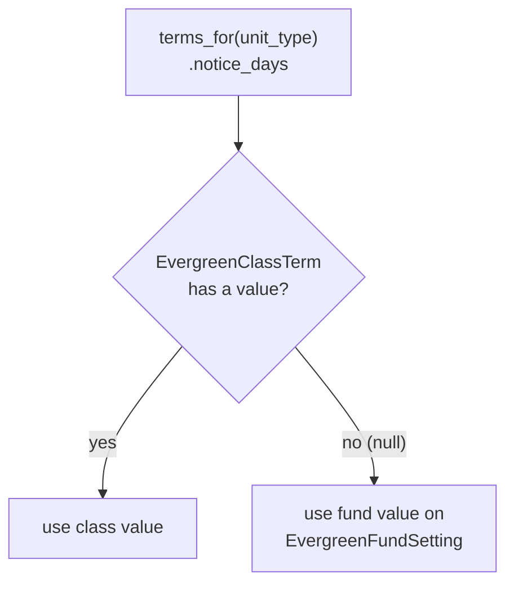

| Component | Responsibility | Transaction | Idempotency |
|---|---|---|---|
| `EvergreenEnable` | Validates at least one unit class and creates the setting, class terms per `fund.unit_types`, the dealing-date and order journey templates (seeded once per entity) and the optional fee formula | One transaction for setting and class terms; template seeding is idempotent via `JourneySetup` | Re-running on an evergreen fund is a no-op |
| `EvergreenPresets` | Loads the YAML presets and returns field values for the form; never saves | — | Pure |
| `EvergreenDisable` | Removes the setting if no `DealingDate` is confirmed | One transaction | — |
| `DealingCalendar` | Expands the calendars (frequency, dealing day, custom dates, Monday–Friday) into dates, cut-offs and notice deadlines | — | Pure |

**Routes** (under `/funds/:fund_id/evergreen`)

| Verb and path | Action | Does | Responds with |
|---|---|---|---|
| `GET settings` | `Evergreen::SettingsController#show` | Enable button or settings form | HTML |
| `POST settings` | `#create` | `EvergreenEnable` | Redirect to Overview, flash "This fund is now evergreen" |
| `PATCH settings` | `#update` | Validate and save; forward-only effect | Turbo Stream form |
| `GET settings/preset?name=` | `#preset` | Fill the form from a preset (unsaved) | Turbo Stream form |
| `DELETE settings` | `#destroy` | `EvergreenDisable` | Redirect, or an error "Dealing dates exist — cannot switch back" |

**Access:** fund update rights (`FundBasePolicy#update?`) for create, update and destroy. The entity flag `enable_evergreen_funds` must be on, otherwise the evergreen controls are not rendered at all.

**Build notes:** the form is a single page with headed sections (see proposal GP-8). Per-class overrides are a nested table, one row per unit type. A blank override cell means "use the fund value". The early-redemption fee schedule is an editable list of (from month, to month, %) rows stored as JSON.

**Worked examples:** H1, H2, E1, E3, E4, E5, E6, E47, X1, X2, X3, X4

**FAQ**

| Question | Answer |
|---|---|
| Why not a boolean `evergreen` column on `funds`? | That would change an existing table. The settings row carries all the terms anyway, and its existence is the flag. |
| Why are class overrides nullable columns, not JSON? | They're validated, queried (for example, the lock-up per class during order checks) and shown in a table; typed columns keep the validation simple. Only the fee schedule, a list, is JSON. |
| What if a unit type is added to the fund later? | `EvergreenClassTerm` rows are created lazily, with fund defaults, the first time a class is used. Its initial price must be set before it can be dealt. |

### ② Orders

Subscriptions and redemptions, from three sources (portal wizard, admin entry, upload), validated by one service, dated by the calendar and queued by received time. For pre-funded funds, accepting a subscription also opens the folio and its subscription payment (⑥), so money can arrive before dealing.

| Owns | Reads / receives | Produces |
|---|---|---|
| `dealing_orders`; order journey templates and workflow checks under `workflow_checks/dealing_order/` | ① terms; ⑦ units held and lot ages (`FundUnit`); ④ latest approved NAV (indicative values, minimum holding); `InvestorKyc` status; attached documents | `DealingOrder` (pending, …), queue position (derived), *ready to deal* (derived), acknowledgement events for ⑨ |

**Accepting an order**

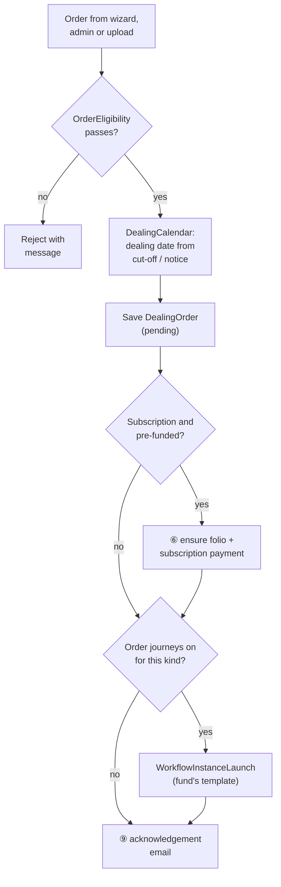

**`OrderEligibility` checks, in order** (first failure wins; messages as in the proposal's Behavior Rules):

| # | Check | Applies to |
|---|---|---|
| 1 | Folio currency = fund currency | both |
| 2 | Unit class is one of the fund's classes, and its initial price is set | both |
| 3 | Amount > 0 and ≥ minimum initial / additional (`terms_for`) | subscription |
| 4 | Exactly one allowed redemption form (units / amount / all) | redemption |
| 5 | Units ≤ held − hard-locked − already queued (lots by `issue_date`, oldest first) | redemption |
| 6 | Value left ≥ minimum holding at the latest approved NAV, unless *all units* | redemption |
| 7 | Soft-locked units → record the early-redemption fee % (flat or by age) on the order | redemption |

**Ready to deal (derived)** = status `pending` **and** (no journey **or** journey at *Ready to deal*) **and** (redemption **or** pay-after-dealing **or** the subscription payment is verified for the full amount).

**Queue position (derived)** = rank among the fund's open redemptions (`pending` or `partially_filled`) ordered by `received_at`, then `id`. Nothing is stored, so rolls and cancellations never renumber anything by hand.

**Order journey checks** (`workflow_checks/dealing_order/`), each answering one question from data:

| Step | Check class | Passes when |
|---|---|---|
| Check investor KYC | `DealingOrder::CheckInvestorKyc` | The investor's `InvestorKyc` linked to the fund's entity is approved (same rule as the KYC journey) |
| Collect signed subscription form | `DealingOrder::CollectSignedForm` | A document tagged "Subscription Form" is attached to the order |
| Accept order | `DealingOrder::AcceptOrder` | `accepted_at` is present (set by **Accept**; **Reject** sets `status: rejected`) |
| Verify request | `DealingOrder::VerifyRequest` | `signatory_verified_at` is present |
| Collect subscription money | `DealingOrder::CollectMoney` | The subscription payment is verified for the full amount; not applicable when paid after dealing |
| Ready to deal | `DealingOrder::ReadyToDeal` | Every earlier step is done or not applicable |
| Allot units and send contract note / Pay redemption / Cancel units and send redemption advice | `DealingOrder::Allotted`, `::Paid`, `::Cancelled` | The order's `DealingFill` has the unit row, payment or document |

**Routes** (under `/funds/:fund_id/evergreen`, plus the investor portal)

| Verb and path | Action | Does | Responds with |
|---|---|---|---|
| `GET orders` | `Evergreen::OrdersController#index` | Order book: one table, `?filter=open` (default) / `dealt` / `closed` / `all`; on Open, each redemption row also carries the gate forecast (`EvergreenGateForecast`, GP) | HTML |
| `GET orders/new?kind=` | `#new` | Wizard (investor) or admin form | HTML (wizard steps as Turbo Frames) |
| `POST orders/preview` | `#preview` | Indicative units or value, dealing date, queue position (no save) | Turbo Stream |
| `POST orders` | `#create` | `DealingOrderCreate` | Done step, or redirect to order |
| `PATCH orders/:id/cancel` | `#cancel` | `DealingOrderCancel` | Turbo Stream row |
| `PATCH orders/:id/accept` · `reject` · `verify_signatory` | `#accept` … | Journey actions | Turbo Stream step bar |
| `POST orders/import` | `ImportUpload` with `ImportDealingOrder` | Per-row `DealingOrderCreate` | Upload results sheet |

**Access**

| Role | Place | Cancel | Accept / reject / verify | See |
|---|---|---|---|---|
| Fund admin (fund `update?`) | For any investor of the fund | Any pending order | Only with fund approve rights | All orders of the fund |
| Investor (permissioned investor of the fund) | Only for their own investor; Redeem only with free units | Own pending orders | — | Own orders only |

Entity scoping: `DealingOrderPolicy::Scope` builds on `FundBasePolicy::Scope`. Investor rows are filtered by `investor_id` in the user's investor accesses. `DealingOrder` is added to `ForInvestor`'s lists of fund-child models.

**Worked examples:** H7, H8, H9, H10, H11, H12, H13, H14, H15, E13, E14, E15, E16, E17, E18, E19, E20, E21, E22, X10, X11, X12, X13, X14, X15, X16, X19

**FAQ**

| Question | Answer |
|---|---|
| Why is queue position derived, not stored? | Rolls, cancellations and partial fills would all need renumbering. Ordering by `received_at` is the rule itself. |
| Why open the folio at acceptance for pre-funded funds? | Payments, bank reconciliation and payment instructions all need the folio and its subscription payment before the money arrives. |
| What if a pre-funded order is cancelled after the folio was opened? | `DealingOrderCancel` removes its subscription payment (if nothing was paid) and reverses the `CommitmentAdjustment` top-up. A folio created for that order with nothing else in it is soft-deleted. |
| Why one model for both kinds? | Calendar, queue, journey, cancel, upload and the order book are shared; the kind-specific columns are few. |

### ③ NAV builder

Drafts a NAV for every class of the fund for one date, from CapHive data, or imports one per class. Each line records its source so the draft is auditable.

| Owns | Reads / receives | Produces |
|---|---|---|
| `fund_navs` (draft rows), `NavInputs`, `ClassApportioner`, `PerformanceFeeCalculator`, `NavStaleness`, `ImportFundNav` | `FundPortfolioCalcs#fmv_on_date`; `fund.fund_account_entries` latest by name on or before the date (cash, other assets, other liabilities, fee-paid names from ①); class folios' "Management Fees" entries; ⑦ `FundUnit` units by class as of date; previous approved `FundNav` per class; ① class terms | `FundNav` draft per class with lines, breakdown JSON, `nav_per_unit_cents`, `perf_fee_accrued_cents`, `mgmt_fee_accrued_to`, `inputs_fingerprint` |

**Building one date's NAVs**

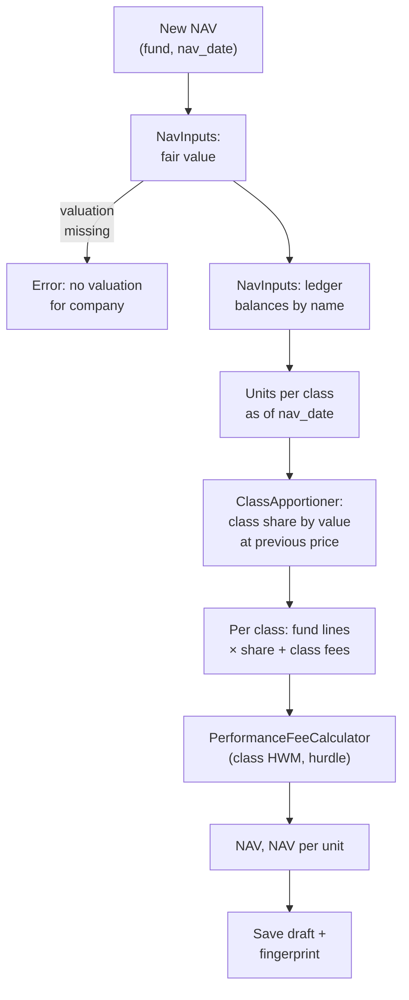

**Line rules**

| Line | Source | Fund-wide or class |
|---|---|---|
| Investments at fair value | `FundPortfolioCalcs.new(fund, nav_date).fmv_on_date` | Fund-wide × class share |
| Cash / Other assets / Other liabilities | Latest fund-level account entry on or before `nav_date` named per ① | Fund-wide × class share |
| Management fee payable | Previous approved NAV's payable + the class folios' management-fee entries in (previous NAV date, `nav_date`] − fund-level "Management Fee Paid" entries in the same window × class share | Class |
| Performance fee payable | Previous payable + previous NAV's crystallised amount − "Performance Fee Paid" entries in the window × class share | Class |
| Accrued performance fee | `PerformanceFeeCalculator` (hard or soft hurdle, model None → no line) | Class |
| Units outstanding | Σ `FundUnit.quantity` for the class with `issue_date ≤ nav_date` | Class |
| NAV per unit | NAV ÷ units; with zero units, the class initial price (labelled) | Class |

**Class share** = (units × previous approved NAV per unit, or initial price) for the class ÷ the same sum over all classes. A single-class fund always gets 100 %.

**Staleness (derived on read).** `NavStaleness` hashes (count, max `updated_at`) of four small, indexed inputs: fund-level account entries on or before the date, the class folios' management-fee entries in the window, `fund_units` of the fund on or before the date, and portfolio valuations of the fund's holdings on or before the date. A different hash means stale. It's computed only for drafts and the latest approved NAV per class on screen; nothing is watched on write.

**Overrides:** `overrides` JSON `{line => {value_cents, reason, user_id, at}}`. NAV is recomputed from lines after any override, and overrides survive **Recalculate** (the line keeps its override, with the computed value shown alongside).

**Upload:** `ImportFundNav` follows `ImportUtil`. Each row creates a draft with `source: uploaded`, lines empty except NAV, units and NAV per unit. It rejects a row when |NAV ÷ units − NAV per unit| > 0.01.

**Management-fee accrual warning:** `mgmt_fee_accrued_to` = max `reporting_date` of the class folios' management-fee entries. If the class fee % > 0 and that date is before `nav_date`, the draft and approval screens show the warning (non-blocking).

**Worked examples:** H3, H4, H5, H29, E7, E8, E10, E11, E35, E36, E38, E39, E40, E41, E42, X5, X6, X7

**FAQ**

| Question | Answer |
|---|---|
| Why split fund-wide lines by value at the previous price, not by units? | Classes have different NAVs per unit; splitting by unit count would move value between classes. |
| Why not recompute staleness on every ledger write? | `account_entries` is very large and written in bulk by allocation runs. A read-time hash over indexed, fund-scoped counts is cheap and never touches the write path. |
| Why does a missing valuation stop the draft instead of using zero? | A silent zero would understate NAV and misprice every order. The admin either adds the valuation or uploads the NAV. |

**Decided and built 8 Oct 2026 — two NAV corrections (see docs/modules/funds/evergreen_design_decisions.md)**

*1. A fee payment settles the class that owed it.* Fund-wide lines are split between classes by value (`ClassApportioner`), and that value already has each class's own fee taken off. Splitting a "Fee Paid" entry by the same value share therefore credits classes that never owed the fee (E197: A ₹46.98 Cr / B ₹51.02 Cr instead of ₹48 Cr / ₹50 Cr). Instead, each payment in the NAV period is split by what each class owed before it — previous payable + this period's accruals (management) or + the previous NAV's crystallised fee (performance). An over-payment's excess, or a payment when nothing is owed, falls back to the value share (E199, E200). The GP still books one fund-level entry.

*2. Dealing in progress is kept out of the NAV.* A new liability line per class, "Money received for orders not yet dealt" (`dealing_in_progress_cents`), holds (a) money received on or before the NAV date for subscriptions whose dealing date is after it — charged to the order's own class, not shared (E201, E203) — and (b) the payout of redemptions dealt on or before the NAV date but not yet paid, whose units are also left out of units outstanding (E202). It is computed from the orders (`NavInputs#dealing_in_progress`), shown with its orders in the NAV breakdown, can be overridden like any line, and is not applied to an uploaded NAV (E204). To keep it from moving value between classes, the total is taken out of the shared cash before the class split and given back to each order's own class alongside an equal liability. Subscription payments, confirmed fills and redemption payouts are part of the NAV staleness fingerprint, so a NAV drafted before they change is flagged. The line assumes the cash balance already includes the advance money, so the NAV page warns when the latest cash balance is older than money received (E205). US treatment: "subscriptions received in advance" / "redemptions payable" (ASC 946).

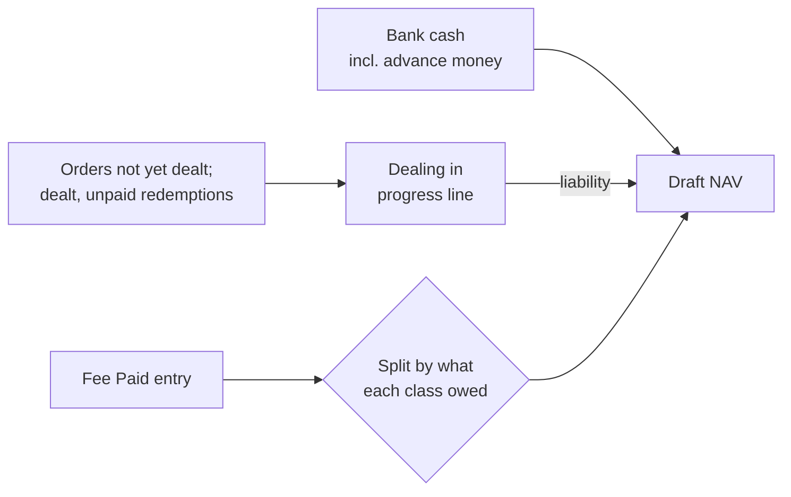

### ④ NAV approval

Maker-checker approval, reopen and performance-fee crystallisation.

| Owns | Reads / receives | Produces |
|---|---|---|
| `FundNavApprove`, `FundNavReopen`, `Crystalliser` | Draft `FundNav`; ① class terms (crystallisation frequency); ⑦ units per folio at `nav_date` | Approved `FundNav`; on crystallisation dates, `AccountEntry` rows "Performance Fee Crystallised" (parent = the `FundNav`) and `hwm_after_cents` |

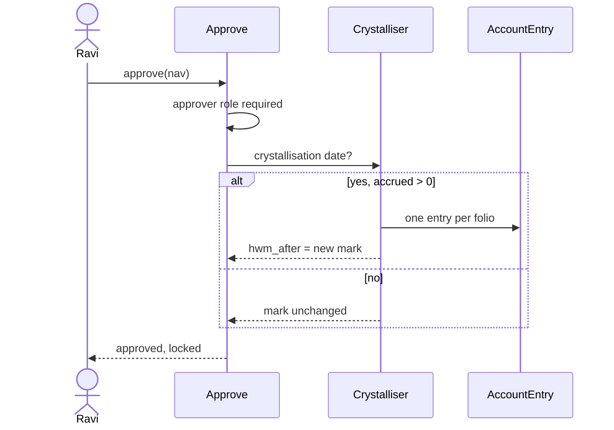

| Component | Transaction | Idempotency |
|---|---|---|
| `FundNavApprove` | Approve + crystallise in one transaction | Approving an approved NAV is refused |
| `FundNavReopen` | Refuses if any `DealingFill.fund_nav_id` references it. Otherwise deletes its crystallisation entries (`fund_id` + `reporting_date` + `parent`, using the `idx_ae_parent_fund_name_flags` index) and restores `hwm` — one transaction | Reopening a draft is refused |

**Access:** approve and reopen need the fund approve rights used by `CapitalCallPolicy#approve?` (the `:approver` role) plus fund access. Preparer ≠ approver is enforced in the service, not just hidden in the UI.

**Worked examples:** H6, H30, E9, E43, E44, X8, X9

**FAQ**

| Question | Answer |
|---|---|
| Why can't a used NAV be reopened? | Units were allotted and cancelled at that price. Reopening would leave the ledger and the unit register describing a price that no longer exists. Corrections are new transactions. |
| Why are crystallisation entries per folio? | Statements and allocation already read commitment-level entries; a fund-level entry would not appear on investor statements. |

### ⑤ Dealing date

A record per fund per dealing date. It owns the step bar, pricing, gating, confirmation, roll, undo and close.

| Owns | Reads / receives | Produces |
|---|---|---|
| `dealing_dates`, `dealing_fills`, `DealingPricer`, `GateAllocator`, `DealingConfirm`, `DealingUndo`, `DealingRoll`, `DealingDateClose`, `DealingDateGenerateJob`, dealing-date journey templates and checks (`workflow_checks/dealing_date/`) | ② ready orders; ④ approved NAV per class (latest on or before the date); ① gate config and settlement days; ⑦ holdings (all-units, investor cap); gate consumption from earlier confirmed dates in the period | `DealingFill` rows; status; snapshot JSON; calls into ⑥; events for ⑨ |

**Pricing and gating (`DealingPricer` → `GateAllocator`)**

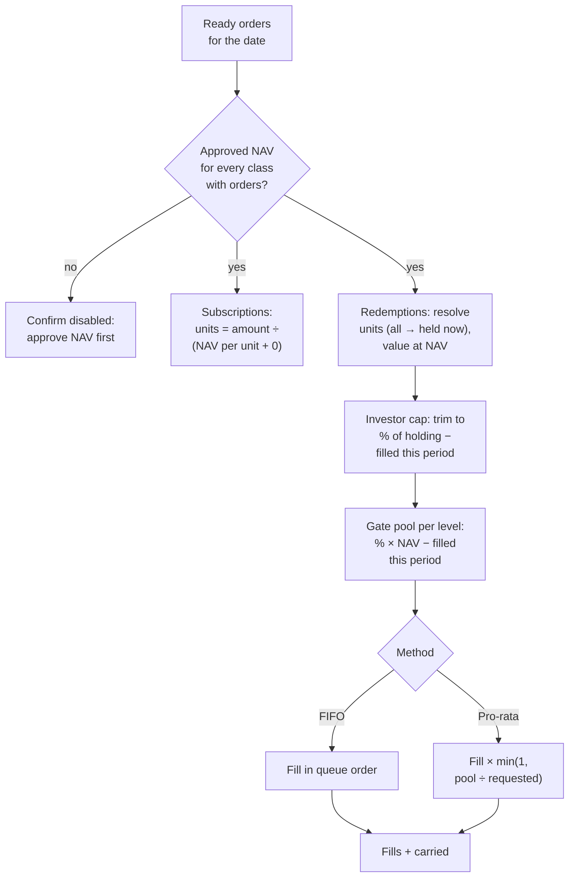

**Gate inputs and rounding**

| Input | Rule |
|---|---|
| NAV for the gate | The approved NAV used to price this date (per class or summed for the fund) |
| Consumed this period | Σ filled value of confirmed dealing dates of the fund in the same gate period (dealing date / quarter / year) and level |
| Investor cap | Per investor: % × units held at the start of the period − units filled for that investor this period |
| Units | Truncated to 4 decimal places; value = units × NAV per unit rounded to paise |

**Dealing-date journey checks** (`workflow_checks/dealing_date/`)

| Step | Check | Passes when |
|---|---|---|
| Collect subscription money (pre-funded) | `DealingDate::CollectMoney` | Cut-off has passed, or every subscription for the date is fully verified |
| Approve NAV | `DealingDate::ApproveNav` | Every class with ready orders has an approved NAV on or before the date |
| Review and confirm dealing | `DealingDate::Confirm` | `status` is confirmed |
| Send payment instructions (pay-after) | `DealingDate::InstructionsSent` | Every subscription fill has `document_sent_at` for instructions |
| Collect subscription money (pay-after) | `DealingDate::CollectMoneyAfter` | Every subscription remittance is verified for its amount |
| Allot units | `DealingDate::Allotted` | Every subscription fill has `fund_unit_id` |
| Pay redemptions | `DealingDate::RedemptionsPaid` | Every redemption payment is completed |
| Cancel units | `DealingDate::UnitsCancelled` | Every paid redemption fill has `fund_unit_id` |
| Generate documents (skip: `DealingDate::NoDocumentTemplates`) | `DealingDate::DocumentsGenerated` | Some fill is settled and no settled fill whose kind has a template is still without a document (`EvergreenDealingDocuments.to_generate` is empty) |
| Approve and send documents (skip: `DealingDate::NoDocumentTemplates`) | `DealingDate::DocumentsSent` | Every settled fill has `document_sent_at` (its generated document approved and emailed, or its email sent at once) |
| Close dealing date | `DealingDate::Closed` | `closed_at` present (button enabled once every earlier step is done **and every settled fill has `document_sent_at`**) |

Steps with no matching fills are *not applicable*. The template is chosen at generation from the fund's payment timing: `DealingDatePreFunded` or `DealingDatePayAfter` (built as one template with skip checks — [lld D2](lld.md#implementation-deviations-recorded-during-apply)). `NoDocumentTemplates` passes (step skipped, shown "n/a — no template") when the fund has no document tagged "Contract Note Template" or "Redemption Advice Template" (`EvergreenDealingDocuments.templates?(fund)`).

**Confirm (`DealingConfirm`)** — one DB transaction, then jobs:

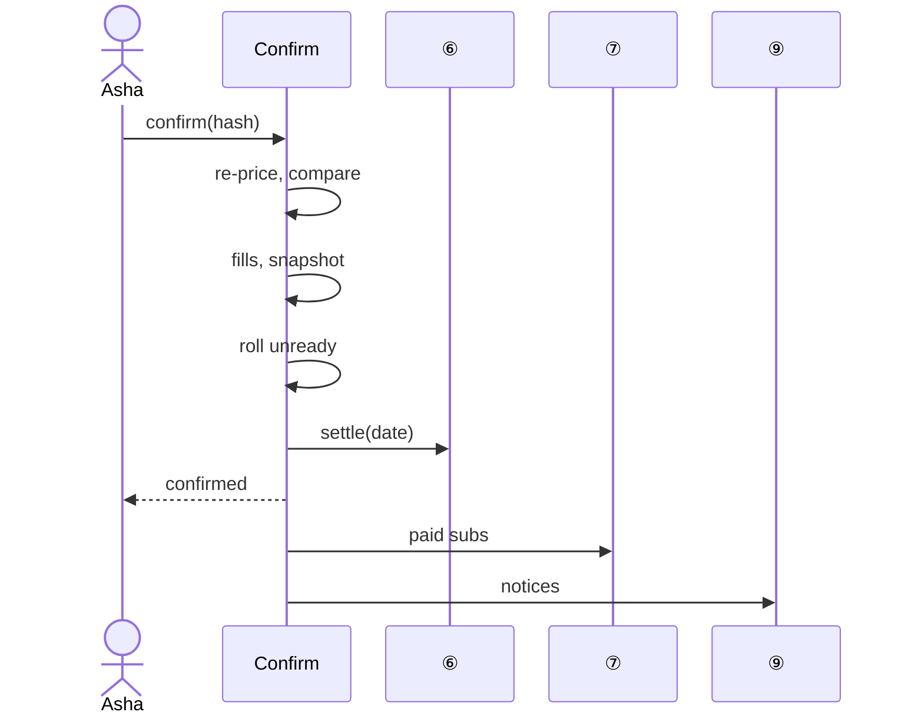

`Confirm` = `DealingConfirm`, which calls `DealingPricer` (re-price) and `DealingRoll` · ⑥ `DealingSettlement` · ⑦ `DealingSettlementSyncJob` · ⑨ `EvergreenNotifier`.

If the re-priced result differs from what the user previewed (for example, an order was cancelled in between), confirm aborts with "Pricing changed — review again". This is the "store exactly what the preview showed" rule.

**Undo (`DealingUndo`):** allowed only if no fill has `fund_unit_id`, no redemption payment is completed and no money was recorded at or after confirm. It reverses ⑥'s confirm-time work (pay-after remittances and folio top-ups, the distribution, unit prices on the call), deletes fills, restores order statuses and dealing dates, and sets `status: open`. One transaction.

**Close (`DealingDateClose`):** sets `closed_at` and `status: closed` once every earlier step passes (`DealingProgress#closable?`, which now also requires `documents_sent?`). Otherwise Close is disabled with "Send every contract note and redemption advice first" (X28).

**Generation (`DealingDateGenerateJob`):** a daily cron per evergreen fund that creates `DealingDate` rows for the next 3 calendar periods and launches their journey. `DealingOrderCreate` also creates one on demand.

**Routes**

| Verb and path | Action | Does | Responds with |
|---|---|---|---|
| `GET dealing` | `Evergreen::DealingDatesController#index` | Dealing list | HTML |
| `GET dealing/:id` | `#show` | Workspace: step bar, pricing (open) or tracker (confirmed) | HTML; tracker rows as Turbo Frames |
| `POST dealing/:id/confirm` | `#confirm` | `DealingConfirm` (with `preview_hash`) | Redirect to tracker |
| `POST dealing/:id/undo` · `close` | `#undo` · `#close` | `DealingUndo` / `DealingDateClose` | Redirect |
| `POST dealing/:id/fills/:fill_id/record_payment` · `verify` · `mark_paid` · `resend` | `Evergreen::DealingFillsController` | Existing remittance-payment, verify and payment-update services; resend document | Turbo Stream row |
| `POST dealing/:id/generate_documents` · `approve_documents` | `#generate_documents` · `#approve_documents` | Enqueue `EvergreenDocumentsJob` / `EvergreenDealingDocuments.approve_and_send` ([card ⑨](#⑨-screens-documents-journeys)) | Redirect with flash |
| `POST dealing/:id/fills/:fill_id/regenerate` | `DealingFillsController#regenerate` | `EvergreenDealingDocuments.regenerate` (unapproved only) | Turbo Stream row |

**Build notes:** the confirm popup uses the action-summary card pattern (three cards). Tracker rows update live through `Turbo::StreamsChannel` on `dealing_date` when the sync job finishes.

**Worked examples:** H16, H17, H18, H19, H20, H21, H24, H26, H57, H59, H61, E23, E24, E25, E26, E27, E28, E29, E30, E33, E34, X17, X18, X20, X28

**FAQ**

| Question | Answer |
|---|---|
| Why re-price at confirm instead of trusting the preview? | The preview is computed on read and data can change between viewing and clicking. The hash check makes sure the stored fills are exactly what was shown, and refuses otherwise. |
| Why store fills rather than recompute them? | Settings and NAV can change later (forward only), and statements and documents must show what was dealt. |
| Can two people confirm at once? | `DealingConfirm` locks the `dealing_dates` row (`lock!`) and refuses unless the status is open. |
| Why do the document steps come after Cancel units rather than inside Allot / Cancel? | Units move per fill, as money arrives; documents are checked and sent as one batch per dealing date. Splitting "move units" from "send documents" lets Allot and Cancel finish on their own data, and lets a fund without templates skip both document steps. |
| A pay-after subscriber pays after Approve & send — does the date go backwards? | Yes, deliberately: the new allotment has no document, so *Generate documents* is current again until it is clicked, then *Approve & send* (E67). Close is never reachable with an unsent document. |

### ⑥ Settlement

Drives CapHive's **existing** settlement records for a dealing date, through their existing services. It adds no columns; links live on `dealing_dates` and `dealing_fills`.

| Owns | Reads / receives | Produces |
|---|---|---|
| `DealingSettlement`, `FolioOpener` | ② orders; ⑤ fills; ① fund close name, settlement days, document templates | `CapitalCall` (call basis Upload) per dealing date with one `CapitalRemittance` per subscription; `CapitalDistribution` (Upload, no auto payments) with one `CapitalDistributionPayment` per filled redemption; `CapitalCommitment` folios and `CommitmentAdjustment` top-ups; early-redemption fee `AccountEntry` (the payment is created net of it) |

**How each record is created**

| Record | Created by (existing service) | Settings that keep it evergreen-only |
|---|---|---|
| Folio (`CapitalCommitment`) | `CapitalCommitmentCreate` with `fund_close` = ① fund close name (default "Evergreen"), `unit_type`, `commitment_date` = order date, `folio_id` generated "F-<n>" | — |
| Top-up | `AdjustmentCreate`, type "Top Up", `as_of` = order date | Reversed by cancel or undo |
| Subscription settlement (`CapitalCall`) | `CapitalCallCreate`, `call_basis: "Upload"`, name "Subscription settlement — <date>", `due_date`/`call_date` = dealing date, `approved: true` (approved_by = the acting user), `send_call_notice_flag: false`, `send_payment_notification_flag: false`, no call fees | `unit_prices` set at confirm to `{class => {price: NAV per unit, premium: "0"}}` |
| Subscription payment (`CapitalRemittance`) | `CapitalRemittanceCreate` (`folio_call_amount_cents` = order amount); counters via `CapitalRemittancesCountersJob` | Created at acceptance (pre-funded) or at confirm (pay-after) |
| Redemption settlement (`CapitalDistribution`) | `CapitalDistribution` with `distribution_on: "Upload"`, `generate_payments: false`, `approved: true`, `send_notification_on_complete: false`, `unit_prices` = `{class => NAV per unit}` | Named "Redemption settlement — <date>" |
| Redemption payment (`CapitalDistributionPayment`) | `CapitalDistributionPaymentCreate`, `cost_of_investment` = filled value, `income` 0, `completed: false`, `payment_date` = due date | Exact units held on `DealingFill` |
| Early-redemption fee | `AccountEntry` on the folio (name "Early Redemption Fee", `parent` = the `DealingFill`); the redemption payment is created net of the fee. No `DistributionFee`: a distribution-level fee was deducted from every payment of the folio (review finding) | Reduces net payable only |

**Roll (pre-funded):** an unpaid subscription's remittance is destroyed in the old call and recreated in the next date's call. A partly paid one is moved by updating `capital_call_id`, its payments follow, and counters are fixed by `CapitalRemittancesCountersJob`.

**Journeys on these records:** none. `CapitalCall`/`CapitalDistribution#skip_journey?` returns true for records a `DealingDate` points at, and `Workflowable#apply_workflow_auto_assignment(_on_update)` returns early when `skip_journey?` is true. The dealing-date journey replaces them.

**Worked examples:** H21, H22, H23, E24, E31, E32, X18

**FAQ**

| Question | Answer |
|---|---|
| Why set the call approved at creation? | Remittances can't be verified while their call is unapproved. Evergreen approvals happen at the NAV and the order, not the call. |
| Why `send_*_flag: false`? | The existing notification gates (`CapitalRemittancePayment#notify_capital_remittance_payment`, `CapitalCall#send_notification`, distribution `send_notification`) already honour these flags, so no closed-end email can go to evergreen investors, with no code change. |
| Why do entity-wide call lists still show these records? | They're real money movements. Their names read "Subscription settlement — …", and the evergreen settlement page is where they are worked. Hiding them from entity reports would change existing reports; see Risks. |

### ⑦ Unit register

Units move only through `DefaultUnitAllocationEngine`. Allotment reuses `allocate_remittance` unchanged. Cancellation uses a new `allocate_dealing_redemption`, so the dealt unit count is exact.

| Owns | Reads / receives | Produces |
|---|---|---|
| `EvergreenSettlementHooks` (concern), `DealingSettlementSyncJob`, `EvergreenAllotment` | After-commit events on `CapitalRemittance` and `CapitalDistributionPayment`; ⑤ fills and status | `FundUnit` rows (positive at NAV per unit; negative exact units), `dealing_fills.fund_unit_id`, events for ⑨ |

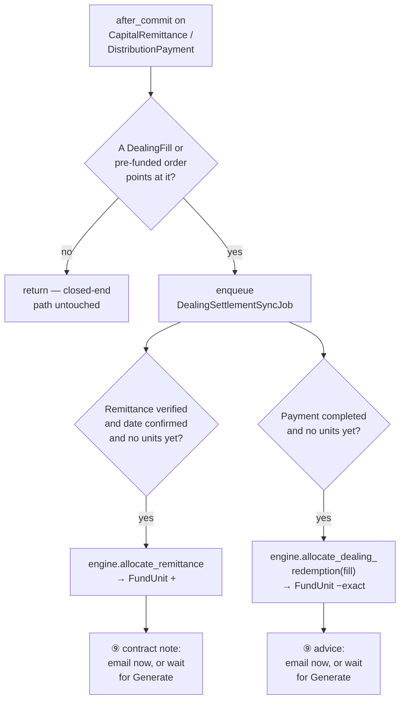

| Component | Queue | Retries | Idempotency |
|---|---|---|---|
| `DealingSettlementSyncJob` | `:default` | Sidekiq default; errors alert the acting user and developers via the existing `UserAlert` / `EntityMailer` path in the engine | Skips when the fill already has `fund_unit_id`; `allocate_remittance` already allocates only the pending amount |
| `allocate_dealing_redemption(payment, fill, reason)` | — | — | Skips when the payment already owns a `FundUnit` |

**Engine change (flagged):** `allocate_distribution_payment` gets a first-line return: if `DealingFill.exists?(capital_distribution_payment_id: payment.id)`, delegate to `allocate_dealing_redemption`. For every closed-end payment the lookup is false and the method body runs unchanged.

**Worked examples:** H21, H23, H24, H25, E2, E34

**FAQ**

| Question | Answer |
|---|---|
| Why not call the engine straight from the tracker buttons? | Money can also be recorded by bank reconciliation or the existing remittance screens. The hook catches every path. |
| Why does recording a payment not allot straight away for pre-funded orders? | Units are allotted at the dealing date's NAV, which only exists at confirm. Until then the job finds the date not confirmed and does nothing. |

### ⑧ Fee formulas

The management fee on NAV is an ordinary `FundFormula`, seeded on request. Nothing in the allocation engine changes.

| Owns | Reads / receives | Produces |
|---|---|---|
| Seeded `FundFormula` "Management Fee on NAV" (rule type `GenerateAccountEntry`, entry type "Management Fees"); `Fund#evergreen_nav_per_unit(unit_type, date)` | `@units` (commitment cache, units as of `end_date`), `fund_unit_setting.management_fee`, `start_date`, `end_date`, ④ approved NAV per unit on or before `start_date` | Per-folio `AccountEntry` = units × NAV per unit × fee % × days ÷ 365 |

The formula string uses only names allowed by `SAFE_EVAL_REGEX` (no `select`, `update`, …). `fund` is the primary-DB `Fund` in the formula binding, so `evergreen_nav_per_unit` works during scratch (SQLite) allocation runs too.

**Worked examples:** H27, H28, E37

**FAQ**

| Question | Answer |
|---|---|
| Why not compute the fee inside the NAV builder? | The formula engine already handles allocation, explain, reruns and statements. The NAV builder just reads its output. |
| What if units change mid-month? | The formula uses units at `end_date` × the NAV per unit at the period start, as specified. Monthly runs keep the error small; a fund wanting daily precision runs shorter periods. |

### ⑨ Screens, documents, journeys

Everything people see, chosen by the fund's flag: the evergreen GP and investor views, labels, emails and documents (including the dealing date's *Generate documents* and *Approve & send*), plus the step bars of the two new journeys.

| Owns | Reads / receives | Produces |
|---|---|---|
| `Evergreen::*` controllers and views (`app/packs/funds/evergreen/views`), `EvergreenLabels` (i18n `evergreen.labels.*`), `EvergreenNotifier` (`BaseNotifier`) + `EvergreenMailer`, `EvergreenDealingDocuments` (which path per fill; generate, approve and send, regenerate), `EvergreenDocumentsJob` (**Generate documents**), `EvergreenDocTemplateGenerator` (Sablon → PDF from the fund's or folio's template, via `DocumentGeneratorBase` like `CapitalDistributionPaymentDocGenerator`), `DealingDateJourneySetup`, `DealingOrderJourneySetup`, sample templates, `SoaGenerator` evergreen context keys | Every other box | Screens, emails, generated documents in the investor's Documents |

**Switch points in existing code** (each guarded; flagged in [Backward compatibility](#backward-compatibility)):

| # | Existing file | Guarded change |
|---|---|---|
| S1 | `funds/views/funds/show.html.erb` | `fund.evergreen?` → render `evergreen/funds/show` (GP or investor variant); else unchanged |
| S2 | Funds list card partial (`funds/_card*`) | `fund.evergreen?` → evergreen card |
| S3 | `entities/widgets/_lp_funds.html.erb` | Per commitment: `fund.evergreen?` → evergreen landing card |
| S4 | `CapitalCallsController#show`, `CapitalDistributionsController#show` | Evergreen settlement record → redirect to the evergreen settlement page |
| S5 | `CapitalCommitmentsController#show` (investor and GP) | Folio of an evergreen fund → redirect to the evergreen folio page |
| S6 | `SoaGenerator#…context` | Adds `evergreen` keys only when `fund.evergreen?` |

**Emails** (`EvergreenNotifier` per event; recipients `investor.notification_users(fund)`, as for remittances; dates via `EmailDateLocalization` `l(date)`): subscription acknowledgement, payment instructions, contract note, redemption acknowledgement, gate notice, redemption advice, request cancelled. The contract note and redemption advice go at once (figures in the body, no PDF) when the folio has no template of that kind, and otherwise at **Approve & send** with the PDF attached — see *Dealing-date documents* below. Reminders, investor updates and team alerts are in [card ⑩](#⑩-notifications).

**Dealing-date documents** (contract notes and redemption advices)

Templates are optional and per kind. A fund uploads a Word template tagged "Contract Note Template" and/or "Redemption Advice Template" to its documents; a folio can override it with its own template of the same name (`CapitalCommitment#templates(tag)`). The built-in PDF layout (`EvergreenDocumentGenerator`, HexaPDF) is retired. For each settled fill:

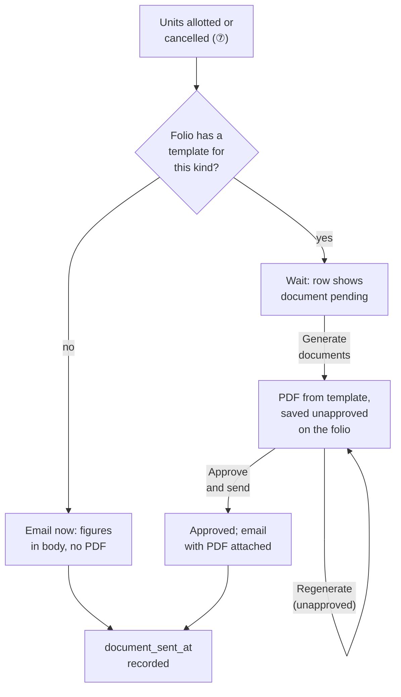

| Path | When it applies | What the investor gets | Recorded on the fill |
|---|---|---|---|
| Email only | No template of this kind for the folio | The contract note / advice email as soon as units move, with folio, class, dates, price, units and amounts in the body | `document_sent_at` |
| Template | A template of this kind exists | Nothing until **Approve & send**; then the email with the PDF attached, and the document appears in their Documents | `document_id` at Generate; `document_sent_at` at Approve & send |

**Generate, then approve and send**

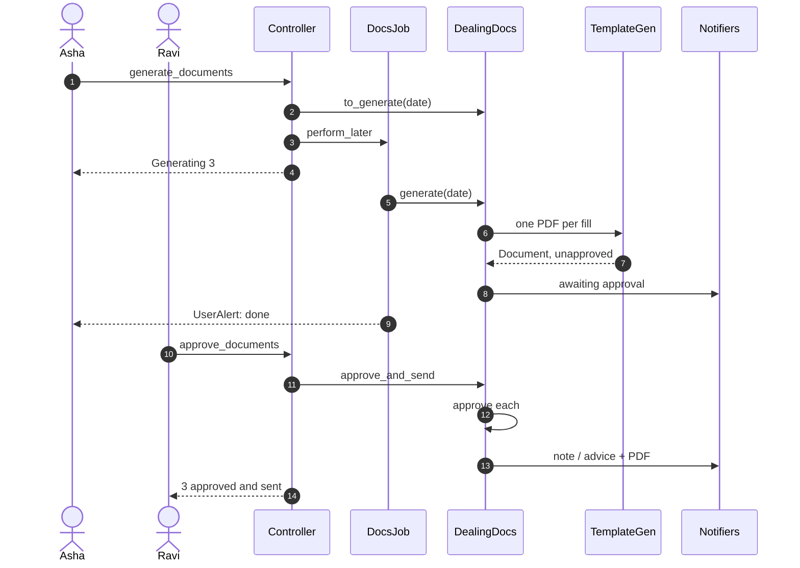

Participants: Controller = `Evergreen::DealingDatesController` · DocsJob = `EvergreenDocumentsJob` (queue `:doc_gen`) · DealingDocs = `EvergreenDealingDocuments` · TemplateGen = `EvergreenDocTemplateGenerator` · Notifiers = `EvergreenAlerts.documents_generated` → `EvergreenOpsNotifier` (step 8) and `EvergreenNotifier` → `EvergreenMailer`, which attaches the approved document (step 13).

| Component | Responsibility | Queue / runs | Idempotency | Transaction |
|---|---|---|---|---|
| `EvergreenDealingDocuments.settled(fill)` | Called by `EvergreenAllotment` after units move: emails at once when the folio has no template of the fill's kind, then re-evaluates the order and dealing-date journeys | Inside `DealingSettlementSyncJob` | `fund_unit_id` set once under `fill.lock!`, so it runs once per fill | After the unit row commits |
| `EvergreenDealingDocuments.to_generate(date)` | Settled fills with a template, no `document_id` and no `document_sent_at` | Read | Pure | — |
| `EvergreenDocumentsJob#perform(dealing_date_id, user_id)` | Calls `generate`; tells the user how many were generated and which failed (`UserAlert`) | `:doc_gen` | Only fills still without a document are generated, so a re-run or retry picks up just the new ones | One `fill.update!(document:)` per fill; a failure on one fill is rescued and listed, the others continue |
| `EvergreenDocTemplateGenerator` | Fills the Sablon template with the decorated records plus ready-formatted `evergreen.*` fields (units, NAV per unit, amounts, net paid, dates in the email format), converts to PDF, uploads to the folio as a "Generated", unapproved `Document` | Inside the job | — | — |
| `EvergreenDealingDocuments.approve_and_send(date, user)` | For every fill whose generated document is unapproved and not sent: `approved: true, approved_by_id`, then the investor email with the PDF, then `document_sent_at` | Inline (emails via Noticed `deliver_later`) | Skips fills with `document_sent_at`; a second click finds nothing | Per fill |
| `EvergreenDealingDocuments.regenerate(fill, user_id)` | Destroys the unapproved document and generates a new one from the current template | Inline | Refused when the document is approved | Per fill |

**Access**

| Role | Generate documents | Approve & send | View | Regenerate |
|---|---|---|---|---|
| Fund admin (`DealingDatePolicy#generate_documents?` = fund `update?`) | ✓ | ✗ unless also approver | ✓ | ✓ (unapproved only) |
| Approver (`#approve_documents?` = `generate_documents?` + approver role) | ✓ | ✓ | ✓ | ✓ (unapproved only) |
| Investor | — | — | Own approved documents in Documents only; unapproved "Generated" documents are hidden as for every generated document today | — |

**Journey — approve and send a dealing date's documents** (approver)

```
┌───────────────────────────────────────────────────────────────────────────┐
│ Dealing date 2 Nov 2026                                     [Actions ▾]   │
│ ① ✓ Allot ✓ Pay ✓ Cancel ✓ Generate documents ● Approve & send ○ Close     │
│ ② Actions: Generate documents · Approve & send                            │
│ ③ P Family Trust F-101 Contract note     Generated [View] [Regenerate]    │
│   A Ltd          F-012 Redemption advice Generated [View] [Regenerate]    │
│   B LLP          F-031 Redemption advice Generated [View] [Regenerate]    │
│  ┌ Approve & send documents ─────────────────────────────────┐           │
│  │ ④ Approve 1 contract note and 2 redemption advices,        │           │
│  │   and email them to investors                              │           │
│  │   Approved documents can't be regenerated                  │           │
│  │ ⑤                             [Cancel]  [Approve & send]    │           │
│  └────────────────────────────────────────────────────────────┘           │
└───────────────────────────────────────────────────────────────────────────┘
```

| Step | The user… | They see |
|---|---|---|
| ① | Opens the dealing date after units moved | The step bar with *Generate documents* or *Approve and send documents* current; both "n/a — no template" for a fund with no template |
| ② | Opens **Actions** | **Generate documents** (fund admins) and **Approve & send** (approvers, only while documents await approval) |
| ③ | Checks a row | **View** opens the PDF; **Regenerate** replaces it while unapproved |
| ④ | Clicks **Approve & send** | An action-summary popup with the counts of contract notes and advices, and that approved documents can't be regenerated |
| ⑤ | Confirms | "3 documents approved and sent"; rows show Sent; *Close dealing date* becomes current |

**Build notes:** the popup is a Bootstrap modal using the Request Updates "Immediate Actions" card pattern (two cards: what is approved and emailed; that approved documents are locked). The Generate flash reads "Generating 3 documents — you'll be notified when they are ready", and "Nothing to generate — every settled order already has its document or email" when `to_generate` is empty (no job is enqueued).

**Investor access:** `FundNav` (approved only) and `DealingOrder` (own only) are added to `ForInvestor`'s hard-coded fund-child lists. Evergreen investor controllers use `policy_scope` like every other fund child.

**Worked examples:** H1, H7, H25, H31, H32, H33, H34, H35, E216, E217, E218, E219, E220, H36, H37, H38, H39, H57, H59, H60, H61, H62, E1, E12, E38, E45, E46, E47, E48, E49, E50, E51, E66, E67, E68, E69, X19, X26, X27, X29, X30

**FAQ**

| Question | Answer |
|---|---|
| Why new views rather than parameterised existing ones? | The evergreen pages have different structure (dealing dates, order book, register), not just different words. New views keep closed-end views byte-identical. |
| How do labels stay consistent in emails and exports? | Every evergreen view, mailer and export reads `EvergreenLabels`. Closed-end code never calls it. |
| Why reuse the tagged-template mechanism instead of the `contract_note_template_id` columns on the settings? | Tagged templates already give folio-level overrides (`CapitalCommitment#templates`), the template upload screens and the Sablon → PDF pipeline. The two settings columns stay in the schema unused (lld D5). |
| Why can't an approved document be regenerated? | Approval is the fund's sign-off and, once sent, the investor holds that PDF. A correction after approval is a new document the fund issues deliberately, not a silent replacement. |
| What if a template breaks for one folio? | The other documents are still generated; the user's alert names the failed investor and the row offers Regenerate once the template is fixed (X30). |
| What does a fund with a contract-note template but no advice template get? | Each kind is decided separately: contract notes go through Generate and Approve & send; advices are emailed as soon as the redemption is paid (E66). |

### ⑩ Notifications

Reminders and updates to investors, and alerts to the fund's own team, raised by events in boxes ②–⑦ and by one daily check. Every notification has a key, a default and a per-fund switch; each is sent once per record.

| Owns | Reads / receives | Produces |
|---|---|---|
| `evergreen_fund_settings.notifications` (switches), `evergreen_notification_logs`, `EvergreenAlerts` (catalogue + switch lookup), `EvergreenRecipients`, `EvergreenNotificationsJob`, `EvergreenOpsNotifier` + `EvergreenOpsMailer`, five new `EvergreenMailer` methods, `EvergreenNotificationCopy` | Events from ② (order placed), ③ (NAV drafted), ④ (NAV approved), ⑤ (dealing date confirmed), ⑥ (payment verified), ⑨ (Generate documents finished); daily: dealing dates, orders, fills, `fund_units` lock-up ends; `Investor#managed_by`, approver role, `User::NOTIFICATION_TAGS`, `FundPolicy`, `DealingOrderPolicy`, fund-level `CustomNotification` for_type "Evergreen" | Investor emails (customisable), in-app + email team alerts, one log row per send |

**How a notification is sent**

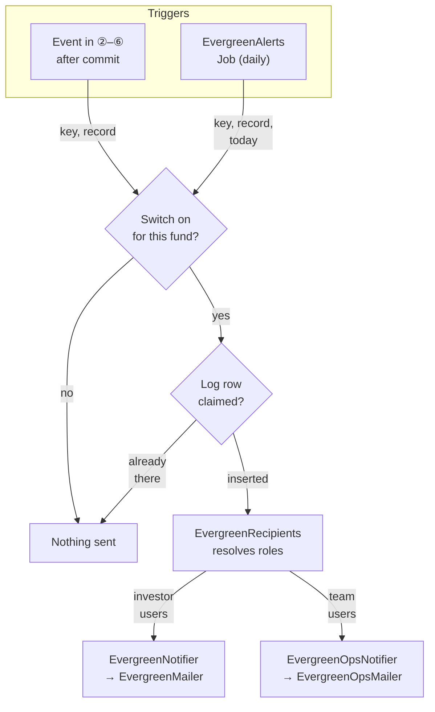

| Step | What happens | Why |
|---|---|---|
| Switch | `EvergreenAlerts.enabled?(fund, key)` reads `notifications[key]`, else the catalogue default | A new notification needs only a default; old funds pick it up without a migration |
| Log claim | Insert into `evergreen_notification_logs`; the unique index rejects a second insert | Claim first, send second: two jobs or a replayed event cannot both send |
| Recipients | `EvergreenRecipients.for(role, record)` per role in the catalogue | One place decides "who is Fund ops", the advisor rule and the relationship-manager fallback |
| Deliver | Investor keys → `EvergreenNotifier` (custom notification if the fund has one); team keys → `EvergreenOpsNotifier` (in-app + email, fixed wording) | Investor wording is the fund's to change; team alerts are operational and stay fixed |

**Catalogue** (keys are the switch keys and the log `key`; ✓ = on by default)

| Key | Audience | Trigger | Default | Recipients | Logged against |
|---|---|---|---|---|---|
| `payment_reminder` | Investor | Daily: cut-off − `reminder_days`, pre-funded subscription not fully paid | ✓ | Investor users | `DealingOrder`, per day |
| `action_needed` | Investor | Daily: cut-off − `reminder_days`, order journey has an unfinished step | ✓ | Investor users | `DealingOrder`, per day |
| `payment_received` | Investor | `CapitalRemittance` of an order becomes verified | ✓ | Investor users | `CapitalRemittance` |
| `units_unlocked` | Investor | Daily: a lot's lock-up ends today | off | Investor users (folio) | `FundUnit`, per day |
| `nav_update` | Investor | `FundNavApprove` succeeds | off | Investor users, one email per folio of the class | `FundNav` |
| `new_order` | Team | `DealingOrderCreate` with source portal | ✓ | Relationship manager, else Fund ops | `DealingOrder` |
| `nav_awaiting_approval` | Team | `FundNavBuilder` / `ImportFundNav` saves a draft | ✓ | Approvers except the preparer | `FundNav` |
| `nav_approved` | Team | `FundNavApprove` succeeds | ✓ | Preparer + Fund ops | `FundNav` |
| `cutoff_summary` | Team | Daily: the day after a dealing date's cut-off | ✓ | Fund ops | `DealingDate`, per day |
| `ready_to_confirm` | Team | NAV approved and cut-off passed (checked on approval and in the daily job) | ✓ | Fund ops + approvers | `DealingDate` |
| `gate_applied` | Team | `DealingConfirm` with carried units > 0 | ✓ | Compliance + Fund ops | `DealingDate` |
| `large_redemption` | Team | Redemption order ≥ `large_redemption_pct` % of the class's latest approved NAV | ✓ | Compliance + relationship manager | `DealingOrder` |
| `settlement_overdue` | Team | Daily: redemption payments past due; pay-after money past pay-by — the day after they fall due, then weekly while still overdue | ✓ | Fund ops | `DealingDate`, per send day (one alert listing every overdue row) |
| `fee_accrual_behind` | Team | A draft NAV's `mgmt_fee_accrued_to` < `nav_date` | ✓ | Fund accounting | `FundNav` |
| `documents_awaiting_approval` | Team | `EvergreenDocumentsJob` finishes having generated ≥ 1 document (funds with a template only) | ✓ | Approvers | `DealingDate`, per day (one alert per run that generated documents; a second run the same day is covered by the first alert) |

The existing investor emails (acknowledgements, payment instructions, gate notice, request moved, request cancelled, contract note, redemption advice) stay always on; they are not in the switch list. The contract note and advice are sent once per fill, guarded by `dealing_fills.document_sent_at` rather than the log.

**Who receives it** (`EvergreenRecipients`)

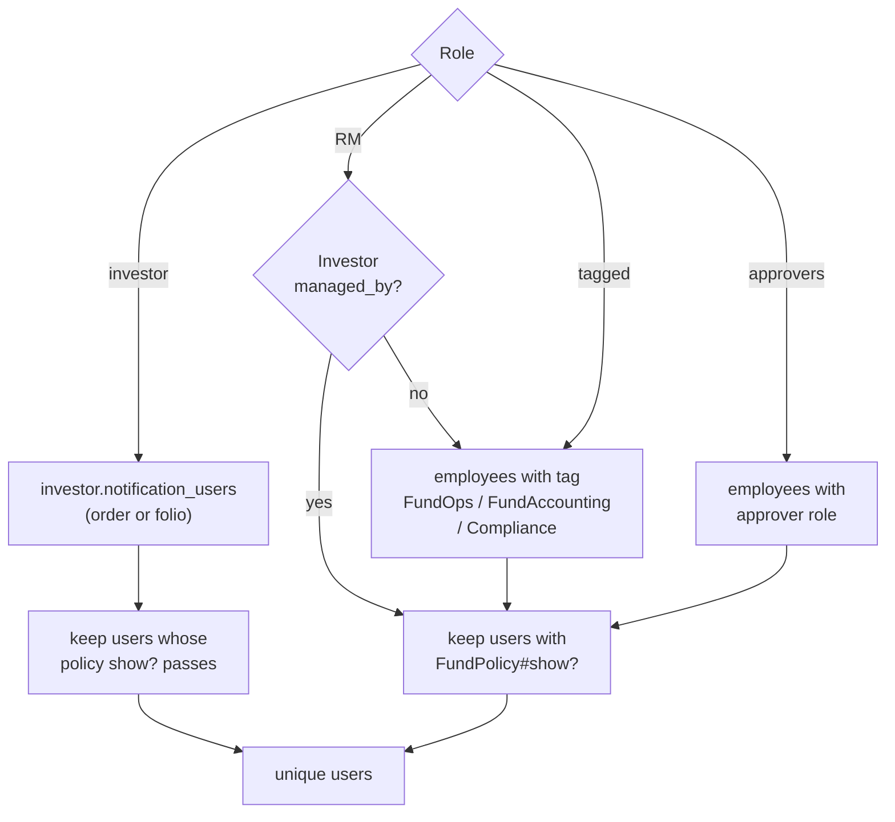

| Rule | Detail | Example |
|---|---|---|
| The order, not the fund, is the model | `notification_users(order)` checks each user against `DealingOrderPolicy#show?`. An advisor on the investor's access list gets the email only if allowed to see that order | E52 |
| Folio notifications | `units_unlocked` and `nav_update` pass the folio (`CapitalCommitment`), so the folio's policy decides | H43, H44 |
| Relationship-manager fallback | `Investor#managed_by` empty → Fund ops | E53 |
| Preparer excluded | `nav_awaiting_approval` drops `fund_nav.prepared_by` even if they are an approver | E58 |
| Fund access | Every team recipient must pass `FundPolicy#show?` for the fund | E59 |
| One email per person | Roles are unioned and de-duplicated before delivery | H47 |

**The daily check**

```mermaid
%%{init: {"sequence": {"actorMargin": 30, "width": 120, "messageMargin": 30}}}%%
sequenceDiagram
    autonumber
    participant J as DailyJob
    participant S as Switches
    participant L as Log
    participant R as Recipients
    participant N as Notifiers
    J->>J: evergreen funds
    J->>S: enabled?(key)
    S-->>J: yes / no
    J->>J: due records
    J->>L: claim(key, rec, today)
    L-->>J: inserted / dup
    J->>R: for(role, rec)
    R-->>J: users
    J->>N: deliver
```

Participants: DailyJob = `EvergreenNotificationsJob` (Sidekiq cron, daily, `find_each` over `EvergreenFundSetting`) · Switches = `EvergreenAlerts.enabled?` · Log = `EvergreenNotificationLog.claim!` · Recipients = `EvergreenRecipients` · Notifiers = `EvergreenNotifier` / `EvergreenOpsNotifier`. Each fund runs in its own `rescue` block, so one fund's error does not stop the others (X25).

| Check | Finds | Key |
|---|---|---|
| Reminder day | Open dealing dates whose `cutoff_at.to_date − reminder_days ≤ today ≤ cutoff_at.to_date` (a missed run catches up the next day; the log keeps it to one reminder per order and date — E161, decision 2026-10-08); their pending pre-funded subscriptions with unpaid remittances; their pending orders whose journey's current step is not *Ready to deal* | `payment_reminder`, `action_needed` |
| Lock-up ends | `fund_units` of the fund's folios whose `issue_date + lock_up_months = today` (class terms) and `quantity > 0` | `units_unlocked` |
| Day after cut-off | Dealing dates with `cutoff_at.to_date = yesterday` | `cutoff_summary` |
| Ready to confirm | Open dealing dates past cut-off whose class NAVs are approved (catches a cut-off that passes after approval) | `ready_to_confirm` |
| Overdue | Confirmed dealing dates with redemption payments past `payment_date` due and not completed, or pay-after remittances past pay-by and not verified | `settlement_overdue` |

**What the fund admin sees — Notifications step of the settings wizard** (between *Journeys & NAV* and *Review*)

```
┌───────────────────────────────────────────────────────────────────────────┐
│ ① Notifications                                                           │
│ ② Send reminders [ 2 ] days before the cut-off                            │
│ ③ Investors                                                               │
│    [✓] Payment reminder (i)        → investor users                        │
│    [✓] Action needed (i)           → investor users                        │
│    [✓] Payment received (i)        → investor users                        │
│    [ ] Units unlocked (i)          → investor users                        │
│    [ ] NAV update (i)              → investor users                        │
│ ④ Your team                                                               │
│    [✓] New order (i)               → relationship manager, else Fund ops   │
│    [✓] Large redemption ≥ [ 2 ] % (i) → Compliance + relationship manager  │
│    ... ten alerts in all                                                  │
│ ⑤ Wording of investor emails: Notifications tab · Copy from fund…         │
└───────────────────────────────────────────────────────────────────────────┘
```

| Step | The user… | They see |
|---|---|---|
| ① | Reaches the step after *Journeys & NAV* | A one-line intro: "Who hears about what, and when" |
| ② | Sets reminder days | Used by the payment reminder and action-needed emails; 1–30 |
| ③ | Switches investor notifications | Each with a tooltip (when it is sent) and its recipients; existing always-on emails listed read-only |
| ④ | Switches team alerts | Recipients named by role, with a hint that roles come from user notification tags and "Managed by" |
| ⑤ | Follows the link | The fund's Notifications tab, where wording is customised and **Copy from fund…** lives |

**Copy from another fund** (`EvergreenNotificationCopy`)

```mermaid
flowchart TB
    A["Asha: Copy from<br/>fund… on Alpha"] --> L["List entity's other<br/>evergreen funds with<br/>Evergreen templates"]
    L --> P["Asha picks<br/>Gamma Income Fund"]
    P --> E{"For each enabled,<br/>latest template"}
    E -- "Alpha already<br/>has this email" --> SK["skip"]
    E -- "not yet" --> CP["copy to Alpha"]
    SK --> RES["N copied,<br/>M skipped"]
    CP --> RES
```

Copied fields: `email_method`, `subject`, `body`, `is_erb`, `attachment_names`, `attachment_mandatory`, `latest_doc_only`, `password_protect_attachment`, `attachment_password`, `show_details`, `show_details_link`, `whatsapp`, `to`, `tag`. Not copied: owner (becomes this fund), `document_folder_id` (a folder of the source fund). One transaction; nothing is overwritten.

**Routes** (under `/funds/:fund_id/evergreen`)

| Verb and path | Action | Does | Responds with |
|---|---|---|---|
| `GET notification_copies/new` | `Evergreen::NotificationCopiesController#new` | Modal listing source funds | Turbo Frame |
| `POST notification_copies` | `#create` (`source_fund_id`) | `EvergreenNotificationCopy` | Turbo Stream: the Notifications tab, flash "3 copied, 0 skipped" |

Switches are saved by the existing `PATCH settings` (permitted `notifications: {}` hash, validated against the catalogue keys).

**Access:** switches and copy need fund `update?` (`EvergreenFundSettingPolicy#update?`); the source fund must be in `policy_scope(Fund)` for the same entity (X24).

**Build notes:** investor emails are new keys in `EvergreenMailer::SUBJECTS`, so they appear in the custom notification list automatically. `EvergreenMailer#set_order` loads the order or, for folio-level emails, the folio (`capital_commitment_id`) and NAV (`fund_nav_id`). Event hooks call `EvergreenAlerts.notify(key, record)` after commit from the existing services (`DealingOrderCreate`, `FundNavBuilder`, `ImportFundNav`, `FundNavApprove`, `DealingConfirm`, the `EvergreenSettlementHooks` verify path). Team alert texts live in `evergreen.notifications.*` i18n keys and format dates with `I18n.l(date, format: :email, locale: :en)`.

**Worked examples:** H40–H56, H58, E52–E65, E70, X21–X25

**FAQ**

| Question | Answer |
|---|---|
| Why claim the log row before sending, not after? | The unique index then decides who sends. Logging after sending would let two overlapping job runs both send before either logs. |
| Why "per day" only for daily checks? | A reminder or an overdue list is about a state on a day; the same order can legitimately be reminded again if the dealing date rolls. An event (payment verified, NAV approved) happens once, so its log ignores the date. |
| A reopened and re-approved NAV — is it announced again? | No. It is the same `FundNav` record, already logged for `nav_approved` and `nav_update`. Investors were told the price once; a correction is communicated by the fund. |
| Why are the existing investor emails not switchable? | They are part of the dealing record (acknowledgement, contract note, advice). Funds change their wording through custom notifications, not whether they go out. |
| Why tags rather than new roles for Fund ops, accounting and compliance? | Tags already route "Kpi" and "Tasks" mail; roles control permissions. A notification preference should not grant access. |
| Why is the overdue alert one message per dealing date? | Fund ops act per dealing date (the tracker). One list beats one email per payment. |
| Why not copy `document_folder_id`? | It points at the source fund's folder; attachments must come from this fund's documents. |

---
## 4. Reference

> Whole-system material that spans several boxes.

### Class diagram

Split into one diagram per group of boxes so each stays readable; the namespaces match the boxes. Arrows that cross groups are listed in [Component contracts](#component-contracts).

**① Settings and ② Orders**

```mermaid
classDiagram
    direction TB
    namespace Settings_1 {
        class EvergreenEnable {
            <<Service>>
            +call(fund, params, user)
        }
        class EvergreenFundSetting {
            <<Model>>
            +terms_for(unit_type)
        }
        class EvergreenClassTerm {
            <<Model>>
        }
        class DealingCalendar {
            <<Service>>
            +next_dealing_date(...)
        }
    }
    namespace Orders_2 {
        class DealingOrderCreate {
            <<Service>>
        }
        class OrderEligibility {
            <<Service>>
            +errors_for(order)
        }
        class DealingOrder {
            <<Model>>
            +ready_to_deal?()
            +queue_position()
        }
    }
    EvergreenEnable --> EvergreenFundSetting
    EvergreenFundSetting --> EvergreenClassTerm : has
    DealingCalendar --> EvergreenFundSetting : reads
    DealingOrderCreate --> OrderEligibility
    DealingOrderCreate --> DealingCalendar
    DealingOrderCreate --> DealingOrder
```

Also in these groups: `EvergreenDisable`, `EvergreenPresets` (services), `DealingOrderCancel`, `ImportDealingOrder` (services), `DealingOrderPolicy` (policy), `DealingOrderJourneySetup` and `workflow_checks/dealing_order/*` (journey).

**③ NAV builder and ④ NAV approval**

```mermaid
classDiagram
    direction TB
    namespace Nav_3_4 {
        class FundNavBuilder {
            <<Service>>
            +call(fund, nav_date, user)
        }
        class NavInputs {
            <<Service>>
        }
        class ClassApportioner {
            <<Service>>
        }
        class PerformanceFeeCalculator {
            <<Service>>
            +accrued(term, nav, hwm, units, days)
        }
        class FundNav {
            <<Model>>
            +stale?()
        }
        class FundNavApprove {
            <<Service>>
        }
        class Crystalliser {
            <<Service>>
        }
    }
    FundNavBuilder --> NavInputs
    NavInputs --> ClassApportioner
    ClassApportioner --> PerformanceFeeCalculator
    PerformanceFeeCalculator --> FundNav
    FundNavApprove --> FundNav
    FundNavApprove --> Crystalliser
```

Also: `NavStaleness`, `ImportFundNav`, `FundNavReopen` (services), `FundNavPolicy` (policy).

**⑤ Dealing date, ⑥ Settlement, ⑦ Unit register**

```mermaid
classDiagram
    direction TB
    namespace Dealing_5 {
        class DealingConfirm {
            <<Service>>
        }
        class DealingPricer {
            <<Service>>
            +preview(dealing_date)
        }
        class GateAllocator {
            <<Service>>
            +allocate(requests, pool, method, caps)
        }
        class DealingDate {
            <<Model>>
        }
        class DealingFill {
            <<Model>>
        }
    }
    namespace Settlement_6 {
        class DealingSettlement {
            <<Service>>
            +settle(dealing_date)
            +unsettle(dealing_date)
        }
    }
    namespace Units_7 {
        class EvergreenSettlementHooks {
            <<Concern>>
        }
        class DealingSettlementSyncJob {
            <<Job>>
        }
        class DefaultUnitAllocationEngine {
            <<Service>>
            +allocate_remittance(r, reason)
            +allocate_dealing_redemption(p, fill, reason)
        }
    }
    DealingConfirm --> DealingPricer
    DealingPricer --> GateAllocator
    DealingConfirm --> DealingFill
    DealingFill --> DealingDate
    DealingConfirm --> DealingSettlement
    DealingSettlement --> EvergreenSettlementHooks : triggers
    EvergreenSettlementHooks --> DealingSettlementSyncJob
    DealingSettlementSyncJob --> DefaultUnitAllocationEngine
```

Also: `DealingUndo`, `DealingRoll`, `DealingDateClose`, `FolioOpener` (services), `DealingDateGenerateJob` (job), `DealingDateJourneySetup` and `workflow_checks/dealing_date/*`. Modified existing classes: `CapitalCall#skip_journey?`, `CapitalDistribution#skip_journey?`, `Workflowable` (early return), `CapitalRemittance` and `CapitalDistributionPayment` (include `EvergreenSettlementHooks`), `DefaultUnitAllocationEngine` (new method plus guard), `Fund` (include `EvergreenFund`).

**⑨ Screens, documents, journeys**

```mermaid
classDiagram
    direction TB
    namespace Views_9 {
        class EvergreenLabels {
            <<Helper>>
        }
        class EvergreenNotifier {
            <<Notifier>>
        }
        class EvergreenMailer {
            <<Mailer>>
        }
        class EvergreenDealingDocuments {
            <<Service>>
            +template_for(fill)
            +templates?(fund)
            +settled(fill)
            +to_generate(dealing_date)
            +generate(dealing_date, user_id)
            +approve_and_send(dealing_date, user)
            +regenerate(fill, user_id)
        }
        class EvergreenDocumentsJob {
            <<Job>>
            +perform(dealing_date_id, user_id)
        }
        class EvergreenDocTemplateGenerator {
            <<Generator>>
            +generated_document
        }
        class DealingDatesController {
            <<Controller>>
            +generate_documents()
            +approve_documents()
        }
        class DealingFillsController {
            <<Controller>>
            +regenerate()
            +resend()
        }
    }
    EvergreenNotifier --> EvergreenMailer
    EvergreenMailer --> EvergreenLabels
    DealingDatesController --> EvergreenDocumentsJob
    DealingDatesController --> EvergreenDealingDocuments
    DealingFillsController --> EvergreenDealingDocuments
    EvergreenDocumentsJob --> EvergreenDealingDocuments
    EvergreenDealingDocuments --> EvergreenDocTemplateGenerator
    EvergreenDealingDocuments --> EvergreenNotifier
```

Controllers are `Evergreen::DealingDatesController` and `Evergreen::DealingFillsController` (the diagram drops the namespace). `EvergreenDocTemplateGenerator` includes the existing `DocumentGeneratorBase` (as `CapitalDistributionPaymentDocGenerator` does); `EvergreenDealingDocuments.settled` is called by `EvergreenAllotment` (⑦) and `generate` calls `EvergreenAlerts.documents_generated` (⑩). Retired: `EvergreenDocumentGenerator` (built-in HexaPDF layout). Also: `Evergreen::SettingsController`, `OrdersController`, `NavsController`, `OverviewController`, `InvestorsController`, `FeesController`, `SettlementsController`, `FoliosController` (controllers); the evergreen views; `SoaGenerator` evergreen context.

**⑩ Notifications**

```mermaid
classDiagram
    direction TB
    namespace Notifications_10 {
        class EvergreenAlerts {
            <<Service>>
            +enabled?(fund, key)
            +notify(key, record)
        }
        class EvergreenNotificationsJob {
            <<Job>>
            +perform(date)
        }
        class EvergreenRecipients {
            <<Service>>
            +for(role, record)
        }
        class EvergreenNotificationLog {
            <<Model>>
            +claim!(key, record, on)
        }
        class EvergreenOpsNotifier {
            <<Notifier>>
        }
        class EvergreenOpsMailer {
            <<Mailer>>
        }
        class EvergreenNotificationCopy {
            <<Service>>
            +call(fund, source_fund)
        }
    }
    EvergreenNotificationsJob --> EvergreenNotifications
    EvergreenAlerts --> EvergreenNotificationLog
    EvergreenAlerts --> EvergreenRecipients
    EvergreenAlerts --> EvergreenOpsNotifier
    EvergreenAlerts --> EvergreenNotifier
    EvergreenOpsNotifier --> EvergreenOpsMailer
```

Also: `Evergreen::NotificationCopiesController` (controller); `EvergreenFundSetting#notification_on?(key)` (delegates to `EvergreenAlerts`); five new `EvergreenMailer` methods. Modified existing: `User::NOTIFICATION_TAGS` (three tags appended).

### Data model and schema changes

**Settings and NAV**

```mermaid
erDiagram
    direction TB
    funds ||--o| evergreen_fund_settings : "has (flag)"
    evergreen_fund_settings ||--o{ evergreen_class_terms : "per class"
    funds ||--o{ fund_navs : "per class per date"
    evergreen_fund_settings {
        bigint id PK
        bigint entity_id FK
        bigint fund_id FK "UK"
        string subscription_calendar
        json subscription_dates
        string redemption_calendar
        json redemption_dates
        string dealing_day
        int dealing_day_n
        string payment_timing
        int pay_after_days
        int subscription_cutoff_days
        string unready_handling
        string order_journeys
        bigint subscription_journey_template_id FK
        bigint redemption_journey_template_id FK
        json redemption_forms
        int redemption_settlement_days
        int notice_days
        int lock_up_months
        string lock_up_type
        json early_redemption_fee
        decimal min_initial_subscription_cents
        decimal min_additional_subscription_cents
        decimal min_holding_cents
        decimal gate_pct
        string gate_level
        string gate_period
        string gate_method
        decimal investor_gate_pct
        string cash_entry_name
        string other_assets_entry_name
        string other_liabilities_entry_name
        string mgmt_fee_paid_entry_name
        string perf_fee_paid_entry_name
        string fund_close_name
        text payment_instructions
        bigint contract_note_template_id FK
        bigint redemption_advice_template_id FK
        string preset
        bigint enabled_by_id FK
        datetime deleted_at
    }
    evergreen_class_terms {
        bigint id PK
        bigint entity_id FK
        bigint fund_id FK
        bigint evergreen_fund_setting_id FK
        string unit_type "UK with fund_id"
        decimal initial_price_cents
        string perf_fee_model
        decimal perf_fee_pct
        decimal hurdle_pct
        string hurdle_type
        string crystallisation
        int notice_days "null = fund"
        int lock_up_months "null = fund"
        string lock_up_type "null = fund"
        json early_redemption_fee "null = fund"
        decimal min_initial_subscription_cents "null = fund"
        decimal min_additional_subscription_cents "null = fund"
        decimal min_holding_cents "null = fund"
    }
    fund_navs {
        bigint id PK
        bigint entity_id FK
        bigint fund_id FK
        string unit_type
        date nav_date
        string status "draft | approved"
        string source "computed | uploaded"
        decimal investments_fmv_cents
        decimal cash_cents
        decimal other_assets_cents
        decimal mgmt_fee_payable_cents
        decimal perf_fee_payable_cents
        decimal perf_fee_accrued_cents
        decimal other_liabilities_cents
        decimal nav_cents
        decimal units_outstanding
        decimal nav_per_unit_before_perf_cents
        decimal nav_per_unit_cents
        decimal class_share
        decimal hwm_cents
        decimal hwm_after_cents
        boolean crystallised
        date mgmt_fee_accrued_to
        json overrides
        json breakdown
        string inputs_fingerprint
        bigint prepared_by_id FK
        bigint approved_by_id FK
        datetime approved_at
        bigint import_upload_id FK
        datetime deleted_at
    }
```

**Dealing**

```mermaid
erDiagram
    direction TB
    dealing_dates ||--o{ dealing_orders : "dealt on"
    dealing_dates ||--o{ dealing_fills : "fills"
    dealing_orders ||--o{ dealing_fills : "filled by"
    fund_navs ||--o{ dealing_fills : "priced at"
    dealing_dates {
        bigint id PK
        bigint entity_id FK
        bigint fund_id FK
        date date "UK with fund_id"
        datetime cutoff_at
        boolean has_subscriptions
        boolean has_redemptions
        string payment_timing
        string status "open | confirmed | closed"
        bigint subscription_call_id FK
        bigint redemption_distribution_id FK
        json settings_snapshot
        json gate_snapshot
        bigint confirmed_by_id FK
        datetime confirmed_at
        bigint closed_by_id FK
        datetime closed_at
    }
    dealing_orders {
        bigint id PK
        bigint entity_id FK
        bigint fund_id FK
        bigint investor_id FK
        bigint capital_commitment_id FK
        bigint dealing_date_id FK
        bigint capital_remittance_id FK
        string unit_type
        string kind "subscription | redemption"
        string status
        decimal amount_cents
        decimal units
        boolean all_units
        datetime received_at
        int rolled_count
        string source "portal | admin | upload"
        bigint entered_by_id FK
        bigint import_upload_id FK
        decimal early_fee_pct
        decimal locked_units
        bigint accepted_by_id FK
        datetime accepted_at
        string rejected_reason
        bigint signatory_verified_by_id FK
        datetime signatory_verified_at
        bigint cancelled_by_id FK
        datetime cancelled_at
        text note
        datetime deleted_at
    }
    dealing_fills {
        bigint id PK
        bigint entity_id FK
        bigint fund_id FK
        bigint dealing_date_id FK
        bigint dealing_order_id FK
        bigint fund_nav_id FK
        string kind
        string unit_type
        decimal requested_units
        decimal units
        decimal amount_cents
        decimal nav_per_unit_cents
        decimal carried_units
        decimal early_fee_cents
        bigint capital_remittance_id FK
        bigint capital_distribution_payment_id FK
        bigint fund_unit_id FK
        bigint document_id FK
        datetime instructions_sent_at
        datetime document_sent_at
    }
```

**Notifications**

```mermaid
erDiagram
    direction TB
    funds ||--o| evergreen_fund_settings : "has (flag)"
    funds ||--o{ evergreen_notification_logs : "sent for"
    evergreen_fund_settings {
        json notifications "switches, days, pct"
    }
    evergreen_notification_logs {
        bigint id PK
        bigint entity_id FK
        bigint fund_id FK
        string key "UK part"
        string record_type "UK part"
        bigint record_id "UK part"
        date sent_on "UK part"
        datetime created_at
    }
```

**Links from new tables to existing tables** (no existing table gets a column):

| New column | Points at existing table | Used for |
|---|---|---|
| `evergreen_fund_settings.fund_id`, `fund_navs.fund_id`, `dealing_*.fund_id` | `funds` | Ownership |
| `dealing_dates.subscription_call_id` | `capital_calls` | Subscription settlement of the date |
| `dealing_dates.redemption_distribution_id` | `capital_distributions` | Redemption settlement of the date |
| `dealing_orders.capital_commitment_id` | `capital_commitments` | The folio |
| `dealing_orders.capital_remittance_id`, `dealing_fills.capital_remittance_id` | `capital_remittances` | Subscription payment |
| `dealing_fills.capital_distribution_payment_id` | `capital_distribution_payments` | Redemption payment |
| `dealing_fills.fund_unit_id` | `fund_units` | Units allotted or cancelled |
| `dealing_fills.document_id` | `documents` | Contract note / redemption advice |


All new tables also have `created_at` and `updated_at`.

**Indexes:**
- `evergreen_fund_settings(fund_id)` UK
- `evergreen_class_terms(fund_id, unit_type)` UK
- `fund_navs(fund_id, unit_type, nav_date, status)`
- `dealing_dates(fund_id, date)` UK
- `dealing_dates(subscription_call_id)`, `dealing_dates(redemption_distribution_id)`
- `dealing_orders(fund_id, kind, status, received_at)`
- `dealing_orders(dealing_date_id)`, `(investor_id)`, `(capital_commitment_id)`, `(capital_remittance_id)`
- `dealing_fills(dealing_date_id, dealing_order_id)` UK
- `dealing_fills(capital_remittance_id)`, `dealing_fills(capital_distribution_payment_id)`
- `evergreen_notification_logs(key, record_type, record_id, sent_on)` UK; `evergreen_notification_logs(fund_id)`
- `entity_id` on every table

**Schema changes**

**`evergreen_fund_settings`** (new): one row per evergreen fund. It holds every fund-level term, and its existence is the evergreen flag, so no existing table changes.

| Column / index | What changed | Why it's needed |
|---|---|---|
| `id`, `entity_id` | Added: PK; bigint FK | Identity; tenant scoping like every fund child |
| `fund_id` + UK | Added: bigint FK, unique | One setting per fund; `Fund#evergreen?` is `evergreen_fund_setting.present?` via a `has_one` |
| `subscription_calendar`, `redemption_calendar` | Added: string, monthly / quarterly / semi_annual / annual / custom | Separate dealing frequencies per kind |
| `subscription_dates`, `redemption_dates` | Added: json array of dates | Custom calendars (interval funds, holidays, weekly) |
| `dealing_day`, `dealing_day_n` | Added: string first / last / day_n; int 1–28 | Which day of the period is the dealing date |
| `payment_timing`, `pay_after_days` | Added: string before / after; int 1–30 | Pre-funded or pay-after-dealing; due window for the latter |
| `subscription_cutoff_days` | Added: int 0–30 | Cut-off before the dealing date |
| `unready_handling` | Added: string roll / cancel | What happens to unpaid or not-ready orders at cut-off |
| `order_journeys` | Added: string off / subscriptions / both | Whether orders get journeys |
| `subscription_journey_template_id`, `redemption_journey_template_id` | Added: bigint FK → workflow templates | Which template to launch per kind |
| `redemption_forms` | Added: json array of units / amount / all | Which redemption forms the fund accepts |
| `redemption_settlement_days` | Added: int 1–90 | Redemption payment due date |
| `notice_days`, `lock_up_months`, `lock_up_type`, `early_redemption_fee` | Added: int; int; string hard / soft; json flat or schedule | Fund defaults for the class-overridable redemption terms |
| `min_initial_subscription_cents`, `min_additional_subscription_cents`, `min_holding_cents` | Added: decimal(20,2) | Fund defaults for minimums |
| `gate_pct`, `gate_level`, `gate_period`, `gate_method`, `investor_gate_pct` | Added: decimal(7,4); string fund / class; string dealing_date / quarter / year; string fifo / pro_rata; decimal(7,4) | All gate options |
| `cash_entry_name`, `other_assets_entry_name`, `other_liabilities_entry_name`, `mgmt_fee_paid_entry_name`, `perf_fee_paid_entry_name` | Added: string(125), defaults per spec | Which ledger balances feed NAV lines (same length as `account_entries.name`) |
| `fund_close_name` | Added: string, default "Evergreen" | Folios must have a `fund_close`; evergreen folios share one |
| `payment_instructions` | Added: text | Bank details shown in acknowledgements and payment instructions |
| `contract_note_template_id`, `redemption_advice_template_id` | Added: bigint FK → template documents | Planned per-fund template choice. **Unused** since dealing-date documents find templates by tag ("Contract Note Template" / "Redemption Advice Template") with folio overrides; kept to avoid a migration ([lld D5](lld.md#implementation-deviations-recorded-during-apply)) |
| `preset` | Added: string | Which preset the admin started from (display only) |
| `enabled_by_id` | Added: bigint FK users | Audit of who made the fund evergreen |
| `created_at`, `updated_at`, `deleted_at` | Added | Standard timestamps; soft delete when switching back |

**`evergreen_class_terms`** (new): the per-class terms and overrides, one row per unit class of an evergreen fund.

| Column / index | What changed | Why it's needed |
|---|---|---|
| `id`, `entity_id`, `fund_id`, `evergreen_fund_setting_id` | Added | Identity, tenancy, parent |
| `unit_type` + UK(`fund_id`, `unit_type`) | Added: string(40), same length as `capital_commitments.unit_type` | One row per class |
| `initial_price_cents` | Added: decimal(24,4) | Price for a class with no units; base for the class share |
| `perf_fee_model` | Added: string none / class_hwm | Extensible performance-fee model per class |
| `perf_fee_pct`, `hurdle_pct`, `hurdle_type`, `crystallisation` | Added: decimal(7,4); decimal(7,4); string hard / soft; string quarterly / semi_annual / annual | Performance-fee terms |
| `notice_days`, `lock_up_months`, `lock_up_type`, `early_redemption_fee` | Added: nullable | Class overrides; null means use the fund value |
| `min_initial_subscription_cents`, `min_additional_subscription_cents`, `min_holding_cents` | Added: nullable decimal(20,2) | Class overrides of minimums |
| `created_at`, `updated_at` | Added | Standard |

**`fund_navs`** (new): one NAV per class per date, draft or approved, with every line, so a price can be audited and reproduced.

| Column / index | What changed | Why it's needed |
|---|---|---|
| `id`, `entity_id`, `fund_id` | Added | Identity, tenancy |
| `unit_type`, `nav_date` | Added: string(40); date | Class and as-of date |
| `status` | Added: string draft / approved | Maker-checker |
| `source` | Added: string computed / uploaded | Which path produced it |
| `investments_fmv_cents`, `cash_cents`, `other_assets_cents`, `mgmt_fee_payable_cents`, `perf_fee_payable_cents`, `perf_fee_accrued_cents`, `other_liabilities_cents` | Added: decimal(20,2) each | The NAV lines (after class share), shown and overridable |
| `nav_cents` | Added: decimal(20,2) | Class NAV |
| `units_outstanding` | Added: decimal(26,8), same as `fund_units.quantity` | Divisor; also snapshots units at the date |
| `nav_per_unit_before_perf_cents`, `nav_per_unit_cents` | Added: decimal(24,4) | Price before and after the performance fee; the dealing price is `nav_per_unit_cents` |
| `class_share` | Added: decimal(12,10) | The class's share of fund-wide lines, kept for audit |
| `hwm_cents`, `hwm_after_cents` | Added: decimal(24,4) | Mark in force and the mark after crystallisation; reopen restores `hwm_cents` |
| `crystallised` | Added: boolean | Whether approval crystallised a fee, so reopen knows to reverse it |
| `mgmt_fee_accrued_to` | Added: date | Drives the accrual warning |
| `overrides` | Added: json | Overridden lines with reason, user and time |
| `breakdown` | Added: json | Source of each line (entry ids, valuation dates, previous NAV id) |
| `inputs_fingerprint` | Added: string(64) | Staleness check |
| `prepared_by_id`, `approved_by_id`, `approved_at` | Added | Maker-checker audit |
| `import_upload_id` | Added: FK | Links uploaded NAVs to their upload |
| index (`fund_id`, `unit_type`, `nav_date`, `status`) | Added | "Latest approved on or before a date" lookups |
| `created_at`, `updated_at`, `deleted_at` | Added | Standard; soft-delete drafts |

**`dealing_dates`** (new): one per fund per dealing date. It owns the confirmed snapshot and the links to the settlement records.

| Column / index | What changed | Why it's needed |
|---|---|---|
| `id`, `entity_id`, `fund_id` | Added | Identity, tenancy |
| `date` + UK(`fund_id`, `date`) | Added | One record per date |
| `cutoff_at` | Added: datetime | Computed at generation; the cut-off rule and step |
| `has_subscriptions`, `has_redemptions` | Added: boolean | Which calendars include this date |
| `payment_timing` | Added: string | Snapshot that picks the journey template; forward-only settings changes |
| `status` | Added: string open / confirmed / closed | Lifecycle |
| `subscription_call_id`, `redemption_distribution_id` + indexes | Added: FK → `capital_calls`, `capital_distributions` | Links to settlement records without touching their tables; the hook guard looks these up |
| `settings_snapshot`, `gate_snapshot` | Added: json | Terms and gate maths as confirmed (forward-only rule; display) |
| `confirmed_by_id`, `confirmed_at`, `closed_by_id`, `closed_at` | Added | Audit and journey checks |
| `created_at`, `updated_at` | Added | Standard |

**`dealing_orders`** (new): subscriptions and redemptions.

| Column / index | What changed | Why it's needed |
|---|---|---|
| `id`, `entity_id`, `fund_id`, `investor_id` | Added | Identity, tenancy, investor scoping |
| `capital_commitment_id` | Added: FK, nullable | Folio; null until opened for a pay-after new subscriber |
| `dealing_date_id` | Added: FK | Current dealing date (changes on roll) |
| `capital_remittance_id` | Added: FK, nullable | Pre-funded subscription payment row, before any fill exists |
| `unit_type`, `kind`, `status` | Added | Class; subscription / redemption; lifecycle |
| `amount_cents`, `units`, `all_units` | Added: decimal(20,2); decimal(26,8); boolean | The order in its allowed form |
| `received_at` | Added: datetime | Dealing date and queue order |
| `rolled_count` | Added: int, default 0 | Shows "rolled" in the UI and audit |
| `source`, `entered_by_id`, `import_upload_id` | Added | Portal / admin / upload, and who entered it |
| `early_fee_pct`, `locked_units` | Added: decimal(7,4); decimal(26,8) | Soft lock-up fee recorded at acceptance |
| `accepted_by_id`, `accepted_at`, `rejected_reason`, `signatory_verified_by_id`, `signatory_verified_at` | Added | Order-journey data that the checks read |
| `cancelled_by_id`, `cancelled_at`, `note` | Added | Cancel audit; investor note |
| index (`fund_id`, `kind`, `status`, `received_at`) | Added | Queue and order book |
| indexes on `dealing_date_id`, `investor_id`, `capital_commitment_id`, `capital_remittance_id` | Added | Lookups from the dealing date, portal, register and hook guard |
| `created_at`, `updated_at`, `deleted_at` | Added | Standard |

**`dealing_fills`** (new): what each order got on a dealing date, frozen at confirm. It links to the settlement row and to the unit row.

| Column / index | What changed | Why it's needed |
|---|---|---|
| `id`, `entity_id`, `fund_id`, `dealing_date_id`, `dealing_order_id` + UK | Added | One fill per order per date |
| `fund_nav_id` | Added: FK | The approved NAV used; blocks reopen |
| `kind`, `unit_type` | Added | Denormalised for the tracker and statements |
| `requested_units`, `units`, `carried_units` | Added: decimal(26,8) | Gate result: asked, filled, carried |
| `amount_cents`, `nav_per_unit_cents` | Added | Value at the dealing price |
| `early_fee_cents` | Added: decimal(20,2) | Fee deducted from the redemption payment |
| `capital_remittance_id`, `capital_distribution_payment_id` + indexes | Added: FK | Settlement row; the hook guard looks these up |
| `fund_unit_id` | Added: FK | The `FundUnit` created; drives the allotted / cancelled steps and undo rules |
| `document_id`, `instructions_sent_at`, `document_sent_at` | Added | `document_id`: the PDF generated from the fund's template (null when the kind has no template; approval is the `Document#approved` flag). `document_sent_at`: when the contract note / advice email went out, on either path — the send-once guard and what Close checks |
| `created_at`, `updated_at` | Added | Standard |

**`evergreen_fund_settings`** (notifications, card ⑩): one column is added to this change's own settings table, so each fund can switch its notifications and tune the two thresholds without a column per notification.

| Column / index | What changed | Why it's needed |
|---|---|---|
| `notifications` | Added: json, nullable (null = all defaults); shape `{ "<key>" => true/false, "reminder_days" => 2, "large_redemption_pct" => 2 }` | Per-fund switches. Missing keys fall back to the catalogue default, so adding a notification later needs no migration or backfill |

**`evergreen_notification_logs`** (new, card ⑩): one row per notification sent, so nothing is ever sent twice for the same record (or, for daily checks, twice on the same day).

| Column / index | What changed | Why it's needed |
|---|---|---|
| `id` | Added: PK | Identity |
| `entity_id` | Added: bigint FK | Tenant scoping like every fund child |
| `fund_id` | Added: bigint FK, indexed | Per-fund audit ("what did Alpha send this week") and cleanup with the fund |
| `key` | Added: string(40) | Which notification (catalogue key, e.g. `payment_reminder`) |
| `record_type`, `record_id` | Added: string(40), bigint (polymorphic) | The record the notification is about (order, remittance, lot, NAV, dealing date) |
| `sent_on` | Added: date | The day it was sent. Daily checks claim (key, record, today); events look up (key, record) on any day |
| `created_at` | Added: datetime | When it was claimed (no `updated_at`: rows are never changed) |
| UK (`key`, `record_type`, `record_id`, `sent_on`) | Added | The claim: a second insert for the same notification, record and day fails, so overlapping runs cannot both send |

**Dealing-date documents need no schema change:** `dealing_fills.document_id` and `document_sent_at` already exist, approval is the existing `documents.approved` flag, and templates are ordinary fund / folio documents tagged "Contract Note Template" or "Redemption Advice Template".

**Changes to existing models** (all guarded; detail in [Backward compatibility](#backward-compatibility)):
- `Fund`: `include EvergreenFund` — associations, `evergreen?`, `evergreen_nav_per_unit`.
- `CapitalCall`, `CapitalDistribution`: `skip_journey?`; `Workflowable#apply_workflow_auto_assignment(_on_update)` returns early when it is true.
- `CapitalRemittance`, `CapitalDistributionPayment`: `include EvergreenSettlementHooks` (one `after_commit`).
- `DefaultUnitAllocationEngine`: new `allocate_dealing_redemption`; guarded first line in `allocate_distribution_payment`.
- `ForInvestor`: add `FundNav`, `DealingOrder` to its fund-child lists.
- `Entity` permissions: append `enable_evergreen_funds` at the end of the bitmask.
- Views and controllers S1–S6 (card ⑨); `SoaGenerator` evergreen keys.
- `User::NOTIFICATION_TAGS`: append "FundOps", "FundAccounting", "Compliance" (card ⑩). The user form's tag checkboxes list them; no user carries them until an admin ticks one.

### Component contracts

| From → To | Contract | Direction rule |
|---|---|---|
| ① → ② | `EvergreenFundSetting#terms_for(unit_type)` → frozen value object; `DealingCalendar.next_dealing_date(...)` | ② reads ①; never writes |
| ① → ③ | Ledger names, class terms (initial price, performance-fee terms) | ③ reads ① |
| ③ → ④ | `FundNav` with `status: draft` | Only ④ moves a NAV out of draft |
| ④ → ⑤ | `FundNav.approved.latest_on_or_before(fund, unit_type, date)` | ⑤ reads; writes `dealing_fills.fund_nav_id` |
| ② → ⑤ | `DealingOrder.for_dealing(date).select(&:ready_to_deal?)`; unready list with reasons | ⑤ changes order status and dealing date only through `DealingConfirm`, `DealingRoll` and `DealingUndo` |
| ⑤ → ⑥ | `DealingSettlement.settle(dealing_date)` / `.unsettle` / `.ensure_subscription_payment(order)` | ⑥ calls existing services only; never edits ⑤'s records except the link ids |
| ⑥ → ⑦ | `after_commit` → `DealingSettlementSyncJob.perform_later(record_type, id)` when the guard is true | ⑦ never writes settlement amounts |
| ⑦ → ⑨ | `dealing_fills.fund_unit_id` set → `EvergreenDealingDocuments.settled(fill)`: email at once if no template, else wait | ⑨ writes only `document_id` / `document_sent_at` on the fill |
| ⑤ → ⑨ | **Generate documents** → `EvergreenDocumentsJob.perform_later(dealing_date.id, user.id)`; **Approve & send** → `EvergreenDealingDocuments.approve_and_send(dealing_date, user)`; ⑨ → ⑤ the `DocumentsGenerated` / `DocumentsSent` checks and `closable?` read the fills | ⑨ never changes the dealing date's status; ⑤ re-evaluates its journey |
| ④ → ⑨ | Approved `FundNav` for display (investors: approved only) | Read only |
| ④ → ⑧ | `Fund#evergreen_nav_per_unit(unit_type, date)` inside the formula binding | Read only |
| ⑦ ⇢ ③ | Σ `FundUnit.quantity` by class as of `nav_date` | Read only |
| ⑧ ⇢ ③ | Management-fee `AccountEntry` rows of the class folios in the window | Read only |
| ②③④⑤⑥⑨ → ⑩ | `EvergreenAlerts.notify(key, record)` after commit (⑨: `EvergreenAlerts.documents_generated(dealing_date)` at the end of a run) | ⑩ never writes another box's records; a failure in ⑩ never rolls back the caller |
| ⑩ ⇢ ②⑤⑥⑦ | Daily reads of dealing dates, orders, remittances, payments and `fund_units` issue dates | Read only |

### Backward compatibility

**Rule:** for every closed-end fund, every request, job and email takes exactly the code path it takes today. This holds by construction:

1. **Schema:** new tables only. No column, index or default changes on any existing table. No data migration or backfill.
2. **Entity switch:** `enable_evergreen_funds` is appended to the end of the permissions bitmask (existing bits unchanged) and defaults off. With it off, no evergreen control is rendered and every evergreen route is refused by policy.
3. **Every touch on existing code has a guard that is false for all existing records:**

| # | Touch | Guard | Why the guard is false for closed-end | Proved by |
|---|---|---|---|---|
| B1 | `Fund` includes `EvergreenFund` | Additive associations and methods only | — | E1 |
| B2 | View switch points S1–S3, S5 | `fund.evergreen?` | No closed-end fund has an `evergreen_fund_settings` row | E1, E47 |
| B3 | Call / distribution `show` redirect (S4) | `DealingDate.exists?(subscription_call_id: id)` / `(redemption_distribution_id: id)` | No dealing date points at a closed-end record | E2 |
| B4 | `skip_journey?` + `Workflowable` early return | Same lookup as B3 | Same | E2 |
| B5 | `EvergreenSettlementHooks` `after_commit` | `DealingFill.exists?(...)` or `DealingOrder.exists?(capital_remittance_id:)` before enqueuing | No fill or order points at a closed-end row; for those records the hook costs one indexed `EXISTS` | E2 |
| B6 | `allocate_distribution_payment` first line | `DealingFill.exists?(capital_distribution_payment_id:)` | Same | E2 |
| B7 | `ForInvestor` lists | Adds new models only; existing entries unchanged | — | X19, E1 |
| B8 | `SoaGenerator` evergreen keys | `fund.evergreen?` | Context for closed-end funds is unchanged | E1 |
| B9 | `User::NOTIFICATION_TAGS` gains "FundOps", "FundAccounting", "Compliance" | Additive constant values | No existing user carries them, and only `EvergreenRecipients` reads them; `EvergreenNotificationsJob` iterates `EvergreenFundSetting` only | E64 |

4. **No signature changes** to existing services, jobs or controllers. Evergreen code calls them with the arguments they already accept.
5. **Regression gate:** the existing Cucumber features for capital calls, remittances, distributions, fund units, commitments, allocation and SOA are part of this change's test run, unchanged (see [Testing](#testing)).

### Notifications

Every notification this change sends, for both audiences. Mechanics, recipient rules and the daily check are in [card ⑩](#⑩-notifications). Roles: **Investor users** = `investor.notification_users(record)` with the order (or folio) as the model, so advisors are included only when approved to see that record; **Approvers** = employees with the `approver` role; **RM** = `Investor#managed_by`, else Fund ops; **Fund ops / Fund accounting / Compliance** = employees tagged "FundOps" / "FundAccounting" / "Compliance". Every internal recipient must pass `FundPolicy#show?`. Defaults are switched per fund in the settings wizard's *Notifications* step.

| Notification | Trigger | Recipients | Channel | Customisable | Default | Sent once? |
|---|---|---|---|---|---|---|
| Subscription acknowledgement | Subscription accepted (`DealingOrderCreate`) | Investor users | Email | Yes — `CustomNotification` for_type "Evergreen" | Always on | Yes — sent from the one-time order creation |
| Redemption acknowledgement | Redemption accepted | Investor users | Email | Yes — for_type "Evergreen" | Always on | Yes — one-time order creation |
| Payment instructions | Pay-after-dealing dealing date confirmed | Investor users | Email | Yes — for_type "Evergreen" | Always on | Yes — `dealing_fills.instructions_sent_at` set on the one-time confirm |
| Gate notice | Redemption partly filled or not filled at confirm | Investor users | Email | Yes — for_type "Evergreen" | Always on | Yes — one-time confirm transition |
| Request moved | Order rolled to the next dealing date | Investor users | Email | Yes — for_type "Evergreen" | Always on | Yes — sent from each roll (one per roll) |
| Request cancelled | Order cancelled, rejected, or cancelled at cut-off | Investor users | Email | Yes — for_type "Evergreen" | Always on | Yes — one-time `cancelled` transition |
| Contract note | No contract-note template: units allotted (figures in the email, no PDF). Template: **Approve & send** (PDF attached) | Investor users | Email (+ PDF with a template) | Yes — for_type "Evergreen" | Always on | Yes — `dealing_fills.document_sent_at`; Approve & send skips sent fills |
| Redemption advice | No redemption-advice template: redemption paid and units cancelled (no PDF). Template: **Approve & send** (PDF attached) | Investor users | Email (+ PDF with a template) | Yes — for_type "Evergreen" | Always on | Yes — `dealing_fills.document_sent_at`; Approve & send skips sent fills |
| Payment reminder | Daily: cut-off − reminder days (default 2), pre-funded subscription unpaid | Investor users | Email | Yes — for_type "Evergreen" | On | Yes — `evergreen_notification_logs` (key, order, day) |
| Action needed | Daily: cut-off − reminder days, order journey step unfinished (names step, roll or cancel) | Investor users | Email | Yes — for_type "Evergreen" | On | Yes — log (key, order, day) |
| Payment received | Subscription payment recorded and verified | Investor users | Email | Yes — for_type "Evergreen" | On | Yes — log (key, remittance) |
| Units unlocked | Daily: a lot's lock-up ends today | Investor users (folio) | Email | Yes — for_type "Evergreen" | Off | Yes — log (key, fund unit, day) |
| NAV update | NAV approved: NAV per unit and holding value, per folio of the class | Investor users (folio) | Email | Yes — for_type "Evergreen" | Off | Yes — log (key, NAV) |
| New order | Investor places an order in the portal | RM, else Fund ops | Email + in-app | No | On | Yes — log (key, order) |
| NAV awaiting approval | NAV drafted or uploaded | Approvers except the preparer | Email + in-app | No | On | Yes — log (key, NAV) |
| NAV approved | NAV approved | Preparer + Fund ops | Email + in-app | No | On | Yes — log (key, NAV) |
| Cut-off summary | Daily: day after a cut-off (orders in, unpaid, not ready, what rolls) | Fund ops | Email + in-app | No | On | Yes — log (key, dealing date, day) |
| Ready to confirm | NAV approved and cut-off passed | Fund ops + approvers | Email + in-app | No | On | Yes — log (key, dealing date) |
| Gate applied | Dealing date confirmed with an amount carried | Compliance + Fund ops | Email + in-app | No | On | Yes — log (key, dealing date) |
| Large redemption | Redemption ≥ X % of class NAV (default 2 %) | Compliance + RM | Email + in-app | No | On | Yes — log (key, order) |
| Settlement overdue | Daily: redemptions unpaid after due date; pay-after money not in after pay-by | Fund ops | Email + in-app | No | On | Yes per send day — log (key, dealing date, day); the day after it falls due, then weekly while anything is still overdue |
| Fee accrual behind | NAV drafted while the management fee is accrued only to an earlier date | Fund accounting | Email + in-app | No | On | Yes — log (key, NAV) |
| Documents awaiting approval | **Generate documents** finishes having generated ≥ 1 contract note or advice (only funds with a template) | Approvers | Email + in-app | No | On — switch key `documents_awaiting_approval` in the settings wizard's *Notifications* step | Yes — once per dealing date per run: sent at the end of a run that generated documents, log (key, dealing date, day); a run that generates nothing sends nothing |

### Cross-cutting concerns

#### Transactions and queries

- **Transactions:**
  - `DealingConfirm` writes fills, statuses, rolls and settlement records in one transaction, after `lock!` on the dealing date.
  - Jobs (sync, notifications) are enqueued after commit.
  - `FundNavApprove` and `FundNavReopen` each run in one transaction including crystallisation entries.
  - `DealingOrderCreate` (pre-funded) wraps order + folio + top-up + remittance.
  - Dealing-date documents are never generated inside a transaction: the job saves one fill at a time, and Approve & send approves, emails and stamps each fill in turn, so one failure leaves the rest done and a re-click finishes the remainder.
- **Large tables (per CLAUDE.md):**
  - `account_entries` reads are fund-scoped with name or entry type plus a date window, on existing indexes (`idx_fund_id_and_name_and_reporting_date`, `idx_fund_id_and_entry_type_and_reporting_date`). Sums happen in SQL, never by loading rows.
  - Crystallisation inserts one entry per class folio with `insert_all`, in batches.
  - Reopen deletes by `fund_id` + `reporting_date` + `parent` (`idx_ae_parent_fund_name_flags`).
  - No `present?`/`blank?` on relations — `exists?` throughout.
- **Units:** units per class and per folio come from `SUM` grouped in SQL over `fund_units` (small per fund).
- **N+1:**
  - The order book preloads investor, commitment, dealing date and fills; the gate forecast loads the open redemptions once (not per page) and one NAV per class.
  - The tracker preloads fills with remittance/payment and fund unit.
  - The register is one grouped `SUM` plus one NAV lookup per class.

#### Exception handling and monitoring

| Failure | Who is alerted | Channel | Detail |
|---|---|---|---|
| NAV draft fails (missing valuation) | Acting user | Inline error | Company and date named |
| Sync job cannot allot or cancel | Acting user + developers | `UserAlert` broadcast + the engine's existing `EntityMailer` error mail | Fill, folio and reason; the tracker row shows "Units not allotted — retry" |
| Email fails | Fund admins of the fund | `Noticed` in-app notification + tracker row "Not sent — Resend" | Recipient and document |
| A document can't be generated from its template | The user who clicked Generate documents | `UserAlert` at the end of `EvergreenDocumentsJob` ("2 documents generated … 1 failed: B LLP: …") + error log | The other documents are saved; the row shows "Not generated — Regenerate" (X30) |
| `DealingDateGenerateJob` error | Developers | Existing job error mail | Fund and period |
| Confirm aborted (pricing changed) | Acting user | Inline | "Pricing changed — review again" |
| `EvergreenNotificationsJob` fails for one fund | Developers | Existing job error mail (`ExceptionNotifier`) | Fund and check; the other funds still run (X25) |
| Notification delivery fails | — | Noticed retries; error log | The log row stays, so a retry delivers but a re-run never duplicates |

#### Performance and security

- **Volume:** dealing dates have tens to a few hundred orders. Confirm runs inline in one transaction (well under a request timeout); documents and emails run in jobs. NAV drafting is O(classes) aggregate queries.
- **Tenancy:** every new table carries `entity_id`. Policies build on `FundBasePolicy::Scope`; investors see their own orders and approved NAVs only (`ForInvestor` lists updated).
- **Maker-checker** is enforced in services (`FundNavApprove`, order accept/reject), not only in views.
- **Input safety:**
  - Uploads go through `ImportUtil` validation.
  - The seeded fee formula passes `SAFE_EVAL_REGEX`.
  - Money is held as `*_cents` with `monetize`.
- **MCP:** new models are **not** exposed over MCP in this change. The ontology YAMLs are untouched.

### Worked examples

**ID legend:** **H** = Happy path · **E** = Edge case · **X** = Error (exception) case.
**Spec scenario codes:** SET `open-ended-fund-settings` · NAV `fund-nav` · ORD `open-ended-requests` · OJ `open-ended-order-journeys` · DEAL `dealing-runs` · FEE `open-ended-fees` · GP `open-ended-gp-workspace` · LP `open-ended-investor-view` · DOC `open-ended-documents` · NOTIF `open-ended-notifications`.
**Feature files** are under `features/fund/evergreen/`.

**Shared setup:**

| Record | Name | Key data |
|---|---|---|
| Entity | Caphive Demo | `enable_evergreen_funds` on |
| Entity | Gamma Advisors | `enable_evergreen_funds` off; one closed-end fund |
| Fund (evergreen) | Alpha Long-Short Fund | INR; class A (initial price ₹10,000; management fee 1.5 %; performance fee 20 %, class high-water mark, hurdle 0, annual; high-water mark ₹10,400 from 31 Dec 2025); monthly subscriptions and redemptions, first business day; pre-funded; cut-off 5 days; Roll; order journeys: subscriptions; notice 30 days; 12-month hard lock-up; gate 5 % fund-level per dealing date, FIFO; redemption settlement 10 business days; all redemption forms |
| Fund (closed-end) | Beta Growth Fund | Existing closed-end fund with a capital call, remittances, a distribution and unit prices |
| Users | Asha | Fund admin of Alpha (prepares NAVs, runs dealing) |
| Users | Ravi | Approver role on Alpha |
| Users | Meera | Compliance; approves KYCs |
| Folios at 31 Oct 2026 (class A) | A Ltd F-012 12,000 units · B LLP F-031 7,000 units · C HUF F-044 2,000 units · D Partners F-050 4,000 units · 8 other folios 75,000 units | Total 1,00,000; all allotted before 1 Oct 2025 (outside the lock-up) |
| Investors without folios | P Family Trust, Q Capital | KYC approved |
| Portfolio at 31 Oct 2026 | Infra Co, Pharma Co | Fair value ₹95,00,00,000 in total (Pharma Co's valuation added in H3) |
| Ledger (fund level) at 31 Oct 2026 | Cash In Hand ₹8,00,00,000 · Other Liabilities ₹30,00,000 | — |
| NAVs | 30 Sep 2026 class A approved (uploaded) ₹98,25,98,930.50 / 98,450 units / ₹9,980.69 | — |
| Redemption orders | A Ltd ₹3,00,00,000 (10 Sep) · B LLP ₹2,50,00,000 (18 Sep 09:15) · C HUF ₹1,00,00,000 (19 Sep 11:30) | All for 2 Nov 2026 |
| Notifications (card ⑩) | Tags and people | Asha tagged "FundOps" and "FundAccounting", and also has the approver role; Ravi approver; Meera tagged "Compliance" with access to Alpha; **Karan** an employee who is "Managed by" for P Family Trust and D Partners; Q Capital and A Ltd have no "Managed by" |
| Notifications (card ⑩) | Investors and advisors | B LLP's access list: two B LLP users and one **Vikram Advisors** advisor user (approved access to B LLP). **R Trust**: KYC approved, no folio |
| Notifications (card ⑩) | Other fund | **Gamma Income Fund**: evergreen, same entity (Caphive Demo), enabled Evergreen custom notifications for `payment_reminder`, `contract_note`, `gate_notice` |
| Notifications (card ⑩) | Switches | Alpha's `notifications` column null (all defaults: reminder days 2, threshold 2 %) unless a row says otherwise |
| Document templates (card ⑨) | None by default | Alpha has **no** contract-note or redemption-advice template unless a row says otherwise. "Both templates" = fund documents *Alpha Contract Note* tagged "Contract Note Template" and *Alpha Redemption Advice* tagged "Redemption Advice Template" (Word, with `{{evergreen.*}}` fields) |

#### Happy Path

| # | Scenario | Given | When | Then | Spec scenario | Feature |
|---|---|---|---|---|---|---|
| H1 | **Retired — evergreen-fund-on-create (type chosen on New Fund; no switching).** Make a fund evergreen with defaults | A closed-end fund in Caphive Demo with unit class A | Asha opens Settings, clicks **Make this fund evergreen**, sets class A's initial price ₹10,000 and saves | "This fund is now evergreen". Settings show monthly subscriptions, quarterly redemptions, first business day, before dealing, 5-day cut-off, Roll, journeys off, all redemption forms, 10 days, no gate (fund level, per dealing date, pro-rata, no investor gate). The fund shows evergreen tabs | SET › Make evergreen with a unit class; SET › Defaults | settings.feature |
| H2 | Apply a preset | The settings form open | Asha picks "US evergreen / tender-offer fund" | The form shows quarterly redemptions, before dealing, 5 % fund gate per calendar quarter, pro-rata, 12-month soft lock-up 2 %; nothing saved until **Save** | SET › Apply a preset | settings.feature |
| H3 | Draft a NAV from CapHive data | Alpha at 31 Oct as in shared setup, with Pharma Co's valuation present | Asha clicks **New NAV** for 31 Oct 2026 | A class A draft with fair value ₹95,00,00,000, cash ₹8,00,00,000, other liabilities ₹30,00,000, management fee payable ₹50,00,000 (after H4), units 1,00,000, NAV ₹102,20,00,000, NAV per unit ₹10,220.00; each line shows its source | NAV › Draft from CapHive data | nav.feature |
| H4 | Override a line with reason | The H3 draft | Asha overrides Management fee payable to ₹50,00,000 with reason "per admin stmt" | The line shows ₹50,00,000 ✎ "per admin stmt"; NAV and NAV per unit recomputed | NAV › Override with reason | nav.feature |
| H5 | Upload an administrator's NAV | No 30 Sep NAV | Asha uploads "A, 30 Sep 2026, 98,25,98,930.50, 98,450, 9,980.69" | A draft dated 30 Sep, source Uploaded, NAV per unit ₹9,980.69 | NAV › Upload administrator NAV | nav.feature |
| H6 | Approve with a different approver | The H3 draft prepared by Asha | Ravi clicks **Approve** | Status Approved, approver and time recorded, lines read-only | NAV › Approved by a colleague | nav.feature |
| H7 | Investor subscribes through the wizard (pre-funded) | Today 20 Oct 2026; 31 Oct not yet approved, latest approved NAV per unit ₹9,980.69 (30 Sep) | P Family Trust enters ₹5,00,00,000, class A, reviews, acknowledges and submits | Step 1 shows "Dealt on 2 Nov 2026 · pay by 28 Oct" and indicative units ≈ 5,009.6736 "Indicative — final price is the NAV for 30 Sep 2026". The order is Pending for 2 Nov. Folio F-101 is opened. Step 3 and the email show "Pay ₹5,00,00,000 by Oct 28, 2026" with bank details and reference | ORD › Investor subscribes before cut-off; ORD › Pre-funded acknowledgement; LP › Indicative units; DOC › Acknowledgement with instructions | orders.feature |
| H8 | Pay-after-dealing acknowledgement | Alpha switched to pay after dealing | Q Capital subscribes ₹2,50,00,000 for 1 Dec 2026 | The wizard says "You'll receive payment instructions after the 1 Dec 2026 dealing date, with the exact units"; no folio opened; no instructions in the email | ORD › Pay-after-dealing acknowledgement | orders.feature |
| H9 | Redeem a number of units with indicative value | A Ltd holds 9,064.5793 free units; approved NAV per unit ₹10,160.94; today 1 Dec 2026; B and C queued | A Ltd enters 2,000 units in the Redeem wizard and submits | Step 1: indicative value ≈ ₹2,03,21,880, fee none. Step 2: earliest dealing 1 Jan 2027, "you would be #3 in the queue". Order Pending | ORD › Redeem a number of units; LP › Indicative redemption | orders.feature |
| H10 | Queue positions | Redemptions from A, B, C received 09:00, 10:00, 11:00 on one day | Asha opens Orders | Queue positions 1, 2, 3 | ORD › Positions | orders.feature |
| H11 | Cancel a pending order | P's pending subscription for 1 Dec | P clicks **Cancel** | Status Cancelled; excluded from dealing; "Request cancelled" email sent; pre-funded subscription payment removed | ORD › Cancel pending | orders.feature |
| H12 | Journey on subscriptions only | Order journeys = Subscriptions | P subscribes and A Ltd redeems | P's order shows a step bar; A's redemption has none | OJ › Journey on subscriptions only | order_journeys.feature |
| H13 | Order waiting on KYC | P's KYC pending | P subscribes | The order's current step is "Check investor KYC", named in What's needed now | OJ › Waiting on KYC | order_journeys.feature |
| H14 | Redemption journey verified and accepted | Order journeys = both; A Ltd's redemption | Asha verifies the signatory; Ravi accepts | Journey at Ready to deal | OJ › Redemption verified and accepted | order_journeys.feature |
| H15 | Investor uploads the signed form | P's order at "Collect signed subscription form" | P opens Requests and uploads the form | The timeline showed "Upload your signed subscription form [Upload]"; after upload the step is done | OJ › Upload signed form | order_journeys.feature |
| H16 | Upcoming dealing dates before orders | Monthly dealing; no orders for 1 Jan 2027 | Asha opens Dealing Dates → filter All dates | 1 Jan 2027 listed with cut-off 27 Dec 2026, step "Open for orders" | DEAL › Upcoming dates shown before orders | dealing.feature |
| H17 | Pre-funded step order | 2 Nov: P paid and verified, 31 Oct NAV approved, not confirmed | Asha opens the dealing date | Collect subscription money ✓, Approve NAV ✓, **Review and confirm dealing** current | DEAL › Pre-funded step order | dealing.feature |
| H18 | Preview subscription units | P ready ₹5,00,00,000; NAV per unit ₹10,220.00 | Asha opens pricing | P: 4,892.3679 units to allot | DEAL › Subscription units | dealing.feature |
| H19 | FIFO over the gate | Fund NAV ₹102,20,00,000, 5 % FIFO; A, B, C requests | Asha opens pricing | A ₹3,00,00,000 filled; B ₹2,11,00,000 filled, ₹39,00,000 carried; C ₹0, ₹1,00,00,000 carried; gate ₹5,11,00,000 | DEAL › FIFO over the gate | gates.feature |
| H20 | Pro-rata over the gate | Same, method pro-rata | Asha opens pricing | Each filled at 78.615 %: A ≈ ₹2,35,84,615, B ≈ ₹1,96,53,846, C ≈ ₹78,61,538 (units truncated to 4 decimals, value at ₹10,220.00), remainder carried | DEAL › Pro-rata over the gate | gates.feature |
| H21 | Confirm creates settlements and notices | H18 + H19 preview | Asha confirms | "Subscription settlement — 2 Nov 2026" (P's payment, unit price ₹10,220.00) and "Redemption settlement — 2 Nov 2026" (A ₹3,00,00,000 2,935.4207 units; B ₹2,11,00,000 2,064.5793 units; both due 16 Nov) exist, linked to the dealing date. Gate notices go to B and C. No capital call or distribution notice is sent to anyone | DEAL › Confirm creates settlements; DOC › No call notice; DOC › Gate notice | dealing.feature |
| H22 | New subscriber, pay after dealing | Pay-after fund; Q (no folio) ₹5,00,00,000 ready | Asha confirms 1 Dec | Folio F-102 class A with subscribed ₹5,00,00,000 owns Q's subscription payment; payment instructions email with exact units | DEAL › New subscriber, pay-after-dealing | settlement.feature |
| H23 | Pay-after allotment on payment | H22 confirmed | Asha records and verifies Q's ₹5,00,00,000 on 6 Dec 2026 | Units allotted dated 6 Dec 2026; contract note sent | DEAL › Pay-after-dealing allotment on payment | settlement.feature |
| H24 | Mark a redemption paid | H21 confirmed | Asha clicks **Mark paid** on A Ltd with date 10 Nov and reference | Row: Paid ✓, Units cancelled ✓ (exactly 2,935.4207), Advice sent ✓; F-012 holds 9,064.5793 | DEAL › Mark a redemption paid; DEAL › Redemption paid | settlement.feature |
| H25 | Pre-funded allotment and contract note at confirmation | P paid and verified before cut-off | H21 confirm | F-101 holds 4,892.3679 class A units dated 2 Nov 2026. The contract note shows F-101, Class A, NAV date Oct 31, 2026, dealing date Nov 02, 2026, ₹10,220.00, 4,892.3679, ₹5,00,00,000. P's Transactions lists the allotment with the note | DEAL › Pre-funded allotment at confirmation; DOC › Contract note contents; LP › Transactions with contract note | settlement.feature |
| H26 | Carried request heads the next queue | B carried 381.6047 units from 2 Nov; D Partners redeems on 10 Nov | Asha opens the 1 Dec pricing | B is ahead of D | DEAL › Carried request at the next dealing date | dealing.feature |
| H27 | Monthly management-fee accrual feeds the next NAV | 31 Oct approved ₹102,20,00,000; formula seeded | Asha runs the fee formula for 1–30 Nov, then drafts the 30 Nov NAV | ₹12,60,000 accrued across folios by units; the 30 Nov draft's Management fee payable includes ₹12,60,000 | FEE › Monthly accrual; FEE › Feeds next NAV | fees.feature |
| H28 | Fee paid on its own schedule | Nothing payable at 30 Sep; accruals Oct ₹12,51,805, Nov ₹12,60,000, Dec ₹12,93,082; "Management Fee Paid" ₹38,04,887 on 5 Jan 2027 | NAVs drafted for 31 Oct, 30 Nov, 31 Dec, 31 Jan | Payable ₹12,51,805 → ₹25,11,805 → ₹38,04,887 → ₹13,12,192 (January only) | FEE › Payment on its own schedule | fees.feature |
| H29 | Performance fee above the mark | Class with mark ₹10,000, no hurdle, 20 %; NAV per unit before fee ₹10,220; 1,00,000 units | Draft NAV | Accrued ₹44,00,000; NAV per unit after fee ₹10,176 | FEE › Above the mark | fees.feature |
| H30 | Crystallisation raises the mark | H29 class; NAV dated 31 Dec 2026 (annual) | Ravi approves | Entries "Performance Fee Crystallised" totalling ₹44,00,000 across folios; mark becomes ₹10,176 | FEE › Crystallisation raises the mark | fees.feature |
| H31 | Evergreen GP tabs | Alpha | Asha opens the fund | Top row Dealing, NAV, Investors, Portfolio, Documents, Notifications, Access; Dealing holds Dealing Dates · Subscriptions (n open) · Redemptions (n open), NAV holds NAV · Fees; no Commitments, Calls or Distributions tabs | GP › Evergreen tabs | gp_screens.feature |
| H32 | Funds list card | Alpha and Beta | Asha opens Funds | Alpha: Evergreen badge, NAV, NAV per unit, net flows, next dealing date; Beta unchanged | GP › Card | gp_screens.feature |
| H33 | Overview figures | 30 Nov approved ₹101,50,00,000 / ₹10,160.94; QTD allotted ₹5,00,00,000, paid ₹5,11,00,000 | Asha opens Overview | NAV ₹101.50 Cr, NAV/unit ₹10,160.94, net flows −₹0.11 Cr | GP › Overview figures | gp_screens.feature |
| H34 | Redemptions list shows each request against the gate | B 381.6047 (queue #1), C 978.4736 (#2); ₹10,160.94; gate 5% | Asha opens Redemptions | One table (no queue table): B Amount ≈ ₹38,77,462; C ≈ ₹99,42,211, Running total ₹1,38,19,674; both "Will be paid in full"; gate cards above (Gate, Requested for, Will be paid · %, Will be carried) | GP › Order book | gp_screens.feature |
| H35 | Unit register totals | 12 folios, 99,892.3679 units; ₹10,160.94 | Asha opens Investors | Total 99,892.3679 units, ₹101.50 Cr | GP › Register totals | gp_screens.feature |
| H36 | Settlement record opened, no manual unit buttons | H21 confirmed | Asha follows Settlement records → redemption; also visits the old distribution URL | Titled "Redemption settlement — 2 Nov 2026" with "Redemption payments", links back to the dealing date; no Redeem units button; the old URL redirects here | GP › Settlement record opened; GP › No manual unit buttons | gp_screens.feature |
| H37 | Investor landing card | P holds 4,892.3679 units, cost ₹5,00,00,000; ₹10,160.94 (30 Nov) | P logs in | Card: value ₹4,97,11,057, gain −0.6 %, 4,892.3679 × ₹10,160.94, next dealing date; no committed, called, uncalled, call % or distributed anywhere | LP › Card shown; LP › No closed-end figures | investor_portal.feature |
| H38 | Investor request timeline | B part-filled on 2 Nov, 381.6047 carried, queue #1 | B opens Requests | Received ✓, Part-filled ✓, "Queued #1 for 1 Dec — 381.6047 units carried" | LP › Request timeline | investor_portal.feature |
| H39 | Quarterly statement | P allotted 4,892.3679 on 2 Nov | Asha generates P's Oct–Dec 2026 statement from the sample template | Opening units 0, closing 4,892.3679, subscriptions 4,892.3679 units / ₹5,00,00,000 | LP › Statement for a quarter | investor_portal.feature |
| H40 | Payment reminder | Q's ₹2,50,00,000 pre-funded subscription for 2 Nov unpaid; cut-off 28 Oct | `EvergreenNotificationsJob` runs on 26 Oct 2026 | Q Capital's users get "Payment reminder": ₹2,50,00,000, "Pay by Oct 28, 2026", bank details, reference. One log row (`payment_reminder`, Q's order, 26 Oct) | NOTIF › Payment reminder | notifications.feature |
| H41 | Action needed names the step (Roll) | R Trust's subscription for 2 Nov at "Collect signed subscription form"; unready handling Roll | Daily job on 26 Oct 2026 | R Trust's users get "Action needed": "Upload your signed subscription form" — if not done by Oct 28, 2026 the request moves to the Dec 01, 2026 dealing date | NOTIF › Action needed names the step and its fate | notifications.feature |
| H42 | Payment received | P's ₹5,00,00,000 subscription | Asha records and verifies ₹5,00,00,000 on 23 Oct 2026 | P's users get "Payment received" for ₹5,00,00,000 against the 2 Nov 2026 dealing date | NOTIF › Payment received | notifications.feature |
| H43 | Units unlocked (switched on) | Alpha `units_unlocked` on; P's 4,892.3679 units allotted 2 Nov 2026, 12-month hard lock-up | Daily job on 2 Nov 2027 | P's users (checked against folio F-101) get "Units unlocked": 4,892.3679 units in F-101 now free to redeem | NOTIF › Units unlocked | notifications.feature |
| H44 | NAV update (switched on) | Alpha `nav_update` on; P holds 4,892.3679 units | Ravi approves the 30 Nov 2026 NAV at ₹10,160.94 | One email for F-101: NAV per unit ₹10,160.94 as of Nov 30, 2026, holding ₹4,97,11,057 | NOTIF › NAV update | notifications.feature |
| H45 | New order to the relationship manager | P managed by Karan | P subscribes ₹5,00,00,000 in the portal on 20 Oct 2026 | Karan gets "New subscription: P Family Trust ₹5,00,00,000 for 2 Nov 2026" in-app and by email; Asha (Fund ops) does not | NOTIF › New order goes to the relationship manager | notifications.feature |
| H46 | NAV awaiting approval skips the preparer | Asha (preparer, also approver); Ravi approver | Asha drafts the class A NAV for 31 Oct 2026 | Ravi gets "NAV awaiting approval: Class A, Oct 31, 2026"; Asha does not | NOTIF › NAV awaiting approval skips the preparer | notifications.feature |
| H47 | NAV approved, de-duplicated | H46 draft; Asha is preparer and Fund ops | Ravi approves | Asha gets "NAV approved: Class A, Oct 31, 2026, ₹10,220.00" once (not once per role) | NOTIF › NAV approved | notifications.feature |
| H48 | Cut-off summary | 2 Nov: P paid ₹5,00,00,000, Q unpaid ₹2,50,00,000; A, B, C redemptions ₹6,50,00,000 | Daily job on 29 Oct 2026 | Asha gets one summary: 2 subscriptions ₹7,50,00,000; 1 unpaid (Q ₹2,50,00,000 — will roll to 1 Dec 2026); 0 not ready; 3 redemptions ₹6,50,00,000 | NOTIF › Cut-off summary | notifications.feature |
| H49 | Ready to confirm | 2 Nov cut-off passed | Ravi approves the 31 Oct NAV on 2 Nov 2026 10:00 | Asha (Fund ops) and Ravi (approver) get "2 Nov 2026 is ready to confirm" with a link to the dealing date | NOTIF › Ready to confirm | notifications.feature |
| H50 | Gate applied | H19 pricing | Asha confirms 2 Nov | Meera (Compliance) and Asha get "Gate applied on 2 Nov 2026: ₹5,11,00,000 paid, ₹1,39,00,000 carried to 1 Dec 2026" | NOTIF › Gate applied | notifications.feature |
| H51 | Large redemption | D Partners managed by Karan; class A latest approved NAV ₹102,20,00,000; threshold 2 % | D Partners redeems ₹2,50,00,000 on 10 Nov 2026 | Meera and Karan get "Large redemption: D Partners ₹2,50,00,000 (2.45 % of Class A NAV)" | NOTIF › Large redemption | notifications.feature |
| H52 | Redemption payment overdue | H21 confirmed; A Ltd's ₹3,00,00,000 due 16 Nov, not paid | Daily job on 17 Nov 2026 | Asha gets "Settlement overdue on 2 Nov 2026" listing A Ltd ₹3,00,00,000, due Nov 16, 2026 | NOTIF › Redemption payment overdue | notifications.feature |
| H53 | Fee accrual behind | Management fee accrued only to 31 Oct (E35 data) | Asha drafts the 30 Nov 2026 NAV | Asha (Fund accounting) gets "Management fee accrued only to Oct 31, 2026 — run the fee formula to Nov 30, 2026 before approving" | NOTIF › Fee accrual behind | notifications.feature |
| H54 | Notifications step in the wizard; reminder days 3 | Alpha settings | Asha opens the Notifications step, sees each switch with tooltip and recipients, sets reminder days 3 and saves; daily job runs on 25 Oct 2026 | Step shows defaults (five investor, ten team; reminder 2; threshold 2 %). After save `notifications` = `{"reminder_days": 3}`; Q's payment reminder goes out on 25 Oct | NOTIF › Notifications step; NOTIF › Reminder days changed | notifications.feature |
| H55 | Copy from another fund | Alpha has no custom notifications | Asha clicks **Copy from fund…** on Alpha's Notifications tab and picks Gamma Income Fund | Alpha gets the three templates with the same subject, body, attachment settings and show-details; "3 copied, 0 skipped" | NOTIF › Copy into a fund with none | notifications.feature |
| H56 | Customised investor wording | Alpha has an Evergreen custom notification for `payment_reminder`, subject "Reminder: fund your {{fund_name}} subscription" | Daily job on 26 Oct 2026 (H40) | Q's reminder has subject "Reminder: fund your Alpha Long-Short Fund subscription" and the custom body | NOTIF › Customised wording | notifications.feature |
| H57 | Generate documents from templates | Alpha has both templates; 2 Nov confirmed (H21) with P allotted at confirm; A Ltd marked paid 10 Nov and B LLP 12 Nov, units cancelled; no email sent for any of them | Asha opens the dealing date and clicks **Actions → Generate documents** | Before the click the step bar shows ✓ Allot units, ✓ Pay redemptions, ✓ Cancel units, **● Generate documents**. Flash "Generating 3 documents — you'll be notified when they are ready". After the job: a contract note on F-101 and advices on F-012 and F-031, each "Generated" and unapproved; no investor email; Asha's alert "3 documents generated for 02/11/2026 — approve and send them on the dealing date"; **Approve and send documents** is current | DOC › Generate documents from templates; DEAL › Document steps with templates | dealing_documents.feature |
| H58 | Documents awaiting approval | H57's run; Ravi and Asha hold the approver role | The job finishes | Ravi and Asha each get one "Documents awaiting approval" alert for 2 Nov 2026, in-app and by email: "1 contract note and 2 redemption advices to approve — open the dealing date and click Approve & send", with a link | NOTIF › Documents awaiting approval | dealing_documents.feature |
| H59 | Approve and send | H57 | Ravi clicks **Actions → Approve & send**; the popup card reads "Approve 1 contract note and 2 redemption advices, and email them to investors"; he confirms | Flash "3 documents approved and sent". The three documents are approved by Ravi. P's users get the contract-note email with the PDF attached; A Ltd's and B LLP's users get their advices with PDFs. Rows show Sent; `document_sent_at` set; **Close dealing date** is current and enabled | DOC › Approve and send; DEAL › Close after Approve and send | dealing_documents.feature |
| H60 | Folio template overrides fund template | Both templates; F-101 also has its own *Alpha Contract Note* template (another letterhead); the 1 Dec dealing date has P (F-101) and A Ltd (F-012) subscriptions, both allotted | Asha clicks **Generate documents** for 1 Dec | P's contract note is generated from F-101's template, A Ltd's from the fund's | DOC › Folio template overrides fund template | dealing_documents.feature |
| H61 | No templates: emails at once, document steps skipped | Alpha with no templates (shared setup) | H21 confirm; Asha marks A Ltd paid on 10 Nov and B LLP on 12 Nov | P's contract-note email goes at confirm, A's and B's advices as each is marked paid, with no attachments and no documents stored. The step bar shows "Generate documents — n/a, no template" and "Approve and send documents — n/a, no template"; the Actions menu has neither action; after B is paid **Close dealing date** is current | DEAL › Document steps without templates | dealing_documents.feature |
| H62 | Regenerate while unapproved | H57; Asha fixes a heading in *Alpha Redemption Advice* | Asha clicks **Regenerate** on B LLP's row | Flash "Document regenerated"; B's old unapproved document is gone and a new unapproved one from the corrected template is on F-031; the others are untouched | DOC › Regenerate while unapproved | dealing_documents.feature |
| H63 | Advisor sees the investor's holding, transactions and requests only | Vikram (Vikram Advisors) advises P Family Trust; P allotted 5,000 u in F-101 at ₹10,220 (₹5,11,00,000) with a 300 u redemption pending; B LLP allotted 1,000 u (₹1,02,20,000) in F-102, holds 7,000 u in F-031, 100 u redemption pending | Vikram, switched into P, opens the fund | Holding F-101 5,000.0000 · ₹10,220.00 · ₹5,11,00,000.00; P's transactions and 300.0000-unit request only; nothing of B | INV › Investors see only their own data (advisor) | advisor_portal.feature |
| H64 | Advisor redeems on behalf of the investor | Vikram advises P (1,000 u in F-101, NAV ₹10,000); B holds F-031 | Vikram, switched into P, redeems 200 u on F-101 | F-031 not offered; indicative ₹20,00,000; "Redemption request received for 200 units"; P's order on F-101, source portal, pending | ORD › Place a redemption order (advisor) | advisor_portal.feature |
| H65 | Advisor cancels the investor's pending request | Vikram advises P; P has a pending ₹5,00,00,000 subscription | Vikram cancels it | "Request cancelled"; order cancelled | ORD › Cancel a pending order (advisor) | advisor_portal.feature |
| H66 | Advisor's portal home shows the investor's card | Vikram advises P (4,892.3679 u in F-101, NAV ₹10,160.94); B holds F-031 | Vikram opens the portal home | F-101 card ₹4,97,11,056.68, 4,892.3679, no "Committed", Redeem offered; no F-031 card | INV › Investor landing card (advisor) | advisor_portal.feature |
| H67 | Folio requests show what each order got | F-012 (A Ltd) with a subscription dealt on 2 Nov, 1 unit at the NAV | Asha opens folio F-012 → Requests | Row: Subscription · 02/11/2026 · NAV / unit · "+1.0000" · Dealt · View → order | GP › Folio page | gp_screens.feature |
| H68 | Folio unit history explains the holding | F-012: 9,064.5793 opening units (1 Sep 2025), then the 2 Nov subscription (+1) | Asha opens folio F-012 → Unit History | "Opening units" +9,064.5793, balance 9,064.5793; "Subscription · 02/11/2026" (links to the order) +1.0000, balance 9,065.5793 | GP › Folio page | gp_screens.feature |

#### Edge Cases

| # | Scenario | Given | When | Then | Spec scenario | Feature |
|---|---|---|---|---|---|---|
| E1 | Closed-end fund untouched | Beta Growth Fund (closed-end) in Caphive Demo | Asha opens Beta; an investor opens Beta; Beta's SOA is generated | Same tabs, header, investor pages and SOA context as before this change | SET › Closed-end fund is unchanged; GP › Closed-end tabs unchanged | regression.feature |
| E2 | Closed-end call and distribution untouched | Beta's capital call and distribution | Asha opens the call; records and verifies a remittance; completes a distribution payment | Labelled "Capital call" / "Distribution"; journey unchanged; no units until **Allocate units** / **Redeem units**; units = amount ÷ price as before | GP › Closed-end record unchanged; DEAL › Manual call unchanged | regression.feature |
| E3 | Custom redemption dates | Redemption calendar custom: 31 Mar 2027, 30 Sep 2027 | An investor redeems on 1 Jan 2027 | Earliest dealing date 31 Mar 2027; only those dates offered | SET › Custom dealing dates | settings.feature |
| E4 | Class override of notice | Fund notice 30; class B override 90 | Class A and B investors redeem on 1 Nov | A uses 30 days, B uses 90 days | SET › Class override | settings.feature |
| E5 | Early-redemption fee by age | Class A soft lock-up, schedule 3 % < 12 months, 2 % 12–24 months | Redeem units aged 8 and 18 months | 3 % and 2 % applied respectively | SET › Early-redemption fee schedule | settings.feature |
| E6 | Gate change applies forward | 2 Nov confirmed at 5 % | Asha sets gate 10 % | 2 Nov shows 5 %; 1 Dec preview uses 10 % | SET › Gate changed after confirmation | settings.feature |
| E7 | Two classes | Classes A and B; previous prices A ₹10,000 × 80,000 units, B ₹10,000 × 20,000 units; fund lines total ₹102,20,00,000 | Draft NAV | Shares 80 % / 20 % (superseded by the stake rule in evergreen-share-classes; identical here because nothing was owed or paid); class A NAV ₹81,76,00,000 and class B ₹20,44,00,000 before class fees; separate NAV per unit | NAV › Several classes | nav.feature |
| E8 | Class with no units | Class B, zero units, initial price ₹10,000 | Draft NAV | Class B NAV per unit ₹10,000 labelled "No units outstanding — initial price" | NAV › Class with no units | nav.feature |
| E9 | Reopen an unused NAV | 30 Nov approved, no fills reference it | Ravi reopens | Draft again, editable, can be re-approved | NAV › Reopen unused NAV | nav.feature |
| E10 | Draft becomes stale | 31 Oct draft | Pharma Co's 30 Oct valuation is edited | Draft shows "Inputs changed since drafted — Recalculate" | NAV › Draft becomes stale | nav.feature |
| E11 | Approved NAV inputs change | 31 Oct approved | A fund unit dated 15 Oct is added | Values unchanged; note "Inputs changed after approval" | NAV › Approved NAV inputs change | nav.feature |
| E12 | Investors never see drafts | Class A: 31 Oct draft, 30 Sep approved | P views Holding and NAV history | NAV per unit as of 30 Sep 2026 only | NAV › Latest NAV is a draft; LP › Latest NAV is a draft | investor_portal.feature |
| E13 | Additional subscription minimum | A Ltd holds class A; minimum additional ₹5,00,000 | A Ltd subscribes ₹5,00,000 | Accepted | ORD › Additional subscription minimum | orders.feature |
| E14 | Subscription after cut-off | Today 29 Oct 2026 | P subscribes | Dealing date 1 Dec 2026; "Received after the 28 Oct cut-off — dealt on 1 Dec 2026." | ORD › Subscription after cut-off | orders.feature |
| E15 | Redemption inside notice | Quarterly last-business-day redemptions, 30 days notice; today 15 Dec 2026 | Investor redeems | Dealing date 31 Mar 2027 | ORD › Redemption inside notice period | orders.feature |
| E16 | Soft lock-up accepted with fee | 1,200 units in a soft lock-up, 2 % | Investor redeems them | Accepted: "An early-redemption fee of 2% applies to 1,200 units." | ORD › Soft lock-up | orders.feature |
| E17 | No cancel after confirmation | 2 Nov confirmed with P's order | P opens Requests | No Cancel action | ORD › Cancel after confirmation | orders.feature |
| E18 | Back-dated admin entry | — | Asha enters B LLP's redemption received 1 Oct 2026 09:00 | Dealing date and queue from that time; "Entered by Asha" | ORD › Back-dated received time | orders.feature |
| E19 | Journeys off | Order journeys Off | P subscribes and pays | No step bar; ready once paid | OJ › Off | order_journeys.feature |
| E20 | GP rejects an order | P's order at Accept order | Ravi rejects "Investor not eligible" | Cancelled with reason; Request cancelled email | OJ › Reject order | order_journeys.feature |
| E21 | Not ready at cut-off, rolled | P waiting on signed form at the 28 Oct cut-off; Roll | Asha confirms 2 Nov | P not priced; dealing date becomes 1 Dec 2026 | OJ › Not ready at cut-off, rolled | order_journeys.feature |
| E22 | Rolled redemption keeps queue place | Journeys both; redemption received 1 Oct not ready; another received 20 Oct ready | Confirm, then next dealing date | The 1 Oct redemption is ahead | OJ › Redemption rolled keeps queue place | order_journeys.feature |
| E23 | Subscriptions only | 1 Dec has subscriptions, no redemptions | Asha confirms | Only the subscription settlement is created; Pay redemptions and Cancel units steps are not applicable | DEAL › No redemptions; DEAL › Subscriptions only | dealing.feature |
| E24 | Unpaid pre-funded subscription rolled | Q ₹2,50,00,000, nothing received by 28 Oct; Roll | Asha opens and confirms 2 Nov | Listed "Not paid by cut-off — will roll to 1 Dec 2026"; not priced; after confirm dealing date 1 Dec and its payment row is in the 1 Dec settlement | DEAL › Unpaid pre-funded subscription rolled | dealing.feature |
| E25 | Not-ready order cancelled | unready_handling Cancel; order waiting on KYC at the cut-off | Asha confirms | Listed "Not ready — waiting on: Check investor KYC"; cancelled at confirm; email sent | DEAL › Not-ready order cancelled | dealing.feature |
| E26 | Nothing to deal | No ready orders for 1 Jan 2027 | Asha opens the dealing date | "Nothing to deal on 1 Jan 2027"; Confirm unavailable | DEAL › No orders | dealing.feature |
| E27 | Under the gate | Requests total ₹4,00,00,000, gate ₹5,11,00,000 | Pricing | All filled in full | DEAL › Under the gate | gates.feature |
| E28 | Quarterly gate across monthly dealing dates | 5 % of ₹100,00,00,000 per quarter; ₹3,00,00,000 paid 1 Oct; ₹4,00,00,000 requested 2 Nov | Pricing | ₹2,00,00,000 filled, ₹2,00,00,000 carried | DEAL › Quarterly gate across monthly dealing dates | gates.feature |
| E29 | Investor-level gate | 25 % of holding per quarter; investor holds 4,000 and requests all units | Pricing | At most 1,000 filled before the fund gate; rest carried | DEAL › Investor-level gate | gates.feature |
| E30 | Class-level gate | 5 % class level; class A NAV ₹80,00,00,000, class B ₹20,00,00,000 | Pricing | A gated at ₹4,00,00,000, B at ₹1,00,00,000, independently | DEAL › Class-level gate | gates.feature |
| E31 | Existing folio top-up | F-012 subscribed ₹3,00,00,000 | A Ltd's ₹1,00,00,000 subscription is accepted (pre-funded) and dealt | F-012 subscribed amount ₹4,00,00,000 | DEAL › Existing folio top-up | settlement.feature |
| E32 | Early-redemption fee deducted and shown on the advice | 1,200 units at ₹10,220.00, 2 % fee | Confirm, then mark paid on 10 Nov | Net payment ₹1,20,18,720; units cancelled 1,200; advice shows gross ₹1,22,64,000, fee ₹2,45,280, net ₹1,20,18,720, Nov 10, 2026 | DEAL › Fee deducted; DOC › Advice with fee | settlement.feature |
| E33 | Undo before anything settles | Pay-after 1 Dec confirmed; no money recorded, no redemption paid | Asha clicks **Undo dealing** | Settlement records removed; top-ups reversed; orders Pending; status open | DEAL › Undo before anything settles | dealing.feature |
| E34 | All-units resolved at confirmation | Investor asked for all units holding 1,000; allotted 200 more before confirm | Confirm | 1,200 units requested (before the gate) | DEAL › Units allotted after the request | dealing.feature |
| E35 | Management fee accrual missing | Class A 1.5 %; latest accrual dated 31 Oct | Draft the 30 Nov NAV | "Management fee accrued only to 31 Oct 2026 — run the fee formula to 30 Nov 2026 before approving" on draft and approval screens; Approve still enabled | FEE › Accrual missing for the NAV period | fees.feature |
| E36 | Class without management fee | Class B 0 % | Draft NAV | No accrual warning for class B | FEE › Class without a management fee | fees.feature |
| E37 | Quarterly NAV accrual | NAVs quarterly; approved ₹102,20,00,000 | Fee formula for 1 Oct–31 Dec | ₹38,64,000 | FEE › Quarterly NAV accrues for the whole quarter | fees.feature |
| E38 | Below the mark | Alpha mark ₹10,400; NAV per unit ₹10,160.94 (and a class at ₹9,900 vs ₹10,000) | Draft NAV; open Fees | Accrued performance fee ₹0; Fees shows "₹239.06 below" | FEE › Below the mark; GP › Below the mark | fees.feature |
| E39 | Hard hurdle | Mark ₹10,000; hard 8 %; 91 days; 20 %; ₹10,220; 1,00,000 units | Draft NAV | Hurdle-adjusted mark ₹10,199.45; fee ₹4,10,958.90 | FEE › Hard hurdle | fees.feature |
| E40 | Soft hurdle | Same, soft | Draft NAV | Fee ₹44,00,000 | FEE › Soft hurdle | fees.feature |
| E41 | Soft hurdle not beaten | Soft 8 %; NAV per unit ₹10,150 vs ₹10,199.45 | Draft NAV | Fee ₹0 | FEE › Soft hurdle not beaten | fees.feature |
| E42 | Performance-fee model None | Class B model None | Draft NAV | No performance-fee lines or mark for B | FEE › Model None | fees.feature |
| E43 | No crystallisation off-schedule | Annual crystallisation; 30 Nov NAV with an accrued fee | Ravi approves | Nothing crystallised; mark unchanged | FEE › No crystallisation off-schedule | fees.feature |
| E44 | Reopen reverses crystallisation | H30 approved, no fills reference it | Ravi reopens | Crystallisation entries deleted; mark back to ₹10,000 | FEE › Reopen reverses crystallisation | fees.feature |
| E45 | Newer draft noted on Overview | 31 Dec draft; 30 Nov approved | Asha opens Overview | Shows 30 Nov figures and "Draft 31 Dec awaiting approval" | GP › Newer draft noted | gp_screens.feature |
| E46 | Unpaid subscription highlighted | Today 24 Nov; Q unpaid for 1 Dec (cut-off 26 Nov) | Asha opens Orders | Q highlighted "Awaiting money" | GP › Unpaid highlighted | gp_screens.feature |
| E47 | Entity without the switch | Gamma Advisors (`enable_evergreen_funds` off) | Its admin opens a fund's Settings; requests an evergreen route directly | No "Make this fund evergreen" option; route refused by policy | — (backward compatibility B2) | regression.feature |
| E48 | Holding with lock-up | P's 4,892.3679 units allotted 2 Nov 2026; 12-month hard lock-up | P opens Holding | "Locked: 4,892.3679 units until 2 Nov 2027 (hard lock-up)", "Free to redeem: 0 units"; Redeem disabled "All your units are locked until 2 Nov 2027" | LP › Holding with lock-up | investor_portal.feature |
| E49 | No approved NAV yet | New evergreen fund, no approved NAV | Investor opens Holding | Units and cost; "NAV not yet published" | LP › No approved NAV yet | investor_portal.feature |
| E50 | Redeem hidden without units | Investor with access, no units | Opens the fund | Subscribe shown; Redeem not shown | LP › Redeem hidden without units | investor_portal.feature |
| E51 | No contract-note template: email at allotment | Alpha has no "Contract Note Template" | P's 4,892.3679 units are allotted at the H21 confirm | P's users get the contract-note email at once; its body shows F-101, Class A, NAV date Oct 31, 2026, dealing date Nov 02, 2026, ₹10,220.00, 4,892.3679 units and ₹5,00,00,000; no attachment; no document stored on F-101 | DOC › No template — email at allotment; DOC › Contract note contents | documents.feature |
| E52 | Advisor and the order | B LLP's access list has a Vikram Advisors advisor user | B LLP's redemption is acknowledged, first with the advisor not allowed to see the order, then with access granted | First: only the two B LLP users get it. Second: the advisor gets it too | NOTIF › Advisor without access to the order; NOTIF › Advisor approved to see the order | notifications.feature |
| E53 | No relationship manager | Q Capital has no "Managed by" | Q subscribes in the portal | New-order alert goes to Asha (Fund ops) | NOTIF › No relationship manager falls back to Fund ops | notifications.feature |
| E54 | Investor notification switched off | Asha switched `payment_reminder` off | Daily job on 26 Oct 2026, Q unpaid | No reminder; no log row | NOTIF › Switched off | notifications.feature |
| E55 | Default-off notification | `notifications` null | Ravi approves the 31 Oct NAV | No NAV update emails to investors (team alerts still go) | NOTIF › Default-off notification | notifications.feature |
| E56 | Daily job run twice | H40 | The job runs again on 26 Oct 2026 | No second reminder: the claim hits the unique index | NOTIF › Daily check run twice | notifications.feature |
| E57 | Copy skips existing | Alpha already customises `contract_note` | Asha copies from Gamma Income Fund | Alpha's contract note unchanged; the other two copied; "2 copied, 1 skipped" | NOTIF › Copy skips existing customisations | notifications.feature |
| E58 | Preparer is the only approver | Ravi has no approver role; Asha (preparer) is the only approver | Asha drafts a NAV | Nobody gets "NAV awaiting approval" (the preparer is never told to approve her own NAV) | NOTIF › NAV awaiting approval skips the preparer | notifications.feature |
| E59 | Tagged user without fund access | Meera tagged Compliance but removed from Alpha's access | Gate applied on Alpha (H50) | Meera gets nothing; Asha still does | NOTIF › Tagged user who cannot see the fund | notifications.feature |
| E60 | Redemption below threshold | Class A NAV ₹102,20,00,000; threshold 2 % | C HUF redeems ₹1,00,00,000 (0.98 %) | No large-redemption alert | NOTIF › Redemption below the threshold | notifications.feature |
| E61 | Pay-after money overdue | Pay after dealing, 7 days; 1 Dec confirmed; Q ₹5,00,00,000 not received | Daily job on 9 Dec 2026 | Asha gets "Settlement overdue on 1 Dec 2026" listing Q ₹5,00,00,000, pay by Dec 08, 2026 | NOTIF › Pay-after money overdue | notifications.feature |
| E62 | Action needed with Cancel handling | As H41 but unready handling Cancel | Daily job on 26 Oct 2026 | Email says the request will be cancelled if the step is not done by Oct 28, 2026 | NOTIF › Action needed when unready orders are cancelled | notifications.feature |
| E63 | No reminder when paid | P fully paid and verified | Daily job on 26 Oct 2026 | P gets no payment reminder (Q still does) | NOTIF › No reminder when paid | notifications.feature |
| E64 | Closed-end fund and tags untouched | Beta Growth Fund; users without the new tags | Daily job runs; Beta's remittance verified | Beta sends nothing new; existing user notification tags unchanged | — (backward compatibility B9) | regression.feature |
| E65 | Missing key uses the default; replayed event | `notifications` = `{"payment_reminder": false}` saved before `payment_received` existed | P's payment verified, then the remittance is saved again (reference corrected) | One "Payment received" (default on); the re-save sends nothing | NOTIF › Missing key uses the default; NOTIF › Event replayed | notifications.feature |
| E66 | Only a contract-note template | Alpha has *Alpha Contract Note* only; 2 Nov confirmed | P is allotted at confirm; Asha marks A Ltd paid on 10 Nov; then clicks **Generate documents**; Ravi clicks **Approve & send** | No email to P at confirm; A's advice email goes on 10 Nov with no PDF. Generate makes one document (F-101). The popup reads "Approve 1 contract note, and email it to investors"; P gets the PDF. Both document steps applied (not "n/a") | DOC › Only one kind has a template | dealing_documents.feature |
| E67 | Re-run picks up only new settlements | Pay after dealing; both templates; 1 Dec confirmed with P and Q; P paid 3 Dec and allotted; P's contract note generated, approved and sent on 4 Dec | Q's money is recorded and verified on 6 Dec (units allotted); Asha clicks **Generate documents**; Ravi clicks **Approve & send** | After Q's allotment the step bar goes back to **● Generate documents**. Only Q's contract note is generated; the popup reads "Approve 1 contract note, and email it to investors"; P gets nothing more | DOC › Re-run picks up only new settlements | dealing_documents.feature |
| E68 | No advice email at payment when a template exists | Alpha has *Alpha Redemption Advice*; 2 Nov confirmed | Asha marks A Ltd paid on 10 Nov | Exactly 2,935.4207 units cancelled; no advice email; A's row reads "Paid ✓ Units cancelled ✓ · Advice to generate" | DOC › No email at payment when a template exists | dealing_documents.feature |
| E69 | Investors can't see unapproved documents | H57 done | P opens Documents and Transactions; then H59; P looks again | Before approval no contract note is listed; after H59 it is listed in Documents and linked from the allotment in Transactions | DOC › Unapproved documents hidden from investors | dealing_documents.feature |
| E70 | Documents awaiting approval switched off | Alpha `notifications` = `{"documents_awaiting_approval": false}`; both templates | H57's run | No approver alert; Asha still gets her own "3 documents generated…" job alert | NOTIF › Documents awaiting approval switched off | dealing_documents.feature |
| E71 | Approver approves the NAV they prepared (small fund) | Asha holds the approver role and drafted the 31 Oct NAV | Asha clicks **Approve** | Status Approved; the audit trail notes "approver also prepared this NAV" (and any lines she overrode) | NAV › Approver approves the NAV they prepared | nav.feature |
| E72 | Part-paid pre-funded subscription accepted | P orders ₹1,00,00,000 on 20 Oct; ₹50,00,000 received 25 Oct | Asha clicks **Accept received amount**; 2 Nov is confirmed at ₹10,220 | Order ₹50,00,000 (reduced from ₹1,00,00,000, audited); payment row and folio ₹50,00,000; 489.2368 units allotted; contract note shows "Subscription reduced from ₹1,00,00,000.00" | DEAL › Pre-funded part payment accepted before dealing | partial_payments.feature |
| E73 | Part-paid pay-after subscription accepted | Q orders ₹1,00,00,000; 1 Dec confirmed at ₹10,000 (10,000 units); ₹50,00,000 received 6 Dec | Asha accepts the amount received | Fill re-sized to 500 units / ₹50,00,000; 500 units allotted dated 6 Dec; folio ₹50,00,000 | DEAL › Pay-after part payment accepted after dealing | partial_payments.feature |
| E80 | Mixed free + soft-locked lots | 500 units from Jun 2025 (free) + 300 from Jun 2026, 12-month soft lock-up, 2 % | Redeem 600 on 2 Nov 2026 (dealt 1 Jan 2027) | Oldest first: fee 2 % on 100 units only — "An early-redemption fee of 2% applies to 100 units." | ORD › Soft lock-up | orders.feature |
| E81 | Dealing date on the unlock date | 100 units issued 1 Feb 2026, 12-month hard lock-up | Redeem on 15 Dec 2026 (dealt 1 Feb 2027) | Accepted, no fee — units unlocking on the dealing date are free | ORD › Hard lock-up | orders.feature |
| E82 | Locked when placed, free by dealing | 100 units issued 15 Dec 2025, hard 12 months | Redeem on 2 Nov 2026 (dealt 1 Jan 2027) | Accepted — lock-up judged at the dealing date | ORD › Hard lock-up | orders.feature |
| E83 | Class lock-up overrides fund | Fund hard 12 months; class B soft 1 %; class C 0 months; 100 units each from Jun 2026 | Redeem each class | A refused (locked until 01 June 2027); B accepted with 1 % on 100 units; C accepted, no fee | SET › Class overrides | orders.feature |
| E84 | All units reaching a soft lock | 500 free + 300 locked units, soft 2 % | Redeem all units | Accepted; fee 2 % on 300 units | ORD › Soft lock-up | orders.feature |
| E85 | Amount reaching a soft lock | Same lots, NAV ₹10,000 | Redeem ₹60,00,000 (= 600 units) | Accepted; fee 2 % on 100 units | ORD › Soft lock-up | orders.feature |
| E86 | Fee per lot age | Schedule 3 % 0–12 m, 2 % 12–24 m; 100 units 18 m old + 100 units 3 m old; NAV ₹10,000 | Redeem 200, dealt 1 Jan 2027 | Fee ₹20,000 + ₹30,000 = ₹50,000 | SET › Early-redemption fee schedule | orders.feature |
| E87 | Rolled order re-judged | 100 units unlocking 15 Jan 2027, soft 2 %; order not ready on 1 Jan | Rolls to 1 Feb 2027 and is priced | No early-redemption fee | ORD › Soft lock-up; DEAL › Roll | orders.feature |
| E88 | Exactly the minimum initial | Min initial ₹25,00,000 | New investor subscribes ₹25,00,000 | Accepted, Pending | ORD › Below minimum initial subscription | orders.feature |
| E89 | Exactly the free units | 4,892.3679 held, 2,000 queued | Redeem 2,892.3679 | Accepted | ORD › Redeem a number of units | orders.feature |
| E90 | Notice deadline boundary | Monthly, 30-day notice | Redemptions received 2 Dec 2026 23:59 and 3 Dec 00:00 | Dealt 1 Jan 2027 and 1 Feb 2027 | ORD › Redemption inside notice period | orders.feature |
| E91 | Cut-off boundary | 5-day cut-off before 2 Nov 2026 | Subscriptions received 28 Oct 23:59 and 29 Oct 00:00 | Dealt 2 Nov and 1 Dec 2026 | ORD › Subscription after cut-off | orders.feature |
| E92 | Back-dated into a confirmed date | 2 Nov 2026 already confirmed | Admin enters a subscription received 20 Oct 2026 | Dealt 1 Dec 2026 | ORD › Back-dated received time | orders.feature |
| E93 | Cancel frees queued units | 1,000 units, 1,000 queued | Cancel, then redeem 1,000 again | Accepted | ORD › Cancel pending | orders.feature |
| E94 | Queue tie | Two redemptions received at the same second | Open the order book | Positions follow creation order (#1, #2) | ORD › Queue position | orders.feature |
| E95 | Minimum holding exact / nothing left | Min holding ₹50,00,000, NAV ₹10,000, 1,000 units | Redeem 500; another folio redeems all 1,000 by units | Both accepted (₹50,00,000 left; ₹0 left) | ORD › Below minimum holding | orders.feature |
| E96 | Upload by folio only | F-012 holds 1,000 units | Upload row: Folio F-012, no investor, All Units = Yes | All-units order for A Ltd, no failed rows | ORD › Admin entry and upload | orders.feature |
| E97 | Reject without reason | Redemption of 1,000 units with a journey | Approver rejects with a blank reason | Rejected with reason "Rejected"; a new 1,000-unit order is accepted | JRN › Reject | order_journeys.feature |
| E100 | Month-end dealing on weekends | Monthly redemptions, dealing day = last; today 1 Oct 2026 | Dealing dates are generated (twice) | 30 Oct 2026 (cut-off 25 Oct), 30 Nov, 31 Dec, 29 Jan 2027 (cut-off 24 Jan); none on 31 Oct or 31 Jan; second run adds nothing | DEAL › Dealing dates from the calendar | edge_dealing.feature |
| E101 | Day-N dealing on a weekend | Dealing day 15 | Dealing dates are generated | 15 Oct, 16 Nov (cut-off 11 Nov), 15 Dec; none on Sun 15 Nov | DEAL › Dealing dates from the calendar | edge_dealing.feature |
| E102 | Cut-off to the minute | 2 Nov cut-off 28 Oct end of day | P's order received 28 Oct 23:59; B's 29 Oct 00:00 | P on 2 Nov; B on 1 Dec | ORD › Subscription after cut-off | dealing.feature |
| E103 | NAV after the dealing date ignored | Approved NAVs 31 Aug ₹10,000 and 3 Nov ₹10,500; P paid ₹5,00,00,000 | Pricing and confirm of 2 Nov | 5,000.0000 units; settlement unit price ₹10,000 | DEAL › Require an approved NAV | dealing.feature |
| E104 | Two classes, own NAVs | Pay-after; P ₹5,00,00,000 class A, Q ₹5,00,00,000 class B; NAVs ₹10,220 / ₹9,500 | Pricing and confirm | P 4,892.3679 A units, Q 5,263.1579 B units; settlement prices A ₹10,220, B ₹9,500 | DEAL › Preview pricing | edge_dealing.feature |
| E105 | All units net of unpaid redemptions | C holds 2,000; 500 dealt on 2 Nov, unpaid; all-units order for 1 Dec; no gate | Pricing of 1 Dec | 1,500 units, ₹1,53,30,000 | DEAL › All-units redemptions resolved at confirmation | dealing.feature |
| E106 | Undo restores moved orders | 2 Nov confirmed: A dealt, B carried to 1 Dec, P cancelled (not ready, cancel handling) | Asha undoes 2 Nov | Date open, no fills or redemption settlement; A, B, P pending on 2 Nov; P's cancellation cleared | DEAL › Undo a confirmed dealing date | dealing.feature |
| E107 | Close when settled, then no undo | Subscriptions-only pre-funded 2 Nov confirmed, units allotted, contract note emailed | Asha closes, then tries Undo | Closed; undo refused "Only a confirmed dealing date can be undone" | DEAL › Close requires every document sent | dealing.feature |
| E108 | Part-paid order under cancel handling | Cancel handling; P ordered ₹5,00,00,000, ₹1,00,00,000 received | Pricing, then confirm | Preview "Not paid by cut-off — will roll to 01 December 2026"; P pending on 1 Dec, payment in the 1 Dec settlement | DEAL › Only ready orders are priced | dealing.feature |
| E109 | Carry with no later redemption date | Custom redemption dates: 2 Nov only; A ₹3 Cr, B ₹2.5 Cr; gate ₹5.11 Cr | Confirm 2 Nov | B filled ₹2,11,00,000 and Dealt: "No later redemption date in the calendar — the rest was not carried"; B's gate notice says "Not carried" instead of naming a next date | DEAL › Carry forward | dealing.feature |
| E110 | Not-ready with no later date | Journeys on; custom redemption dates: 2 Nov only; A not accepted | Pricing, then confirm | A "will be cancelled — no later dealing date"; cancelled "… — no later dealing date in the calendar" | DEAL › Only ready orders are priced | dealing.feature |
| E111 | Redemptions exactly at the gate | Gate ₹5,11,00,000 FIFO; A ₹3,00,00,000, B ₹2,11,00,000 | Pricing and confirm | Both filled in full (2,935.4207 + 2,064.5793 units), both Dealt, nothing carried | DEAL › Under the gate | gates.feature |
| E112 | Fund gate counts every class | Fund-level 5%; class A ₹80 Cr, class B ₹20 Cr; only A redeems ₹6 Cr | Pricing | Filled ₹5,00,00,000, carried ₹1,00,00,000 | DEAL › Apply the redemption gates (gate level) | gates.feature |
| E113 | Zero gate | Gate 0%; A redeems ₹10,00,00,000 | Pricing | Filled in full, 9,784.7358 units | DEAL › Apply the redemption gates (0 % = no gate) | gates.feature |
| E114 | Gated units truncated | Gate ₹5.11 Cr FIFO; A ₹1 Cr first; B 5,000 units at ₹10,220 | Pricing | B 4,021.5264 units, ₹4,10,99,999.81 filled, ₹1,00,00,000.19 carried | DEAL › FIFO over the gate | gates.feature |
| E115 | Investor gate reduced within the quarter | 25% investor gate per quarter; holds 4,000; 600 filled 1 Oct | Pricing of 2 Nov for 1,000 units | 400 units (₹40,00,000) filled, ₹60,00,000 carried | DEAL › Investor-level gate | gates.feature |
| E116 | New quarter, full gate | Quarterly 5% gate; ₹3 Cr filled 1 Sep (Q3) | Pricing of 1 Oct for ₹5 Cr | ₹5,00,00,000 filled, nothing carried | DEAL › Quarterly gate across monthly dealing dates | gates.feature |
| E117 | Quarter gate used up | ₹5 Cr filled 1 Oct uses the whole quarterly gate; A asks ₹1 Cr for 2 Nov | Pricing, confirm, close | A filled 0, carried ₹1,00,00,000, pending on 1 Dec; no redemption settlement; 2 Nov closes | DEAL › Quarterly gate across monthly dealing dates; DEAL › Close | gates.feature |
| E118 | Same received time | A and B each ₹3 Cr received 10 Sep 09:00, A entered first; gate ₹5.11 Cr FIFO | Pricing | A ₹3,00,00,000; B ₹2,11,00,000, carried ₹89,00,000 | DEAL › FIFO over the gate | gates.feature |
| E119 | Pro-rata exactly at the gate | Gate ₹5.11 Cr pro-rata; A ₹3 Cr, B ₹2.11 Cr | Pricing | Ratio 1; both filled in full | DEAL › Pro-rata over the gate | gates.feature |
| E120 | Upload at exactly the tolerance | — | Upload "A, 30 Sep 2026, 1,00,00,100, 1,000, 10,000.09" and "A, 31 Oct 2026, 1,00,00,100, 1,000, 10,000.11" | Both accepted: 10,000.10 is exactly 0.01 from each | NAV › Upload row inconsistent with units | nav.feature |
| E121 | Re-upload replaces a draft | Computed 31 Oct draft with cash overridden | Upload 31 Oct ₹102,00,00,000 / 1,00,000 / ₹10,200, then upload again at ₹10,210 | Same row becomes uploaded, lines zero, override dropped; second upload updates it (one NAV, ₹10,210) | NAV › Upload administrator NAV | nav.feature |
| E122 | 255-character override reason | 31 Oct draft, NAV ₹102,20,00,000 | Override Cash to ₹1,00,000 with a 255-character reason | Saved; NAV ₹102,21,00,000, ₹10,221 a unit | NAV › Override with reason | nav.feature |
| E123 | Override survives re-draft | 31 Oct draft, cash overridden to ₹1,00,000 "bank stmt" | Asha drafts 31 Oct again | Cash ₹1,00,000 and its note kept; NAV ₹102,21,00,000 | NAV › Override with reason | nav.feature |
| E124 | Approver who overrode approves | Asha is an approver, drafts 31 Oct and overrides Cash "bank stmt" | Asha approves | Approved; trail notes "Overrode cash: bank stmt", "approver also prepared this NAV", "approver also overrode cash" | NAV › Approver approves the NAV they prepared | nav.feature |
| E125 | Split by value, not units | A and B 50,000 units each, previous NAV ₹12,000 and ₹8,000; fair value ₹100 Cr | Draft 31 Oct | A ₹60,00,00,000 (₹12,000 a unit), B ₹40,00,00,000 (₹8,000 a unit) | NAV › Several classes | nav.feature |
| E126 | First NAV splits by initial price | A 1,00,000 units at ₹10,000; B 50,000 units at ₹20,000; no NAVs; fair value ₹200 Cr | Draft 31 Oct | A and B ₹100,00,00,000 each; ₹10,000 and ₹20,000 a unit | NAV › Several classes | nav.feature |
| E127 | NAV exactly at the mark | Mark ₹10,220, 20% fee | Draft 31 Oct at ₹10,220 | Accrued fee ₹0; ₹10,220 a unit | FEES › Below the mark | fees.feature |
| E128 | Crystallise on last business day | Quarterly crystallisation; mark ₹10,000 at 30 Jun 2028; 30 Sep 2028 is a Saturday | Draft and approve Fri 29 Sep 2028 at ₹10,220 | Crystallised ₹44,00,000 across 2 folios; mark ₹10,176 | FEES › Crystallisation raises the mark | fees.feature |
| E129 | Mark holds through loss and recovery | Mark ₹10,176 (31 Dec 2026), 20% fee | Approve 31 Jan 2027 at ₹9,800, then 28 Feb at ₹10,300 | Jan fee ₹0; Feb mark ₹10,176, fee 20% × ₹124 × 1,00,000 = ₹24,80,000, ₹10,275.20 a unit | FEES › Above the mark | fees.feature |
| E130 | Crystallisation date with no fee | Mark ₹10,400, annual | Approve 31 Dec 2026 at ₹10,220 | Not crystallised; no entries; mark stays ₹10,400 | FEES › No crystallisation off-schedule | fees.feature |
| E131 | First approved NAV is the first mark | Approved 30 Sep at ₹10,000, no crystallisation, 20% fee | Draft 31 Oct at ₹10,220 | Mark ₹10,000; fee ₹44,00,000; ₹10,176 a unit | FEES › Above the mark | fees.feature |
| E132 | Very first NAV has no mark | No approved NAVs, 20% fee | Draft 31 Oct at ₹10,220 | No mark; fee ₹0; ₹10,220 a unit | FEES › Above the mark | fees.feature |
| E133 | Re-approve crystallises once | Crystallised 31 Dec 2026 NAV (₹44,00,000) | Ravi reopens and approves again | Crystallised once: ₹44,00,000 across 2 folios; mark ₹10,176 | FEES › Reopen reverses crystallisation | fees.feature |
| E134 | Leap-year February accrual | Class A 1.5%; approved 31 Jan 2028 NAV ₹102,20,00,000 | Fee formula runs 1–29 Feb 2028 | ₹102,20,00,000 × 1.5% × 29 ÷ 365 = ₹12,18,000 | FEES › Monthly accrual | fees.feature |
| E135 | Classes accrue at their own rates | A 80,000 units at 1.5%, B 20,000 units at 2%, both ₹10,000 on 30 Sep | Fee formula runs 1 Oct–12 Dec 2026 (73 days) | A ₹24,00,000; B ₹8,00,000 | FEES › Monthly accrual | edge_nav_fees.feature |
| E136 | Accrual dated on the NAV date | Class A 1.5%; F-012 accrued ₹12,60,000 on 30 Nov | Draft 30 Nov | No "accrued only to" warning; payable ₹12,60,000 | FEES › Accrual missing for the NAV period | fees.feature |
| E137 | Notification ranges at their top | Evergreen fund | Reminder days 30, threshold 100, save | "Settings saved"; 30 and 100 stored | NOTIF › Invalid reminder days | settings.feature |
| E138 | **Retired — evergreen-fund-on-create (type chosen on New Fund; no switching).** Switch back while nothing dealt | Evergreen fund, open 1 Dec date, 31 Oct NAV draft, no orders | Asha clicks Make closed-end again and confirms | "This fund is closed-end again"; not evergreen; dates and NAVs removed | SETTINGS › Switch back after a confirmed dealing date | settings.feature |
| E139 | Payment timing follows to open dates | Confirmed 2 Nov and open 1 Dec dealing dates, timing "before" | Pick "After dealing" (Days to pay appears), save | Setting "after"; 1 Dec "after"; 2 Nov keeps "before" | SETTINGS › Gate changed after confirmation | settings.feature |
| E140 | Two payments that sum exactly | Pay-after ₹1,00,00,000 at ₹10,000, confirmed 1 Dec 2026 | ₹40,00,000 paid 3 Dec, then the remaining ₹60,00,000 recorded 6 Dec | No units after the first; 1,000.0000 units dated 6 Dec after the second, one unit row | Units allotted and cancelled automatically | edge_settlement.feature |
| E141 | Part-paid row does not claim allotting | Pay-after ₹1,00,00,000, ₹40,00,000 received | GP opens the dealing date | Row shows the Part paid badge and neither "Money received" nor "allotting" | Settlement tracker | edge_settlement.feature |
| E142 | Payment within the 10-paise tolerance | Pay-after ₹1,00,00,000 at ₹10,000 | ₹99,99,999.90 recorded 6 Dec | Fully paid: 999.99999999 → 1,000.0000 units dated 6 Dec, no part-paid badge | Units allotted and cancelled automatically | edge_settlement.feature |
| E143 | Over-payment | Pay-after ₹1,00,00,000 at ₹10,000 | ₹1,00,10,000 recorded | 1,000.0000 units (subscription amount only); ₹10,000 excess is a refund | Units allotted and cancelled automatically | edge_settlement.feature |
| E144 | Early fee on a gated fill | 5 % FIFO gate, 2 % soft lock-up fee, A Ltd 12,000 locked units, NAV ₹10,220 × 1,00,000 | A Ltd redeems 6,000 units; confirmed 2 Nov; paid 10 Nov | 5,000 filled (₹5,11,00,000), fee ₹10,22,000, net ₹5,00,78,000, folio 7,000 units, advice shows all | Early-redemption fee on payment | edge_settlement.feature |
| E145 | Folio numbering past the highest F- | Folios F-150 and F-ABC exist | P Family Trust subscribes ₹1,00,00,000 (pre-funded) | Opens F-151 subscribed ₹1,00,00,000; F-ABC ignored | Folio for every subscriber | edge_settlement.feature |
| E146 | Undo reverses a confirm-time top-up | Pay-after; A Ltd folio F-012 | ₹1,00,00,000 top-up confirmed 1 Dec, then Undo | Subscribed +₹1,00,00,000 after confirm, +₹0 after Undo | Undo a dealing date | edge_settlement.feature |
| E147 | Cancel reverses an order-time top-up | Pre-funded; A Ltd folio F-012 with 1,000 units | ₹1,00,00,000 top-up order placed, then cancelled | Subscribed +₹1,00,00,000 then +₹0; order cancelled; folio keeps 1,000 units | Cancel an order | edge_settlement.feature |
| E148 | Investor without portal users | Z Corp (no users), folio F-050 with 100 units, paid ₹1,02,20,000 | 2 Nov confirmed at ₹10,220 | 1,000.0000 units (folio 1,100), no contract-note email, Close enabled | Units allotted and cancelled automatically | edge_settlement.feature |
| E149 | Only a redemption-advice template | Redemption Advice Template only; 2 Nov dealing (P Family Trust, A Ltd, B LLP) | Redemptions paid; documents generated | Contract note emailed at allotment with no PDF; 2 advices generated (A Ltd, B LLP); none for P Family Trust | Contract notes and redemption advices | dealing_documents.feature |
| E150 | Generate twice makes no duplicates | Both templates; 2 Nov dealing settled | Documents generated twice | Exactly 3 generated documents | Generate documents | dealing_documents.feature |
| E151 | Custom contract-note notification | Fund has an evergreen custom notification for contract_note | 2 Nov confirmed | P Family Trust gets "Your Alpha units" with "you now hold 4,892.3679 more units at 10,220.00" | Notifications | documents.feature |
| E160 | Redemption exactly at threshold | Class A NAV ₹1,02,20,00,000 (10,220 × 1,00,000) at 31 Oct; threshold 2 %; Meera tagged Compliance | A Ltd redeems ₹2,04,40,000 on 10 Nov 2026 | Meera and Asha (Fund ops, no RM) each get "Large redemption: A Ltd ₹2,04,40,000.00 (2.0 % of Class A NAV)" once | NOTIF › Large redemption ("at least X %") | notifications.feature |
| E161 | Reminder not repeated next day | Q's ₹2,50,00,000 pre-funded subscription for 2 Nov unpaid; cut-off 28 Oct | Daily job on 26 Oct, then 27 Oct | One payment reminder; one log row | NOTIF › Daily check run twice | notifications.feature |
| E162 | No reminder before the reminder day | As E161, reminder days 2 | Daily job on 25 Oct 2026 | No reminder, no log | NOTIF › Payment reminder | notifications.feature |
| E163 | User in two recipient roles | Asha is approver and FundOps; Ravi approver; P paid; NAV 31 Oct drafted | Ravi approves on 2 Nov 2026 | Asha and Ravi each get "Nov 02, 2026 is ready to confirm" once | NOTIF › Ready to confirm; NOTIF › NAV approved ("each once") | notifications.feature |
| E164 | RM from another entity | Q Capital managed by Gary of Gamma Advisors | Q subscribes ₹2,50,00,000 in the portal on 20 Oct | Asha (Fund ops) gets the new-order alert; Gary gets nothing | NOTIF › No relationship manager falls back to Fund ops | notifications.feature |
| E165 | Deactivated RM | Q managed by Karan, Karan deactivated | Q subscribes in the portal | Asha gets "New subscription: Q Capital ₹2,50,00,000.00 for Nov 02, 2026"; Karan nothing | NOTIF › No relationship manager falls back to Fund ops | notifications.feature |
| E166 | Team alert switched off | `new_order` off; P managed by Karan | P subscribes ₹5,00,00,000 in the portal | No "New subscription" alert to anyone; P still gets "Subscription received" | NOTIF › Per-fund switches | notifications.feature |
| E167 | Overdue weekly cadence | H52 (A Ltd ₹3,00,00,000 due 16 Nov unpaid) | Daily job 17 Nov, 20 Nov, 24 Nov | Alert on 17 Nov; none on 20 Nov; a second on 24 Nov (2 in total) | NOTIF › Redemption payment overdue | notifications.feature |
| E168 | Units unlocked at month end | Class A 1-month hard lock-up; units_unlocked on; P 1,000 units F-101 issued 31 Oct; Q 500 units F-102 issued 30 Oct | Daily job on 30 Nov 2026, run twice | P gets one "Units now free to redeem" (1,000.0000 units, F-101); Q one (500.0000 units, F-102); C HUF none | NOTIF › Units unlocked | notifications.feature |
| E169 | Investor with no portal users | "Others" (no users) and Q both have unpaid pre-funded subscriptions | Daily job on 26 Oct | Q gets the reminder; exactly 1 reminder email sent in total | NOTIF › Payment reminder | notifications.feature |
| E170 | Placeholders in custom wording | Evergreen payment_reminder template with placeholders in subject and body | Daily job on 26 Oct | Subject "Alpha Long-Short Fund: pay ₹2,50,00,000.00 by Oct 28, 2026"; body "Dear Q Capital, your Subscription for the Nov 02, 2026 dealing date is unpaid. Pay to HDFC Bank A/c …" | NOTIF › Customised wording | notifications.feature |
| E171 | Investor sees only own folios | P holds 1,000 units F-101; B LLP 7,000 units F-031 and a redemption | P opens the fund | Sees F-101, 1,000.0000, ₹1,00,00,000.00; no F-031 or 7,000.0000; Requests says "No requests yet." | INV › Investors see only their own data | investor_portal.feature |
| E172 | Soft lock-up keeps Redeem | 12-month soft lock-up; P 4,892.3679 units issued 2 Nov 2026 | P opens the fund on 1 Dec 2026 | "Locked: 4,892.3679 units until 02 November 2027 (soft lock-up)"; "Free to redeem: 4,892.3679 units"; Redeem enabled | INV › Holding with lock-up | investor_portal.feature |
| E173 | Queued units not free | P 1,000 units F-101; open redemption of 300 units | P opens the fund | "Free to redeem: 700 units"; Redeem enabled; Requests shows 300.0000 units | INV › Holding (units free to redeem) | investor_portal.feature |
| E174 | Folio partly locked | Hard 12-month lock-up; F-101 lots 1,000 (1 Sep 2025) and 500 (2 Nov 2026) | P opens the fund on 1 Dec 2026 | "Units 1,500.0000"; "Locked: 500.0000 units until 02 November 2027 (hard lock-up)"; "Free to redeem: 1,000 units"; Redeem enabled | INV › Holding with lock-up | investor_portal.feature |
| E175 | Unapproved docs hidden | F-101 has an approved and an unapproved generated document | P opens the Documents tab | Only the approved one is listed | INV › Investors see only their own data | investor_portal.feature |
| E176 | Register lock and queued badges | Hard lock-up; A Ltd 9,064.5793 units with a 2,000-unit redemption open; P 4,892.3679 units issued 2 Nov 2026 | Asha opens the unit register on 1 Dec 2026 | F-101 red lock badge 02/11/2027; F-012 no lock, queued 2,000; total 13,956.9472; "Total (2 folios)" | GP › Unit register | gp_screens.feature |
| E177 | Register download | As E176 | Asha downloads the .xlsx | F-012: 9064.5793 units, no unlock date, 2000 queued; F-101: 4892.3679 units, 2027-11-02, 0 queued | GP › Unit register ("downloadable") | gp_screens.feature |
| E178 | Empty register | New evergreen fund with no units | Asha opens the unit register | "No units yet…"; "Total (0 folios)" | GP › Unit register | gp_screens.feature |
| E179 | Closed-end records unchanged | Evergreen-enabled entity; closed-end Beta Growth Fund with a call and a distribution | Asha opens the call, the distribution and Beta's order book address | Call and distribution stay on their own pages; order book redirects with "This fund is not evergreen" | GP › Closed-end record unchanged; B3 | regression.feature |
| E180 | Portal card in the closed-end layout | P holds 4,892.3679 units of F-101; approved NAV 30 Nov 2026 ₹10,160.94 | P opens the portal home on 1 Dec 2026 | The F-101 card shows ₹4,97,11,056.68 and 4,892.3679 units, no "Committed", and an enabled Redeem | INV › Investor landing card | investor_portal.feature |
| E181 | Only not-ready orders | Only an unpaid pre-funded subscription (₹2,50,00,000) on 2 Nov 2026 | Asha opens and confirms 2 Nov | Workspace: "Nothing to price on 02 November 2026" and "will roll to 01 December 2026"; confirmed with no fills; P pending on 1 Dec | DEAL › Only ready orders are priced | dealing.feature |
| E182 | Advisor of two investors sees each separately | Vikram advises P (F-101, 1,000 u) and Q Capital (F-201, 2,500 u); NAV ₹10,000 | Opens the fund as P, switches to Q, opens again | As P: F-101 ₹1,00,00,000.00 only; as Q: F-201 ₹2,50,00,000.00 only | INV › Investors see only their own data (advisor) | advisor_portal.feature |
| E183 | Advisor sees approved contract notes only | F-101 has an approved and an unapproved contract note | Vikram opens Documents | Oct 2026 note shown; Nov 2026 hidden | DOCS › approve before investors see (advisor) | advisor_portal.feature |
| E184 | Advisor acts only for the investor switched into | Vikram advises P and B, switched into P | Posts a 100 u redemption naming F-031 | Folio stripped; no order; B has no orders | INV › Investors see only their own data (advisor) | advisor_portal.feature |
| E185 | Advisor of an investor with no folios | Vikram advises Q (fund access, no folio); P holds F-101 | Vikram, switched into Q, opens the fund | "You hold no units yet." with Subscribe, no Redeem, no F-101 | INV › Holding (advisor) | advisor_portal.feature |
| E186 | Advisor in his own firm sees nothing | Vikram advises P but is not switched in | Requests P's fund page | Redirected; no evergreen investor page; no F-101 | INV › Investors see only their own data (advisor) | advisor_portal.feature |
| E187 | Advisor without the fund access right | Vikram approved for P but fund access right removed | Opens the fund | No F-101 / 1,000.0000 | INV › Investors see only their own data (advisor) | advisor_portal.feature |
| E196 | Gate summary with no redemptions | Fund gate 5% FIFO; 1,00,000 units; NAV ₹10,220 at 31 Oct; only P's paid subscription on 2 Nov | Asha opens the 2 Nov dealing date | "Gate 5% of NAV = ₹5,11,00,000.00" (whole fund's NAV), not ₹0.00 | DEAL › Apply the redemption gates | dealing.feature |
| E197 | Fee payment settles the class that owed it | Classes A and B, 5,00,000 units each at ₹1,000 (₹50 Cr each); only A has a performance fee; A crystallised ₹2 Cr on 31 Dec | ₹2 Cr "Performance Fee Paid" booked 15 Jan; 31 Jan NAV drafted, no market move | A ₹48 Cr (₹960), B ₹50 Cr (₹1,000); both performance payables ₹0 — not A ₹46.98 Cr / B ₹51.02 Cr | NAV › Fee payments settle the class that owed them | nav_corrections.feature |
| E198 | Part payment by what each class owes | Management fee payable at 31 Dec: A ₹9,00,000 (1.5%), B ₹3,00,000 (2%) | ₹6,00,000 "Management Fee Paid" booked; 31 Jan NAV | A credited ₹4,50,000, B ₹1,50,000 (9 : 3) | NAV › Fee payments settle the class that owed them | nav_corrections.feature |
| E199 | Over-payment | Owed A ₹9,00,000, B ₹3,00,000 | ₹15,00,000 paid | ₹12,00,000 settles both payables; the extra ₹3,00,000 is split by value share and shows as fee paid in advance | NAV › Fee payments settle the class that owed them | nav_corrections.feature |
| E200 | Payment when nothing is owed | Payables A ₹0, B ₹0 | ₹1,00,000 paid | Split by value share, as before | NAV › Fee payments settle the class that owed them | nav_corrections.feature |
| E201 | Advance subscription money kept out of the NAV | Fair value ₹102,20,00,000; ledger cash ₹5,00,00,000 = P's pre-funded money received 25 Oct for the 2 Nov dealing date; 1,00,000 units | 31 Oct NAV drafted | "Money received for orders not yet dealt" ₹5,00,00,000 (P, 2 Nov); NAV ₹102,20,00,000; ₹10,220 a unit (not ₹10,720); P gets 4,892.3679 units on 2 Nov | NAV › Money for orders not yet dealt | nav_corrections.feature |
| E202 | Dealt but unpaid redemption | A Ltd's 1,000 units dealt 2 Nov at ₹10,220 (₹1,02,20,000), paid 3 Dec; fund assets ₹102,20,00,000 incl. that cash; 1,00,000 units | 30 Nov NAV drafted, no market move | Line ₹1,02,20,000; units outstanding 99,000; NAV ₹101,17,80,000; ₹10,220 a unit | NAV › Money for orders not yet dealt | nav_corrections.feature |
| E203 | Advance money charged to its own class | Classes A and B; P's ₹5 Cr advance is for class B | NAV drafted before P's dealing date | The ₹5 Cr line is on class B only; class A's NAV is unaffected | NAV › Money for orders not yet dealt | nav_corrections.feature |
| E204 | Uploaded NAV taken as given | Administrator uploads the 31 Oct NAV; P's ₹5 Cr advance pending | Upload | No dealing-in-progress line is added to an uploaded NAV | NAV › Money for orders not yet dealt | nav_corrections.feature |
| E205 | Cash balance older than advance money | Latest "Cash In Hand" entry 20 Oct (₹10,00,000); P's ₹5 Cr received 25 Oct for 2 Nov | 31 Oct NAV drafted and opened | Warning: "The cash balance ("Cash In Hand") is from 20 October 2026, before money received on 25 October 2026 for orders not yet dealt — update the cash balance and draft again, or this NAV will be too low" | NAV › Money for orders not yet dealt | nav_corrections.feature |
| E206 | Folio request not priced yet | A Ltd places a 2,000-unit redemption on F-012, dealing date not confirmed | Asha opens folio F-012 → Requests | NAV / unit and Units show "—" ("Priced on the dealing date"); status Pending with queue position | GP › Folio page | gp_screens.feature |
| E207 | Unit movement issued after today | F-012 has a unit row issued 15 Dec 2026; today 1 Dec 2026 | Asha opens folio F-012 → Unit History | Row shows "Not yet issued" ("Holding counts units issued up to today"); balance includes it, Holding does not | GP › Folio page | gp_screens.feature |
| E208 | Dealing date with only a subscription | P's ₹5 Cr subscription paid for 2 Nov; no redemptions | Asha opens the 2 Nov dealing date | Tabs "Subscriptions (1)" (open) and "Redemptions (0)"; Redemptions tab says "No redemptions to price for this redemption date." | GP › Dealing date tabs | dealing.feature |
| E209 | Dealing date with only redemptions | A Ltd redeems 2,000 units of F-012 for 2 Nov; no subscriptions | Asha opens the 2 Nov dealing date | Opens on "Redemptions (1)"; "Subscriptions (0)" not active | GP › Dealing date tabs | dealing.feature |
| E210 | Redemption gate shown as cards | A Ltd redeems all 12,000 units of F-012 for 2 Nov; 5% fund gate, FIFO; NAV ₹10,220 × 1,00,000 units | Asha opens the 2 Nov dealing date → Redemptions | Cards: Gate ₹5,11,00,000.00 "Gate · 5% of NAV · FIFO", Requested, "Will be paid · %", "Will be carried to 01/12/2026" | GP › Dealing date tabs | dealing.feature |
| E211 | Open portal section keeps its title | P holds 4,892.3679 units of F-101; the open accordion section hides its button | P opens the fund page | Holding section shows its own header "Holding" with a one-line subtitle; each other section likewise | LP › Fund page sections | investor_portal.feature |
| E212 | US browser sees US wording | F-101 held by P; browser locale en-US; no entity or fund wording set | Asha opens folio F-101, then the fund page | "Account: F-101"; the dealing tab reads "Calendar" (en: "Folio", "Dealing") | GP › Wording | wording.feature |
| E213 | Fund issues shares | Fund's "What investors hold" = Shares; entity keeps Units | P opens the fund page | "NAV / share" and share counts; no "NAV / unit" | LP › Wording | wording.feature |
| E214 | Units by default | No fund or entity unit word | P opens the fund page | "NAV / unit" | LP › Wording | wording.feature |
| E215 | Entity wording applies to its funds | Entity wording unit=share, folio="Account"; fund has no unit word of its own | Asha opens F-101; P opens the fund page | "Account: F-101"; "NAV / share" — a fund's own unit word would win over the entity's | GP/LP › Wording | wording.feature |
| E216 | Gate part-fills the last request that fits | B 4,935.4207 u (#1), C 978.4736 u (#2); ₹10,160.94; FIFO gate 5% of ₹101.50 Cr = ₹5,07,50,017.83 | Asha opens Redemptions | B "Will be paid in full" (₹5,01,48,513.61); C "Will be part-filled" — 59.1976 u will be paid, 919.2760 u will be carried | GP › Order book | gp_screens.feature |
| E217 | Order book opens on open orders | A Ltd subscription dealt 2 Nov; Q subscription pending | Asha opens Orders, then filter → Dealt | Open: Q listed, A Ltd not; Dealt: A Ltd listed, Q not | GP › Order book | gp_screens.feature |
| E218 | Amount and units in separate columns | B redeems ₹1,00,00,000 as an amount; NAV ₹10,160.94 | Asha opens Redemptions | Amount ₹1,00,00,000.00 plain; Units ≈ 984.1609 (estimate) | GP › Order book | gp_screens.feature |
| E219 | Dealing tab counts open orders only | A Ltd subscription dealt 2 Nov; Q subscription pending | Asha opens the fund | Dealing → "Subscriptions (1)", "Redemptions (0)" — the dealt order is not counted | GP › Evergreen tabs | gp_screens.feature |
| E220 | Link to an inner tab | Alpha | Asha opens the fund with `?tab=evergreen-redemptions-tab` | Dealing is the active top tab and Redemptions is shown inside it | GP › Evergreen tabs | gp_screens.feature |
| E221 | Dealing date reads as a preview | A Ltd redeems 12,000 units of F-012 for 2 Nov; 5% FIFO gate; NAV ₹10,220 × 1,00,000 units | Asha opens the 2 Nov dealing date → Redemptions (not confirmed) | Line "Preview — nothing is allotted, paid, carried or cancelled until you click Confirm dealing" with the NAV used; A Ltd row "Will be part-filled", 5,000.0000 units will be paid — the same cells as the Redemptions list | GP › Dealing date tabs | dealing.feature |
| E222 | Dealing list hides empty dates | Calendar generated on 2 Nov; no orders | Asha opens Dealing Dates, then filter → All dates | Default "With orders": the next date still taking orders is listed, 1 Jan 2027 is not; All dates lists 1 Jan 2027 (cut-off 27 Dec) | GP › Dealing list | dealing.feature |
| E223 | Confirmed date keeps the preview's tabs | A ₹3 Cr, B ₹2.5 Cr, C ₹1 Cr redemptions; 5% FIFO gate ₹5.11 Cr; NAV ₹10,220 | Asha confirms 2 Nov | Green "Confirmed … these figures are final" line; Redemptions (3) tab active; rows A "Paid in full", B "Part-filled", C "Carried", each with a Settlement column ("Awaiting payment") | GP › Dealing date tabs | dealing.feature |
| E224 | Resend is a button that asks first | 2 Nov confirmed; A Ltd's redemption marked paid, advice emailed (no template) | Asha opens the 2 Nov tracker row of A Ltd | Settlement column: badges "Paid", "Units cancelled", "Redemption advice sent"; Actions: View + Resend (outline button) whose popup reads "Immediate Actions … Email A Ltd again · Nothing else changes" | GP › Settlement tracker | dealing_documents.feature |
| E225 | Order page shows its dealing | As E224 | Asha opens A Ltd's redemption order | Details: investor, folio, dealing date and units are links; "Units cancelled" with the NAV and date next to Requested; Dealing card: a 2 Nov row with NAV / unit, amount, units, "Redemption advice sent" and the Resend button (same popup) | GP › Order page | dealing_documents.feature |
| E226 | LP order page has no fund-user links | P's ₹5 Cr subscription dealt on 2 Nov | P opens their order | Investor, folio and dealing date shown as plain text; no Dealing card (fund users get links to investor, folio, dealing date, fund unit and settlement record) | LP › Order page | investor_portal.feature |

#### Error Cases

| # | Scenario | Given | When | Then (what the user sees, who is alerted) | Spec scenario | Feature |
|---|---|---|---|---|---|---|
| X1 | **Retired — evergreen-fund-on-create (type chosen on New Fund; no switching).** No unit class | Fund without unit classes | Asha opens Settings | No option to make it evergreen; "Add a unit class first" with link | SET › Fund has no unit class | settings.feature |
| X2 | Gate out of range | Settings form | Save with gate 120 % | Not saved; "must be between 0 and 100" on the gate field | SET › Out-of-range gate | settings.feature |
| X3 | No redemption form | Settings form | Clear Units, Amount, All units; save | Not saved; "Allow at least one way to redeem" | SET › No redemption form allowed | settings.feature |
| X4 | **Retired — evergreen-fund-on-create (type chosen on New Fund; no switching).** Switch back after dealing | Alpha with a confirmed dealing date | Asha tries to make it closed-end | Unavailable: "Dealing dates exist — cannot switch back" | SET › Switch back after a confirmed dealing date | settings.feature |
| X5 | Missing valuation | Pharma Co has no valuation on or before 31 Oct | **New NAV** for 31 Oct | No draft; "No valuation for Pharma Co on or before 31 Oct 2026 — add one or upload the NAV" | NAV › Missing portfolio valuation | nav.feature |
| X6 | Override without reason | A draft | Override a line, reason blank | Not saved; reason field error | NAV › Override without reason | nav.feature |
| X7 | Inconsistent upload row | — | Upload "A, 30 Sep 2026, 98,26,00,000, 98,450, 9,980.40" | Row rejected "NAV per unit does not equal NAV ÷ units outstanding" | NAV › Upload row inconsistent with units | nav.feature |
| X8 | Approve without the approver role | Asha's draft; Asha has no approver role | Asha views it; Asha posts approve directly | No Approve action, "Needs the approver role"; the direct request is refused: "Only an approver can approve a NAV" | NAV › Without the approver role | nav.feature |
| X9 | Reopen a used NAV | 31 Oct NAV used by the confirmed 2 Nov dealing date | Ravi views it | Reopen disabled: "Used by dealing date 2 Nov 2026 — cannot reopen" | NAV › Reopen used NAV | nav.feature |
| X10 | Below minimum initial | Minimum initial ₹25,00,000; new investor | Subscribe ₹10,00,000 | Rejected: "Minimum subscription is ₹25,00,000" | ORD › Below minimum initial subscription | orders.feature |
| X11 | Foreign-currency folio | USD folio in an INR fund | Place an order | Rejected: "Evergreen orders must be in the fund currency (INR)" | ORD › Foreign-currency folio | orders.feature |
| X12 | More units than free | Holds 4,892.3679, 2,000 queued | Redeem 3,000 | Rejected: "You hold 4,892.37 units; 2,000 are already queued for redemption." | ORD › More units than free | orders.feature |
| X13 | Form not allowed | Fund allows units and all units only | Upload a row with an amount | Row rejected: "This fund accepts redemptions in units or all units only" | ORD › Form not allowed | orders.feature |
| X14 | Hard lock-up | 1,200 units locked until 15 Mar 2027 | Redeem them | Rejected: "1,200 of these units are locked until 15 Mar 2027." | ORD › Hard lock-up | orders.feature |
| X15 | Below minimum holding | Minimum holding ₹50,00,000 | Partial redemption leaving ₹40,00,000 | Rejected with the minimum-holding message | ORD › Below minimum holding | orders.feature |
| X16 | Upload with one bad row | Two rows, second over-redeems | Upload | First created; second row's result explains the failure | ORD › Upload with one bad row | orders.feature |
| X17 | NAV not approved | Class A ready orders; 31 Oct NAV draft | Asha opens the 2 Nov dealing date | Confirm disabled: "Approve the NAV for Class A dated 31 Oct 2026 first" | DEAL › NAV not approved | dealing.feature |
| X18 | Undo after allotment | H21 confirmed, P allotted | Asha views the dealing date | Undo disabled: "Units allotted or payments recorded — reverse them first" | DEAL › Undo after allotment | dealing.feature |
| X19 | Another investor's order | P logged in | P opens B LLP's order URL | Access denied | LP › Another investor's order | investor_portal.feature |
| X20 | Pricing changed between preview and confirm | Preview open; P cancels in another session | Asha clicks Confirm | Confirm aborted: "Pricing changed — review again"; nothing written | — (design: confirm stores exactly what was shown) | dealing.feature |
| X21 | Reminder days out of range | Notifications step | Asha enters reminder days 0 and saves | Not saved; "must be between 1 and 30" on the field | NOTIF › Invalid reminder days | notifications.feature |
| X22 | Threshold out of range | Notifications step | Asha enters large-redemption threshold 0 % (then 120 %) and saves | Not saved; "must be greater than 0 and at most 100" | NOTIF › Invalid threshold | notifications.feature |
| X23 | Nothing to copy from | No other evergreen fund in Caphive Demo has Evergreen custom notifications | Asha clicks **Copy from fund…** | "No other evergreen fund has custom notifications to copy"; nothing changes | NOTIF › Nothing to copy from | notifications.feature |
| X24 | Copy or switch without rights | An investor user, and a Gamma Advisors user | Post to `notification_copies`, or patch `notifications` in settings | Refused by policy; nothing copied or saved | — (design: card ⑩ access) | notifications.feature |
| X25 | Daily job error on one fund | Gamma Income Fund's check raises | Daily job on 26 Oct 2026 | Alpha's reminders still go; the error is reported by the existing job error mail with the fund and check | — (design: exception handling) | notifications.feature |
| X26 | Approve & send without the approver role | H57; Asha's approver role removed | Asha opens **Actions**; then posts `approve_documents` directly | No **Approve & send** in the menu; the direct request is refused by `DealingDatePolicy#approve_documents?`; nothing approved or sent | DOC › Approve requires approver | dealing_documents.feature |
| X27 | Regenerate an approved document | H59 | Asha looks at P's row; then posts `regenerate` for it directly | No Regenerate on the row; the request is refused: "Approved documents can't be regenerated"; the document is unchanged | DOC › Regenerate after approval | dealing_documents.feature |
| X28 | Close before documents are sent | H57 (generated, not approved) | Asha looks for **Close dealing date** | Close disabled: "Send every contract note and redemption advice first" | DEAL › Close requires documents sent | dealing_documents.feature |
| X29 | Nothing to generate | H59 done | Asha opens the dealing date; then posts `generate_documents` directly | No **Generate documents** button; the direct request is refused: "Nothing to generate — every settled order already has its document or email"; no job enqueued; no alert | DOC › Nothing to generate | dealing_documents.feature |
| X30 | One document fails | Both templates; F-031 has its own *Alpha Redemption Advice* that is not a valid Word file | H57's run | P's and A's documents are saved; Asha's alert reads "2 documents generated for 02/11/2026 … 1 failed: B LLP: …"; B's row shows "Not generated — Regenerate"; **Generate documents** stays current; approvers get one alert for the two | DOC › One document fails | dealing_documents.feature |
| X31 | Accept with nothing received | P orders ₹1,00,00,000; nothing received | Asha opens the order; posts accept directly | No Accept received amount button; refused: "No money has been received for this subscription — cancel it instead" | DEAL › Nothing received | partial_payments.feature |
| X40 | Mixed lots, hard lock | 500 free + 300 locked until 1 Jun 2027 | Redeem 600 | "100 of these units are locked until 01 June 2027." (500 accepted) | ORD › Hard lock-up | orders.feature |
| X41 | Past redemptions netted | 500 (2025) + 500 (Jun 2026) units, 400 already redeemed | Redeem 200 | "100 of these units are locked until 01 June 2027." (100 accepted) | ORD › Hard lock-up | orders.feature |
| X42 | One day before unlock | Units unlock 2 Feb 2027; dealt 1 Feb 2027 | Redeem 100 | "100 of these units are locked until 02 February 2027." | ORD › Hard lock-up | orders.feature |
| X43 | All units under a hard lock | 500 free + 300 locked | Redeem all units | "300 of these units are locked until 01 June 2027." | ORD › Hard lock-up | orders.feature |
| X44 | Two locked lots | 100 units unlocking 1 Mar 2027 + 100 unlocking 1 Jun 2027 | Redeem 200 | "200 of these units are locked until 01 June 2027." | ORD › Hard lock-up | orders.feature |
| X45 | Subscription amount limits | Min initial ₹25,00,000, additional ₹5,00,000 | Subscribe 0, −₹1,00,000, ₹24,99,999; holder ₹4,99,999 | "Enter an amount greater than zero" ×2; "Minimum subscription is ₹25,00,000"; "Minimum subscription is ₹5,00,000" | ORD › Below minimum initial subscription | orders.feature |
| X46 | Minimum holding counts queued | Min ₹50,00,000, NAV ₹10,000, 1,000 units, 300 queued | Redeem 300 more | "This would leave ₹40,00,000, below the ₹50,00,000 minimum holding. Redeem all units instead." | ORD › Below minimum holding | orders.feature |
| X47 | One redemption form only | 1,000 units | Redeem with units + amount; with neither | "Enter units, amount or all units — only one" | ORD › Place a redemption order | orders.feature |
| X48 | Fraction over free | 4,892.3679 held, 2,000 queued | Redeem 2,892.368 | "You hold 4,892.37 units; 2,000 are already queued for redemption." | ORD › More units than free | orders.feature |
| X49 | Zero / negative units | 1,000 units | Redeem −100, then 0 units | Refused; no order saved | ORD › Place a redemption order | orders.feature |
| X50 | Amount with no NAV | No approved NAV | Redeem ₹10,00,000 | "No approved NAV yet — enter units or try after the next NAV is approved" | ORD › Place a redemption order | orders.feature |
| X51 | Upload row errors | F-012 (A Ltd), F-031 (B LLP) | Upload rows: A Ltd on F-031; Type Switch; folio F-999; one good row | 3 failed: "Choose a folio of this investor in this fund", "Choose an investor, a class and subscription or redemption", "This folio has no units to redeem"; good row created | ORD › Upload with one bad row | orders.feature |
| X52 | Class checks | Class B has no initial price | Subscribe in B; in Z | "Class B has no initial price yet"; "Choose an investor, a class and subscription or redemption" | ORD › Place a subscription order | orders.feature |
| X53 | Cancel refusals | One cancelled subscription; one with ₹10,00,000 received | Cancel again; cancel the paid one | "Only a pending order can be cancelled"; "Money has been received for this order — refund it before cancelling" | ORD › Cancel a pending order | orders.feature |
| X54 | Accept received twice / redemption | ₹1 Cr subscription, ₹50 L received and accepted; a redemption | Accept again; accept the redemption | "This subscription is already fully paid"; "Only a subscription can be accepted at the amount received" | ORD › Accept received amount | partial_payments.feature |
| X55 | One class's NAV still draft | Classes A, B with ready orders; A NAV approved, B 31 Oct NAV draft | Asha confirms | Refused "Approve the NAV for Class B dated 31 October 2026 first"; date open, 0 fills | DEAL › NAV not approved | edge_dealing.feature |
| X56 | Double confirm | A second tab loaded 2 Nov while open; the first confirm succeeds | Second tab confirms | Refused "This dealing date is already confirmed"; still 1 fill | DEAL › Confirm and settle | dealing.feature |
| X58 | Undo after a later date dealt moved orders | 2 Nov carried B and C to 1 Dec; 1 Dec confirmed | Undo 2 Nov; undo 1 Dec; undo 2 Nov | First refused "Orders moved on from this date have since been dealt on a later date — undo that date first"; then both undo; B and C pending on 2 Nov | DEAL › Undo a confirmed dealing date | dealing.feature |
| X59 | Undo after allotment (covers X18) | Pre-funded P allotted at confirm | Asha views / undoes | Undo disabled; refused "Units allotted or payments recorded — reverse them first" | DEAL › Undo after allotment | dealing.feature |
| X60 | Undo of an open date | 2 Nov not confirmed | Undo | Refused "Only a confirmed dealing date can be undone" | DEAL › Undo a confirmed dealing date | dealing.feature |
| X61 | Close before settlement | 2 Nov confirmed, redemption unpaid | Close | Refused "Finish settling this dealing date before closing it"; stays confirmed | DEAL › Close requires every document sent | dealing.feature |
| X62 | Investor requests the workspace | A Ltd portal user | Opens the 2 Nov dealing date URL | Denied; workspace and Confirm not shown; policy refuses confirm | DEAL › Dealing-date step bar (GP only) | dealing.feature |
| X70 | Upload just past the tolerance | — | Upload "A, 31 Oct 2026, 1,00,00,101, 1,000, 10,000.09" next to a valid row | Row rejected "NAV per unit does not equal NAV ÷ units outstanding (10000.09 vs 10000.101)"; valid row loads | NAV › Upload row inconsistent with units | nav.feature |
| X71 | Upload with zero units | — | Upload "A, 30 Sep 2026, 0, 0, 10,000" | Row rejected "…(10000.0 vs no units)"; no NAV | NAV › Upload administrator NAV | nav.feature |
| X72 | Upload for an unknown class | Fund has class A only | Upload a class B row | Row rejected "B is not a unit class of Alpha Long-Short Fund" | NAV › Upload administrator NAV | nav.feature |
| X73 | Upload over an approved NAV | Approved A NAV 30 Sep 2026 at ₹10,000 | Upload a 30 Sep row | Row rejected "An approved NAV exists for A on 2026-09-30 — reopen it first"; approved values kept | NAV › Upload administrator NAV | nav.feature |
| X74 | 256-character override reason | 31 Oct draft | Direct override with a 256-character reason | Refused "Reason is too long (maximum is 255 characters)"; NAV unchanged | NAV › Override without reason | nav.feature |
| X75 | Uploaded NAV refuses overrides | Uploaded 30 Sep NAV | Open it; direct override | No override form; refused "An uploaded NAV has no lines to override — upload a corrected NAV instead" | NAV › Upload administrator NAV | nav.feature |
| X76 | Approved NAV refuses overrides | Approved 31 Oct NAV | Open it; direct override by the approver | No override form; refused "Only a draft NAV can be edited"; NAV unchanged | NAV › Approved by a colleague | nav.feature |
| X77 | Approve twice | Approved 31 Oct NAV | Approver approves it again directly | Refused "This NAV is already approved" | NAV › Approved by a colleague | nav.feature |
| X78 | Reopen without approver role | Approved 31 Oct NAV; Asha has no approver role | Asha opens it; reopens directly | No Reopen button; refused "Only an approver can reopen a NAV"; still approved | NAV › Reopen unused NAV | nav.feature |
| X79 | Reopen a draft | 31 Oct draft | Ravi reopens it directly | Refused "Only an approved NAV can be reopened"; still draft | NAV › Reopen unused NAV | nav.feature |
| X80 | Draft over an approved NAV | Approved 31 Oct NAV ₹102,20,00,000; fair value now ₹110 Cr | Asha drafts 31 Oct | "An approved NAV exists for … — reopen it to recalculate"; NAV still ₹102,20,00,000 | NAV › Draft from CapHive data | nav.feature |
| X81 | Reminder days 31 | Evergreen fund | Reminder days 31, save | "Reminder days must be between 1 and 30"; stays 2 | NOTIF › Invalid reminder days | settings.feature |
| X82 | Custom dates must be ISO | Evergreen fund | Custom redemption calendar with "2027-03-31, 03/04/2027, 2027-02-30", save | "These dates are not valid YYYY-MM-DD dates: 03/04/2027, 2027-02-30"; calendar stays quarterly | SETTINGS › Custom dealing dates | settings.feature |
| X83 | **Retired — evergreen-fund-on-create (type chosen on New Fund; no switching).** Pending order blocks switch back | Pending subscription on the open 1 Dec date, nothing confirmed | Open settings; direct switch-back | "This fund cannot be made closed-end again…"; no button; refused "Orders or confirmed dealing dates exist — cannot switch back"; still evergreen | SETTINGS › Switch back after a confirmed dealing date | settings.feature |
| X84 | Day of month above 28 | Evergreen fund, dealing day "first" | Pick "A set day of the month" (day field appears), enter 29, save | "Dealing day n must be in 1..28"; stays "first" | SETTINGS › Defaults | settings.feature |
| X85 | One paisa beyond the tolerance | Pay-after ₹1,00,00,000 at ₹10,000 | ₹99,99,999.89 recorded | Stays part paid: no units, part-paid badge shown | Accept the amount received for a part-paid subscription | edge_settlement.feature |
| X86 | Zero payment refused | Confirmed pay-after ₹1,00,00,000 | Record payment posted with amount 0 | Refused: no payment row, not verified, no units | Settlement tracker | edge_settlement.feature |
| X87 | Record payment again on a fully paid subscription | ₹1,00,00,000 recorded, 1,000.0000 units allotted | Record payment posted again | Refused: still 1 payment row, ₹1,00,00,000 collected, 1 unit row | Settlement tracker | edge_settlement.feature |
| X88 | Mark paid twice | A Ltd 100-unit redemption (₹10,22,000) marked paid 10 Nov, UTR-1 | Mark paid posted again 12 Nov, UTR-2 | Refused: paid 10 Nov / UTR-1, folio 11,900 units, 1 advice email | Settlement tracker | edge_settlement.feature |
| X89 | Row action on the wrong kind of row | Confirmed 2 Nov: A Ltd redemption, P Family Trust paid subscription | Record payment on A Ltd's row; Mark paid on P Family Trust's row | "This fill has no subscription payment" / "This fill has no redemption payment"; nothing changes | Settlement tracker | edge_settlement.feature |
| X90 | Investor cannot mark own redemption paid | A Ltd 100-unit redemption confirmed 2 Nov | A Ltd's portal user posts Mark paid | Access Denied; unpaid; folio 12,000 units | Settlement tracker | edge_settlement.feature |
| X91 | Approve & send twice | Both templates; Ravi already approved and sent | Ravi posts approve_documents again | "No documents waiting for approval"; 1 email per investor | Approve and send | dealing_documents.feature |
| X92 | No advice regenerated for an unpaid redemption | Both templates; A Ltd paid, B LLP unpaid | Asha posts Regenerate for B LLP | Refused; B LLP has no document | Regenerate while unapproved | dealing_documents.feature |
| X93 | No documents before confirmation | Contract Note Template; 2 Nov dealing still open | Asha posts generate_documents | Access Denied; nothing generated; date open | Generate documents | dealing_documents.feature |
| X94 | Direct close while documents unsent | Both templates; documents generated, not sent | Asha posts close | "Finish settling this dealing date before closing it"; date stays confirmed | Close a dealing date | dealing_documents.feature |
| X95 | Template removed after settlement | Alpha has a Contract Note Template; P Family Trust's paid ₹5,00,00,000 subscription is allotted 4,892.3679 units on 2 Nov 2026 at ₹10,220 and no contract note has been generated or emailed | The Contract Note Template is deleted and the GP works the dealing date (Generate documents if offered) | P Family Trust gets the plain contract-note email with no PDF, and Close dealing date becomes available | Contract notes and redemption advices (templates optional) | edge_settlement.feature |
| X100 | Advisor without folio access | nav_update on; B LLP advisor Vikram approved on the access list, no fund right | Ravi approves the 30 Nov NAV at ₹10,160.94 | B LLP users get NAV update (7,000.0000 units, ₹7,11,26,580.00); Vikram gets none | NOTIF › Advisor without access to the order | notifications.feature |
| X101 | Copy from another entity refused | Delta Fund (Delta Capital, evergreen) has Evergreen templates | Asha posts a copy from Delta Fund directly | Refused; Alpha has no Evergreen templates | NOTIF › Copy customised notifications | notifications.feature |
| X102 | Closed-end fund not a copy source | Closed-end Beta Growth Fund carries an Evergreen payment_reminder template | Asha opens Copy from fund, then posts from Beta directly | "No other evergreen fund of this entity has notification templates yet."; refused; nothing copied | NOTIF › Nothing to copy from | notifications.feature |
| X103 | Copy only from visible funds | Gamma Income Fund has 3 templates; Nikhil can update only Alpha | Nikhil opens Copy from fund, then posts from Gamma directly | Nothing offered; refused; nothing copied | NOTIF › Copy customised notifications | notifications.feature |
| X104 | Order on another investor's folio | P (F-101) and B LLP (F-031) | P posts a 100-unit redemption naming F-031 | No order on F-031; B LLP has no orders | INV › Investors see only their own data | investor_portal.feature |
| X105 | Investor opens GP screens | P and B LLP; B LLP redemption open | P opens the unit register, order book and dealing dates addresses | No register, no F-031, no B LLP anywhere | INV › Investors see only their own data | investor_portal.feature |
| X106 | Other-entity user | Gary, company admin of Gamma Advisors | Gary opens Alpha's page and unit register | No evergreen tabs; register refused; no A Ltd | GP › Screens chosen by the fund's flag (access) | gp_screens.feature |
| X107 | Employee without fund access | Nikhil, employee with no access right on Alpha | Nikhil opens the unit register address | Refused; no A Ltd | GP › Unit register (access) | gp_screens.feature |
| X108 | Evergreen switched off at entity | Alpha evergreen with Q's unpaid subscription; entity switch then turned off | Daily job on 26 Oct; Asha opens the fund and order book; Q opens the fund | No reminder or log; closed-end page without evergreen actions; "This fund is not evergreen"; no evergreen investor page | E47 / B1–B8 backward compatibility | regression.feature |
| X115 | Card Redeem disabled when all hard-locked | 12-month hard lock-up; P's 4,892.3679 units issued 2 Nov 2026 | P opens the portal home on 1 Dec 2026 | The card's Redeem is disabled; "All your units are locked until 02 November 2027" | INV › Holding with lock-up | investor_portal.feature |
| X116 | Duplicate class and date in an upload | Alpha, class A | Upload a file with Class A 31 Oct 2026 twice (₹10,200 and ₹10,210) and a valid 30 Sep row | Whole file refused: "Class A on 31 October 2026 appears more than once"; no NAV saved | NAV › Upload administrator NAV | nav.feature |
| X117 | Negative NAV | Alpha class A, 1,00,000 units | Draft with fair value −₹1,00,000; override liabilities to ₹103,00,00,000 against ₹102,20,00,000; upload a −₹1,00,000 row | Each refused: "The NAV for Class A on 31 October 2026 would be negative (₹-80,00,000.00) — liabilities exceed assets; check the valuations and ledger balances" (draft and upload show their own amount) | NAV › Upload administrator NAV | nav.feature |
| X118 | Unapproved advisor sees nothing | Vikram's investor access to P not approved | Opens the fund and P's order | No P data; no order shown | INV › Investors see only their own data (advisor) | advisor_portal.feature |
| X119 | Revoked advisor sees nothing | Vikram switched into P; grant then removed | Logs in, opens the fund and P's order | No F-101; no order shown | INV › Investors see only their own data (advisor) | advisor_portal.feature |
| X120 | Advisor cannot order on another investor's folio | Vikram advises only P; B holds F-031 | Posts a 100 u redemption naming F-031 | Folio stripped; no order; B has no orders | INV › Investors see only their own data (advisor) | advisor_portal.feature |
| X121 | Advisor cannot open another investor's order | Vikram advises P; B has a redemption | Opens B's order address | No order shown | INV › Investors see only their own data (advisor) | advisor_portal.feature |
| X122 | Advisor cannot open GP screens | Vikram advises P; B holds F-031 | Requests the unit register and order book | No register, no F-031, no "B LLP" | GP › Unit register (access) | advisor_portal.feature |
| X123 | Unapproved advisor cannot place an order | Vikram's access to P not approved | Posts a ₹10,00,000 subscription | No order; P has no orders | ORD › Place a subscription order (advisor) | advisor_portal.feature |
| X126 | Units and all units together | A Ltd holds 1,000 units | A Ltd redeems 100 units with "all units" ticked | Refused: "Enter units, amount or all units — only one" | ORD › Place a redemption order | orders.feature |

### Testing

Cucumber only. A new `features/fund/evergreen/` folder holds one feature file per Feature column above, with new step files in `features/step_definitions/evergreen/` for settings, NAV, orders, dealing, gates and portal. Fund, commitment, unit, valuation and account-entry setup reuses the existing fund and allocation steps. Emails are asserted with the existing mail steps.

`notifications.feature` (H40–H56, E52–E63, E65, X21–X25) uses `travel_to` for the daily job's dates and asserts both email (existing mail steps) and in-app `Noticed` rows for team alerts.

`dealing_documents.feature` (H57–H62, E66–E70, X26–X30) uploads the two Word templates as tagged fund documents (and a folio override for H60, a broken file for X30), runs `EvergreenDocumentsJob` inline, and asserts Documents, approval, mail attachments and the step bar; `documents.feature` keeps E51 for the email-only contract note.

`regression.feature` (E1, E2, E47, E64) runs alongside the existing capital call, remittance, distribution, fund unit, commitment, allocation and SOA features, unchanged, as the backward-compatibility gate.

### Risks and open questions

- **Entity-wide call and distribution lists include evergreen settlement records.** → Their names read "Subscription settlement — …" / "Redemption settlement — …", and they are real money movements. Hiding them would change existing reports, so they stay listed. Revisit if users find them confusing.
- **Moving a partly paid pre-funded remittance on roll** touches counters. → Reuse `CapitalRemittancesCountersJob`. Covered by E24 and a partly paid variant in `settlement.feature`.
- **`Workflowable` guard change affects every workflowable.** → `skip_journey?` defaults to false via `respond_to?`; only `CapitalCall`/`CapitalDistribution` define it, and only dealing-date records return true (E2 regression).
- **Pay-after-dealing units dated on payment** can land after the next NAV date. → Units count in the NAV whose date is on or after their issue date, as specified; documented in the FAQ.
- **The formula's units-at-period-end approximation.** → Documented; funds can run shorter periods.
- **An approver bottleneck blocks Close.** → With templates, Close waits for Approve & send; the *Documents awaiting approval* alert (on by default) tells approvers, and a fund that does not want the step simply has no template.
- **A broken template stops a fund's documents.** → One failure never stops the rest (X30); Regenerate retries after the fix; the email-only path is one template deletion away.
- **Holiday calendars are not modelled.** → Custom dealing dates cover holidays; out of scope per the proposal.

| # | Open question | Current thinking | Status |
|---|---|---|---|
| — | None blocking | All proposal decisions are resolved (proposal decisions 1–14) | — |

**FAQ**

| Question | Answer |
|---|---|
| Where do I start reviewing? | [Backward compatibility](#backward-compatibility), then card ⑤ (dealing date) and card ⑥ (settlement); they carry most of the risk. |
| How do I know every spec scenario is tested? | Every scenario appears in the Spec scenario column of at least one H/E/X row; each row is one Cucumber scenario. |
| What's the riskiest change to existing code? | The `Workflowable` early return and the engine guard. Both are one-line guards whose condition is an indexed `EXISTS` that is false for every existing record, proved by E2. |
