# Open-Ended Funds — Proposal

> **Audience:** Business team, product, QA, support — non-technical.
> **Companion document:** [Design](design.md) · Background: [docs/modules/funds/open_ended_funds.md](../../../docs/modules/funds/open_ended_funds.md)

> **Planning phase — no code changes.** This document proposes and explains the change. Do not
> edit application code while writing it; implementation happens later, in the tasks phase.

---

## Why

CapHive is built for closed-end funds: investors commit, the fund calls the money, and pays it back when investments are sold. **Open-ended funds** (Indian Category III AIFs, US evergreen and interval funds) work differently: investors buy in and cash out at the current **NAV per unit** on regular *dealing dates*, and *gates* limit how much can be redeemed at once. Today a fund admin can only fake this. They work out NAV and the gate in a spreadsheet, then build a capital call and a distribution by hand for each dealing date, typing the NAV in as the unit price. Nothing checks the NAV, records who approved it, queues redemption requests or applies the gate, and investors still see "committed / called / uncalled" numbers that mean nothing to them.

---

## Background: How Evergreen Funds Work

*Evergreen*, *open-ended*, *perpetual* and *semi-liquid* all describe the same idea, and this document uses "open-ended" and "evergreen" interchangeably. The section is written for readers who have only worked with closed-end funds.

### In one minute

- **The fund never closes and never winds up.** It keeps accepting new money and keeps investing for as long as the manager runs it.
- **Investors own units, and units have a price.** The price is the fund's **NAV per unit**: what everything the fund owns is worth, minus what it owes, divided by the number of units in issue.
- **Investors come and go on fixed dates.** On each **dealing date** (usually monthly for subscriptions, monthly or quarterly for redemptions) new investors buy units and leaving investors sell units back to the fund, all at that date's NAV per unit.
- **Exits are rationed.** The fund holds illiquid assets, so it cannot pay everyone out at once. A **gate** caps how much can be redeemed on one dealing date, and the excess waits in a **queue** for the next one.
- **Fees follow value.** The management fee is charged on NAV, not on commitments. A performance fee is charged only on gains above the previous peak, the **high-water mark**.

### Closed-end and evergreen side by side

| Question | Closed-end fund | Evergreen fund |
|---|---|---|
| How does an investor get in? | Signs a commitment during the fundraise; money is drawn over years by capital calls | Subscribes on any dealing date; pays the full amount up front |
| What price do they pay? | Usually a fixed face value per unit | The NAV per unit of that dealing date |
| How do they get out? | They wait — money comes back as the GP sells investments | They request a redemption and are paid on a dealing date, subject to notice, lock-up and the gate |
| Who decides when money moves? | The GP | The investor, within the fund's rules |
| How big is the fund? | Fixed at final close | Changes every dealing date |
| How long does it last? | A fixed term, typically 7–12 years | Indefinitely |
| What is the investor's position? | Committed, called, uncalled, distributed | Units held × NAV per unit |
| Management fee basis | Commitment or invested capital | NAV |
| Performance fee | Carry through a waterfall at exit | Periodic, above a high-water mark |

### The life of one investment

One investor's money, from first subscription to final redemption:

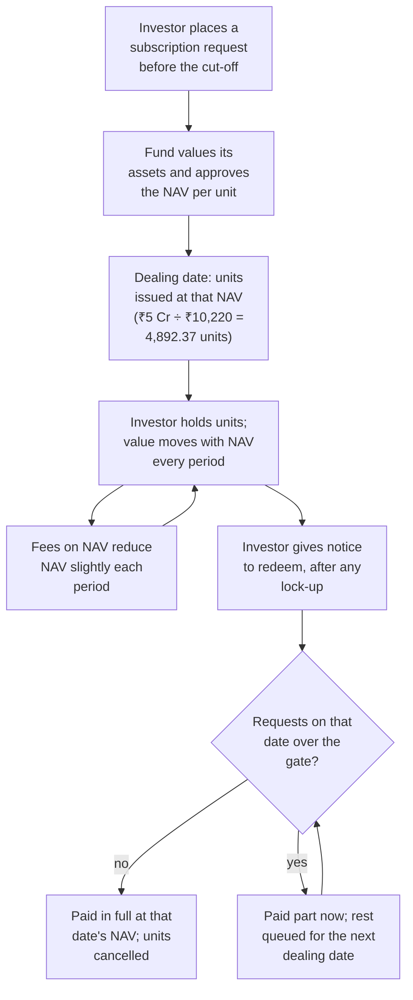

### The fund's operating calendar

What the manager and fund administrator do in every dealing period, monthly in this example:

| When | What happens | Who |
|---|---|---|
| Throughout the month | Investors send subscription and redemption requests | Investors, or the admin on their behalf |
| Cut-off, e.g. 5 days before the dealing date | Requests received after this move to the next dealing date | — (rule) |
| Month-end (valuation date) | Investments valued; cash, receivables and payables recorded | Fund admin |
| First days of next month | NAV drafted per unit class, checked and approved by a second person | Fund admin, then approver |
| Dealing date | Requests priced at the approved NAV; gate applied to redemptions; units issued and cancelled | Fund admin |
| After the dealing date | Subscribers' money collected; redeeming investors paid; confirmations and statements sent | Fund admin |
| Each quarter or year (crystallisation date) | Performance fee charged if NAV per unit is above the high-water mark; the mark resets | Fund admin, approver |

### Where these funds show up

| Market | Vehicle | Typical terms |
|---|---|---|
| India | Category III AIF (open-ended; Category I and II must be closed-end under the SEBI AIF Regulations) | Monthly or quarterly dealing, lock-ups of 1–3 years, exit loads, performance fee above a high-water mark |
| US | Evergreen private equity and private credit funds, tender-offer funds | Monthly subscriptions, quarterly redemptions, a gate around 5% of NAV per quarter |
| US | Interval funds | Periodic repurchase offers of 5–25% of shares |

### Key terminology

| Term | Meaning | Example in this document |
|---|---|---|
| **Evergreen / open-ended fund** | A fund with no fixed end date that continually issues and buys back units | Alpha Long-Short Fund |
| **Semi-liquid fund** | An evergreen fund holding illiquid assets, so redemptions are limited by gates and notice periods | — |
| **Closed-end fund** | A fund with a fixed fundraise, drawdowns by capital call, and a fixed term — what CapHive supports today | — |
| **NAV (net asset value)** | Everything the fund owns minus everything it owes, on a date | ₹102.2 Cr on 31 Oct 2026 |
| **NAV per unit** | NAV ÷ units outstanding: the price at which units are issued and redeemed | ₹10,220.00 |
| **Units outstanding** | Total units in issue for a class on a date | 1,00,000 |
| **Unit class (share class)** | A variety of unit with its own fees and NAV per unit — e.g. a lower fee for a larger ticket | Class A |
| **Initial price** | The NAV per unit a class starts at, before it has any units | ₹10,000 |
| **Valuation date / NAV date** | The date the NAV is calculated as of | 31 Oct 2026 |
| **Dealing date** | The date subscriptions and redemptions are priced and units issued or cancelled | 2 Nov 2026 |
| **Subscription** | Buying new units from the fund | ₹5 Cr → 4,892.37 units |
| **Redemption** | Selling units back to the fund for cash | 2,000 units |
| **Cut-off** | The last moment a request can arrive and still be dealt on a dealing date | 5 days before → 28 Oct for 2 Nov |
| **Notice period** | How far ahead of the dealing date a redemption must be requested | 30 days |
| **Lock-up** | A period after units are issued during which they cannot be redeemed (*hard*) or can only be redeemed with a fee (*soft*) | 12 months |
| **Early-redemption fee (exit load)** | A fee charged on redeeming units still inside a soft lock-up | 2% |
| **Gate** | A cap on total redemptions per dealing date, usually a % of NAV | 5% of ₹102.2 Cr = ₹5.11 Cr |
| **Gate method** | How redemptions over the gate are rationed: **FIFO** (earliest first) or **pro-rata** (everyone gets the same %) | Pro-rata: 78.6% each |
| **Redemption queue** | Redemption requests in the order received | A, B, C = positions 1, 2, 3 |
| **Carry-forward** | The part of a redemption held back by the gate, kept in the queue for the next dealing date | B's ₹39 lakh |
| **Minimum subscription** | The smallest amount accepted in one subscription | ₹25 lakh |
| **Minimum holding** | The smallest value an investor may keep after a partial redemption | ₹50 lakh |
| **Net flows** | Subscriptions minus redemptions over a period | −₹0.11 Cr (₹5 Cr in, ₹5.11 Cr out) |
| **Holding value** | Units held × NAV per unit | 4,892.37 × ₹10,220 = ₹5 Cr |
| **Management fee on NAV** | An annual % of NAV, accrued each period | 1.5% → ₹12.6 lakh for November |
| **Performance fee** | A % of the gain in NAV per unit above the high-water mark | 20% |
| **High-water mark (HWM)** | The highest NAV per unit on which a performance fee has been charged; no fee is charged again until NAV per unit exceeds it | ₹10,000 |
| **Hurdle** | A minimum annual return that must be exceeded before a performance fee applies | 8% a year |
| **Crystallisation** | The date an accrued performance fee becomes payable and the high-water mark resets | 31 Dec each year |
| **Equalisation / series accounting** | Ways of making sure investors who join at different prices pay a fair share of performance fee (not covered by this change) | — |
| **Swing pricing** | Adjusting NAV per unit on a dealing date to make entering or leaving investors bear trading costs (not covered) | — |
| **Suspension** | Stopping all dealing temporarily, e.g. in a crisis (not covered) | — |
| **Fund administrator** | A third party that calculates the NAV and keeps the unit register for the manager | NAV uploaded from them |
| **Folio** | An investor's account in the fund. CapHive stores it as a commitment | F-012 |
| **Maker-checker** | One person prepares and a different person approves | NAV prepared by Asha, approved by Ravi |

### Gaps in CapHive today

What an evergreen fund needs, what CapHive does today, and which block in [How the System Changes](#how-the-system-changes) closes the gap.

| # | Evergreen fund needs | CapHive today | Gap | Closed by | In this change? |
|---|---|---|---|---|---|
| G1 | To mark a fund as evergreen, with its dealing terms | Every fund is treated as closed-end | No evergreen fund type or dealing settings | ① Fund settings | Yes |
| G2 | A calculated NAV per unit for each class and date | The unit price is typed into each call or distribution by hand | No NAV calculation | ③ NAV builder | Yes |
| G3 | NAV checked by a second person, with an audit trail | No NAV record exists to approve | No approval, override reasons or locking | ④ NAV approval | Yes |
| G4 | Separate NAV per unit class | Unit classes exist with their own fee %, carry % and ISIN, but share one typed price | No per-class NAV | ③ NAV builder | Yes |
| G5 | Use an external administrator's NAV | No place to load one | No NAV upload | ③ NAV builder | Yes |
| G6 | Investors pay in full at subscription, with no drawdown | Money in only through a commitment followed by a capital call | Admin must create or top up a commitment and build an upload call for every dealing date | ⑤ Dealing run + ⑥ Settlement | Yes |
| G7 | Investors request subscriptions and redemptions themselves | Investors can only respond to calls and receive distributions | No requests, in the portal or by admin entry or upload | ② Requests | Yes |
| G8 | Dealing calendar with cut-offs and notice periods | No concept of dealing dates | Dates worked out by hand | ① Settings + ② Requests | Yes |
| G9 | Redeem a number of units, or all units | A distribution redeems units worked out from an amount the GP sets | Can't redeem an exact unit count | ⑤ Dealing run + ⑦ Units | Yes |
| G10 | Lock-ups and early-redemption fees | None | Not enforced | ② Requests + ⑤ Dealing run | Yes |
| G11 | Gate with FIFO or pro-rata, and a queue that carries forward | None | Worked out in a spreadsheet; no queue position for investors | ⑤ Dealing run | Yes |
| G12 | Units issued and cancelled as part of settlement | An admin must click **Allocate units** or **Redeem units** | Manual step that is easy to forget | ⑦ Unit register | Yes |
| G13 | Management fee on NAV | Fund formulas can charge fees, but have no NAV to charge on | No NAV source; no ready-made formula | ⑧ Fee formulas | Yes |
| G14 | Performance fee above a high-water mark, crystallised periodically | Only a carry % for a closed-end waterfall | No high-water mark, hurdle or crystallisation | ④ NAV approval | Yes |
| G15 | Investors see units, NAV per unit, value and gain | Investors see committed, called, uncalled and distributed. A "Current NAV" card adds up fair value and cash, but not units × price | Wrong headline figures for evergreen investors | ⑨ Screens | Yes |
| G16 | Investors see their requests and queue position | Nothing to show | No request status | ⑨ Screens | Yes |
| G17 | GP headline numbers: NAV, units, NAV per unit, net flows | Commitment-based headline | Wrong headline figures for evergreen funds | ⑨ Screens | Yes |
| G18 | Statements with opening and closing units, NAV and flows | Statements show units, but not NAV per unit, holding value or request activity | Missing statement fields | ⑨ Statements | Yes |
| G19 | Per-investor high-water marks, equalisation or series accounting | None | Not covered | — | No — future change |
| G20 | Swing pricing or anti-dilution levies | None | Not covered | — | No — future change |
| G21 | Suspension of dealing | None | Not covered; an admin can simply not confirm a dealing date | — | No — future change |
| G22 | Daily or weekly dealing | None | Only monthly and quarterly are planned | — | No — future change |
| G23 | Switching between unit classes | Unit transfers between investors exist, not class conversions | Not covered; use a redemption plus a subscription | — | No — future change |
| G24 | Liquidity monitoring: cash reserve against the redemption queue | None | Only an at-a-glance tile on the Overview | ⑨ Screens (tile only) | Partly — full dashboard is future |
| G25 | Screens and words made for evergreen funds | Every fund shows commitment, call and distribution screens and labels | GP and investors must translate closed-end terms | ⑨ Screens by fund type | Yes |
| G26 | Evergreen investor documents: acknowledgements, contract notes, gate notices, redemption advices | Call and distribution notices only | No evergreen documents | ⑨ Documents | Yes |
| G27 | Per-order onboarding checks (KYC, signed form, GP acceptance) before dealing | Journeys exist for calls, distributions and KYC, not for orders | No per-order checklist or "ready to deal" gate | ② Requests + ⑨ Order journeys | Yes |
| G28 | Different fund types: payment before or after dealing, gate per quarter or per investor, per-class terms | — | One fixed model would not fit Cat III, tender-offer, interval and hedge-fund-style funds | ① Fund settings + presets | Yes |

## What Changes

Think of it like a mutual fund's monthly dealing cycle, run inside CapHive: value the fund, approve the price, take orders, fill them at that price. **The evergreen experience is designed around how evergreen funds are run, not around the closed-end screens we already have.** Under the hood it reuses CapHive's settlement, unit register, ledger, journeys and documents.

- **An evergreen flag on the fund.** A fund admin makes a fund evergreen and records its terms: dealing calendar, payment timing, cut-off, notice, lock-up, gate, minimums, fees, and whether orders need their own journeys. Every term is a setting, so funds as different as an Indian Cat III AIF and a US tender-offer fund can be configured without code. Presets fill the form for the common kinds of fund ([Fund Setups](#fund-setups)).
- **Different screens by fund type.** The flag decides what GP users and investors see:
  - **GP:** an evergreen fund has its own tabs — Overview, Dealing, Orders, NAV, Investors, Fees, Portfolio, Ledger, Documents, Settings.
  - **Investors:** the fund page has Holding, Transactions, Requests, NAV history and Documents.
  - Closed-end funds keep exactly the screens they have today.
- **Evergreen words.** Evergreen screens, emails and documents say *subscription*, *redemption*, *folio*, *allotment* and *contract note* — never *capital call*, *distribution*, *committed* or *uncalled* ([Evergreen labels](#evergreen-labels)).
- **NAV per unit, computed and approved.** CapHive drafts each class's NAV from data it already has: investments at fair value, plus cash, minus fees and other liabilities, divided by units outstanding. The admin can override any line or upload an external administrator's NAV, and a second person approves. Only an approved NAV can price anything.
- **Orders from investors and admins.** Investors subscribe and redeem through guided wizards in the portal that show the dealing date, cut-off, indicative units or value, fees and their queue position. Admins can enter or upload orders for them, and everything lands in one order book.
- **Payment timing per fund.** Subscribers either pay **before** dealing (cleared money by the cut-off, the norm for evergreen funds) or **after** dealing (within a set number of days), as the fund chooses.
- **Optional journeys per order.** A fund can require each subscription — and, if it wants, each redemption — to pass its own checklist before it's dealt: KYC approved, signed subscription form, GP acceptance and money received. Only orders that reach *Ready to deal* are priced.
- **A workspace per dealing date.** Each dealing date has a step bar and a *What's needed now* panel. Its pricing screen applies the gate, and after confirmation its settlement tracker follows every investor from money received to units allotted and contract note sent, or from payment to units cancelled and redemption advice sent.
  - Units are allotted and cancelled automatically.
  - Redemptions held back by the gate keep their place in the queue for the next dealing date.
  - Settlement runs through CapHive's existing settlement records, labelled the evergreen way and kept out of the evergreen tabs.
- **Evergreen documents and emails.** Subscription and redemption acknowledgements, payment instructions, contract notes, gate notices and redemption advices replace call and distribution notices.
- **Documents as part of dealing-date processing.** Templates are optional. A fund with no contract-note or redemption-advice template emails each investor the figures as soon as their units are allotted or their redemption is paid. A fund that uploads its own Word templates gets two extra dealing-date steps after settlement — **Generate documents** (PDFs saved unapproved, out of investors' sight, approvers alerted) and **Approve & send** (an approver approves them all and each investor is emailed their PDF) — and the dealing date can only be closed once every document has gone out. Contract notes and advices are no longer generated from a built-in layout or emailed automatically when a template exists.
- **Evergreen notifications.** Investors get switchable reminders and updates (payment reminder, action needed, payment received, units unlocked, NAV update), customisable per fund like other notifications, and a fund can copy its customised emails from another evergreen fund. The fund's team gets in-app and email alerts by role — relationship manager, approvers, and users tagged Fund ops, Fund accounting or Compliance — for new orders, NAVs awaiting approval, cut-off summaries, gates, large redemptions, overdue settlements and fee accruals running behind. Each is switched on or off per fund in a new *Notifications* settings step and sent once per record.
- **Fees on NAV.** A ready-made formula accrues the management fee on NAV up to every NAV date. A performance fee above a per-class high-water mark crystallises on schedule. Both show on a Fees tab.
- **Closed-end funds are not affected.** Nothing changes for any fund that is not flagged evergreen.

### Flow Diagram

Before / after: pricing a dealing date.

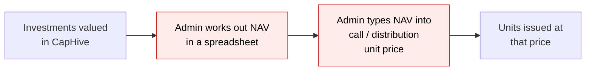

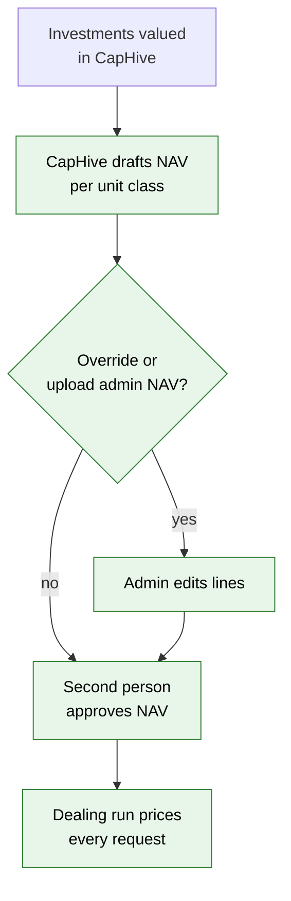

Before / after: an investor subscribes.

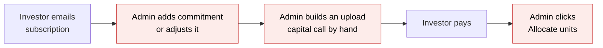

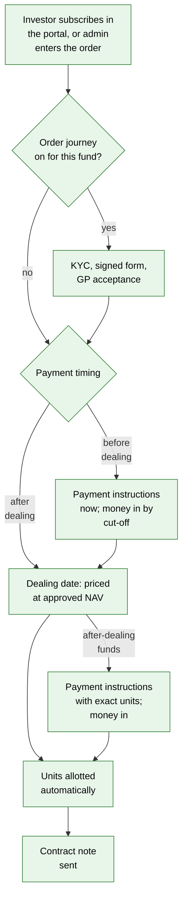

Before / after: an investor redeems.

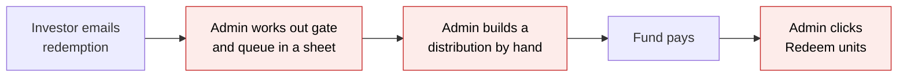

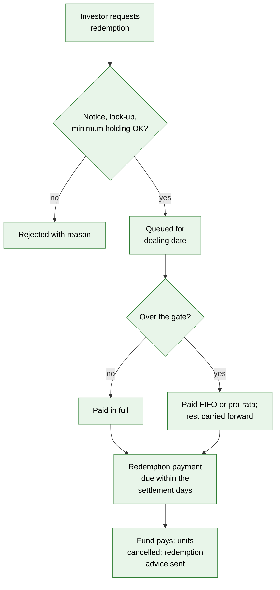

---

## How the System Changes

This section shows in block diagrams how CapHive changes to handle open-ended funds. It describes behaviour only, with no code. The boxes are numbered ①–⑨, and the numbers mean the same box in every diagram here and in the design.

Colour key used throughout: **green** = new, **amber** = existing part that changes a little, **grey** = existing part reused as is.

### 1. Who starts things: the fundamental shift

In a closed-end fund the **GP** starts every money movement: it decides when to call and when to distribute, and types in the unit price. In an open-ended fund the **investor** starts it by placing a request, and the **price is calculated** from the fund's NAV. The GP's job changes from "decide and build" to "value, approve and confirm".

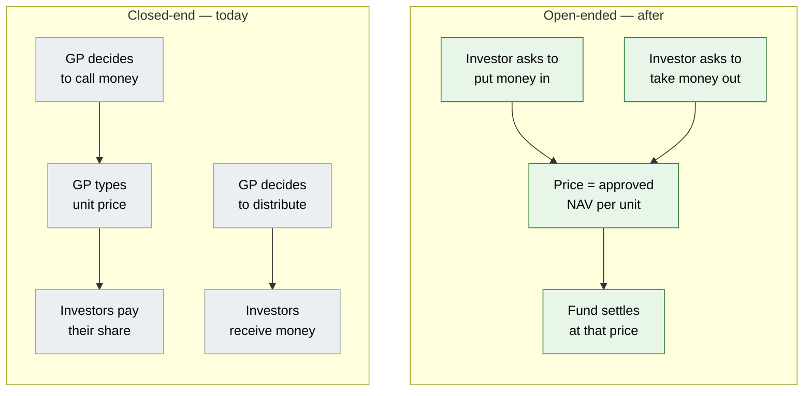

| | Closed-end (today) | Open-ended (after) |
|---|---|---|
| Who starts a money movement | GP | Investor (request) |
| Where the price comes from | Typed in per call | Calculated and approved NAV per unit |
| How often | Whenever the GP chooses | Fixed dealing dates (monthly or quarterly) |
| Can investors exit? | Only when the GP distributes | Yes, by request — limited by a gate |
| What the investor watches | Committed / called / uncalled | Units × NAV per unit |

### 2. The building blocks

Nine blocks. Five are new (①–⑤). Two are existing ones reused unchanged (⑥ settlement) or given a small automatic step (⑦ units). Two are existing ones extended (⑧ fees, ⑨ screens and statements). **The new blocks decide prices and quantities; the existing blocks move the money.**

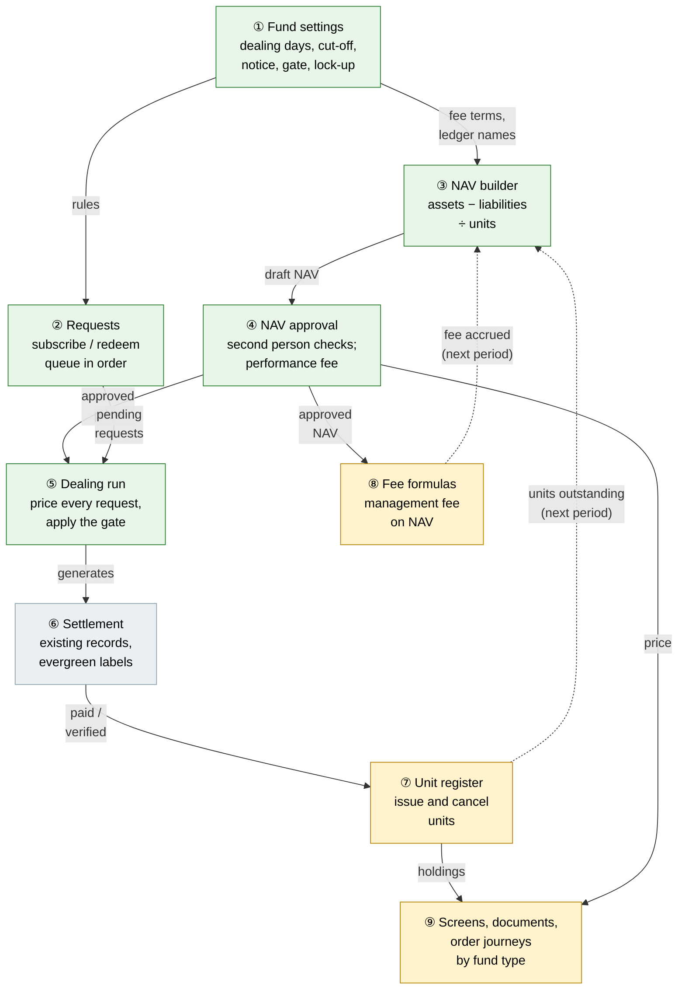

| # | Block | New or existing | What it does in plain words |
|---|---|---|---|
| ① | Fund settings | New | Holds the fund's offering-document terms: when dealing happens, cut-offs, notice, lock-up, gate, minimums, fees. Its presence is what makes a fund "open-ended". |
| ② | Requests | New | The order book. Every subscription and redemption request, who placed it, when it was received (which fixes its dealing date and queue position), and its status. |
| ③ | NAV builder | New | Works out what the fund is worth on a date, for each unit class, from data CapHive already has. Lines can be overridden or replaced by an upload. |
| ④ | NAV approval | New | A second person approves the NAV. Approval locks it, and on crystallisation dates it charges the performance fee and resets the high-water mark. |
| ⑤ | Dealing run | New | On a dealing date: prices every request at the approved NAV, applies the gate to redemptions, and, when confirmed, generates the settlement. |
| ⑥ | Settlement | Existing, reused | The settlement records CapHive already has (capital call and distribution underneath) move the money: payment collection, bank reconciliation and the ledger. On evergreen funds they're labelled *Subscription settlement* and *Redemption settlement* and are reached from the dealing date. |
| ⑦ | Unit register | Existing, small change | Same register of units per investor. New: units are issued or cancelled **automatically** for dealing-run payments, and redemptions cancel the **exact** units requested. |
| ⑧ | Fee formulas | Existing, extended | A ready-made formula that charges the management fee on NAV instead of on commitment. |
| ⑨ | Screens, documents and journeys | Existing, extended | The fund's flag picks the screens. Evergreen funds get their own GP tabs and investor pages, evergreen labels, contract notes and redemption advices, and optional per-order journeys. Closed-end funds are unchanged. |

### 3. One dealing period, as a cycle

Everything repeats every dealing period (monthly in this example). The loop closes because units issued or cancelled in one period change the units outstanding — and the fees accrued — that the next NAV is built from.

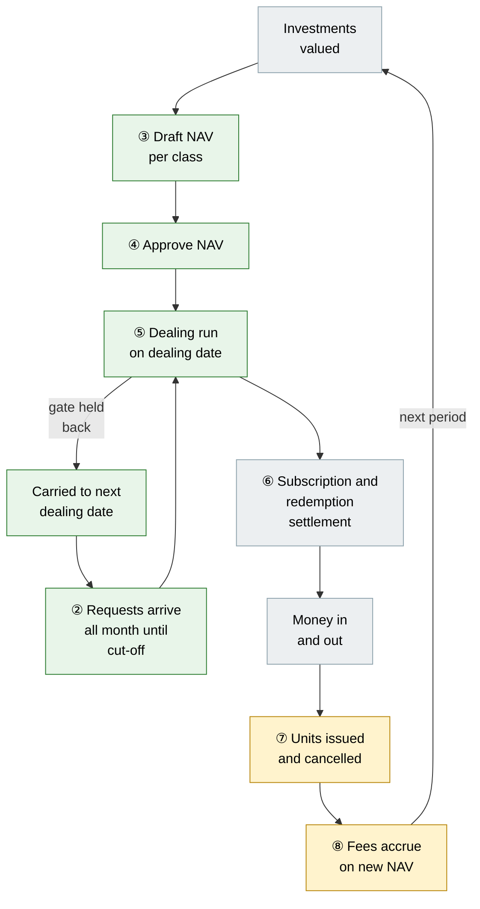

| Step | Who | When (monthly example) |
|---|---|---|
| Value investments | Fund admin, as today | By month-end |
| Draft NAV | Fund admin clicks **New NAV**, or uploads the administrator's NAV | First days of the new month |
| Approve NAV | A second person with approve rights | Before the dealing date |
| Requests | Investors in the portal, or admin by entry or upload | Any time; cut-off decides which dealing date |
| Dealing run | Fund admin previews and confirms | On the dealing date |
| Money in and out | Investors pay the call; the fund pays the distribution — as today | After the dealing date |
| Units | Automatic when a payment is verified or completed | As payments land |
| Fees | Fee formula run, as allocations run today | Each period |

### 4. How NAV is built

NAV is assembled from figures CapHive already holds. Nothing new needs to be keyed in for a self-administered fund. For a fund with an external administrator, the administrator's NAV is uploaded instead and goes through the same approval.

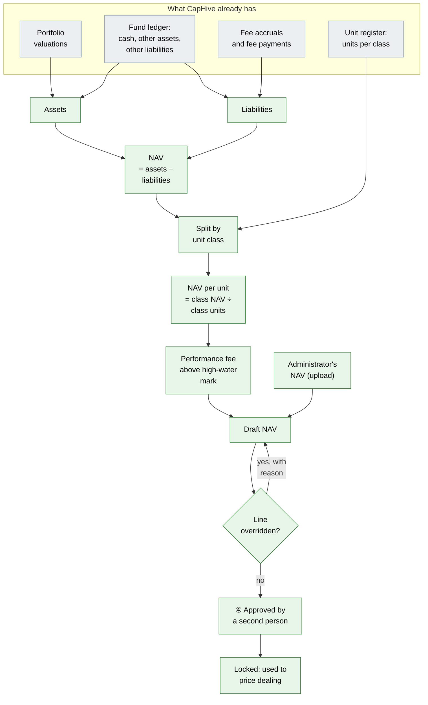

Worked example (one class, 31 Oct 2026):

| Line | Source | Amount |
|---|---|---|
| Investments at fair value | Portfolio valuations | ₹95,00,00,000 |
| Cash | Ledger balance "Cash In Hand" | ₹8,00,00,000 |
| Other assets | Ledger balance "Net Current Assets" | ₹0 |
| Management fee payable | Last NAV's payable + accruals − payments | (₹50,00,000) |
| Performance fee payable / accrued | High-water-mark calculation | ₹0 |
| Other liabilities | Ledger balance "Other Liabilities" | (₹30,00,000) |
| **NAV** | | **₹102,20,00,000** |
| Units outstanding | Unit register | 1,00,000 |
| **NAV per unit** | | **₹10,220.00** |

Safeguards built into this block:
- **Two people:** whoever prepared a NAV cannot approve it.
- **Locked once used:** an approved NAV that a dealing run has used can never be reopened. Corrections go through new transactions, as they would at a real fund.
- **Stale warning:** if a valuation, ledger balance or unit changes after the NAV was drafted, the NAV is flagged, so nobody approves a number built from old inputs.

### 5. A subscription, end to end

Each box starts with who acts. The investor makes one request; an optional order journey checks it; the money moves through CapHive's existing settlement records, labelled the evergreen way. This shows a **pre-funded** fund. A pay-after-dealing fund moves "Pays" to after "Dealing date".

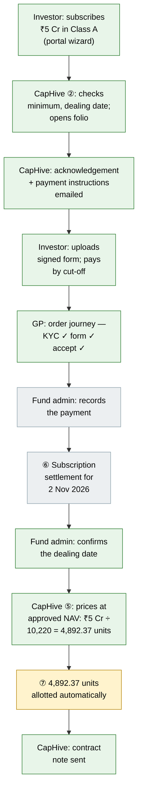

What's different from today: the admin no longer builds a call by hand, types the price, adds or tops up the commitment, or clicks **Allocate units**. The investor never sees a "capital call"; they get an acknowledgement, payment instructions and a contract note.

### 6. A redemption, end to end, with the gate and the queue

Redemptions are checked when requested (do the units exist, are they locked up, is the notice period met) and rationed when dealt (the gate). Whatever the gate holds back stays at the front of the queue for the next dealing date.

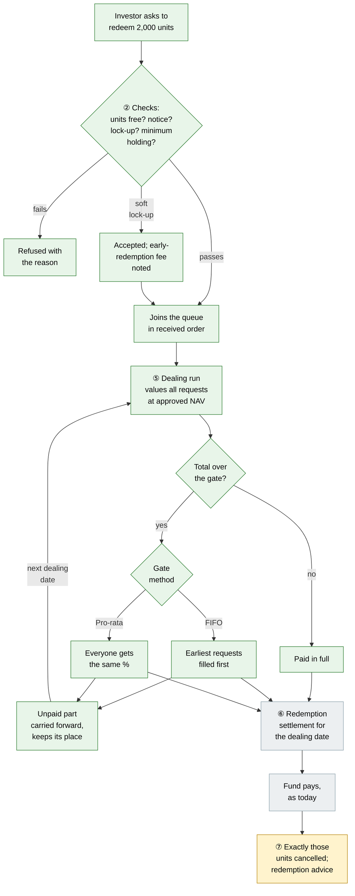

**The gate in one example** — fund NAV ₹102.2 Cr, gate 5 % = ₹5.11 Cr available; requests A ₹3.0 Cr, B ₹2.5 Cr, C ₹1.0 Cr (₹6.5 Cr in total):

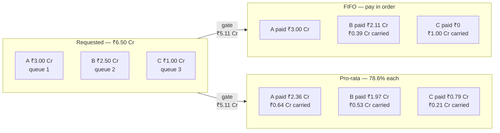

Which method applies is a fund setting, matching the offering documents. Pro-rata figures are rounded to two decimals here.

### 7. Fees: how they feed back into NAV

Both fees are worked out from NAV and both reduce the next NAV. That makes them part of the cycle in diagram 3, not a separate process.

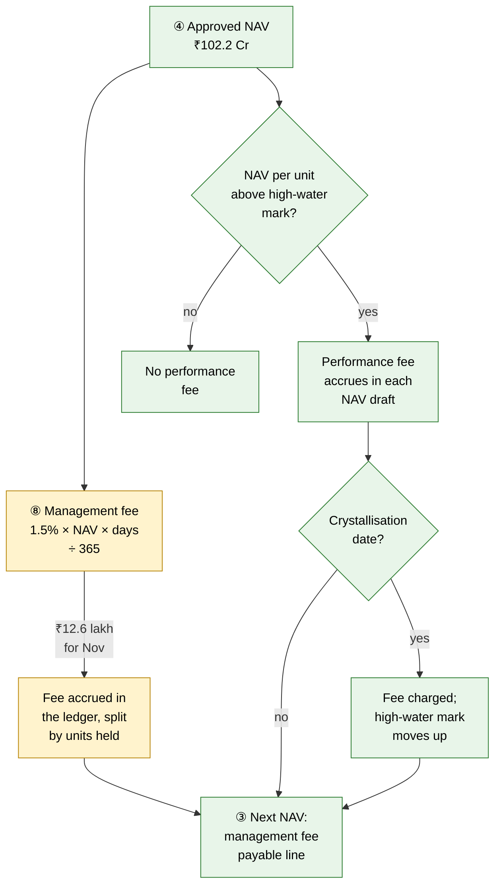

| Fee | Today | After |
|---|---|---|
| Management fee | Charged on commitment or invested capital by a fund formula | Same formula engine; a ready-made formula charges it on NAV, per class |
| Performance fee | Carry % in a closed-end waterfall | Charged only on NAV per unit above the class's high-water mark, at quarter- or year-end; the mark then moves up |

### 8. What each person sees

The fund's flag picks the screens. Full screen-by-screen comparison: [Screens by fund type](#screens-by-fund-type).

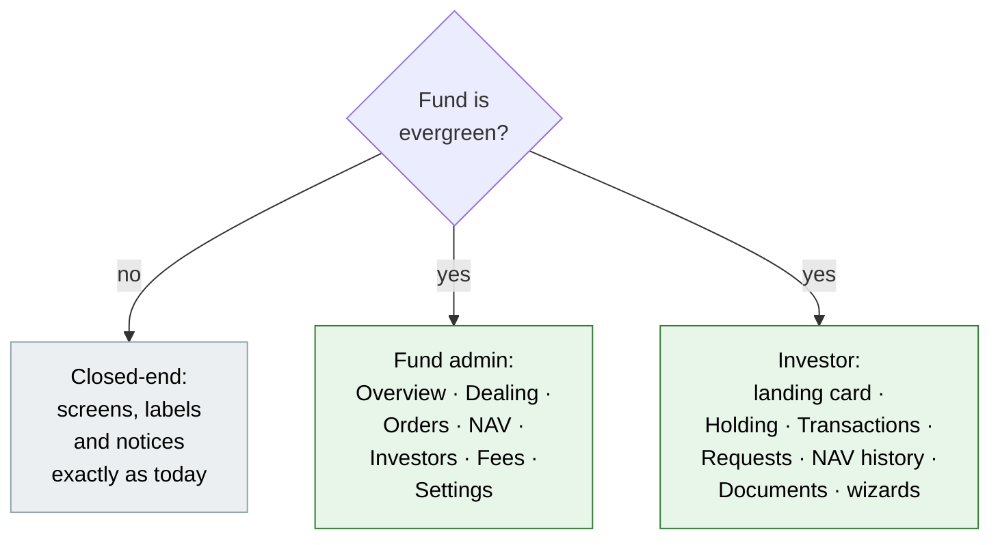

### 9. What stays the same

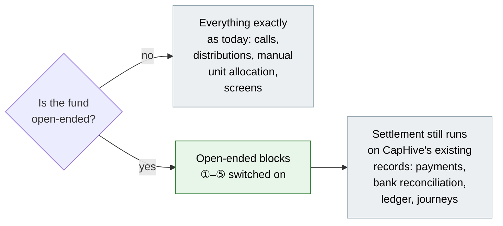

- **Closed-end funds see no change.** Every new behaviour switches on only when a fund has open-ended settings.
- **Money still moves through CapHive's existing settlement records** (capital calls and distributions underneath), so payment recording, bank reconciliation and the ledger work unchanged. Evergreen funds show those records with evergreen labels, and send evergreen documents instead of call and distribution notices.
- **The unit register stays the single record of who owns what.** Open-ended funds simply keep it up to date automatically.

---

## User Stories

Examples use the figures from the background section: NAV ₹102.2 Cr, 1,00,000 Class A units, NAV per unit ₹10,220. Screens and stories use an example fund that deals subscriptions and redemptions **monthly** on the first business day, with **pre-funded** subscriptions unless a story says otherwise.

### US-1: Switch a fund to evergreen

**As a** fund admin,
**I want** to mark a fund as evergreen and record its dealing terms,
**So that** CapHive runs the fund the evergreen way, with its own screens, workflow and investor documents.

**Acceptance criteria:**
- A closed-end fund's **Settings** has **Make this fund evergreen**. It opens a form with the fields in [Validation Rules](#validation-rules).
- The fund must have at least one unit class before it can be made evergreen. Otherwise the button is replaced by "Add a unit class first", with a link to unit settings.
- Saving shows "This fund is now evergreen". From then on, everyone sees the evergreen version of the fund's screens (see [Screens by fund type](#screens-by-fund-type)).
- Settings can be edited at any time. Changes apply to requests received after the change and to dealing dates not yet confirmed.

### US-2: Draft, review and approve a NAV

**As a** fund admin,
**I want** CapHive to draft the NAV for a dealing date and a colleague to approve it,
**So that** every subscription and redemption is priced at a checked number.

**Acceptance criteria:**
- **New NAV** asks for a NAV date and drafts one row per unit class. Each row has these lines: Investments at fair value, Cash, Other assets, Management fee payable, Performance fee payable, Accrued performance fee, Other liabilities, then NAV, Units outstanding and NAV per unit. Cash, other assets and other liabilities come from the fund's ledger balances under the names set in the evergreen settings, which default to "Cash In Hand", "Net Current Assets" and "Other Liabilities".
- Each line shows where its number came from. Any line can be overridden, and an override needs a short reason, which is shown next to the line.
- **Upload NAV** accepts a sheet with columns *Unit class, NAV date, NAV, Units outstanding, NAV per unit* and creates a draft NAV marked "Source: uploaded".
- **Approve** is available only to a user with fund approve rights who did **not** prepare the NAV. Approving locks the NAV.
- An approved NAV can be **reopened** only if no confirmed dealing date used it. Otherwise the button is disabled, with the tooltip "Used by dealing date 2 Nov 2026 — cannot reopen".

### US-3: Investor subscribes

**As an** investor,
**I want** to subscribe from the investor portal in a few guided steps,
**So that** I know what I'm buying, when it will be priced and how to pay.

**Acceptance criteria:**
- **Subscribe** opens a three-step wizard ([screen](#lp-3-subscribe-wizard)):
  1. **Amount:** pick the class and amount. Shows the minimum subscription, the next dealing date, its cut-off, and an *indicative* number of units at the last approved NAV, labelled "Indicative — final price is the NAV for <NAV date>".
  2. **Review:** a summary and an acknowledgement of the fund's offering documents.
  3. **Done:** the confirmation and how to pay.
- **Pre-funded fund:** step 3 shows the payment instructions straight away: bank account, amount, reference and "Pay by 28 Oct 2026 (cut-off) to be dealt on 2 Nov 2026". The same goes out by email (US-13). If the investor has no folio yet, CapHive opens one now.
- **Pay-after-dealing fund:** step 3 says "You'll receive payment instructions after the 2 Nov 2026 dealing date, with the exact units". Instructions follow when the dealing date is confirmed.
- The request appears under **Requests** with a status timeline ([screen](#lp-2-fund-page--requests)). The investor can **Cancel** it until the dealing date is confirmed.

### US-4: Investor redeems

**As an** investor,
**I want** to redeem some or all of my units and see straight away whether and when I'll be paid,
**So that** I can plan around the fund's rules.

**Acceptance criteria:**
- **Redeem** opens a wizard ([screen](#lp-4-redeem-wizard)):
  1. **What:** choose *Number of units*, *Amount* or *All units*. Shows units held, units free to redeem (held − locked − already queued), the indicative value at the last approved NAV, and any early-redemption fee.
  2. **When:** shows the earliest dealing date the notice period allows, the gate, and the investor's place in the queue if they submit now ("You would be #4 in the queue").
  3. **Done:** the confirmation, also sent by email.
- Notice period, lock-up and minimum-holding failures are shown inline in step 1 or 2, before the investor can submit (see [Behavior Rules](#behavior-rules)).

### US-5: Fund admin enters or uploads orders

**As a** fund admin,
**I want** to enter or upload requests for investors,
**So that** requests that arrive by email or form join the same order book.

**Acceptance criteria:**
- **Orders** has **New subscription**, **New redemption** and **Upload orders**.
- The upload sheet has columns *Type (Subscription/Redemption), Folio No or Investor, Unit class, Amount, Units, All units (Yes/No), Received at*. Each row runs the same checks as a portal request, and failures appear in the upload's results sheet.
- An admin-entered request records "Entered by <user>". *Received at* defaults to now and can be back-dated; it decides the dealing date and the queue position.
- An admin-entered request gets the same investor emails as a portal request.

### US-6: Run a dealing date

**As a** fund admin,
**I want** one workspace per dealing date that tells me what's needed now and tracks every investor's settlement,
**So that** I never have to open a capital call or distribution to run an evergreen fund.

**Acceptance criteria:**
- **Dealing** lists every dealing date — upcoming, open and closed — with its current step ([screen](#gp-2-dealing)).
- Each dealing date has a **step bar** and a **What's needed now** panel ([screen](#gp-3-dealing-date-workspace)). The steps depend on the fund's payment timing:

  | Pre-funded subscriptions | Pay-after-dealing subscriptions |
  |---|---|
  | 1. Collect subscription money (by cut-off) | 1. Approve NAV |
  | 2. Approve NAV | 2. Review and confirm dealing |
  | 3. Review and confirm dealing | 3. Send payment instructions |
  | 4. Allot units | 4. Collect subscription money |
  | 5. Pay redemptions | 5. Allot units |
  | 6. Cancel units | 6. Pay redemptions |
  | 7. Generate documents | 7. Cancel units |
  | 8. Approve and send documents | 8. Generate documents |
  | 9. Close dealing date | 9. Approve and send documents |
  | | 10. Close dealing date |

  *Generate documents* and *Approve and send documents* show "n/a — no template" when the fund has neither a contract-note nor a redemption-advice template.

- **Review and confirm dealing** shows every request priced at the approved NAV, with the gate applied: limit, total requested, method and fill %. It's recalculated each time it's opened until confirmed. **Confirm** is disabled until every class with requests has an approved NAV ("Approve the NAV for Class A dated 31 Oct 2026 first"). For a pre-funded fund, only fully paid subscriptions are included. Unpaid ones are listed separately as "Not paid by cut-off — will roll to 1 Dec 2026" or "— will be cancelled", depending on the setting.
- After confirming, the **settlement tracker** shows one row per investor:
  - **Subscription:** Awaiting money → Money received → Units allotted → Contract note sent.
  - **Redemption:** Awaiting payment → Paid → Units cancelled → Advice sent.
  - Each row has its next action inline: **Record payment**, **Mark paid**, **Resend**.
- Units are allotted and cancelled automatically as money is recorded. There are no "Allocate units" or "Redeem units" buttons for evergreen funds.
- A subscriber with no folio gets one: when the request is accepted (pre-funded) or when the dealing date is confirmed (pay-after-dealing). Each subscription adds its amount to the folio's subscribed total.
- Redemptions held back by the gate stay *Partially filled* and move to the next dealing date, keeping their place in the queue.
- A confirmed dealing date can be **undone** only while nothing has been allotted, cancelled or paid on it. Undo returns its requests to *Pending*.
- Underneath, the dealing date settles its subscriptions and redemptions through CapHive's existing settlement records. On an evergreen fund those records are labelled **Subscription settlement** and **Redemption settlement** — never "capital call" or "distribution" (see [Evergreen labels](#evergreen-labels)). They're reached only from **Settlement records** at the foot of the dealing date, for audit, and don't appear in the evergreen fund's tabs.

### US-7: Management fee on NAV

**As a** fund admin,
**I want** the management fee accrued on NAV,
**So that** the fee matches the offering documents.

**Acceptance criteria:**
- Making the fund evergreen offers **Add NAV-based management fee formula**. This adds a fund formula that accrues *class management fee % × NAV × days ÷ 365* for each class, and allocates it to investors by units held.
- The accrued fee feeds the *Management fee payable* line of the next NAV draft. Example: 1.5% on ₹102.2 Cr for 30 days = ₹12,60,000.
- **The fee accrues up to every NAV date, not on dealing dates.** Payment is a separate ledger entry ("Management Fee Paid" by default), made on whatever schedule the offering documents set — often quarterly in arrears.
- If a class charges a management fee and its latest accrual is older than the NAV date, the NAV draft and the approval screen show "Management fee accrued only to 31 Oct 2026 — run the fee formula to 30 Nov 2026 before approving". The warning does not block approval.
- The **Fees** tab shows accruals, payments and the payable balance month by month ([screen](#gp-7-fees)).

**Worked example — monthly NAV, fee paid quarterly in arrears** (starting with nothing payable at 30 Sep):

| Month | NAV used (latest approved on or before the 1st) | Days | Fee accrued | Paid | Management fee payable in month-end NAV |
|---|---|---|---|---|---|
| Oct 2026 | ₹98.26 Cr (30 Sep) | 31 | ₹12,51,805 | — | ₹12,51,805 |
| Nov 2026 | ₹102.20 Cr (31 Oct) | 30 | ₹12,60,000 | — | ₹25,11,805 |
| Dec 2026 | ₹101.50 Cr (30 Nov) | 31 | ₹12,93,082 | — | ₹38,04,887 |
| Jan 2027 | ₹103.00 Cr (31 Dec) | 31 | ₹13,12,192 | ₹38,04,887 on 5 Jan | ₹13,12,192 |

Why it matters: if November's ₹12,60,000 were missing from the 30 Nov NAV, NAV per unit would be ₹12.60 too high (₹12,60,000 ÷ 1,00,000 units). Someone redeeming 2,000 units on 1 Dec would be overpaid by ₹25,200, at the expense of the investors who stay. Full walkthrough: [background doc, E4a](../../../docs/modules/funds/open_ended_funds.md#2-worked-examples).

### US-8: Performance fee with a high-water mark

**As a** fund admin,
**I want** a performance fee charged only on gains above the class's high-water mark,
**So that** investors are not charged twice for the same gain.

**Acceptance criteria:**
- The evergreen settings hold the performance fee %, an optional annual hurdle % and the crystallisation frequency (quarterly or annually) for each class.
- Each NAV draft shows the class's current high-water mark and the accrued performance fee:
  - *fee % × (NAV per unit before performance fee − max(high-water mark, hurdle-adjusted mark)) × units outstanding*
  - when NAV per unit is at or below the mark, the fee is ₹0.
- When a NAV dated on a crystallisation date is approved, the accrued fee is crystallised as a fund liability. The class's high-water mark becomes that NAV per unit, if higher.
- The **Fees** tab shows each class's high-water mark, its distance from current NAV per unit, the accrued fee and the crystallisation history.

### US-9: Investor sees their evergreen investment

**As an** investor,
**I want** to see what my units are worth and everything that has happened to them,
**So that** I understand my investment without asking the fund.

**Acceptance criteria:**
- On the investor landing page, an evergreen fund's card shows value, units, NAV per unit with its date, gain since investment, the next dealing date, and **Subscribe** / **Redeem** buttons ([screen](#lp-1-landing-page-card)). It does not show committed, called, uncalled or distributed.
- The evergreen fund page has the tabs **Holding · Transactions · Requests · NAV history · Documents** ([screens](#lp-2-fund-page--holding)):
  - **Holding:** per class and folio — units, NAV per unit, value, cost, gain, units locked and until when, units free to redeem.
  - **Transactions:** every allotment and redemption, with date, units, price, amount, fees and a link to its contract note or redemption advice.
  - **Requests:** each request with a status timeline, dealing date, queue position and carried-forward units.
  - **NAV history:** NAV per unit over time for the investor's classes (approved NAVs only).
  - **Documents:** contract notes, redemption advices and statements.
- An investor sees only approved NAVs, and only their own folios, transactions and requests.

### US-10: Statements

**As a** fund admin,
**I want** units, NAV and request activity in statement templates,
**So that** quarterly statements for evergreen investors show the right figures.

**Acceptance criteria:**
- Folio and investor document templates can use:
  - opening and closing units
  - opening and closing NAV per unit
  - holding value
  - subscriptions and redemptions in the period (units and amount)
  - management and performance fees in the period
  - redemption requests still queued
- A sample "Evergreen quarterly statement" template is added to the template samples.

### US-11: GP sees an evergreen fund the evergreen way

**As a** fund admin,
**I want** an evergreen fund's pages to be organised around NAV, dealing dates and orders,
**So that** I'm not working through commitment and call screens that don't fit the fund.

**Acceptance criteria:**
- Evergreen funds show the tabs **Overview · Dealing · Orders · NAV · Investors · Fees · Portfolio · Ledger · Documents · Settings**. Closed-end funds keep today's tabs ([Screens by fund type](#screens-by-fund-type)).
- **Overview** ([screen](#gp-1-overview)) shows:
  - NAV and NAV per unit per class, with the date and approval status;
  - net flows for the quarter to date;
  - the next dealing date, with its cut-off, step and what's needed now;
  - the redemption queue against the gate, and cash against queued redemptions;
  - a 12-month NAV-per-unit trend.
- **Investors** is the unit register ([screen](#gp-6-investors-unit-register)): one row per folio and class, with units, value, cost, gain, units locked until, and units queued for redemption. It replaces the Commitments tab for evergreen funds.
- On the funds list, an evergreen fund's card shows NAV, NAV per unit, net flows and the next dealing date, with an **Evergreen** badge, instead of committed / called / distributed.

### US-12: Order book

**As a** fund admin,
**I want** one order book for all subscriptions and redemptions,
**So that** I can see what is coming, what is unpaid and where each redemption sits in the queue.

**Acceptance criteria:**
- **Orders** opens on open requests; a filter shows Dealt, Cancelled / rejected or All ([screen](#gp-4-orders)). The request is split into **Amount** and **Units** — the side asked in shown plainly, the other an estimate at the latest approved NAV.
- Open redemptions are listed in queue order in the **same table**, each row carrying its running total, what the next gate pays and what is carried, and Paid in full / Part-filled / Carried. A line above gives the gate and the total queued. There is no separate queue table.
- For pre-funded funds, unpaid subscriptions show "Awaiting money" with the amount outstanding, and are highlighted from 2 days before the cut-off.

### US-13: Evergreen investor documents and emails

**As an** investor,
**I want** the documents an evergreen fund normally sends,
**So that** I have a record of every order and every unit I own.

**Acceptance criteria:**
- Evergreen funds send these instead of call and distribution notices:

  | Document / email | Sent when | Contents |
  |---|---|---|
  | Subscription acknowledgement | Request accepted | Class, amount, dealing date, cut-off; payment instructions if pre-funded |
  | Payment instructions | Pay-after-dealing fund: dealing date confirmed | Exact amount, units, NAV per unit, bank details, due date |
  | Contract note | Units allotted | Units, NAV per unit, amount, NAV date, dealing date, folio, class |
  | Redemption acknowledgement | Redemption request accepted | Units or amount, earliest dealing date, queue position, any early-redemption fee |
  | Gate notice | Redemption partially filled or not filled | Filled units and amount, carried-forward units, next dealing date |
  | Redemption advice | Redemption paid and units cancelled | Units cancelled, NAV per unit, gross amount, early-redemption fee, net paid, payment date |
  | Request cancelled | Request cancelled by investor or admin | What was cancelled and by whom |

- Contract notes and redemption advices use the fund's own Word templates when it has them (tagged "Contract Note Template" / "Redemption Advice Template"; a folio can override the fund's). With a template they are generated as PDFs by **Generate documents** on the dealing date, approved by an approver with **Approve & send**, and only then emailed (PDF attached) and shown in the investor's **Documents**. Without a template the email goes as soon as units are allotted or the redemption is paid, with the figures in the email.
- They go to the investor's users who receive fund notices today. Dates follow CapHive's email date format.

### US-14: A journey for each order (optional, per fund)

**As a** fund admin,
**I want** each subscription — and, if the fund needs it, each redemption — to go through its own checklist before it's dealt,
**So that** no order is priced until KYC, paperwork and GP acceptance are in place.

**Acceptance criteria:**
- Evergreen settings have **Order journeys**: *Off* (default), *Subscriptions*, or *Subscriptions and redemptions*. The fund picks the journey template for each, from templates that admins can edit like any other journey template.
- When order journeys are on, each order gets a step bar and a **What's needed now** panel, the same way capital calls, distributions and KYCs do today. Each step's status is worked out from the order's own data.
- Seeded subscription template (steps can be removed or made optional per fund):

  | Step | Done when | Who usually acts |
  |---|---|---|
  | 1. Check investor KYC | The investor's KYC for this fund is approved | Compliance |
  | 2. Collect signed subscription form | A signed subscription form is attached to the order | Investor, then fund admin |
  | 3. Accept order | A GP user with approve rights clicks **Accept** (or **Reject** with a reason) | GP |
  | 4. Collect subscription money | Payment recorded for the full amount (pre-funded funds only) | Fund admin |
  | 5. Ready to deal | All steps above done or not applicable | — (gate into the dealing date) |
  | 6. Allot units and send contract note | Units allotted at the dealing date | Automatic |

- Seeded redemption template: 1. Verify request (authorised signatory) → 2. Accept order → 3. Ready to deal → 4. Pay redemption → 5. Cancel units and send redemption advice.
- **An order is included in a dealing date only once its journey reaches *Ready to deal*.** Orders still in progress at the cut-off are listed separately on the dealing date ("Not ready — waiting on: Check investor KYC") and roll to the next dealing date or are cancelled, under the same setting as unpaid subscriptions. A rolled redemption keeps its place in the queue.
- Orders on funds with journeys *Off* skip straight to *Ready to deal* once their own checks pass, as in US-3 and US-4.
- The investor sees the steps that need them (e.g. "Upload your signed subscription form") in the request's timeline, with an upload button.
- The dealing date's own step bar (US-6) stays. It tracks the dealing date as a whole, while order journeys track each order.

---

## UI Behavior

The fund's evergreen flag decides which screens everyone sees. **Closed-end funds keep every screen they have today.** Evergreen funds get the screens below, designed for how an evergreen fund is run rather than adapted from closed-end screens. Calls and distributions still do the settlement underneath, out of sight.

### Screens by fund type

**Fund admin (GP)**

| Area | Closed-end fund (unchanged) | Evergreen fund |
|---|---|---|
| Funds list card | Committed, called, distributed, call % | NAV, NAV per unit, net flows QTD, next dealing date, **Evergreen** badge |
| Fund page header | Committed, called, distributed | NAV, units, NAV per unit, net flows QTD, next dealing date |
| Fund page tabs | Today's tabs: commitments, calls, distributions, units, ratios, portfolio, account entries, documents | **Overview · Dealing · Orders · NAV · Investors · Fees · Portfolio · Ledger · Documents · Settings** |
| Money in | Capital call → remittances | Dealing date → settlement tracker → subscriptions |
| Money out | Distribution → payments | Dealing date → settlement tracker → redemptions |
| Who is in the fund | Commitments: committed, called, uncalled | Investors: the unit register — units, value, cost, gain, lock-up, queued |
| Unit allocation | **Allocate units** / **Redeem units** buttons | Automatic — no buttons |
| Step bar | Capital call journey, distribution journey | Dealing date journey |
| Investor emails and documents | Call notice, distribution notice | Acknowledgements, payment instructions, contract notes, gate notices, redemption advices |
| Calls and distributions | The main way of working | Exist underneath for audit; reached from **Settlement records** on a dealing date; not in the tabs |

**Investor (LP)**

| Area | Closed-end fund (unchanged) | Evergreen fund |
|---|---|---|
| Landing page fund card | Committed, called, uncalled, distributed | Value, units, NAV per unit (date), gain, next dealing date, **Subscribe** / **Redeem** |
| Fund page tabs | Commitments, remittances, distributions, units, ratios, documents | **Holding · Transactions · Requests · NAV history · Documents** |
| Actions | Pay a call (offline) | **Subscribe**, **Redeem**, **Cancel** a pending request |
| Documents | Call notices, distribution notices, statements | Contract notes, redemption advices, statements |

### Evergreen labels

Evergreen funds use evergreen words everywhere — on screens, in emails, in documents and in the labels of the settlement records underneath. The records themselves are shared, so the same record reads differently depending on the fund's flag.

| Closed-end label (kept for closed-end funds) | Label on an evergreen fund |
|---|---|
| Capital commitment | Folio |
| Committed amount | Subscribed amount |
| Capital call | Subscription settlement (one per dealing date) |
| Remittance | Subscription payment |
| Collected | Money received |
| Call notice | Payment instructions / contract note |
| Allocate units | Allot units (automatic) |
| Distribution | Redemption settlement (one per dealing date) |
| Distribution payment | Redemption payment |
| Distribution notice | Redemption advice |
| Redeem units | Cancel units (automatic) |
| Fund close, called, uncalled, call % | Not shown |
| Commitments tab | Investors (unit register) |

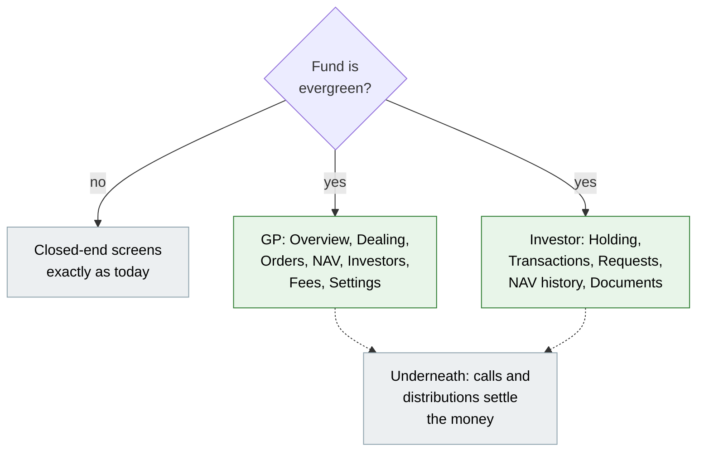

### GP-1 Overview

```
┌───────────────────────────────────────────────────────────────────────────┐
│ Alpha Long-Short Fund                       Evergreen · INR · Class A     │
│[Overview] Dealing Orders NAV Investors Fees Portfolio Ledger Docs Settings│
│                                                                           │
│ ① NAV ₹101.50 Cr   NAV/unit ₹10,160.94   30 Nov 26 ✓ approved             │
│ ② Net flows QTD −₹0.11 Cr        (in ₹5.00 Cr · out ₹5.11 Cr)             │
│ ③ Next dealing 1 Dec 2026 · cut-off 26 Nov (passed)                       │
│   ✓ Collect money  ✓ Approve NAV  ● Review and confirm dealing            │
│   What's needed now: confirm 2 subscriptions, 2 redemptions   [Open]      │
│ ④ Redemption queue ₹1.39 Cr  ·  gate 5% = ₹5.08 Cr  ·  cash ₹7.80 Cr      │
│ ⑤ NAV per unit, 12 months   ▁▂▂▃▄▄▅▆▆▇█▇                                  │
└───────────────────────────────────────────────────────────────────────────┘
```

| # | What it is | Behaviour |
|---|---|---|
| ① | Latest NAV per class | Shows the latest approved NAV. If a newer draft exists: "Draft 31 Dec awaiting approval". |
| ② | Net flows | Subscriptions allotted minus redemptions paid, quarter to date |
| ③ | Next dealing date | Step bar of that dealing date; **Open** goes to its workspace |
| ④ | Liquidity at a glance | Queued redemptions at the last NAV, the gate in money, and cash from the ledger |
| ⑤ | Trend | Approved NAV per unit for the last 12 months; one line per class |

### GP-2 Dealing

```
┌───────────────────────────────────────────────────────────────────────────┐
│ Dealing                                         Payment timing: pre-funded│
│ Dealing date  Cut-off   Subs         Redemptions   Step                   │
│ 1 Jan 2027    27 Dec    0            0             ○ Open for orders      │
│ 1 Dec 2026    26 Nov    2  ₹7.50 Cr  2  ₹1.39 Cr   ● Review and confirm   │
│ 2 Nov 2026    28 Oct    1  ₹5.00 Cr  3  ₹6.50 Cr   ✓ Closed               │
└───────────────────────────────────────────────────────────────────────────┘
```

- Dealing dates are generated from the dealing calendar in Settings, so upcoming dates appear before any orders arrive.
- Clicking a row opens its workspace (GP-3).

### GP-3 Dealing date workspace

Before confirming:

```
┌───────────────────────────────────────────────────────────────────────────┐
│ Dealing date 2 Nov 2026          NAV Class A 31 Oct 26 ✓ ₹10,220.00/unit  │
│ ✓ Collect money ✓ Approve NAV ● Review and confirm ○ Allot units ...      │
│ What's needed now: review pricing and the gate, then confirm.             │
│                                                                           │
│ Subscriptions (paid by cut-off)                                           │
│ Investor        Folio  Class  Paid          NAV/unit    Units             │
│ P Family Trust  F-101  A      5,00,00,000   10,220.00   4,892.3679        │
│ Not paid by cut-off — will roll to 1 Dec 2026                             │
│ Q Capital       F-102  A      0 of 2,50,00,000                            │
│                                                                           │
│ Redemptions   Gate 5% of NAV = 5,11,00,000 · FIFO · filled 78.6%          │
│ Queue Investor Folio  Requested    Filled       Carried     Units cancel  │
│ 1     A Ltd    F-012  3,00,00,000  3,00,00,000  0           2,935.4207    │
│ 2     B LLP    F-031  2,50,00,000  2,11,00,000  39,00,000   2,064.5793    │
│ 3     C HUF    F-044  1,00,00,000  0            1,00,00,000 0             │
│                                          [Cancel]  [Confirm dealing]      │
└───────────────────────────────────────────────────────────────────────────┘
```

After confirming — the settlement tracker:

```
┌───────────────────────────────────────────────────────────────────────────┐
│ Dealing date 2 Nov 2026                                                   │
│ ✓ Collect ✓ NAV ✓ Confirm ✓ Allot units ● Pay redemptions ○ Cancel ○ Close│
│ What's needed now: pay 2 redemptions (₹5.11 Cr) by 16 Nov 2026.           │
│                                                                           │
│ Subscriptions                                                             │
│ P Family Trust  F-101  4,892.3679 units  ✓ Allotted ✓ Contract note sent  │
│                                                                           │
│ Redemptions                                                               │
│ A Ltd   F-012  ₹3,00,00,000  2,935.4207 u  ● Awaiting payment [Mark paid] │
│ B LLP   F-031  ₹2,11,00,000  2,064.5793 u  ● Awaiting payment [Mark paid] │
│                                       ✓ Gate notices sent to B LLP, C HUF │
│                                                                           │
│ Settlement records (audit): subscription · redemption settlement          │
│                                                          [Undo dealing]   │
└───────────────────────────────────────────────────────────────────────────┘
```

- With order journeys on, subscriptions and redemptions whose journey hasn't reached *Ready to deal* appear under "Not ready — waiting on: <step>" next to the unpaid list, and are left out of the pricing.
- Confirm first shows a popup of three action-summary cards: "Allot 4,892.3679 units to 1 investor", "Pay 2 redemptions — ₹5.11 Cr", "Carry ₹1.39 Cr to 1 Dec 2026 and send 2 gate notices".
- **Mark paid** records the payment date and reference. Units are cancelled straight away; the redemption advice is emailed at once if the fund has no advice template, otherwise it waits for **Generate documents** and **Approve & send** (Actions menu), with View · Regenerate on each row until approved.
- **Undo dealing** is shown only while nothing has been allotted, cancelled or paid. Otherwise it's disabled with "Units allotted or payments recorded — reverse them first".
- Each redemption's payment-due date is the dealing date plus the redemption settlement days in Settings.

### GP-4 Orders

```
┌────────────────────────────────────────────────────────────────────────────────────────────────┐
│ Redemptions                                          [Open ▾] [− New redemption] [Upload]       │
│ Next dealing date 1 Dec 2026 · Queued ₹1.38 Cr of the [gate 5% of NAV = ₹5.08 Cr] · Within gate │
│ ███████░░░░░░░░░░░░░░░░░░░░░                                                                    │
│ Received      Investor  Amount         Units       Status   Running   Paid 1 Dec   Carried At gate│
│ 18 Sep 09:15  B LLP     ≈ ₹38,77,462   381.6047    Pend #1  ₹0.39 Cr  ₹38,77,462   —   Paid in full│
│ 19 Sep 11:30  C HUF     ≈ ₹99,42,211   978.4736    Pend #2  ₹1.38 Cr  ₹99,42,211   —   Paid in full│
└────────────────────────────────────────────────────────────────────────────────────────────────┘
```

- One table: Subscriptions and Redemptions are separate tabs, each opening on **Open** orders in dealing order; the filter shows Dealt, Cancelled / rejected or All (newest first, without the gate columns).
- **Amount** and **Units** are separate columns: the side the investor asked in is plain, the other an estimate (≈) at the latest approved NAV per unit (here ₹10,160.94 at 30 Nov). A dealt order shows what it actually got.
- The gate columns use the same allocator as the confirm (FIFO or pro-rata), so a request over the gate shows **Part-filled** with its paid and carried split. The final value is fixed when the dealing date is confirmed.
- Carried-forward redemptions keep their original received time, so they stay ahead of newer requests.
- With order journeys on, Status shows the order's current journey step (e.g. "● Check investor KYC"), and clicking the order opens its step bar.

### GP-5 NAV

```
┌───────────────────────────────────────────────────────────────────────────┐
│ NAV                                            [New NAV] [Upload NAV]     │
│ NAV date    Class   NAV/unit   Units        NAV         Status    Source  │
│ 30 Nov 26   A       10,160.94  99,892.3679  101.50 Cr   Approved  Computed│
│ 31 Oct 26   A       10,220.00  1,00,000     102.20 Cr   Approved  Computed│
│ 30 Sep 26   A        9,980.69     98,450     98.26 Cr   Approved  Uploaded│
└───────────────────────────────────────────────────────────────────────────┘
```

**NAV draft (one class)**

```
┌──────────────────────────────────────────────────────────────┐
│  NAV — Class A — 31 Oct 2026                Status: Draft    │
│  Investments at fair value      95,00,00,000                 │
│  Cash                            8,00,00,000                 │
│  Other assets                              0                 │
│  Management fee payable          (50,00,000)   ✎ overridden: │
│                                                per admin stmt│
│  Performance fee payable                   0                 │
│  Accrued performance fee                   0   HWM 10,400.00 │
│  Other liabilities               (30,00,000)                 │
│  ─────────────────────────────────────────                   │
│  NAV                           102,20,00,000                 │
│  Units outstanding                  1,00,000                 │
│  NAV per unit                      10,220.00                 │
│  Prepared by Asha · 2 Nov 2026                               │
│                        [Edit lines] [Approve] [Delete draft] │
└──────────────────────────────────────────────────────────────┘
```

- **Approve** is hidden from the person who prepared the NAV, with the tooltip "Needs a different approver".
- Editing a line recalculates NAV and NAV per unit in place, with no page reload.
- A NAV becomes *stale* if a portfolio valuation, fund unit or fee accrual dated on or before its NAV date changes after it was drafted. A stale draft shows "Inputs changed since drafted — Recalculate". An approved NAV keeps its values and shows an information note.

### GP-6 Investors (unit register)

```
┌───────────────────────────────────────────────────────────────────────────┐
│ Investors · Class A · values at NAV 30 Nov 26 (₹10,160.94)    [Download]  │
│ Investor        Folio  Units         Value         Gain    Locked  Queued │
│ A Ltd           F-012  9,064.5793    ₹9.21 Cr      +6.4%   —       —      │
│ B LLP           F-031  4,935.4207    ₹5.01 Cr      +3.1%   —       381.60 │
│ P Family Trust  F-101  4,892.3679    ₹4.97 Cr      −0.6%   all to  —      │
│                                                            2 Nov 27       │
│ Total (12 folios)      99,892.3679   ₹101.50 Cr                           │
└───────────────────────────────────────────────────────────────────────────┘
```

- Clicking a row opens the folio: its holding, transactions, requests and documents — the same tabs the investor sees, plus admin actions (enter request, resend document).

### GP-7 Fees

```
┌───────────────────────────────────────────────────────────────────────────┐
│ Fees                                                                      │
│ Management fee · Class A 1.5% on NAV · paid quarterly                     │
│ Payable at 30 Nov 26 ₹25,11,805   last paid 5 Oct 26   accrued to 30 Nov  │
│ Month     NAV used     Days  Accrued      Paid         Payable            │
│ Nov 26    ₹102.20 Cr   30    ₹12,60,000   —            ₹25,11,805         │
│ Oct 26    ₹98.26 Cr    31    ₹12,51,805   —            ₹12,51,805         │
│                                                                           │
│ Performance fee · Class A 20% · crystallises 31 Dec                       │
│ High-water mark ₹10,400.00 · NAV/unit ₹10,160.94 · ₹239.06 below · ₹0     │
│ Mark history: 31 Dec 25 ₹10,400.00 (crystallised ₹31,20,000)              │
└───────────────────────────────────────────────────────────────────────────┘
```

- If fees aren't accrued up to the latest NAV date, a banner says so, with **Run fee formula to <date>**.

### GP-8 Settings

The evergreen settings form groups the fields in [Validation Rules](#validation-rules) under these headings:
- **Dealing calendar:** frequency or a custom list of dates, dealing day.
- **Subscriptions:** payment timing, minimums, handling of unpaid or not-ready orders.
- **Redemptions:** notice, lock-up, gate, settlement days.
- **Classes:** per-class overrides, initial price, performance fee, hurdle, crystallisation.
- **Order journeys:** off, subscriptions, or both; which templates.
- **NAV sources:** ledger names.
- **Documents:** contract-note and redemption-advice templates.

Each heading has a one-line hint of what it controls, and a **Typical setups** panel offers presets that fill the form ([Fund setups](#fund-setups)).

### LP-1 Landing page card

```
┌──────────────────────────────────────────────────────────┐
│ Alpha Long-Short Fund · Evergreen · Class A              │
│ Value  ₹4,97,11,057          Gain −0.6% since investing  │
│ 4,892.3679 units × ₹10,160.94 (NAV 30 Nov 2026)          │
│ Next dealing 1 Dec 2026 · cut-off 26 Nov                 │
│                          [Subscribe]  [Redeem]  [Open →] │
└──────────────────────────────────────────────────────────┘
```

### LP-2 Fund page — Holding

```
┌──────────────────────────────────────────────────────────┐
│ Alpha Long-Short Fund                                    │
│ [Holding] Transactions  Requests  NAV history  Documents │
│                                                          │
│ Folio F-101 · Class A                                    │
│ Units          4,892.3679      NAV/unit  ₹10,160.94      │
│ Value       ₹4,97,11,057       Cost   ₹5,00,00,000       │
│ Gain          −₹2,88,943 (−0.6%)                         │
│ Locked: 4,892.3679 units until 2 Nov 2027 (hard lock-up) │
│ Free to redeem: 0 units                                  │
│                          [Subscribe more]  [Redeem]      │
└──────────────────────────────────────────────────────────┘
```

- **Redeem** is disabled with "All your units are locked until 2 Nov 2027" when nothing is free to redeem under a hard lock-up.

### LP-2 Fund page — Transactions

```
┌──────────────────────────────────────────────────────────┐
│ Date       Type        Units        NAV/unit   Amount    │
│ 2 Nov 26   Allotment   4,892.3679   10,220.00  ₹5.00 Cr  │
│                                    Contract note ↓       │
└──────────────────────────────────────────────────────────┘
```

### LP-2 Fund page — Requests

```
┌──────────────────────────────────────────────────────────┐
│ Subscription ₹2,50,00,000 · Class A · dealing 1 Dec 26   │
│ ✓ Received 20 Nov ✓ Money in 22 Nov ○ Units allotted     │
│                                               [Cancel]   │
│ Redemption 381.6047 units · dealing 1 Dec 26 (B LLP)     │
│ ✓ Received 18 Sep ✓ Part-filled 2 Nov (2,064.58 u paid)  │
│ ● Queued #1 for 1 Dec — 381.6047 units carried           │
└──────────────────────────────────────────────────────────┘
```

- Subscription timeline: Received → Money received (pre-funded) → Units allotted → Contract note.
- Redemption timeline: Received → Queued (#position) → Filled or Part-filled → Paid → Units cancelled.
- **Cancel** shows only while the request is pending and its dealing date isn't confirmed.
- With order journeys on, steps that need the investor appear in the timeline with their action, e.g. "● Upload your signed subscription form [Upload]".

### LP-3 Subscribe wizard

```
┌──────────────────────────────────────────────────────────┐
│ Subscribe · Alpha Long-Short Fund    ① Amount ② Review ③ │
│ Class   [A ▾]          Minimum ₹25,00,000                │
│ Amount  [ 2,50,00,000 ]                                  │
│ Dealt on 1 Dec 2026 · pay by 26 Nov (cut-off)            │
│ Indicative units ≈ 2,460.4023 at ₹10,160.94 (30 Nov NAV) │
│ Indicative — final price is the NAV for 30 Nov 2026      │
│                                             [Next →]     │
└──────────────────────────────────────────────────────────┘
```

Step ③ for a pre-funded fund:

```
┌──────────────────────────────────────────────────────────┐
│ ✓ Subscription request received                          │
│ Pay ₹2,50,00,000 by 26 Nov 2026 to be dealt on 1 Dec     │
│ Bank   Alpha LSF Collection A/c · HDFC0001234 · 50100... │
│ Reference  SUB-F-102-0001                                │
│ We've emailed you these instructions.                    │
└──────────────────────────────────────────────────────────┘
```

### LP-4 Redeem wizard

```
┌──────────────────────────────────────────────────────────┐
│ Redeem · Alpha Long-Short Fund        ① What ② When ③    │
│ (•) Units [ 2,000 ]  ( ) Amount  ( ) All units           │
│ Held 9,064.5793 · free 9,064.5793 · queued 0             │
│ Indicative value ≈ ₹2,03,21,880 at ₹10,160.94            │
│ Early-redemption fee: none                               │
│ ② Earliest dealing 1 Jan 2027 (30-day notice)            │
│   Gate 5% of NAV · you would be #3 in the queue          │
│                                         [Submit request] │
└──────────────────────────────────────────────────────────┘
```

---

## What This Feature Does NOT Cover

| Excluded | Covered In |
|---|---|
| Per-investor high-water marks, equalisation and series accounting | Future change; the performance-fee model setting is built to take more options |
| Crystallising performance fee on redemption | Future change |
| Swing pricing, anti-dilution levies | Future change |
| Daily dealing | Future change; any calendar from weekly to annual can be entered as custom dates |
| Online payment collection for subscriptions (investors pay by bank transfer, as for capital calls today) | Existing payment recording and bank reconciliation |
| Converting an existing closed-end fund's history into evergreen history | Not planned; the flag applies from the switch date |
| Switching between unit classes (class conversions) | Future change; use a redemption plus a subscription meanwhile |
| Regulatory filings (SEBI Cat III reports, Form N-23c-3) | Not planned |
| Investor KYC itself | Existing KYC process; an order journey can *wait for* KYC approval |
| Suspending dealing (e.g. in a crisis) | Future change; meanwhile an admin simply does not confirm a dealing date |
| A full liquidity dashboard | Future change; the Overview shows queued redemptions, the gate and cash at a glance |
| A public-holiday calendar | Business days are Monday–Friday; holidays are handled by entering custom dealing dates |

---

## Validation Rules

Every term is a fund setting, so one model fits different kinds of evergreen funds. Settings marked **per class** can be overridden for each unit class; otherwise the fund value applies.

| Setting | Options / rule | Default | Per class |
|---|---|---|---|
| Subscription dealing calendar | Monthly, Quarterly, Semi-annual, Annual, or a custom list of dates | Monthly | — |
| Redemption dealing calendar | Monthly, Quarterly, Semi-annual, Annual, or a custom list of dates | Quarterly | — |
| Dealing day | First business day, last business day, or day N of the period (moved to the next business day) | First business day | — |
| Subscription payment timing | **Before dealing** (cleared money by the cut-off) or **After dealing** (within 1–30 days of the dealing date) | Before dealing; 7 days | — |
| Subscription cut-off | 0–30 days before the dealing date | 5 | — |
| Orders unpaid or not ready at cut-off | Roll to the next dealing date, or Cancel | Roll | — |
| Order journeys | Off, Subscriptions, or Subscriptions and redemptions; a journey template for each | Off | — |
| Minimum initial subscription | ≥ 0 | 0 | ✓ |
| Minimum additional subscription | ≥ 0 | 0 | ✓ |
| Redemption forms allowed | Any of: Units, Amount, All units (at least one) | All three | — |
| Redemption notice period | 0–180 days before the dealing date | 30 | ✓ |
| Redemption settlement | 1–90 business days after the dealing date | 10 | — |
| Lock-up | 0–60 months from each unit's allotment; Hard (refused) or Soft (allowed with fee) | 0; Hard | ✓ |
| Early-redemption fee | 0–10 % flat, or a schedule by unit age (e.g. 3 % in year 1, 2 % in year 2), applied to units in a soft lock-up | 0 | ✓ |
| Minimum holding | ≥ 0; a partial redemption may not leave the folio below it (redeem all instead) | 0 | ✓ |
| Gate | 0–100 % of NAV; 0 = no gate | 0 | — |
| Gate level | Whole fund, or each class separately | Whole fund | — |
| Gate period | Per dealing date, per calendar quarter, or per year (the gate is shared by every dealing date in the period) | Per dealing date | — |
| Gate method | FIFO or Pro-rata | Pro-rata | — |
| Investor-level gate | 0–100 % of an investor's own holding per gate period; 0 = none | 0 | — |
| Initial price | > 0; required for every class | — | ✓ |
| Performance fee model | None, or Class high-water mark | None | ✓ |
| Performance fee % | 0–50 % | 0 | ✓ |
| Hurdle | 0–50 % a year; Hard (fee only on the gain above the hurdle) or Soft (fee on the whole gain once the hurdle is beaten) | 0; Hard | ✓ |
| Crystallisation | Quarterly, Semi-annual or Annual | Annual | ✓ |
| NAV ledger names | Non-blank names for cash, other assets, other liabilities, management fee paid, performance fee paid | "Cash In Hand", "Net Current Assets", "Other Liabilities", "Management Fee Paid", "Performance Fee Paid" | — |
| Document templates | Contract note and redemption advice templates | Samples provided | — |
| Subscription amount | > 0 and ≥ the applicable minimum (initial or additional) | — | — |
| Redemption | Exactly one allowed form; units ≤ units held − locked (hard) − already queued | — | — |
| NAV line override | Reason required, max 255 characters | — | — |
| NAV approval | Approver ≠ preparer; fund approve permission | — | — |

---

## Fund Setups

Presets in Settings fill the form with a typical starting point for each kind of evergreen fund. They are starting points only: every value can then be changed to match the fund's offering documents.

| Setting | Indian Cat III AIF (open-ended) | US evergreen / tender-offer fund | US interval fund | Hedge-fund style |
|---|---|---|---|---|
| Subscriptions | Monthly | Monthly | Monthly | Monthly |
| Redemptions | Monthly or quarterly | Quarterly | Quarterly (repurchase offers) | Quarterly |
| Payment timing | Before dealing | Before dealing | Before dealing | Before dealing |
| Notice period | 30 days | 30–60 days | 21–42 days | 45–90 days |
| Lock-up | 12 months, soft, exit load 1–3 % | 12 months, soft, 2 % | None | 12 months, hard |
| Gate | Usually none | 5 % of fund NAV per quarter, pro-rata | 5–25 % of fund NAV per repurchase, pro-rata | 25 % of each investor's holding per quarter (investor-level) |
| Performance fee | Class high-water mark, often with hurdle, annual | Class high-water mark, 5–8 % hurdle | Usually none | Class high-water mark, 20 %, annual |
| Order journeys | Subscriptions (KYC, signed form, acceptance) | Subscriptions | Subscriptions | Subscriptions and redemptions |

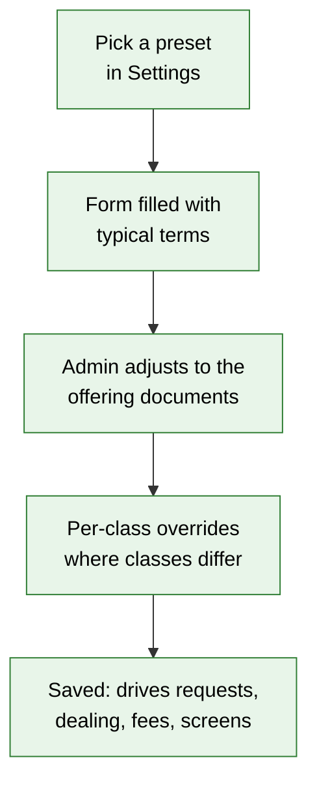

---

## Behavior Rules

| Scenario | What User Sees |
|---|---|
| Subscription received after the cut-off | Accepted; dealing date is the following one: "Received after the 28 Oct cut-off — dealt on 1 Dec 2026." |
| Pre-funded subscription not fully paid by the cut-off | Listed on the dealing date as "Not paid by cut-off"; rolled to the next dealing date or cancelled, per the setting; the investor is emailed which |
| Order journey not at *Ready to deal* by the cut-off | Listed as "Not ready — waiting on: <step>"; rolled or cancelled per the setting; a rolled redemption keeps its queue place |
| Pay-after-dealing subscription | After the dealing date is confirmed, the investor receives payment instructions with the exact units and amount; units are allotted when the money is recorded |
| Redemption received inside the notice period | Accepted for the first dealing date that satisfies the notice period, with that date shown |
| Redemption of units still in a hard lock-up | Rejected: "1,200 of these units are locked until 15 Mar 2027." |
| Redemption of units in a soft lock-up | Accepted with "An early-redemption fee of 2% applies to 1,200 units." The fee is deducted from the redemption payment |
| Partial redemption leaving the folio below the minimum holding | Rejected: "This would leave ₹40,00,000, below the ₹50,00,000 minimum holding. Redeem all units instead." |
| Redemption for more units than are free | Rejected: "You hold 4,892.37 units; 2,000 are already queued for redemption." |
| Redemption form not allowed by the fund (e.g. Amount) | The option is not offered in the wizard or the upload |
| Redemptions under the gate | All paid in full |
| Redemptions over the gate, FIFO | Filled in received order until the gate is used up; the rest carried forward; gate notices sent |
| Redemptions over the gate, pro-rata | Every request filled by the same fraction (5.11 ÷ 6.50 = 78.6%); the rest carried forward; gate notices sent |
| Gate period is a quarter, with monthly dealing | Redemptions paid earlier in the quarter use up the quarter's gate; later dealing dates in the quarter get only what remains |
| Investor-level gate | Each investor's fill is capped at their % of holding for the gate period before the fund-level gate is applied |
| Carried-forward request at the next dealing date | Queued ahead of anything received later; gated again if needed |
| *All units* redemption | Units counted at confirmation, so units allotted since the request are included |
| No approved NAV for a class with orders | Confirm disabled: "Approve the NAV for Class A dated 31 Oct 2026 first" |
| Dealing date with no orders | "Nothing to deal on 2 Nov 2026" — no settlement created |
| Undo after units are allotted, cancelled or paid | Undo disabled: "Units allotted or payments recorded — reverse them first" |
| Investor tries to cancel after the dealing date is confirmed | Cancel link gone; the request shows its settlement status |
| NAV inputs change after approval | Approved NAV unchanged; note "Inputs changed after approval on 2 Nov — reopen to recalculate" (only possible if no confirmed dealing date used it) |
| Subscription money recorded on a confirmed dealing date | Units allotted immediately; contract note emailed at once if the fund has no contract-note template, otherwise it waits for Generate documents and Approve & send |
| Redemption marked paid | Units cancelled immediately; redemption advice emailed at once if the fund has no advice template, otherwise it waits for Generate documents and Approve & send |
| Close dealing date before every contract note and advice is sent | Close disabled: "Send every contract note and redemption advice first" |
| Generate documents when every settled order already has its document | "Nothing to generate — every settled order already has its document or email" |
| Regenerate an approved document | Refused: "Approved documents can't be regenerated" |
| GP opens a settlement record of an evergreen fund | It reads "Subscription settlement — 2 Nov 2026" / "Redemption settlement — 2 Nov 2026" with evergreen labels, and links back to the dealing date |
| Closed-end fund | Screens, labels, notices and unit buttons exactly as today |

---

## Resolved Design Decisions

| # | Decision | Resolution |
|---|---|---|
| 1 | Where does NAV come from? | CapHive drafts it from its own data; the admin can override lines or upload an administrator's NAV; a second person approves (agreed 2026-10-07) |
| 2 | How are redemptions over the gate filled? | Fund setting: FIFO or pro-rata (agreed 2026-10-07) |
| 3 | Performance fee model | Class high-water mark in this change, chosen by a per-class "model" setting so other models can be added later (agreed 2026-10-07) |
| 4 | Who places orders? | Investors in the portal, and fund admins by entry or upload (agreed 2026-10-07) |
| 5 | How are orders settled? | On CapHive's existing settlement records (capital call and distribution underneath), so payments, reconciliation and the ledger are reused; hidden behind evergreen screens and labels |
| 6 | Dealing calendar | Fund setting: monthly, quarterly, semi-annual, annual or custom dates, separately for subscriptions and redemptions |
| 7 | Gate basis | Fund settings: % of NAV, at fund or class level, per dealing date, quarter or year, plus an optional investor-level gate |
| 8 | What is an evergreen investor's "commitment"? | Their folio. Each subscription adds to its subscribed amount, so existing reports keep working; screens call it a folio |
| 9 | Scope | Everything in one change: NAV, orders, dealing, fees, screens, documents and journeys (agreed 2026-10-07) |
| 10 | When does a subscriber pay? | Fund setting: before dealing (by cut-off) or after dealing (within N days) (agreed 2026-10-08) |
| 11 | Screens | Designed for evergreen funds and chosen by the fund's flag; closed-end screens unchanged (agreed 2026-10-08) |
| 12 | Labels | Evergreen terms on screens, emails, documents and on the settlement records underneath (agreed 2026-10-08) |
| 13 | Order journeys | Optional per fund, for subscriptions or for subscriptions and redemptions, on the existing journey framework; *Ready to deal* gates the dealing date (agreed 2026-10-08) |
| 14 | Different kinds of fund | Every term is a setting, with per-class overrides where classes commonly differ, and presets for common fund types (agreed 2026-10-08) |

---

## Capabilities

### New Capabilities

- `funds/open-ended-fund-settings`: the evergreen flag and every fund and per-class term, plus presets.
- `funds/fund-nav`: drafting, overriding, uploading, approving and reopening NAV per unit class per date, including staleness.
- `funds/open-ended-requests`: subscription and redemption orders from the portal wizards, admin entry and upload — validation, dealing-date assignment, payment timing, queue position, cancel.
- `funds/open-ended-order-journeys`: optional per-order journeys and the *Ready to deal* gate.
- `funds/dealing-runs`: dealing-date workspace, pricing at approved NAV, gates, settlement tracker, automatic allotment and cancellation, carry-forward and undo.
- `funds/open-ended-fees`: management fee on NAV and the performance fee with a class-level high-water mark and crystallisation.
- `funds/open-ended-gp-workspace`: the GP screens chosen by the fund's flag — overview, order book, unit register, fees tab, funds-list card — and evergreen labels on settlement records.
- `funds/open-ended-investor-view`: investor landing card, fund page tabs, holding, transactions, requests, NAV history and statement fields.
- `funds/open-ended-documents`: acknowledgements, payment instructions, contract notes, gate notices and redemption advices.
- `funds/open-ended-notifications`: investor reminders and updates, team alerts by role, per-fund switches with defaults, send-once logging, and copying customised notifications from another fund.

### Modified Capabilities

None. The settlement records and journey framework are reused; their existing requirements don't change for closed-end funds.

---

## Impact

- **Fund pages (GP):** a second set of tabs and header for evergreen funds, chosen by the flag; funds-list card.
- **Investor portal:** evergreen landing card, fund page tabs and subscribe/redeem wizards.
- **Capital calls and distributions:** created by dealing dates as settlement records; shown with evergreen labels on evergreen funds; units allotted and cancelled automatically only for these. Manual calls and distributions behave as today.
- **Fund units:** redemptions from a dealing date cancel the exact units, not units back-calculated from an amount.
- **Journeys:** new dealing-date and order journey templates, seeded per entity.
- **Fund formulas:** ready-made management-fee-on-NAV formula; performance-fee accrual.
- **Documents and emails:** new evergreen templates and emails; statement fields.
- **Uploads:** NAV upload and order upload.
- **Permissions:** NAV approval and order acceptance use the existing fund approve permission; investors' order rights follow their existing access to the fund.

---

## Benefits

1. GP users and investors work in screens and words made for evergreen funds — no commitment or call vocabulary to translate.
2. Every dealing date is priced at a NAV a second person approved, with an audit trail of every override.
3. Gates, queues, lock-ups and notice periods are applied the same way every time, and investors see their place in the queue.
4. One confirmation settles a dealing date; units, contract notes and redemption advices follow automatically.
5. Funds with stricter onboarding can require KYC, signed forms and GP acceptance before any order is dealt.
6. One configurable model fits Cat III AIFs, US tender-offer and interval funds, and hedge-fund-style vehicles.
7. Closed-end funds are untouched.

---

## FAQ

| Question | Answer |
|---|---|
| Who can use this? | Entities where evergreen funds are switched on (off by default, so nothing changes for anyone else). Within such an entity, each fund is made evergreen individually by a fund admin. |
| What happens to closed-end funds? | Nothing. Screens, labels, notices and unit buttons stay exactly as they are. |
| Will GP users still see capital calls for an evergreen fund? | Not in the evergreen tabs. The settlement records exist for audit, reached from a dealing date, and are labelled *Subscription settlement* and *Redemption settlement*. |
| Can an existing fund be switched? | Yes. Existing units and folios carry over and dealing starts from the next dealing date. History before the switch is not re-priced. |
| Can it be switched back? | Only while no dealing date has been confirmed. |
| Do investors get emails? | Yes — evergreen ones: acknowledgements, payment instructions, contract notes, gate notices and redemption advices. They don't get call or distribution notices for evergreen funds. |
| Do we have to use order journeys? | No. They're off by default and switched on per fund, for subscriptions only or for both. |
| Does it work with an external fund administrator? | Yes. Upload their NAV per class, approve it, and deal on it. |
| Our fund's terms aren't in a preset — can we still set it up? | Yes. Presets only fill the form; every term can be changed, and many can be set per class. |
| What if NAV is wrong after a dealing date used it? | It can't be reopened. Correct it as a fund would: an adjusting entry plus a corrective subscription or redemption. See design.md. |
| Does pricing or billing change? | No. |
| Is KYC enforced for new subscribers? | Existing KYC rules apply; with order journeys on, a subscription can also wait for KYC approval before it's dealt. |

---

## Design Principle for the Next Phase

Reuse under the hood, design the experience for evergreen funds. **Settlement must reuse capital calls, remittances, distributions and payments; unit allotment must reuse the existing unit engine; journeys must reuse the existing journey framework; documents must reuse the existing template and email machinery.** None of that may leak into what evergreen users see. Flag these for the design to deal with head-on:

- **Screens and labels by flag.** Choosing tabs, headers, cards and labels by the fund's flag must not fork every existing view or touch closed-end rendering. Prefer a small number of switch points plus new evergreen views.
- **Shared records, two vocabularies.** The same capital call or distribution record must read "Subscription settlement" or "Redemption settlement" on an evergreen fund. Decide where labels live so emails, screens, exports and audit logs agree.
- **Exact unit quantity on redemption.** Today units redeemed are worked out as amount ÷ price. Keep closed-end behaviour byte-identical while dealing-date payments cancel an exact unit count.
- **Automatic allotment.** Today it's a manual button. Adding it only for dealing-date settlement must not change manual calls and distributions.
- **Two payment timings and optional order journeys.** These multiply the paths through a dealing date. Model them as data (the steps a dealing date and an order go through), not as branches spread through the code.
- **Gate options.** Fund or class level, per dealing date, quarter or year, plus an investor-level cap — one allocator with clear inputs, tested against worked examples.
- **NAV inputs.** Cash and liabilities come from existing ledger data, with no new ledger. Keep staleness detection cheap.
- **Changes to existing models** (capital call, distribution, payment, commitment, unit engine, fund views) must be listed explicitly for approval.
