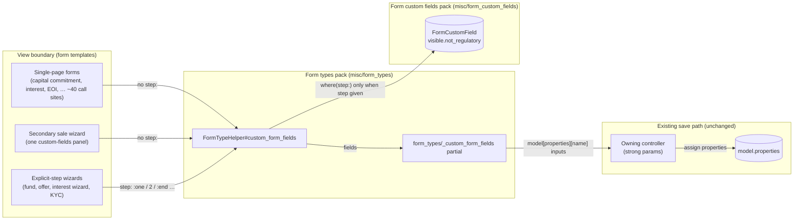
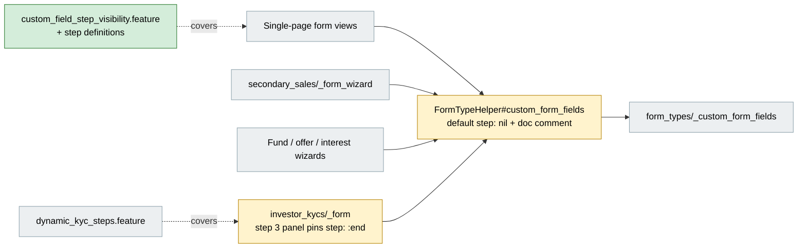
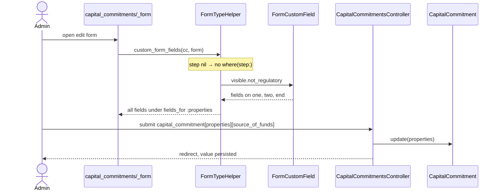
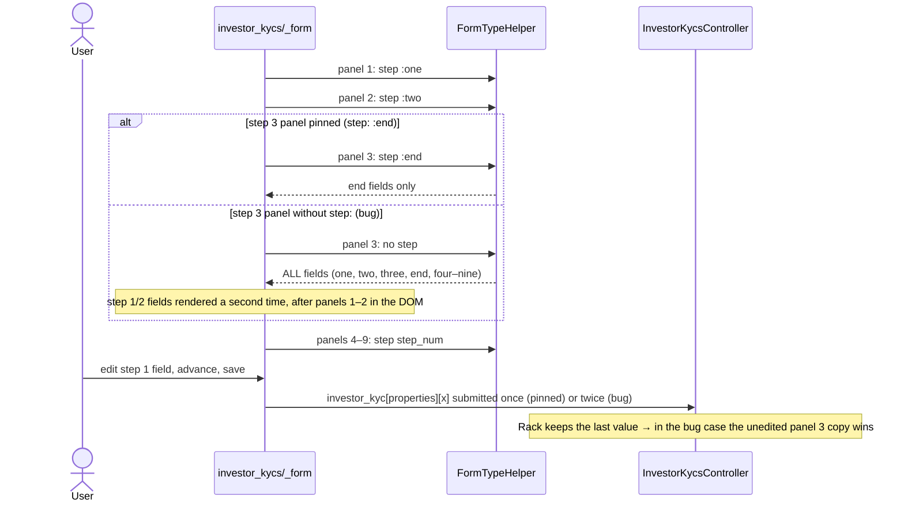
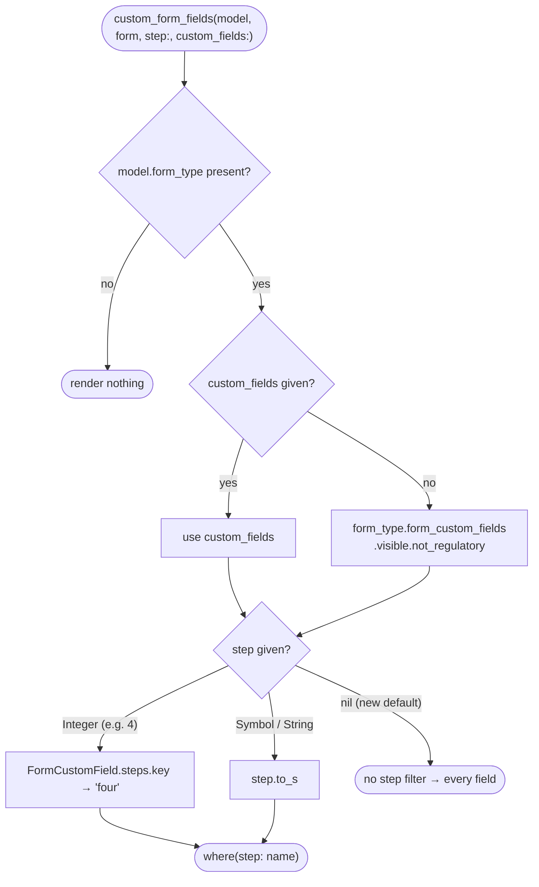

# Custom Fields on Every Step Render on Single-Page Forms — Design

> **Audience:** Engineering team.
> **Companion documents:** [Proposal](proposal.md) · [Spec](specs/)

---

## Contents

- [Overview](#overview)
- [Architecture](#architecture)
  - [Component Boundaries](#component-boundaries)
  - [Class Diagram](#class-diagram)
  - [Change Footprint](#change-footprint)
- [Data Model and States](#data-model-and-states)
  - [Data Model](#data-model)
  - [State Transitions](#state-transitions)
- [Behaviour](#behaviour)
  - [Pipeline / Flow](#pipeline--flow)
  - [Sequence Diagrams](#sequence-diagrams)
  - [Worked Examples](#worked-examples)
- [Key Components](#key-components)
  - [Decision Flows](#decision-flows)
- [Controllers and Routes](#controllers-and-routes)
- [Policy](#policy)
- [UI Changes](#ui-changes)
  - [At a glance](#at-a-glance)
  - [Journey 1: An admin moves a field to another step](#journey-1-an-admin-moves-a-field-to-another-step)
  - [Journey 2: A user fills in the Investor KYC wizard](#journey-2-a-user-fills-in-the-investor-kyc-wizard)
  - [Build notes (for implementers)](#build-notes-for-implementers)
- [Cross-cutting Concerns](#cross-cutting-concerns)
  - [Transactions and Queries](#transactions-and-queries)
  - [Exception Handling and Monitoring](#exception-handling-and-monitoring)
  - [Performance and Security](#performance-and-security)
- [Design Decisions](#design-decisions)
- [Testing](#testing)
- [Risks and Open Questions](#risks-and-open-questions)

---

## Overview

`FormTypeHelper#custom_form_fields` changes its default from `step: "end"` to `step: nil`, and a
nil step means "no step filter". Every single-page form that calls it without `step:` now renders
all visible, non-regulatory custom fields. Wizards keep passing `step:` per panel, as they already
did. The one wizard panel that relied on the old default, the Investor KYC step 3 panel, now passes
`step: :end` explicitly. Landed in `0fa9e8ab3e`, with Cucumber coverage extended in `b67f3580f8`.

Background on the step enum: `FormCustomField#step` is `{ one: 1, two: 2, three: 3, end: 100,
four: 4 … nine: 9 }`. The form builder labels `end` "Step 3 (Default)", and new fields get it
unless someone picks another step. `four`–`nine` (`EXTRA_STEP_RANGE`) are dynamic extra steps that
only the KYC wizard renders, via `FormType#extra_step_numbers`.

---

## Architecture

### Component Boundaries



| From → To | Contract | Direction rule |
|---|---|---|
| View → `custom_form_fields` | `step:` is an enum name, an integer, or absent. `custom_fields:` overrides the query. | Only a view that renders custom fields on more than one panel passes `step:`. |
| `custom_form_fields` → `FormCustomField` | `visible.not_regulatory`, plus `where(step: <enum name>)` only when a step is given | The helper always resolves an integer step to its enum name before querying. |
| Partial → controller | Every field submits as `model[properties][<name>]`, on whichever panel it renders | A field must appear on one panel only. Rack keeps the last value for a repeated name. |

### Class Diagram

```mermaid
classDiagram
    direction LR
    namespace View_Boundary {
        class InvestorKycForm {
            <<View>>
            investor_kycs/_form.html.erb
            step 3 panel: step :end (changed)
        }
        class SinglePageForm {
            <<View>>
            e.g. capital_commitments/_form
            calls without step
        }
    }
    namespace FormTypes_Pack {
        class FormTypeHelper {
            <<Helper>>
            +custom_form_fields(model, form, step: nil, required:, custom_fields:)
            +display_custom_fields(model, ...)
        }
    }
    namespace FormCustomFields_Pack {
        class FormCustomField {
            <<Model>>
            step: one|two|three|end|four..nine
            +visible()
            +not_regulatory()
        }
        class FormType {
            <<Model>>
            +extra_step_numbers()
        }
    }
    InvestorKycForm --> FormTypeHelper : custom_form_fields(step:)
    SinglePageForm --> FormTypeHelper : custom_form_fields()
    FormTypeHelper --> FormCustomField : query
    FormType o-- FormCustomField : form_custom_fields
```

### Change Footprint

All changes are in the `misc/form_types` pack and one `core/investor_kycs` view. No new classes.



---

## Data Model and States

### Data Model

N/A — no tables or columns change. Values keep living in `properties` (`json_fields`).

### State Transitions

N/A — no status or lifecycle. A field's `step` is configuration, not state.

---

## Behaviour

### Pipeline / Flow

N/A — a single query with one optional filter. See [Decision Flows](#decision-flows).

### Sequence Diagrams

**Happy path: single-page form (capital commitment edit)**



**Edge flow: Investor KYC wizard, with and without the step 3 pin**



### Worked Examples

**ID legend:** **H** = Happy path · **E** = Edge case · **X** = Error (exception) case. IDs are
referenced from tasks.md and Cucumber scenario names.

**Shared setup:**

| Record | Name | Key data |
|---|---|---|
| Entity | TestFund | Investment Fund, `enable_funds=true`, user is `company_admin` |
| Capital Commitment form type | — | Source of Funds (`one`), Risk Notes (`two`), Internal Notes (`end`) |
| Capital commitment | FilterFund / Investor A | committed amount 100,000 |
| KYC entity | DynStepFund | DynStepInvestor; KYC form type with one text field on each step one to nine |

#### Happy Path

| # | Scenario | Given | When | Then | Spec scenario | Feature |
|---|---|---|---|---|---|---|
| H1 | Single-page form shows every step | Capital commitment form type with fields on `one`, `two`, `end` | Admin opens the capital commitment edit form | Source of Funds, Risk Notes and Internal Notes are all shown | Fields on Step 1, Step 2 and the default step | `features/core/custom_field_step_visibility.feature` |
| H2 | Non-default step value is saved | Same, with Source of Funds on `one` | Admin enters "Salary savings" in Source of Funds and saves, then reopens the form | `properties["source_of_funds"]` is "Salary savings" and the field shows it | Value entered in a non-default step field is saved | `features/core/custom_field_step_visibility.feature` |
| H3 | KYC wizard still splits by step | KYC form type with a field on each step one to nine | User opens the KYC edit form | The wizard shows 9 navigation circles | KYC wizard | `features/core/dynamic_kyc_steps.feature` |

#### Edge Cases

| # | Scenario | Given | When | Then | Spec scenario | Feature |
|---|---|---|---|---|---|---|
| E1 | Step 1 edit not overwritten by step 3 | Same KYC form type | User fills "val_step_1" … "val_step_9" on each step and saves | Every value is saved and shown on the show page. Fails without the step 3 pin (`Expected properties['step_one_field'] = 'val_step_1' but got '""'`) | KYC wizard; Step 1 edit on the KYC wizard is not overwritten by step 3 | `features/core/dynamic_kyc_steps.feature` |

#### Error Cases

N/A — the change only widens a query. It adds no input, validation or external call that can fail.

---

## Key Components

N/A — no services or jobs. The only logic is the step filter in `FormTypeHelper#custom_form_fields`,
shown below.

### Decision Flows



---

## Controllers and Routes

N/A — no routes or controller actions change. Owning controllers already permit `properties`.

---

## Policy

N/A — no authorization changes. Who can open each form is decided by its existing policy, and the
helper only reads fields from `model.form_type`, which is already scoped to the record's entity.

| Role | Access |
|---|---|
| All roles | Unchanged |

**Multi-tenancy:** unchanged. Fields come from `model.form_type`, which belongs to the record's
`entity_id`.

---

## UI Changes

The user-facing rule is in the [proposal](proposal.md#what-changes).

### At a glance

| Where in CapHive | Today | After this change | Who sees it |
|---|---|---|---|
| Any single-page form with custom fields (e.g. Capital Commitment edit) | Only fields on "Step 3 (Default)" are shown | Every visible field is shown, in `position` order | Anyone who can edit that record |
| Secondary sale wizard, custom-fields panel | Only default-step fields | Every visible field | Anyone who can edit the sale |
| Investor KYC wizard | One step per panel | Unchanged | — |
| Fund / offer / interest wizards | Fields on the steps they render | Unchanged | — |


### Journey 1: An admin moves a field to another step

```
Capital Commitment — Edit
┌──────────────────────────────────────────────┐
│  Committed amount  [ 100,000            ]    │
│  ① Source of Funds [ Salary savings     ]    │  ← tagged Step 1
│  ② Risk Notes      [                    ]    │  ← tagged Step 2
│  ③ Internal Notes  [                    ]    │  ← tagged Step 3 (Default)
│  ④ [ Save ]                                  │
└──────────────────────────────────────────────┘
```

| Step | The user… | They see |
|---|---|---|
| 1 | In the form builder, sets Source of Funds to "Step 1" | The field saves with its new step |
| 2 | Opens a capital commitment edit form | ①②③ all shown. Before this change only ③ was. |
| 3 | Fills ① and clicks ④ Save | The value is saved and shown on the next edit |

### Journey 2: A user fills in the Investor KYC wizard

```
Investor KYC — Edit (wizard)
┌──────────────────────────────────────────────┐
│  ① ○─○─●─○─○─○─○─○─○   (one circle per step)  │
│  ② Step 3 panel: only "Step 3 (Default)"     │
│     fields — no repeats of Step 1 / Step 2   │
│  ③ [ Next ]                                  │
└──────────────────────────────────────────────┘
```

| Step | The user… | They see |
|---|---|---|
| 1 | Opens the KYC edit form | ① one circle per configured step, as before |
| 2 | Fills step 1, clicks ③ Next through to step 3 | ② only default-step fields, as before |
| 3 | Saves from the last step | Every step's value is kept |

Two things that are easy to miss when testing this journey:
- **The fields come from the `IndividualKyc` or `NonIndividualKyc` form type,** never from one
  named `InvestorKyc`. New KYC → "Individual (KYC)" means the `IndividualKyc` form type tagged
  "KYC". See the form-type risk in [Risks and Open Questions](#risks-and-open-questions).
- **"Reporting Fields" is not a Step.** It is an extra last panel at position 3 + (number of extra
  steps in use) + 1, holding every field with a `reg_env` (e.g. SEBI's Investor Category and
  Investor Sub Category). A field's Step is ignored there. Investors and signed-link users don't
  see the panel.

### Build notes (for implementers)

| Interaction | Screen update |
|---|---|
| All | No Turbo or Stimulus changes. Fields are server-rendered by `form_types/_custom_form_fields` under `fields_for :properties`. The KYC wizard's panel switching is unchanged. |

---

## Cross-cutting Concerns

### Transactions and Queries

| What is read | When | N+1 risk | How it stays cheap |
|---|---|---|---|
| `form_custom_fields.visible.not_regulatory` | Once per `custom_form_fields` call (once per wizard panel) | No | `includes(:rich_text_info)`, same query as before minus the step filter on single-page forms |

| Operation | In a transaction? | Why |
|---|---|---|
| Saving `properties` | Unchanged | The save path is untouched |

### Exception Handling and Monitoring

N/A — no new runtime failure modes.

### Performance and Security

- **Performance:** single-page forms now load a few more fields per render. Form types have tens of
  fields at most, so the cost is negligible.
- **Security:** no new parameters. Fields are still nested under `properties`, which owning
  controllers already permit. Hidden (`visible`) and regulatory fields stay excluded.

---

## Design Decisions

1. **Default `step: nil` means "no step filter"** — `step_name` is already `nil` for a blank
   `step`, so the existing `where(step: step_name) if step_name.present?` guard skips the filter.
   The doc comment now says only wizard panels pass `step:`. Alternative considered: add `step: nil`
   to each single-page view. Rejected because there are dozens of single-page call sites and only a
   handful of wizard panels. The bug being fixed is "a field silently disappears", so a call that
   chooses no step should show too much rather than too little, and every new single-page form
   gets the fix for free.
2. **Pin the Investor KYC step 3 panel to `step: :end`** — `investor_kycs/_form.html.erb:319` was
   the one multi-panel call without `step:`. Pinning `:end` reproduces its old output exactly.
   Alternative considered: also show `three` there. Rejected for now because `three` fields were
   never shown on any KYC panel, and showing them needs the helper to accept a list of steps (Open
   Question 2).
3. **Don't widen `step: :end` to mean "everything"** — fund, offer and interest wizards pass `:end`
   for their last panel. Widening it would repeat their `one`/`two` fields there. Rejected.
4. **Keep the integer → enum-name conversion** — KYC extra steps pass integers (`step_num`), and
   `where` on an enum column needs the name on Rails 7.1+. That path is unaffected.
5. **Leave the secondary sale wizard without `step:`** — `secondary_sales/_form_wizard.html.erb:84`
   is its only custom-fields call, so showing every field there is the intended single-page
   behaviour and nothing renders twice.

---

## Testing

Cucumber only, Redis on 6379 and Elasticsearch up (investor setup), with a random
`TEST_ENV_NUMBER`. New: `features/core/custom_field_step_visibility.feature` (H1, H2). It reuses the
existing entity, custom-field and capital commitment setup steps, with its visit, field-label and
saved-value steps in the new `custom_field_step_visibility_steps.rb`. Reused unchanged:
`features/core/dynamic_kyc_steps.feature` (H3, E1). Both pass: 4 scenarios, 46 steps.

---

## Risks and Open Questions

- [A future wizard panel forgets `step:` and shows every field, repeating fields from other panels
  and overwriting their edits on save (the KYC bug shown in [Sequence Diagrams](#sequence-diagrams))]
  → the helper's doc comment says multi-panel wizards must pass `step:`, and E1 guards the KYC
  wizard.
- [Single-page forms show fields tagged `one`/`two`/`three`/`four`–`nine` that people had stopped
  seeing, possibly with values last set by import or API] → intended: it matches the form builder
  configuration. Fields render in `position` order, not grouped by step.
- [Partial rollback] → revert the helper default and the KYC pin together. Reverting only the pin
  brings back the KYC overwrite bug. Stored `properties` values are untouched either way. No schema
  or data changes ship with this.
- [Explicit-step wizards that don't render every step still hide fields, e.g. a fund field on `two`
  (the fund wizard renders only `:one` and `:end`)] → out of scope, unchanged from before. Fixing it
  needs a view change per wizard (Open Question 3).
- [**Fields added to a form type named `InvestorKyc` never appear on the KYC form.** Admins can
  create one, because `InvestorKyc` is in the form builder's type list and in
  `MULTIPLE_FORM_TYPES_ALLOWED`. But the KYC form always looks up `IndividualKyc` or
  `NonIndividualKyc`. This was found while testing Journey 2 and is not caused by this change.]
  → documented here only, with no behaviour change. Admins should add form fields to the
  `IndividualKyc` / `NonIndividualKyc` form type. Open Question 4. Where each name is read today:

  | Form type name | Read by | Code |
  |---|---|---|
  | `IndividualKyc` / `NonIndividualKyc` | New KYC (via the menu's `form_type_id`, or by type name) | `InvestorKycsController#new`, `WithSetupCustomFields#setup_custom_fields` |
  | | Edit KYC, which keeps the record's `form_type_id` and looks up by type only when it is blank | `InvestorKycsController` (edit path) |
  | | Model fallback, creation and import | `WithCustomField#setup_form_type`, `InvestorKycCreate`, `ImportInvestorKyc` |
  | | SEBI reporting fields (the SEBI button) | `AddRegulatoryCustomFieldsService`, `FormCustomField::REGULATORY_FIELD_MODELS` |
  | | KYC list Excel download | `investor_kycs/index.xlsx.axlsx` |
  | `InvestorKyc` | KYC list grid columns ("Configure Grids" is offered only for this name) | `RansackTableHeader#ag_selected_columns`, `#get_columns`, `form_types/show.html.erb` |
  | | KYC list custom-field filters (fields marked filterable) | `WithCustomFieldFilter#register_filterable_ransackers_for` |
  | | Capital Commitment filters, "Investor Kyc" group | `CapitalCommitment.ransackable_associations` + the same concern |
  | | Fund Excel export, KYC columns on the CapitalCommitment sheet | `FundXl` (`get_form_type("InvestorKyc")`) |
  | | Custom grid columns behind `investor_kyc_custom_cols` | `GridColsHelper#custom_grid_columns` |
  | | `condition_on: "kyc_type"` validation | `FormCustomField#condition_on_custom_field` |

  The reverse case is also affected: a field marked filterable on `IndividualKyc` is **not**
  offered as a KYC list filter, because the filter concern reads only `InvestorKyc` form types.
  The exception to all of the above is an old KYC record whose `form_type_id` already points at an
  `InvestorKyc` form type. The edit form keeps that form type and renders its fields.

| # | Open question | Current thinking | Status |
|---|---|---|---|
| 1 | Should the form builder stop offering Step for form types that are never shown as a wizard? | Would prevent the confusion at the source. It is a form type editor UI change, not needed for this fix. | Deferred |
| 2 | Should the KYC step 3 panel also show fields tagged `three`? The builder offers both "Step 3" (`three`) and "Step 3 (Default)" (`end`), but only `end` has a KYC panel. | Let `custom_form_fields` accept a list, e.g. `step: [:three, :end]`. | Deferred |
| 3 | Should the fund and interest wizards render their unused steps (`two`/`three`), or should the builder limit which steps each form type offers? | Limiting the builder's options seems simpler. | Deferred |
| 4 | Should `InvestorKyc` form types be limited to list-level settings (grid columns, filters, export columns)? The options are: say so in the form builder, stop offering `InvestorKyc` as a type for form fields, or have filters also read `IndividualKyc` / `NonIndividualKyc`. | Make the builder say that `InvestorKyc` fields don't appear on the KYC form, and have filters read all three names. A separate change. | Deferred |
