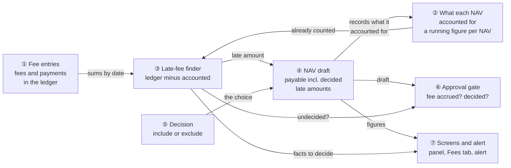
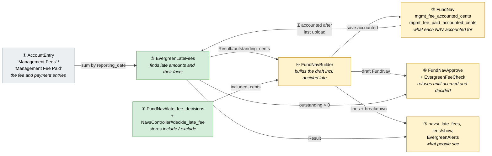
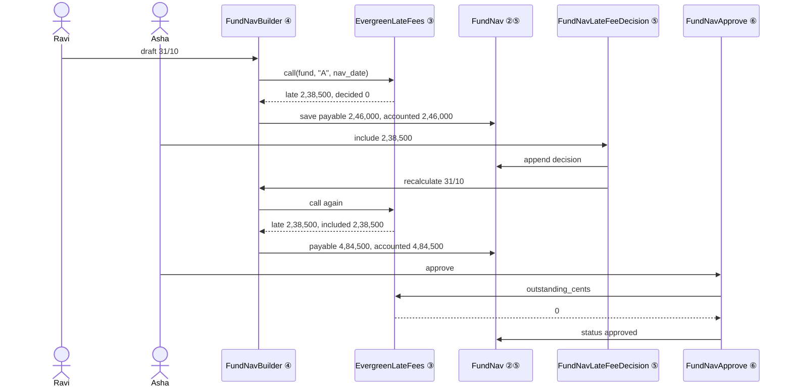
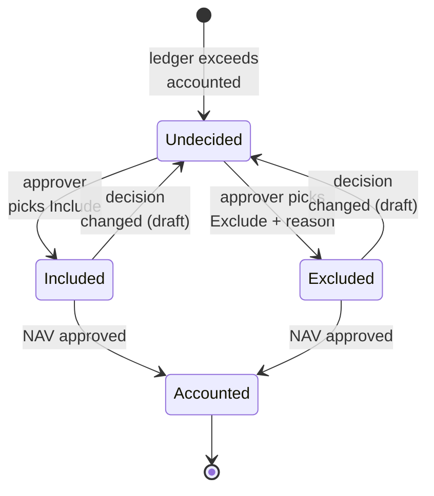
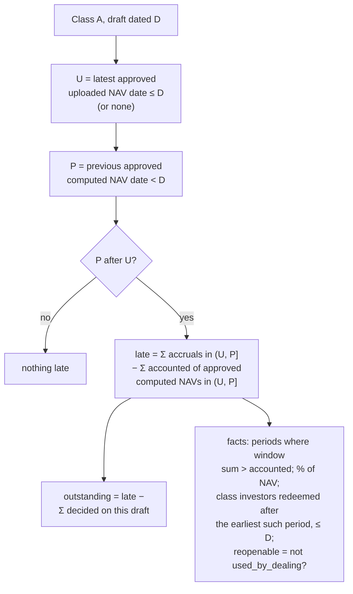
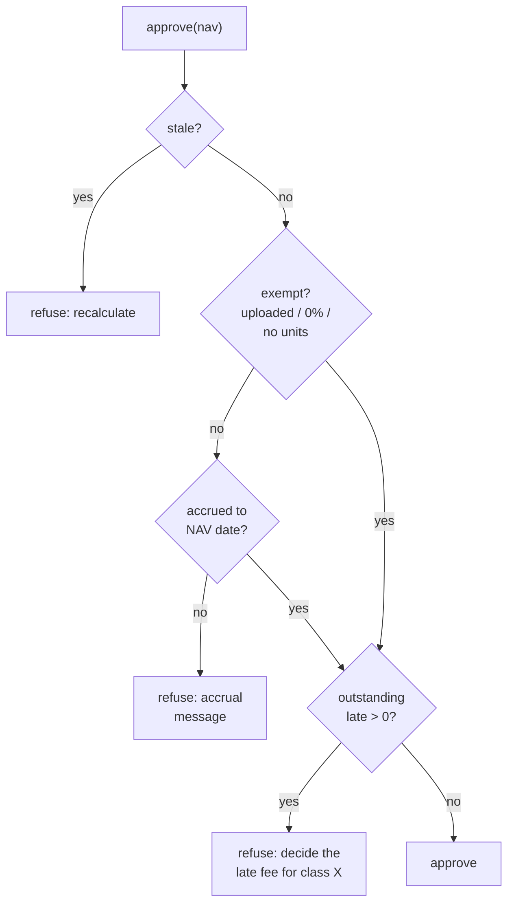
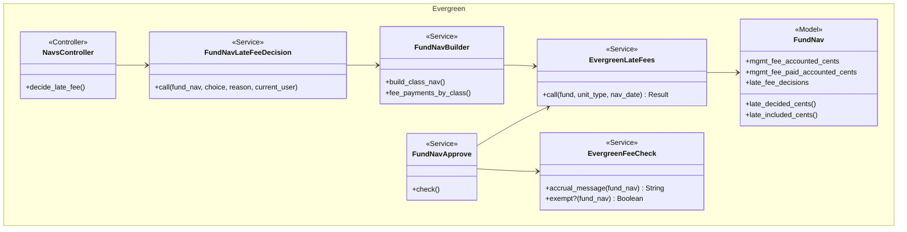
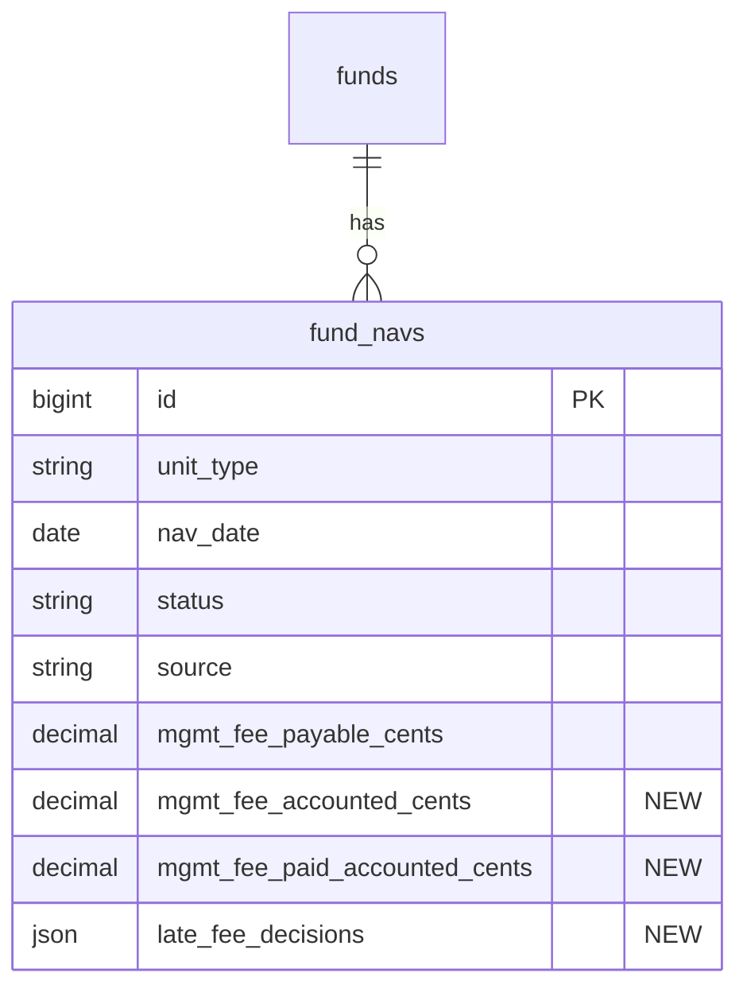

# Late management fees on evergreen NAVs — Design

> **Audience:** Engineering team.
> **Companion documents:** [Proposal](proposal.md) · [Spec](specs/funds/open-ended-fees/spec.md) · [LLD](lld.md) · [QA checklist](qa-checklist.md)
> **Business background:** [evergreen_backdated_management_fees.md](../../../../docs/modules/funds/evergreen_backdated_management_fees.md) · rules R9.2, R9.10–R9.16 in [evergreen_business_rules.md](../../../../docs/modules/funds/evergreen_business_rules.md#fees-booked-late)

> **Planning phase — no code changes.**

---

## Contents

- [1. The idea](#1-the-idea)
  - [What this adds](#what-this-adds)
  - [The idea in one picture](#the-idea-in-one-picture)
  - [Walkthrough: one example, start to finish](#walkthrough-one-example-start-to-finish)
  - [Key ideas](#key-ideas)
- [2. The same picture with real names](#2-the-same-picture-with-real-names)
  - [Picture](#picture)
  - [What each box does](#what-each-box-does)
  - [One run, end to end](#one-run-end-to-end)
  - [Lifecycles](#lifecycles)
  - [What users see](#what-users-see)
  - [Design decisions](#design-decisions)
- [3. One card per box](#3-one-card-per-box)
  - [① Fee entries in the ledger](#①-fee-entries-in-the-ledger)
  - [② What each NAV accounted for](#②-what-each-nav-accounted-for)
  - [③ Late-fee finder](#③-late-fee-finder)
  - [④ NAV draft](#④-nav-draft)
  - [⑤ Decision](#⑤-decision)
  - [⑥ Approval gate](#⑥-approval-gate)
  - [⑦ Screens and alert](#⑦-screens-and-alert)
- [4. Reference](#4-reference)
  - [Class diagram](#class-diagram)
  - [Data model and schema changes](#data-model-and-schema-changes)
  - [Component contracts](#component-contracts)
  - [Notifications](#notifications)
  - [Cross-cutting concerns](#cross-cutting-concerns)
  - [Worked examples](#worked-examples)
  - [Testing](#testing)
  - [Risks and open questions](#risks-and-open-questions)

---

## 1. The idea

### What this adds

Each computed NAV starts recording **how much management fee it accounted for**, as a running figure.
On the next draft, anything in the ledger beyond that figure, dated in an already-approved period, is
**late**. The GP must include or exclude it before approving. Approval also refuses a NAV whose fee isn't
accrued to its date. Both refusals follow the pattern `FundNavApprove` already uses for stale drafts: a
message that blocks the action and is also shown as the disabled button's reason.

### The idea in one picture

### Walkthrough: one example, start to finish

**Setup:** Alpha Long-Short Fund, Class A, 1.5% a year. NAVs are drafted from the ledger monthly. The
30/09/2026 NAV (₹19,34,20,000) was approved with no fee accrued, before this change existed. Dealing date
01/10/2026 was priced at it. Two investors redeemed on 01/10.

**Legend:** ✓ done · ● we are here (waiting on this, not done yet) · ○ not started.

| # | When | What happens | Behind the scenes | Result |
|---|---|---|---|---|
| 1 | 11/10 | Ravi runs the fee formula for 01/09–31/10 | Fee entries (①): ₹2,38,500 dated 30/09 and ₹2,46,000 dated 31/10 | ✓&nbsp;Fee&nbsp;booked |
| 2 | 01/11 | Ravi drafts 31/10 | NAV draft (④) counts the window (30/09, 31/10] = ₹2,46,000; the late-fee finder (③) finds ₹2,38,500 dated ≤ 30/09 not accounted for by the 30/09 NAV (②) | ✓&nbsp;Draft&nbsp;31/10 **●&nbsp;Decide&nbsp;late&nbsp;fee** ○&nbsp;Approve |
| 3 | 01/11 | Asha clicks Approve | Approval gate (⑥): late amount undecided → refused | Same as row 2 |
| 4 | 01/11 | Asha picks Exclude, reason blank | Decision (⑤) refuses: reason required | Same as row 2 |
| 5 | 01/11 | Asha picks Include | Decision (⑤) stored on the draft; NAV draft (④) rebuilds: payable ₹2,46,000 + ₹2,38,500 = ₹4,84,500 | ✓&nbsp;Draft&nbsp;31/10 ✓&nbsp;Decide&nbsp;late&nbsp;fee **●&nbsp;Approve** |
| 6 | 02/11 | Ravi books another ₹10,000 dated 30/09 | Fingerprint changes → draft stale; Recalculate → finder (③) now sees ₹2,48,500 late, ₹2,38,500 decided → ₹10,000 outstanding | ✓&nbsp;Draft&nbsp;31/10 **●&nbsp;Decide&nbsp;late&nbsp;fee&nbsp;(₹10,000)** ○&nbsp;Approve |
| 7 | 02/11 | Asha excludes the ₹10,000: "Duplicate fee, reversed by admin" | Decision (⑤) appended | ✓&nbsp;Draft&nbsp;31/10 ✓&nbsp;Decide&nbsp;late&nbsp;fee **●&nbsp;Approve** |
| 8 | 02/11 | Asha approves | Gate (⑥) passes; 31/10 NAV (②) records accounted = ₹2,46,000 + ₹2,38,500 + ₹10,000 = ₹4,94,500 | ✓&nbsp;Approve |
| 9 | 01/12 | Ravi drafts 30/11 | Finder (③): ledger ≤ 31/10 = ₹4,94,500; accounted = ₹4,94,500 → nothing late | No panel |

Snapshot at row 2 — see the proposal's [What you see](proposal.md#what-you-see).

**What to notice**
- Nothing is tracked entry by entry: one running figure per NAV (②) against ledger sums (①).
- A decision is per amount, so new late entries after a decision need only their own decision.
- Excluded amounts are "accounted" too, so they never come back.
- The draft stays the place where everything is decided; approval only checks.

### Key ideas

| # | Idea | In one line | Card |
|---|---|---|---|
| 1 | Accounted, not counted entries | Each NAV stores what fee it took into account (window + decided late) | [②](#②-what-each-nav-accounted-for) |
| 2 | Late = ledger − accounted | After the last uploaded NAV, ledger fees dated ≤ previous NAV minus what approved NAVs accounted for | [③](#③-late-fee-finder) |
| 3 | Decisions live on the draft | Like overrides, they survive recalculation and are audited | [⑤](#⑤-decision) |
| 4 | Two new approval refusals | Fee not accrued; late amount undecided — same pattern as the stale refusal | [⑥](#⑥-approval-gate) |
| 5 | Payments are always included | The cash line already moved; the payable must follow | [④](#④-nav-draft) |

**FAQ**

| Question | Answer |
|---|---|
| Why not mark each account entry as "counted"? | It would write to `account_entries` (huge table, CLAUDE.md) and add a column to an existing model. A running figure per NAV needs only sums. |
| Does anything block users that didn't before? | Yes, approval — on purpose (R9.2, R9.13). Recording entries is never blocked. |
| What about NAVs approved before this ships? | Backfilled as having accounted exactly their own window (row 4 of [Risks](#risks-and-open-questions)). |

---

## 2. The same picture with real names

### Picture

Colour = footprint: **green** new, **amber** modified, **grey** reused unchanged. Exact files are in
[lld.md File Map](lld.md#file-map).

### What each box does

| # | Box | Real parts | What it does | When it runs | What it decides | Details |
|---|---|---|---|---|---|---|
| ① | Fee entries | `AccountEntry` (entry types "Management Fees", ledger name `mgmt_fee_paid_entry_name`) | Holds accruals (per folio) and payments (fund level) | Allocation runs, manual entries | — | [card ① →](#①-fee-entries-in-the-ledger) |
| ② | What each NAV accounted for | `FundNav` + 2 columns | Remembers how much fee / payment each NAV took in | Saved by ④ on every draft | — | [card ② →](#②-what-each-nav-accounted-for) |
| ③ | Late-fee finder | `EvergreenLateFees` (new service) | Late amount = ledger since the last upload, dated ≤ previous NAV, minus Σ accounted; plus periods, % of NAV, investors redeemed, reopenable NAVs | Draft build, NAV page, Fees tab, approval | Is anything late? How much is undecided? | [card ③ →](#③-late-fee-finder) |
| ④ | NAV draft | `FundNavBuilder#build_class_nav`, `#fee_payments_by_class` | Payable = previous + window + included late − (window paid + late paid) | Draft / Recalculate | What goes into the payable | [card ④ →](#④-nav-draft) |
| ⑤ | Decision | `FundNav#late_fee_decisions` (json), `Evergreen::NavsController#decide_late_fee`, `FundNavLateFeeDecision` op | Records include / exclude (+ reason) for an amount on a draft, then recalculates | Approver clicks Save | Include or exclude | [card ⑤ →](#⑤-decision) |
| ⑥ | Approval gate | `FundNavApprove#check`, `EvergreenFeeCheck` (new, shared with the helper/alerts) | Two new refusals | Approve click / direct call | Can it be approved? | [card ⑥ →](#⑥-approval-gate) |
| ⑦ | Screens and alert | `evergreen/navs/_late_fees`, `navs/show`, `fees/show`, `EvergreenFeeSummary`, `EvergreenAlerts` | Panel, Fees-tab row note, approver alert | Page render; on draft | — | [card ⑦ →](#⑦-screens-and-alert) |

### One run, end to end

### Lifecycles

A late amount on a draft — **derived** from ③ each time, never stored as a status. Only the decisions are stored (on the draft NAV).

### What users see

| Where in CapHive | Today | After this change | Who sees it |
|---|---|---|---|
| NAV page (draft) | Info warning "accrued only to…"; Approve works | Same message, Approve disabled with it | Fund users |
| NAV page (draft) | — | **Late fees** panel per class with a Decide button | Fund users; Decide for approvers |
| NAV page (approved) | — | Read-only "Late fees decided" | Fund users |
| Fees tab row | Payable working | + line "₹X late (period), included / excluded" or "Late fee booked" | Fund users |
| Alerts | "NAV awaiting approval" | + "… needs a late management fee decision" when applicable | Approvers |

Main journey — see the proposal's [Workflow Journey](proposal.md#workflow-journey) and its mockup; the
decision modal is in [card ⑤](#⑤-decision).

### Design decisions

1. **Running "accounted" figure per NAV** — Alternative: flag each `account_entries` row as counted.
   Rejected: writes to the largest table, touches an existing model, and needs per-row reads.
2. **Decisions on the draft NAV (json), like `overrides`** — Alternative: a new `late_fee_decisions` table.
   Rejected: one NAV has at most a handful; the overrides json already shows the pattern (kept across
   recalculation, audited via `audited`).
3. **Decisions by amount, not by entry** — Alternative: decide per entry. Rejected: needs entry listing
   (large table) and gives the GP no better decision; the question is "who bears this money".
4. **Late payments always included** — Alternative: same choice as fees. Rejected: the cash line has already
   dropped (ledger balance), so excluding would understate the NAV by the payment.
5. **Uploaded NAVs reset the window** — Alternative: ignore uploads. Rejected by rule R9.10: the
   administrator's figure already includes the fee.
6. **Refusals in `FundNavApprove#check`** — Alternative: only disable the button. Rejected: direct requests
   bypass the view (same reasoning as review fix 2).
7. **One shared check `EvergreenFeeCheck.accrual_message`** for helper, alert and approval — Alternative: keep
   three copies (today the helper and `EvergreenAlerts#fee_accrual_behind?` already duplicate it). DRYer.

**FAQ**

| Question | Answer |
|---|---|
| Why recalculate after a decision rather than patch the payable? | The builder is the single place the payable is computed; overrides already work this way. |
| Does a decision change the stale fingerprint? | No — decisions aren't inputs from the ledger; the draft is rebuilt immediately after one. |
| Can two approvers decide at once? | The decision op locks the NAV row; the second sees the first's choice after reload. |

---

## 3. One card per box

### ① Fee entries in the ledger

Unchanged. Accruals are folio entries of entry type `NavInputs::MGMT_FEE_ENTRY_TYPE` written by the
"Management Fee on NAV" formula; payments are fund ledger entries named `mgmt_fee_paid_entry_name`.

| Owns | Reads / receives | Produces |
|---|---|---|
| Nothing new | — | Sums by `reporting_date`, read by ③ |

Nothing is ever refused here (R9.11).

**Worked examples:** H105, E329.

**FAQ**

| Question | Answer |
|---|---|
| Why not stop allocation runs from writing into approved periods? | Decided against (proposal decision 1): legitimate corrections must be recordable. |

### ② What each NAV accounted for

Two decimal columns on `fund_navs`: `mgmt_fee_accounted_cents` (this class's accruals the NAV took in: its
window plus every decided late amount) and `mgmt_fee_paid_accounted_cents` (this class's share of payments
it took in: window plus late). Written by ④ on every draft; final once approved.

| Owns | Reads / receives | Produces |
|---|---|---|
| The two columns | Figures from ④ | Σ for ③ over approved computed NAVs after the last upload |

**Backfill** (migration's data step, evergreen funds only): for each approved computed NAV,
`mgmt_fee_accounted_cents` = `breakdown["mgmt_fee_accrued_cents"]` when present, else the ledger window sum
at migration time; `mgmt_fee_paid_accounted_cents` = `breakdown["mgmt_fee_paid_cents"]` when present, else
the builder's split of the window's payments. Uploaded NAVs stay 0 (they reset the window).

**Worked examples:** H105, E336, E337.

**FAQ**

| Question | Answer |
|---|---|
| Why per class for payments? | Payments are split by class (E197–E200); storing each class's share lets the fund total be summed back. |
| Why not derive accounted from payable? | Payable nets accruals against payments and decisions; it can't be split back. |

### ③ Late-fee finder

`EvergreenLateFees.call(fund, unit_type, nav_date)` → `Result`. Aggregates only.

| Owns | Reads / receives | Produces |
|---|---|---|
| The late arithmetic and facts | ① sums, ② columns, the draft's decisions, dealing fills | `Result(late_cents, decided_cents, included_cents, outstanding_cents, late_paid_cents, periods, pct_of_nav, redeemed_investors, reopenable_navs)` |

- `late_paid_cents` is the same calculation at fund level for payments (U = the latest upload of any class),
  split by ④.
- Periods: one grouped sum of accruals by `reporting_date` over (U, P], bucketed in Ruby into each approved
  NAV's window and compared with its window figure (`breakdown["mgmt_fee_accrued_cents"]`, else its accounted).
- `% of NAV` uses the draft's `nav_cents` (0 → shown as "—").
- A negative late (entries deleted after approval) is treated as 0 and shown as a note; see E341.

**Worked examples:** H105, E329–E335, E338–E341.

**FAQ**

| Question | Answer |
|---|---|
| Why exclude the draft's own window? | Those entries are the draft's normal accruals, counted by ④. |
| Why only approved NAVs in Σ? | Drafts can change; only approved NAVs have fixed what they accounted for. |
| What if two drafts exist at once? | Each computes against approved NAVs only; the later one is blocked from dealing anyway until the earlier is approved. |

### ④ NAV draft

`FundNavBuilder#build_class_nav` changes in two places:

| Owns | Reads / receives | Produces |
|---|---|---|
| The payable figure | ③ Result, the draft's decisions | `mgmt_fee_payable_cents`, `mgmt_fee_accounted_cents`, `mgmt_fee_paid_accounted_cents`, breakdown keys `late_mgmt_fee_included_cents`, `late_mgmt_fee_paid_cents` |

- payable = previous payable + window accruals + **included late** − (window paid + **late paid**)
- accounted = window accruals + **all decided late** (included and excluded)
- paid accounted = window paid + late paid
- `fee_payments_by_class` adds `late_paid_cents` to the fund's payment total before the split, so late
  payments follow the existing owed-proportion rule.
- The draft keeps `late_fee_decisions` across recalculation (`find_or_initialize_by`, as overrides); a decision
  whose amount now exceeds the late total is dropped with an audit note (E341).

**Worked examples:** H105, H106, E333, E336, E337, E341.

**FAQ**

| Question | Answer |
|---|---|
| Why does accounted include excluded amounts? | So they are never late again (R9.15). |
| Does including a late fee change NAV per unit? | Yes — that is the point; the panel shows the effect before the choice. |

### ⑤ Decision

A per-draft list of decisions in `fund_navs.late_fee_decisions` (json array of `{amount_cents, choice,
reason, user_id, decided_at}`), written by the `FundNavLateFeeDecision` operation, which then rebuilds the
draft with `FundNavBuilder`.

| Owns | Reads / receives | Produces |
|---|---|---|
| The decision list and its validation | Approver's choice + reason; ③ outstanding | Updated draft, audit comment |

**Routes**

| Verb and path | Action | Does | Responds with |
|---|---|---|---|
| PATCH `/funds/:fund_id/evergreen/navs/:id/decide_late_fee` | `Evergreen::NavsController#decide_late_fee` | Locks the NAV, validates, appends `{amount = current outstanding, choice, reason}`, rebuilds | Redirect to the NAV page with "Late fee included" / "excluded", or the error |
| PATCH same, `choice=clear` | same | Removes this draft's decisions (Change decision) | Redirect |

**Access**

| Role | Can decide? |
|---|---|
| Approver role + fund update rights (`FundNavPolicy#approve?` rules) | Yes |
| Other fund users | Sees the panel, no Decide button |
| Investors / advisors | Never see draft NAVs (existing rule) |

Scoped by the NAV's `entity_id` through the existing `FundNavPolicy` scope.

**Build notes:** the modal is a Bootstrap modal (like the NAV page's override modal) with two radio buttons
(none checked), a reason field shown and required for Exclude, and Save. No browser confirm.

**Worked examples:** H106, H107, E334, E335, X204, X205, X206.

**FAQ**

| Question | Answer |
|---|---|
| Why store the amount with the decision? | So a later late entry is a new outstanding amount, not silently covered (E334). |
| Why rebuild instead of editing the payable? | One place computes the payable (decision 1 in Part 2). |

### ⑥ Approval gate

`FundNavApprove#check` gains two refusals after the stale check; `EvergreenFeeCheck` holds the accrual rule
shared with `evergreen_mgmt_fee_warning` and `EvergreenAlerts#fee_accrual_behind?`.

| Owns | Reads / receives | Produces |
|---|---|---|
| The refusal messages | NAV, class fee %, ③ outstanding | `ctx[:errors]` or pass |

Checked again inside the existing lock (`fund_nav.lock!`) so a decision cleared concurrently can't slip through.
The NAV page's Approve button shows the same message as its disabled reason (existing pattern for STALE_MESSAGE).

**Worked examples:** H108, E342–E345, X207, X208.

**FAQ**

| Question | Answer |
|---|---|
| Why is the accrual rule now blocking? | R9.2, decided 11/10/2026: running the formula is in the GP's control. |
| Uploaded NAVs? | Exempt from both checks. |

### ⑦ Screens and alert

| Owns | Reads / receives | Produces |
|---|---|---|
| `navs/_late_fees` partial, NAV page wiring, Fees-tab row note, alert text | ③ Result, decisions | HTML, alert |

- **NAV page:** `_late_fees` renders per class (one card, the action-summary style for the facts) with the
  Decide modal for approvers; read-only after approval.
- **Fees tab:** `EvergreenFeeSummary::NavRow` gains `late_included_cents`, `late_excluded` and `late_booked`
  (window excess after approval); the row shows them under the payable.
- **Alert:** the existing `:nav_awaiting_approval` internal alert gets a suffix when outstanding > 0 (no new alert key).

**Worked examples:** H106, H107, E338, E339, E340.

**FAQ**

| Question | Answer |
|---|---|
| Why not a separate page for late fees? | The decision belongs to the draft it changes; the NAV page is where approvers already are. |

---

## 4. Reference

### Class diagram

### Data model and schema changes

**Indexes:** none new — ③ reads approved NAVs by the existing `fund_id, unit_type, nav_date` index.

**Schema changes**

**`fund_navs`** (changed): each NAV must remember what fee it accounted for and the late-fee decisions made on it.

| Column / index | What changed | Why it's needed |
|---|---|---|
| `mgmt_fee_accounted_cents` | Added: decimal(20,2), default 0, null false | Running figure ③ subtracts from the ledger to find late accruals |
| `mgmt_fee_paid_accounted_cents` | Added: decimal(20,2), default 0, null false | Same for this class's share of payments |
| `late_fee_decisions` | Added: json, null | The approver's include/exclude decisions on this draft, kept across recalculation |

**Changes to existing models:**
- `FundNav` (evergreen pack): readers for the new columns; `late_decided_cents`, `late_included_cents`.
  No change to `AccountEntry` or any closed-ended model.

### Component contracts

| From → To | Contract | Direction rule |
|---|---|---|
| ① → ③ | `SUM(amount_cents)` grouped by `reporting_date`, scoped fund, entry type, class folios | Read only |
| ② → ③ | Σ accounted of approved computed NAVs in (U, P] | Read only |
| ③ → ④ | `Result#late_cents`, `#late_paid_cents` | ④ never writes ③ |
| ⑤ → ④ | `FundNav#late_included_cents`, `#late_decided_cents` | ⑤ triggers a rebuild |
| ④ → ② | Saves the three figures on the draft | Write on draft only |
| ④ → ⑥ | Draft `FundNav` | — |
| ③ → ⑥ | `Result#outstanding_cents` | Checked under lock |
| ④/③ → ⑦ | NAV lines, breakdown, Result | Read only |

### Notifications

| Notification | Trigger | Recipients | Channel | Customisable | Default | Sent once? |
|---|---|---|---|---|---|---|
| NAV awaiting approval (changed text) | Draft built with outstanding late fee | Approvers (`EvergreenRecipients#approvers`, except the preparer) | In-app internal alert | No (internal) | On (existing `nav_awaiting_approval` switch) | Yes — `internal(…, on: nav_date)` sends once per NAV date |
| Fee accrual behind (existing) | Unchanged trigger; uses `EvergreenFeeCheck` | Accounting-tagged users | In-app | No | Existing switch | Existing once-per-date rule |
| Investors | **None.** A late-fee decision changes only an unapproved draft; investors hear about the NAV through the existing NAV update when it is approved. | — | — | — | — | — |

### Cross-cutting concerns

#### Transactions and queries

- ③ issues ~5 aggregate queries per class (latest uploaded NAV, previous NAV, grouped accrual sums, Σ
  accounted, distinct redeeming investors); no `account_entries` rows are loaded.
- ⑤ runs inside `fund_nav.with_lock`; the rebuild uses `FundNavBuilder`'s existing transaction.
- Fees tab: ③ is called once per class, not per row.

#### Exception handling and monitoring

| Failure | Who is alerted | Channel | Detail |
|---|---|---|---|
| Decision rebuild fails (e.g. negative NAV) | The approver | Flash alert | The builder's error; the decision is rolled back with it |
| Backfill can't compute a window | Engineering | Migration log | NAV ids listed; accounted left 0 → those amounts would show as late (safe direction) |

#### Performance and security

- Volumes are per fund and class (tens of NAVs); all reads are indexed aggregates.
- Access is through `FundNavPolicy` (entity-scoped); the decision action requires the approve rights.
  The reason is plain text, escaped on render.

### Worked examples

**Shared setup:**

| Record | Name | Key data |
|---|---|---|
| Fund | Alpha Long-Short Fund | Evergreen, INR, class A 1.5%, class B 0%; monthly NAVs drafted from the ledger |
| Folios | A Ltd F-012, B LLP F-031 | 60,000 and 40,000 class A units, issued 01/09/2025 |
| NAV | 30/09/2026 class A | Approved, computed, ₹19,34,20,000, accounted ₹0 |
| Users | Ravi (fund ops), Asha (approver) | — |

#### Happy Path

| # | Scenario | Given | When | Then | Spec scenario | Feature |
|---|---|---|---|---|---|---|
| H105 | Late fee listed | 30/09 approved with no accrual; ₹2,38,500 dated 30/09 booked after | Draft 31/10 (NAV ₹19,40,00,000) | Panel: ₹2,38,500, period 30/09, 0.12% of NAV; payable not changed | Late fee listed on the next draft | late_fees.feature |
| H106 | Include | H105 + October ₹2,46,000 | Asha includes | Payable ₹4,84,500; audit "included by Asha" | Include a late fee | late_fees.feature |
| H107 | Exclude | H105 | Asha excludes "Waived for Q3 by side letter" | Payable ₹2,46,000; 30/11 draft lists nothing late | Exclude a late fee | late_fees.feature |
| H108 | Approve after accruing | 30/11 draft accrued only to 31/10 | Run formula to 30/11, recalculate, approve | Approved | Approval allowed once the fee is accrued | late_fees.feature |

#### Edge Cases

| # | Scenario | Given | When | Then | Spec scenario | Feature |
|---|---|---|---|---|---|---|
| E329 | Recording a late entry is never refused | 30/09 approved | Fee entry dated 30/09 booked | Saved | Late fee listed on the next draft | late_fees.feature |
| E330 | Uploaded period never late | 30/09 uploaded | Accrual dated 30/09 booked, 31/10 drafted | No panel | Uploaded NAV period is never late | late_fees.feature |
| E331 | Late before an upload, then computed NAVs | 31/08 computed approved, 30/09 uploaded | Accrual dated 31/08 booked, 31/10 drafted | No panel (dated ≤ the upload) | Uploaded NAV period is never late | late_fees.feature |
| E332 | Entry dated in the draft's own window | 30/09 approved | Accrual dated 15/10 booked, 31/10 drafted | Counted in the window, no panel | Late fee listed on the next draft | late_fees.feature |
| E333 | Two classes, only A late | Classes A and B (1.5% and 1.0%), late only for A | Draft 31/10 | Panel for A only; B approves without a decision | Late fee listed on the next draft | late_fees.feature |
| E334 | More late after a decision | H106 | ₹10,000 more dated 30/09, recalculate | ₹10,000 outstanding; ₹2,38,500 stays included | More late entries after a decision | late_fees.feature |
| E335 | Change a decision on a draft | H106 | Change decision → Exclude with reason | Payable back to ₹2,46,000 | Exclude a late fee | late_fees.feature |
| E336 | Late payment always included | 30/09 approved | "Management Fee Paid" ₹1,00,000 dated 25/09 booked after | 31/10 payable −₹1,00,000; listed "always included" | Late payment always included | late_fees.feature |
| E337 | Late payment split by class | Classes A, B owing 3:1 | ₹1,00,000 late payment | A −₹75,000, B −₹25,000 | Late payment always included | late_fees.feature |
| E338 | Investors redeemed since (own class only) | A Ltd and B LLP (class A) redeemed on 01/10 | Draft 31/10 with late | "2 investors redeemed since 30/09/2026" | Investors who redeemed since | late_fees.feature |
| E339 | Reopen route | Late in 31/08 period, 31/08 not used by dealing | Open draft and Fees tab | "31/08 NAV can be reopened" | Reopen route shown when possible | late_fees.feature |
| E340 | Locked period | Late in 30/09 period, priced 01/10 | Open draft | "30/09 NAV priced 01/10/2026 — it can't be reopened" | Reopen route shown when possible | late_fees.feature |
| E341 | Late entry deleted after a decision | H106 | The ₹2,38,500 is reversed, recalculate | Decision dropped with an audit note; nothing outstanding | More late entries after a decision | late_fees.feature |
| E342 | 0% class exempt | Class B 0% | Draft with no accrual, approve | Approved | Class without a management fee | late_fees.feature |
| E343 | Uploaded NAV exempt from accrual check | Uploaded 30/11 class A | Approve | Approved | Uploaded NAV is exempt | late_fees.feature |
| E344 | No units exempt | First NAV, no units | Approve | Approved | NAV with no units outstanding is exempt | late_fees.feature |
| E345 | Accrual exactly on the NAV date | Accrual dated 30/11 | Approve 30/11 | Approved (E136 still holds) | Approval allowed once the fee is accrued | late_fees.feature |

#### Error Cases

| # | Scenario | Given | When | Then (what the user sees, who is alerted) | Spec scenario | Feature |
|---|---|---|---|---|---|---|
| X204 | Exclude without reason | H105 | Exclude, blank reason | "Give a reason for excluding the late fee"; nothing saved | Exclude needs a reason | late_fees.feature |
| X205 | Non-approver decides directly | H105 | Fund user without approver role PATCHes decide | Refused (policy); nothing saved | Late fee listed on the next draft | late_fees.feature |
| X206 | Decide on an approved NAV | Approved 31/10 | PATCH decide | "This NAV is already approved" | Late fee listed on the next draft | late_fees.feature |
| X207 | Approve with undecided late | H105 | Approve | "Decide the late management fee for class A first"; still draft | Approval refused while a late amount is undecided | late_fees.feature |
| X208 | Approve with fee not accrued | 30/11 accrued to 31/10 | Approve (button or direct) | "Management fee accrued only to 31 Oct 2026 — run the fee formula to 30 Nov 2026, then recalculate" | Approval refused until the fee is accrued | late_fees.feature |

Existing scenarios E35 (`fees.feature`) and the "accrued only to" alert in `notifications.feature` keep their IDs;
their expected text changes from "before approving" to ", then recalculate" (spec scenario "Accrual missing for the NAV period").

### Testing

Cucumber only. New `features/fund/evergreen/late_fees.feature` reusing `evergreen_nav_steps.rb`
(fee accruals, ledger entries, draft/approve) and `evergreen_gp_steps.rb` (Fees tab rows); new steps go in
`features/step_definitions/evergreen_late_fee_steps.rb`. Every scenario carries an "ID — Edge case: …"
comment; code names the IDs of the paths it implements. Existing scenarios that approve NAVs for classes with
a fee but no accrual must accrue first — audit `fees.feature`, `class_nav.feature`, `notifications.feature`.

### Risks and open questions

- Existing tests approve fee-charging NAVs without accruals → they now fail on the new block. Mitigation: audit
  the evergreen features in the tasks phase and add accruals (or set the fee to 0 where the fee isn't the point).
- Backfill absorbs late entries that already exist at migration time → evergreen is new and has no production
  late entries; the migration logs any NAV whose ledger window differs from its saved breakdown so it can be
  checked by hand.
- Demo seed (`evergreen:seed_demo_fund`) approves NAVs → it already accrues to each NAV date (commit 843bc87bc); verify.
- Approver confusion between "Include" and the payable → the panel states the resulting payable before the choice.

| # | Open question | Current thinking | Status |
|---|---|---|---|
| — | None | — | — |

**FAQ**

| Question | Answer |
|---|---|
| Where do I start reviewing? | Card ③ (the arithmetic), then ⑥ (what now blocks), then the worked examples. |
| What breaks for existing funds? | Only approval of fee-charging drafted NAVs without accruals — by design. |
