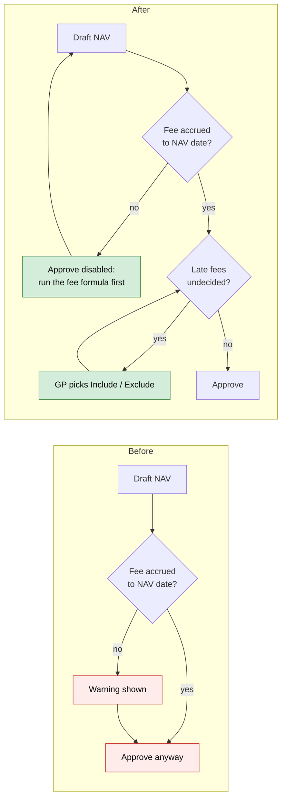
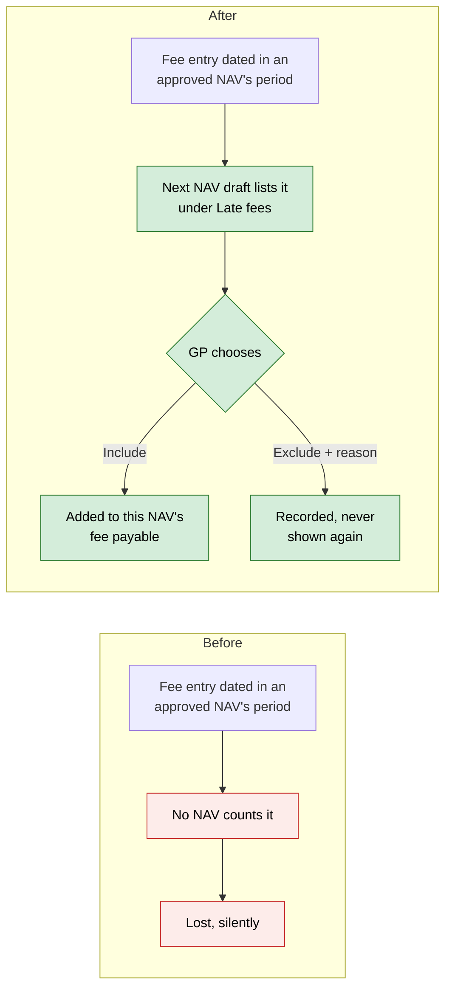
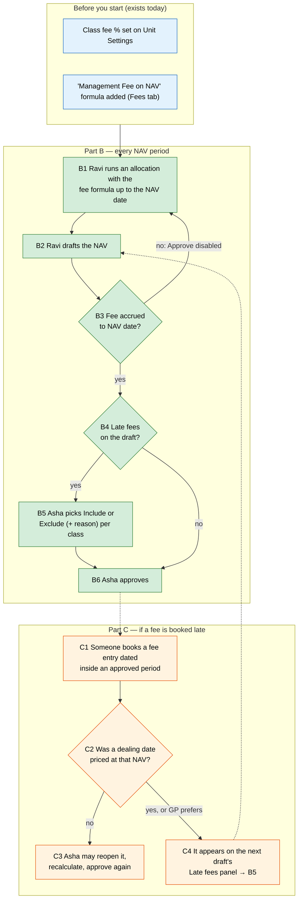

# Late management fees on evergreen NAVs — Proposal

> **Audience:** Business team, product, QA, support — non-technical.
> **Companion document:** [Design](design.md)
> **New to this? Start with the [Workflow Journey](#workflow-journey)** — every action, in order, from start to the outcome.
> **Background on fees from scratch, with worked examples:** [evergreen_backdated_management_fees.md](../../../../docs/modules/funds/evergreen_backdated_management_fees.md).
> **Business rules this builds:** R9.2 and R9.10–R9.16 in [evergreen_business_rules.md §9](../../../../docs/modules/funds/evergreen_business_rules.md#fees-booked-late).

> **Planning phase — no code changes.** This document proposes and explains the change. Do not
> edit application code while writing it; implementation happens later, in the tasks phase.

---

## Why

An evergreen NAV deducts the management fee for **its own period**: the fee entries dated after the previous
NAV, up to its own date. Two things go wrong today, and neither is visible:

1. **A NAV can be approved without its fee.** If nobody ran the fee formula up to the NAV date, the draft
   shows a warning, but Approve still works. Investors then deal at a NAV per unit that is too high.
2. **A fee booked late is silently lost.** A fee entry dated inside a period whose NAV is already approved
   is never counted by any NAV. It sits in the ledger, the manager never receives it through the NAV, and
   no screen says so.

## What Changes

- **Approve is blocked until the fee is accrued** to the NAV date. The current warning becomes the reason
  Approve is disabled. Exempt: uploaded NAVs (the administrator's figure already includes the fee), classes
  with a 0% fee, and NAVs with no units outstanding.
- **Fees booked late are allowed, but never silently lost or silently caught up.** The next NAV draft shows a
  **Late fees** panel for each class with late entries:
  - the amount, the period it belongs to, its size as a % of this NAV, and how many investors redeemed since
  - a choice the GP **must** make: **Include in this NAV** or **Exclude — settled outside the NAV** (with a
    reason). There is no default.
- **Approve is blocked until every late amount has a choice.**
- **The decision is recorded on the NAV** (amount, who, when, why) and shown on the NAV page and the Fees tab.
  An excluded amount never comes back.
- **Late fee payments** ("Management Fee Paid" entries dated in an approved period) are always included,
  with no choice. The cash has already left the fund, so the payable must fall with it.
- **Periods covered by an uploaded NAV are never late.** The administrator's figure already has the fee in it.

### Flow Diagram

Approving a NAV — before and after:



A fee entry booked into an approved period — before and after:



---

## Workflow Journey

### Who is involved

| Person | Role | What they do in the journey |
|---|---|---|
| Ravi | Fund operations (fund update rights) | Runs the fee formula, drafts the NAV |
| Asha | Approver (approver role) | Decides on late fees, approves the NAV |

### The journey on one page



### Before you start

| Needed | Why | Where it comes from |
|---|---|---|
| Each class's management fee % | Decides whether a class needs a fee at all | Fund › Actions › Unit Settings |
| The "Management Fee on NAV" formula | Books the fee per folio | NAV › Fees › step 1 › Add formula |
| The NAV is drafted from the ledger | Uploaded NAVs are exempt | NAV › Draft NAV |

### Part B — every NAV period

| Step | Who | Where | Action | What the system does | What you see |
|---|---|---|---|---|---|
| B1 | Ravi | Fund › Allocations › New run | Run the fee formula for 01/11–30/11/2026 | Books "Management Fees" per folio, dated 30/11 | The run's entries |
| B2 | Ravi | NAV › Draft NAV | Draft 30/11/2026 | Payable = previous + November's accruals − payments | Draft with its lines |
| B3 | Asha | NAV page | Open the draft | If the fee isn't accrued to 30/11, Approve is disabled with the reason | "Approve is disabled — Management fee accrued only to 31/10/2026. Run the fee formula to 30/11/2026, then recalculate." |
| B4 | Asha | NAV page › Late fees | Read the panel | Lists fee entries dated in approved periods that no NAV has counted | Panel per class (mockup below) |
| B5 | Asha | Late fees › Decide | Choose Include, or Exclude with a reason; Save | Stores the choice on the draft; on Include, recalculates the payable | Panel shows the decision; Approve enables when all are decided |
| B6 | Asha | NAV page › Approve | Approve | Records approval and the late-fee decisions in the audit trail | Approved NAV with the decision shown |

### Part C — if a fee is booked late

| Step | Who | Where | Action | What the system does | What you see |
|---|---|---|---|---|---|
| C1 | Ravi | Allocations | Runs the fee formula for September after the 30/09 NAV was approved | Books entries dated 30/09 | — |
| C2 | — | Fees tab | — | Finds the NAV the entries belong to | Row 30/09: "Late fee booked: ₹2,38,500" |
| C3 | Asha | Fees tab › Reopen (only if no dealing date was priced at 30/09) | Reopen, recalculate, approve | The fee lands in September | Row 30/09: "Accrued to 30/09/2026" |
| C4 | — | Next draft (31/10) | — | Lists the ₹2,38,500 under Late fees | Panel on the 31/10 draft → B5 |

### What you see

The 31/10/2026 draft for Class A, after September's fee was booked on 11/10:

```
┌ NAV — Class A — 31/10/2026  [Draft] ───────────────────────────────────────────────┐
│ ...NAV lines...                                                                     │
│ Management fee payable                     ₹2,46,000   ← October's accruals         │
│                                                                                     │
│ ┌ Late fees — decide before approving ───────────────────────────────────────────┐ │
│ │ ₹2,38,500 of management fee dated in September (the 30/09/2026 NAV's period),  │ │
│ │ booked on 11/10/2026 — after that NAV was approved, so no NAV has counted it.   │ │
│ │                                                                                 │ │
│ │   0.12% of this NAV  (₹2,38,500 ÷ ₹19,40,00,000)                                │ │
│ │   2 investors redeemed since 30/09/2026 — they would not bear it if included    │ │
│ │   30/09 NAV priced 01/10/2026 — it can't be reopened                            │ │
│ │                                                                                 │ │
│ │   ( ) Include in this NAV — payable becomes ₹2,46,000 + ₹2,38,500 = ₹4,84,500   │ │
│ │   ( ) Exclude — settled outside the NAV.  Reason: [__________________]          │ │
│ │                                                         [ Save decision ]        │ │
│ └─────────────────────────────────────────────────────────────────────────────────┘ │
│ [Approve] disabled — decide the late fee above first                                │
└─────────────────────────────────────────────────────────────────────────────────────┘
```

After choosing Include and approving, the Fees tab row for 31/10 reads:

```
31/10/2026 │ ₹0.00 │ + ₹2,46,000 │ − ₹0.00 │ = ₹4,84,500 │ ✓ Accrued to 31/10/2026
           │       │ + ₹2,38,500 late (Sep), included by Asha 11/10/2026                │
```

### What goes wrong

Asha opens the 30/11 draft and Approve is disabled: "Management fee accrued only to 31/10/2026. Run the
fee formula to 30/11/2026, then recalculate."

1. Ravi runs the allocation for 01/11–30/11.
2. The draft turns stale (its inputs changed), and Recalculate is offered.
3. Ravi recalculates. The payable now includes November and Approve enables.

### Summary: the minimum actions

| # | Action | Who | How often |
|---|---|---|---|
| 1 | Run the fee formula up to the NAV date | Ravi | Every NAV period |
| 2 | Draft the NAV | Ravi | Every NAV period |
| 3 | Decide each late fee (only if any) | Asha | Only when a fee was booked late |
| 4 | Approve | Asha | Every NAV period |

---

## User Stories

### US-1: Never approve a NAV without its fee

**As an** approver, **I want** Approve to be refused while the management fee isn't accrued to the NAV date,
**so that** investors never deal at a NAV per unit that leaves out the fee.

**Acceptance criteria:**
- A drafted NAV for a class with a fee above 0% and units outstanding, whose latest fee accrual is before
  the NAV date (or missing), shows Approve disabled with: "Management fee accrued only to <date> — run the
  fee formula to <NAV date>, then recalculate" (or "No management fee accrued yet — …").
- Calling approve anyway (stale page, API) is refused with the same message.
- Uploaded NAVs, classes with 0% fee and NAVs with no units outstanding approve as today.

### US-2: See and decide fees booked late

**As an** approver, **I want** a draft to list fee entries that belong to already-approved periods, with
what including them would do, **so that** I decide who bears them instead of the system losing them.

**Acceptance criteria:**
- The panel shows, per class: the amount, the approved NAV period(s) it belongs to, the booking date, its %
  of this NAV, the number of investors who redeemed since that period, and whether that NAV can still be
  reopened.
- Neither option is pre-selected. Exclude requires a reason of up to 255 characters.
- Approve stays disabled until every late amount on the draft has a decision.
- Include adds the amount to this NAV's management fee payable. Exclude leaves the payable unchanged.

### US-3: Decisions are kept and visible

**As** support or an auditor, **I want** each decision recorded with who, when and why, **so that** a
payable that jumped, or a fee that never reached a NAV, can be explained later.

**Acceptance criteria:**
- The NAV's audit trail records "Late management fee ₹X (period) included/excluded by <user>: <reason>".
- The NAV page and the Fees tab row show the decision.
- An excluded amount never appears on a later draft. An included amount is counted once.
- Recalculating a draft keeps its decisions while the late amount is unchanged. If more late entries
  arrive, only the new amount needs a decision.

### US-4: Late payments always reduce the payable

**As a** GP, **I want** a "Management Fee Paid" entry dated in an approved period to reduce the next NAV's
payable automatically, **so that** the cash already gone and the liability stay in step.

**Acceptance criteria:**
- It is listed in the panel as "Late payment — always included", with no choice.

---

## UI Behavior

### NAV page — Late fees panel (draft, computed NAVs only)

Shown above the actions when the draft has late entries. Bootstrap card, same style as the NAV page's
other cards; the decision opens a small Bootstrap modal whose Save is the confirmation.

**Behavior notes:**
- One block per class.
- After Save, the page reloads: Include recalculates the payable line, which shows "incl. ₹X late".
- Changing a decision is allowed while the NAV is a draft ("Change decision").
- Approved NAVs show the panel read-only ("Late fees decided").

### Fees tab

- The row gains a line under the payable: "+ ₹2,38,500 late (Sep), included by Asha 11/10/2026" or
  "₹2,38,500 late (Sep) excluded: <reason>".
- A row whose period received late entries after approval shows the badge **Late fee booked** with the
  reopen route, or "appears on the next draft" when it is locked.

---

## What This Feature Does NOT Cover

| Excluded | Covered In |
|---|---|
| Paying back investors who already left (full restatement of past NAVs) | Manual process |
| Late performance fees | Not applicable: worked inside each NAV, never booked late |
| Late class expenses or other ledger lines | Future change, if needed |
| Uploaded NAVs | Exempt by rule — the administrator's figure includes the fee |

---

## Validation Rules

| Field | Rule | Default |
|---|---|---|
| Late fee choice | Include or Exclude; required before approval | None (no default) |
| Exclude reason | Required when Exclude; 1–255 characters | — |
| Approval | Refused while the fee isn't accrued to the NAV date (non-exempt) or a late amount is undecided | — |

---

## Behavior Rules

| Scenario | What User Sees |
|---|---|
| Fee accrued only to 31/10, NAV 30/11 | Approve disabled: "Management fee accrued only to 31/10/2026 — run the fee formula to 30/11/2026, then recalculate" |
| Uploaded NAV, no accrual | Approves as today |
| Class fee 0% | Approves as today, no panel |
| First NAV, no units | Approves as today |
| ₹2,38,500 booked late, Include | Payable +₹2,38,500; Fees row shows "included" |
| ₹2,38,500 booked late, Exclude "Waived for Q3" | Payable unchanged; never shown again |
| Late entries grow after a decision | Only the new amount needs a decision |
| Late payment ₹1,00,000 | Payable −₹1,00,000, listed as "always included" |
| Entry dated in an uploaded NAV's period | Not listed; never late |

---

## Resolved Design Decisions

| # | Decision | Resolution |
|---|---|---|
| 1 | Block late entries outright? | No — real late fees happen (side letters, backdated rates, auditor fixes); blocking would make them unrecordable once a dealing date priced the NAV |
| 2 | Default choice? | None — the choice decides who bears the fee, so it is always made by a person (decided 11/10/2026) |
| 3 | Late payments: choose or always include? | Always include — the cash line already shows the money gone; excluding would understate the NAV |
| 4 | Periods with uploaded NAVs? | Never late — the administrator's figure includes the fee |
| 5 | What blocks approval? | Fee not accrued to the NAV date (non-exempt), or any undecided late amount |
| 6 | Pay back investors who left? | Out of scope; manual |

---

## Capabilities

### New Capabilities

_None._

### Modified Capabilities

- `funds/open-ended-fees`: the "Management fee accrued up to every NAV date" requirement changes from a
  warning to an approval block. A new requirement adds late management-fee entries.

---

## Impact

- **NAV page:** the Approve button's rules and a new Late fees panel.
- **Fees tab:** the decision and "Late fee booked" shown on rows.
- **NAV drafting:** the payable includes late amounts the GP chose to include, and late payments.
- **NAV approval** (screen and back end): two new refusal reasons.
- **Audit trail** of NAVs.
- **Data:** each NAV records how much fee and payment it accounted for, and its late-fee decisions.

---

## Benefits

1. Investors never deal at a NAV per unit that silently leaves out the fee.
2. No fee disappears from the books unnoticed.
3. Who bears a late fee is always a recorded human decision, with the facts needed to make it.
4. Support can explain any jump in the payable from the NAV page alone.

---

## FAQ

| Question | Answer |
|---|---|
| Who can decide a late fee? | Users who can approve the NAV (approver role and fund update rights) |
| Does this affect closed-ended funds? | No — evergreen funds only |
| What about NAVs approved before this change? | They're treated as having counted exactly their own period; nothing is re-raised (see design) |
| Is anyone notified? | Approvers already get "NAV awaiting approval"; when a draft has late fees, that alert says a decision is needed |
| Can a decision be changed? | Yes, while the NAV is a draft. Once approved it's final; reopen the NAV to change it |
| Does including a late fee change past NAVs? | No — only this NAV's payable, which is the trade-off the panel explains |
| What if the same late entry is edited later? | The draft compares amounts, not individual entries; any difference is a new late amount to decide |

---

## Design Principle for the Next Phase

Keep it DRY and simple:
- **Reuse the NAV draft's existing pieces:** overrides (kept across recalculation), the audit trail, the
  stale check, and the approve-refusal pattern (`FundNavApprove` already refuses stale drafts with a message).
- **Find late amounts with aggregates only** (CLAUDE.md large-table rules): never list `account_entries`
  rows. The risky part is "what has no NAV counted yet?". The design should keep a running "accounted"
  figure on each NAV rather than tracking entries one by one.
- **Payments are fund-level and split between classes.** Treat late payments with the same split the
  builder already uses, not a new mechanism.
