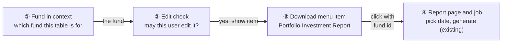
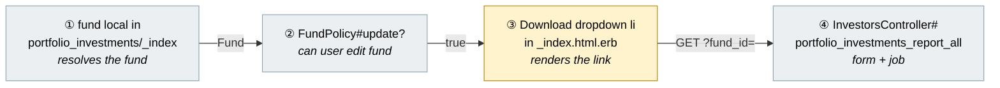
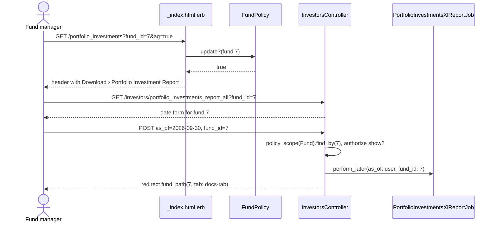
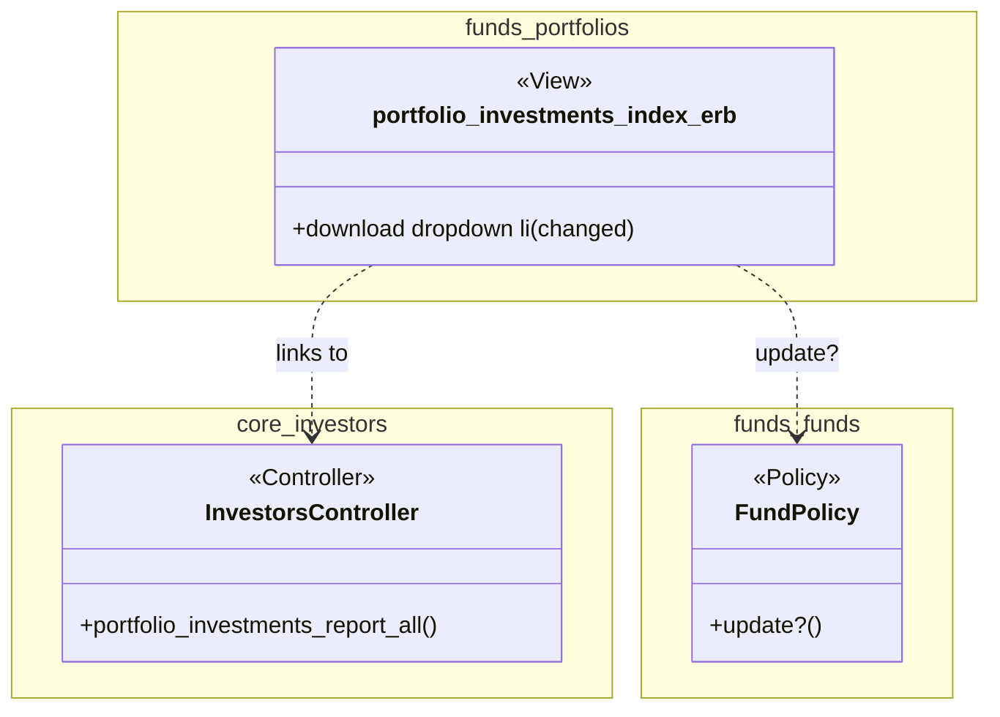

# Portfolio Investment Report Link on the Portfolio Investments Table — Design

> **Audience:** Engineering team.
> **Companion documents:** [Proposal](proposal.md) · [Spec](specs/funds/portfolio-investments-downloads/spec.md)

> **Planning phase — no code changes.** This document explains HOW the proposal is built. The
> one-file change already exists on the branch (commit `b5699794d`); this document records it.

---

## Contents

- [1. The idea](#1-the-idea)
  - [What this adds](#what-this-adds)
  - [The idea in one picture](#the-idea-in-one-picture)
  - [Walkthrough: one example, start to finish](#walkthrough-one-example-start-to-finish)
  - [Key ideas](#key-ideas)
- [2. The same picture with real names](#2-the-same-picture-with-real-names)
  - [Picture](#picture)
  - [What each box does](#what-each-box-does)
  - [One run, end to end](#one-run-end-to-end)
  - [Lifecycles](#lifecycles)
  - [What users see](#what-users-see)
  - [Design decisions](#design-decisions)
- [3. One card per box](#3-one-card-per-box)
  - [① Fund in context](#①-fund-in-context)
  - [② Edit check](#②-edit-check)
  - [③ Download menu item](#③-download-menu-item)
  - [④ Report page and job](#④-report-page-and-job)
- [4. Reference](#4-reference)
  - [Class diagram](#class-diagram)
  - [Data model and schema changes](#data-model-and-schema-changes)
  - [Component contracts](#component-contracts)
  - [Notifications](#notifications)
  - [Cross-cutting concerns](#cross-cutting-concerns)
  - [Worked examples](#worked-examples)
  - [Testing](#testing)
  - [Risks and open questions](#risks-and-open-questions)

---

## 1. The idea

### What this adds

One `<li>` in the Download dropdown of the Portfolio Investments page header, linking to the
existing `portfolio_investments_report_all` page with the current fund. It copies the link already
on the Aggregate Portfolio Investments page and the fund show page, and reuses the `fund` /
`policy(fund).update?` gate already used for New Investment and Upload in the same partial.

### The idea in one picture



### Walkthrough: one example, start to finish

Meera can edit "Alpha Growth Fund I". Ravi can only view it. Legend: ✓ done · ● we are here
(waiting on this, not done yet) · ○ not reached.

| # | When | What happens | Behind the scenes | Result |
|---|---|---|---|---|
| 1 | Meera opens the fund's portfolio grid | Page loads with `fund_id` in the URL | the fund in context (①) is found from `fund_id` | ✓&nbsp;Find&nbsp;fund<br>**●&nbsp;Check&nbsp;access**<br>○&nbsp;Show&nbsp;item<br>○&nbsp;Open&nbsp;report |
| 2 | Header renders | Download menu built | the edit check (②) passes for Meera | ✓&nbsp;Find&nbsp;fund<br>✓&nbsp;Check&nbsp;access<br>**●&nbsp;Show&nbsp;item**<br>○&nbsp;Open&nbsp;report |
| 3 | Meera clicks Download › Portfolio Investment Report | Full page load | the menu item (③) links to the report page (④) with `fund_id` | ✓&nbsp;Find&nbsp;fund<br>✓&nbsp;Check&nbsp;access<br>✓&nbsp;Show&nbsp;item<br>**●&nbsp;Open&nbsp;report** |
| 4 | Meera clicks Generate for 30-Sep-2026 | Job queued, redirect to fund Documents tab | the report page (④) re-checks the fund via `policy_scope(Fund)` | ✓&nbsp;Find&nbsp;fund<br>✓&nbsp;Check&nbsp;access<br>✓&nbsp;Show&nbsp;item<br>✓&nbsp;Open&nbsp;report |
| 5 | Ravi opens the same grid (stall) | Menu shows Export All / Export Visible only | the edit check (②) fails, item (③) not rendered | ✓&nbsp;Find&nbsp;fund<br>**●&nbsp;Check&nbsp;access&nbsp;(failed)**<br>○&nbsp;Show&nbsp;item<br>○&nbsp;Open&nbsp;report |
| 6 | Ravi pastes the report URL directly (mistake) | Form renders; on Generate the job only runs for funds Ravi can see | the report page (④) scopes the fund itself | Same as row 4 for a fund he can view; redirect with "Fund not found or not accessible." otherwise |

```
[⇩ Download ▾]
 ├ Export All
 ├ Export Visible
 └ Portfolio Investment Report   ← row 2, Meera only
```

**What to notice**
- The link is a convenience; access to the report is enforced by the report action (④), not by the link.
- No new code paths: same gate, same route, same page as two other screens.

### Key ideas

| # | Idea | In one line | Card |
|---|---|---|---|
| 1 | Reuse the page's fund | `fund` is already resolved at the top of the partial | [①](#①-fund-in-context) |
| 2 | Same gate as New Investment | `fund && policy(fund).update?` | [②](#②-edit-check) |
| 3 | Reuse the existing report route | `portfolio_investments_report_all_investors_path(fund_id:)` | [④](#④-report-page-and-job) |

**FAQ**

| Question | Answer |
|---|---|
| Is this AG-Grid-only? | The dropdown is in the header above the `if params[:ag]` branch, so it shows in both views. The AG grid view is where it was asked for. |
| Does anything block users? | No; it only adds a menu item. |

---

## 2. The same picture with real names

### Picture



Colour = footprint: **green** new, **amber** modified, **grey** reused unchanged.

### What each box does

| # | Box | Real parts | What it does | When it runs | What it decides | Details |
|---|---|---|---|---|---|---|
| ① | Fund in context | `fund` / `fund_id` locals at top of `_index.html.erb`, `AggregatePortfolioInvestment` | Resolves the fund from local, `params[:fund_id]`, or the aggregate's `fund_id` | Every render | Which fund, or nil | [card ① →](#①-fund-in-context) |
| ② | Edit check | `FundPolicy#update?` | Authorises edit on the fund | Every render with a fund | Show item or not | [card ② →](#②-edit-check) |
| ③ | Download menu item | New `<li>` in the Download `<ul>` | Renders link with `ti-report` icon, `data-turbo=false` | When ① non-nil and ② true | — | [card ③ →](#③-download-menu-item) |
| ④ | Report page and job | `InvestorsController#portfolio_investments_report_all`, `portfolio_investments_report.html.erb`, `PortfolioInvestmentsXlReportJob` | Shows date form; on POST scopes fund and enqueues job | On click / submit | Whether the fund is accessible | [card ④ →](#④-report-page-and-job) |

### One run, end to end



### Lifecycles

N/A — no stored or derived status.

### What users see

| Where | Today | After this change | Who sees it |
|---|---|---|---|
| Portfolio Investments › Download | Export All, Export Visible, (Custom Report) | + Portfolio Investment Report after Export Visible | Users who can edit the fund |

The mockup and journey are in the [proposal](proposal.md#what-you-see).

### Design decisions

1. **Gate on `policy(fund).update?`** — Same check as New Investment / Upload on this page and the
   aggregate page's version of this link. Alternative: `InvestorPolicy#portfolio_investments_report_all?`
   (company_admin only). Rejected: the report action doesn't call that policy for GET and checks
   `show?` on the fund for POST, so it would hide the item from fund editors who can use it.
2. **Plain link, `data-turbo: false`** — Matches the aggregate page link; the report page is a
   full page outside the table's turbo frame. Alternative: modal. Rejected: extra code for no gain.
3. **Hard-coded label** — Same literal as the two other entry points. Alternative: `t_common`.
   Deferred: would need a new key and changing all three places together.

**FAQ**

| Question | Answer |
|---|---|
| Why not hide the item behind `params[:ag]`? | The header is shared by both views and the report applies equally; adding a mode check adds a branch for no user benefit. |
| Why not extract a shared partial for the three links? | Three one-line links with different styling; a partial would be more code than it saves. |

---

## 3. One card per box

### ① Fund in context

Existing logic at the top of the partial: `fund ||= Fund.find_by(id: fund_id)` where `fund_id` is
the local, `params[:fund_id]`, or the aggregate's `fund_id`.

| Owns | Reads / receives | Produces |
|---|---|---|
| Nothing new | `params[:fund_id]`, `params[:aggregate_portfolio_investment_id]`, locals | `fund` or nil |

**Worked examples:** H1, H2, E2

**FAQ**

| Question | Answer |
|---|---|
| Is `Fund.find_by` tenant-scoped here? | No, but ② checks the policy before anything is shown, and ④ re-scopes on POST. Unchanged by this work. |

### ② Edit check

`FundPolicy#update?` — reused unchanged; already gates New Investment and Upload in this partial.

| Owns | Reads / receives | Produces |
|---|---|---|
| Nothing new | `current_user`, `fund` | boolean |

| Role | Sees item |
|---|---|
| Fund employee with edit access | Yes |
| Fund employee with view-only access | No |
| Investor (`curr_role_investor?`) | No — whole Download menu hidden |

**Worked examples:** H1, E3, E4

**FAQ**

| Question | Answer |
|---|---|
| Is `entity_id` scoping enforced? | `FundPolicy#update?` requires `enable_funds` and `permissioned_employee?(:update)` on the fund, and is false for snapshot funds; ④ also scopes via `policy_scope(Fund)`. |

### ③ Download menu item

The only modified part: one `<li>` inside the `<% if fund && policy(fund).update? %>` guard,
between Export Visible and Custom Report.

| Owns | Reads / receives | Produces |
|---|---|---|
| The `<li>` markup | `fund.id` | `<a class="dropdown-item" data-turbo="false" href="/investors/portfolio_investments_report_all?fund_id=…">` |

| Verb and path | Action | Does | Responds with |
|---|---|---|---|
| GET `/investors/portfolio_investments_report_all?fund_id=:id` | `InvestorsController#portfolio_investments_report_all` | Renders form | HTML |

**Worked examples:** H1, H2, H3, E1

**FAQ**

| Question | Answer |
|---|---|
| Why `data-turbo: false`? | The page sits inside the `portfolio_investments_frame` turbo frame; a full load avoids rendering the form into the frame. |

### ④ Report page and job

Reused unchanged. GET renders the form; POST resolves `fund_id` through `policy_scope(Fund)`,
`authorize fund, :show?`, enqueues `PortfolioInvestmentsXlReportJob`, redirects to the fund's
Documents tab.

| Owns | Reads / receives | Produces |
|---|---|---|
| Access on generate | `fund_id`, `as_of` | Queued job, redirect |

**Worked examples:** H1, X1

**FAQ**

| Question | Answer |
|---|---|
| What if someone builds the URL by hand? | Same as today: POST rejects funds outside `policy_scope(Fund)`. |

---

## 4. Reference

### Class diagram



### Data model and schema changes

N/A — no tables or columns change.

### Component contracts

| From → To | Contract | Direction rule |
|---|---|---|
| ① → ② | `Fund` instance (non-nil) | View calls policy; policy never calls view |
| ② → ③ | `true` | Item rendered only on true |
| ③ → ④ | GET with `fund_id` query param | Link only; ④ does its own auth |

### Notifications

None added or changed. Internal users: the existing report email (`send_portfolio_investment_report`)
is sent by the job exactly as when started from the fund page. Investors: nothing is sent to them;
the item is not visible to investors.

### Cross-cutting concerns

#### Transactions and queries

N/A — no writes. The `policy(fund).update?` call already happens earlier in the same render.

#### Exception handling and monitoring

N/A — no new failure modes.

#### Performance and security

- Performance: one extra policy evaluation per header render; negligible.
- Security: the link carries only `fund_id`; tenant isolation is enforced by ④ on POST. Brakeman
  has nothing new to flag (no user input rendered).

### Worked examples

**ID legend:** **H** = Happy path · **E** = Edge case · **X** = Error (exception) case.

**Shared setup:**

| Record | Name | Key data |
|---|---|---|
| Entity | Investment Fund entity | `entity_type=Investment Fund` |
| Fund | Alpha Growth Fund I | `currency=INR` |
| User | Meera | company_admin, can edit the fund |
| User | Ravi | employee, view-only on the fund |
| Aggregate PI | Acme Robotics / Series A | belongs to Alpha Growth Fund I |

#### Happy Path

| # | Scenario | Given | When | Then | Spec scenario | Feature |
|---|---|---|---|---|---|---|
| H1 | Editor opens report from grid | Meera, fund | Visit `portfolio_investments_path(fund_id:, ag: true)`, click Portfolio Investment Report | Report page titled "…: Alpha Growth Fund I" | Fund editor sees the item and opens the report page | `features/fund/portfolio_investments_downloads.feature` |
| H2 | Fund from aggregate | Meera, aggregate PI | Visit `portfolio_investments_path(aggregate_portfolio_investment_id:, ag: true)` | Item present, links to `fund_id` of the aggregate | Fund resolved from an aggregate portfolio investment | same |
| H3 | Classic view | Meera, fund | Visit `portfolio_investments_path(fund_id:)` | Item present | Item also present in the classic table view | same |

#### Edge Cases

| # | Scenario | Given | When | Then | Spec scenario | Feature |
|---|---|---|---|---|---|---|
| E1 | Item order | Meera, fund | Open grid | Item follows Export Visible | Fund editor sees the item and opens the report page | same |
| E2 | No fund in context | Meera | Visit `portfolio_investments_path(ag: true)` | Export All / Export Visible present, item absent | No single fund in context | same |
| E3 | View-only employee | Ravi, fund | Visit grid for fund | Item absent | View-only employee | same |
| E4 | Investor user | Investor user | Visit portfolio investments | No Download menu | Investor user | same |

#### Error Cases

| # | Scenario | Given | When | Then (what the user sees, who is alerted) | Spec scenario | Feature |
|---|---|---|---|---|---|---|
| X1 | Hand-built URL for another tenant's fund | Meera, fund of another entity | POST report_all with that `fund_id` | Redirect to investors with "Fund not found or not accessible."; no job | View-only employee (access not widened by the link) | same |

### Testing

Cucumber only, `@rack_test` (dropdown items are in the DOM without JS). Reuse
`Im logged in as a user …`, `the user has role …`, `there is a fund … for the entity` and the
existing `features/step_definitions/portfolio.rb`; add a small step file only for the menu
assertions. Each scenario carries a comment with its H/E/X ID.

### Risks and open questions

- Label is not translated → same as the two existing entry points; change together later if needed.
- `FundPolicy#update?` is broader than `portfolio_investments_report_all?` (company_admin) → the
  action does not enforce the latter, so the link matches real access. Revisit if that policy is
  ever wired into the action.

**FAQ**

| Question | Answer |
|---|---|
| Where do I start reviewing? | `git show b5699794d` — one 7-line hunk in `portfolio_investments/_index.html.erb`. |
