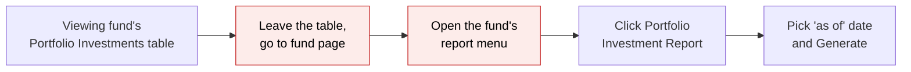
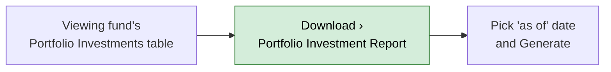
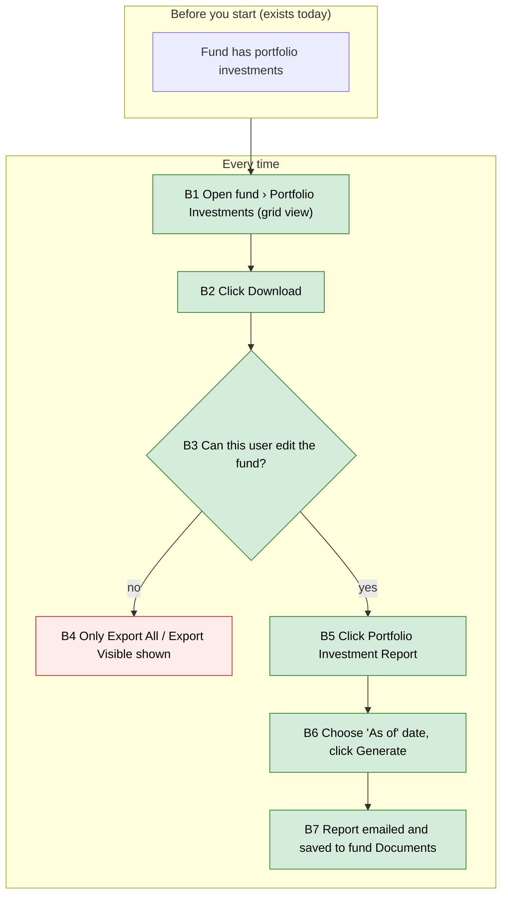

# Portfolio Investment Report Link on the Portfolio Investments Table — Proposal

> **Audience:** Business team, product, QA, support — non-technical.
> **Companion document:** [Design](design.md)
> **New to this? Start with the [Workflow Journey](#workflow-journey)** — every action, in order, from start to the outcome.

> **Planning phase — no code changes.** This document proposes and explains the change. Do not
> edit application code while writing it; implementation happens later, in the tasks phase.
> (The change itself is small and has already been made on the working branch; this document
> records what it does and why so it can be reviewed and tested.)

---

## Why

Fund managers who look at a fund's portfolio investments in the grid view (the AG Grid
"Portfolio Investments" table) cannot start the **Portfolio Investment Report** from there. Today
they have to leave the table and go to the fund page's report menu or the Aggregate Portfolio
Investments page to find the same report. Putting the link in the table's **Download** menu
removes that detour.

## What Changes

- The **Download** menu on the Portfolio Investments table gets a new item: **Portfolio
  Investment Report**.
- It only appears when the table is showing a single fund's investments and the user is allowed
  to edit that fund (the same people who already see **New Investment** and **Upload**).
- Clicking it opens the existing "Generate Portfolio Investments Reports" page, already set to
  that fund. Nothing about the report itself changes.
- No breaking changes.

### Flow Diagram

Before — getting the report while looking at the portfolio investments table:



After — the report is one click away from the table:



---

## Workflow Journey

### Who is involved

| Person | Role | What they do in the journey |
|---|---|---|
| Meera | Fund manager (can edit the fund "Alpha Growth Fund I") | Starts the report from the table |
| Ravi | Read-only fund employee (can view, not edit, the fund) | Sees the table but not the new item |

### The journey on one page



### Before you start

| Needed | Why | Where it comes from |
|---|---|---|
| A fund with portfolio investments | The report has something to report on | Fund › Portfolio › New Investment or Upload |
| Edit access to the fund | The link is only shown to users who can edit the fund | Fund access settings |

### Every time

| Step | Who | Where | Action | What the system does | What you see |
|---|---|---|---|---|---|
| B1 | Meera | Alpha Growth Fund I › Portfolio Investments (grid) | Open the table | Loads the fund's investments | The grid with New Investment, Upload, Download buttons |
| B2 | Meera | Download button | Click | Opens the menu | Export All, Export Visible, **Portfolio Investment Report** |
| B5 | Meera | Download › Portfolio Investment Report | Click | Opens the existing report page for this fund | "Generate Portfolio Investments Reports : Alpha Growth Fund I" with "As of" date (defaults to today) |
| B6 | Meera | Report page › Generate | Pick 30-Sep-2026, click Generate | Queues the report in the background | Fund page, Documents tab, "Report generation started, please check back in a few mins" |
| B7 | — | Background | — | Builds the spreadsheet, saves it to the fund, emails it | Report appears in the fund's Documents and in Meera's inbox |
| B4 | Ravi | Download button | Click | Opens the menu without the report item | Export All, Export Visible only |

### What you see

```
┌ Portfolio Investments ───────────────────────────────────────────────┐
│                      [+ New Investment] [⇪ Upload] [⇩ Download ▾]     │
│                                                ┌──────────────────────────────┐
│                                                │ ▤ Export All                 │
│                                                │ ▦ Export Visible             │
│                                                │ ▣ Portfolio Investment Report│  ← new
│                                                └──────────────────────────────┘
│ Company        Instrument    Qty     Cost (₹)       FMV (₹)            │
│ Acme Robotics  Series A    10,000    5,00,00,000   7,50,00,000         │
│ Bolt Foods     Seed         2,500    1,00,00,000   1,20,00,000         │
└──────────────────────────────────────────────────────────────────────┘
```

### What goes wrong

Ravi asks support why he cannot see "Portfolio Investment Report" on the table. He can view but
not edit Alpha Growth Fund I, so the item is hidden. Fix: an admin grants him edit access to the
fund, or Meera runs the report for him. The same rule already hides New Investment and Upload for
him, so it is consistent.

### Summary: the minimum actions

| # | Action | Who | How often |
|---|---|---|---|
| 1 | Download › Portfolio Investment Report | Meera | Every time she wants the report |
| 2 | Pick "As of" date, Generate | Meera | Every time |

---

## User Stories

### US-1: Start the report from the portfolio investments table

**As a** fund manager who can edit the fund,
**I want** a Portfolio Investment Report item in the table's Download menu,
**So that** I can generate the report without leaving the table.

**Acceptance criteria:**
- On a single fund's Portfolio Investments table, the Download menu shows "Portfolio Investment
  Report" with a report icon, after "Export Visible".
- Clicking it opens "Generate Portfolio Investments Reports : <Fund name>" with that fund
  preselected.
- The page opens as a full page load (not inside the table frame).

### US-2: Hide the item from users who cannot edit the fund

**As a** product owner,
**I want** the item hidden from users without edit access to the fund,
**So that** it follows the same rule as New Investment and Upload.

**Acceptance criteria:**
- A user who can view but not edit the fund does not see the item.
- Investor (LP) users do not see the Download menu at all (unchanged).

### US-3: No item when there is no single fund

**As a** user viewing portfolio investments across funds (e.g. a multi-company widget),
**I want** the menu to stay as it is,
**So that** I am not offered a report with no fund to run it for.

**Acceptance criteria:**
- When the table is not tied to one fund, the Download menu shows only Export All / Export
  Visible (and Custom Report where it already applies).

---

## UI Behavior

### Portfolio Investments table › Download menu

```
┌──────────────────────────────┐
│ ▤ Export All                 │
│ ▦ Export Visible             │
│ ▣ Portfolio Investment Report│   shown only: one fund + user can edit it
│ ▤ Custom Report              │   shown only: custom report params (unchanged)
└──────────────────────────────┘
```

**Behavior notes:**
- The item's visibility follows the same check as the New Investment and Upload buttons.
- The fund is picked up from the page (the fund the table belongs to, directly or via the
  aggregate investment being viewed).
- The item is a normal link that loads a full page; it does not refresh the grid.
- The Download menu sits above the table, so the item shows in both the grid (AG Grid) view and
  the classic table view of the same page.

---

## What This Feature Does NOT Cover

| Excluded | Covered In |
|---|---|
| Changes to the report's contents, format or email | Existing Portfolio Investment Report |
| A report for all funds at once from this table | Stakeholders page › Portfolio Investment Report (all) |
| Translating the menu label | Not planned; the same label is hard-coded on the fund and aggregate pages |

---

## Validation Rules

| Field | Rule | Default |
|---|---|---|
| As of (on the report page, unchanged) | Required to generate | Today |

---

## Behavior Rules

| Scenario | What User Sees |
|---|---|
| Fund manager with edit access, single-fund table | Item shown; opens report page for that fund |
| Employee with view-only access | Item hidden |
| Investor (LP) user | No Download menu (unchanged) |
| Table not tied to a single fund | Item hidden |
| Table opened from an Aggregate Portfolio Investment | Item shown for that aggregate's fund (if user can edit it) |

---

## Resolved Design Decisions

| # | Decision | Resolution |
|---|---|---|
| 1 | Who should see the item? | Users who can edit the fund — same rule as New Investment / Upload on this page |
| 2 | Where in the menu? | After Export Visible, before Custom Report |
| 3 | Reuse or build a new report page? | Reuse the existing report page and link already used on the fund and aggregate pages |

---

## Capabilities

### New Capabilities

- `funds/portfolio-investments-downloads`: What the Download menu on the Portfolio Investments
  table offers and who sees each item.

### Modified Capabilities

None.

---

## Impact

- The Portfolio Investments table page (header Download menu) — one menu item added.
- No change to the report page, the background report, emails, data, or permissions.

---

## Benefits

1. One click from the table to the report, instead of navigating back to the fund page.
2. Consistent with the Aggregate Portfolio Investments page, which already has this item.

---

## FAQ

| Question | Answer |
|---|---|
| Who can use this? | Users who can edit the fund the table belongs to. |
| Is this a new report? | No. It is the same Portfolio Investment Report available from the fund page. |
| Does it change existing data? | No. |
| Will investors see it? | No. Investors don't see the Download menu on this table. |
| Does it change notifications? | No. The report email is unchanged. |

---

## Design Principle for the Next Phase

Keep it to one view change that reuses the existing route, page and permission check already used
elsewhere on this page. No new controller action, policy method, or component.
