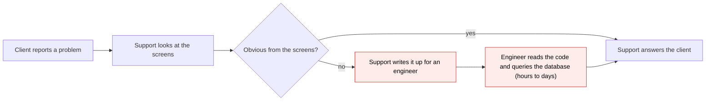
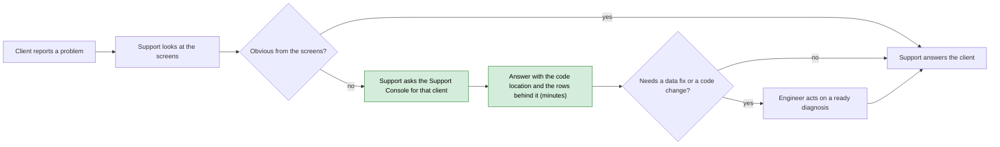
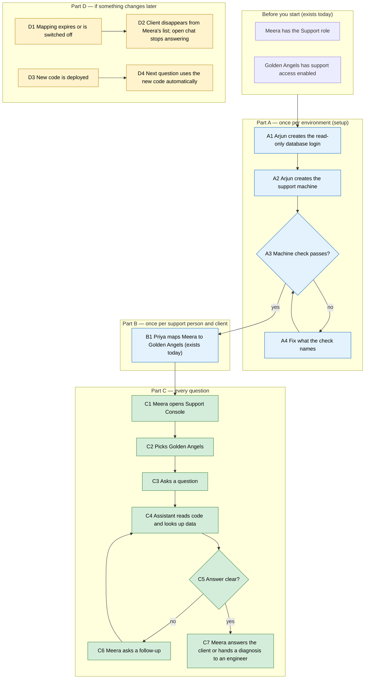

# Support Console — Proposal

> **Audience:** Business team, product, QA, support — non-technical.
> **Companion document:** [Design](design.md)
> **New to this? Start with the [Workflow Journey](#workflow-journey)** — every action, in order, from start to the outcome.

> **Planning phase — no code changes.** This document proposes and explains the change. Do not
> edit application code while writing it; implementation happens later, in the tasks phase.

---

## Why

When a client reports "this number looks wrong" or "this email never went out", a CapHive support person
today has to guess from the screens and then wait for an engineer to read the code and query the
database. The Support Console lets the support person ask an AI assistant (Claude Code) that has read
the exact code the client is running and can look up that client's data, so most "why" questions get a
checked answer in minutes, without an engineer. It replaces the earlier Troubleshooting Sandbox idea,
which needed a terminal login, a heavy server image and could see every client.

## What Changes

- A new **Support Console** page in the CapHive app, for users with the **Support** role.
- The support person **picks one client** from the clients they are already mapped to (the same list they
  see on the admin pages) and asks questions in a chat.
- The assistant **reads the deployed code and looks up data**, read-only, from a copy of the production
  database that is kept in step with it (the "replica"). It answers in business terms and shows where its
  answer comes from: the code location and the rows it used.
- It **cannot change anything**: no data edits, no emails, no re-runs. It explains; people act.
- Each conversation stays with **one client**. Earlier conversations for that client are listed and can be
  continued.
- Every question the assistant asks the database is **recorded** with who asked and for which client.

### Flow Diagram

How a "why does this look wrong" ticket is handled.

**Before** — the support person relays the question to an engineer and waits.



**After** — the support person asks the Support Console and gets a checked answer.



---

## Workflow Journey

### Who is involved

| Person | Role | What they do in the journey |
|---|---|---|
| Arjun | CapHive engineer (super user) | Sets up the support machine and its read-only database login once per environment |
| Priya | CapHive super user | Maps Meera to the client, as today |
| Meera | CapHive support (Support role) | Picks the client and asks the questions |
| Golden Angels | Client (fund manager) | Has support access switched on, as today; reports the problem |

### The journey on one page



### Before you start

| Needed | Why | Where it comes from |
|---|---|---|
| Meera holds the **Support** role | Only Support users see the Support Console | Admin › Users, as today |
| Golden Angels has **support access enabled** | The client's consent for CapHive support to look at their data | Admin › Entities › permissions, as today |
| A **support mapping** Meera ↔ Golden Angels, enabled, not past its end date | Decides which clients Meera may pick | Admin › Support Client Mappings, as today |
| The support machine for the environment is running | It is where the assistant works | Part A |

### Part A — once per environment (setup)

| Step | Who | Where | Action | What the system does | What you see |
|---|---|---|---|---|---|
| A1 | Arjun | Terminal, a setup task | Runs the read-only login setup in dry-run, then for real | Creates a database login that can only read, limited to the support machine, with limits on connections and query time | A summary: login created, reads work, a test write was refused |
| A2 | Arjun | Terminal, a setup task | Runs the support machine setup | Creates the small machine, its network rules (app servers in; replica and the AI service out) and its access to the AI service | The machine's name and address |
| A3 | Arjun | Terminal, the machine check | Runs the check | Confirms: connected to the replica (not the main database), read-only, writes refused, code revision present, AI service reachable | A list of ✓ lines |
| A4 | Arjun | — | Fixes whatever line failed | — | The check passes on rerun |

### Part B — once per support person and client

| Step | Who | Where | Action | What the system does | What you see |
|---|---|---|---|---|---|
| B1 | Priya | Admin › Support Client Mappings › New | Maps Meera to Golden Angels with an end date (unchanged from today) | Enables support for the client | The mapping, enabled |

### Part C — every question

| Step | Who | Where | Action | What the system does | What you see |
|---|---|---|---|---|---|
| C1 | Meera | Left menu › Support Console | Opens the page | Lists only clients Meera is mapped to, with support enabled and the mapping in date | The client picker |
| C2 | Meera | Support Console › client picker | Picks **Golden Angels** | Shows earlier conversations for that client | "New conversation" and a list of past ones |
| C3 | Meera | Chat box › **Ask** | Types "Why does Ravi K show a zero closing balance in Fund I for Q3?" | Starts the assistant for Golden Angels only | "Working…" with a **Stop** button |
| C4 | — | — | — | The assistant searches the code, reads how the closing balance is worked out, and looks up Golden Angels' rows for that investor | Progress lines: "Reading how closing balance is calculated", "Looking up account entries" |
| C5 | Meera | Chat | Reads the answer | — | The answer, the code locations, and the rows behind it |
| C6 | Meera | Chat box › **Ask** | Asks a follow-up | Continues the same conversation | A new answer in the same thread |
| C7 | Meera | Outside the console | Replies to the client or passes the diagnosis to an engineer | — | — |

### Part D — if something changes later

| Step | Who | Where | Action | What the system does | What you see |
|---|---|---|---|---|---|
| D1 | — | — | Meera's mapping passes its end date (or Priya switches it off) | The client is removed from Meera's picker; the next question in an open conversation is refused | "Your support access to Golden Angels has ended." |
| D3 | — | — | A new version of CapHive is deployed | The machine uses the new code for the next question | The answer's footer shows the new code version |

### What you see

```
┌─ Support Console ───────────────────────────────────────────────────────────┐
│ Client: [ Golden Angels ▾ ]          Conversations: ● New   ○ 12 Oct "Q3 …" │
├─────────────────────────────────────────────────────────────────────────────┤
│ Meera: Why does Ravi K show a zero closing balance in Fund I for Q3?        │
│                                                                             │
│ Assistant:                                                                  │
│  The Q3 closing balance is zero because no Q3 entries were generated for    │
│  Ravi K's commitment. The closing balance is opening + movements in the     │
│  quarter. For Q2:                                                           │
│     Opening        ₹ 40,00,000                                              │
│   + Contributions  ₹ 10,00,000                                              │
│   − Distributions  ₹  2,00,000                                              │
│   = Closing Q2     ₹ 48,00,000                                              │
│  For Q3 there are no entries at all, so the screen shows ₹ 0.               │
│  Re-running the Q3 allocation for Fund I would create them.                 │
│                                                                             │
│  Where this comes from                                                      │
│   • Code: how closing balance is worked out   (file:line)                   │
│   • Data: 3 Q2 entries, 0 Q3 entries for this commitment                    │
├─────────────────────────────────────────────────────────────────────────────┤
│ [ Ask a follow-up…                                       ]  [ Ask ] [ Stop ]│
│ Data as of 12 seconds ago · Code version 425c604                           │
└─────────────────────────────────────────────────────────────────────────────┘
```

Check: 40,00,000 + 10,00,000 − 2,00,000 = 48,00,000.

### What goes wrong

**The mapping ended mid-conversation.** Meera's mapping to Golden Angels ended yesterday; Meera reopens a
conversation and asks a follow-up. The question is refused with "Your support access to Golden Angels has
ended. Ask a super user to extend the mapping." Priya extends the end date in Admin › Support Client
Mappings, and Meera asks again; it works.

**The question needs another client.** Meera asks "compare this with how Beta Capital's fund is set up".
The assistant replies that it can only look at Golden Angels in this conversation, and suggests starting
a separate conversation for Beta Capital (if Meera is mapped to it).

### Summary: the minimum actions

| # | Action | Who | How often |
|---|---|---|---|
| 1 | Create the read-only login and the support machine | Arjun | Once per environment |
| 2 | Map the support person to the client | Priya | Once per person and client (exists today) |
| 3 | Pick the client and ask | Meera | Every question |

---

## User Stories

### US-1: Ask about one client

**As a** support person,
**I want** to ask why something looks the way it does for a client I support,
**So that** I can answer the client without waiting for an engineer.

**Acceptance criteria:**
- The Support Console appears in the left menu only for users with the Support role.
- The client picker lists exactly the clients the user is mapped to, where the mapping is enabled, not
  past its end date, and the client has support access enabled.
- After asking, the answer arrives in the same page without a reload, with progress lines while it works.
- Every answer ends with a "Where this comes from" block naming code locations and the data used.

### US-2: Stay with one client

**As a** support person,
**I want** each conversation tied to the client I picked,
**So that** answers never mix two clients' figures.

**Acceptance criteria:**
- A conversation shows its client in the header and cannot be switched to another client.
- Picking another client starts a different conversation.
- A question that needs another client's data is answered with "I can only look at <client> in this
  conversation".

### US-3: Access ends when the mapping ends

**As a** CapHive super user,
**I want** a support person's access to stop when their mapping ends,
**So that** support access follows the client's consent.

**Acceptance criteria:**
- When the mapping is disabled, past its end date, or the client's support access is turned off, the
  client disappears from the picker on next load.
- A question in an already-open conversation for that client is refused with "Your support access to
  <client> has ended."

### US-4: Continue an earlier conversation

**As a** support person,
**I want** to see and continue earlier conversations for a client,
**So that** I don't start from scratch on a recurring problem.

**Acceptance criteria:**
- Picking a client lists its conversations, newest first, with date, who started it and the first
  question.
- Opening one shows its messages and allows a follow-up.
- Conversations older than 90 days are no longer listed.

### US-5: Stop a long answer

**As a** support person,
**I want** to stop the assistant when it is going the wrong way,
**So that** I can rephrase without waiting.

**Acceptance criteria:**
- A **Stop** button is shown while the assistant works; pressing it ends the answer within a few seconds
  and shows "Stopped."
- Only one question at a time runs per conversation; **Ask** is disabled while one is running.

### US-6: Nothing can be changed

**As a** CapHive super user,
**I want** the assistant to be unable to change data or send anything,
**So that** support investigations are safe.

**Acceptance criteria:**
- Asked to fix data, the assistant explains what the fix would be and says it cannot make it.
- The machine check (Part A) shows that a test write is refused by the database.

---

## UI Behavior

### Support Console

```
┌─ Support Console ───────────────────────────────────────────────────────────┐
│ Client: [ Pick a client…                ▾ ]                                 │
│          Golden Angels                                                      │
│          Beta Capital Partners                                              │
├─────────────────────────────────────────────────────────────────────────────┤
│  Conversations for Golden Angels                     [ + New conversation ] │
│  ┌──────────┬────────────┬────────────────────────────────────────────────┐ │
│  │ Date     │ Started by │ First question                                 │ │
│  ├──────────┼────────────┼────────────────────────────────────────────────┤ │
│  │ 12/10/26 │ Meera      │ Why is the Q3 call notice missing for Ravi K?  │ │
│  │ 03/10/26 │ Kiran      │ Why did the distribution email not go out?     │ │
│  └──────────┴────────────┴────────────────────────────────────────────────┘ │
└─────────────────────────────────────────────────────────────────────────────┘
```

**Behavior notes:**
- No client is pre-selected; the conversation list and chat appear once one is picked.
- With no mapped clients, the page shows "You are not mapped to any client with support access. Ask a
  super user to add a support mapping." and no picker.
- Answers stream into the chat through the page's live updates; no reload.
- While an answer is running: **Ask** disabled, **Stop** enabled, progress lines shown.
- The footer shows "Data as of N seconds ago" and the code version used for the last answer.
- If the support machine cannot be reached, the chat shows "The Support Console is unavailable right now.
  Try again in a few minutes." and the question is kept in the box.

---

## What This Feature Does NOT Cover

| Excluded | Covered In |
|---|---|
| Changing data, re-running allocations, re-sending emails | Not planned; engineers act on the diagnosis |
| Running the app's own code to reproduce a bug | Not planned |
| Searching (search boxes) and opening document files | Not planned |
| A hard database-level guarantee that only the chosen client's rows can be read | Phase 2 (client-only database views) |
| Access for anyone other than the Support role (super users, clients, investors) | Not planned |
| Access from a terminal | Not planned |

---

## Validation Rules

| Field | Rule | Default |
|---|---|---|
| Client | Must be in the user's mapped list at the moment of each question | None selected |
| Question | Required, up to 4,000 characters | — |
| One question at a time | A second question in the same conversation is refused while one runs | — |
| Conversation age | Hidden and removed after 90 days | 90 days |

---

## Behavior Rules

| Scenario | What User Sees |
|---|---|
| User without the Support role opens the page | "Not authorized." and a redirect to the home page |
| Mapping disabled or expired, question asked | "Your support access to <client> has ended." |
| Client's support access switched off | Client gone from the picker; open conversations refuse questions with the same message |
| Support machine unreachable | "The Support Console is unavailable right now. Try again in a few minutes." |
| The replica is more than 60 s behind | Footer: "Data as of N seconds ago" in red (danger) |
| The assistant tries to look at another client's data | The lookup is blocked; the answer says it can only look at <client> |
| User presses Stop | "Stopped." appended; Ask re-enabled |
| A lookup takes longer than 30 s | That lookup is cancelled; the assistant tries a narrower one or says it could not get the data |
| Question asks for a change | The assistant describes the change and says it cannot make it |

---

## Resolved Design Decisions

| # | Decision | Resolution |
|---|---|---|
| 1 | Who uses it? | Users with the Support role, limited to their mapped clients |
| 2 | Which assistant? | Claude Code (the real harness), signed in with a Claude subscription token (changed 2026-10-19 from Amazon Bedrock, which stays available behind `SUPPORT_CONSOLE_AUTH=bedrock`) |
| 3 | Where does it run? | A small separate machine per environment, holding no production passwords or keys |
| 4 | Can it see the code? | Yes, the exact deployed version; it reads it, never runs it |
| 5 | Which database? | The read replica only, through a read-only login; never the main database |
| 6 | How is it kept to one client? | Phase 1: best effort — told the client, every lookup checked, every lookup recorded. Phase 2: database views that only contain that client's rows |
| 7 | How do support people reach it? | Inside the CapHive app; no terminal or server login |
| 8 | Are conversations kept? | Yes, per client, for 90 days |
| 9 | Change history (who changed what)? | Included in phase 1 |

---

## Capabilities

### New Capabilities

- `support-console`: the Support Console page, client picker, conversations, the relay to the support
  machine, the read-only data tool with its checks, the client-scoping checks and the query record.

### Modified Capabilities

None.

---

## Impact

- **New:** the Support Console page and its menu entry for Support users; a background queue for
  support questions.
- **New infrastructure, per environment:** the small support machine, a read-only database login on the
  replica, one network rule from the machine to the replica, and access to Amazon Bedrock.
- **Deploys:** each deploy also publishes a copy of the code (no passwords or keys) for the support
  machine.
- **Unchanged:** support mappings, the client's support permission, the existing MCP connection for
  clients, and all client-facing screens.

---

## Benefits

1. Support answers most "why does this look wrong" questions in minutes instead of waiting on an engineer.
2. Answers show the code location and the rows behind them, so they can be checked before telling the client.
3. Engineers receive a ready diagnosis when a fix is needed.
4. Support access to client data follows the existing mapping and client consent.
5. Nothing can be changed or sent by mistake.

---

## FAQ

| Question | Answer |
|---|---|
| Who can use this? | Users with the Support role, for the clients they are mapped to with support access enabled. Super users don't get it unless they also have the Support role. |
| Does the client know? | Support access is already something the client switches on. The console uses the same switch; there are no new client-facing notifications. |
| Can it change anything? | No. The database login can only read, and the assistant has no way to send emails or run jobs. |
| Is the data live? | Nearly: it reads a copy that follows the main database, usually seconds behind. The footer shows how far behind. |
| Can it see other clients' data? | It is told and checked to stay on the chosen client, and every lookup is recorded. A database-level guarantee comes in phase 2. See [design](design.md#keeping-a-session-to-one-client). |
| Where does client data go? | The replica and the support machine are in CapHive's AWS account; the rows Claude reads go to Anthropic's API (since 2026-10-19; with `SUPPORT_CONSOLE_AUTH=bedrock` they stay with Amazon Bedrock). |
| What does it cost? | AI usage is billed per use through AWS. Each environment has a $10/month budget alert; going over it sends an alert but does not stop the console. |
| What about India and US? | Each has its own machine, database login and AI access; nothing is shared. |
| How is it rolled out? | Staging first, then India production with two support people, then the wider team, then US. |

---

## Design Principle for the Next Phase

- **Reuse the existing chat.** Sessions, messages and live updates already exist for the AI agents; the
  console should be one more agent on that, not a new chat system.
- **Reuse the existing support-access rule** (mapping + client permission) exactly as the admin pages
  apply it, checked again on every question.
- **Reuse the Troubleshooting Sandbox work** that applies: the read-only login setup task and the
  code-publishing step on deploy.
- **Risk of complexity:** the relay between the app and the machine (streaming, stop, one question at a
  time) and the client-scoping checks. Keep the relay a thin pass-through and the checks a small,
  testable rule set; push the hard guarantee to phase 2 rather than over-building phase 1.
