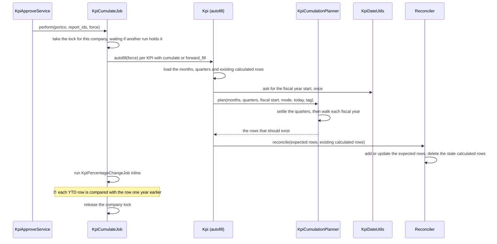
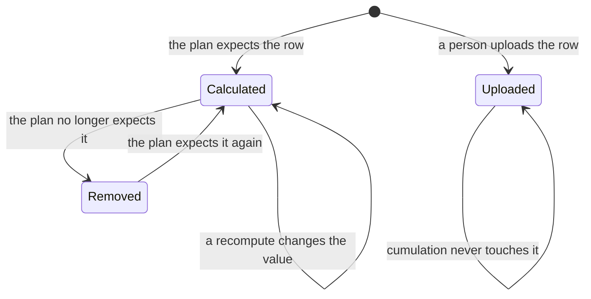
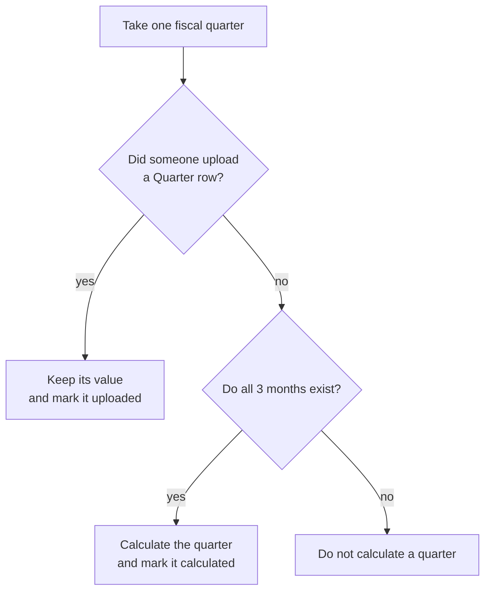
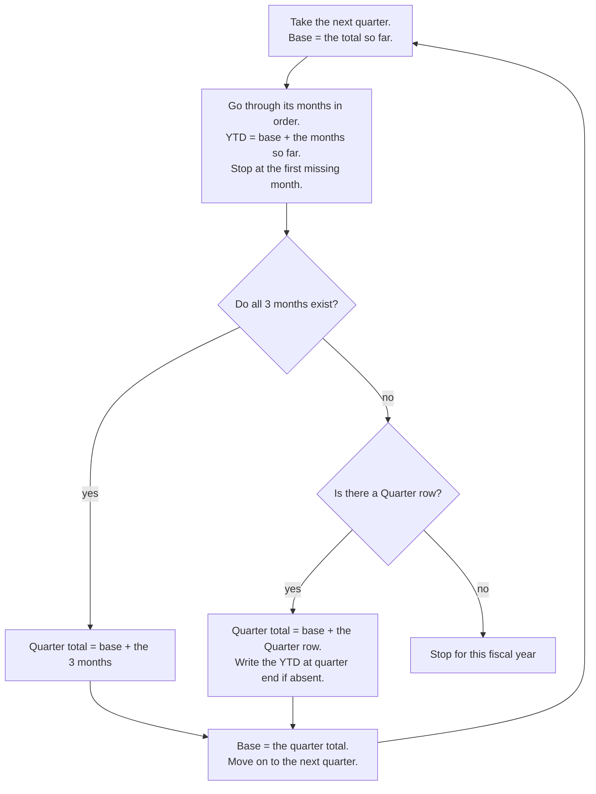
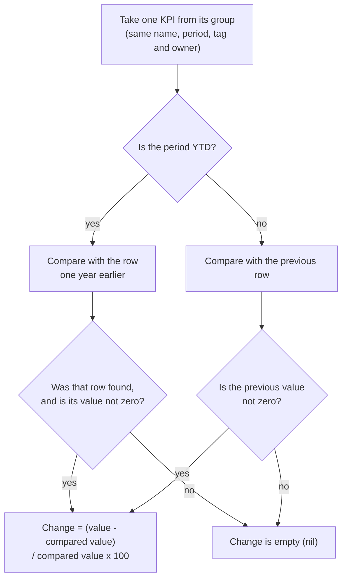
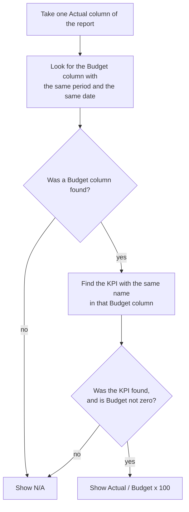
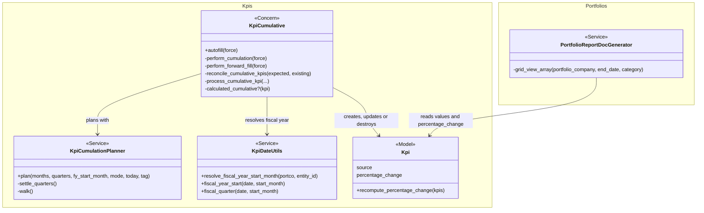

# KPI YTD, Quarter and Year from Mixed Monthly and Quarterly Data — Design

> **Audience:** Engineering team.
> **Companion documents:** [Proposal](proposal.md) · [Spec: cumulation](specs/startups/kpi-cumulation/spec.md) · [Spec: report comparison](specs/funds/portfolio-report-kpi-comparison/spec.md) · [LLD](lld.md)

> **Planning phase — no code changes.** This document explains HOW the proposal will be built.

---

## Contents

- [1. The idea](#1-the-idea)
  - [What this adds](#what-this-adds)
  - [The idea in one picture](#the-idea-in-one-picture)
  - [Walkthrough: one example, start to finish](#walkthrough-one-example-start-to-finish)
  - [Key ideas](#key-ideas)
- [2. The same picture with real names](#2-the-same-picture-with-real-names)
  - [Picture](#picture)
  - [What each box does](#what-each-box-does)
  - [One run, end to end](#one-run-end-to-end)
  - [Lifecycles](#lifecycles)
  - [What users see](#what-users-see)
  - [Design decisions](#design-decisions)
- [3. One card per box](#3-one-card-per-box)
  - [① Source figures](#-source-figures)
  - [② Fiscal calendar](#-fiscal-calendar)
  - [③ Quarter settler](#-quarter-settler)
  - [④ Year walker](#-year-walker)
  - [⑤ Reconciler](#-reconciler)
  - [⑥ Grid](#-grid)
  - [⑦ Percentage change](#-percentage-change)
  - [⑧ Report comparison](#-report-comparison)
  - [⑨ Report fund metrics](#-report-fund-metrics)
- [4. Reference](#4-reference)
  - [Class diagram](#class-diagram)
  - [Data model and schema changes](#data-model-and-schema-changes)
  - [Component contracts](#component-contracts)
  - [Cross-cutting concerns](#cross-cutting-concerns)
  - [Worked examples](#worked-examples)
  - [Testing](#testing)
  - [Risks and open questions](#risks-and-open-questions)

---

## 1. The idea

### What this adds

YTD, Quarter and Year are now worked out in two small steps, one fiscal year at a time:

1. **Settle the quarters.** Keep every quarter that someone uploaded. Calculate a quarter only when all 3 of its months
   exist.
2. **Walk the year.** Go through the fiscal year in order, quarter by quarter and month by month, adding up as you go.
   This gives the YTD and Year figures.

The walk only works out which figures *should* exist. It does not touch the database. A separate step, the
**reconciler**, then makes the saved data match that answer: it adds figures that are missing, updates figures whose
value is wrong, and deletes calculated figures that should no longer exist. It never touches a figure a person
uploaded.

This follows the existing `KpiCumulative` / `KpiCumulateJob` pattern. It replaces the separate monthly and quarterly
paths and the `skip_years` workaround.

Two other things read these figures, and both are fixed in the same change as small, separate pieces:

- **⑦ Percentage change.** The change shown next to a YTD figure now compares it with the same series one year earlier,
  not with the previous row. This is `Kpi.recompute_percentage_change`, which `KpiCumulateJob` already runs after
  cumulation.
- **⑧ Report comparison.** Each Actual column in the Word report gets a new `<label>_vs_budget_percent` field (Actual as
  a percentage of Budget). It is worked out in memory when the report is generated. It is its own capability
  (`funds/portfolio-report-kpi-comparison`) and does not depend on the cumulation work.
- **⑨ Report fund metrics.** The Word report also gets the company's stake (read off its latest investment across all funds),
  its first investment date (its earliest buy across all funds), and its IRR (XIRR) and MOIC in each fund. Its own
  capability (`funds/portfolio-report-fund-metrics`); it reads stored investments and fund ratios, not KPI figures, and
  is not part of the cumulation picture below.

### The idea in one picture

Read it left to right. Each box says what that step does. Each arrow says what is handed to the next step.

```mermaid
flowchart LR
    S["① Source figures<br/>Read the approved<br/>month and quarter figures."]
    F["② Fiscal calendar<br/>Know which fiscal year<br/>and quarter a date is in."]
    Q["③ Quarter settler<br/>Decide which quarters<br/>are complete."]
    W["④ Year walker<br/>Add up the year to get the<br/>YTD and Year figures."]
    R["⑤ Reconciler<br/>Save the result: add missing rows,<br/>fix wrong rows, delete stale rows."]
    G["⑥ Grid<br/>The KPI grid people read.<br/>Only a guard for empty changes."]
    P["⑦ Percentage change<br/>Compare each YTD figure with<br/>the same date a year earlier."]
    C["⑧ Report comparison<br/>Show Actual as a percentage<br/>of Budget in the Word report."]
    S -- "approved figures" --> Q
    S -- "monthly figures" --> W
    F -- "the quarter of each date" --> Q
    F -- "the quarter of each date" --> W
    Q -- "complete quarters" --> W
    W -- "the rows that should exist" --> R
    R -- "rows added, updated or deleted" --> G
    R -- "after saving, recompute changes" --> P
    P -- "stores the change on each figure" --> G
    G -- "the figures the report loads" --> C
```



**What the reconciler does, in one example.** The walk says "Aug YTD should be 16,293,230.03 and there should be no
September quarter". The database still holds an old Aug YTD of 7,704,594.50 and an old calculated September quarter. The
reconciler corrects the Aug YTD and deletes the September quarter, so the saved rows match the walk's answer. See the
[card](#-reconciler) for the full example.

### Walkthrough: one example, start to finish

**Setup.** Ayati Devices, April fiscal year, KPI Revenue set to Cumulate, Actual tag. Today is 22 Oct 2026. Meera has
uploaded Q1 as a Quarter figure (8,588,635.53, period ending 30 Jun) and July (4,682,642.64) and August
(3,021,951.86) as months. September has not been uploaded. An earlier version of the platform ignored Q1, so it saved
Jul YTD as 4,682,642.64 and Aug YTD as 7,704,594.50, and it also wrote a September Quarter row of 7,704,594.50 (July +
August + zero).

**Legend.** "Uploaded" means a person or the import entered it. "Calculated" means the system wrote it and marked it
as such. ✔ = written, ✘ = not written, ⌫ = removed.

| # | When | What happens | Behind the scenes | Result |
|---|---|---|---|---|
| 1 | Meera approves August | Cumulation runs for Revenue | ① loads months Jul, Aug and the Q1 row | Inputs: Q1 (uploaded), Jul, Aug |
| 2 | Quarter settling | Q1 is uploaded, so left alone. Q2 has 2 of 3 months | ③ asks ② which months belong to Q2 | Q1 kept; Q2 not calculated |
| 3 | Walk Q1 | Base 0; no months; Q1 row exists | ④ total = 0 + 8,588,635.53 | Jun YTD ✔ 8,588,635.53 |
| 4 | Walk Q2 months | Jul then Aug, base 8,588,635.53 | ④ month-end totals; ⑤ replaces the old wrong values | Jul YTD ✔ 13,271,278.17; Aug YTD ✔ 16,293,230.03 |
| 5 | Walk Q2 end | Sep missing, no Q2 row | ④ stops the fiscal year | Sep YTD ✘ |
| 6 | Reconcile | The old Sep Quarter row is calculated and not expected | ⑤ deletes it | Sep Quarter ⌫ |
| 7 | Mistake | Meera un-approves July and recomputes | ③ ④ rerun; Jul now missing | Jul YTD ⌫, Aug YTD ⌫; Jun YTD unchanged |
| 8 | Stall | Same run, Q2 gap | ④ stops at Q2 | Nothing after Jun YTD |

```
Aug 2026 snapshot
Q1 row       8,588,635.53 (uploaded)      Jun YTD 8,588,635.53
Jul month    4,682,642.64                 Jul YTD 13,271,278.17   = Q1 + Jul
Aug month    3,021,951.86                 Aug YTD 16,293,230.03   = Q1 + Jul + Aug
Sep          (nothing)                    Sep Quarter, Sep YTD    not written
```

**What to notice:** a quarter row and months are summed without double counting; a missing month never becomes zero;
the wrong September row disappears on its own.

**Second example: the comparisons.** Same company, YTD Actual. Jun-25 YTD is 7,000,000 and Jun-26 YTD is 8,588,636.
Jul-26 YTD is 13,271,278 but there is no Jul-25 YTD. Budget YTD for Jun-26 is 9,336,561.

| # | When | What happens | Behind the scenes | Result |
|---|---|---|---|---|
| 9 | After step 6 | Percentage change recomputed | ⑦ pairs each YTD row with the row dated one year earlier (same name, tag, owner) | Jun-26 YTD change 22.69; Jul-26 YTD change empty |
| 10 | Report generated | Actual as % of Budget | ⑧ looks up Budget with the same name, period and `as_of` in the reports it already loaded | `ytd_06_26_actual_vs_budget_percent` = 92 |
| 11 | Stall: no Budget row | Budget never uploaded | ⑧ finds no row | Field is "N/A"; report still generates |
| 12 | Mistake: Budget approved late | Budget approved after the first report | Nothing was stored | Next generated report shows 92 |

```
Jun-26 YTD Actual 8,588,636    vs  Jun-25 YTD Actual 7,000,000   -> change 22.69  (stored, ⑦)
Jun-26 YTD Actual 8,588,636    /   Jun-26 YTD Budget 9,336,561   -> 92 (x 100)   (report only, ⑧)
```

### Key ideas

| Idea | In one line | Card |
|---|---|---|
| Walk the year | YTD is a running total by quarter, then month | [④](#-year-walker) |
| Complete quarters only | A calculated Quarter needs all 3 months | [③](#-quarter-settler) |
| Uploaded wins | Calculated rows are marked; uploaded rows are never touched | [⑤](#-reconciler) |
| Plan, then save | First work out what should exist, then make the saved data match | [⑤](#-reconciler) |
| One fiscal year source | The shared resolver in `KpiDateUtils` only | [②](#-fiscal-calendar) |
| YTD change is year over year | Compare with the same series one year earlier; never fall back | [⑦](#-percentage-change) |
| Actual against Budget is report-time arithmetic | Calculated from rows already loaded; nothing stored | [⑧](#-report-comparison) |

**FAQ**

| Question | Answer |
|---|---|
| Why split the planner from the reconciler? | The planner only does arithmetic, so the rules can be tested without a database. The reconciler then compares the plan with what is saved, which also makes deleting stale calculated rows simple: any calculated row that is not in the plan goes. |
| Does anything new get stored? | No new column. A marker value goes on an existing column (see [schema](#data-model-and-schema-changes)). The YTD percentage change reuses `kpis.percentage_change` with a corrected meaning. |
| Why is Actual against Budget not stored like the percentage change? | It compares two different series. A stored value goes stale when Budget is approved after Actual, which is why the RAG code needs a cascade. Worked out at report time it is always current and costs no extra query. |

---

## 2. The same picture with real names

### Picture

The same eight boxes as above, now with the code that implements each one. Arrows say what is passed on.

```mermaid
flowchart LR
    S["① Source figures<br/>KpiCumulative fetch methods<br/>(approved Kpi rows)"]
    F["② Fiscal calendar<br/>KpiDateUtils"]
    Q["③ Quarter settler<br/>KpiCumulationPlanner<br/>#settle_quarters"]
    W["④ Year walker<br/>KpiCumulationPlanner<br/>#walk"]
    R["⑤ Reconciler<br/>KpiCumulative<br/>#reconcile_cumulative_kpis"]
    G["⑥ Grid<br/>PerformanceTableService,<br/>KpisHelper and the grid views"]
    P["⑦ Percentage change<br/>Kpi.recompute_percentage_change"]
    C["⑧ Report comparison<br/>PortfolioReportDocGenerator<br/>#grid_view_array"]
    S -- "Kpi rows with period and as_of" --> Q
    S -- "monthly Kpi rows" --> W
    F -- "fiscal year start and quarter" --> Q
    F -- "fiscal year start and quarter" --> W
    Q -- "hash of settled quarters" --> W
    W -- "list of period, as_of and value" --> R
    R -- "creates, updates or destroys Kpi rows" --> G
    R -- "runs KpiPercentageChangeJob inline" --> P
    P -- "sets percentage_change on each Kpi" --> G
    G -- "kpi_reports with their kpis preloaded" --> C
    click S "#-source-figures"
    click F "#-fiscal-calendar"
    click Q "#-quarter-settler"
    click W "#-year-walker"
    click R "#-reconciler"
    click G "#-grid"
    click P "#-percentage-change"
    click C "#-report-comparison"
    classDef newc fill:#d4edda,stroke:#2e7d32,color:#000
    classDef modc fill:#fff3cd,stroke:#f9a825,color:#000
    classDef reuse fill:#eeeeee,stroke:#757575,color:#000
    class Q,W newc
    class F,R,P,C,G modc
    class S reuse
```



Colours: green is new code, yellow is existing code that changes, grey is existing code that is reused as is.

*① reuses the existing fetch of approved KPIs. ② gains one entry point for the fiscal start and quarter. ③ and ④ are
new, pure code. ⑤ reworks the existing writer into plan-then-save. ⑥ gains one guard for an empty change. ⑦ gains a
YTD-specific comparator. ⑧ gains one field per Actual column and an in-memory index.*

### What each box does

| # | Box | Real parts | What it does | When it runs | What it decides | Details |
|---|---|---|---|---|---|---|
| ① | Source figures | `KpiCumulative#fetch_related_monthly_kpis`, `#fetch_related_quarterly_kpis` | Loads approved months and quarters for the KPI name, company and tag | Each cumulation | Which rows are inputs | [card](#-source-figures) |
| ② | Fiscal calendar | `KpiDateUtils.resolve_fiscal_year_start_month`, `EntitySetting.compute_start_of_financial_year_date` | Gives fiscal year start and fiscal quarter of any date | Every planning run | The one fiscal year definition | [card](#-fiscal-calendar) |
| ③ | Quarter settler | `KpiCumulationPlanner#settle_quarters` | Keeps uploaded quarters; calculates a quarter when all 3 months exist | Each planning run | Complete or not | [card](#-quarter-settler) |
| ④ | Year walker | `KpiCumulationPlanner#walk` | Produces YTD and Year using the walk rules | Each planning run | Where the walk stops | [card](#-year-walker) |
| ⑤ | Reconciler | `KpiCumulative#reconcile_cumulative_kpis`, `#process_cumulative_kpi` | Adds or updates the expected rows; deletes calculated rows that are no longer expected | After planning | Which rows are calculated and which are uploaded | [card](#-reconciler) |
| ⑥ | Grid | `PerformanceTableService`, grid views, `KpisHelper#kpi_percentage_class` | Shows the figures; shows "-" for an empty change | On page load | Whether to colour the change | [card](#-grid) |
| ⑦ | Percentage change | `Kpi.recompute_percentage_change`, `KpiPercentageChangeJob` | Stores the change against the comparator row | After cumulation, on approval and on recompute | Which row is the comparator | [card](#-percentage-change) |
| ⑧ | Report comparison | `PortfolioReportDocGenerator#grid_view_array` | Adds `<label>_vs_budget_percent` to Actual columns | Each report generation | Which Budget row matches | [card](#-report-comparison) |
| ⑨ | Report fund metrics | `PortfolioReportDocGenerator#add_fund_level_data`, `#fund_ratio_values`, `#add_investment_milestones` | Adds the latest and earliest buy across funds, and `irr` and `moic` to each `<fund>_data` | Each report generation | Which buy and which stored ratio | [card](#-report-fund-metrics) |

### One run, end to end



### Lifecycles

Calculated row (stored, via the `source` marker):



### What users see

No screen changes. The grid shows corrected YTD values, N/A where nothing qualifies, no calculated September Quarter,
and "-" for a YTD change with nothing a year earlier to compare with. See the [proposal mockup](proposal.md#what-you-see).

### Design decisions

| Choice | Alternative | Why |
|---|---|---|
| Pure planner plus reconciler | Patch each existing method | One rule set instead of seven methods that can disagree; deletes come free |
| Calculated marker in `kpis.source` | Match `notes` text; new boolean column | Notes is free text and user-editable; `source` already exists (limit 100) and avoids a migration. Legacy rows still recognised by the note prefix and stamped on next write. An import stamps `upload`, so approving it over a calculated row replaces the marker |
| One lock per company around the cumulation job | A lock per period; no lock | The plan reads the whole series and the reconciler can delete across fiscal years, so runs for different periods still overlap. One lock per company is the simplest rule that holds. A busy run waits instead of being skipped, so a later approval is never dropped and the last run always reads the final data |
| Quarters settled before the walk | Walk months only and ignore quarters | The walk needs quarter totals to resume after a gap and to produce Year |
| Months win over an uploaded quarter for YTD | Quarter wins | Agreed requirement; the discrepancy is a data issue, not hidden |
| Single fiscal resolver from `KpiDateUtils` | Keep the three-way fallback in `KpiCumulative#fiscal_year_key` (since removed) | One source of truth shared with the workbook reader and template generator |
| Forward fill reuses the same planner in a `:last` mode | Separate forward-fill code | Quarter and Year follow the same completeness rules; YTD has no gap stop because a balance does not depend on earlier months (the old code also treated each balance on its own) |
| YTD change compared with the row one year earlier, fixed in the stored value | Fix only in the report; add a second column | One stored meaning for the figure the grid, thresholds and report all read; existing recompute backfills it; no schema change |
| No fallback when the year-earlier row is missing | Fall back to the previous row | A silent fallback is how the wrong change appeared; empty is honest, and agrees with "a gap stops YTD" |
| Month, Quarter and Year keep previous-row comparison | Make everything year over year | Month and Quarter changes are expected to be period over period (quarter on quarter); one column cannot hold both |
| Actual against Budget calculated in the report | Store it on the Actual row | It crosses two series, so it goes stale when Budget is approved late; in memory it is current and free |
| Ratio is Actual ÷ Budget × 100 | (Actual − Budget) ÷ Budget | Requested form; 92 means 92% of Budget. Same formula and guards (blank when either value is missing or the divisor is zero) as the KPI Budget View's achievement column |
| One in-memory index of KPIs per report | Keep `kr.kpis.show_in_report.find` | That scope runs a query per mapping per report; the index removes it and serves the Budget lookup |
| The report's KPI index holds approved KPIs only | Keep showing unapproved figures and filter only the comparison | Unapproved figures are not used anywhere else (same rule as `find_tagged_kpi` and the RAG comparators); one rule for the whole report is simpler than a special case for the new field |
| Comparator tags as a small constant list | Parse template merge fields, generic KPI-by-KPI division | Budget only now; IC later is a one-line addition with its own field name and no template parsing |

**FAQ**

| Question | Answer |
|---|---|
| Why not delete via notes? | A user could edit a note; deletion of real data must not depend on free text. |
| Why settle quarters first and not derive Year from months? | An uploaded quarter plus months in other quarters would then never produce a Year. |
| Why does the YTD change care about the cumulation cleanup? | A removed calculated YTD row is the comparator for the next year's YTD; recomputing right after cumulation keeps them consistent (E16). |
| Why a lock per company and not per period? | Every run plans the whole series for a KPI, so two runs for different periods still read and write the same rows. Per company is the smallest unit that never overlaps (E34). |

---

## 3. One card per box

### ① Source figures

Loads approved Kpi rows for the name, company and tag, split into months and quarters, plus existing Quarter/YTD/Year
rows that are calculated. | **Owns:** the queries | **Reads / receives:** entity, company, name, tag | **Produces:**
three arrays.

- Reuses the existing preload/join pattern (see the comments on `fetch_related_monthly_kpis`) so no wide-row sort.
- Quarter fetch now deliberately includes calculated rows too; the planner distinguishes uploaded from calculated by the
  marker.

**Worked examples:** H1, E12.

**FAQ**

| Question | Answer |
|---|---|
| Are unapproved rows included? | No; an unapproved month counts as missing (E12). |

### ② Fiscal calendar

Owns the one definition of the fiscal year. `KpiCumulative` resolves the start month through
`KpiDateUtils.resolve_fiscal_year_start_month` (portfolio company, then entity setting, then region) and
`EntitySetting.compute_start_of_financial_year_date` (`#fiscal_year_key` and `#fiscal_quarter_number` had no caller left and
were removed). The start month is resolved once per run and passed to the planner.

**Owns:** fiscal start, quarter of a date | **Reads:** portfolio company, entity settings | **Produces:** start month,
fiscal year key, quarter 1 to 4.

- The monthly path's calendar-quarter grouping is replaced by fiscal quarter, which only agreed for Jan/Apr/Jul/Oct
  starts.
- The offset lives on the portfolio company or in the entity setting, never on a Kpi. The old code asked the Kpi first;
  that always returned a date (the regional default), so the company and entity settings were never read. The shared
  resolver now reads them. A company or entity whose offset differs from the regional default will see its fiscal years
  shift on the next recompute; task 1.1 lists them for the rollout.

**Worked examples:** E10, E11, E35.

**FAQ**

| Question | Answer |
|---|---|
| Boundary dates? | `compute_start_of_financial_year_date` places 30 Jun and 31 Mar correctly for April; verified. |

### ③ Quarter settler

For each fiscal quarter with data: an uploaded Quarter row is kept as is; all 3 months present produce a calculated
Quarter (sum, or last value for forward fill); otherwise no calculated Quarter is expected.

**Owns:** `settle_quarters` | **Reads:** months, uploaded quarters, calculated quarters | **Produces:** quarters keyed
by fiscal year and number, each flagged uploaded or calculated.



**Worked examples:** H2, E1, E5, E7.

**FAQ**

| Question | Answer |
|---|---|
| Does a calculated Q feed the walk like an uploaded one? | Yes, identically. |

### ④ Year walker

The walk per the agreed rules, per fiscal year, tag and KPI. It returns YTD and Year rows only.

**Owns:** `walk` | **Reads:** settled quarters, months, today, tag | **Produces:** expected YTD and Year rows.



After Q4, `Year = base`. Actual rows dated after today are not expected; Budget and IC are exempt.

A Quarter figure covers its quarter end even when a month inside the quarter is missing, and even when a month dated at
the quarter end exists: the quarter total is then base plus the Quarter figure and the quarter-end month is not added on
top. With Q1 and Q2 uploaded, October and December present, November missing and Q3 uploaded, October YTD is
Q1 + Q2 + October, November has none, and December YTD is Q1 + Q2 + Q3 (E38).

**Forward fill does not stop at a gap.** A balance is a snapshot, so a forward-fill KPI's YTD at a date is the balance
at that date and equals that month's own value (cash of 10 in June and 12 in July is 12 at July, never 22). Only
Cumulate KPIs have a running total that differs from the month. With no running total, a missing month has nothing to
break. The planner (`:last` mode) produces: YTD at each month that has a balance, equal to that balance (a month wins
over a Quarter figure on the same date); YTD at a quarter end that only a Quarter figure covers, equal to that figure and never added to an earlier quarter (E39);
a Quarter equal to the last month's balance only when all 3 months exist; and a Year equal to the Q4 balance only when
all 4 quarters are covered. A missing July leaves August's YTD alone (E36).

**Worked examples:** H1, H3, H4, H5, H6, H7, E2, E3, E4, E6, E8, E9, E36, E38, E39.

**FAQ**

| Question | Answer |
|---|---|
| Why is `base` not updated while walking months? | A quarter bridged by a Quarter row would otherwise double count its partial months (E3). |

### ⑤ Reconciler

Takes the planner's list of rows that should exist and compares it with the calculated rows already saved for the KPI
and tag, across every fiscal year that has any source or calculated row. Then it makes the saved rows match:

- a row on the list that is not saved is **added**;
- a row on the list whose saved value is different is **updated** (through the existing `process_cumulative_kpi`);
- a calculated row that is saved but not on the list is **deleted**.

A row without the calculated marker (one a person uploaded) is never updated or deleted.

**Owns:** `reconcile_cumulative_kpis` | **Reads:** the planner's list, existing Quarter/YTD/Year rows | **Produces:**
writes and deletes.

The walkthrough example, step 6:

| Row | The plan says | Saved now | The reconciler |
|---|---|---|---|
| Jun YTD | 8,588,635.53 | none | Adds the row |
| Jul YTD | 13,271,278.17 | 4,682,642.64 (calculated, old) | Updates the value |
| Aug YTD | 16,293,230.03 | 7,704,594.50 (calculated, old) | Updates the value |
| Sep YTD | no row | none | Does nothing |
| Sep Quarter | no row | 7,704,594.50 (calculated, old) | Deletes it |
| Jun Quarter (Q1) | not on the list | 8,588,635.53 (uploaded) | Does nothing, a person uploaded it |

- A legacy row counts as calculated if its `notes` start with "Auto-generated". It gets the marker the next time it is
  written or kept.
- Who writes `source`: the reconciler writes `auto_cumulation`, an import writes `upload`, and the Kpi form writes
  `manual`. A row is calculated only when `source` is `auto_cumulation` (or it is a legacy row, above); `upload`,
  `manual` and blank all mean a person wrote it.
- An import writes an unapproved row. Approving it over an approved calculated row makes `KpiApprover` copy the new
  value onto the old row, so it also copies `source` (blank included). Without that copy the figure someone uploaded
  would still carry `auto_cumulation` and be overwritten or deleted later (E30). This is task 1.2.
- The reconciler applies "never overwrite an uploaded row" itself, before it calls `process_cumulative_kpi`. The
  function stays a plain writer because the compute path also calls it, for every period including Month, and must
  keep updating its own rows.
- Save failures keep feeding `@autofill_errors` as today.
- After all the deletes for a KPI, once the transaction has committed, it refreshes the red/amber/green status of rows that
  were judged against a deleted row (a Budget on the same date, or the next period's row) by calling the existing
  `cascade_dependent_rag_recompute!` for each deleted row. A save already does this; a delete did not (E37). It does
  nothing when the KPI's mapping has no RAG rules, and otherwise costs two small queries per deleted row.

**Worked examples:** E5, E12, E13, E14, E30, E34, E37, X1.

**FAQ**

| Question | Answer |
|---|---|
| Is the empty period report removed? | No; it shows N/A (see proposal "does not cover"). |
| Why a separate step instead of saving inside the walk? | The walk then stays pure arithmetic that can be tested without a database, and the delete rule is one comparison: calculated and not on the list. |

### ⑥ Grid

One small fix. `PerformanceTableService` and the grid views already read Quarter, Month and YTD rows by period and as_of
and need no change. But `KpisHelper#kpi_percentage_class` compares the change with the mapping's thresholds without
checking for an empty change, and empty YTD changes are now common (every YTD figure with nothing a year earlier). It
would raise an error. It now skips the colour for an empty change and shows "-". The KPI show page and the list row
print " %" for an empty change; they show "-" too.

**Worked examples:** H1, E31.

**FAQ**

| Question | Answer |
|---|---|
| Does the grid need work? | No layout change. One guard for an empty change (above); the change figure and its red/green colour read the corrected stored value (see ⑦). |

### ⑦ Percentage change

`Kpi.recompute_percentage_change` groups approved KPIs by period, name, owner and tag and, for each KPI in a group,
stores the change against a comparator. For `YTD` groups the comparator becomes the row with `as_of` exactly one year
earlier (a month-end date is matched to the month end one year earlier, so 28 Feb 2025 matches 29 Feb 2024). Month,
Quarter and Year groups keep the previous row. A missing comparator or a zero comparator stores nil. There is no fallback.

**Owns:** the comparator rule | **Reads:** approved KPIs grouped as today | **Produces:** `kpis.percentage_change`.



- Existing data is corrected by `KpiPercentageChangeJob`, which recomputes every row. `KpiCumulateJob` runs it inline after cumulation when
  `compute_percentage_change` is true, which covers rows the reconciler writes or removes (E16). Approval and mapping
  delete already pass true. The Recompute Auto-Fill action (`KpiReportsController#recompute_cumulative`) did not, so it now does (E32). An import also starts a
  cumulation, but it only writes unapproved rows, so the approved figures do not change; the percentage change follows
  at approval.
- The method now groups by owner as well as period, name and tag (the job already did). A list that mixed owners would
  otherwise mix their rows when the year-earlier row is picked by date (E33). The app does not let one report hold two
  figures of the same KPI, so E33 is set up by skipping that save check and handing the method one mixed list.
- The grid's red/green thresholds read this column, so YTD cells now colour by year-over-year change. An empty change
  shows "-" with no colour (E31).
- The change is rounded to 2 decimals first; if its absolute value is then above 9,999.99 it is stored as nil (the
  column is decimal 6,2). Checking before rounding would let 9,999.995 through, and it rounds to 10,000.00, which
  overflows.
- No existing scenario asserts a YTD percentage change (checked, task 6.3).

**Worked examples:** H9, E15 to E20, E26, E27, E31, E32, E33.

**FAQ**

| Question | Answer |
|---|---|
| Why not compare with a year earlier for every period? | Month and Quarter rows are expected to read month on month and quarter on quarter; Year rows already compare year to year because their previous row is a year earlier. |
| What about the first year of data? | There is no year-earlier row, so the change is empty (E15). |

### ⑧ Report comparison

`PortfolioReportDocGenerator#grid_view_array` already loads every report up to the end date, with its KPIs. It now
builds one lookup per report (`KpiReport#report_kpis_by_name`) from the **approved** KPIs whose mapping is shown in the report
(keyed by lower-cased name; the first match wins, as the current `find` does).

For each Actual report it then:

1. looks for the report with the same period, the same `as_of` and a comparator tag (`Budget`);
2. finds the KPI with the same name in it;
3. adds `<label>_vs_budget_percent` = Actual ÷ Budget × 100.

The field is "N/A" when there is no such report or KPI, when either KPI is not approved, or when Budget is zero. Budget,
IC and untagged reports get no such field. Period and tag are matched without regard to case (E40). The comparator tags are a constant list `["Budget"]`, and the field name is
`_vs_<tag in lower case>_percent`.

Because the lookup holds approved KPIs only, an unapproved figure also shows as "N/A" in the existing `<label>` and
`<label>_percent` keys. `PortfolioReportSablonWordService#grid_view_array`, which mirrors this logic for the AI-drafted
report export, gets the same approved-only rule. The KPI screen grid (the `kpi_reports` and `kpis` grid partials) is not
changed: it already shows approved figures only by default (an unapproved one is "N/A", as in the report now), and
"View Including Staged" shows the pending ones with a Pending badge so reviewers can approve them. `KpisHelper#grid_view_array`
looks like its twin but has no caller anywhere in the app, so it is left alone too.

Each row also gets `data_type` (the mapping's data type in lower case), set once per row, so a template can test it with
`compare_data_type_eq_percentage`; percentage values are fractions (0.12). The Word export of an AI-drafted report does not get it.

**Owns:** the comparison and its key names | **Reads:** the preloaded reports and KPIs | **Produces:** extra keys on
each KPI row.



- No new query. The same pass also removes the existing query per mapping per report (`kr.kpis.show_in_report`).
- Values are raw numbers, like the existing keys; the template or decorator formats.
- Because it is not stored, a Budget approved later appears on the next generation (E22).

**Worked examples:** H10, H11, H12, H15, E21 to E25, E28, E29, E40.

**FAQ**

| Question | Answer |
|---|---|
| Does an unapproved figure count? | No. The index holds approved KPIs only, so an unapproved Actual or Budget gives "N/A" (E28), and an unapproved figure also shows "N/A" in the existing keys (E29). |
| Why not change the KPI screen grid too? | It already hides unapproved figures by default and has a "View Including Staged" switch that reviewers need to approve them. `KpisHelper#grid_view_array` is not the screen grid (nothing calls it) and stays as it is. |
| How would IC be added? | Add the tag to the constant list; the field `<label>_vs_ic_percent` appears with no other change. |

---

### ⑨ Report fund metrics

`PortfolioReportDocGenerator#add_fund_level_data` already loops over the company's funds and stores `<fund>_data` and
`<fund>_latest_pi`. It now also adds:

1. `latest_pi` and `earliest_pi`: across **all** the company's funds, the latest
   investment (a buy or a sale, `quantity` any sign) and the first **buy** (the `buys` scope), dated on or before the end date
   (ties: the later-created for latest, the earlier-created for earliest).
   The template reads `latest_pi.custom_fields.stake` and
   `earliest_pi.investment_date`. With no investment both are
   blank placeholders, so a template that reads them still renders.
2. `irr` and `moic` on each `<fund>_data`: the company's stored fund ratios (owner the portfolio company, fund the fund),
   named IRR (the XIRR) or MOIC, Default scenario, no computation context, the latest whose end date is on or before the
   report's end date. A ratio never run is "N/A". Values are raw numbers (IRR in percent, MOIC as a multiple).

**Owns:** the choice of buy and of ratio | **Reads:** the company's investments (already loaded) and `fund_ratios` |
**Produces:** extra context keys; stores nothing and computes no ratio.

- One extra query per report for all funds together (`fund_ratios`, plucked), none per fund.
- The ratios come from the existing fund ratio runs, so they match the Ratios tab; a fund whose ratios have not been run
  for the period shows "N/A" until they are.

**Worked examples:** H13, H14, E41 to E47.

**FAQ**

| Question | Answer |
|---|---|
| Why does a sale count for the latest but not the earliest? | The latest is the most recent transaction in the company, so a sale can be it (and then carries no stake); the first investment date is by definition the first buy. |
| Why not compute IRR and MOIC at report time? | They already exist as stored fund ratios (the dashboard reads the same rows); recomputing needs the XIRR service and would risk two different answers. |
| Why the Default scenario only? | Scenario and cross-fund runs are what-ifs, not the reported figure. |

---

## 4. Reference

### Class diagram



### Data model and schema changes

No tables or columns change. `kpis.source` (string, limit 100, existing) carries `auto_cumulation` on rows the system
calculates, `upload` on rows written by an import and `manual` on rows written by the Kpi form. Blank, `upload` and
`manual` all mean a person wrote the row.

**Schema changes:** none.

**Changes to existing models:** `Kpi` gains a scope or predicate for calculated rows (marker, or legacy note prefix),
and `Kpi.recompute_percentage_change` gains the YTD year-over-year comparator. `kpis.percentage_change` keeps its
type (decimal 6,2, nil allowed) and changes meaning for `YTD` rows. Nothing is stored for Actual against Budget.

### Component contracts

| From → To | Contract | Direction rule |
|---|---|---|
| ① → ③ | Arrays of `Kpi` with `kpi_report.period`, `as_of`, `value` | Read-only |
| ② → ③ ④ | `fiscal_year_start`, `fiscal_quarter` | Pure functions of date and start month |
| ③ → ④ | Hash `{fy => {q => {value:, origin:}}}` | Planner-internal |
| ④ → ⑤ | Array of `{period, as_of, value}` | Planner never touches the database |
| ⑤ → ⑥ | `Kpi` rows | Reconciler is the only writer |
| ⑤ → ⑦ | `KpiCumulateJob` runs `KpiPercentageChangeJob` inline when `compute_percentage_change` is true (approval, mapping delete and, newly, Recompute Auto-Fill) | Percentage job recomputes after the reconciler finished |
| ⑦ → ⑥ | `kpis.percentage_change` | Percentage change is the only writer of the column |
| ⑥ → ⑧ | Reports with KPIs and mappings, preloaded | Read-only; ⑧ never writes |
| ⑧ → template | Keys `<label>_vs_<tag>_percent`: number or "N/A" | Additive; existing keys unchanged |
| ⑨ → template | Keys `latest_pi`, `earliest_pi`; `irr` and `moic` on `<fund>_data`: number or "N/A" | Additive; existing keys unchanged; reads stored ratios, never writes |

### Cross-cutting concerns

#### Transactions and queries

Three reads per KPI (months, quarters, existing calculated rows) using the existing preload pattern. The percentage
change reuses the loaded group and picks the year-earlier row from it in memory (no query per row). The report
comparison adds no query and removes the one per mapping per report. Each reconcile
write is its own save as today; the delete and upserts for one KPI run inside one transaction so a failure does not
leave half the walk applied. `KpiCumulateJob` also takes one lock per company for the whole run (cumulation and the
inline percentage recompute), so two runs for the same company never overlap.

#### Exception handling and monitoring

| Failure | Who is alerted | Detail |
|---|---|---|
| Row save fails | Job danger toast and error email (existing) | `record_autofill_save_error` |
| Delete fails | Same channel | Reported with period and as_of |

#### Performance and security

- Runs in the existing background job, per KPI, scoped by `report_ids` on approval; no new load class.
- Tenant isolation by `entity_id` on every query, as existing.

### Worked examples

**ID legend:** **H** = Happy path · **E** = Edge case · **X** = Error (exception) case.

**Shared setup:**

| Record | Name | Key data |
|---|---|---|
| Entity | Acme Fund | India, fiscal year April; today 22 Oct 2026 |
| Portfolio company | Ayati Devices | no override |
| KPI | Revenue | Cumulate, Actual |
| KPI | Cash | Forward fill, Actual |
| Values | Q1 8,588,635.53; Jul 4,682,642.64; Aug 3,021,951.86 | Simple values 100, 10, 40 used where stated |
| Comparison values | Jun-25 YTD Actual 7,000,000; Jun-26 YTD Actual 8,588,636; Jun-26 YTD Budget 9,336,561 | Simple values 92 Actual and 100 Budget used where stated |

#### Happy Path

| # | Scenario | Given | When | Then | Spec scenario | Feature |
|---|---|---|---|---|---|---|
| H1 | Quarter then months | Q1 uploaded, Jul, Aug approved | Cumulate | Jun YTD 8,588,635.53; Jul YTD 13,271,278.17; Aug YTD 16,293,230.03; no Sep | Quarter then months | kpi_cumulate_mixed_granularity |
| H2 | Complete quarter | Jul, Aug, Sep approved | Cumulate | Sep Quarter = sum; Sep YTD includes Q1 | Complete quarter | kpi_cumulate_mixed_granularity |
| H3 | Quarters only | Q1, Q2 uploaded, no months | Cumulate | Jun YTD = Q1; Sep YTD = Q1 + Q2 | Uploaded quarter bridges a gap | kpi_cumulate_mixed_granularity |
| H4 | Year from months | 12 months approved | Cumulate | Year = sum | Year from months | kpi_cumulate_mixed_granularity |
| H5 | Year from mixed | Q1, Q2 uploaded; Q3, Q4 as months | Cumulate | Year = sum of 4 quarters | Year from mixed data | kpi_cumulate_mixed_granularity |
| H6 | Forward fill quarter then month | Cash Q1 uploaded, Jul balance | Forward fill | Jun YTD = Q1; Jul YTD = Jul | Quarter then month balance | kpi_forward_fill_mixed_granularity |
| H7 | Budget future quarter | Budget Jan, Feb, Mar of next year | Cumulate | Quarter calculated | Budget quarter in the future | kpi_cumulate_mixed_granularity |
| H8 | Approval trigger | Aug approved via the approval action | Approve | YTD recalculated | Approval triggers calculation | kpi_cumulate_cleanup |
| H9 | YTD against a year earlier | Jun-25 YTD 7,000,000, Mar-26 YTD 8,000,000 and Jun-26 YTD 8,588,636, same KPI and tag | Percentage change recomputed | Jun-26 YTD change 22.69, not against Mar-26 | YTD compared with a year earlier | kpi_ytd_yoy_percentage_change |
| H10 | YTD Actual against YTD Budget | Jun-26 YTD Actual 92, YTD Budget 100 | Report rows built | `ytd_06_26_actual_vs_budget_percent` = 92 | YTD Actual against YTD Budget | portfolio_report_kpi_vs_budget |
| H11 | Quarter Actual against Quarter Budget | Jun-26 Quarter Actual 45, Quarter Budget 60 | Report rows built | `quarter_06_26_actual_vs_budget_percent` = 75 | Quarter Actual against Quarter Budget | portfolio_report_kpi_vs_budget |
| H12 | Existing fields unchanged for approved figures | A template using only `<label>` and `<label>_percent`, all KPIs approved | Report rows built | Same values as before | Existing fields unchanged | portfolio_report_kpi_vs_budget |
| H15 | Row data type | A KPI whose mapping has data type percentage | Report rows built | The row has `data_type` "percentage" | Row data type | portfolio_report_kpi_vs_budget |
| H13 | Stake and first date across funds | Buys in two funds: 15 Mar 2024 (stake 8), 10 Jan 2025 (stake 10), 1 Sep 2025 (stake 12.5) | Fund data built | Latest investment's stake 12.5; earliest investment's date 15 Mar 2024 | Latest and earliest investment across funds | portfolio_report_fund_metrics |
| H14 | IRR and MOIC for each fund | Alpha Fund: IRR 14.5, MOIC 1.8; Beta Fund: IRR -3.2, MOIC 0.9 (stored) | Fund data built | Each fund's data shows its own irr and moic | IRR and MOIC for each fund | portfolio_report_fund_metrics |

#### Edge Cases

| # | Scenario | Given | When | Then | Spec scenario | Feature |
|---|---|---|---|---|---|---|
| E1 | Incomplete quarter | Jul, Aug approved only | Cumulate | No Sep Quarter | Incomplete quarter | kpi_cumulate_mixed_granularity |
| E2 | Gap stops YTD | Q1, Jul, Sep; Aug missing | Cumulate | Jun, Jul YTD only | Gap stops YTD | kpi_cumulate_mixed_granularity |
| E3 | No double count | Q1 100, Jul 10, uploaded Q2 40 | Cumulate | Jul YTD 110; Sep YTD 140 | Partial months with an uploaded quarter are not double counted | kpi_cumulate_mixed_granularity |
| E4 | Months win | Q1 100; Jul+Aug+Sep 45; uploaded Q2 40 | Cumulate | Sep YTD 145; Q2 stays 40 | Months take priority over a disagreeing uploaded quarter | kpi_cumulate_mixed_granularity |
| E5 | Uploaded authoritative | Uploaded Q2 40; 3 months total 45 | Cumulate | Q2 still 40 | Uploaded quarter with all months present | kpi_cumulate_mixed_granularity |
| E6 | FY independence | Gap in FY26, full FY27 | Cumulate | FY27 YTD from its own start | Gap does not leak into the next fiscal year | kpi_cumulate_mixed_granularity |
| E7 | Three quarters | Q1 to Q3 only | Cumulate | No Year | Year is not produced for three quarters | kpi_cumulate_mixed_granularity |
| E8 | Forward fill incomplete | Cash Jul, Aug | Forward fill | No Quarter; YTD Jul and Aug = their balances | Incomplete quarter balance | kpi_forward_fill_mixed_granularity |
| E9 | Actual future | Actual months of a future quarter | Cumulate | No Quarter | Actual quarter in the future | kpi_cumulate_mixed_granularity |
| E10 | Company override | Company FY starts January | Cumulate | Q1 = Jan to Mar | Portfolio company override | kpi_cumulate_mixed_granularity |
| E11 | India default | No settings; India | Cumulate | Q1 = Apr to Jun | India default | kpi_cumulate_mixed_granularity |
| E12 | Month un-approved | Calculated Q2 exists; Aug un-approved | Recompute | Q2 and dependent YTD removed | Month un-approved | kpi_cumulate_cleanup |
| E13 | Legacy partial quarter | Old Sep Quarter row (note "Auto-generated Quarter cumulative") | Recompute | Row removed | Previously wrong partial quarter | kpi_cumulate_cleanup |
| E14 | Uploaded survives | Uploaded Quarter where none would be calculated | Recompute | Kept | Uploaded figure survives | kpi_cumulate_cleanup |
| E15 | No YTD a year earlier | Jun-26 and Jul-26 YTD; no Jul-25 YTD | Percentage change recomputed | Jul-26 change empty, not against Jun-26 | No YTD a year earlier | kpi_ytd_yoy_percentage_change |
| E16 | Year-earlier figure removed | Jul-25 YTD calculated and removed by cleanup | Cumulate then recompute | Jul-26 YTD change becomes empty | Year-earlier figure removed | kpi_ytd_yoy_percentage_change |
| E17 | Year-earlier YTD zero | Jun-25 YTD is 0 | Percentage change recomputed | Jun-26 change empty | Year-earlier YTD is zero | kpi_ytd_yoy_percentage_change |
| E18 | Leap-day month end | 28 Feb 2025 YTD and 29 Feb 2024 YTD | Percentage change recomputed | The two are compared | Year-earlier month end differs | kpi_ytd_yoy_percentage_change |
| E19 | Tags separate | Actual and Budget YTD for two years | Percentage change recomputed | Each tag against its own tag | Tags compare separately | kpi_ytd_yoy_percentage_change |
| E20 | Other periods unchanged | Consecutive Month, Quarter, Year figures | Percentage change recomputed | Each against the previous figure of its period | Month, Quarter and Year unchanged | kpi_ytd_yoy_percentage_change |
| E21 | Budget missing | Actual column with no Budget row | Report rows built | Field "N/A" | Budget missing | portfolio_report_kpi_vs_budget |
| E22 | Budget approved later | Report generated before Budget exists, then Budget approved | Report generated again | Field now shows the ratio | Budget approved later | portfolio_report_kpi_vs_budget |
| E23 | Budget zero | Budget value 0 | Report rows built | Field "N/A" | Budget is zero | portfolio_report_kpi_vs_budget |
| E24 | Different period not compared | Month Actual and only a Quarter Budget at the same date | Report rows built | Month field "N/A" | Different period is not compared | portfolio_report_kpi_vs_budget |
| E25 | Only Actual columns | A Budget and an IC column | Report rows built | No `_vs_budget_percent` field on them | Budget and IC columns | portfolio_report_kpi_vs_budget |
| E26 | Recompute corrects old values | A YTD row stores a change against the previous month | Percentage change job runs | Value is year over year | Recompute corrects a previously stored YTD change | kpi_ytd_yoy_percentage_change |
| E27 | Change overflows the column | Year-earlier YTD 1 and current YTD 1,000,000 (change above 9,999.99), or a change of 9,999.995 (rounds to 10,000.00) | Percentage change recomputed | Change stored as nil; other KPIs in the group still updated | YTD change too large to store | kpi_ytd_yoy_percentage_change |
| E28 | Unapproved figure | Budget KPI unapproved, or Actual KPI unapproved | Report rows built | Field "N/A" | Unapproved figures are not compared | portfolio_report_kpi_vs_budget |
| E29 | Report shows approved KPIs only | An unapproved Revenue KPI in a report column | Report rows built | `<label>` and `<label>_percent` are "N/A" | Report uses approved KPIs only | portfolio_report_kpi_vs_budget |
| E30 | Uploaded figure approved over a calculated row | A calculated Sep Quarter exists; a person uploads a Sep Quarter and approves it | Approved, then cumulation recomputed | The Quarter keeps the uploaded value, is marked `upload` and is not removed or recalculated | Uploaded figure replaces a calculated one | kpi_cumulate_cleanup |
| E31 | Empty change with thresholds set | A YTD figure with an empty change; its mapping has a lower threshold | The KPI grid is shown | "-" with no colour and no error | Empty change with thresholds set | kpi_ytd_yoy_percentage_change |
| E32 | Recompute Auto-Fill recomputes changes | Cumulation adds a YTD row | The Recompute Auto-Fill action runs | The job is queued with the percentage-change flag; the new YTD row gets its year-over-year change | Recompute Auto-Fill refreshes YTD changes | kpi_ytd_yoy_percentage_change |
| E33 | Owners separate | YTD figures of two owners for the same KPI, tag and dates | Percentage change recomputed | Each is compared with its own owner's year-earlier figure | Owners compare separately | kpi_ytd_yoy_percentage_change |
| E34 | Company busy | Another cumulation run holds the company's lock | KpiCumulateJob runs | The job queues itself again and changes no figure; once the lock is free the run completes on the latest data | Company busy | kpi_cumulate_cleanup |
| E35 | Entity setting | Company sets nothing; the entity setting starts the fiscal year in January; region India | Cumulate | Q1 = Jan to Mar (the old cumulation used April here) | Entity setting | kpi_cumulate_mixed_granularity |
| E36 | Forward fill gap | Cash balances for Apr, May, Jun, Aug and Sep; July missing | Forward fill | YTD for Apr, May, Jun, Aug and Sep each equal that month's balance; Q1 Quarter = June balance; no Q2 Quarter | Gap does not stop forward-fill YTD | kpi_forward_fill_mixed_granularity |
| E37 | Status judged against a removed figure | A calculated Budget YTD row that an Actual YTD row was judged against (RAG configured) is removed by the cleanup | Recompute | The Actual YTD row's status is re-evaluated | Status judged against a removed figure refreshes | kpi_cumulate_cleanup |
| E38 | Quarter figure bridges a missing month | Q1 and Q2 uploaded; October and December approved; November missing; Q3 uploaded (31 December) | Cumulate | October YTD = Q1 + Q2 + October; no November YTD; December YTD = Q1 + Q2 + Q3, the December month not added on top | Quarter figure bridges a missing month | kpi_cumulate_mixed_granularity |
| E39 | Later quarter balance, no month | Cash Q1 balance 40 and Q2 balance 50 uploaded as quarters; no month figures | Forward fill | Jun YTD = 40; Sep YTD = 50 (the Q2 balance, not 90) | Later quarter balance without a month | kpi_forward_fill_mixed_granularity |
| E40 | Tag case ignored | Budget report tagged "budget" | Report rows built | Ratio calculated against it | Tag case is ignored | portfolio_report_kpi_vs_budget |
| E41 | Ratio not run | A fund where the company has an IRR but no MOIC stored, and a fund with neither | Fund data built | The missing fields are "N/A" | Ratio not run | portfolio_report_fund_metrics |
| E42 | Ratio as of the end date | IRR stored for 31 Dec 2025, 30 Jun 2026 and 30 Sep 2026; report ends 30 Jun 2026 | Fund data built | The 30 Jun 2026 figure | Ratio as of the end date | portfolio_report_fund_metrics |
| E43 | Other scenarios and owners ignored | A Bull Case IRR of the company and the fund's own IRR, both dated 30 Jun 2026, besides the Default one | Fund data built | The company's Default figure | Other scenarios and other owners are ignored | portfolio_report_fund_metrics |
| E44 | A later sale is the latest investment | Buys in 2024 and 2025, a sale in 2026 | Fund data built | Latest is the 2026 sale (stake blank); earliest the 2024 buy | A later sale is the latest investment | portfolio_report_fund_metrics |
| E45 | Investments after the end date | A buy dated after the report's end date | Fund data built | Not used | Investments after the end date | portfolio_report_fund_metrics |
| E46 | No investment | The company has no buy yet | Fund data built | Stake and date blank; nothing fails | No investment | portfolio_report_fund_metrics |
| E47 | Stake not recorded | The latest investment has no stake | Fund data built | Stake blank; earliest date shown | Stake not recorded | portfolio_report_fund_metrics |

#### Error Cases

| # | Scenario | Given | When | Then (what the user sees, who is alerted) | Spec scenario | Feature |
|---|---|---|---|---|---|---|
| X1 | Row save fails | A calculated row fails validation | Cumulate | Job danger toast and error email list the period; that KPI's reconcile is undone as a whole (no half-written walk), other KPIs' rows are still written | Stale calculated figures are removed (failure path) | kpi_cumulate_cleanup |

### Testing

Cucumber only. New features: `features/startup/kpi_cumulate_mixed_granularity.feature`,
`kpi_forward_fill_mixed_granularity.feature`, `kpi_cumulate_cleanup.feature`, `kpi_ytd_yoy_percentage_change.feature` (⑦)
`features/fund/portfolio_report_kpi_vs_budget.feature` (⑧, built from the report generator's row builder, not the
Word file) and `features/fund/portfolio_report_fund_metrics.feature` (⑨, built from the generator's fund-level
context). Reuse the steps in
`features/step_definitions/` used by `kpi_cumulate.feature` (Monthly KPI Reports tables, "I run the KPI cumulate
method"); add steps for uploaded Quarter rows and for asserting absence, and for asserting a stored percentage change
(empty or a value). Reuse the portfolio report steps in `features/fund/portfolio_report.feature`. Existing `kpi_cumulate*.feature` scenarios that
expect partial-quarter totals are updated (see risks).

### Risks and open questions

- Existing scenarios assume a partial quarter is totalled ("Only approved KPIs are cumulated" expects a Quarter of 300
  from two of three months) → update to the new rule and record it as the behaviour change.
- An uploaded figure approved over a calculated row would keep the marker and be overwritten later → an import stamps
  `upload`, the approver copies `source`, the Kpi form stamps `manual`; covered by task 1.2, E14 and E30.
- Two cumulation runs for one company could overlap and a stale one delete correct rows → one lock per company
  (E34).
- Un-approving or deleting an uploaded Quarter makes calculated figures change on next recompute → expected.
- Deleting rows loses data → only rows with the calculated marker or legacy note, and the agreed cleanup (test
  investor only for the first run).
- Honouring the company and entity fiscal-year settings (the old code never read them) moves fiscal years for any
  company whose offset differs from the regional default → list them first (task 1.1) and expect their YTD and Year
  rows to be recalculated on the next recompute.
- The meaning of a stored value changes (YTD percentage change), including its red/green colouring → existing values
  are corrected only when the recompute runs; run it per company after deploy (LLD: Configuration and Rollout) and
  no existing scenario asserts a YTD change (task 6.3 checked).
- Other readers of `percentage_change` pick up the new YTD meaning: the KPI show page and form, the "Percentage Change"
  column of the KPI export, the tear sheet generator's KPI data, the AI portfolio assistant's KPI data and the Word
  report's existing `<label>_percent` field. None changes code; reviewers should know their YTD numbers move. A YTD
  figure with no year-earlier row now has an empty change, so its `<label>_percent` is empty (it was 0 for the first row and
  last month's change otherwise). In a formatted template field (`format_...`) an empty value is read as 0 and printed
  as "-"; an unformatted field prints nothing. The field is left as it is (not changed to "N/A"). On the KPI grid
  the empty change prints "-" (the existing nil branch of `kpi_percentage_class`, kept by task 6.4).
- Year-earlier row depends on the cumulation cleanup → the percentage job runs after cumulation, including after
  Recompute Auto-Fill (E16, E32).
- `kpi_extended_aggregation.feature` ("Forward Fill monthly KPIs into Quarterly reports") expects a Quarter from two of
  three months with March missing → update it to expect no Quarter (open question 6, resolved) and record it as a
  behaviour change.
- Existing scenarios encode the old rules and need updating (tasks 2.3 and 4.1): "Only approved KPIs are cumulated", "Existing
  cumulative KPI is replaced if value is different" and its "NOT replaced" twin (the seeded Quarter row has no marker, so
  it is now treated as uploaded and kept; seed it as a calculated row), "Compute KPI using division formula" (built a
  Quarter from January alone), the nil-mapping backfill step, and the forward-fill Quarter one above.
- A report with a blank tag has no tag to match the saved Quarter, YTD and Year rows on, so for it the reconciler sees no
  saved rows: it still writes the planned ones (as before), but it cannot protect an uploaded figure or remove a stale one.
  Blank tags are rare and this was already so; the bulk-query feature (E4) keeps covering that the values are right.
- An import whose value equals the approved calculated row it would replace is skipped by the import's existing same-value
  check, so that row stays calculated and a later recompute may remove it if it stops qualifying. Not changed here.
- Row-building refactor in the report could change which KPI is picked when two share a name → keep "first match wins"
  and check H12.
- Reports that used to show an unapproved figure now show "N/A" → intended (E29); mention in the release note.

| # | Open question | Current thinking | Status |
|---|---|---|---|
| 1 | Remove empty auto-created period reports left behind | Leave as N/A columns | Deferred |
| 2 | Should an unapproved Budget count in Actual against Budget? | No. Both sides must be approved | Resolved |
| 3 | IC (and other) comparators | Add to the constant list when the template needs it. Confirm the exact tag text first: the budget-view feature uses "IC Case", the `ics` scope uses "IC" | Deferred |
| 4 | The KPI Budget View already computes tag ÷ tag × 100 inside its view template. Share one helper with the report? | Not now; keep this change small and leave the view untouched. Revisit when IC is added | Deferred |
| 5 | `grid_view_array` applied no status filter, so existing `<label>` values could show unapproved figures | Report generator and its mirror use approved KPIs only; the KPI screen grid (and the unused `KpisHelper#grid_view_array`) is unchanged | Resolved |
| 6 | Forward fill (balances such as Cash): should a missing month stop YTD, and should a Quarter be built from an incomplete quarter? | YTD has no gap stop: each month with a balance gets its own balance as YTD. A Quarter needs all 3 months (the old code took the last month present) | Resolved |

**FAQ**

| Question | Answer |
|---|---|
| Where do I start reviewing? | The planner in [④](#-year-walker) and the worked examples, then the reconciler in [⑤](#-reconciler). |
