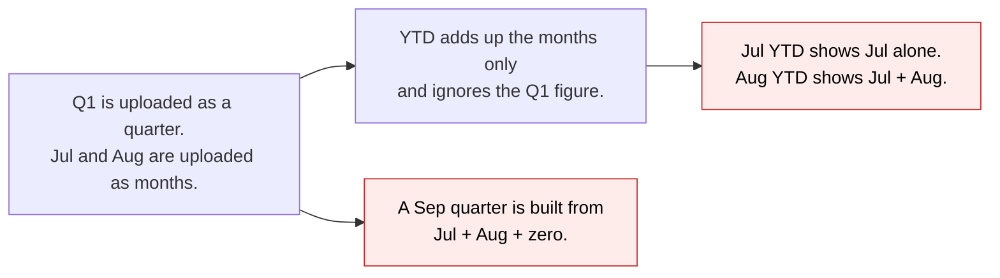
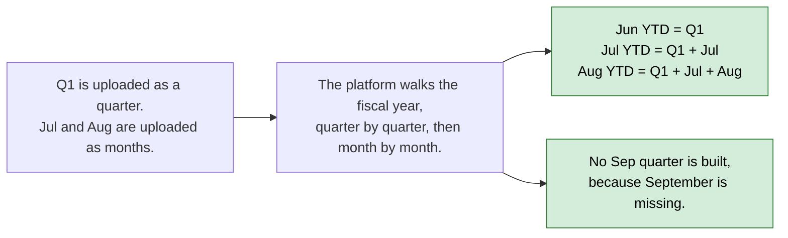
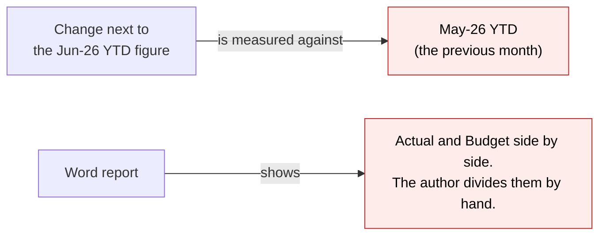
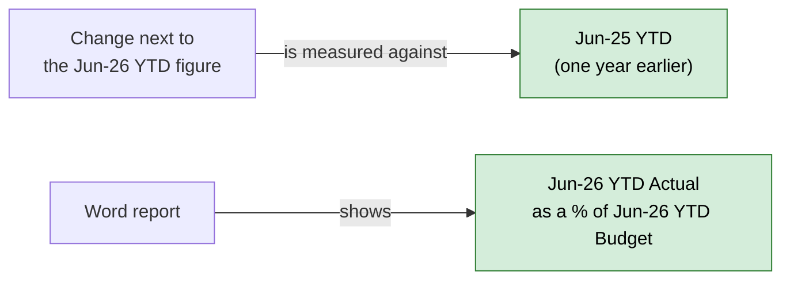
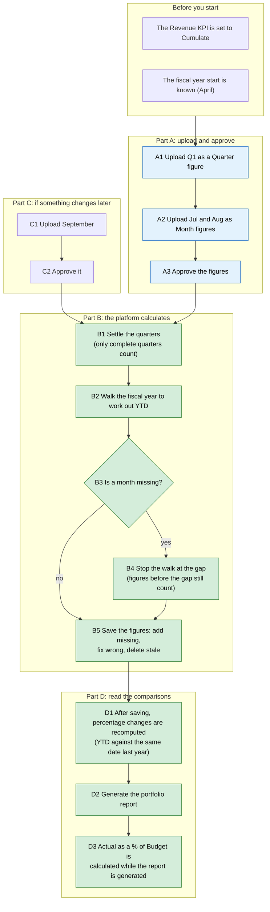

# KPI YTD, Quarter and Year from Mixed Monthly and Quarterly Data — Proposal

> **Audience:** Business team, product, QA, support — non-technical.
> **Companion document:** [Design](design.md)
> **New to this? Start with the [Workflow Journey](#workflow-journey)** — every action, in order, from start to the outcome.

> **Planning phase — no code changes.** This document proposes and explains the change. Do not
> edit application code while writing it; implementation happens later, in the tasks phase.

---

## Why

A portfolio company uploaded its Q1 as one quarterly figure and then July and August as monthly figures. The
platform ignored the Q1 figure when building "year to date" (YTD), so July YTD showed July alone and August YTD showed
July + August. It also produced a September quarter figure from only two months, treating the missing month as zero.
Fund managers read these numbers as real, so they are wrong and misleading.

Two things read these figures downstream and are wrong or missing today, so they are fixed in the same change:

- The change shown next to a YTD figure compares it with the **previous month's YTD** (June YTD against May YTD), not
  with the same point **one year earlier**. A YTD year-over-year change is meaningless when measured that way.
- The Word portfolio report has no way to show **Actual against Budget** (for a month, quarter, YTD or year), so
  authors compute it by hand.

## What Changes

- **YTD uses whatever granularity exists.** YTD at any month end is everything from the start of the fiscal year up to
  that date, built from quarter figures where a quarter was uploaded as a quarter and from monthly figures otherwise.
  June 2026 YTD equals Q1 2026 (India fiscal year, April to March).
- **A gap stops YTD.** If a month is missing and no quarter figure covers it, no YTD is shown from that month to the end
  of that fiscal year. A missing month is never treated as zero. A later quarter figure that covers the gap lets YTD
  resume.
- **Quarter and Year are only calculated from complete data.** A calculated Quarter needs all 3 months. A calculated
  Year needs all 4 quarters covered. With July and August but no September, no September quarter is produced.
- **Uploaded quarter figures are never overwritten.** A quarter that someone uploaded stays as uploaded. Only figures
  the platform calculated are recalculated.
- **Stale calculated figures are removed.** If a calculated Quarter/YTD/Year no longer qualifies (for example the
  September quarter above, or after a month is un-approved), the platform removes it. Figures a person entered are
  never removed.
- **Forward-fill KPIs (balances such as cash) carry the latest balance instead of adding.** A balance is a snapshot,
  so adding months together would be meaningless (cash of 10 in June and 12 in July is not 22). Its YTD at a date is the
  balance at that date, which equals that month's own value; this is how forward fill already works. A KPI mapped to
  "Cumulate" (revenue) is different: its YTD is the running total and differs from the month. A balance's YTD does not
  need the earlier months to exist. A Quarter is shown only when all 3 months exist, and a
  Year only when all 4 quarters are covered.
- **One definition of the fiscal year** is used everywhere: the portfolio company's own setting, then the fund's
  setting, then the regional default (April for India, January for US). Until now the calculation ignored the company
  and fund settings and always used the regional default, so a company with a different fiscal year start will see its
  YTD, Quarter and Year figures rebuilt on its own fiscal year.
- **One calculation at a time per company.** If two approvals for the same company arrive together, the second waits
  for the first, so the final figures always reflect everything approved.
- **An uploaded figure replaces a calculated one for good.** If a person uploads and approves a Quarter, YTD or Year
  figure where the system had calculated one, it is treated as uploaded from then on and is never recalculated or
  removed.
- **YTD change is year over year.** The percentage change on a YTD figure compares it with the YTD figure of the same
  series dated exactly one year earlier (30 Jun 2026 against 30 Jun 2025). If there is no such figure, or it is zero,
  the change is empty ("N/A"); the system never falls back to an earlier month. Month, Quarter and Year figures keep
  comparing with the previous figure of their series (month on month, quarter on quarter). Existing data is corrected by
  the existing percentage-change recompute, which "Recompute Auto-Fill" now runs as well. A change too large to store
  (above 9,999.99%) is left empty. An empty change shows "-" in the grid and never breaks a colour threshold.
- **Actual against Budget in the portfolio report.** For every Actual figure the report also offers
  "Actual as a percentage of Budget" for the same date and period (Actual ÷ Budget × 100, so 92 means 92%). On a YTD
  column this is YTD Actual against YTD Budget; on a Quarter column it is Quarter Actual against Quarter Budget. It is
  empty ("N/A") when there is no approved Budget figure or Budget is zero. Only approved figures count, on both sides;
  an unapproved Actual or Budget is treated as missing. It is calculated when the report is generated and is
  not stored, so approving a Budget later never leaves it stale. Budget is the only comparator now; the comparator list
  is built so another tag (for example IC) can be added without reshaping the report.
- **Stake, first investment date, IRR and MOIC in the Word report.** The report also offers the company's stake (the
  `stake` custom field of its latest investment across all funds), the date of its first buy across all funds, and, for each
  fund, the company's IRR (XIRR) and MOIC in that fund. They are read from the investments and from the fund ratios
  already stored (the same figures as the Ratios tab), as of the report's end date; a ratio that was never run shows
  "N/A". Nothing is stored or recomputed.
- **The Word report uses approved KPIs only.** The report's KPI rows (the main list and the per-category lists) take
  only approved figures; an unapproved figure shows "N/A" like a missing one. The same rule applies to the Word export
  of an AI-drafted report, which mirrors the generator. The KPI screens still show unapproved figures, because
  reviewers need to see them there.
- **BREAKING (behaviour):** a Quarter figure built from only 1 or 2 months is no longer produced. Existing scenarios
  that relied on partial-quarter totals change.
- **BREAKING (behaviour):** the percentage change on a YTD figure changes meaning (previous month becomes the same date
  one year earlier). Values already shown in the grid and used for the red/green thresholds change after the recompute.

### Flow Diagram

Before: YTD ignores the quarter figure, and a partial quarter is totalled.



After: YTD walks the fiscal year, and partial quarters are not built.



Before: the YTD change compares with last month, and the report has no Actual against Budget.



After: the YTD change compares with a year earlier, and the report carries Actual against Budget.



---

## Workflow Journey

### Who is involved

| Person | Role | What they do in the journey |
|---|---|---|
| Meera | Fund manager at the investor | Uploads the company's KPIs, approves them, reads the KPI grid |
| Ayati Devices (portfolio company) | Reports Revenue | Provided a Q1 total and then monthly figures |

### The journey on one page



### Before you start

| Needed | Why | Where it comes from |
|---|---|---|
| Revenue mapped with "Cumulate" | Only cumulate and forward-fill KPIs are calculated | KPI mapping for the company |
| Fiscal year start | Decides which months make a quarter | Company setting, then fund setting, then regional default |
| Budget figures approved for the same dates (only for Actual against Budget) | The Budget side of the comparison | KPI upload with the Budget tag |
| A report template that uses the new "against Budget" fields (only for the report) | Printing the values | Template author, provided separately |

### Part A — upload and approve (every reporting period)

| Step | Who | Where | Action | What the system does | What you see |
|---|---|---|---|---|---|
| A1 | Meera | KPIs › Upload | Upload Q1 2026 as a Quarter figure (period ending 30 Jun 2026) | Stores it as an uploaded figure | Jun 2026 Quarter column filled |
| A2 | Meera | KPIs › Upload | Upload Jul and Aug 2026 as Month figures | Stores both | Jul 2026 and Aug 2026 Month columns filled |
| A3 | Meera | KPIs › Approve | Approve the figures | Starts the cumulation | Notice that cumulative values are being computed |

### Part B — the platform calculates

| Step | Who | Where | Action | What the system does | What you see |
|---|---|---|---|---|---|
| B1 | System | background | Settle quarters | Q1 is uploaded, so it is left alone. Q2 has only 2 of 3 months, so it is not calculated | No Sep 2026 Quarter figure |
| B2 | System | background | Walk the fiscal year | Works out Jun YTD = Q1, Jul YTD = Q1 + Jul, Aug YTD = Q1 + Jul + Aug | Nothing yet: the figures are worked out, not saved |
| B3 | System | background | Check for a missing month | September is missing and no Q2 figure covers it | Nothing yet |
| B4 | System | background | Stop the walk | No YTD is worked out after Aug for this fiscal year; the figures before the gap still count | Nothing yet |
| B5 | System | background | Save the figures (also when there was no gap) | Adds or corrects Jun, Jul and Aug YTD and removes calculated figures that no longer qualify, such as an old September Quarter | YTD columns filled for Jun, Jul, Aug; no Sep YTD |

### Part C — if something changes later

| Step | Who | Where | Action | What the system does | What you see |
|---|---|---|---|---|---|
| C1 | Meera | KPIs › Upload | Upload September 2026 | Stores it | Sep 2026 Month column filled |
| C2 | Meera | KPIs › Approve | Approve | Q2 now has 3 months, so Q2 is calculated. Sep YTD written | Sep 2026 Quarter and Sep YTD appear |

### Part D — read the comparisons

| Step | Who | Where | Action | What the system does | What you see |
|---|---|---|---|---|---|
| D1 | System | background | After B5 (whether or not the walk stopped), recompute percentage changes | YTD figures are compared with the YTD figure dated one year earlier; other periods with the previous figure | Change next to each YTD figure is year over year; "-" when there is no figure a year earlier |
| D2 | Meera | Portfolio reports › Generate | Generate the report for the company and date range | Reads the same figures the report already uses | Report generated notice |
| D3 | Meera | Documents › Portfolio Reports | Open the Word file | Calculates Actual ÷ Budget × 100 for each Actual column that has a Budget figure for the same date and period | The "against Budget" fields filled where the template uses them |

### What you see

Revenue for Ayati Devices (India fiscal year, figures in the example are the ones from the report that raised this):

```
                 Jun-26     Jul-26    Jul-26    Aug-26    Aug-26     Sep-26
                 Quarter    Month     YTD       Month     YTD        Quarter
Total Revenue    8,588,636  4,682,643 13,271,278 3,021,952 16,293,230  N/A
                 (Q1)       (month)   Q1+Jul    (month)   Q1+Jul+Aug  (no Sep data)

Arithmetic:  Jul YTD = 8,588,635.53 + 4,682,642.64 = 13,271,278.17
             Aug YTD = 13,271,278.17 + 3,021,951.86 = 16,293,230.03
```

Change shown next to the YTD figure (illustrative numbers, YTD Actual):

```
                  Jun-25 YTD   Jun-26 YTD   Change shown
Total Revenue     7,000,000    8,588,636    22.69 %   (against Jun-25 YTD, not May-26 YTD)
Total Revenue     (none)       13,271,278   -         (no Jul-25 YTD, so no change; never against Jun-26)
```

Actual against Budget in the Word report (illustrative numbers):

```
                  Jun-26 YTD   Jun-26 YTD   Actual as % of Budget
                  Actual       Budget
Total Revenue     8,588,636    9,336,561    92        (8,588,636 / 9,336,561 x 100)
Total Revenue     8,588,636    (none)       N/A
Total Revenue     8,588,636    0            N/A
```

### What goes wrong

Aug 2026 is missing but Sep 2026 is uploaded. Jul YTD is shown (Q1 + Jul). Aug YTD and Sep YTD are not shown, and the
Sep quarter is not calculated. The fix is to upload Aug, or to upload the Q2 total as a quarter figure; after approval
the missing figures appear.

### Summary: the minimum actions

| # | Action | Who | How often |
|---|---|---|---|
| 1 | Upload the period's figures (month or quarter) | Meera | Every reporting period |
| 2 | Approve them | Meera | Every reporting period |

---

## User Stories

### US-1: YTD includes an uploaded quarter

**As a** fund manager, **I want** YTD to include a quarter that was uploaded as a quarter, **So that** July YTD is
Q1 plus July.

**Acceptance criteria:**
- With Q1 (Apr to Jun) uploaded and July uploaded, Jun YTD equals Q1 and Jul YTD equals Q1 plus July.
- Aug YTD equals Q1 plus July plus August.

### US-2: No guessing for missing months

**As a** fund manager, **I want** missing periods never to be treated as zero, **So that** no quarter, YTD or year
figure understates the truth.

**Acceptance criteria:**
- July and August without September produces no September quarter.
- A missing month stops YTD for the rest of that fiscal year unless a quarter figure covers the gap.

### US-3: Uploaded figures win

**As a** fund manager, **I want** figures I or the company uploaded never to be replaced by calculated ones, **So
that** the reported number is the one on record.

**Acceptance criteria:**
- An uploaded Quarter figure keeps its value even when all 3 months exist.
- Only calculated figures are recalculated or removed.

### US-4: Wrong figures clean themselves up

**As a** fund manager, **I want** wrongly calculated figures to be removed when they no longer qualify, **So that**
the grid does not keep showing the earlier mistake.

**Acceptance criteria:**
- A calculated Quarter, YTD or Year that no longer qualifies disappears after the next approval or recompute.

### US-5: Balances show the latest value

**As a** fund manager, **I want** balance-type KPIs (forward fill) to show the latest balance, **So that**
a quarter-end balance is only shown when the quarter is complete, and a missing month does not hide the others.

**Acceptance criteria:**
- A Quarter balance is shown only when all 3 months exist, and equals the last month's value.
- YTD for a balance equals the balance at that date, even when an earlier month is missing.

### US-6: YTD change is year over year

**As a** fund manager, **I want** the change shown next to a YTD figure to compare it with the same date a year
earlier, **So that** I read real growth and not just the month's addition to the running total.

**Acceptance criteria:**
- Jun-26 YTD is compared with Jun-25 YTD of the same KPI and tag.
- With no figure a year earlier, or a year-earlier figure of zero, the change is empty; it is never taken against an
  earlier month.
- Month figures still compare with the previous month and Quarter figures with the previous quarter.
- Existing YTD changes are corrected by the percentage-change recompute.

### US-7: Actual against Budget in the report

**As a** fund manager, **I want** the portfolio report to give Actual as a percentage of Budget for the same date and
period, **So that** I do not divide by hand.

**Acceptance criteria:**
- For each Actual column the report offers Actual ÷ Budget × 100 against the Budget column of the same period and date
  (YTD against YTD, Quarter against Quarter).
- It is "N/A" when the Budget figure is missing, unapproved or zero, and when the Actual figure is unapproved.
- It always reflects the Budget approved at the time the report is generated.
- The report's KPI rows use approved figures only: an unapproved figure shows "N/A" in `<label>` and `<label>_percent`
  as well.
- Otherwise existing report fields are unchanged for approved figures.

### US-8: Stake, first investment date, IRR and MOIC in the report

**As a** fund manager, **I want** the portfolio report to show the company's stake, the date we first invested, and our
IRR and MOIC in each fund, **So that** I do not copy them from other screens.

**Acceptance criteria:**
- The stake is read from the company's latest investment (buy or sale) across all funds; the first investment date from its earliest buy.
- Each fund's data carries the company's IRR (XIRR) and MOIC in that fund as of the report's end date, from the stored
  ratios of the Default scenario; "N/A" when they were never run.
- Investments after the report's end date are left out; a company with no investment still generates the report.

---

## UI Behavior

### KPI grid (Quarter, Month, YTD columns)

```
Period       | Jun-26 Quarter | Jul-26 YTD  | Aug-26 YTD  | Sep-26 Quarter
Revenue      | 8,588,636      | 13,271,278  | 16,293,230  | N/A
```

**Behavior notes:**
- No screen is added or changed. Values and N/A cells in the existing grid change.
- A column for a period that has no figures left shows N/A.
- The existing notice "cumulative values are being computed" after approval is unchanged.
- The small change figure next to each YTD value (and its red/green colour against the mapping thresholds) now reads
  year over year; it shows "-" when there is nothing a year earlier to compare with.

### Word portfolio report

No screen changes. Each column's existing fields (`<label>` and `<label>_percent`) are unchanged for approved figures
and show "N/A" for an unapproved one. A new field
`<label>_vs_budget_percent` (for example `ytd_06_26_actual_vs_budget_percent`) holds Actual ÷ Budget × 100 or "N/A".
Each KPI row also carries `data_type` (money, numeric or percentage) so a template can format percentage KPIs (stored as fractions, 0.12 for 12%). Templates that do not use it render exactly as before.
New fields `latest_pi`, `earliest_pi` (the template reads the `stake` custom field and the investment date off them) and `irr` and `moic` on each fund's data are added the same way.

---

## What This Feature Does NOT Cover

| Excluded | Covered In |
|---|---|
| KPIs set to "Compute" (formula) mode | Unchanged; they still read the cumulated components |
| Half-year periods | Not produced today; unchanged |
| Removing the empty period column left behind after a calculated figure is removed | Not changed; the column shows N/A |
| Changing the wording of the approval notice | Unchanged |
| Changing how Month, Quarter or Year percentage changes are calculated | Unchanged (previous figure of the series) |
| Dividing any KPI by any other KPI (ratios such as margins) | Not covered; no ratio is requested now |
| Comparators other than Budget (for example IC) | Later; the comparator list is built to take another tag, with the template updated then |
| Actual against Budget on screen | Not changed here. The KPI Budget View already shows tag ÷ tag × 100 (its "achievement" column); this change only adds the Word report field |
| Storing Actual against Budget | Not stored; calculated while generating the report |

---

## Validation Rules

| Field | Rule | Default |
|---|---|---|
| Fiscal year start | Portfolio company setting, then fund setting, then regional default | April (India), January (US) |
| Calculated Quarter | Needs all 3 months approved for that tag (Actual, Budget, IC) | Not produced |
| Calculated Year | Needs all 4 quarters covered (uploaded or calculated) | Not produced |
| Calculated figure dated in the future (Actual only) | Not produced | Budget and IC may be future-dated |
| YTD percentage change | Against the YTD figure of the same KPI and tag dated one year earlier (month end to month end); empty when there is none or it is zero | Empty |
| Month, Quarter, Year percentage change | Against the previous figure of the same KPI, period and tag | Unchanged |
| Actual as % of Budget | Actual ÷ Budget × 100, same KPI, same period, same date; Actual tag only; approved figures only | "N/A" when either figure is missing or unapproved, or Budget is zero |

---

## Behavior Rules

| Scenario | What User Sees |
|---|---|
| Q1 + Jul + Aug, no Sep | Jun, Jul, Aug YTD filled; no Sep Quarter, no Sep YTD |
| Q1 + Jul + Sep, Aug missing | Jun, Jul YTD only; nothing from Aug on |
| Q1 and Q2 uploaded as quarters, no months | Jun YTD = Q1, Sep YTD = Q1 + Q2 |
| Q1, Q2 uploaded; Oct and Dec months; Nov missing; Q3 uploaded as a quarter | Oct YTD = Q1 + Q2 + Oct; no Nov YTD; Dec YTD = Q1 + Q2 + Q3 |
| Month and uploaded quarter both present and disagree | Month YTD follows the months; the Quarter column keeps the uploaded figure |
| An approved month is un-approved | Dependent calculated Quarter/YTD/Year disappear on next recompute |
| Uploaded quarter figure present | Never overwritten or removed |
| Balance (forward-fill) KPI with 2 of 3 months | No Quarter figure; YTD shows the latest month |
| Balance (forward-fill) KPI with a month missing in the middle | The months that exist keep their own balance as YTD; no Quarter for the incomplete quarter |
| Balance (forward-fill) KPI with a quarter balance and no month at that quarter end | YTD equals that quarter's balance (not added to earlier quarters) |
| Jun-26 YTD with Jun-25 YTD present | Change = Jun-26 YTD against Jun-25 YTD |
| Jun-26 YTD but no Jun-25 YTD | Change empty; not taken against May-26 or any other figure |
| Jun-25 YTD is removed by the cleanup | Jun-26 YTD change becomes empty on the next recompute |
| Budget for the date is missing, unapproved or zero | Actual as % of Budget is "N/A" |
| Actual figure is unapproved | Actual as % of Budget is "N/A" |
| Any KPI figure is unapproved when the report is generated | Its `<label>` and `<label>_percent` show "N/A", as if missing |
| Budget approved after the Actual | The next generated report shows it; nothing needs recomputing |
| Budget and IC columns | No "against Budget" field of their own |

---

## Resolved Design Decisions

| # | Decision | Resolution |
|---|---|---|
| 1 | Existing wrongly calculated rows | Removed automatically on the next cumulation (calculated rows only) |
| 2 | Forward fill | No Quarter unless all 3 months exist; YTD per month with no gap stop |
| 3 | Order of work | Quarters are settled first, then YTD and Year |
| 4 | Months vs uploaded quarter for YTD | Months are used first; uploaded quarters fill the gaps |
| 5 | Which fiscal year definition | Only the shared fiscal-year resolver (portfolio company, then fund, then region) |
| 6 | How calculated rows are told apart from uploaded ones | An explicit marker on the figure, not the note text (see design) |
| 7 | YTD change comparator | Same series one year earlier; empty if absent or zero; no fallback to an earlier month |
| 8 | Where the YTD change is fixed | At the source, in the stored percentage change, so the grid and thresholds are corrected too; existing data fixed by the recompute |
| 9 | Where Actual against Budget lives | Calculated in memory when the report is generated, not stored, so it cannot go stale |
| 10 | Actual against Budget formula and scale | Actual ÷ Budget × 100 (92 = 92%), not (Actual − Budget) ÷ Budget |
| 11 | Which periods get Actual against Budget | Every Actual column; the period decides the meaning (YTD, Quarter, Month, Year) |
| 12 | Other comparators and KPI-by-KPI division | Not now; the comparator tag list is a small constant, with no template parsing |
| 13 | How this is scoped | Folded into this change as its own capability so it cannot block the YTD work |
| 14 | Unapproved figures in Actual against Budget | Never counted: both Actual and Budget must be approved, as everywhere else |
| 15 | Unapproved figures in the report's KPI rows | The report generator and its Word-export mirror use approved KPIs only; the KPI screens keep showing unapproved figures |

---

## Capabilities

### New Capabilities

- `startups/kpi-cumulation`: how Quarter, YTD and Year figures are calculated from monthly and quarterly KPI data, when they are skipped, and when calculated figures are removed; and how the percentage change on a YTD figure is measured (against the same date a year earlier).
- `funds/portfolio-report-kpi-comparison`: the Actual-as-a-percentage-of-Budget field the Word portfolio report offers for each Actual KPI column.
- `funds/portfolio-report-fund-metrics`: the company's stake and first investment date across all funds, and its IRR and MOIC in each fund, in the Word portfolio report.

### Modified Capabilities

<!-- None. Cumulation is not described by an existing main spec. -->

---

## Impact

- The KPI cumulation logic for cumulate and forward-fill KPIs (portfolio company KPI pack).
- The KPI grid: Quarter, YTD and Year cells change value or become N/A.
- Existing cumulation scenarios that assumed partial-quarter totals.
- Data: wrongly calculated rows in existing companies are removed on the next cumulation or recompute.
- Companies whose fiscal year start is set on the company or in the fund settings (and differs from the regional
  default) get their YTD and Year figures rebuilt on that fiscal year; the first run is the test investor.
- The stored percentage change of YTD figures changes meaning; existing values are corrected by the existing
  percentage-change recompute (no schema change).
- Other places that show the stored percentage change (KPI show page and export, tear sheet data, AI portfolio
  assistant data, and the change figure beside each KPI in the Word portfolio report) show the new YTD meaning too;
  none of their code changes. A YTD figure with no year-earlier figure has no change figure: the KPI grid and a
  formatted report field show "-".
- The Word portfolio report (and the Word export of an AI-drafted report) stops showing unapproved KPI figures; they
  show "N/A".
- The Word portfolio report generator gains the stake, first investment date, and per-fund IRR and MOIC fields (one extra query per report, no schema change).
- The Word portfolio report generator gains one field per Actual KPI column. Its KPI-row building also stops running a
  query per KPI mapping per report.

---

## Benefits

1. YTD matches what the company actually reported, whether quarterly, monthly or mixed.
2. No more silent zeros: a number is shown only when the data behind it is complete.
3. Uploaded numbers are never replaced by calculated ones.
4. Earlier wrong figures correct themselves.
5. The change next to a YTD figure shows real year-over-year growth.
6. Actual against Budget is in the report, always current, with no hand calculation.

---

## FAQ

| Question | Answer |
|---|---|
| Who sees this? | Anyone who reads the KPI grid; no new screens. |
| What happens to figures that are already wrong? | Calculated ones are removed on the next approval or recompute, and rebuilt if they qualify. |
| Will uploaded figures change? | No. Uploaded Quarter, YTD and Year figures are never changed or removed. |
| Why is September YTD missing when I uploaded September? | A month before it is missing and nothing covers it. Upload the missing month or the quarter. |
| Does this change notifications or billing? | No. |
| Does this affect Budget or IC figures? | Yes, the same completeness rules apply to each tag, and each tag's YTD change is measured against its own tag a year earlier. |
| Why is the change next to my YTD figure now "-"? | There is no YTD figure of that KPI and tag dated one year earlier, or it is zero. It is not compared with an earlier month. |
| Why did the YTD change values move? | They used to compare with last month's YTD; they now compare with the same date last year. |
| Is "Actual against Budget" a gap or a ratio? | A ratio: Actual ÷ Budget × 100. 92 means Actual is 92% of Budget. |
| What if I approve Budget after generating a report? | Generate the report again; nothing is stored. |
| Will IC work the same way? | It is planned as an additional comparator with its own field, added when the template needs it. |
| Where is the how? | See [design.md](design.md). |

---

## Design Principle for the Next Phase

Keep the change inside the existing cumulation code: one pass that settles quarters and one pass that walks the fiscal
year, replacing the separate monthly and quarterly paths and their "skip years" workaround. Reuse the existing figure
writer, fiscal-year helper and approval trigger. The one risky area is telling calculated figures from uploaded ones
reliably, because both removal and "never overwrite" depend on it.

The two additions stay small. The YTD year-over-year fix is one comparator rule inside the existing percentage-change
recompute, which already runs after cumulation. Actual against Budget is plain arithmetic on figures the report
generator already loads, added to its existing row building (indexed once in memory). No new column, job, or template
parsing.
