# Portfolio Report Combined Packet — Design

> **Audience:** Engineering team.
> **Companion documents:** [Proposal](proposal.md) · [Spec](specs/)

> **Planning phase — no code changes.** This document explains HOW the proposal will be built.
> Do not edit application code while writing it; implementation happens later, in the tasks phase.

> **Design, not code.** Explain the design with mermaid diagrams and tables. Do NOT paste Ruby/JS
> class bodies, migrations, route blocks or policy code. Put real class, method, table and path
> names inside the diagrams and tables instead.

> **Zoom one picture.** The whole design hangs off ONE numbered picture. Part 1 draws it in plain
> words. Part 2 redraws the SAME picture, same shape and same numbers, with real names. Part 3 has
> one card per box, in the same order. Part 4 is reference material that spans several boxes. The
> numbers ①②③ mean the same box everywhere, so a reader always knows where they are.

> **FAQ per section.** Parts 1 and 2, every card in Part 3, and Part 4 each end with a FAQ table of
> the real "why", "why not X" and "what if" questions a reviewer will ask about that section.

> **Scale to the change.** **CORE** sections are always present. **CONDITIONAL** sections say when
> they apply; otherwise the heading carries `N/A — <reason>`.

> **No repetition.** The proposal owns _what users see and the business rules_, the spec owns
> _requirements_, this document owns _how_. Exact files are in [lld.md](lld.md).

---

## Contents

- [1. The idea](#1-the-idea)
  - [What this adds](#what-this-adds)
  - [The idea in one picture](#the-idea-in-one-picture)
  - [Walkthrough: one example, start to finish](#walkthrough-one-example-start-to-finish)
  - [Key ideas](#key-ideas)
- [2. The same picture with real names](#2-the-same-picture-with-real-names)
  - [Picture](#picture)
  - [What each box does](#what-each-box-does)
  - [One run, end to end](#one-run-end-to-end)
  - [Lifecycles](#lifecycles)
  - [What users see](#what-users-see)
  - [Design decisions](#design-decisions)
- [3. One card per box](#3-one-card-per-box)
  - [① Report setup](#①-report-setup)
  - [② Parts list](#②-parts-list)
  - [③ Run](#③-run)
  - [④ Company data](#④-company-data)
  - [⑤ Section builders](#⑤-section-builders)
  - [⑥ Joiner](#⑥-joiner)
  - [⑦ Result](#⑦-result)
  - [⑧ Extracts](#⑧-extracts)
- [4. Reference](#4-reference)
  - [Class diagram](#class-diagram)
  - [Data model and schema changes](#data-model-and-schema-changes)
  - [Component contracts](#component-contracts)
  - [Cross-cutting concerns](#cross-cutting-concerns)
  - [Worked examples](#worked-examples)
  - [Testing](#testing)
  - [Risks and open questions](#risks-and-open-questions)

---

## 1. The idea

### What this adds

The legacy bulk portfolio report flow already generates one Word file per company and joins them with `DocxMerger`. This change generalises that run from "one report repeated per company" to "an ordered list of parts": a **normal** part still yields one piece per company, and a new **consolidated** part yields one piece for all companies, built by a new generator that gives each company a small set of data of its own (company, latest and earliest investment, funds with IRR and MOIC, logo). All pieces go through the one existing merger, which already means "the first file's styling wins". Three small, independent extract improvements ride along (box ⑧): extracts can be built without documents, the dashboard widget skips blank extracts, and an extract can be deleted from its details page.

### The idea in one picture

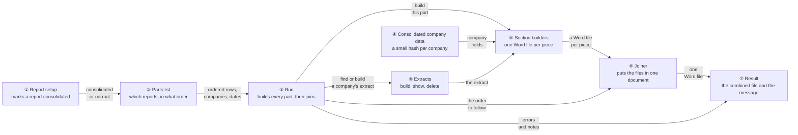

### Walkthrough: one example, start to finish

**Setup.** Alpha Ventures holds three portfolio companies: Ace Limited, Beta Corp and Gamma Corp. Meera is a fund admin. Three reports exist: _Portfolio Overview_ (consolidated, template _Cover and Summary_, 2 pages), _Analyst Report_ (normal, template _Company One-Pager_, 1 page per company) and _Disclaimer_ (consolidated, template _Legal Disclaimer_, 1 page, no merge fields). Period: 2026-01-01 to 2026-09-30. Ace and Beta have extracts; Gamma has none, and "Generate missing report extracts" is **off**.

**Legend.** ✓ done · ● we are here: building this part now, not done yet · ○ not started · ✗ failed.

**Phase 1 — building the list**

| #   | When                                                                                             | What happens                                                                                                                              | Behind the scenes                                                                                                                      | Result (state after)                                                                                                                       |
| --- | ------------------------------------------------------------------------------------------------ | ----------------------------------------------------------------------------------------------------------------------------------------- | -------------------------------------------------------------------------------------------------------------------------------------- | ------------------------------------------------------------------------------------------------------------------------------------------ |
| 1   | Meera picks the three companies and clicks **Next**                                              | The options page opens with one row                                                                                                       | The parts list (②) shows one row; the report setup (①) tells it which reports are consolidated                                         | List:<br/>Row&nbsp;1&nbsp;Portfolio&nbsp;Overview&nbsp;/&nbsp;Cover&nbsp;and&nbsp;Summary                                                  |
| 2   | She presses **Add report** twice and fills rows 2 and 3                                          | Row 2 is _Analyst Report / Company One-Pager_, row 3 is _Disclaimer / Legal Disclaimer_                                                   | The parts list (②) copies a hidden row blueprint and limits each row's templates to its report                                         | List:<br/>Row&nbsp;1&nbsp;Cover&nbsp;and&nbsp;Summary<br/>Row&nbsp;2&nbsp;Company&nbsp;One-Pager<br/>Row&nbsp;3&nbsp;Legal&nbsp;Disclaimer |
| 3   | **Mistake:** she adds row 4 and picks _Company One-Pager_ again, then clicks **Generate Report** | The page stays put and shows "Each template can be used only once in a list. Remove the repeated template." beside row 4. Nothing is sent | The browser (②'s `report-parts` controller) checks the rows; no request is made                                                        | List unchanged, 4 rows, nothing sent                                                                                                       |
| 4   | **Undo:** she changes row 4's template (or removes row 4) and clicks **Generate Report**         | The message clears; "Queued report generation for 3 companies."                                                                           | The parts list (②) submits; the server repeats the same checks as a backstop and enqueues the run (③) with the first row plus two more | List:<br/>Row&nbsp;1&nbsp;Cover&nbsp;and&nbsp;Summary<br/>Row&nbsp;2&nbsp;Company&nbsp;One-Pager<br/>Row&nbsp;3&nbsp;Legal&nbsp;Disclaimer |

**Phase 2 — the run**

| #   | When                                             | What happens                                                                                                                                                                                                   | Behind the scenes                                                                                                                                  | Result (state after)                                                                                                                                            |
| --- | ------------------------------------------------ | -------------------------------------------------------------------------------------------------------------------------------------------------------------------------------------------------------------- | -------------------------------------------------------------------------------------------------------------------------------------------------- | --------------------------------------------------------------------------------------------------------------------------------------------------------------- |
| 5   | Part 1                                           | One Word file lists Ace, Beta, Gamma on one page-pair                                                                                                                                                          | The run (③) asks the section builders (⑤) for a consolidated file; they take each company's fields from company data (④) and nest them in one list | ✓&nbsp;Cover&nbsp;and&nbsp;Summary&nbsp;(file&nbsp;in&nbsp;temp)<br/>●&nbsp;Company&nbsp;One-Pager<br/>○&nbsp;Legal&nbsp;Disclaimer                             |
| 6   | Part 2, Ace and Beta                             | Each gets a one-pager, saved in its own folder                                                                                                                                                                 | The run (③) finds each extract, asks the section builders (⑤) for a per-company file; company data (④) supplies the fields                         | ✓&nbsp;Cover&nbsp;and&nbsp;Summary<br/>●&nbsp;Company&nbsp;One-Pager&nbsp;(Ace&nbsp;✓,&nbsp;Beta&nbsp;✓,&nbsp;Gamma&nbsp;next)<br/>○&nbsp;Legal&nbsp;Disclaimer |
| 7   | Part 2, Gamma (no extract, generate-missing off) | Gamma's one-pager is built with "No data available"                                                                                                                                                            | The run (③) creates an empty extract rather than skipping and notes Gamma                                                                          | ✓&nbsp;Cover&nbsp;and&nbsp;Summary<br/>✓&nbsp;Company&nbsp;One-Pager<br/>●&nbsp;Legal&nbsp;Disclaimer                                                           |
| 8   | Part 3                                           | The disclaimer is rendered with no fields to fill                                                                                                                                                              | Same consolidated path as step 5; no data is read from it                                                                                          | ✓&nbsp;Cover&nbsp;and&nbsp;Summary<br/>✓&nbsp;Company&nbsp;One-Pager<br/>✓&nbsp;Legal&nbsp;Disclaimer                                                           |
| 9   | Joining                                          | One file: 2 + 3×1 + 1 = 6 pages                                                                                                                                                                                | The run (③) gives the joiner (⑥) the files in row order, companies A–Z inside row 2; the joiner keeps the first file's look                        | One combined file saved in Portfolio Reports / Generated Portfolio Reports                                                                                              |
| 10  | Done                                             | Toast: "Portfolio Report Generation completed. The following companies had no extract: Gamma Corp. Saved in Portfolio Reports / Generated Portfolio Reports: Cover and Summary 2026-01-01 to 2026-09-30 - 3 companies" | The result (⑦) shows the message the run (③) built                                                                                                 | ✓ all three parts                                                                                                                                               |

**A failure (a second run):** Beta's one-pager raises an error. Same as rows 5–10 except the run (③) records "Error generating Company One-Pager for Beta Corp …", the combined file has 5 pages (cover 2, Ace, Gamma, disclaimer), and the toast is red with the error email, because a failure is an error, unlike a missing extract.

```
  Result file, page by page (what Word shows)

   p1-2  Cover and Summary        (consolidated)   <- first file: its look wins
   p3    Company One-Pager - Ace Limited
   p4    Company One-Pager - Beta Corp
   p5    Company One-Pager - Gamma Corp   ("No data available")
   p6    Legal Disclaimer         (consolidated)
```

**What to notice**

- A "header" or "footer" document is just the first or last row; no special concept exists.
- Consolidated pieces are never saved on their own; only the combined file is new.
- The only job-wide decision is order: rows in screen order, companies A–Z inside a normal row.
- A missing extract is information; a failure is an error. They are reported differently.
- The joiner is the single place that mixes templates, and it simply lets the first file's look win.

### Key ideas

| #   | Idea                                           | In one line                                                 | Card                     |
| --- | ---------------------------------------------- | ----------------------------------------------------------- | ------------------------ |
| 1   | Consolidated is a property of the report       | One boolean decides which builder runs                      | [①](#①-report-setup)     |
| 2   | A list of rows, in screen order                | No reordering; the dropdowns are the order                  | [②](#②-parts-list)       |
| 3   | One run, many parts                            | The existing job loops parts; one part = today              | [③](#③-run)              |
| 4   | The consolidated builder has its own company data | A smaller hash than a normal report's; the normal builder is untouched | [④](#④-company-data)     |
| 5   | Pieces are files; only the final is a Document | Consolidated pieces live in a temp folder                   | [⑤](#⑤-section-builders) |
| 6   | First file's look wins                         | The merger already works this way                           | [⑥](#⑥-joiner)           |
| 7   | Extracts get three small fixes                 | Built without documents, widget skips blank ones, deletable | [⑧](#⑧-extracts)         |

**FAQ**

| Question                                                         | Answer                                                                                                                                                                 |
| ---------------------------------------------------------------- | ---------------------------------------------------------------------------------------------------------------------------------------------------------------------- |
| Does anything block users?                                       | Only the row checks in ② (missing or repeated template), done in the browser; everything else is background.                                                           |
| Why not just let the user upload a cover and a closing document? | They want them generated from the same machinery (consolidated reports with merge fields); a plain upload is a consolidated report with a template that has no fields. |
| Is a new table needed?                                           | No. One column on `portfolio_reports`. The list of rows lives only in the request and the job's arguments.                                                             |

---

## 2. The same picture with real names

### Picture

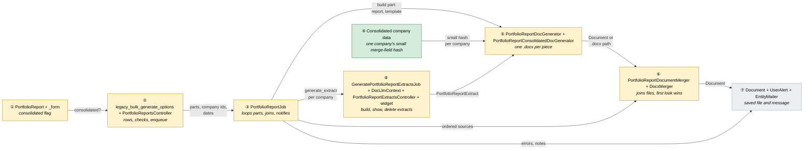

Colour = footprint: **green** new, **amber** modified, **grey** reused unchanged. Exact files are in
[lld.md File Map](lld.md#file-map). ⑥ is amber for the merger class; `DocxMerger` itself is only touched if the task 2.1 spike shows it must be.

### What each box does

| #   | Box              | Real parts                                                                                                                                                                                                                      | What it does                                                                                                             | When it runs                                                        | What it decides                                                 | Details                       |
| --- | ---------------- | ------------------------------------------------------------------------------------------------------------------------------------------------------------------------------------------------------------------------------- | ------------------------------------------------------------------------------------------------------------------------ | ------------------------------------------------------------------- | --------------------------------------------------------------- | ----------------------------- |
| ①   | Report setup     | `portfolio_reports.consolidated`, `PortfolioReport`, `_form.html.erb`                                                                                                                                                           | Stores whether a report is consolidated                                                                                  | When a report is saved                                              | Normal or consolidated                                          | [card ①](#①-report-setup)     |
| ②   | Parts list       | `legacy_bulk_generate_options.html.erb`, new `_report_part_row.html.erb`, new Stimulus `report_parts_controller.js`, existing `report_template_filter_controller.js`, `PortfolioReportsController#legacy_bulk_generate_options` | Lets the user build the rows, checks them in the browser, enqueues the run (the server repeats the checks as a backstop) | On the options page and its submit                                  | Whether the rows are valid; which reports Extracts Only touches | [card ②](#②-parts-list)       |
| ③   | Run              | `PortfolioReportJob`                                                                                                                                                                                                            | Resolves companies, builds each part, joins, notifies                                                                    | Once per submit, queue `:low`                                       | Part order, lone-company shortcut, what is an error             | [card ③](#③-run)              |
| ④   | Company data     | private methods of the new `PortfolioReportConsolidatedDocGenerator`                                                                                                                                                                                         | Builds one company's small set of merge fields                                                                            | Inside the consolidated builder                                                 | Nothing; pure data assembly                                     | [card ④](#④-company-data)     |
| ⑤   | Section builders | `PortfolioReportDocGenerator` (modified), new `PortfolioReportConsolidatedDocGenerator`                                                                                                                                         | Renders a template to a `.docx`                                                                                          | Per company (normal) or once (consolidated)                         | Which keys the template receives                                | [card ⑤](#⑤-section-builders) |
| ⑥   | Joiner           | `PortfolioReportDocumentMerger`, `DocxMerger`                                                                                                                                                                                   | Joins ordered files into one document and saves it                                                                       | Once per run, when more than a lone company                         | Name and folder of the combined file                            | [card ⑥](#⑥-joiner)           |
| ⑦   | Result           | `Document`, `UserAlert`, `EntityMailer#doc_gen_errors`                                                                                                                                                                          | The saved file and the message the user sees                                                                             | End of the run                                                      | Success vs error message                                        | [card ⑦](#⑦-result)           |
| ⑧   | Extracts         | `GeneratePortfolioReportExtractsJob`, `DocLlmContext`, `PortfolioReportExtract`, `PortfolioReportExtractsController`, `show.html.erb`, `investors/widgets/_portfolio_report.html.erb`                                           | Builds an extract (now also without documents), shows the latest one with data on the dashboard, deletes an extract      | When extracts are generated, when the widget renders, on **Delete** | Which inputs the LLM gets; which extract the widget shows       | [card ⑧](#⑧-extracts)         |

### One run, end to end

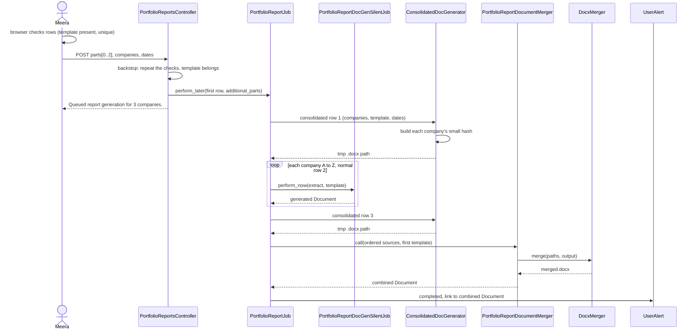

### Lifecycles

N/A — no stored status. A run is a single background job; the list of rows is request data, and pieces are temporary files removed at the end.

### What users see

| Where in CapHive                                   | Today                                       | After this change                                                      | Who sees it                        |
| -------------------------------------------------- | ------------------------------------------- | ---------------------------------------------------------------------- | ---------------------------------- |
| Portfolio report form                              | Name, tags, two checkboxes                  | Plus a **Consolidated** checkbox                                       | Users who edit portfolio reports   |
| Bulk Generate Portfolio Reports (Legacy) › Options | One Report and one Template                 | A list of rows with **Add report** / **Remove**                        | Users of the legacy bulk flow      |
| Completion toast                                   | Link to the merged file                     | Same, linking to the combined file                                     | The user who ran it                |
| Extract details page                               | Palette, tear sheet, Edit Data              | Plus a **Delete** button with a confirm popup                          | Users who may delete extracts      |
| Extract generation toasts                          | A red "No documents found" per company      | An amber warning when the extract is built from notes and KPIs instead | The user who ran it                |
| Dashboard portfolio report widget                  | Latest extract; hidden if its data is blank | Latest extract that has data                                           | Anyone viewing a company dashboard |

Main journey: building and running the list.

```
  +---------------------------------------------------------------+
  | Portfolio Reports : Portfolio Overview                         |
  |   Consolidated [x]  <-- ①                                     |
  +---------------------------------------------------------------+

  +---------------------------------------------------------------+
  | Options - 3 companies                                          |
  |  1 Report [Portfolio Overview (Consolidated) v] Template [..v] |  <-- ②
  |  2 Report [Analyst Report v]            Template [..v] Remove  |
  |  3 Report [Disclaimer (Consolidated) v] Template [..v] Remove  |
  |  [+ Add report]                                                |
  |  Start [2026-01-01]  End [2026-09-30]                          |
  |  [Generate Extracts Only]               [Generate Report]      |
  +---------------------------------------------------------------+
        "Portfolio Report Generation completed ... Saved in ..."   <-- ⑦
```

| Step | The user…                                     | They see                                                                                          |
| ---- | --------------------------------------------- | ------------------------------------------------------------------------------------------------- |
| 1    | Edits a report and ticks **Consolidated** (①) | The report saved, box ticked on edit                                                              |
| 2    | Opens the options page (②)                    | One row; the first report and template selected                                                   |
| 3    | Presses **Add report** (②)                    | A new row below; templates limited to that row's report                                           |
| 4    | Clicks **Generate Report** (②)                | A message beside the offending row (nothing sent), or "Queued report generation for 3 companies." |
| 5    | Waits (③)                                     | Nothing until the completion toast                                                                |
| 6    | Opens the toast link (⑦)                      | The combined Word file                                                                            |

### Design decisions

1. **One boolean on `portfolio_reports`, not on the template.** Alternative: a flag per template document. Rejected because a report is the unit the user picks first, its sections and extracts only make sense for normal reports, and Documents are a shared table that should not gain report-specific columns. (User decision.)
2. **Give the consolidated generator its own small company data, not a shared module.** Alternatives: make the consolidated generator a subclass of `PortfolioReportDocGenerator`; call the per-company generator and merge contexts; or extract the company-data methods into a module both generators include. Rejected: the existing `generate` mixes company data, extract data and rendering, and calling it per company would save a Document each time; and the consolidated report needs far less data than a normal one (no KPIs, cap table or fund-named keys), so a shared module would only tie the two together. The normal generator is left exactly as it was.
3. **Join with the existing `DocxMerger`, first look wins.** Alternatives: PDF packet via CombinePDF (already used for headers and footers); per-part Word sections with their own styles. Rejected: PDF is not editable and "No data available" blocks must be fillable; per-part sections need style/numbering reconciliation the user chose not to take on.
4. **Carry the first row in the existing positional arguments and extra rows in a new `additional_parts:` keyword.** Alternatives: change to a `parts:` array; add a new job class. Rejected: `DocGenJob` already notes that queued jobs break when a signature changes; keeping the first two positionals and adding an optional keyword keeps old queued runs valid, and the tag fallback keeps working.
5. **Rows are indexed form fields built by a small Stimulus controller from a `<template>` blueprint.** Alternative: a Turbo Frame round trip per "Add report". Rejected: needless request per click for pure client-side list editing; the repo's `report_template_filter_controller.js` already filters templates client-side, so each row reuses it unchanged.
6. **Validate rows in the browser, repeat them on the server.** Alternatives: server-only checks with a re-rendered options page; let the job fail. Rejected: the checks need no data the page does not already have (is a template chosen, is one repeated), so a round trip is wasted and re-rendering a POST-only page is awkward. The server keeps the same checks as a backstop because the browser can be bypassed; its refusal is a plain redirect with an alert, because only a tampered request ever reaches it. (User decision.)
7. **Consolidated pieces are temp files, not Documents.** Alternative: save each as a Document. Rejected: clutters folders; the user wanted only the combined file saved.
8. **No `parts` table, no stored packet definition.** Alternative: persist a "packet" per user. Rejected as speculative; the list is rebuilt each run.
9. **A template may appear once per list.** Alternative: let the second generation rename the document. Rejected: `DocumentGeneratorBase#upload` replaces a same-named company document, which would delete the first piece's file mid-run; refusing is simpler than renaming.
10. **The first row's template names the combined file.** Alternative: a "use for title" choice per row. Rejected: business confirmed the first row's template always names it, so no setting is needed. (User decision.)
11. **Extracts without documents use notes and KPIs, KPIs only in that case.** Alternatives: always add KPIs; keep skipping. Rejected: a KPI spreadsheet is normally already among the documents, so adding KPIs always would duplicate it and change existing extracts. (User decision.)
12. **Deleting an extract is the existing soft delete, guarded by entity scope.** `PortfolioReportExtract` already includes `Trackable` (paranoid), so `destroy` hides the row and keeps history. The extracts controller looks records up unscoped today, so `destroy` would reach other entities' extracts; the lookup moves to `policy_scope`.
13. **Fund totals are a top-level list with precomputed sums, not a call on the company collection.** Alternatives: a `sum_cf_<field>` decorator method on the company list; totals repeated on every company's fund line. Rejected: a template call takes no arguments and a company's own values sit one level down (`company.portfolio_company`), so a sum must be built where all companies are known; the user's Grand Total row sits after the company loop, so a top-level list is what it reads, and repeating the totals on every line would only copy the same numbers. Which custom fields are summed is not named by the template author: every numeric field of the companies' form types is summed. (User decision.)

**FAQ**

| Question                                          | Answer                                                                                                                                     |
| ------------------------------------------------- | ------------------------------------------------------------------------------------------------------------------------------------------ |
| Why is ⑥ amber if `DocxMerger` is reused?         | `PortfolioReportDocumentMerger` changes (accepts mixed sources); `DocxMerger` changes only if the spike (tasks 2.1) shows a defect.        |
| Where do extracts fit?                            | Only inside ③ for normal parts; a consolidated part never touches them.                                                                    |
| Is anything in `app/models` or `app/controllers`? | No. Everything stays in `app/packs/funds/portfolios` (models, controllers, jobs, services, views) and `app/packs/core/documents/services`. |

---

## 3. One card per box

> Same order and numbers as the picture.

### ① Report setup

A yes/no property on a portfolio report that decides which builder (⑤) runs and whether extracts are involved.

| Owns                                                      | Reads / receives  | Produces                                    |
| --------------------------------------------------------- | ----------------- | ------------------------------------------- |
| `portfolio_reports.consolidated` (boolean, default false) | The form checkbox | `PortfolioReport#consolidated?` for ② and ③ |

- Strong params permit `:consolidated`; `ransackable_attributes` gains `consolidated`.
- Existing rows get `false` from the column default; no backfill.
- Sections and the AI "Suggest Sections" button stay as they are; for a consolidated report they are simply unused (no code guards them).

**Worked examples:** H1, E1, H10

**FAQ**

| Question                                                      | Answer                                                                                             |
| ------------------------------------------------------------- | -------------------------------------------------------------------------------------------------- |
| Why not hide the sections editor for consolidated reports?    | Not required by the spec and would add JS; the form hint says they are unused. Can be added later. |
| What if someone flips an existing report to consolidated?     | Its old extracts stay in the table, unread; unticking returns it to normal behaviour.              |
| Can a consolidated report's template still use `report_data`? | No. The key is not supplied to a consolidated template; the proposal tells authors this.           |

### ② Parts list

The options page turns one Report/Template pair into a list of rows and checks them in the browser; the controller repeats the checks as a backstop, turns the posted rows into parts and enqueues the run.

| Owns                                                                                                             | Reads / receives                                                                                    | Produces                                                        |
| ---------------------------------------------------------------------------------------------------------------- | --------------------------------------------------------------------------------------------------- | --------------------------------------------------------------- |
| Row markup and add/remove behaviour; row validation (browser first, server backstop); the `extracts_only` branch | `parts[<i>][portfolio_report_id]`, `parts[<i>][report_template_id]`, company ids, dates, checkboxes | `PortfolioReportJob.perform_later` or a redirect with a message |

**Routes** (no new routes; the existing POST handles both hits)

| Verb and path                                                               | Action                         | Does                                              | Responds with                                                                                       |
| --------------------------------------------------------------------------- | ------------------------------ | ------------------------------------------------- | --------------------------------------------------------------------------------------------------- |
| `GET /portfolio_reports/legacy_bulk_generate`                               | `legacy_bulk_generate`         | Company filter step (unchanged)                   | The page                                                                                            |
| `POST /portfolio_reports/legacy_bulk_generate_options` (no `mode`)          | `legacy_bulk_generate_options` | Renders the options page                          | The page                                                                                            |
| `POST /portfolio_reports/legacy_bulk_generate_options` (`mode=full_report`) | same                           | Repeats the row checks, enqueues the run          | Redirect with notice, or (only for a tampered request) a redirect to the company step with an alert |
| same (`mode=extracts_only`)                                                 | same                           | Enqueues extract jobs for distinct normal reports | Redirect with notice                                                                                |

Browser checks (`report-parts` Stimulus controller), run on every template change and on submit:

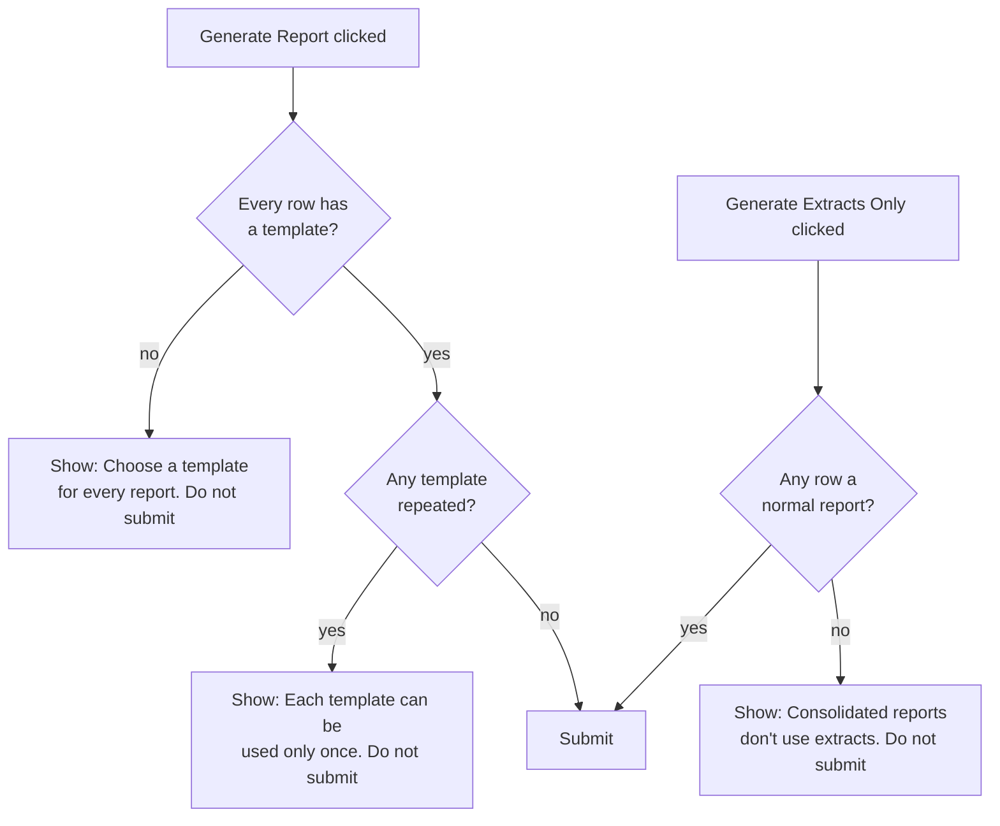

Server backstop (`PortfolioReportsController`), for a request that bypassed the browser:

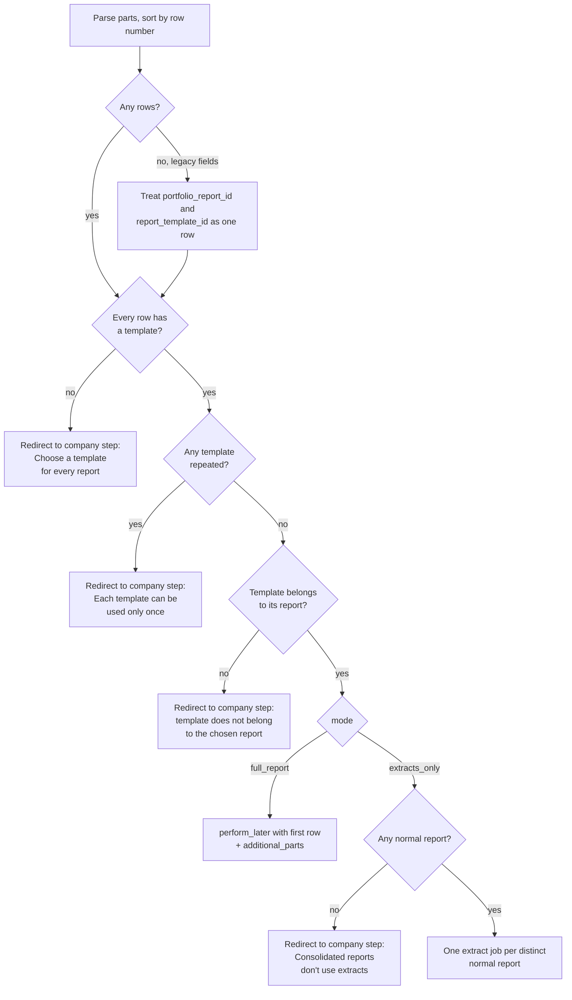

**Build notes (UI)**

- The Stimulus controller `report-parts` clones a `<template>` blueprint, replaces a `__INDEX__` placeholder with a running integer, and toggles the **Remove** button visibility (hidden while one row remains). Each row is its own `report-template-filter` scope, so the existing controller works per row unchanged.
- Row numbers can have gaps after removals; the controller sorts by the integer key (E6).
- The browser check marks the offending row (`is-invalid` and a message under it), clears it as soon as the row changes, and stops the submit. Each option in the report dropdown carries a `data-consolidated` attribute so the Extracts Only check needs no request. The message texts live in `data-` attributes on the rows container so the page stays the one place they are written.
- The server backstop only ever sees a tampered or scripted request. Its refusal is a plain redirect to the company step with an alert, the same way the existing "Select at least one portfolio company" refusal works; nothing is preserved because a real user never gets here.
- The combined file's name and settings come from the first row's template; there is no per-row "use for title" choice.

**Role → access** (unchanged from today; `bulk_generate?` is `create?`: fund portfolios enabled and a permissioned employee)

| Role                               | Options page and submit                                                                                                  |
| ---------------------------------- | ------------------------------------------------------------------------------------------------------------------------ |
| Fund admin / permissioned employee | ✓                                                                                                                        |
| Employee without portfolio access  | ✗ refused by `authorize`                                                                                                 |
| Investor / LP                      | ✗ no route access                                                                                                        |
| User of another entity             | ✗ reports, templates and companies are looked up inside their own entity only, so foreign ids are "not found" or dropped |

**Worked examples:** H7, H8, H9, H10, E6, E8, E17, X1, X2, X3, X4, X5, X10, X11, X12, X13, X14

**FAQ**

| Question                                                       | Answer                                                                                                                                                                                                    |
| -------------------------------------------------------------- | --------------------------------------------------------------------------------------------------------------------------------------------------------------------------------------------------------- |
| Why keep `portfolio_report_id`/`report_template_id` working?   | Existing steps and any bookmarked/older form posts; costs two lines (E8).                                                                                                                                 |
| Why is Extracts Only per distinct report?                      | Extracts are keyed by report, company and dates; two rows of one report need one run.                                                                                                                     |
| Why refuse a blank template now?                               | Before, blank meant "all templates of the report", which in practice ended in "No templates found".                                                                                                       |
| Why check in the browser and again on the server?              | The browser check gives instant feedback with no request. The server cannot rely on it (devtools, scripts), and a queued run with a blank or repeated template would fail late or overwrite its own file. |
| Why is the server refusal not a re-render with the rows kept?  | Only a tampered request reaches it. Keeping the re-render path would add the most code for a case no real user hits.                                                                                      |
| What stops a tampered row from naming another entity's report? | The report is found through `policy_scope(PortfolioReport)`, so it is "not found" (X4).                                                                                                                   |

### ③ Run

The existing background job, extended to loop over parts, join, and report once at the end.

| Owns                                                           | Reads / receives                                                                             | Produces                               |
| -------------------------------------------------------------- | -------------------------------------------------------------------------------------------- | -------------------------------------- |
| Order of work, the lone-company shortcut, error vs information | First row (positionals), `additional_parts`, company ids, dates, `generate_missing_extracts` | Files for ⑥, a message and email for ⑦ |

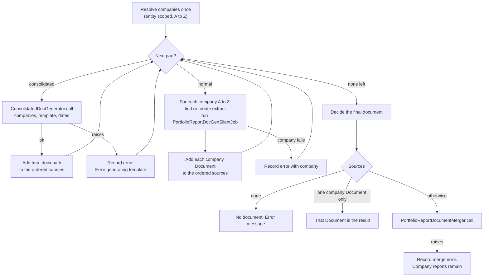

Component responsibilities

| Component                                                 | Queue  | Retry                 | Idempotency                                                                                            | Transaction                         |
| --------------------------------------------------------- | ------ | --------------------- | ------------------------------------------------------------------------------------------------------ | ----------------------------------- |
| `PortfolioReportJob`                                      | `:low` | None added (as today) | A re-run replaces company documents of the same name (existing `upload`) and saves a new combined file | None; each document save is its own |
| Run-level temp folder `tmp/portfolio_report_packet/<hex>` | n/a    | n/a                   | Removed in `ensure`                                                                                    | n/a                                 |

- Extract handling per normal part reuses the existing find-latest / generate-missing / create-empty logic, moved into one private method that takes the part's report (E7: the second row of the same report finds the extract the first row made). When it calls `GeneratePortfolioReportExtractsJob#generate_extract` the company may now have no documents; [card ⑧](#⑧-extracts) covers what that call does.
- Companies are resolved once for the run; the tag fallback (`portfolio_company_ids` absent) uses the first report's tags, as today.
- `additional_parts` entries are `{ "portfolio_report_id", "template_id" }` hashes with string keys (JSON-safe); each report is looked up inside the first report's entity.

**Worked examples:** H5, H6, E2, E3, E5, E7, E9, E10, X6, X7, X8, X9

**FAQ**

| Question                                      | Answer                                                                                                                                                                                                      |
| --------------------------------------------- | ----------------------------------------------------------------------------------------------------------------------------------------------------------------------------------------------------------- |
| Why a loop in one job and not a job per part? | The parts must be joined in order at the end; the existing job already collects documents and joins them.                                                                                                   |
| Why sort companies per part rather than once? | Normal parts sort by company; consolidated parts do too (inside the loop), so one rule covers both.                                                                                                         |
| Why a lone-company shortcut?                  | Today's behaviour (E3): no combined file for one company; keeps existing users unsurprised.                                                                                                                 |
| What if the job dies midway?                  | Company documents already saved remain and no combined file is made. The temp folder is removed in `ensure`; a hard kill can leave it behind, and it holds nothing that is not also in the saved documents. |

### ④ Company data

Private methods of the consolidated generator that assemble a small Hash for one company. The normal generator is not touched and keeps its own data methods.

| Owns                                                                                                                                              | Reads / receives                                           | Produces                          |
| ------------------------------------------------------------------------------------------------------------------------------------------------- | ---------------------------------------------------------- | --------------------------------- |
| The keys a consolidated company exposes: `portfolio_company`, `latest_pi`, `earliest_pi`, `funds` (name, currency, fmv, cost_of_investment, irr, moic per fund), `logo` | A company, an end date, a working directory (for the logo) | One Hash per company, fresh every time |

- No KPIs, cap table, `apis`, `portfolio_investments` or fund-named keys: a consolidated template does not use them.
- `latest_pi` is the latest investment, buy or sale; `earliest_pi` the first buy; both are blank when the company has no investment so the template still renders.
- Each fund carries `ratios`, a list of name/value rows (IRR, MOIC), so a template can nest a third loop: companies, then funds, then ratios.
- Kept in reserve, not built: expose each fund by name as flat keys on the company (`awesome_fund_name`, `_currency`, `_irr`, `_moic`, `_fmv`, `_coi`), for a template that wants one specific fund without a loop. The raw values would not take `format_` calls, and the keys depend on fund names.
- `funds` is a list so the template can loop it without knowing fund names; IRR and MOIC are the latest stored Default-scenario run on or before the end date, "N/A" if never run.
- **Fund totals** are a second, top-level list `fund_totals`, built once after every company's hash exists (nothing is added to a company's hash). One entry per fund any selected company invested in: `name`, `currency`, `fmv` and `cost_of_investment` (sums of the companies' fund lines, as `Money`) and `custom_fields`, an object holding the sum of every numeric company custom field. Numeric means a `NumberField` or `Money` custom field in the companies' form types (normally one form type, i.e. the first company's); the raw stored values are added, blank is zero, text and other types are not offered. Because `TemplateDecorator#custom_fields` wraps the object, the template reads `total.custom_fields.format_1_div_7_investment_commitment`, the same shape as a company's `portfolio_company.custom_fields_with_td.…`; no new decorator method is needed. A Grand Total row after the company loop loops `fund_totals` and keeps one fund with the same `compare_name_eq_<fund>` check the fund rows use.

**Worked examples:** H3, E4, H15, E20, E21

**FAQ**

| Question                                        | Answer                                                                                                                                                                                                                            |
| ----------------------------------------------- | --------------------------------------------------------------------------------------------------------------------------------------------------------------------------------------------------------------------------------- |
| Does this change a normal report? | No. `PortfolioReportDocGenerator` is identical to `main`; the existing `portfolio_report*` features (KPI vs budget, fund metrics) stay green and are the guard (phase 1).                                                         |
| What about a logo inside a loop?                | Expected to work: the logo uses the existing `image:` key, which Sablon reads wherever it appears in the context. Task 1.1 is a quick confirmation on the first real consolidated render; no fallback is planned unless it fails. |

### ⑤ Section builders

Two builders turn a template plus data into a Word file.

| Owns                                                                       | Reads / receives                                                                                   | Produces                                                                                                             |
| -------------------------------------------------------------------------- | -------------------------------------------------------------------------------------------------- | -------------------------------------------------------------------------------------------------------------------- |
| Rendering with Sablon, post-processing via `DocumentGeneratorBase#convert` | Normal: company, template, extract, dates. Consolidated: companies, template, dates, output folder | Normal: a saved `Document` in the company's folder (as today). Consolidated: a `.docx` path in the run's temp folder |

Consolidated context shape

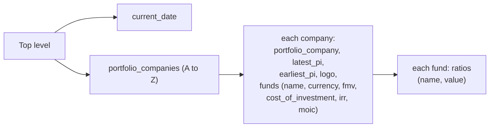

- The normal generator is unchanged in behaviour and output.
- The consolidated generator never creates, reads or queries a `PortfolioReportExtract`.
- It runs through `DocumentGeneratorBase#convert` with `to_pdf: false` (same as the normal generator), so formatting preservation is identical.
- It does not use `upload`; the caller owns the file and the temp folder.

**Worked examples:** H2, H3, H4, E4, X7

**FAQ**

| Question                                                    | Answer                                                                                                                             |
| ----------------------------------------------------------- | ---------------------------------------------------------------------------------------------------------------------------------- |
| Why not reuse `DocGenJob` for the consolidated generator?   | It loops models × templates and expects one model that owns the saved document; there is no single owner and no document is saved. |
| Where is the generator picked?                              | In ③, from `portfolio_report.consolidated?` for each part.                                                                         |
| Does a consolidated template get `audits` or `report_data`? | No, by design (spec: consolidated reports don't use extracts).                                                                     |

### ⑥ Joiner

Takes the ordered pieces and saves one document.

| Owns                                                                                | Reads / receives                                                                                       | Produces                                                     |
| ----------------------------------------------------------------------------------- | ------------------------------------------------------------------------------------------------------ | ------------------------------------------------------------ |
| Name, folder and settings of the combined file; downloading Documents to temp paths | Ordered sources (Documents and/or `.docx` paths), the first row's template, company count, dates, user | One `Document` under Portfolio Reports / Generated Portfolio Reports |

- `DocxMerger.merge` stays the one low-level joiner: first file's styles, page setup and running header/footer; later files contribute body content, with relationships, media and list numbering remapped; a page break between files.
- `PortfolioReportDocumentMerger` no longer sorts documents; the run orders them (per part, companies A–Z). Name: "<first template> <start> to <end> - <N> companies" where N is the number of selected companies.
- Template settings (original/download/printing/force_esign_order), `from_template` and `owner_tag: "Generated"` come from the first row's template, as today.

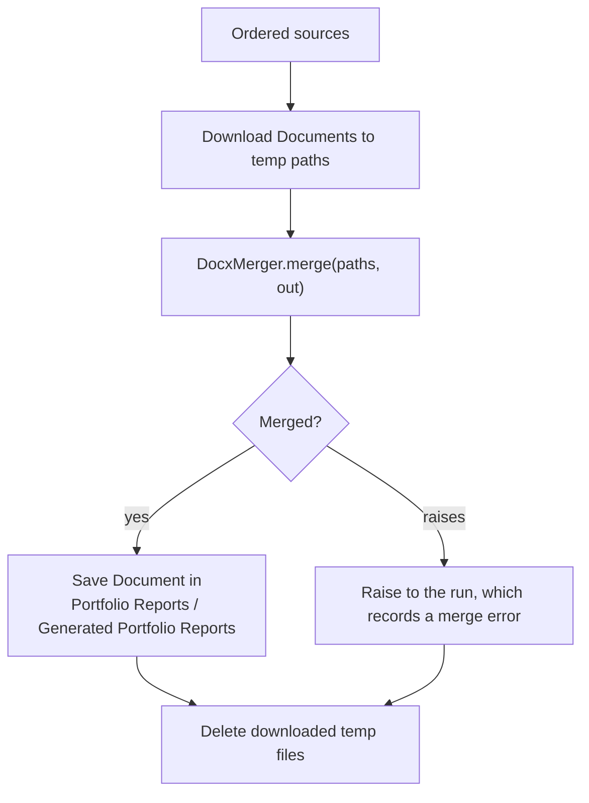

Spike (task 2.1, before any other phase-2 work): merge two documents made from two different real templates and check (a) every relationship target exists in the package, (b) all texts and images are present, (c) Word opens it without repair. Known suspects: header/footer relationships copied from later files with no matching part, and list ids that clash.

**Worked examples:** H5, E2, E11, X9

**FAQ**

| Question                                                 | Answer                                                                                                                             |
| -------------------------------------------------------- | ---------------------------------------------------------------------------------------------------------------------------------- |
| Why can the spike block progress?                        | If Word reports corruption the merger needs a fix (skip relationships whose target part is not copied) before the feature is safe. |
| Why does a one-file merge still go through `DocxMerger`? | `merge` already copies a single file; a lone consolidated part therefore uses the same save path (E2).                             |
| What happens to the first file's section?                | It is kept as the document's only section; later files' own section properties are dropped.                                        |

### ⑦ Result

The saved combined document and the message.

| Owns                                | Reads / receives                                            | Produces                                                        |
| ----------------------------------- | ----------------------------------------------------------- | --------------------------------------------------------------- |
| Message wording and the error email | The run's errors, the "no extract" list, the final document | `UserAlert` toast and, on errors, `EntityMailer#doc_gen_errors` |

- Success: "Portfolio Report Generation completed." + optional "The following companies had no extract: …" + "Saved in <folder breadcrumb>: <link>". Unchanged wording.
- Errors: a red toast listing each error plus the email, as today. A missing extract is information only.
- A consolidated part's error message reads "Error generating <template name> (consolidated): <message>".

**Worked examples:** H5, E3, E5, X6, X7, X8, X9

**FAQ**

| Question                                         | Answer                                                                                        |
| ------------------------------------------------ | --------------------------------------------------------------------------------------------- |
| Does the toast list the temp consolidated files? | No; they are never Documents, so only the combined file (or the lone company file) is linked. |
| What does an all-failed run link to?             | Nothing; the existing "no document" path leaves the location text empty.                      |

### ⑧ Extracts

Three small, independent improvements to portfolio report extracts. They do not depend on the combined document and can ship first.

| Owns                                                                                                                            | Reads / receives                                                                                                                            | Produces                                                                            |
| ------------------------------------------------------------------------------------------------------------------------------- | ------------------------------------------------------------------------------------------------------------------------------------------- | ----------------------------------------------------------------------------------- |
| What the language model is given for a company with no documents; which extract the dashboard widget shows; deleting an extract | The company, report and period; the company's documents, notes and KPIs; the viewed company and widget `portfolio_report_id`; an extract id | An extract (possibly empty), a warning toast, the widget content, a deleted extract |

**8a. Build an extract without documents**

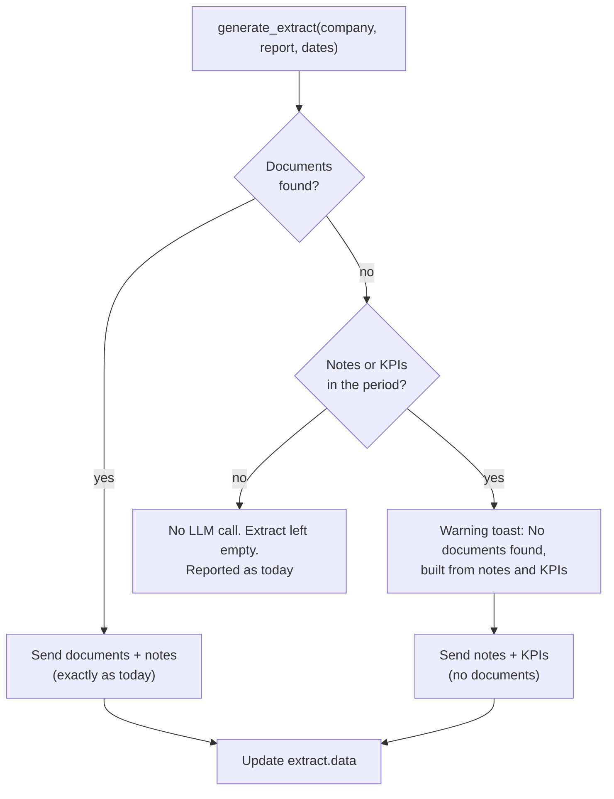

- The early return in `GeneratePortfolioReportExtractsJob#generate_extract` is removed. The extract is created first, as today, with the (empty) `source_document_ids`.
- With no documents, the approved KPIs of the company's latest KPI report in the period (newest `as_of`, as documents use the newest report) are turned into plain text lines ("name: value (as of date)", using the KPI's display value, with its currency or unit, when it has one) and passed to `DocLlmContext` as an optional extra input next to the notes. `DocLlmContext` appends them after the notes; callers that do not pass them behave as before.
- Which KPIs: the company's approved KPIs whose KPI report's `as_of` falls in the same start-to-end range the document lookup uses.
- The warning is a `UserAlert` at level `warning`. It replaces the red "No documents found" alert for the case where the extract is still built; it is not added to the run's error list, so no error email is sent for it. In a bulk extract run the warnings are collected and sent as one alert at the end, listing every such company; a full-report run (and a single extract) sends one per company.
- Nothing at all (no documents, notes or KPIs): same outcome as today, including the message in the error list.

**8b. Dashboard widget: latest extract with data**

- `investors/widgets/_portfolio_report.html.erb` today takes the last extract (end date, then id) and hides itself when that extract's data is blank. It will take the latest extract **with data** for the company (and for `portfolio_report_id` when the widget has one).
- It is one query in the view, built in an if/else on whether the widget has a `portfolio_report_id`: with an id, the company's extracts of that report; without, the company's extracts of any report (as today). Both exclude blank data in SQL (`data` not NULL and not an empty string), order by `end_date` then `id` newest first, and take `.first`. One row is read, no loop.
- The existing `data.present?` guard in the view stays as a safety net for the rare value SQL cannot see (a JSON `null` or `{}`); such a row hides the widget exactly as today.
- No extract with data: the widget stays hidden, as now.

**8c. Delete an extract**

| Verb and path                                                                  | Action        | Does                                                                                           | Responds with                                                                                                            |
| ------------------------------------------------------------------------------ | ------------- | ---------------------------------------------------------------------------------------------- | ------------------------------------------------------------------------------------------------------------------------ |
| `DELETE /portfolio_report_extracts/:id` (route already exists via `resources`) | new `destroy` | Finds the extract through `policy_scope`, `authorize`s `destroy?` (the extract policy's `create?` plus the company admin role), soft-deletes it | Redirect to `portfolio_report_extracts_path(portfolio_report_id:)` with "Portfolio report extract deleted successfully." |

- The details page gets a **Delete** button (shown only when `policy(...).destroy?`) using the repo's confirm-popup delete pattern.
- `PortfolioReportExtract` includes `Trackable`, which is paranoid: `destroy` sets `deleted_at`, so history is kept and the next lookup for that company, report and period finds nothing (E16).
- `set_portfolio_report_extract` moves from `PortfolioReportExtract.find` to `policy_scope(PortfolioReportExtract).find`. The policy scope is `entity_id` of the user, so another entity's extract is "not found" (X16). This also closes the same gap on show, edit and update, which today authorize by role only.

**Worked examples:** H11, H12, H13, E12, E13, E14, E15, E16, E18, X15, X16

**FAQ**

| Question                                                                | Answer                                                                                                                                                                                              |
| ----------------------------------------------------------------------- | --------------------------------------------------------------------------------------------------------------------------------------------------------------------------------------------------- |
| Why not always add the KPIs?                                            | A KPI spreadsheet is usually already one of the documents, so adding KPIs would duplicate it and change every existing extract. They are added only when nothing else is available.                 |
| Why is the nothing-at-all case still an error?                          | The report still renders "No data available" for that company; flagging it keeps today's behaviour and tells the user why. The warning is only for the case where we did manage to build something. |
| Does the warning appear when the extract is built by a full report run? | Yes, the same `generate_extract` is called; the toast is the same.                                                                                                                                  |
| Does deleting an extract delete generated reports?                      | No. Documents already generated from it stay. Only the extract and, through its dependent, its tear sheet presentation are removed.                                                                 |
| Could the widget show stale data?                                       | It shows the latest extract with data, which can now be older than the latest run. That is the point: a blank newer run no longer hides good older data.                                            |

---

## 4. Reference

> Whole-system material that spans several boxes.

### Class diagram

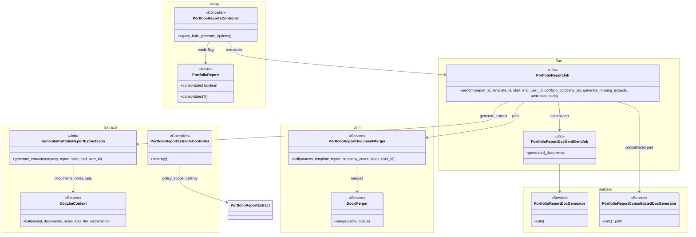

### Data model and schema changes

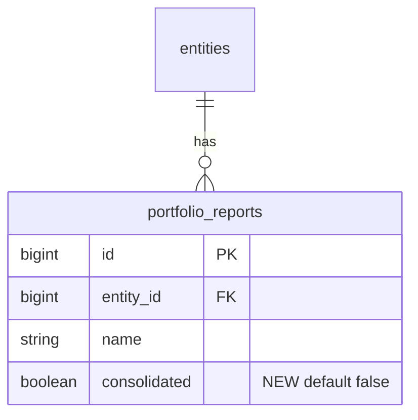

**Indexes:** none added.

**Schema changes**

**`portfolio_reports`** (existing): records whether a report is consolidated.

| Column / index | What changed                            | Why it's needed                                                                                                                     |
| -------------- | --------------------------------------- | ----------------------------------------------------------------------------------------------------------------------------------- |
| `consolidated` | Added: boolean, not null, default false | Chooses the builder and tells the options page to label the report; the default keeps every existing report normal with no backfill |

**Changes to existing models:** `PortfolioReport` gains `consolidated?` (from the column) and `consolidated` in `ransackable_attributes`; the report form and strong params gain `consolidated`.

### Component contracts

| From → To | Contract                                                                                                                                                                                                                                                                   | Direction rule                                            |
| --------- | -------------------------------------------------------------------------------------------------------------------------------------------------------------------------------------------------------------------------------------------------------------------------- | --------------------------------------------------------- |
| ① → ②     | `portfolio_report.consolidated?` read to label options                                                                                                                                                                                                                     | ② reads ①; ① never calls ②                                |
| ② → ③     | `PortfolioReportJob.perform_later(report_id, template_id, start, end, user_id, portfolio_company_ids:, generate_missing_extracts:, additional_parts: [{ "portfolio_report_id", "template_id" }])`; rows pre-checked                                                        | ② enqueues; ③ re-scopes every id to the entity            |
| ③ → ⑤     | Normal: `PortfolioReportDocGenSilentJob.new(extract_id, template_id, start, end, user_id).perform_now` then `.generated_documents`. Consolidated: `PortfolioReportConsolidatedDocGenerator.new(companies, template, start, end, user_id, output_dir:).call` → `.docx` path | ③ drives; builders never call back                        |
| ⑤ → ⑥     | Normal pieces are `Document` records; consolidated pieces are local paths                                                                                                                                                                                                  | ⑥ accepts a mix and does not know which builder made them |
| ③ → ⑥     | `PortfolioReportDocumentMerger.call(sources, portfolio_report: first, template: first_template, company_count:, start_date:, end_date:, user_id:)`                                                                                                                         | ③ orders; ⑥ never reorders                                |
| ⑥ → ⑦     | A saved `Document`                                                                                                                                                                                                                                                         | ⑦ only links to it                                        |
| ③ → ⑦     | `send_notification` and `EntityMailer#doc_gen_errors` as today                                                                                                                                                                                                             | one message per run                                       |
| ③ → ⑧     | `GeneratePortfolioReportExtractsJob.new.generate_extract(company, report, start, end, user_id)` → `[extract, message_or_nil]`, unchanged signature                                                                                                                         | ③ calls; ⑧ never calls back into the run                  |
| ⑧ → LLM   | `DocLlmContext.call(model: extract, documents:, notes:, kpis:, llm_instructions:)`; `kpis:` optional and absent for extracts built from documents                                                                                                                          | `DocLlmContext` treats absent `kpis` as empty             |

### Cross-cutting concerns

#### Transactions and queries

- A consolidated company runs a few queries (investments, funds, fund ratios, logo), far fewer than a normal part; this change adds no new query shape.
- No transaction spans the run; each document save is its own, as today. No external call sits inside a transaction.

#### Exception handling and monitoring

| Failure                                 | Who is alerted      | Channel                                                               | Detail                                                                  |
| --------------------------------------- | ------------------- | --------------------------------------------------------------------- | ----------------------------------------------------------------------- |
| A company's section fails               | The requesting user | Danger toast (`UserAlert`) + `EntityMailer#doc_gen_errors` (existing) | Names company and template                                              |
| A consolidated part fails               | Same                | Same                                                                  | Names template and "(consolidated)"                                     |
| Joining fails                           | Same                | Same                                                                  | "Error merging portfolio report documents for report …" (existing text) |
| Missing extract                         | The user            | Success toast note                                                    | Not an error                                                            |
| Extract built without documents         | The user            | Warning toast (`UserAlert` level `warning`)                           | Not an error; no email                                                  |
| Nothing at all to build an extract from | The user            | Error list as today (danger toast + email)                            | LLM not called; extract left empty                                      |

#### Performance and security

- Runs in the `:low` queue; memory is one part at a time (pieces are written to disk, not held).
- Every lookup is entity scoped (reports via `policy_scope`, companies via `Investor.where(entity_id:)`, templates via `portfolio_report.documents`); the job re-scopes ids again.
- Uploaded templates are rendered by Sablon as today; no new user-supplied HTML. Temp folders are created under `tmp/` with a random name and removed in `ensure`.

### Worked examples

**ID legend:** **H** = Happy path · **E** = Edge case · **X** = Error (exception) case.

**Shared setup:**

| Record                | Name                                                                                                                                                                                                                                                                                                 | Key data                                                                                                |
| --------------------- | ---------------------------------------------------------------------------------------------------------------------------------------------------------------------------------------------------------------------------------------------------------------------------------------------------- | ------------------------------------------------------------------------------------------------------- |
| Entity / user         | Alpha Ventures / Meera                                                                                                                                                                                                                                                                               | Investment Fund entity, `company_admin`                                                                 |
| Other entity / user   | Other Fund / Omar                                                                                                                                                                                                                                                                                    | Used for tenant checks                                                                                  |
| Portfolio companies   | Ace Limited, Beta Corp, Gamma Corp                                                                                                                                                                                                                                                                   | Created in the order Gamma, Ace, Beta; Ace and Beta have KPI data; Gamma has none and no logo           |
| Report (normal)       | Analyst Report                                                                                                                                                                                                                                                                                       | Sections Overview, Quarterly Update; template _Company One-Pager_; extracts exist for Ace and Beta only |
| Report (consolidated) | Portfolio Overview                                                                                                                                                                                                                                                                                   | Template _Cover and Summary_ (lists `portfolio_companies`)                                              |
| Report (consolidated) | Disclaimer                                                                                                                                                                                                                                                                                           | Template _Legal Disclaimer_ (no merge fields)                                                           |
| Extract examples (F4) | Company _Delta Inc_ with no documents; notes and Revenue KPIs inside the period (H11); a company with widget extracts for Q1, Q2 (data) and Q3 (blank) (H12)                                                                                                                                         | The language model is stubbed (`stub_doc_llm_context_call`, existing)                                   |
| Period                | 2026-01-01 to 2026-09-30                                                                                                                                                                                                                                                                             |                                                                                                         |
| Feature files         | F0 `features/fund/bulk_portfolio_report.feature` (existing) · F1 `features/fund/consolidated_portfolio_report.feature` · F2 `features/fund/portfolio_report_combined_packet.feature` · F3 `features/fund/portfolio_report_parts_list.feature` · F4 `features/fund/portfolio_report_extracts.feature` |                                                                                                         |

#### Happy Path

| #   | Scenario                                   | Given                                                                                     | When                                                                                        | Then                                                                                                                                                                                                                                                            | Spec scenario                                                                                                                                | Feature                                                                              |
| --- | ------------------------------------------ | ----------------------------------------------------------------------------------------- | ------------------------------------------------------------------------------------------- | --------------------------------------------------------------------------------------------------------------------------------------------------------------------------------------------------------------------------------------------------------------- | -------------------------------------------------------------------------------------------------------------------------------------------- | ------------------------------------------------------------------------------------ |
| H1  | Tick Consolidated                          | Meera on the new report form                                                              | She ticks **Consolidated** and saves, then reopens                                          | Report saved consolidated; box ticked                                                                                                                                                                                                                           | Tick Consolidated and save                                                                                                                   | F1                                                                                   |
| H2  | Companies A–Z in the loop                  | _Cover and Summary_ lists company names; companies created Gamma, Ace, Beta               | The consolidated part is built                                                              | Text order: Ace Limited, Beta Corp, Gamma Corp, each once                                                                                                                                                                                                       | All selected companies listed alphabetically                                                                                                 | F1                                                                                   |
| H3  | Per-company values in the loop             | Ace and Beta have different IRRs in a fund; template prints name and each fund's IRR                | Built                                                                                       | Each company shows its own IRR, equal to the normal template's value                                                                                                                                                                                          | Company fields match a normal template                                                                                                       | F1                                                                                   |
| H4  | No extracts needed                         | Three companies, no extracts                                                              | Consolidated part built with "generate missing" on                                          | File produced; extract count unchanged (0)                                                                                                                                                                                                                      | No extract read or created                                                                                                                   | F1                                                                                   |
| H5  | Three-row list, one combined file          | Rows: Cover and Summary, Company One-Pager, Legal Disclaimer; 3 companies                 | Run completes                                                                               | One document "Cover and Summary 2026-01-01 to 2026-09-30 - 3 companies" in Portfolio Reports / Generated Portfolio Reports, text order cover, Ace, Beta, Gamma, disclaimer; each company has its one-pager in its folder; no document exists for the consolidated parts | Sections follow row order; Combined file is saved and named; Company reports are saved as today; Consolidated parts are not saved separately | F2                                                                                   |
| H6  | One normal report unchanged                | One row (Company One-Pager), 3 companies                                                  | Run completes                                                                               | Same as today: merged "… - 3 companies", pieces A–Z, each company's own report exists                                                                                                                                                                           | Companies alphabetical within a report                                                                                                       | F0 (existing "Generate a merged report for multiple portfolio companies", annotated) |
| H7  | Add and remove rows                        | Options page for 3 companies                                                              | Page shows 1 row; click **Add report** twice; remove row 2; try to remove until one remains | 1 row → 3 rows → 2 rows; no **Remove** on the last row                                                                                                                                                                                                          | Options start with one row; Add report adds a row; Remove report removes a row; The last row cannot be removed                               | F3                                                                                   |
| H8  | Templates follow the row's report          | Two reports with different templates                                                      | Change row 2's report                                                                       | Row 2 offers only the new report's templates and selects its first; row 1 unchanged                                                                                                                                                                             | Templates follow the row's report                                                                                                            | F3                                                                                   |
| H9  | Extracts Only on normal reports            | Rows: Portfolio Overview (consolidated), Analyst Report                                   | Click **Generate Extracts Only**                                                            | Extracts generated for the 3 companies for Analyst Report; none for Portfolio Overview                                                                                                                                                                          | Extracts only covers the normal reports                                                                                                      | F3                                                                                   |
| H10 | Consolidated label                         | Portfolio Overview is consolidated                                                        | Open the options page                                                                       | Report dropdown reads "Portfolio Overview (Consolidated)"; "Analyst Report" has no suffix                                                                                                                                                                       | Consolidated label in report choices                                                                                                         | F3                                                                                   |
| H11 | Extract built without documents            | Delta Inc has notes and Revenue KPIs in the period, no documents                          | **Generate Extracts Only**                                                                  | Extract has data; its source documents are empty; a warning toast "No documents found for Delta Inc … built from notes and KPIs"; the LLM input holds the notes and the KPI lines                                                                               | Notes and KPIs stand in for missing documents                                                                                                | F4                                                                                   |
| H12 | Widget skips blank, shows latest with data | A company has extracts ending Q1 (data), Q2 (data), Q3 (data nil) for the widget's report | Open the company dashboard                                                                  | The widget shows Q2's data (latest end date that has data)                                                                                                                                                                                                      | A blank latest extract is skipped; The latest extract with data wins                                                                         | F4                                                                                   |
| H13 | Delete an extract                          | Meera on an extract's details page                                                        | Clicks **Delete**, confirms                                                                 | Extract gone from the list; she is on the report's extract list with "Portfolio report extract deleted successfully."                                                                                                                                           | Delete with confirmation                                                                                                                     | F4                                                                                   |
| H14 | Preview with no match says so             | The company step; filters that match no company                                          | Clicks **Preview**                                                                          | An alert "No portfolio companies match the selected filters." is shown above the (empty) company list                                                                                                                                                         | Preview with no match shows an alert                                                                                                         | F3                                                                                   |
| H15 | Fund totals across the companies          | Ace, Beta and Gamma all invested in one fund; the template has a Grand Total row reading `fund_totals`, filtered to that fund | The consolidated part is built | The row shows the fund's FMV and cost of investment as the sum of the three companies' figures, and the sum of their `investment_commitment` custom field | Fund totals across the selected companies | F1 |
| H16 | Sections not needed when consolidated | The new report form, Consolidated unticked | Consolidated is ticked, then unticked; a consolidated report is saved with no section | The Sections block and **Add Section** are hidden while ticked and shown again when unticked; the report is saved with no section (a section filled in anyway is kept) | Consolidated report needs no section | F1 |
| H17 | Normal report saved without a section | The new report form, Consolidated unticked, the section row left blank | Saved | The report is saved with no section | Sections are optional | F1 |
| H18 | Report without sections is ready | A report with no section and one template | The reports list is opened | The report shows as **Ready**; it is offered when generating | Sections are optional | F1 |

#### Edge Cases

| #   | Scenario                                  | Given                                                                                          | When                                                                                                          | Then                                                                                                               | Spec scenario                                  | Feature |
| --- | ----------------------------------------- | ---------------------------------------------------------------------------------------------- | ------------------------------------------------------------------------------------------------------------- | ------------------------------------------------------------------------------------------------------------------ | ---------------------------------------------- | ------- |
| E1  | Existing reports stay normal              | A report created before the change                                                             | Opened                                                                                                        | **Consolidated** unticked; generates as before                                                                     | Existing reports are not consolidated          | F1      |
| E2  | Only a consolidated row                   | One row: Cover and Summary                                                                     | Run completes                                                                                                 | A combined document holding that part, named "Cover and Summary … - 3 companies"                                   | Consolidated-only list creates a combined file | F2      |
| E3  | One normal report, one company            | One row, one company                                                                           | Run completes                                                                                                 | No combined document; the toast links to Ace's own report                                                          | Lone company report creates no combined file   | F2      |
| E4  | Company with no investments and no logo   | Gamma has no investments, no logo                                                                     | Consolidated part built                                                                                       | Gamma listed with no fund lines; file produced                                                                    | Company without investments or logo still listed      | F1      |
| E5  | No extract, generate-missing off          | Gamma has no extract                                                                           | Run with the three rows                                                                                       | Gamma's piece shows "No data available"; toast says "The following companies had no extract: Gamma Corp"; no error | A company without data still gets a section    | F2      |
| E6  | Gaps in row numbers                       | Rows posted as 0, 2, 5                                                                         | Submitted                                                                                                     | Parts are in order 0, 2, 5                                                                                         | Gaps in row numbering keep the order           | F3      |
| E7  | Same report, two templates                | Two normal rows from Analyst Report with different templates; generate-missing on; no extracts | Run                                                                                                           | One extract per company (3), both rows built from it                                                               | Extracts are made once per report              | F2      |
| E8  | Older single-report fields                | A POST with `portfolio_report_id` and `report_template_id`, no `parts`                         | Submitted                                                                                                     | Queued as one row                                                                                                  | Single-report submit still works               | F3      |
| E9  | Run queued before release                 | A job enqueued with only the original arguments                                                | Performed                                                                                                     | Behaves as one row, merged document as today                                                                       | Queued runs from before release still work     | F2      |
| E10 | Regenerating                              | H5 already ran                                                                                 | Run again, same period                                                                                        | Company one-pagers replaced (no duplicates by name); a second combined document saved                              | Company reports are saved as today             | F2      |
| E11 | Different templates join cleanly          | Cover and Summary and Company One-Pager are different real templates                           | Run                                                                                                           | Package integrity: every relationship target exists, every part's text is present                                  | Later parts adopt the first part's look        | F2      |
| E12 | KPIs alone are enough                     | Delta Inc has KPIs, no notes, no documents                                                     | Extracts generated                                                                                            | Extract built from the KPI lines only                                                                              | KPIs alone are enough                          | F4      |
| E13 | Documents present: unchanged              | A company has a KPI report with documents                                                      | Extracts generated                                                                                            | The LLM input holds documents and notes only: no KPI lines, no warning                                             | Extracts built from documents are unchanged    | F4      |
| E14 | Nothing at all                            | A company with no documents, no notes, no KPIs in the period                                   | Extracts generated                                                                                            | LLM not called; extract created with no data; the company is in the error list as today                            | Nothing at all leaves the extract empty        | F4      |
| E15 | Only blank extracts                       | Every extract of the company for the report has blank data                                     | Open the dashboard                                                                                            | The widget is not shown                                                                                            | Only blank extracts hide the widget            | F4      |
| E16 | Deleted extract is regenerated when asked | H13 done                                                                                       | Generate the report for that company and period, once with "Generate missing report extracts" on and once off | On: a new extract is generated. Off: the report shows "No data available" for the company                          | A deleted extract is regenerated when asked    | F4      |
| E17 | A fixed row clears its message            | X2's message is showing on row 4                                                               | She changes row 4's template                                                                                  | Message disappears; **Generate Report** now submits                                                                | A fixed row clears its message                 | F3      |
| E18 | Cancel keeps the extract                  | Details page open                                                                              | **Delete**, then cancel the popup                                                                             | The extract still exists and the page is unchanged                                                                 | Cancelling keeps the extract                   | F4      |
| E19 | Next needs a company                      | The company step with no company chosen                                                        | Looks at **Next**; chooses a company; clears it again                                                         | **Next** is disabled; enabled once a company is chosen; disabled again when none remains                           | Next needs a company                           | F3      |
| E20 | One entry per fund                        | Ace and Beta invested in fund Alpha; Gamma only in fund Beta                                   | Built                                                                                                         | `fund_totals` has Alpha (Ace + Beta) and Beta (Gamma alone); nothing is added to any company's own fields           | One entry per fund, companies of that fund only | F1      |
| E21 | Blank and non-numeric custom fields       | One company has no `investment_commitment`; the companies also have text custom fields         | Built                                                                                                         | The blank counts as zero in the total; no total exists for the text fields                                         | Blank and non-numeric custom fields            | F1      |

#### Error Cases

| #   | Scenario                                  | Given                                                   | When                                                     | Then (what the user sees, who is alerted)                                                                                       | Spec scenario                                           | Feature |
| --- | ----------------------------------------- | ------------------------------------------------------- | -------------------------------------------------------- | ------------------------------------------------------------------------------------------------------------------------------- | ------------------------------------------------------- | ------- |
| X1  | Row without a template (browser)          | Row 2 has no template                                   | **Generate Report**                                      | Page stays; "Choose a template for every report in the list." beside row 2; no request sent, nothing queued                     | Row without a template blocks the submit                | F3 (JS) |
| X2  | Repeated template (browser)               | Rows 2 and 4 both _Company One-Pager_                   | **Generate Report**                                      | Page stays; "Each template can be used only once in a list. Remove the repeated template." beside row 4; no request sent        | Repeated template blocks the submit                     | F3 (JS) |
| X3  | Template from another report              | Row's template belongs to a different report (tampered) | **Generate Report**                                      | Redirected to the company step: "The selected template does not belong to the chosen report."; nothing queued                   | Template from another report is refused                 | F3      |
| X4  | Report from another entity                | Row names Other Fund's report                           | **Generate Report**                                      | Treated as not found; nothing queued                                                                                            | Report from another entity is refused                   | F3      |
| X5  | Extracts Only, all consolidated (browser) | Every row consolidated                                  | **Generate Extracts Only**                               | Page stays; "Consolidated reports don't use extracts, so there is nothing to generate."; no request sent                        | Extracts Only with consolidated reports only is blocked | F3 (JS) |
| X6  | A company's section fails                 | Beta's one-pager raises                                 | Run                                                      | Red toast + error email name Beta Corp; combined file has the other parts                                                       | A failing company section does not stop the rest        | F2      |
| X7  | Consolidated part fails                   | _Cover and Summary_ generator raises                    | Run                                                      | Red toast + email name the template "(consolidated)"; combined file has one-pagers and disclaimer                               | A failing consolidated part does not stop the rest      | F2      |
| X8  | Everything fails                          | All builders raise                                      | Run                                                      | Red toast + email; no combined document                                                                                         | Nothing generated means no combined file                | F2      |
| X9  | Joining fails                             | The merger raises                                       | Run                                                      | Red toast + email "Error merging portfolio report documents …"; each company's one-pager still saved                            | Joining failure keeps company reports                   | F2      |
| X10 | Company from another entity               | A posted company id belongs to Other Fund               | Submitted                                                | That company is ignored; never generated                                                                                        | Companies from another entity are ignored               | F3      |
| X11 | No access                                 | A user without portfolio report access                  | POSTs to the options step                                | Refused; nothing queued                                                                                                         | Users without access are refused                        | F3      |
| X12 | Posted row without a template             | A scripted POST with a blank template                   | Submitted                                                | Redirected to the company step: "Choose a template for every report in the list."; nothing queued                               | Posted row without a template is refused                | F3      |
| X13 | Posted repeated template                  | A scripted POST with one template in two rows           | Submitted                                                | Redirected to the company step: "Each template can be used only once in a list. Remove the repeated template."; nothing queued  | Posted repeated template is refused                     | F3      |
| X14 | Posted Extracts Only, all consolidated    | A scripted POST, every row consolidated                 | Submitted                                                | Redirected to the company step with "Consolidated reports don't use extracts, so there is nothing to generate."; nothing queued | Posted extracts only with consolidated reports only     | F3      |
| X15 | Delete without permission                 | A user who is not a company admin                       | Sends a DELETE directly                                  | The request is refused; extract remains; the policy denies `destroy?`                                                           | Only company admins may delete                          | F4      |
| X16 | Another entity's extract                  | Omar sends DELETE for Alpha Ventures' extract id        | Submitted                                                | Not found; extract remains                                                                                                      | Another entity's extract cannot be deleted              | F4      |

### Testing

Cucumber only. Reuse the Background and steps in `features/step_definitions/bulk_portfolio_report.rb` (extend for rows and the consolidated report setup); new steps go in `features/step_definitions/portfolio_report_combined_packet_steps.rb`. Binary template fixtures for the two consolidated templates go under `public/sample_uploads/portfolio_reports_test/`. Text and package checks read the saved `.docx` zip directly. Every scenario carries a comment naming its H/E/X ID, and code comments name the IDs of the paths they implement (see the tasks rules). Browser behaviour (H7, H8, H10, X1, X2, X5, E17, and the Delete popup H13, E18) runs with the JS driver the bulk page features already use; the server backstop (X3, X12, X13, X14) is tested with direct requests. The extract examples (F4) stub `DocLlmContext` as the existing bulk feature does and assert on the arguments it received. The existing scenario 1 in `bulk_portfolio_report.feature` stays as it is: the Background's KPIs are dated 2023, outside its 2024–2025 period, so with no documents, notes or KPIs in the period its first half still expects an empty extract (the E14 case).

### Risks and open questions

- Word may reject a joined file of different templates (dangling header/footer relationships, clashing list ids) → spike first (tasks 2.1); fix `DocxMerger` before building on it. Numbering differences in later parts are accepted by decision.
- A logo inside a loop is expected to render (the `image:` key is read wherever it appears in the context) → confirmed quickly on the first real consolidated render (task 1.1); only if it fails is the logo dropped for consolidated templates.
- The new KPI lines add tokens to the prompt of a no-documents extract. Bounded by using only the latest KPI report in the period (like documents), so a long period does not multiply them; the same company's notes can already be large, and this path only runs when nothing else exists.
- Possible issue, not reproduced: a later template with an inline section break (a section break in the middle of its body) that has its own header or footer may leave the joined file pointing at a header part that was not copied, and Word could report it as corrupt. Check with such a template in the QA pass (C-series); if it fails, strip header/footer references from the copied content in `DocxMerger`.
- Large selections make the consolidated file big and slow → same cost as one normal part; accepted.
- Jobs queued at deploy time → positional arguments are kept (E9).

| #   | Open question                                                  | Current thinking                                       | Status                                                             |
| --- | -------------------------------------------------------------- | ------------------------------------------------------ | ------------------------------------------------------------------ |
| 1   | Does Word open a join of two different real templates cleanly? | Spike run (task 2.1): before the fix `DocxMerger` copied every relationship of a later file, leaving duplicate styles/settings/theme/numbering/fontTable/webSettings relationships (and, for templates with headers or footers, relationships to parts that were not copied). Fixed: only relationships the copied content uses are brought across. After: no duplicates, no missing targets, no unresolved ids, both texts present, LibreOffice opens it (3 pages). Opening in Word itself is still to be checked in the QA checklist | Does not change specs |
| 2   | Does a `logo` key work inside a nested company Hash?           | Expected to work (user). Sablon's context transform handles hashes inside arrays, so an `image:logo` key inside each company hash becomes `logo`; not yet rendered end to end with a picture placeholder (task 1.1 stays open for the first real render) | Agreed; does not change specs                                      |

**FAQ**

| Question                           | Answer                                                                                               |
| ---------------------------------- | ---------------------------------------------------------------------------------------------------- |
| Where do I start reviewing?        | Part 1 picture, then [card ③](#③-run) and [card ⑥](#⑥-joiner), then [lld.md](lld.md) Review Summary. |
| Why Cucumber for the merge checks? | There is no RSpec tier here; the saved `.docx` is a zip that a step can open and inspect.            |
| Why are ⑤ and ⑥ amber, not green?  | Both extend existing classes; only the consolidated generator is new.       |
