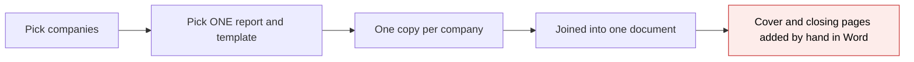
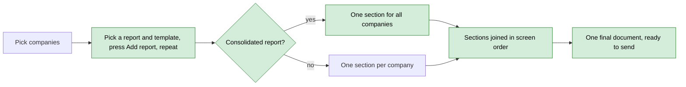
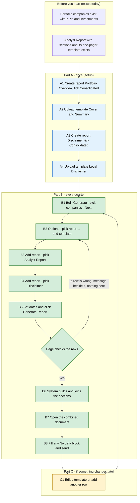

# Portfolio Report Combined Packet — Proposal

> **Audience:** Business team, product, QA, support — non-technical.
> **Companion document:** [Design](design.md)
> **New to this? Start with the [Workflow Journey](#workflow-journey)** — every action, in order, from start to the outcome.

> **Planning phase — no code changes.** This document proposes and explains the change. Do not
> edit application code while writing it; implementation happens later, in the tasks phase.

---

## Why

Today "Bulk Generate Portfolio Reports (Legacy)" produces one Word document made of the **same report repeated once per company**. Fund admins cannot put a cover section in front of it (for example a 2-page summary of every company), or a closing section after it (for example a 1-page disclaimer), so they stitch the final document together by hand in Word. They also have no way to show data of **all** companies in a single table or chart, because a report template only ever sees one company at a time.

## What Changes

- A portfolio report can be marked **Consolidated**. A consolidated report's template sees **all the selected companies at once** (it loops over them), instead of one company per copy. It does not use report sections or extracts.
- The options step of the bulk flow lets the user build a **list of reports**: pick a report and template, press **Add report**, pick the next one, and so on. Each row is a "part" of one final document.
- The final document is the parts joined **in the order shown on screen**: normal reports contribute one section per company (alphabetical), consolidated reports contribute one section for everybody. A "header" is simply the first row, a "footer" simply the last.
- The joined document keeps **the look of the first part** throughout (fonts, page size, margins, running header and footer). Later parts adopt it.
- Only the final document is saved as a new file. Each company's own report still lands in that company's folder, exactly as today.
- With a single normal report in the list, nothing changes from today.
- The options screen checks the list in the browser (a template on every row, no template twice) and shows the problem next to the row, with no round trip.
- Three small extract improvements ride along: an extract is built for a company even when it has **no documents** (from its notes and KPIs, with a warning), the **dashboard widget** shows the latest extract that actually has data, and an extract can be **deleted** from its details page.

### Flow Diagram

*Caption: how the final document is built, before and after.*





---

## Workflow Journey

### Who is involved

| Person | Role | What they do in the journey |
|---|---|---|
| Meera | Fund admin at Alpha Ventures (can manage portfolio reports) | Sets up the two consolidated reports once; generates the combined document each quarter |
| Rohan | Report author at Alpha Ventures (same access) | Writes the three Word templates (can be Meera) |

### The journey on one page



### Before you start

| Needed | Why | Where it comes from |
|---|---|---|
| At least one portfolio company | Reports are generated per company | Existing Portfolio Companies |
| A normal report with a template (here: Analyst Report, template "Company One-Pager") | Supplies the per-company sections in the middle | Already set up for today's legacy flow |
| Word templates for the cover and the closing page | Supply the first and last sections | Written by Rohan (Part A) |
| Permission to manage portfolio reports | The bulk flow checks it | Existing access |

### Part A — once (setup)

| Step | Who | Where | Action | What the system does | What you see |
|---|---|---|---|---|---|
| A1 | Meera | Portfolio Reports › New | Name it "Portfolio Overview", tick **Consolidated**, save | Saves the report as consolidated | The report page; no sections needed |
| A2 | Rohan | Portfolio Report › Templates | Upload the Word template "Cover and Summary" (2 pages). It loops over `portfolio_companies` to list each company's data | Stores the template under the report | Template listed |
| A3 | Meera | Portfolio Reports › New | Name it "Disclaimer", tick **Consolidated**, save | As A1 | The report page |
| A4 | Rohan | Portfolio Report › Templates | Upload "Legal Disclaimer" (1 page, plain text, no merge fields) | Stores the template | Template listed |

### Part B — every quarter

| Step | Who | Where | Action | What the system does | What you see |
|---|---|---|---|---|---|
| B1 | Meera | Portfolio Reports › Bulk Generate (Legacy) | Choose Fund / Tag / Sector, **Preview**, check Ace Limited, Beta Corp, Gamma Corp, **Next** | Hands the three companies to the options step | Options page: "Generating for 3 portfolio companies: Ace Limited, Beta Corp, Gamma Corp" |
| B2 | Meera | Options › row 1 | Report "Portfolio Overview (Consolidated)", template "Cover and Summary" | Offers only that report's templates | Row 1 filled |
| B3 | Meera | Options › **Add report** | Row 2: report "Analyst Report", template "Company One-Pager" | Adds a row; templates limited to the chosen report | Row 2 filled |
| B4 | Meera | Options › **Add report** | Row 3: report "Disclaimer (Consolidated)", template "Legal Disclaimer" | Adds a row | Row 3 filled |
| B5 | Meera | Options | Start 2026-01-01, End 2026-09-30, optionally tick "Generate missing report extracts", click **Generate Report** | The page checks every row in the browser (see Validation Rules); if all good it submits and the system queues the run | "Queued report generation for 3 companies." |
| B6 | System | Background | Builds Cover and Summary once (all 3 companies), the One-Pager for each company, and the Disclaimer; joins them in row order | Saves each company's one-pager in that company's folder as today; saves the combined file under Portfolio Reports / Generated Portfolio Reports | Toast: "Portfolio Report Generation completed. Saved in Portfolio Reports / Generated Portfolio Reports: Cover and Summary 2026-01-01 to 2026-09-30 - 3 companies" |
| B7 | Meera | Toast link | Open the combined document | — | One Word file, 6 pages (below) |
| B8 | Meera | Word | Fill any "No data available" block for a company with no extract, then send | — | Editable document |

### Part C — if something changes later

| Step | Who | Where | Action | What the system does | What you see |
|---|---|---|---|---|---|
| C1 | Rohan / Meera | Templates, or the Options list | Edit a template, or add/remove a row, then regenerate | Regenerating replaces each company's own one-pager of the same name and saves a new combined file | A fresh combined document |

### What you see

The options step (new rows area at the top):

```
+---------------------------------------------------------------------------+
| Bulk Generate Portfolio Reports (Legacy) - Options                        |
| Generating for 3 portfolio companies: Ace Limited, Beta Corp, Gamma Corp |
|                                                                           |
| Reports in this document (top to bottom = order in the final document)    |
|  1  Report   [ Portfolio Overview (Consolidated) v ]                      |
|     Template [ Cover and Summary v ]                          [ Remove ]  |
|  2  Report   [ Analyst Report v ]                                         |
|     Template [ Company One-Pager v ]                          [ Remove ]  |
|  3  Report   [ Disclaimer (Consolidated) v ]                              |
|     Template [ Legal Disclaimer v ]                           [ Remove ]  |
|  [ + Add report ]                                                         |
|                                                                           |
| Start date [2026-01-01]       End date [2026-09-30]                       |
| [ ] Generate missing report extracts                                      |
| [ Generate Extracts Only ]                      [ Generate Report ]       |
+---------------------------------------------------------------------------+
```

The final document, page by page:

```
 Page 1-2   Cover and Summary        (consolidated: Ace, Beta, Gamma on one table)
 Page 3     Company One-Pager - Ace Limited
 Page 4     Company One-Pager - Beta Corp
 Page 5     Company One-Pager - Gamma Corp
 Page 6     Legal Disclaimer
 ---------
 Pages: 2 + (3 companies x 1) + 1 = 6
```

### What goes wrong

Meera adds a fourth row and picks "Company One-Pager" again. On **Generate Report** the page does not submit and shows, next to the fourth row: *"Each template can be used only once in a list. Remove the repeated template."* Nothing is sent or queued. She changes that row's template (or removes the row); the message disappears and **Generate Report** works.

A second failing path: one company, Gamma Corp, has no KPI data and "Generate missing report extracts" is off. Its one-pager still generates with a single "No data available" block (as today), and the toast reports it as an informational note, not an error.

### Summary: the minimum actions

| # | Action | Who | How often |
|---|---|---|---|
| 1 | Tick **Consolidated** on a report | Meera | Once per consolidated report |
| 2 | Upload its template | Rohan | Once per template |
| 3 | Pick companies, then fill one row per part and click **Generate Report** | Meera | Every quarter |

---

## User Stories

### US-1: Mark a report as consolidated

**As a** fund admin,
**I want** to mark a portfolio report as Consolidated,
**So that** its template can show data for all selected companies in one place.

**Acceptance criteria:**
- The portfolio report form has a **Consolidated** checkbox, unticked by default; existing reports stay unticked.
- A ticked report shows as "(Consolidated)" wherever reports are chosen in the legacy bulk flow.
- Sections are optional for every report; a consolidated report ignores any it has.

### US-2: One template that sees every company

**As a** report author,
**I want** a consolidated template to loop over all selected companies,
**So that** I can build one summary table or chart of the whole portfolio.

**Acceptance criteria:**
- Inside the loop, each company exposes a small set of merge fields: `portfolio_company`, `latest_pi`, `earliest_pi`, `funds` (each with `name`, `currency`, `fmv`, `cost_of_investment`, `irr`, `moic` and a `ratios` list of name/value rows) and `logo` when the company has one. A template can nest loops: companies, then funds, then ratios. KPIs, cap table and the other normal-template fields are not available.
- Companies appear in alphabetical order.
- `current_date` is available outside the loop.
- `fund_totals` is available outside the loop: one entry per fund the selected companies invested in, with `name`, `currency`, `fmv` and `cost_of_investment` (sums over the companies in that fund) and `custom_fields` (the sum of each numeric company custom field, found from the companies' form types; blank counts as zero). A Grand Total row after the company loop reads it, e.g. `fund_totals:each(total)`, `total.compare_name_eq_<fund_name>:if`, `=total.format_1_div_7_fmv`, `=total.format_1_div_7_cost_of_investment`, `=total.custom_fields.format_1_div_7_investment_commitment`, `total…:endIf`, `fund_totals:endEach`. The fund-name check keeps the row to one fund.
- A consolidated template has no `report_data` or `audits`; no extract is created or read for it.

### US-3: Build a document from several reports

**As a** fund admin,
**I want** to add several reports, each with its own template, to one generation run,
**So that** the cover, the company pages and the disclaimer come out as one document.

**Acceptance criteria:**
- The options step starts with one row and an **Add report** button; each added row has **Remove**; the last remaining row cannot be removed.
- Changing a row's report limits that row's template choices to that report's templates, as today.
- The order of the rows on screen is the order in the final document.
- The same template cannot appear in two rows.
- Every row must have a template.
- These two rules are checked on the page itself: the problem is shown next to the row, the form is not submitted, and the message clears as soon as the row is fixed.
- The combined file is named after the first row's template.

### US-4: One saved file, company files unchanged

**As a** fund admin,
**I want** just the combined document saved as a new file,
**So that** my folders are not filled with intermediate files.

**Acceptance criteria:**
- Each company's own report from a normal row is still saved in that company's "Portfolio Reports" folder.
- Consolidated parts are not saved on their own.
- The combined file is saved in Portfolio Reports / Generated Portfolio Reports, named "<first row's template> <start> to <end> - <N> companies".
- When the list is one normal report and one company, no combined file is created (that company's report is the result), as today.

### US-5: Extracts for companies without documents

**As a** fund admin,
**I want** an extract to be built even when a company has no documents,
**So that** a company with only notes and KPIs still gets a meaningful report section.

**Acceptance criteria:**
- When a company has no source documents for the period, its extract is built from its notes for the period and the KPIs of its latest KPI report in the period (the same "latest wins" rule as for documents).
- A warning tells the user which company had no documents and that notes and KPIs were used. A bulk extract run sends one warning at the end listing all such companies.
- Companies that do have documents are extracted exactly as before; KPIs are not added for them.
- A company with no documents, no notes and no KPIs still gets an empty extract and is reported as today.

### US-6: The dashboard widget skips blank extracts

**As a** user viewing a company dashboard,
**I want** the portfolio report widget to show the latest extract that has content,
**So that** a newer blank extract does not hide good data.

**Acceptance criteria:**
- The widget shows the latest extract (by end date, then creation) that has data, for the company and the widget's report.
- A blank extract is skipped in favour of the previous one.
- If no extract has data, the widget stays hidden as today.

### US-7: Delete an extract

**As a** fund admin,
**I want** to delete an extract from its details page,
**So that** a wrong or unwanted extract can be removed and regenerated.

**Acceptance criteria:**
- The details page has a **Delete** button for users who may delete extracts; others do not see it.
- The button asks for confirmation; cancelling keeps the extract.
- After deleting, the user is on the report's extract list with a confirmation.
- Generating the report again for that company and period creates a new extract (when "Generate missing report extracts" is on) or shows "No data available" (when off).

---

## UI Behavior

### Portfolio report form

```
+----------------------------------------------------+
| Portfolio Reports : Portfolio Overview             |
| Name   [ Portfolio Overview                      ] |
| Tags   [                                         ] |
| Include KPI [ ]   Include portfolio investments [ ]|
| Consolidated [x]                                   |
|   One document for all selected companies. The     |
|   template loops over every company. Sections and  |
|   extracts are not used.                           |
+----------------------------------------------------+
```

### Bulk options step

See the mockup under [What you see](#what-you-see).

**Behavior notes:**
- Row 1 is always present. **Remove** is hidden while only one row remains.
- A report's name is shown with "(Consolidated)" after it when ticked.
- Changing a row's report immediately limits that row's template list, and picks that report's first template.
- **Generate Extracts Only** applies to the normal (non-consolidated) reports in the list, once per distinct report.
- The "Generate missing report extracts" checkbox affects normal rows only.
- Dates and the checkboxes apply to the whole list.
- If a row has no template, or a template is used twice, **Generate Report** does not submit; the message appears under the row and clears when the row is fixed.
- **Generate Extracts Only** does not submit when every row is a consolidated report; the message appears on the page.

### Extract details page

```
+------------------------------------------------------------+
| Ace Limited                    [Palette v] [Generate Tear Sheet] |
| Analyst Report   01/01/2026 - 30/09/2026   [Edit Data] [Delete]  |
+------------------------------------------------------------+
   [Delete] asks: "Are you sure?" -> list of the report's extracts
```

---

## What This Feature Does NOT Cover

| Excluded | Covered In |
|---|---|
| Different look per part (own page size, margins, orientation, running header/footer for each part) | Not planned: the first part's look is used throughout, by decision |
| Reordering rows with drag and drop | Not needed: change the dropdowns to change the order |
| Choosing which row's template names the combined file | Not planned: the first row's template always names it (business decision) |
| KPIs in extracts built from documents | Not planned: KPIs are used only when a company has no documents |
| Restoring a deleted extract from the screen | Not planned: generate it again |
| A PDF version of the combined document | Not planned: the document stays editable Word |
| Saving a list of parts as a reusable "packet" definition | Not planned: the list is built on screen each run |
| The newer draft-based portfolio report flow and its auto-generation | Unchanged |
| Consolidated reports from the single-company "Portfolio Report (Legacy)" page | Unchanged: that page keeps using normal reports |
| Showing page-by-page repeating headers/footers different from the first template's | Not planned |

---

## Validation Rules

| Field | Rule | Default |
|---|---|---|
| Rows | At least one row | One empty row |
| Row report | Must be one of the entity's portfolio reports | First report |
| Row template | Required; must belong to the row's report | First template of the row's report |
| Templates across rows | Each template at most once | — |

The template-required and once-only rules are checked on the page (no request). The server checks them again, plus "belongs to the row's report", in case a request bypasses the page; a user normally never sees those server messages.
| Companies | At least one, as today | — |
| Start / End date | As today | Three months back / end of this month |

User-facing messages (exact):

| Situation | Message |
|---|---|
| No template chosen on a row | *Choose a template for every report in the list.* |
| Same template on two rows | *Each template can be used only once in a list. Remove the repeated template.* |
| Template not from the row's report | *The selected template does not belong to the chosen report.* |
| Extracts Only, but every row is consolidated | *Consolidated reports don't use extracts, so there is nothing to generate.* (shown on the page; nothing is sent) |
| Extract built without documents | *No documents found for Ace Limited for Analyst Report. Extract built from notes and KPIs.* (warning) |
| Extract deleted | *Portfolio report extract deleted successfully.* |
| Queued | *Queued report generation for 3 companies.* |

---

## Behavior Rules

| Scenario | What User Sees |
|---|---|
| One normal report, several companies | Same as today: one joined document, "<template> <dates> - N companies" |
| One normal report, one company | Same as today: that company's own report, no combined file |
| One consolidated report only | One combined file containing just that part |
| Consolidated + normal + consolidated | Combined file in row order (cover, companies A-Z, closing) |
| A company has no extract and "generate missing" is off | Its section reads "No data available"; toast notes which companies had no extract |
| A company's section fails to generate | Error toast and email list it; the combined file still contains the other sections |
| A consolidated part fails to generate | Error toast and email name that part; the combined file contains the rest |
| Every part fails | Error toast; no combined file |
| Joining fails | Error toast; each company's own report is still saved |
| Same companies and period generated again | Each company's one-pager is replaced as today; a new combined file is saved |
| A later part uses different fonts or a different page layout | It adopts the first part's look. Styles missing from the first part fall back to its default style |
| A later part uses a bullet/number list style the first part also defines | The first part's definition wins, so bullets/numbering may look different |
| A company has no documents but has notes or KPIs | Extract is built from them; a warning toast names the company |
| A company has no documents, notes or KPIs | Empty extract, reported as today; the report shows "No data available" |
| A company's latest extract is blank | The dashboard widget shows the previous extract that has data |
| User deletes an extract | It disappears from the list and the widget; the next run treats the company as having no extract |

---

## Resolved Design Decisions

| # | Decision | Resolution |
|---|---|---|
| 1 | Where is "consolidated" set? | On the portfolio report (checkbox on its form); its templates inherit it |
| 2 | Does a consolidated report use extracts? | No. No extract is read or created; it uses live company data only |
| 3 | What are "header" and "footer" documents? | Not a special concept: the first and last rows of the list |
| 4 | How are parts joined? | One Word file; the first part's styling, page setup and running header/footer apply everywhere |
| 5 | Is reordering needed? | No; rows run in on-screen order |
| 6 | Dates, options | One period and one set of options for the whole list |
| 7 | What is saved? | Company reports as today, plus the one combined file; consolidated parts are not saved separately |
| 8 | Name of the combined file | First row's template name, dates, and company count |
| 9 | Extracts Only with several rows | Runs for each distinct normal report in the list |
| 10 | Repeated template | Refused, because regenerating a template replaces the company file it produced earlier in the same run |
| 11 | Blank template (previously "all templates of the report") | Refused; every row needs a template (in practice blank always ended in a "No templates found" error) |
| 12 | Jobs already queued when this ships | Keep working: the first row is still carried in the original positions |
| 13 | Where are the rows checked? | In the browser first (no request); the server repeats the checks only as a safeguard |
| 14 | Which template names the combined file? | The first row's template (business decision); no per-row choice |
| 15 | Which extracts get KPIs? | Only those built for a company with no documents; others are unchanged |
| 16 | How does the widget pick an extract? | The latest one with data; blank ones are skipped |
| 17 | What does deleting an extract do? | The existing soft delete: it disappears from screens and lookups |

---

## Capabilities

### New Capabilities

- `funds/consolidated-portfolio-report`: a portfolio report can be consolidated, and its template then sees every selected company in one document without using extracts.
- `funds/portfolio-report-combined-packet`: the legacy bulk flow builds one document from an ordered list of report-and-template rows, checked in the browser.
- `funds/portfolio-report-extracts`: extracts can be built without documents (notes and KPIs), the dashboard widget shows the latest extract with data, and an extract can be deleted from its details page.

### Modified Capabilities

None. (The in-flight change `fix-legacy-bulk-generate-fund-filter` owns the Fund/Tag/Sector preview step and is not touched.)

---

## Impact

- **Portfolio report form:** one new checkbox.
- **Bulk Generate Portfolio Reports (Legacy) › Options page:** single Report/Template pair becomes a list of rows.
- **Report generation run:** produces one extra kind of section (consolidated) and joins sections from several reports.
- **Combined document:** now built from several templates instead of one.
- **Data:** one new yes/no field on portfolio reports (existing reports default to No).
- **Extract generation:** companies without documents now get an extract built from notes and KPIs, with a warning.
- **Company dashboard:** the portfolio report widget shows the latest extract with data.
- **Extract details page:** a **Delete** button.
- **User guide:** "Portfolio Report (Legacy)" guide needs a short section on consolidated reports and the list of reports.
- **Not affected:** the newer draft-based flow, the single-company legacy generate page, extracts-only for existing reports, permissions.

---

## Benefits

1. A cover, the company pages and a disclaimer come out as one finished document with no manual stitching.
2. Whole-portfolio summaries (tables across all companies) become possible in the same tool.
3. Existing reports, templates and single-report runs behave exactly as before.
4. The final file stays editable, so missing company data can be filled in before sending.

---

## FAQ

| Question | Answer |
|---|---|
| Who can use this? | Anyone who can use the legacy bulk generate page today. No new permission. |
| Do existing reports change? | No. They stay non-consolidated. |
| Will my existing templates still work? | Yes. A normal template is untouched. |
| Can a consolidated template use the same fields as my one-company template? | Yes, inside the company loop the field names are the same, so you can copy a block across. |
| Why is the first part's look used everywhere? | It keeps the join simple and reliable. Put the layout you want everywhere in the first row's template. |
| What if my second template has a different page orientation? | It will use the first template's orientation. Orientation per part is not supported. |
| Why can't I pick the same template twice? | Each company's report is saved under the template's name; a second pick would overwrite the first. |
| Does it send any emails or notifications? | Same as today: a completion toast, and an error email only if something failed. |
| Is the data changed? | One yes/no field is added to portfolio reports. Nothing is migrated. |
| Why does the page check the rows instead of the server? | The checks need nothing the page does not already have, so the answer is instant and no request is made. The server still repeats them in case someone bypasses the page. |
| Who decides the combined file's name? | The first row's template, always. |
| Why only use KPIs when there are no documents? | KPIs normally arrive as a document, so adding them to extracts built from documents would repeat them and change existing results. |
| Can I get a deleted extract back? | Not from the screen. Generate it again. |
| What about jobs queued during the release? | They keep working; see [design.md](design.md). |
| How is the join done? | See [design.md](design.md). |

---

## Design Principle for the Next Phase

Keep it DRY and simple: reuse the existing per-company document generation, the existing merger and the existing report/template dropdown behaviour. Flagged risks for the design phase:

1. **Joining different templates** relies on "first part wins". The merger today assumes one shared template; the design must prove (with a spike on two real documents) that Word opens the result, especially around header/footer parts and numbering.
2. **A logo inside a company loop** is expected to work like the top-level logo; the design only asks for a quick confirmation on the first real render.
3. ~~Sharing the per-company data between the normal and consolidated generators~~ Resolved: a consolidated company needs far less data, so the consolidated generator builds its own small hash and the normal generator is untouched.
