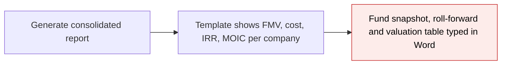
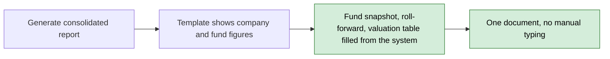
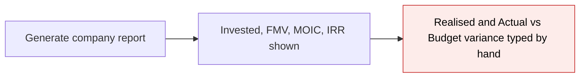
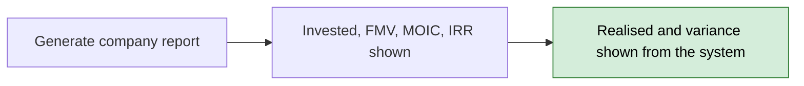
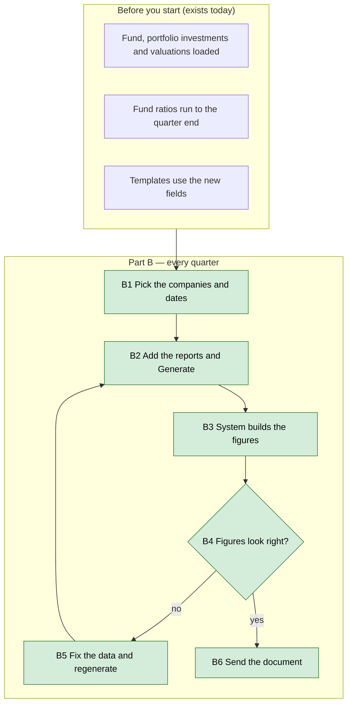

# Portfolio Report Fund Metrics — Proposal

> **Audience:** Business team, product, QA, support — non-technical.
> **Companion document:** [Design](design.md)
> **New to this? Start with the [Workflow Journey](#workflow-journey)** — every action, in order, from start to the outcome.

> **Planning phase — no code changes.** This document proposes and explains the change. Do not
> edit application code while writing it; implementation happens later, in the tasks phase.

---

## Why

The consolidated portfolio report (cover/summary and closing pages) cannot yet show what the fund's investor report needs: fund-level money and returns, a quarterly cost and value roll-forward per company, and the valuation change against the start of the year. The per-company report has no "Realised" figure and no Actual-versus-Budget variance. Admins fill these in by hand in Word today.

## What Changes

- **Consolidated report, per company and fund:** every fund money figure (committed, called, collected, distributed, target, unit premium and their tracking-currency versions) **as of the end date**, taken from the fund's as-of view, cost and value for the **prior quarter-end**, the **quarter** and the **end date**, cost of exits in the quarter, FMV change, and FMV at the start of the financial year with the change since.
- **Consolidated report, per fund (the Total row and fund snapshot):** the same figures added up across the selected companies, plus collected %, uncollected amount and %, the number of companies, and the fund's own IRR, MOIC, TVPI, DPI and RVPI.
- **Cost is shown net of exits** in the roll-forward (Jun-26 + Invested in qtr − Exits in qtr = Sep-26). The existing "cost of investment" (everything ever paid) stays and is still used by the fund snapshot and the LP page.
- **Per-company (LP) report:** each fund shows **sold amount** (what the fund received from sales up to the end date) and cost of remaining; each KPI row shows **Actual vs Budget variance** as a percentage (negative when Actual is below Budget).
- Nothing changes for reports that do not use the new fields.

### Flow Diagram

*Caption: how the Summary and Disclaimer pages get their figures, before and after.*





*Caption: how the per-company page gets Realised and the variance.*





---

## Workflow Journey

### Who is involved

| Person | Role | What they do in the journey |
|---|---|---|
| Meera | Fund admin (company admin) | Generates the quarterly investor report and checks the figures |
| Business reviewer | Finance / investor relations | Confirms the figures read correctly |

### The journey on one page



### Before you start

| Needed | Why | Where it comes from |
|---|---|---|
| Portfolio investments (buys and sells) | Cost, exits, sold amount | Portfolio investments on the fund |
| Valuations up to the quarter end and at the prior quarter end and financial-year start | FMV at each date | Valuations on the portfolio company |
| Fund ratios run (XIRR, MOIC, TVPI, DPI, RVPI) | Fund snapshot returns | Fund ratios job |
| Budget and Actual KPI reports (approved) | Variance | KPI reports |
| Updated Summary, Disclaimer and LP templates | Show the new fields | Template owner |

### Part B — every quarter

| Step | Who | Where | Action | What the system does | What you see |
|---|---|---|---|---|---|
| B1 | Meera | Portfolio reports › Bulk generate | Picks companies, start 1 Jul 2026, end 30 Sep 2026 | — | Options page |
| B2 | Meera | Options page › Generate Report | Adds Summary, Company report, Disclaimer | Queues the run | "Queued report generation" |
| B3 | System | — | Builds each part | Works out each figure below | — |
| B4 | Meera | Final document | Reads the figures | — | Tables below |
| B5 | Meera | Data screens | Corrects a missing valuation or ratio | — | "N/A" gone on regenerate |

### What you see

Fund Inflexor Technology Discovery Fund 1, quarter 1 Jul – 30 Sep 2026, amounts in INR Crore.

```
Roll-forward                 Cost (net of exits)                     Fair market value
Company        Jun-26  Invested  Exits   Sep-26     Jun-26   Sep-26   Change %
Company A       40.0     10.0     5.0     45.0       50.0     60.0     20.0
Company B       30.0      0.0     0.0     30.0       24.0     21.0    -12.5
Total           70.0     10.0     5.0     75.0       74.0     81.0      9.5
  Cost:   40.0 + 10.0 - 5.0 = 45.0      70.0 + 10.0 - 5.0 = 75.0
  Change: (60 - 50) / 50 x 100 = 20.0   (81 - 74) / 74 x 100 = 9.5

Fund snapshot
  Commitments raised   502.0
  Capital drawn        125.5   25.0% of commitments   (125.5 / 502.0 x 100)
  Uncalled             376.5   75.0% of commitments   (502.0 - 125.5)
  Invested (at cost)    80.0   everything paid in, exits not deducted
  Companies                2

Valuation changes     FMV 31-Mar-26   FMV Jun-26   FMV Sep-26   QoQ     FYTD
Company A                  45.0           50.0         60.0     20.0%   33.3%
Company B                  28.0           24.0         21.0    -12.5%  -25.0%
  FYTD: (60 - 45) / 45 x 100 = 33.3

LP page, Company A:  Invested 50.0  Realised 7.0  FMV 60.0
KPI row Revenue:     Actual 92  Budget 100  vs Budget  -8.0%   ((92 - 100) / 100 x 100)
```

### What goes wrong

Company B has no valuation before 1 Jul 2026, so its Jun-26 FMV is 0. Its Change % shows **N/A** (no dividing by zero) and the Total row still adds up. Fix: add the valuation, regenerate. Likewise a fund whose ratios were never run shows **N/A** for IRR, MOIC, TVPI, DPI and RVPI.

### Summary: the minimum actions

| # | Action | Who | How often |
|---|---|---|---|
| 1 | Make sure valuations and fund ratios are up to date | Meera | Every quarter |
| 2 | Generate the report with the three parts | Meera | Every quarter |

---

## User Stories

### US-1: Quarterly roll-forward per company
**As a** fund admin, **I want** each company's cost and FMV at the prior quarter-end, the quarter's purchases and exits, and the end date, **so that** the roll-forward adds up without typing.

**Acceptance criteria:**
- Jun-26 cost + Invested in qtr − Exits in qtr = Sep-26 cost, per company and in the Total row.
- Exits in qtr is shown as a positive number.
- Change % = (FMV at end date − FMV at prior quarter-end) ÷ FMV at prior quarter-end × 100; **N/A** when the prior FMV is zero.

### US-2: Fund snapshot
**As a** fund admin, **I want** committed, collected, uncollected, company count and the fund's returns, **so that** page 1 of the investor report needs no typing.

**Acceptance criteria:**
- Money figures are the fund's amounts as of the end date: commitments dated, payments received and distributions paid up to that date, so a drawdown after the end date is not included.
- Collected % = collected ÷ committed × 100; uncollected = committed − collected, with its percent; **N/A** when committed is zero.
- Company count = selected companies with an investment in the fund on or before the end date.
- IRR, MOIC, TVPI, DPI and RVPI are the fund's latest stored values on or before the end date (Default scenario); **N/A** when never run.

### US-3: Valuation changes against the financial year start
**As a** fund admin, **I want** FMV at the start of the financial year and the change since, **so that** the SEBI valuation table fills itself.

**Acceptance criteria:**
- FMV at start = FMV as of the day before the financial year starts (31 March with an April year).
- FYTD % = (FMV at end date − FMV at start) ÷ FMV at start × 100; **N/A** when the start FMV is zero.

### US-4: Realised on the company page
**As a** fund admin, **I want** each fund's sold amount, **so that** "Realised" shows what the fund received from sales up to the end date.

**Acceptance criteria:**
- Sold amount is the total of the sell investments dated on or before the end date, positive.

### US-5: Variance against Budget
**As a** fund admin, **I want** Actual against Budget as a percentage change, **so that** the Key metrics table shows over- or under-performance.

**Acceptance criteria:**
- Variance = (Actual − Budget) ÷ Budget × 100; negative when Actual is below Budget.
- **N/A** when either figure is missing or Budget is zero.
- The existing "Actual as a percentage of Budget" figure is unchanged.

---

## UI Behavior

There is no new screen. The figures are available to templates as merge fields; the report pages above are the visible result.

**Behavior notes:**
- A template that does not use the new fields is unaffected.
- Percent fields are numbers like `20.0`; the template adds the "%" sign.
- Money fields keep the template's existing scaling (for example crore).

---

## What This Feature Does NOT Cover

| Excluded | Covered In |
|---|---|
| Filtering the valuation table to changes above the SEBI thresholds | Not planned |
| Net IRR, fees and expenses table, target fund size as a figure | Not planned |
| A "like-for-like" Change % that ignores purchases and sales | Not planned (decided: keep total FMV comparison) |
| Aggregate-investment figures as of the end date (`apis`) | Dropped |
| FMV at financial-year start in the Total row | Not planned |

---

## Validation Rules

| Field | Rule | Default |
|---|---|---|
| Change %, FYTD %, collected %, uncollected % | Divide by the base figure; base zero shows N/A | N/A |
| Fund IRR, MOIC, TVPI, DPI, RVPI | Latest Default-scenario run on or before the end date | N/A when none |
| Variance vs Budget | N/A when Actual or Budget missing, or Budget is zero | N/A |
| Exits in qtr | Shown positive | 0 when none |
| Financial year start | Fund override, then entity setting, then the country default (April for IN) | April |

---

## Behavior Rules

| Scenario | What User Sees |
|---|---|
| A company has sold part of its holding in the quarter | Cost net of exits drops by the cost of what was sold; Exits in qtr shows that cost |
| A purchase is made in the quarter and nothing is revalued | Change % rises (total FMV comparison, by decision) |
| Fund has several companies but the report selects two | Company count is 2; totals add up the two |
| Company has no investment in the fund before the end date | It is not counted in that fund and has no row for it |
| A stock conversion happens in the quarter | Shares moved reduce cost held; the roll-forward may differ by that amount (known edge) |
| Report generated for a past end date | Money figures, FMV and cost are all as of the dates |

---

## Resolved Design Decisions

| # | Decision | Resolution |
|---|---|---|
| 1 | Fund money figures as of today or the end date? | As of the end date, by extending the fund's as-of view (`FundAsOf`) to give the fund's money figures; today the fund holds only running totals |
| 2 | Which ratio is the fund's IRR? | The fund's XIRR, exposed as `irr` |
| 3 | Fund ratios per company-fund or per fund? | Per fund; repeated per company-fund is acceptable (few funds) |
| 4 | Field names flat or grouped? | Flat |
| 5 | Include tracking-currency money figures? | Yes, with the base ones |
| 6 | Change % definition | Total FMV now vs prior quarter-end, including purchases and sales (business: like-for-like would misreport) |
| 7 | Cost columns in the roll-forward | Net of exits, `cost_of_remaining` and `cost_of_remaining_prior`; Invested and Exits unchanged |
| 8 | Does "Invested in portfolio" on the snapshot change? | No, stays the gross `cost_of_investment` |
| 9 | Exits in qtr sign | Positive |
| 10 | Realised name and source | `sold_amount`, from the sell investments |
| 11 | Aggregate-investment as-of figures | Dropped |
| 12 | Financial year start | Fund override, entity setting, then country default |
| 13 | Variance field name | `<label>_vs_budget_compute_percent` |
| 14 | Value objects | `Data.define` for fixed shapes; custom-field sums stay `OpenStruct` |

---

## Capabilities

### New Capabilities

- `funds/portfolio-report-fund-metrics`: fund and company-fund figures for the consolidated report (money, cost net of exits, FMV prior and financial-year start, changes, company count, fund returns) and, for the per-company report, sold amount, cost of remaining and Actual-vs-Budget variance.

### Modified Capabilities

None in `openspec/specs/`. The consolidated report's own capability is defined by the in-flight change `portfolio-report-combined-packet`; this change builds on its fund totals and company fund lists and should be applied after it.

---

## Impact

- Consolidated report builder (company fund lists and fund totals).
- Per-company report builder (fund data and KPI rows).
- The fund's as-of view gains the fund's money figures; the capital call and distribution letters that already use it are unaffected.
- Summary, Disclaimer and LP Word templates read the new fields.
- No database change, no new screen, no permission change.

---

## Benefits

1. The Summary and Disclaimer pages fill from the system; no hand typing in Word.
2. The cost roll-forward adds up.
3. One source for fund-level returns and money on the report.
4. The LP page shows Realised and budget variance without manual work.

---

## FAQ

| Question | Answer |
|---|---|
| Do existing reports change? | No. Existing fields keep their meaning; new fields are added. |
| Why is "Invested in portfolio" different from Sep-26 cost? | The snapshot is everything paid in; the roll-forward cost is net of exits. They match when there have been no exits. |
| Do the money figures match the fund page? | For an end date of today, yes. For a past date they show what was committed, collected and distributed up to that date. Collections count verified payments only, as the fund total does. |
| Why does Change % jump when we buy more? | It compares total FMV; business chose that over like-for-like. |
| Which financial year start is used? | The fund's own setting, then the entity's, then April (India). |
| Is there a data migration? | No. |

See [design.md](design.md) for how.

---

## Design Principle for the Next Phase

Keep it DRY: one shared way to value a fund's investments at a date, reused for the end date, the prior quarter-end and the financial-year start. Risks to handle head-on: valuing investments at three dates is slow if not batched, and a valued investment cannot be reused for a second date.
