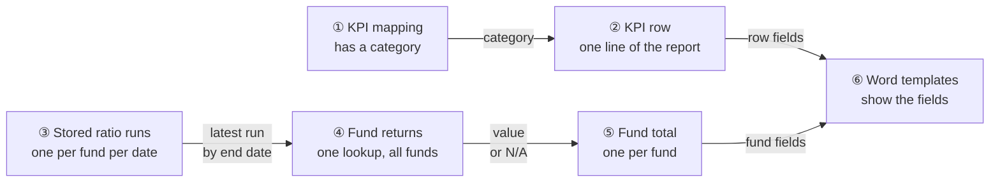
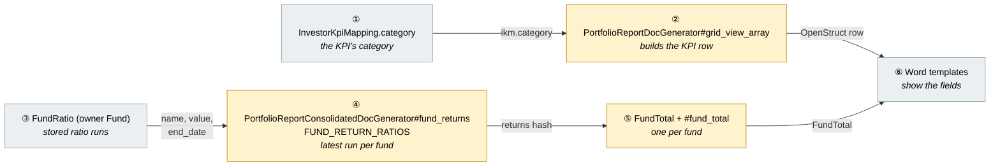
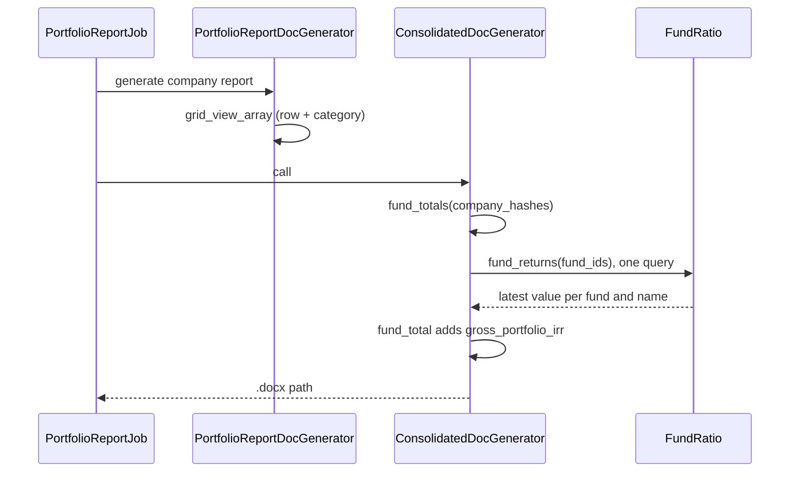
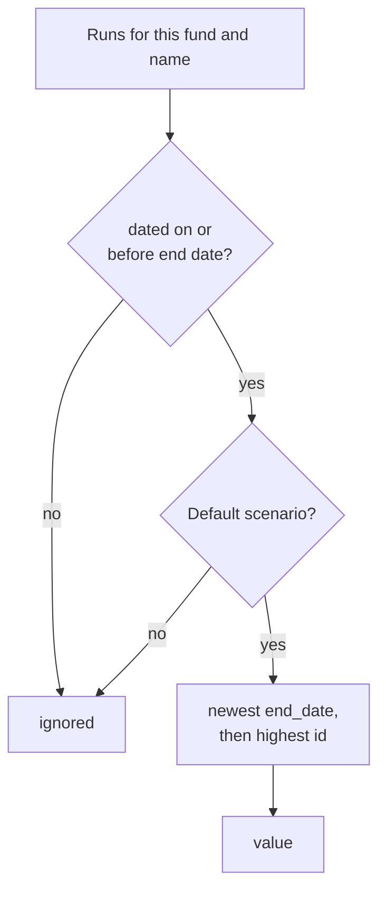
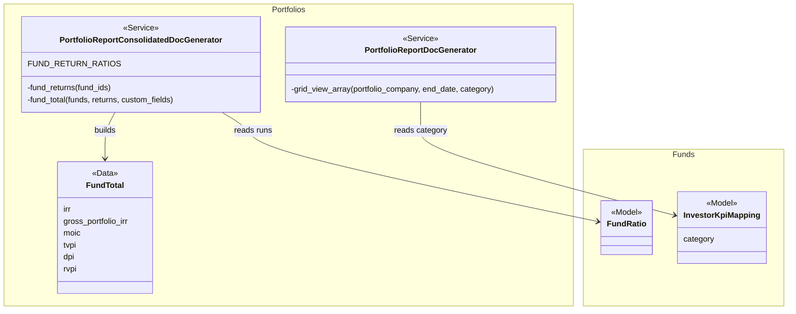

# Portfolio Report Category and Gross Portfolio IRR — Design

> **Audience:** Engineering team.
> **Companion documents:** [Proposal](proposal.md) · [Spec](specs/)

> **Planning phase — no code changes.** This document explains HOW the proposal will be built.
> Do not edit application code while writing it; implementation happens later, in the tasks phase.

> **Small change.** Two additions to existing builders, no new class, table, job or screen. Sections
> that do not apply keep their heading with `N/A — <reason>`. Builds on `portfolio-report-fund-metrics`
> (the fund total and its one-query return lookup are defined there).

---

## Contents

- [1. The idea](#1-the-idea)
  - [What this adds](#what-this-adds)
  - [The idea in one picture](#the-idea-in-one-picture)
  - [Walkthrough: one example, start to finish](#walkthrough-one-example-start-to-finish)
  - [Key ideas](#key-ideas)
- [2. The same picture with real names](#2-the-same-picture-with-real-names)
  - [Picture](#picture)
  - [What each box does](#what-each-box-does)
  - [One run, end to end](#one-run-end-to-end)
  - [Lifecycles](#lifecycles)
  - [What users see](#what-users-see)
  - [Design decisions](#design-decisions)
- [3. One card per box](#3-one-card-per-box)
  - [① and ② KPI row](#①-and-②-kpi-row)
  - [③ and ④ Fund returns lookup](#③-and-④-fund-returns-lookup)
  - [⑤ Fund total](#⑤-fund-total)
  - [⑥ Word templates](#⑥-word-templates)
- [4. Reference](#4-reference)
  - [Class diagram](#class-diagram)
  - [Data model and schema changes](#data-model-and-schema-changes)
  - [Component contracts](#component-contracts)
  - [Notifications](#notifications)
  - [Cross-cutting concerns](#cross-cutting-concerns)
  - [Worked examples](#worked-examples)
  - [Testing](#testing)
  - [Risks and open questions](#risks-and-open-questions)

---

## 1. The idea

### What this adds

Two read-only fields for the report templates. The KPI row built for the per-company report gets a `category`, next to the `data_type` it already has. The consolidated report's fund total gets `gross_portfolio_irr`, read with the same single query that already reads the fund's `irr`, `moic`, `tvpi`, `dpi` and `rvpi`.

### The idea in one picture



### Walkthrough: one example, start to finish

Meera generates the Q2 reports (end date 30 Sep 2026). Alpha Fund I has Gross Portfolio IRR runs of 16.0 (30 Jun) and 18.0 (30 Sep) and an XIRR of 14.2. Alpha Fund II has never had its ratios run. Legend: ✓ done, ● we are here.

| # | When | What happens | Behind the scenes | Result |
|---|---|---|---|---|
| 1 | Company report | Meera generates the company report | The KPI row (②) takes the category from its KPI mapping (①) | Row "Revenue": category Financial, data type money |
| 2 | Category lists | The report also builds the Financial list | The same row builder is called for the category, so the same category is on the row | Row "Revenue" in the Financial list: category Financial |
| 3 | Consolidated report | Meera generates the consolidated report | The fund returns lookup (④) reads the stored runs (③) for both funds in one query | Alpha Fund I: 18.0 (latest on or before 30 Sep). Alpha Fund II: no run |
| 4 | Fund totals | The totals are built | The fund total (⑤) takes `gross_portfolio_irr` from the lookup, or "N/A" | Alpha Fund I: irr 14.2, gross 18.0. Alpha Fund II: "N/A" |
| 5 | Mistake | Meera sees "N/A" for Alpha Fund II | Nothing stored, so nothing shown (⑤) | "N/A" |
| 6 | Fix | Meera runs the fund ratios to 30 Sep and generates again | A new run is stored (③), the lookup picks it up (④) | Alpha Fund II shows its value |
| 7 | Later run | A run dated 15 Oct is stored | The lookup only reads runs on or before the end date (④) | Alpha Fund I still 18.0 |

```
Fund total (after step 4)
Fund            irr    gross_portfolio_irr
Alpha Fund I    14.2   18.0
Alpha Fund II   N/A    N/A
```

**What to notice**
- Nothing is computed: the report copies what the fund ratio run stored.
- Gross Portfolio IRR is the fund's, so a company's fund line and fund data show the same value as the fund total, beside the company's own `irr`.
- The new value rides the existing query, so the report makes no extra database call for it.
- Missing data reads as "N/A" or blank and never stops the report.

### Key ideas

| # | Idea | In one line | Card |
|---|---|---|---|
| 1 | Category rides the KPI row | One more key on the row the template already reads | [① and ②](#①-and-②-kpi-row) |
| 2 | Gross IRR rides the fund-returns query | One more name in the existing list of fund ratios | [③ and ④](#③-and-④-fund-returns-lookup) |
| 3 | The fund's value, shown at three levels | The fund total, each company's fund line and each company report fund data get it | [⑤](#⑤-fund-total) |

**FAQ**

| Question | Answer |
|---|---|
| Does anything block users? | No. Missing values read as "N/A" or blank. |
| Is any stored data changed? | No. |

---

## 2. The same picture with real names

### Picture



Colour = footprint: **green** new, **amber** modified, **grey** reused unchanged. Exact files are in [lld.md File Map](lld.md#file-map).

### What each box does

| # | Box | Real parts | What it does | When it runs | What it decides | Details |
|---|---|---|---|---|---|---|
| ① | KPI mapping | `InvestorKpiMapping#category` | Holds the category | Saved by admins | Nothing here | [card](#①-and-②-kpi-row) |
| ② | KPI row | `PortfolioReportDocGenerator#grid_view_array` | Adds `category` to each row | Each company report job | Blank when none | [card](#①-and-②-kpi-row) |
| ③ | Stored runs | `FundRatio` rows named "Gross Portfolio IRR", owner Fund | Holds the value | Fund ratio runs | Nothing here | [card](#③-and-④-fund-returns-lookup) |
| ④ | Fund returns | `PortfolioReportConsolidatedDocGenerator#fund_returns`, `FUND_RETURN_RATIOS` | Reads the latest Default-scenario run per fund on or before the end date | Each consolidated report job | Which run wins | [card](#③-and-④-fund-returns-lookup) |
| ⑤ | Fund total | `FundTotal`, `#fund_total` | Exposes `gross_portfolio_irr` | Each consolidated report job | "N/A" when absent | [card](#⑤-fund-total) |
| ⑥ | Word templates | Sablon templates | Show the fields | Document merge | Nothing | [card](#⑥-word-templates) |

### One run, end to end



### Lifecycles

N/A — no status is stored or derived; both fields are read when the report is built.

### What users see

N/A — no screen, email or alert changes. The generated document is the only output; its example is in the proposal's [What you see](proposal.md#what-you-see).

### Design decisions

1. **Gross IRR on the fund total, the company fund line and the company report's fund data** — first built on the fund total only, then widened because the consolidated template's company row asks for `fund.gross_portfolio_irr` and failed on a missing field. Every company line repeats the fund's value beside the company's own `irr`; the template author decides whether to print it. The consolidated lines read the same returns hash as the totals, loaded once for all the companies' funds; the company report reads the fund's run in one query.
2. **Ride the existing returns query** — Alternative: a second query for the new name. Rejected because `fund_returns` already filters by name list; one more entry in `FUND_RETURN_RATIOS` adds no query and reuses its Default-scenario, end-date and entity filters.
3. **Plain name "Gross Portfolio IRR" only** — Alternative: also read labelled formulas and the tracking-currency variant. Rejected because XIRR, TVPI, DPI and RVPI read their plain names only; one rule for all returns.
4. **Category kept as saved** — Alternative: lowercase it as `data_type` is. Rejected because `data_type` is lowercased for format switching while category is a label shown to readers.
5. **Blank, not nil, for no category** — Alternative: leave nil. Rejected because the template engine should always receive a string, as it does for `data_type`.

**FAQ**

| Question | Answer |
|---|---|
| Why not add it to the AI-drafted report's Word export? | That export mirrors the grid without `data_type` either; it is a separate path and not asked for. |
| Why is `irr` not renamed to avoid confusion with `gross_portfolio_irr`? | Existing templates read `irr`; renaming would break them. |

---

## 3. One card per box

### ① and ② KPI row

The KPI mapping holds the category; `grid_view_array` builds one row per mapping and now copies it onto the row.

| Owns | Reads / receives | Produces |
|---|---|---|
| `grid_view_array` row keys | `InvestorKpiMapping#category` | Row with `category` beside `data_type` |

- The all-KPIs list and each `<category>_kpis` list call the same builder, so the row's category is the same in both.
- `category` is a fixed key, so it cannot collide with the period keys (`q1_fy25`, `..._percent`, `..._vs_budget_percent`).
- A mapping without a category gives `""`.

**Worked examples:** H1, H2, H3, E1, E2

**FAQ**

| Question | Answer |
|---|---|
| Why is the category in the row and not read from the list name? | The all-KPIs list has no list name to read it from. |
| What about a category with spaces or symbols? | The value is passed as saved; only the list key is normalised, as before. |

### ③ and ④ Fund returns lookup

The stored runs are `FundRatio` rows owned by the fund. `fund_returns` picks, for each fund and ratio name, the latest run dated on or before the end date in the Default scenario.

| Owns | Reads / receives | Produces |
|---|---|---|
| `FUND_RETURN_RATIOS` (key to ratio name) | `FundRatio` rows: owner Fund, name, `computation_context_id` nil, `end_date`, entity | Hash keyed `[fund_id, ratio name]` |



- The change adds `gross_portfolio_irr: "Gross Portfolio IRR"` to `FUND_RETURN_RATIOS`; the name list in the query follows from it.
- Labelled formulas and the tracking-currency run are separate names ("Gross Portfolio IRR (USD)", a label) and are not matched.

**Worked examples:** H4, E3, E4, E5, E6, E7, E8, E9

**FAQ**

| Question | Answer |
|---|---|
| Does the extra name add a query? | No. The `IN` list grows by one name; it is still one query for all funds. |
| Which run wins on the same date? | The highest id, as for the other returns. |

### ⑤ Fund total

`FundTotal` gains one field; `fund_total` fills it from the returns hash like the other returns.

| Owns | Reads / receives | Produces |
|---|---|---|
| `FundTotal` fields | Returns hash from ④ | `gross_portfolio_irr` or "N/A" |

- `FundTotal` is a fixed-shape `Data` class, so the field must be in the definition; a missing key fails when built rather than rendering blank.
- `FundLine` and the company report's fund data also carry the value (see [spec](specs/funds/portfolio-report-category-gross-irr/spec.md)). `fund_returns` is now loaded once for the funds of all the companies and shared by the lines and the totals, so the lines add no query per company.
- Two companies in one fund give one fund total with one value, not a sum.

**Worked examples:** H4, H5, H6, E10, E11

**FAQ**

| Question | Answer |
|---|---|
| Why does the fund total not add up the companies' values? | The value belongs to the fund, so it is taken once. |
| Is there a rule for a run with no stored value? | It follows the other returns; see Risks. |

### ⑥ Word templates

Templates are uploaded Word files; nothing in the repo reads the new fields yet.

| Owns | Reads / receives | Produces |
|---|---|---|
| Template merge fields | Row and fund-total fields | The rendered document |

- Templates use Word mail merge fields, not `{{ }}`. In the company template the KPI loop is `kpis:each(kpi)` with `=kpi.header` and the new `=kpi.category`. In the consolidated template the company loop is `portfolio_companies:each(company)` with the fund loop `company.funds:each(fund)` inside it (`=fund.irr` is the company's IRR); the fund totals are a separate loop, `fund_totals:each(total)`, which is where `=total.gross_portfolio_irr` goes, beside `=total.irr`.
- The new Gross Portfolio IRR is therefore not available inside the company then fund loop (see Design decision 1); a template that wants it there reads it from the fund totals loop.
- The three sample templates in `public/final_portfolio_report_docs/` are not changed by this change; a template uses the fields once its author adds them.

**Worked examples:** none (templates are outside the automated checks; see [qa-checklist.md](qa-checklist.md)).

**FAQ**

| Question | Answer |
|---|---|
| Will existing templates break? | No. Unused fields are ignored. |

---

## 4. Reference

### Class diagram



### Data model and schema changes

N/A — no table, column or index changes; `category` and the `FundRatio` rows already exist.

### Component contracts

| From → To | Contract | Direction rule |
|---|---|---|
| ① → ② | `ikm.category` copied to the row key `category`, `""` when nil | Read only |
| ② → ⑥ | `OpenStruct` row, keys unchanged plus `category` | Existing keys never change |
| ③ → ④ | `FundRatio` rows: owner Fund, name, Default scenario, `end_date` on or before the end date, entity scoped | Read only, one query |
| ④ → ⑤ | Hash keyed `[fund_id, ratio name]` to value | Absent key means "N/A" |
| ⑤ → ⑥ | `FundTotal` with `gross_portfolio_irr` | Fixed shape; `irr` and the rest unchanged |

### Notifications

None sent, added, changed or suppressed. Neither field triggers an email, in-app alert or WhatsApp message, for investors or internal users. The report job's own completion handling is not touched.

### Cross-cutting concerns

#### Transactions and queries

Reads only, no writes. `grid_view_array` adds no query (the mapping is already loaded). `fund_returns` stays one query for all funds; the name list grows by one.

#### Exception handling and monitoring

N/A — the new fields cannot raise: an absent run is "N/A" and an absent category is `""`.

#### Performance and security

- Volume: one extra row per fund in the existing query result; negligible.
- Tenant isolation: `fund_returns` keeps its `entity_id` filter, so only the companies' own entities' runs are read.

### Worked examples

**ID legend:** **H** = Happy path · **E** = Edge case · **X** = Error (exception) case.

**Shared setup:**

| Record | Name | Key data |
|---|---|---|
| Company | MyFavStartup | Portfolio company with KPI mappings below |
| KPI mapping | Revenue | Category "Financial", data type money, shown in report |
| KPI mapping | Churn | Category "Customer Metrics", data type percentage, shown in report |
| KPI mapping | Headcount | No category, shown in report |
| Fund | Inflexor Technology Discovery Fund 1 | Two companies, from the Inflexor quarter data; end date 30 Sep 2026 |
| Fund ratios | Gross Portfolio IRR | 16.0 on 30 Jun 2026, 18.0 on 30 Sep 2026 |
| Fund ratios | XIRR | 14.2 on 30 Sep 2026 |

#### Happy Path

| # | Scenario | Given | When | Then | Spec scenario | Feature |
|---|---|---|---|---|---|---|
| H1 | Row carries its category | Revenue mapping, category Financial | Report rows built to 30 Sep | Revenue row category is "Financial" | Row carries its mapping's category | portfolio_report_kpi_category |
| H2 | Same category in the category's list | Same setup | Rows built for the "Financial" list and the all list | Both Revenue rows show "Financial" | Same category in the category's own list | portfolio_report_kpi_category |
| H3 | Existing row fields unchanged | Churn mapping data type percentage, a stored value | Rows built | Churn row keeps data type "percentage" and its period values | Existing row fields are unchanged | portfolio_report_kpi_category |
| H4 | Latest run on or before the end date | Gross IRR 16.0 on 30 Jun and 18.0 on 30 Sep | Consolidated data built 1 Jul to 30 Sep | Fund total gross_portfolio_irr is 18.0 | Latest run on or before the end date | portfolio_report_fund_total_gross_irr |
| H5 | Shown beside the fund's IRR | XIRR 14.2 and Gross IRR 18.0 on 30 Sep | Built | irr is 14.2 and gross_portfolio_irr is 18.0 | Shown beside the fund's IRR | portfolio_report_fund_total_gross_irr |
| H6 | Each fund has its own value | Two funds with Gross IRR 18.0 and 11.5 | Built | Each total shows its own | Each fund has its own value | portfolio_report_fund_total_gross_irr |
| H7 | Company fund line shows both | Company IRR 22.0 in a fund with Gross IRR 18.0 | Built | The fund line shows irr 22.0 and gross_portfolio_irr 18.0 | Company fund line shows both | portfolio_report_fund_total_gross_irr |

#### Edge Cases

| # | Scenario | Given | When | Then | Spec scenario | Feature |
|---|---|---|---|---|---|---|
| E1 | Category keeps its case | Churn category "Customer Metrics" | Rows built | Row category is "Customer Metrics" | Category keeps its case | portfolio_report_kpi_category |
| E2 | Mapping without a category | Headcount has no category | Rows built | Headcount row category is blank and the report builds | Mapping without a category | portfolio_report_kpi_category |
| E3 | Run after the end date ignored | Also 19.5 dated 15 Oct | Built to 30 Sep | Still 18.0 | A run after the end date is ignored | portfolio_report_fund_total_gross_irr |
| E4 | Other scenario ignored | Only run is in scenario "Stress" | Built | "N/A" | A run in another scenario is ignored | portfolio_report_fund_total_gross_irr |
| E5 | No run | No Gross IRR run for the fund | Built | "N/A" and the report builds | No run | portfolio_report_fund_total_gross_irr |
| E6 | Run exactly on the end date | Run dated 30 Sep, end date 30 Sep | Built | That run is used | Latest run on or before the end date | portfolio_report_fund_total_gross_irr |
| E7 | Two runs on the same date | Runs 17.0 then 18.0 stored on 30 Sep | Built | 18.0, the later one | Latest run on or before the end date | portfolio_report_fund_total_gross_irr |
| E8 | Zero is a value | Run of 0.0 on 30 Sep | Built | 0.0, not "N/A" | Latest run on or before the end date | portfolio_report_fund_total_gross_irr |
| E9 | Negative return | Run of -3.2 on 30 Sep | Built | -3.2 | Latest run on or before the end date | portfolio_report_fund_total_gross_irr |
| E10 | Labelled run not matched | Only a run named "Gross Portfolio IRR (USD)" | Built | "N/A" | No run | portfolio_report_fund_total_gross_irr |
| E11 | Two companies in one fund | Two companies invested in the fund | Built | One total with 18.0, not 36.0 | Each fund has its own value | portfolio_report_fund_total_gross_irr |

#### Error Cases

None. Neither field can fail the build: an absent run is "N/A" (E4, E5, E10) and an absent category is blank (E2). The report job has no new input, permission or entry point, so there is no direct-request path to test.

### Testing

Cucumber only. Two new feature files, `portfolio_report_kpi_category` and `portfolio_report_fund_total_gross_irr`, reuse the existing KPI and quarter-data steps (`the portfolio report rows are built up to`, `the fund has a {string} ratio of {float} on {string}`, `the consolidated report data is built for`); the few new steps are in [lld.md Test Plumbing](lld.md#test-plumbing). Every scenario carries a comment naming its H/E/X ID and path; code comments name the IDs of the paths they implement.

### Risks and open questions

- A Gross Portfolio IRR run stored with no value (the calculation returned none) is handled by the shared lookup exactly as for the other returns → not changed here; if it needs a rule, it changes all returns together.
- A template that uses `category` for a KPI list that has no category gets a blank → documented, expected.
- The deferred per-share FMV decision is separate → see the [fund-metrics design](../archive/2026-10-27-portfolio-report-fund-metrics/design.md#open-decision-per-share-basis-for-fmv-change-percent).

| # | Open question | Current thinking | Status |
|---|---|---|---|
| 1 | Gross Portfolio IRR on company fund lines? | Yes, on the fund lines and the company report's fund data as well as the totals | Resolved |

**FAQ**

| Question | Answer |
|---|---|
| Where do I start reviewing? | Card ④ (the lookup), then ⑤. |
| Why no unit specs? | Cucumber is the only test framework in this repo. |
