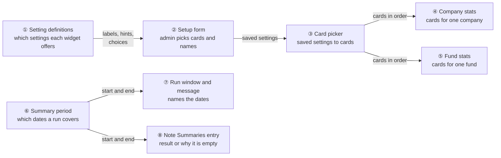
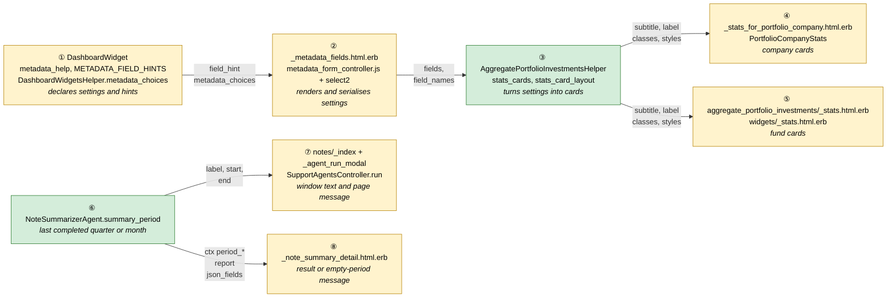
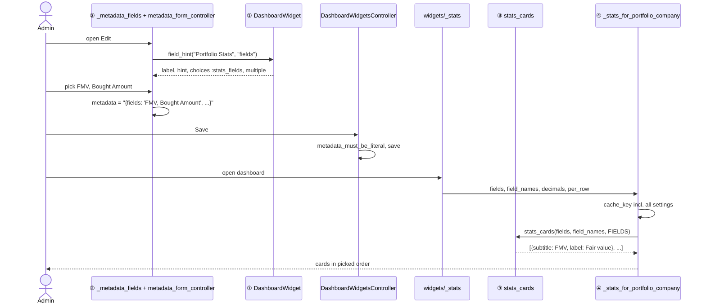
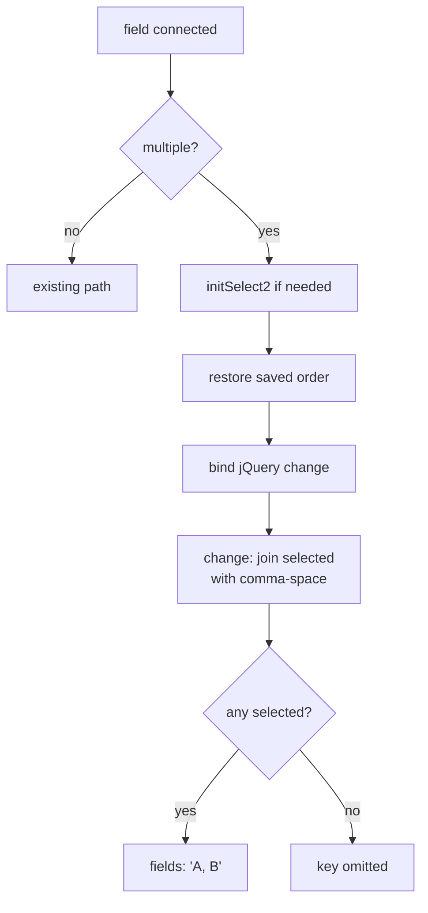
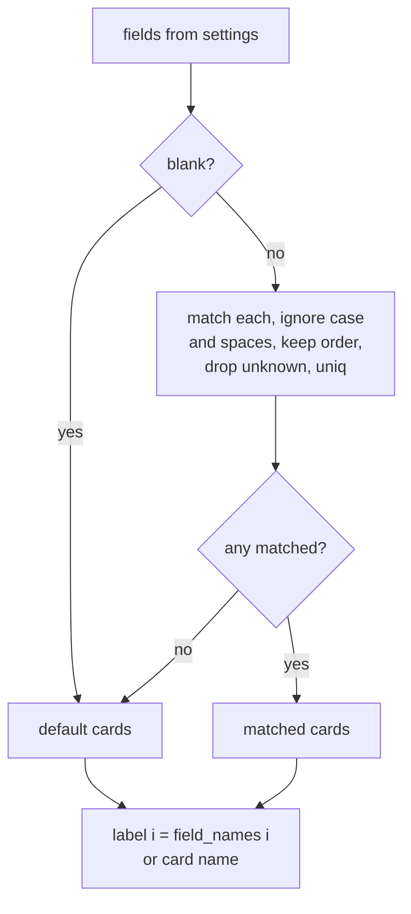
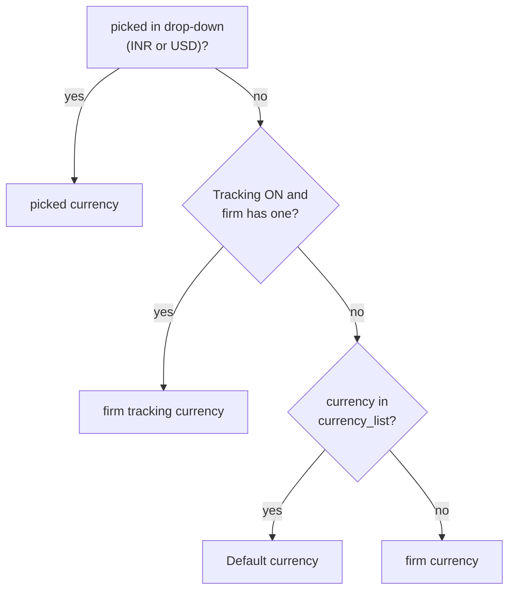
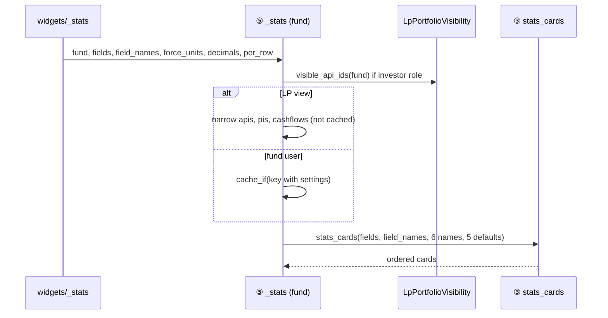
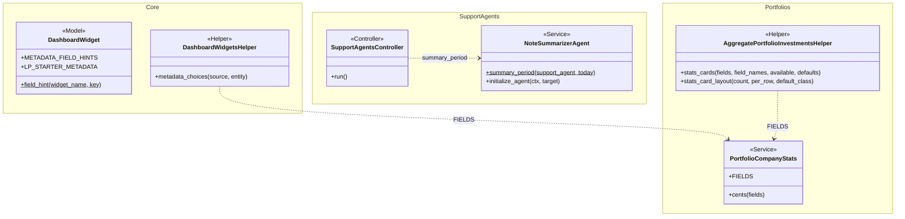

# Fix Portfolio Dashboard Widgets (second batch) — Design

> **Audience:** Engineering team.
> **Companion documents:** [Proposal](proposal.md) · [Spec](specs/) · [LLD](lld.md)

> **Planning phase — no code changes.** This document explains HOW the proposal will be built.
> Do not edit application code while writing it; implementation happens later, in the tasks phase.

> **Design, not code.** Explain the design with mermaid diagrams and tables. Real class, method and
> partial names live inside the diagrams and tables.

> **Zoom one picture.** The whole design hangs off ONE numbered picture. Part 1 draws it in plain
> words, Part 2 redraws it with real names, Part 3 has one card per box, Part 4 is reference.

---

## Contents

- [1. The idea](#1-the-idea)
  - [What this adds](#what-this-adds)
  - [The idea in one picture](#the-idea-in-one-picture)
  - [Walkthrough: one example, start to finish](#walkthrough-one-example-start-to-finish)
  - [Key ideas](#key-ideas)
- [2. The same picture with real names](#2-the-same-picture-with-real-names)
  - [Picture](#picture)
  - [What each box does](#what-each-box-does)
  - [One run, end to end](#one-run-end-to-end)
  - [Lifecycles](#lifecycles)
  - [What users see](#what-users-see)
  - [Design decisions](#design-decisions)
- [3. One card per box](#3-one-card-per-box)
  - [① Setting definitions](#-setting-definitions)
  - [② Setup form](#-setup-form)
  - [③ Card picker](#-card-picker)
  - [④ Company stats and ⑤ Fund stats](#-company-stats-and--fund-stats)
  - [⑥ Summary period](#-summary-period)
  - [⑦ Run window and run message](#-run-window-and-run-message)
  - [⑧ Note Summaries entry](#-note-summaries-entry)
- [4. Reference](#4-reference)
  - [Class diagram](#class-diagram)
  - [Data model and schema changes](#data-model-and-schema-changes)
  - [Component contracts](#component-contracts)
  - [Notifications](#notifications)
  - [Cross-cutting concerns](#cross-cutting-concerns)
  - [Worked examples](#worked-examples)
  - [Testing](#testing)
  - [Risks and open questions](#risks-and-open-questions)

---

## 1. The idea

### What this adds

Two small threads that share nothing but the dashboard.

- **Widgets:** the stats widgets get a shared "card picker" that turns saved Fields and Field names into the cards to show. The company and fund stats templates both use it. The setup form learns a "multiple" choice, reusing the hint mechanism (`DashboardWidget::METADATA_FIELD_HINTS`) and the app's select2 set-up, both added by the first batch.
- **Notes:** the Note Summariser's period calculation moves into one class method. The run window, the run response and the agent all read it, so the screens name the same dates the agent summarises. The period rule is untouched.

### The idea in one picture



### Walkthrough: one example, start to finish

Meera (fund admin) sets up stats widgets on 03 Nov 2026. Arjun runs Summarise Notes on Flipkart Unlisted the same day. Data from the [shared setup](#worked-examples).

Legend: ✓ done · ● we are here: waiting on this, not done yet · ○ not started.

**Phase 1: company Portfolio Stats**

| # | When | What happens | Behind the scenes | Result |
|---|---|---|---|---|
| 1 | 03 Nov, 10:00 | Meera opens Portfolio Stats › Edit on Flipkart Unlisted | The setup form (②) asks the setting definitions (①) for Fields' hint: a multiple choice of the six cards | **●&nbsp;Pick&nbsp;cards**<br>○&nbsp;Name&nbsp;cards<br>○&nbsp;Check&nbsp;dashboard |
| 2 | 10:01 | She picks FMV, then Bought Amount | select2 moves each picked option to the end; the setup form (②) writes `fields: 'FMV, Bought Amount'` | ✓&nbsp;Pick&nbsp;cards<br>**●&nbsp;Name&nbsp;cards**<br>○&nbsp;Check&nbsp;dashboard |
| 3 | 10:02 | Mistake: she types `Buy, Fair value` | The setup form (②) saves names as typed | ✓&nbsp;Pick&nbsp;cards<br>✓&nbsp;Name&nbsp;cards<br>**●&nbsp;Check&nbsp;dashboard** |
| 4 | 10:03 | The dashboard shows "Buy" ₹12,881.10 L (FMV's figure) | The card picker (③) labels by position; company stats (④) builds a new cached fragment because the names are in the cache key | Same as row 3 |
| 5 | 10:04 | Undo: she retypes `Fair value, Buy` and saves | Same path; new key, new fragment | ✓&nbsp;Pick&nbsp;cards<br>✓&nbsp;Name&nbsp;cards<br>✓&nbsp;Check&nbsp;dashboard |

**Phase 2: fund Portfolio Stats**

| # | When | What happens | Behind the scenes | Result |
|---|---|---|---|---|
| 6 | 10:10 | Alpha Growth Fund's Portfolio Dashboard, no settings | Fund stats (⑤) gets no fields, so the card picker (③) returns the five defaults | **●&nbsp;Configure&nbsp;fund&nbsp;widget** |
| 7 | 10:12 | She picks FMV, Sold + FMV; names `Value, Total value` | The card picker (③) returns two cards; fund stats (⑤) works out Sold + FMV = 40.00 + 310.00 = ₹350.00 Cr | ✓&nbsp;Configure&nbsp;fund&nbsp;widget |
| 8 | 10:13 | Someone opens the fund's Portfolio Investments page | Fund stats (⑤) has no settings there; its cache key differs from the widget's | Same as row 7 (page shows five cards) |

**Phase 3: Summarise Notes**

| # | When | What happens | Behind the scenes | Result |
|---|---|---|---|---|
| 9 | 11:00 | Arjun clicks Summarise Notes | The run window (⑦) asks the summary period (⑥): Quarter → Jul 01, 2026 – Sep 30, 2026 | **●&nbsp;Run&nbsp;summariser**<br>○&nbsp;Read&nbsp;result |
| 10 | 11:01 | He clicks Run Summariser | The run response (⑦) queues `SupportAgentJob` and shows a page message with the same dates | ✓&nbsp;Run&nbsp;summariser<br>**●&nbsp;Read&nbsp;result** |
| 11 | 11:02 | Stall: no notes in Jul–Sep | The agent's period comes from the summary period (⑥); `collect_notes` finds 0 | Same as row 10 |
| 12 | 11:03 | He opens Note Summaries | The Note Summaries entry (⑧) sees `note_count` 0 and shows the empty-period message | ✓&nbsp;Run&nbsp;summariser<br>✓&nbsp;Read&nbsp;result |

Key moment (row 12):

```
+-- Note Summaries ---------------------------------------------------------------+
| Report #2746 | Quarter (Jul 01, 2026 - Sep 30, 2026) | Notes processed: 0       |
| (i) No notes dated Jul 01, 2026 - Sep 30, 2026. Notes dated after               |
|     Sep 30, 2026 will be in the next quarter's summary.                         |
+---------------------------------------------------------------------------------+
```

**What to notice**

- One card picker (③) serves both stats templates, so "same settings, same behaviour" holds by construction.
- Settings that change the output are in the cache key, which is why row 4 shows straight away.
- The window, the message and the agent read one period (⑥), so they can't disagree.
- The summariser's rule and data are unchanged; only what the user is told changes.

### Key ideas

| # | Idea | In one line | Card |
|---|---|---|---|
| 1 | A "multiple" choice in the hint mechanism | One more flag on `METADATA_FIELD_HINTS`; the form renders select2 | [①](#-setting-definitions), [②](#-setup-form) |
| 2 | One card picker | Normalise fields, fall back to defaults, label by position, lay out by row | [③](#-card-picker) |
| 3 | Everything that changes output is in the cache key | Fixes the "5 days" lag and keeps the widget and page fragments apart | [④⑤](#-company-stats-and--fund-stats) |
| 4 | Empty settings mean "as today" | Fund widget and Portfolio Investments page unchanged without settings | [④⑤](#-company-stats-and--fund-stats) |
| 5 | One period method | `NoteSummarizerAgent.summary_period` used by the agent and the screens | [⑥](#-summary-period) |

**FAQ**

| Question | Answer |
|---|---|
| Why put widgets and notes in one change? | They come from the same QA document and each is small. They share no code. |
| Does anything change for users who never edit widgets? | Only the summariser screens, which gain text. Unconfigured widgets render as before. |
| Is any data rewritten? | No migration. A one-off console script removes dead settings (see [Configuration and Rollout](lld.md#configuration-and-rollout)). |

---

## 2. The same picture with real names

### Picture



Colour = footprint: **green** new, **amber** modified, **grey** reused unchanged. Exact files are in [lld.md File Map](lld.md#file-map).

### What each box does

| # | Box | Real parts | What it does | When it runs | What it decides | Details |
|---|---|---|---|---|---|---|
| ① | Setting definitions | `DashboardWidget` widget lists, `METADATA_FIELD_HINTS`, `LP_STARTER_METADATA`, `DashboardWidgetsHelper#metadata_choices` | Declares each widget's settings and their label, hint and choices | Form render | Which settings a new widget offers; which are multi-select | [card ①](#-setting-definitions) |
| ② | Setup form | `dashboard_widgets/_metadata_fields.html.erb`, `metadata_form_controller.js`, `custom/select2_handler.js` | Renders inputs, writes the metadata literal | Edit/new widget page | How a multi-select is read and restored | [card ②](#-setup-form) |
| ③ | Card picker | `AggregatePortfolioInvestmentsHelper#stats_cards`, `#stats_card_layout` | Maps saved fields to cards, applies names, lays out rows | Widget render | Which cards, in which order, with which label | [card ③](#-card-picker) |
| ④ | Company stats | `_stats_for_portfolio_company.html.erb`, `PortfolioCompanyStats` | Company totals in a target currency | Widget render, cached | Cache key | [card ④⑤](#-company-stats-and--fund-stats) |
| ⑤ | Fund stats | `aggregate_portfolio_investments/_stats.html.erb`, `widgets/_stats.html.erb` | Fund totals in fund currency, LP folio aware | Widget and Portfolio Investments page render, cached | Units, decimals, cache key | [card ④⑤](#-company-stats-and--fund-stats) |
| ⑥ | Summary period | `NoteSummarizerAgent.summary_period` | Returns label, start, end from `summary_period` and today | Window render, run, agent init | The period | [card ⑥](#-summary-period) |
| ⑦ | Run window and message | `notes/_index.html.erb`, `support_agents/_agent_run_modal.html.erb`, `SupportAgentsController#run` | Shows the dates; confirms the run | Notes list render; Run click | Message text | [card ⑦](#-run-window-and-run-message) |
| ⑧ | Note Summaries entry | `support_agents/_note_summary_detail.html.erb` | Shows the summary, or why it is empty | Note Summaries widget load | Empty-period message vs summary box | [card ⑧](#-note-summaries-entry) |

### One run, end to end

The main widget path: an admin saves Fields and Field names, then the dashboard renders.



### Lifecycles

N/A: no stored or derived status is added or changed. `SupportAgentReport` statuses are untouched.

### What users see

| Where in CapHive | Today | After this change | Who sees it |
|---|---|---|---|
| Dashboard Widgets › Edit › Portfolio Stats / Fund Portfolio Stats | Fields is free text; Currency offered but does nothing | Fields is a multi-select; Field names hint; company widget: Default currency pick-list with its order hint; fund widgets: no currency settings | Fund admins |
| Dashboard Widgets › Edit › Data Card | Cols, Field names offered; fading example | Fields and Title only; lasting help | Fund admins |
| Portfolio Dashboard, Fund Dashboard | Stats ignore settings | Stats honour Fields, names, units, decimals, per row | All dashboard viewers |
| Notes › Summarise Notes window | Agent description only | Plus the dates covered | Users with the agent enabled |
| After Run Summariser | Nothing | Page message | Same |
| Note Summaries entry with 0 notes | Empty Summary box | Empty-period message | Same |

Main journey (the setup form), with callouts:

```
+-- Widget Configuration ------------------------------------------+
| Fields (1)                          | Field names (2)            |
| [FMV x][Bought Amount x]       v    | [Fair value, Buy        ]  |
| Pick the cards to show, in order.   | List the names in the same |
|                                     | order as the Fields ... (3)|
+------------------------------------------------------------------+
```

| Step | The user… | They see |
|---|---|---|
| ① | opens the Fields list and picks cards | chips in picked order |
| ② | types names | — |
| ③ | reads the hint | the order rule and an example |

### Design decisions

1. **Extend the hint mechanism with `multiple: true`.** Alternative: a bespoke Stimulus controller for stats fields. Rejected: the first batch's `choices` path already renders selects from hints; one flag reuses it.
2. **Keep `fields` saved as a comma-separated string.** Alternative: save an array literal. Rejected: every saved widget and every stats template reads a string; changing the format would need a migration.
3. **One card picker in `AggregatePortfolioInvestmentsHelper`.** Alternative: copy the company logic into the fund template. Rejected: two copies would drift, defeating the consistency goal. Alternative: a new service object. Rejected: it is view shaping (labels, CSS), so a helper fits.
4. **Fallback to default cards when no field matches.** Alternative: show nothing, as the company widget does today. Rejected: a blank widget after release would be the worst outcome of the fund change.
5. **No currency settings on fund widgets.** None of the three ever had an effect here: the fund partial reads none of them. Alternative considered: a tracking-currency mode using `aggregate_portfolio_investments.tracking_bought_amount_cents`, `tracking_sold_amount_cents` and `tracking_fmv_cents`. Rejected (with the user, to keep it simple): Cost Of Remaining and Income have no tracking columns, and the stored tracking Bought is gross, while the fund card shows net bought (`net_bought_amount_cents`). A fund/tracking toggle would also need a new fund endpoint, because `portfolio_stats_currency_controller` only serves company and multi-company stats.
6. **Summariser: describe the period, don't change it.** Alternative: quarter-to-date for manual runs. Rejected (with the user): changes note dating and overwrite rules in code not owned by the implementer.
7. **Run message only for NoteSummarizerAgent.** Alternative: add a page message for every targeted run. Rejected: pages with a progress panel (CP/CS, SLO) don't need it, and it would change their UX.
8. **Remove dead settings from defaults, clean saved ones with a script.** Same pattern as the first batch's `docs/operations/dashboard_widget_metadata_cleanup.md`.
9. **Company `currency` becomes a working Default currency.** It had no effect (the wrapper never passed it to the company partial). Alternative: remove it. Rejected (with the user): the Aggregated Stats widget already treats `currency` as a default, and making the company widget do the same is one step in its existing currency choice. The order follows the Aggregated widget, except that Show currency filter doesn't make it fall back to the firm's currency.

**FAQ**

| Question | Answer |
|---|---|
| Why not reuse `PortfolioCompanyStats` for funds? | It converts currency per row by date. Fund totals are plain sums in fund currency, which the fund template already does. |
| Why is ③ a helper and not a component? | `NumberStatsComponent` already renders a card; ③ only decides which cards and how they are laid out. |
| Does the aggregated "Stats" widget use ③? | No. Its card names differ ("Total …") and it is out of scope. |

---

## 3. One card per box

### ① Setting definitions

The widget lists' `metadata_help` strings and the `METADATA_FIELD_HINTS` table, keyed by widget name.

| Owns | Reads / receives | Produces |
|---|---|---|
| Default settings per widget; per-setting label, hint, `integer`, `choices`, new `multiple` | — | `field_hint(name, key)`; `metadata_choices(source, entity)` |

Changes:

| Widget (dashboard) | `metadata_help` | Hints |
|---|---|---|
| Portfolio Stats (Portfolio Company) | keep `currency` | `fields`: choices `:stats_fields`, `multiple`; `field_names`: order hint; `currency`: label "Default currency", choices `:entity_currencies` (single), hint "Order: picked on page > Tracking currency (if ON) > Default currency > firm's currency" |
| Portfolio Stats (Portfolio Dashboard) | drop `currency`, `tracking_currency`, `show_currency_filter` | shared with the row above (keyed by widget name); the `currency` hint never shows because the key isn't offered |
| Fund Portfolio Stats (Fund Dashboard) | add `per_row`; drop the three currency keys | same two hints |
| Data Card (Portfolio Company) | drop `cols`, `field_names` | `fields`: lasting format hint |
| `LP_STARTER_METADATA["Data Card"]` | drop `cols: 2` | — |

`metadata_choices(:stats_fields, _)` returns `PortfolioCompanyStats::FIELDS` as `[name, name]` pairs. `metadata_choices(:entity_currencies, entity)` returns `entity.currency_list` as pairs; the form already adds a saved value missing from the list (E17 of the first batch), so an old `currency: 'SGD'` stays visible until changed. Because hints are keyed by widget name, the Portfolio Dashboard's "Portfolio Stats" gets the same hints, which is what we want now that ⑤ honours them.

**Worked examples:** H3, H8, E12, E13

**FAQ**

| Question | Answer |
|---|---|
| Labels for `force_units`, `per_row`, `tracking_currency`? | Optional polish. Add plain labels ("Units", "Cards per row", "Tracking currency") while here. They cost one hint row each. |
| What if a saved widget still has `cols`? | It still shows in the form (the form adds saved keys) until the clean-up script removes it. |

### ② Setup form

The Widget Configuration section, rendered per setting from ①, serialised by `metadata_form_controller` into the hidden `metadata` literal.

| Owns | Reads / receives | Produces |
|---|---|---|
| Input per setting; serialisation | `field_hint`, `metadata_choices`, saved metadata | `metadata` string, e.g. `{fields: 'FMV, Bought Amount'}` |

Build notes:

- **Render:** when `field_hint[:multiple]`, render `select_tag … multiple: true, class: "form-select select2"` with `data-metadata-multiple`. Options are the choices, with the saved ones first in saved order so select2 shows chips in that order. Saved names not in the choices are not rendered, so saving drops them (E11).
- **Initialise:** the global `turbo:load` / `turbo:frame-load` hooks miss fields inserted by `metadata_help.turbo_stream.erb` (choosing a widget name on New). `fieldTargetConnected` calls `initSelect2` on the field when it is `select.select2`.
- **Read:** select2 fires jQuery `change`, which native Stimulus `data-action` listeners don't receive. `fieldTargetConnected` binds `$(field).on("change", …)` to `debounceUpdate` for multiple selects. `updateMetadata` joins the selected options' values in DOM order with ", "; none selected means the key is left out.
- **Restore:** `syncFieldFromMetadata` for a multiple select splits the saved string, marks those options selected, moves them to the front in saved order, and triggers `change.select2`.



**Worked examples:** H1, H2, E11, E17, E18

**FAQ**

| Question | Answer |
|---|---|
| Why not `select multiple` without select2? | Native multi-select keeps DOM order, not click order, and is awkward to use. The app's select2 handler already keeps click order. |
| Could the jQuery bridge fire twice? | The per-element and global `select2:select` handlers both move the option and trigger change; `debounceUpdate` collapses the calls. |
| Does C1 (literal-only metadata) still hold? | Yes. The value is a plain quoted string. |

### ③ Card picker

Two helper methods shared by ④ and ⑤.

| Owns | Reads / receives | Produces |
|---|---|---|
| Field matching, fallback, labels, row layout | `fields` (array of strings), `field_names` (array), the template's available card names, its default names | `stats_cards`: ordered `[{subtitle:, label:}]`; `stats_card_layout(count, per_row)`: per-card CSS class and style |



`stats_card_layout` is the `per_row` block moved out of the company template unchanged. With `per_row` blank it returns the template's existing classes: the company count-based `col-md-*` classes, and for the fund template no class, as today.

**Worked examples:** E1, E2, E3, X1

**FAQ**

| Question | Answer |
|---|---|
| Why ignore case? | Saved values come from hand-typed settings; the old free-text field invited "fmv". |
| What about duplicates like `FMV, fmv`? | One FMV card; duplicates are dropped after matching. |

### ④ Company stats and ⑤ Fund stats

The two templates that sum figures and render `NumberStatsComponent` cards.

| Owns | Reads / receives | Produces |
|---|---|---|
| Sums, currency, caching | Settings from the widget wrapper; `params[:display_currency]`; LP visibility (⑤) | Rendered cards |

**④ Company** (`_stats_for_portfolio_company.html.erb`):
- Cache key adds `field_names`, `decimals`, `per_row`, `tracking_currency` and `currency`, which are missing today.
- Normalises `fields` through ③ before `PortfolioCompanyStats#cents`, which matches exact names.
- Builds cards from ③'s list; `stats_card_layout` replaces the inline block.
- **Default currency.** The wrapper passes the `currency` it already reads. The target-currency choice gains one step, after the tracking step and before the firm's currency. The drop-down options become the base currency, the target currency, INR and USD (deduplicated), so a default like EUR is listed and selected. `PortfolioCompanyStats` converts to any target, so nothing else changes.



**⑤ Fund** (`aggregate_portfolio_investments/_stats.html.erb`, also used by the fund's Portfolio Investments page):
- New locals with nil defaults: `fields`, `field_names`, `force_units`, `decimals`, `per_row`. The widget wrapper passes them; the Portfolio Investments page doesn't.
- `params[:force_units] = force_units.presence || fund.default_currency_units`; it is reset to nil after, as today.
- `money_to_currency(…, decimals:)` with nil keeps today's 2.
- Adds a "Sold + FMV" card (sold + FMV sums); default cards are the five existing ones.
- Cache key: `["api_stats", fund, fields, field_names, force_units, decimals, per_row]`. With all nil (the Portfolio Investments page, unconfigured widgets) the fragment is the same as today's, apart from one cache miss after deploy.
- The LP branch (`lp_api_ids`) narrows the sums before ③ runs. That path is not cached, as today. Under Allocated, `LP_ALLOCATED_PORTFOLIO_WIDGETS` already hides the stats widget from LPs, so in practice the LP branch runs only on the Portfolio Investments page, which has no settings (E7).



**Worked examples:** H4, H5, H6, H7, H13, E4, E5, E6, E7, E19, E20, E21, X3

**FAQ**

| Question | Answer |
|---|---|
| Will the Portfolio Investments page change? | No. It passes no settings, so ③ returns the five defaults and the units/decimals are today's. |
| Why compute Sold + FMV in the template? | The fund template already sums each figure; Sold + FMV is their total, as in `PortfolioCompanyStats#cents`. |
| "Bought Amount" means different things? | Yes: fund = `net_bought_amount`, company = gross buys. Known difference, unchanged ([proposal](proposal.md#what-this-feature-does-not-cover)). |

### ⑥ Summary period

A class method holding the period rule now inline in `initialize_agent`.

| Owns | Reads / receives | Produces |
|---|---|---|
| Last completed quarter / month rule | `support_agent.json_fields["summary_period"]`, `today` (default `Time.zone.today`) | `{label: "Quarter", start: Date, end: Date}` |

`initialize_agent` calls it and sets `ctx[:period_label]`, `ctx[:period_start]` and `ctx[:period_end]` from it, so behaviour is identical. The rule: Month → previous month; anything else → previous calendar quarter.

**Worked examples:** H10, E8, E9, E14, E15

**FAQ**

| Question | Answer |
|---|---|
| What if the window opens on 30 Sep and Run is clicked on 1 Oct? | The run covers Jul–Sep while the window said Apr–Jun. The page message is built at Run time, so it is right; accepted edge case. |
| Why a class method, not a helper? | The agent is the owner of the rule; the views ask it. |

### ⑦ Run window and run message

The Notes list's Summarise Notes button, the shared run modal, and `SupportAgentsController#run`.

| Owns | Reads / receives | Produces |
|---|---|---|
| Window text; page message after Run | ⑥ for the entity's NoteSummarizerAgent | Modal info line; notice in `#user_alert` |

- `notes/_index.html.erb` finds the entity's `NoteSummarizerAgent`, asks ⑥ for the period, and passes the text to `_agent_run_modal` via a new optional `period_notice` local (rendered as a small info alert under the description). Other callers don't pass it, so they are unchanged.
- `SupportAgentsController#run`, turbo_stream branch with a target: for `NoteSummarizerAgent`, also append `turbo_stream.update("user_alert", partial: "layouts/alerts", locals: { notice: <message> })`. `#user_alert` is always in the layout, whereas `#page_alerts` exists only when the page loaded with a notice. The two progress-panel replaces stay (they are no-ops on the Notes page).

| Verb and path | Action | Does | Responds with |
|---|---|---|---|
| POST `/support_agents/run` | `run` | Queues `SupportAgentJob` (unchanged) | turbo_stream: progress panels + page alert for NoteSummarizerAgent |

Authorisation is unchanged: `authorize @support_agent` with `run_target` checks the target's firm.

**Worked examples:** H10, H11, E16

**FAQ**

| Question | Answer |
|---|---|
| Why does the message say "dated 30/09/2026"? | `save_summary_as_note` dates the summary note with the period end. The message formats it with `l(date)`, as in the Notes list. |
| What if the agent is disabled? | The button stays greyed out and no window renders (existing branch). |

### ⑧ Note Summaries entry

The detail partial rendered per report in the Note Summaries widget.

| Owns | Reads / receives | Produces |
|---|---|---|
| Summary vs empty display | `report.json_fields`: `note_count`, `period_label`, `period_start`, `period_end`, `summary_text` | Summary card, or the empty-period alert |

When `note_count` is 0 and `summary_text` is blank, render the empty-period alert in place of the summary card (even when `can_edit`). When notes existed but `summary_text` is blank (LLM failure), keep today's display: the empty, editable summary card for editors, the "No summary text available…" alert for others (X2). The auto-tagging line stays.

The Period column's start date switches from `format: :short` ("Jul 01") to `format: :abbr_month_day_year` ("Jul 01, 2026"), matching the end date and the window text (E9).

**Worked examples:** H12, E10, X2

**FAQ**

| Question | Answer |
|---|---|
| Why not change the agent's issue messages? | They feed reports and logs elsewhere. The view has everything it needs in `json_fields`. |
| Old reports without `period_start`? | The alert needs the dates; without them it falls back to today's behaviour. |

---

## 4. Reference

### Class diagram



### Data model and schema changes

N/A: no tables or columns change. `dashboard_widgets.metadata` keeps its format; the one-off script only removes keys.

### Component contracts

| From → To | Contract | Direction rule |
|---|---|---|
| ① → ② | `field_hint(widget_name, key)` returns `{label:, hint:, integer:, choices:, multiple:}`; `metadata_choices(:stats_fields, entity)` returns `[[name, name]]`; `metadata_choices(:entity_currencies, entity)` returns `entity.currency_list` pairs | Form reads definitions; never the reverse |
| ② → ③ | Saved `metadata` literal with `fields: 'A, B'`, `field_names: 'x, y'`, split on "," and stripped by the widget wrapper | Settings are data; ③ never parses the literal itself |
| ③ → ④/⑤ | `stats_cards` returns ordered `{subtitle:, label:}`; `stats_card_layout` returns `[classes, styles]` | Templates own sums; ③ owns order and labels |
| ⑥ → ⑦/⑧ | `summary_period` returns `{label:, start:, end:}`; the agent stores them in report `json_fields` | Views never compute a period themselves |

### Notifications

None sent, added, changed or suppressed. Investor side: the summariser doesn't email investors, and stats widgets send nothing. Internal side: the only new user-facing output is an in-page flash after Run, shown to the user who clicked. It isn't a `Noticed` notification and isn't stored.

| Notification | Trigger | Recipients | Channel | Customisable | Default | Sent once? |
|---|---|---|---|---|---|---|
| (in-page message, not a notification) "Summarising notes dated…" | Run Summariser click | The clicking user only | Page alert (flash.now) | No | On | Per click; not stored |

### Cross-cutting concerns

#### Transactions and queries

The fund template adds no queries for settings. "Sold + FMV" reuses the sold and FMV sums already run. ⑦ adds one `SupportAgent.find_by(agent_type:, entity_id:)` per Notes list render with an owner. That lookup already happens for the enabled check via `support_agents.set?`.

#### Exception handling and monitoring

N/A: no new failure modes. The company template's existing `rescue → ErrorReport.notify` stays.

#### Performance and security

- Cache keys gain a few small values; fragments still expire in 5 days. The fund fragment count grows only by distinct widget settings.
- Tenant isolation unchanged: stats are scoped by fund/company as today; the summariser run keeps `authorize` with `run_target`. Metadata stays literal-only (`metadata_must_be_literal`).
- Labels from `field_names` are rendered by `NumberStatsComponent` with Rails escaping, as today.

### Worked examples

**ID legend:** **H** = Happy path · **E** = Edge case · **X** = Error (exception) case.

**Shared setup:**

| Record | Name | Key data |
|---|---|---|
| Entity | Golden Angels | INR; exchange rates for USD (so `currency_list` = USD, INR); no SGD rates; tracking currency USD (set only in E20); NoteSummarizerAgent enabled, `summary_period` blank (Quarter) |
| Portfolio company | Flipkart Unlisted | Bought ₹1,695.86 L, Sold ₹2,009.74 L, FMV ₹12,881.10 L, Cost Of Remaining ₹63.17 L, Income ₹0 |
| Fund | Alpha Growth Fund | INR, default units Crores; Bought ₹250.00 Cr, Sold ₹40.00 Cr, FMV ₹310.00 Cr, Cost Of Remaining ₹220.00 Cr, Income ₹5.00 Cr |
| LP | Ravi (investor user) | Allocated LP portfolio view; folio holds FMV ₹62.00 Cr of the fund's ₹310.00 Cr |
| Notes on Flipkart Unlisted | 4 notes | 27/10, 29/10, 30/10, 04/11/2026 |
| Today | — | 03 Nov 2026 (time travel) |

#### Happy Path

| # | Scenario | Given | When | Then | Spec scenario | Feature |
|---|---|---|---|---|---|---|
| H1 | Fields saved in picked order | Portfolio Stats widget on Portfolio Company Dashboard | Admin picks FMV then Bought Amount and saves | Saved metadata contains `fields: 'FMV, Bought Amount'` | Cards are saved in the order picked | features/core/dashboard_widget_metadata.feature |
| H2 | Saved fields reopen in order | Widget saved with `fields: 'Sold Amount, Bought Amount'` | Admin opens Edit | Fields shows Sold Amount then Bought Amount | Saved cards reopen in their saved order | features/core/dashboard_widget_metadata.feature |
| H3 | Field names hint | Fund Portfolio Stats on Fund Dashboard | Admin opens Edit | `field_names` helper text contains "same order as the Fields you picked" | Field names hint | features/core/dashboard_widget_metadata.feature |
| H4 | Renamed label shows at once | Flipkart widget with `fields: 'Bought Amount', field_names: 'Buy'`, page visited once | Field names changed to "Invested", page reloaded | Card reads "Invested" | Renamed label shows at once | features/fund/portfolio_stats_widget_settings.feature |
| H5 | Fund widget picks and names | Alpha Growth Fund widget with `fields: 'FMV, Sold + FMV', field_names: 'Value, Total value'` | User opens Portfolio Dashboard | "Value" ₹310.00 Cr then "Total value" ₹350.00 Cr | Picked fields and names | features/fund/portfolio_stats_widget_settings.feature |
| H6 | Fund units and decimals | Fund Portfolio Stats on Fund Dashboard with `force_units: 'Lakhs', decimals: 0` | User opens Fund Dashboard | FMV reads ₹31,000 L | Units and decimals | features/fund/portfolio_stats_widget_settings.feature |
| H7 | Fund cards per row | Fund widget with `per_row: 2`, no fields | User opens Portfolio Dashboard | Five cards; first four at 50% width, last at 100% | Cards per row | features/fund/portfolio_stats_widget_settings.feature |
| H8 | Data Card offers Fields and Title | — | Admin adds a Data Card | Fields and Title shown; no `cols` or `field_names` | Data Card settings | features/core/dashboard_widget_metadata.feature |
| H9 | Data Card help stays | Data Card Edit | Admin types "Category:" in Fields | Helper text containing "custom_fields." still shown | Help stays while typing | features/core/dashboard_widget_metadata.feature |
| H10 | Window names the quarter | Flipkart Notes list, quarterly agent | User clicks Summarise Notes | Window says "Summarises notes dated Jul 01, 2026 – Sep 30, 2026 (the last completed quarter)." | Quarterly agent | features/ai/support_agents/note_summarizer_run_feedback.feature |
| H11 | Message after Run | Same | User clicks Run Summariser | Page shows "Summarising notes dated Jul 01, 2026 – Sep 30, 2026. The summary will appear in this Notes list as a note tagged 'summary' dated 30/09/2026, and in the Note Summaries widget." | Message after run | features/ai/support_agents/note_summarizer_run_feedback.feature |
| H12 | Summary note appears | Notes dated 10/08 and 20/09/2026; LLM stubbed to "Two updates." | The summariser runs for Flipkart, user opens Notes | A note tagged "summary" dated 30/09/2026 reading "Two updates." | Summary appears in the Notes list | features/ai/support_agents/note_summarizer_run_feedback.feature |
| H13 | Default currency used | Flipkart widget `currency: 'USD'`, `show_currency_filter: true`, Tracking currency off | Dashboard opens, nothing picked | Cards in USD; drop-down has USD selected | Default currency used | features/fund/portfolio_stats_widget_settings.feature |

#### Edge Cases

| # | Scenario | Given | When | Then | Spec scenario | Feature |
|---|---|---|---|---|---|---|
| E1 | Lower-case fields | Flipkart widget `fields: 'fmv, sold amount'` | Dashboard opens | FMV then Sold Amount cards | Lower-case field names match | features/fund/portfolio_stats_widget_settings.feature |
| E2 | Fewer names than cards | Flipkart widget `fields: 'Bought Amount, Sold Amount, FMV', field_names: 'Buy'` | Dashboard opens | Buy, Sold Amount, FMV | Fewer names than cards | features/fund/portfolio_stats_widget_settings.feature |
| E3 | More names than cards; duplicate field | Flipkart widget `fields: 'FMV, fmv', field_names: 'Value, Extra'` | Dashboard opens | One card, "Value" | Stats card fields match leniently (requirement) | features/fund/portfolio_stats_widget_settings.feature |
| E4 | Decimals change shows at once | Flipkart widget `decimals: 2`, page visited | Decimals set to 0, reload | Amounts show no decimals | Decimals change shows at once | features/fund/portfolio_stats_widget_settings.feature |
| E5 | Widget and Portfolio Investments page don't share | Fund widget `fields: 'FMV'`, dashboard visited | User opens the fund's Portfolio Investments page | Five default cards | Fund widget and Portfolio Investments page do not share cards | features/fund/portfolio_stats_widget_settings.feature |
| E6 | Fund widget, no settings | Fund widget with blank metadata | Dashboard opens | Bought, Sold, FMV, Cost Of Remaining, Income in Cr, 2 decimals; no Sold + FMV | No settings, unchanged | features/fund/portfolio_stats_widget_settings.feature |
| E7 | LP folio totals unaffected by settings | Growth Fund I (FMV ₹96 Cr) under Allocated; Ravi's folio holds Acme (FMV 40) and Cedar (FMV 18); fund widget `fields: 'FMV', field_names: 'Value'` | Ravi opens the Portfolio Dashboard, then the Portfolio Investments page | Dashboard shows the holdings list and no stats widget (E42 of lp-folio-portfolio-dashboard); Portfolio Investments shows FMV ₹58 Cr | LP folio totals | features/fund/portfolio_stats_widget_settings.feature |
| E8 | Monthly agent | `summary_period: Month` | Summarise Notes opened 03 Nov 2026 | "Oct 01, 2026 – Oct 31, 2026 (the last completed month)" | Monthly agent | features/ai/support_agents/note_summarizer_run_feedback.feature |
| E9 | Window and report agree | Quarterly agent | Run, report saved | Report period Jul 01, 2026 – Sep 30, 2026 equals window text | Window and summary agree | features/ai/support_agents/note_summarizer_run_feedback.feature |
| E10 | Notes only after the period | Shared notes (Oct–Nov) | Run finishes; Note Summaries opened | "Notes processed: 0", empty-period message, no Summary box | Notes only after the period | features/ai/support_agents/note_summarizer_run_feedback.feature |
| E11 | Unknown saved field dropped | Widget saved `fields: 'FMV, Total FMV'` | Admin opens Edit, saves | Saved `fields: 'FMV'` | Cards are saved in the order picked (requirement: dropped on save) | features/core/dashboard_widget_metadata.feature |
| E12 | Company stats: Default currency offered | — | Admin adds Portfolio Stats on Portfolio Company Dashboard | `tracking_currency`, `show_currency_filter` and `currency` present; `currency` is a pick-list of USD, INR labelled "Default currency" with helper text "Order: picked on page > Tracking currency (if ON) > Default currency > firm's currency" | Company stats settings | features/core/dashboard_widget_metadata.feature |
| E13 | Fund stats: no currency settings | — | Admin adds Fund Portfolio Stats | No `currency`, `tracking_currency`, `show_currency_filter` | Fund stats settings | features/core/dashboard_widget_metadata.feature |
| E14 | Year boundary | Today 01 Jan 2027, quarterly | Summarise Notes opened | "Oct 01, 2026 – Dec 31, 2026" | Quarterly agent | features/ai/support_agents/note_summarizer_run_feedback.feature |
| E15 | Last day of a quarter | Today Sep 30, 2026, quarterly | Summarise Notes opened | "Apr 01, 2026 – Jun 30, 2026" | Quarterly agent | features/ai/support_agents/note_summarizer_run_feedback.feature |
| E16 | Agent disabled | Agent disabled for the entity | Notes list opens | Greyed Summarise Notes, no window text | The run window names the period covered (requirement: unchanged when disabled) | features/ai/support_agents/note_summarizer_run_feedback.feature |
| E17 | All chips removed | Widget saved `fields: 'FMV'` | Admin removes the chip and saves | Saved metadata has no `fields`; dashboard shows all cards | Cards are saved in the order picked | features/core/dashboard_widget_metadata.feature |
| E18 | New widget, name chosen later | New widget page, dashboard Portfolio Company | Admin chooses "Portfolio Stats" as widget name | Fields renders as a working multi-select; picking FMV updates the hidden metadata | Cards are saved in the order picked | features/core/dashboard_widget_metadata.feature |
| E19 | Picked currency wins | Flipkart widget `currency: 'USD'`, `show_currency_filter: true` | Viewer picks INR in the drop-down | Cards in INR | Picked currency wins | features/fund/portfolio_stats_widget_settings.feature |
| E20 | Tracking currency wins over the default | Golden Angels tracking currency USD; Flipkart widget `tracking_currency: true`, `currency: 'INR'` | Dashboard opens | Cards in USD | Tracking currency wins over the default | features/fund/portfolio_stats_widget_settings.feature |
| E21 | Drop-down lists the firm's currencies | Golden Angels also has SGD↔INR rates; Flipkart widget `show_currency_filter: true` | Viewer opens the drop-down and picks SGD | Drop-down lists INR, SGD, USD (as the metadata editor); cards in S$ | Drop-down lists the firm's currencies | features/fund/portfolio_stats_widget_settings.feature |

#### Error Cases

| # | Scenario | Given | When | Then (what the user sees, who is alerted) | Spec scenario | Feature |
|---|---|---|---|---|---|---|
| X1 | No field matches | Flipkart widget `fields: 'Total FMV'` | Dashboard opens | All six default cards; no alert | No field matches | features/fund/portfolio_stats_widget_settings.feature |
| X2 | LLM fails with notes present | Notes dated 10/08/2026; LLM stub raises | Run finishes; Note Summaries opened | "Notes processed: 1"; no empty-period message; today's display stays (an editor sees the empty, editable Summary box; others see "No summary text available…") | An empty summary says why (requirement: only for no notes) | features/ai/support_agents/note_summarizer_run_feedback.feature |
| X3 | Default currency without rates | Flipkart widget `currency: 'SGD'` | Dashboard opens | Cards in INR (firm currency); no error | Default currency without rates | features/fund/portfolio_stats_widget_settings.feature |

### Testing

Cucumber only. Widget form rows extend `features/core/dashboard_widget_metadata.feature` and its steps (`@javascript` for select2). Render rows go in a new `features/fund/portfolio_stats_widget_settings.feature`. Summariser rows go in a new `features/ai/support_agents/note_summarizer_run_feedback.feature`, with time travel and an LLM stub on the agent's chat call. Every scenario carries a comment with its ID and path; code comments name the IDs they implement.

### Risks and open questions

- Saved fund-level settings start taking effect (e.g. `force_units: 'Millions'`) → the clean-up dry run prints them as `REVIEW` for support to check before release.
- Saved company `currency` values start taking effect (the old example suggested `currency: 'USD'`) → the clean-up dry run prints company Portfolio Stats widgets with a saved `currency` as `REVIEW`.
- select2 events not reaching Stimulus → the explicit jQuery bridge in ② and E18 / H1 as `@javascript` tests.
- The company cache key gains values, so all company stats fragments miss once after deploy → acceptable; they rebuild on first view.
- `METADATA_FIELD_HINTS` is keyed by widget name, so the aggregated dashboard's "Stats" widget isn't affected (different name) → confirmed; no action.

No open questions.

**FAQ**

| Question | Answer |
|---|---|
| Where do I start reviewing? | Card ③ (the shared logic), then ⑤ (the template shared with the Portfolio Investments page). |
| What is the riskiest part? | ⑤'s cache key and defaults, because the Portfolio Investments page shares it. E5 and E6 guard it. |
| Can this ship without the clean-up script? | Yes. Dead keys would only show in the form until it runs, and fund widgets with saved settings would change without review. Run it first. |
