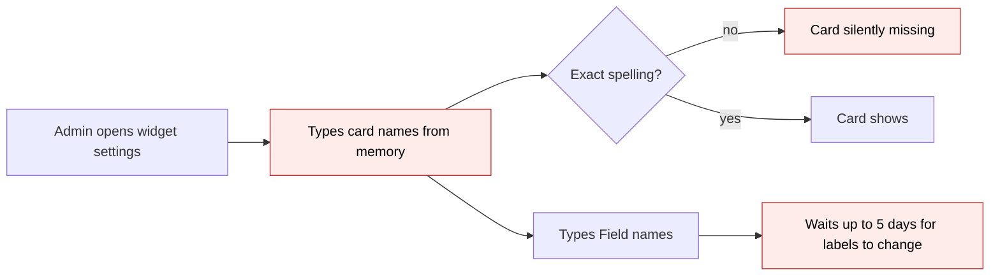
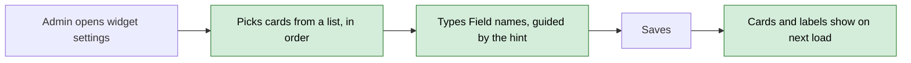
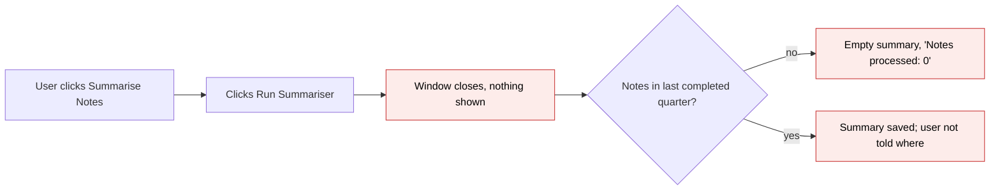
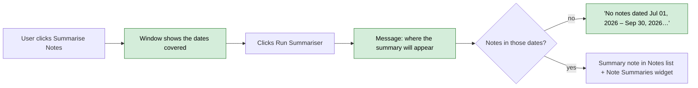
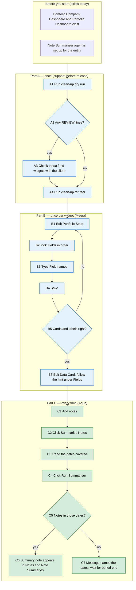

# Fix Portfolio Dashboard Widgets (second batch) — Proposal

> **Audience:** Business team, product, QA, support — non-technical.
> **Companion document:** [Design](design.md)
> **New to this? Start with the [Workflow Journey](#workflow-journey)** — every action, in order, from start to the outcome.

> **Planning phase — no code changes.** This document proposes and explains the change. Do not
> edit application code while writing it; implementation happens later, in the tasks phase.

---

## Why

The second part of the QA review of the Portfolio Company Dashboard ("Dashboard - Observation", items 8–11) found four more problems. The Portfolio Stats settings make you type exact card names from memory. The Data Card offers two settings that do nothing. "Summarise Notes" produced an empty summary with no explanation, and nothing on screen says where a summary goes. The first batch (items 1–7) was fixed in `fix-portfolio-dashboard-widgets`; this change covers the rest.

While checking item 8 we also found that the **fund-level** stats widgets ("Portfolio Stats" on the Portfolio Dashboard and "Fund Portfolio Stats" on the Fund Dashboard) offer the same settings as the company widget but ignore all of them. Since the aim is that similar widgets behave the same, this change makes the fund-level widgets honour the same settings, apart from currency.

## What Changes

1. **Portfolio Stats: pick Fields from a list.** "Fields" becomes a multi-select of the six cards (Bought Amount, Sold Amount, FMV, Cost Of Remaining, Income, Sold + FMV). Cards show in the order you pick them. "Field names" gets a permanent hint: *list the names in the same order as the Fields you picked*.
2. **Portfolio Stats: renamed labels show straight away.** Today, changing Field names, decimals, cards per row, the tracking-currency setting or the default currency can take up to 5 days to show, because the saved copy of the widget doesn't notice these settings. After the fix a change shows on the next page load.
3. **Portfolio Stats: forgiving field names.** "fmv" or "sold amount" now match their cards. If none of the saved fields match a card, the widget shows all cards instead of going blank.
4. **Portfolio Stats (company): Default currency now works.** The `Currency` setting has never had an effect on this widget (checked in the code). It becomes **Default currency**, a pick-list of the firm's currency and the currencies it has exchange rates for. The widget opens in that currency, and the on-page currency drop-down starts on it. The order in which currencies win:
   1. a currency the viewer picked in the drop-down;
   2. the firm's tracking currency, when Tracking currency is ON;
   3. the Default currency, if the firm has exchange rates for it;
   4. the firm's own currency.

   This matches the Aggregated Portfolio Dashboard's Stats widget, except that a Default currency is still used when Show currency filter is on.
5. **Fund-level stats widgets use the same settings.** On the Portfolio Dashboard and the Fund Dashboard, Fields, Field names, Units, Decimals and Cards per row now work. "Sold + FMV" can be picked as a sixth card. A fund widget with no settings looks exactly as it does today.
6. **Settings that do nothing are removed from the form.**
   - Data Card: `Cols` and `Field names`.
   - Fund-level stats widgets: `Currency`, `Tracking currency` and `Show currency filter`. None of these has ever had an effect on these widgets (checked in the code). We're keeping them in the fund's own currency on purpose. Tracking-currency values are stored only for Bought (before sales), Sold and FMV. Cost Of Remaining and Income have none, so a tracking view would be incomplete.
7. **Data Card: permanent help under Fields.** The help that disappears once you start typing is replaced by text that stays visible under the box. It explains the `Label:field` format and the `custom_fields.` prefix, with examples.
8. **Summarise Notes says which notes it covers.** The run window shows the exact dates, e.g. *"Summarises notes dated Jul 01, 2026 – Sep 30, 2026 (the last completed quarter)."* The summary rule itself doesn't change: it still covers the last completed quarter or month, as configured.
9. **Summarise Notes confirms the run.** After you click Run, a message says where the summary will appear: as a note tagged "summary", dated the last day of the period, in this Notes list, and in the Note Summaries widget. Today the window closes and nothing happens on screen.
10. **An empty summary explains itself.** If the period had no notes, the Note Summaries widget shows *"No notes dated Jul 01, 2026 – Sep 30, 2026. Notes dated after Sep 30, 2026 will be in the next quarter's summary."* Today it shows an empty Summary box and "Notes processed: 0".

No breaking changes. Widgets with no saved settings look the same as today.

### Flow Diagram

Choosing Portfolio Stats cards, before and after:





Summarise Notes, before and after:





---

## Workflow Journey

### Who is involved

| Person | Role | What they do in the journey |
|---|---|---|
| Meera | Fund admin (can edit dashboard widgets) | Sets up the Portfolio Stats and Data Card widgets for Flipkart Unlisted and for the fund |
| Arjun | Fund manager user with the Note Summariser enabled | Adds notes on Flipkart Unlisted and runs Summarise Notes |
| Support | CapHive support | Runs the one-off settings clean-up before release |

### The journey on one page



### Before you start

| Needed | Why | Where it comes from |
|---|---|---|
| Edit rights on dashboard widgets | To change widget settings | Fund admin role |
| Portfolio investments for the company / fund | So the stats cards have figures | Portfolio Investments |
| Note Summariser agent, enabled, with "Summary period" set (Quarter by default) | To run Summarise Notes | Support Agents settings |
| Notes on the company | Something to summarise | Notes tab / Notes widget |

### Part A — once (support, before release)

| Step | Who | Where | Action | What the system does | What you see |
|---|---|---|---|---|---|
| A1 | Support | Production console | Run the clean-up script with `apply = false` | Lists widgets holding removed settings, and fund-level stats widgets with saved settings that will start to take effect | `WOULD FIX` and `REVIEW` lines, and a count |
| A2–A3 | Support | — | Check each `REVIEW` widget's saved Fields / Units / Currency with the client | — | e.g. a fund widget with `force_units: 'Millions'` will switch to millions after release; a company widget with `currency: 'USD'` will open in USD |
| A4 | Support | Production console | Run again with `apply = true` | Removes the dead settings | `FIX` lines; a second dry run prints `Would fix 0` |

### Part B — once per widget (Meera)

| Step | Who | Where | Action | What the system does | What you see |
|---|---|---|---|---|---|
| B1 | Meera | Flipkart Unlisted › Dashboard › Portfolio Stats › Edit | Open the settings | Shows Widget Configuration | Fields is a list box; Field names has a hint under it; Default currency is a pick-list (INR, USD for this firm) |
| B2 | Meera | Fields | Pick Bought Amount, Sold Amount, FMV, in that order | Keeps the order picked | Three chips: Bought Amount · Sold Amount · FMV |
| B3 | Meera | Field names | Type `Buy, Sell, Fair value` | — | — |
| B4 | Meera | Save | Save | Saves `fields: 'Bought Amount, Sold Amount, FMV', field_names: 'Buy, Sell, Fair value'` | Back on the dashboard |
| B5 | Meera | Dashboard | Look at the widget | Shows the three cards, relabelled | Buy ₹1,695.86 L · Sell ₹2,009.74 L · Fair value ₹12,881.10 L |
| B6 | Meera | Data Card › Edit | Read the hint under Fields; type `Category:category, KPI Currency:custom_fields.kpi_currency` | — | No Cols or Field names settings |

### Part C — every time (Arjun)

| Step | Who | Where | Action | What the system does | What you see |
|---|---|---|---|---|---|
| C1 | Arjun | Notes widget › New Note | Adds notes dated 27/10, 29/10, 30/10 and 04/11/2026 | Saves them | Four notes in the list |
| C2 | Arjun | Notes widget › Summarise Notes | Click, on 03 Nov 2026 | Works out the period: last completed quarter = Jul 01, 2026 – Sep 30, 2026 | Window with "Summarises notes dated Jul 01, 2026 – Sep 30, 2026 (the last completed quarter)" |
| C4 | Arjun | Window › Run Summariser | Click | Queues the summary in the background | Window closes; message "Summarising notes dated Jul 01, 2026 – Sep 30, 2026. The summary will appear in this Notes list as a note tagged 'summary' dated 30/09/2026, and in the Note Summaries widget." |
| C5–C7 | — | Note Summaries widget | Reload | No notes in 01 Jul – 30 Sep, so nothing to summarise | "No notes dated Jul 01, 2026 – Sep 30, 2026. Notes dated after Sep 30, 2026 will be in the next quarter's summary." |
| C6 | Arjun | Same, in January 2027 | Run again | Period is now Oct 01, 2026 – Dec 31, 2026; 4 notes collected | A note tagged "summary, quarter" dated 31/12/2026 in the Notes list; the summary in Note Summaries |

### What you see

Portfolio Stats settings (B1–B3):

```
+-- Widget Configuration ------------------------------------------------+
| Fields                                | Field names                    |
| [Bought Amount x][Sold Amount x][FMV x]| [Buy, Sell, Fair value       ] |
| Pick the cards to show, in order.     | List the names in the same     |
|                                       | order as the Fields you picked,|
|                                       | separated by commas. E.g.      |
|                                       | Bought Amount, Sold Amount,    |
|                                       | FMV -> Buy, Sell, Fair value   |
| Units [Lakhs v]   Decimals [2]   Cards per row [3]                     |
| Tracking currency [Default v]   Show currency filter [ON v]            |
| Default currency [None v]                                              |
| Used when no currency is picked on the page and Tracking currency is   |
| off.                                                                   |
+------------------------------------------------------------------------+
```

The resulting cards (B5), using Flipkart Unlisted's figures:

```
+------------------+  +------------------+  +---------------------+
| Rs 1,695.86 L    |  | Rs 2,009.74 L    |  | Rs 12,881.10 L      |
| Buy              |  | Sell             |  | Fair value          |
+------------------+  +------------------+  +---------------------+
Adding "Sold + FMV" would show 2,009.74 + 12,881.10 = Rs 14,890.84 L
```

Fund-level Portfolio Stats with no settings (unchanged), e.g. Alpha Growth Fund in crores:

```
Bought Rs 250.00 Cr | Sold Rs 40.00 Cr | FMV Rs 310.00 Cr | Cost Of Remaining Rs 220.00 Cr | Income Rs 5.00 Cr
With fields 'FMV, Sold + FMV' and field_names 'Value, Total value':
Value Rs 310.00 Cr | Total value Rs 350.00 Cr          (40.00 + 310.00 = 350.00)
```

Run window (C2):

```
+-- Summarise Investor Notes ----------------------------------- x --+
| Generates LLM-based summaries of investor notes ...                |
| (i) Summarises notes dated Jul 01, 2026 - Sep 30, 2026               |
|     (the last completed quarter).                                  |
|                                    [Cancel]  [Run Summariser]      |
+--------------------------------------------------------------------+
```

Empty result (C7):

```
+-- Note Summaries ------------------------------------------------------------------+
| Flipkart Unlisted | Quarter Jul 01, 2026 - Sep 30, 2026 | 0 | Ready | Nov 03, 2026 |
|  (i) No notes dated Jul 01, 2026 - Sep 30, 2026. Notes dated after Sep 30, 2026   |
|      will be in the next quarter's summary.                                        |
+------------------------------------------------------------------------------------+
```

### What goes wrong

**A fund widget suddenly changes after release.** Alpha Growth Fund's Portfolio Stats was saved months ago with `force_units: 'Millions'`. Today that setting is ignored and the widget shows crores. After release it takes effect and the widget shows millions. The clean-up dry run (A1) lists this widget as `REVIEW`. Support either confirms the client wants millions, or Meera clears Units on that widget.

**Field names in the wrong order.** Meera picks FMV, Bought Amount and types `Buy, Fair value`. The cards read "Buy" on the FMV figure. Fix: edit the widget and type the names in the order of the chips, following the hint.

### Summary: the minimum actions

| # | Action | Who | How often |
|---|---|---|---|
| 1 | Run the clean-up dry run, review, then apply | Support | Once, before release |
| 2 | Pick Fields and type Field names on each stats widget that needs custom cards | Meera | Once per widget |
| 3 | Click Summarise Notes › Run Summariser | Arjun | Whenever a summary is wanted |

---

## User Stories

### US-1: Pick stats cards from a list
**As a** fund admin, **I want** to pick Portfolio Stats cards from a list, **so that** I don't have to remember exact names.

**Acceptance criteria:**
- Fields on "Portfolio Stats" (Portfolio Company Dashboard and Portfolio Dashboard) and "Fund Portfolio Stats" (Fund Dashboard) is a multi-select of the six card names.
- The cards show in the order the admin picked them; reopening the form shows the chips in that same order.
- Field names shows the hint "List the names in the same order as the Fields you picked, separated by commas. E.g. Bought Amount, Sold Amount, FMV → Buy, Sell, Fair value".
- Leaving Fields empty shows all cards, as today.

### US-2: Setting changes show straight away
**As a** fund admin, **I want** my label, decimals and layout changes to show on the next load, **so that** I can see whether my setup is right.

**Acceptance criteria:**
- Changing Field names, Decimals, Cards per row, Units or Tracking currency on the company Portfolio Stats widget shows on the next page load.
- The same holds for the fund-level stats widgets.

### US-3: Fund-level stats widgets honour their settings
**As a** fund admin, **I want** the fund-level stats widgets to use Fields, Field names, Units, Decimals and Cards per row like the company widget, **so that** similar widgets behave the same.

**Acceptance criteria:**
- With no settings, the fund widget shows the same five cards, units and decimals as today.
- "Sold + FMV" appears only when picked.
- The fund's Portfolio Investments page (which shows the same cards above the grid) is unchanged.
- An LP who sees only their folio's holdings still sees only those totals.
- No Currency, Tracking currency or Show currency filter settings are offered.

### US-3a: Company stats open in a chosen default currency
**As a** fund admin, **I want** to set the currency the company Portfolio Stats widget opens in, **so that** viewers see the figures in the currency the firm reports in without picking it each time.

**Acceptance criteria:**
- Default currency is a pick-list of the firm's currency and the currencies it has exchange rates for.
- With Default currency USD and nothing picked on the page, the cards are in USD and the drop-down shows USD.
- A viewer's pick in the drop-down overrides the Default currency.
- With Tracking currency ON, the tracking currency wins over the Default currency.
- A saved Default currency the firm has no rates for is ignored; the firm's own currency is used, with no error.

### US-4: Data Card shows only working settings, with help that stays
**As a** fund admin, **I want** the Data Card form to show only Fields and Title, with lasting help on the Fields format, **so that** I can set it up without guessing.

**Acceptance criteria:**
- No Cols or Field names settings on a new Data Card.
- Under Fields: "Standard field: a label, a colon, then the field name, e.g. Category:category, Sector:sector, City:city. Custom field: the same, with custom_fields. before the name, e.g. KPI Currency:custom_fields.kpi_currency. Separate entries with commas."

### US-5: Summarise Notes is clear about what it covers
**As a** user running Summarise Notes, **I want** to see the dates covered and where the result goes, **so that** an empty or missing summary isn't a mystery.

**Acceptance criteria:**
- The run window shows "Summarises notes dated {start} – {end} (the last completed {quarter|month})."
- After Run, a page message names the period and says the summary appears in the Notes list as a note tagged "summary" dated {end}, and in the Note Summaries widget.
- When the period had no notes, the Note Summaries detail shows "No notes dated {start} – {end}. Notes dated after {end} will be in the next {quarter|month}'s summary." instead of an empty Summary box.

---

## UI Behavior

### Widget Configuration — Portfolio Stats (all three stats widgets)

See the mockup under [What you see](#what-you-see).

**Behavior notes:**
- Fields uses the app's standard searchable multi-select. Picking adds a chip at the end; removing a chip removes the card.
- The saved value stays in today's format (`fields: 'Bought Amount, FMV'`), so widgets saved before the change open with their cards pre-selected in their saved order.
- A saved name that isn't one of the six cards (e.g. a typo) isn't offered in the list. Saving the form drops it.

### Widget Configuration — Data Card

```
+-- Widget Configuration ------------------------------------------------+
| Fields                                          | Title                |
| [Category:category, Sector:sector             ] | [Summary          ]  |
| Standard field: a label, a colon, then the      |                      |
| field name, e.g. Category:category, ...         |                      |
| Custom field: ... KPI Currency:custom_fields... |                      |
+------------------------------------------------------------------------+
```

### Summarise Notes window, page message and empty summary

See the run window and empty result under [What you see](#what-you-see). The page message shows in the usual alert area at the top of the page.

---

## What This Feature Does NOT Cover

| Excluded | Covered In |
|---|---|
| Choosing which period Summarise Notes covers (e.g. quarter-to-date) | Not planned. The agent's period rule is unchanged |
| Rewording the "Auto-tagging" line in Note Summaries | Not planned |
| Showing fund-level stats in the fund's tracking currency, or any other currency | Not planned. Kept simple: fund currency only |
| Making "Bought Amount" mean the same on fund and company widgets (fund = net of shares sold; company = every buy) | Known difference, documented. No change |
| Aggregated Portfolio Dashboard "Stats" widget (uses "Total …" card names) | Not planned |
| LP layout version of Portfolio Stats (shows a fixed set of cards) | Not planned |
| Settings clean-up for the first batch | `fix-portfolio-dashboard-widgets` task 6.6 |

---

## Validation Rules

| Field | Rule | Default |
|---|---|---|
| Portfolio Stats › Fields | Zero or more of: Bought Amount, Sold Amount, FMV, Cost Of Remaining, Income, Sold + FMV. Order kept | Empty = all cards (fund-level: the five cards without Sold + FMV) |
| Portfolio Stats › Field names | Free text, comma-separated; matched to the picked cards by position | Empty = card names |
| Fund-level stats › Units | Lakhs / Crores / Millions | The fund's default units |
| Fund-level stats › Decimals | Whole number | 2 |
| Fund-level stats › Cards per row | Whole number, 1–12 | Today's layout |
| Portfolio Stats (company) › Default currency | One of the firm's currency or the currencies it has exchange rates for | None = the firm's own currency |
| Data Card › Fields | `Label:field` pairs, comma-separated | — |

---

## Behavior Rules

| Scenario | What User Sees |
|---|---|
| Saved fields `fmv, sold amount` (wrong case) | FMV and Sold Amount cards |
| Saved fields that match no card (`Total FMV`) | All cards, not an empty widget |
| More Field names than picked Fields | Extra names ignored |
| Fewer Field names than picked Fields | Remaining cards keep their own names |
| Fund widget, no settings | Exactly today's five cards |
| Fund Portfolio Investments page | Unchanged |
| LP with an allocated portfolio view, fund widget with fields `FMV` | Portfolio Dashboard shows the holdings list without the stats widget, as today; the Portfolio Investments page shows the LP's folio totals |
| Company widget, Default currency USD, nothing picked, Tracking currency off | Cards in USD; drop-down shows USD |
| Same, viewer picks INR in the drop-down | Cards in INR |
| Company widget, Tracking currency ON and Default currency USD | Cards in the firm's tracking currency |
| Company widget, saved Default currency SGD with no SGD rates | Cards in the firm's own currency; no error |
| Summary period = Month, run on 03 Nov 2026 | Window says "Oct 01, 2026 – Oct 31, 2026 (the last completed month)" |
| Summariser run for the same period twice | Same summary note updated, not duplicated (as today) |
| Summarise Notes button when the agent is disabled | Greyed out, as today; no window |

---

## Resolved Design Decisions

| # | Decision | Resolution |
|---|---|---|
| 1 | Should a manual run summarise the current quarter so far? | No. The period rule stays as it is (last completed period); the screens now say which dates are covered |
| 2 | Hide "Summarise Notes" on the Notes widget when there is no Note Summaries widget? | No. A successful summary appears in the Notes list itself, so the button is useful alone |
| 3 | Data Card Cols: make it work or remove it? | Remove, together with Field names |
| 4 | Fund-level stats: remove the dead settings or make them work? | Make Fields, Field names, Units, Decimals and Cards per row work; remove the currency settings |
| 5 | Should "Sold + FMV" appear on fund widgets by default? | No, only when picked, so existing screens don't change |
| 6 | New change or reopen the first batch? | New change, so the first batch's QA sign-off stays clean |
| 7 | Company stats `Currency` (dead today): remove it or make it work? | Make it work as **Default currency**, in the same order as the Aggregated Stats widget, but still used when Show currency filter is on |
| 8 | Fund-level stats in tracking currency? | No. Fund currency only, kept simple; the user guide lists which stats have tracking-currency values |

---

## Capabilities

### New Capabilities

- `ai/note-summarizer`: what a manual Summarise Notes run tells the user (period covered, where the summary goes, empty result).
- `ui/dashboard-widgets`: stats card picking and matching, fund-level stats settings, settings that work, Data Card help. The first batch (`fix-portfolio-dashboard-widgets`) introduces the same capability path and hasn't been archived yet. This change adds new, separately named requirements to it, so the two merge whichever is archived first.

### Modified Capabilities

None among the main specs.

---

## Impact

- Dashboard widget settings form (the Widget Configuration section) and the settings definitions for Portfolio Stats, Fund Portfolio Stats and Data Card
- Portfolio Stats widget on the Portfolio Company Dashboard; Portfolio Stats on the Portfolio Dashboard; Fund Portfolio Stats on the Fund Dashboard
- Stats cards above the fund's Portfolio Investments page (shares the fund-level stats; must stay unchanged)
- Notes widget's Summarise Notes window; the support agent "run" response; the Note Summaries widget
- A one-off production clean-up of saved widget settings (support)

---

## Benefits

1. Admins set up stats widgets by picking from a list, with no spelling traps.
2. Setup changes show at once, so admins can trust what they see.
3. Company and fund stats widgets work the same way.
4. The Data Card form only offers what works, with help that stays on screen.
5. Users know which notes a summary covers and where to find it, so an empty summary is no longer a mystery.

---

## FAQ

| Question | Answer |
|---|---|
| Will existing dashboards look different after release? | Only where a widget already has settings saved that did nothing until now: a fund-level stats widget with Fields, Units etc., or a company Portfolio Stats widget with a Currency (e.g. `currency: 'USD'`, which the old example suggested). Those start to take effect. Support reviews them before release (Part A). |
| Which currency does the company Portfolio Stats widget use? | In order: a currency the viewer picked on the page; the firm's tracking currency, if Tracking currency is ON; the Default currency, if the firm has exchange rates for it; otherwise the firm's own currency. |
| Do saved Portfolio Stats settings need to be redone? | No. Saved Fields open pre-selected in their saved order. |
| Why does Summarise Notes still not include this month's notes? | It summarises the last *completed* quarter (or month, if the agent is set to Month). Notes from the current period go into the next summary. The window now says which dates are covered. |
| Where are summaries kept? | As a note on the company tagged "summary", dated the last day of the period, and in the Note Summaries widget. Running again for the same period updates the same note. |
| Can fund stats be shown in the fund's tracking currency (e.g. USD)? | Not in this change. Tracking values exist only for Bought, Sold and FMV, not for Cost Of Remaining or Income, so the widget stays in fund currency. A holding's detail page still shows its tracking-currency Bought, Sold and FMV. |
| Who can change these settings? | The same people as today: users who can edit dashboard widgets. |
| Any data migration? | Only the one-off clean-up of removed settings, run by support. |

---

## Design Principle for the Next Phase

Keep it small. This code isn't owned by the person making the change.

- **The multi-select** should extend the settings form's existing hint mechanism (label / hint / choices) with a "multiple" flag and reuse the app's select2 set-up. It needs no new component. Watch the one integration trap: select2 fires jQuery events that the form's Stimulus listeners don't hear.
- **Fund-level stats** should reuse the company widget's card-order and layout logic rather than copy it. The design must protect the fund's Portfolio Investments page and the LP folio totals, which share the same template.
- **Summarise Notes** must not change the agent's period rule. The design only moves the period calculation into one place, so the window, the page message and the agent always agree.
