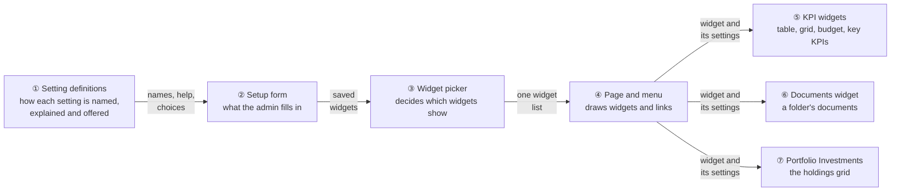
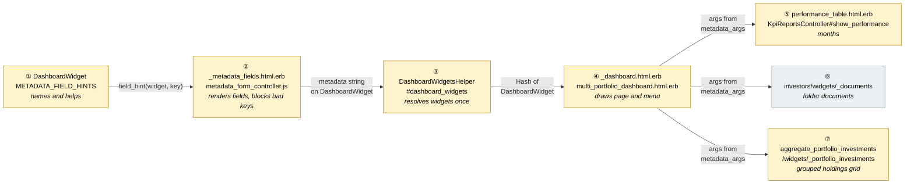
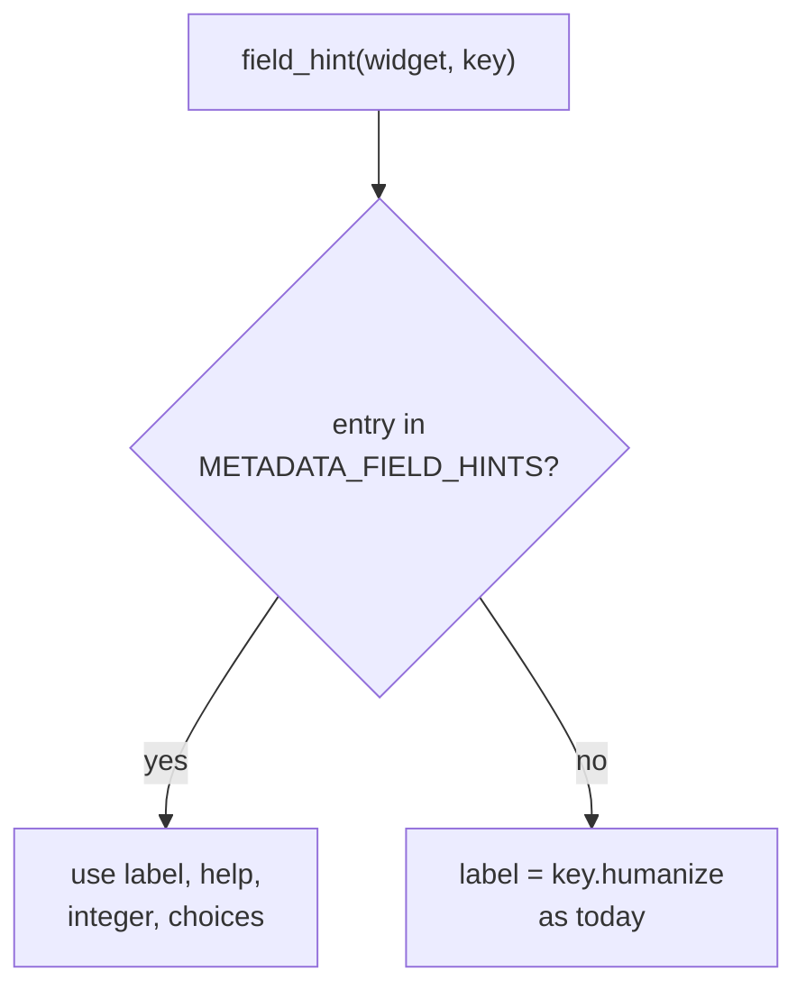
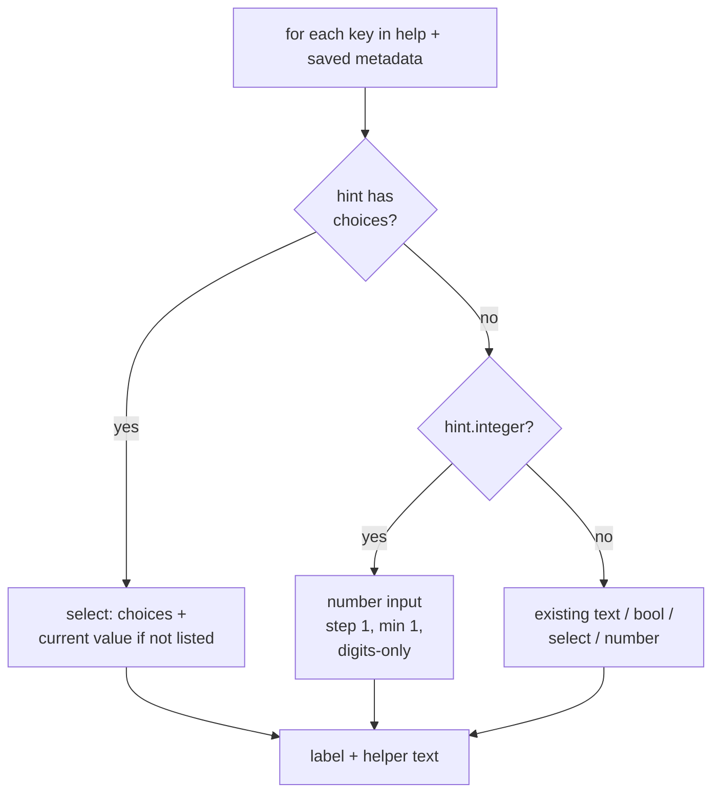
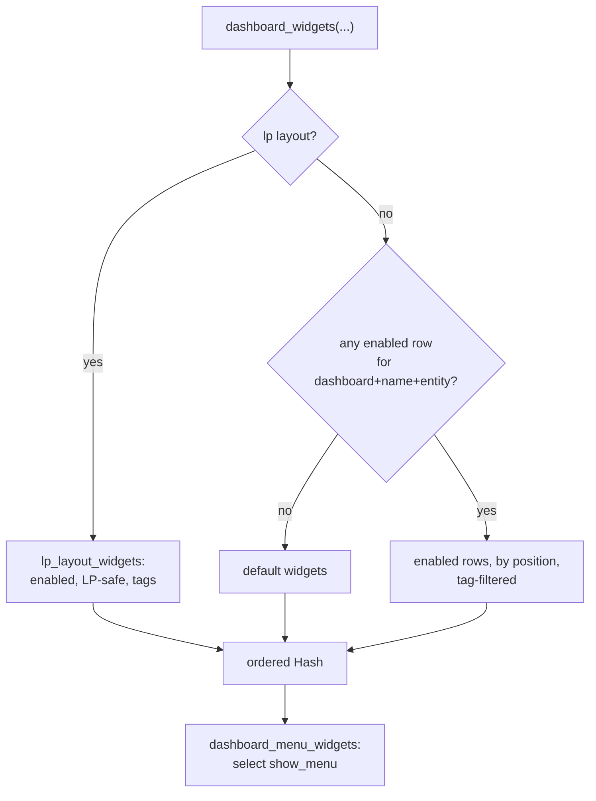
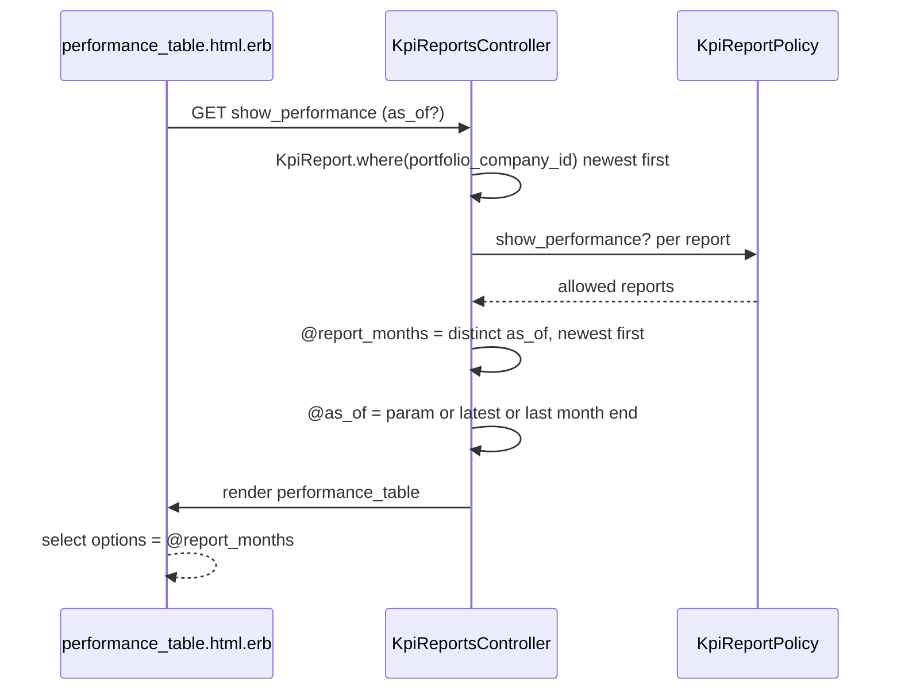
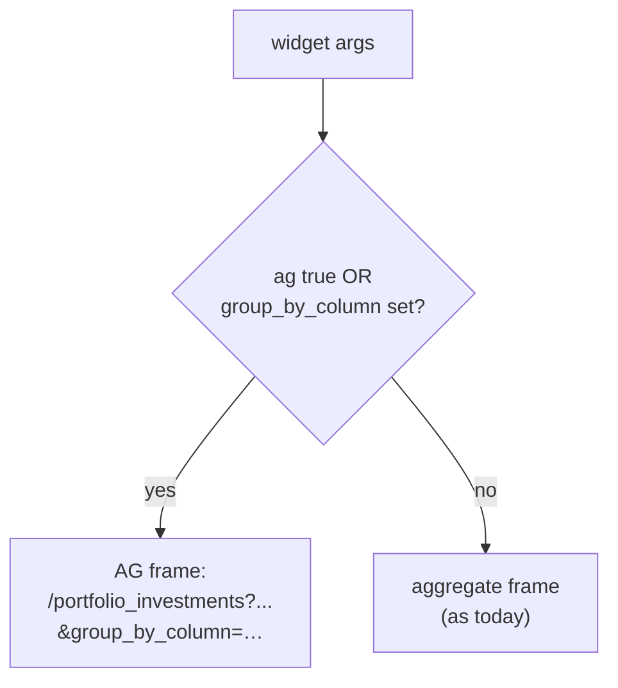
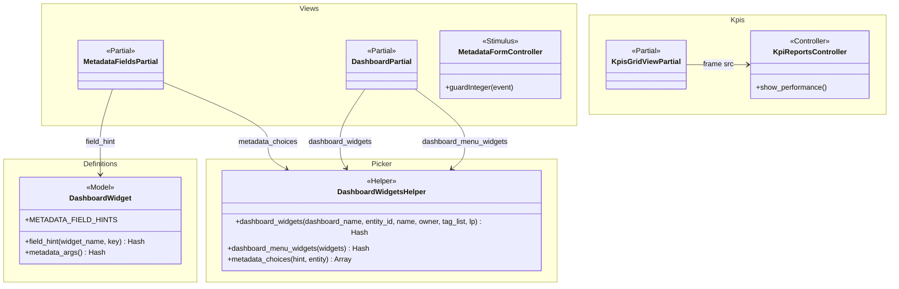

# Fix Portfolio Dashboard Widgets — Design

> **Audience:** Engineering team.
> **Companion documents:** [Proposal](proposal.md) · [Spec](specs/ui/dashboard-widgets/spec.md) · [LLD](lld.md)

> **Planning phase — no code changes.** This document explains HOW the proposal will be built.

> **Design, not code.** Real class, method and partial names appear in diagrams and tables; no class bodies.

> **Zoom one picture.** The design hangs off ONE numbered picture (①–⑦). Part 1 draws it in plain words, Part 2 redraws it with real names, Part 3 has one card per box, Part 4 is reference. The numbers mean the same box everywhere.

---

## Contents

- [1. The idea](#1-the-idea)
  - [What this adds](#what-this-adds)
  - [The idea in one picture](#the-idea-in-one-picture)
  - [Walkthrough: one example, start to finish](#walkthrough-one-example-start-to-finish)
  - [Key ideas](#key-ideas)
- [2. The same picture with real names](#2-the-same-picture-with-real-names)
  - [Picture](#picture)
  - [What each box does](#what-each-box-does)
  - [One run, end to end](#one-run-end-to-end)
  - [Lifecycles](#lifecycles)
  - [What users see](#what-users-see)
  - [Design decisions](#design-decisions)
- [3. One card per box](#3-one-card-per-box)
  - [① Setting definitions](#①-setting-definitions)
  - [② Setup form](#②-setup-form)
  - [③ Widget picker](#③-widget-picker)
  - [④ Page and menu](#④-page-and-menu)
  - [⑤ KPI widgets](#⑤-kpi-widgets)
  - [⑥ Documents widget](#⑥-documents-widget)
  - [⑦ Portfolio Investments widget](#⑦-portfolio-investments-widget)
- [4. Reference](#4-reference)
  - [Class diagram](#class-diagram)
  - [Data model and schema changes](#data-model-and-schema-changes)
  - [Component contracts](#component-contracts)
  - [Cross-cutting concerns](#cross-cutting-concerns)
  - [Worked examples](#worked-examples)
  - [Testing](#testing)
  - [Risks and open questions](#risks-and-open-questions)

---

## 1. The idea

### What this adds

Two small, shared mechanisms replace a pile of one-off behaviours. The **page and menu are built from one widget list** instead of two separate lookups, and the **setup form reads one definitions table** for every setting's label, helper text, whole-number rule and pick-list. Each of the seven reported problems is then a short change to a box that already exists: it follows the pattern the app already uses for widget settings (a `metadata` hash edited by the dynamic form), and adds no table, job or route.

### The idea in one picture



### Walkthrough: one example, start to finish

**Setup.** Meera (fund admin at Acme Capital) sets up the Portfolio Company Dashboard for the company "Flipkart Unlisted". Flipkart has KPI reports for Jan 2022, Oct 2025 and Mar 2026. Legend: ✓ done, ● we are here (waiting on this, not done yet), ○ not started.

**Phase 1 — Meera configures widgets**

| # | When | What happens | Behind the scenes | Result |
|---|---|---|---|---|
| 1 | Meera adds a **Kpis** widget | She sees "Data-only view" and "Show action buttons" with one-line help; no Show table / Show chart / Budget View | The setup form (②) asks the setting definitions (①) for each label and help line | Form shown |
| 2 | She ticks Enabled and Show Menu, saves | A widget row is stored | The setup form (②) saves a widget row | Saved |
| 3 | She adds **Portfolio Investments**, chooses Group by "Fund Name", leaves AG Grid on Default, ticks Enabled but unticks Show Menu | The choice list holds the grid's own columns | The setup form (②) gets the list from the definitions (①), which read the grid's column list | Saved |
| 4 | She types "e12" into a Documents **Folder ID** | The field keeps only "12" | The setup form (②) filters keys for whole-number settings flagged in the definitions (①) | Field = 12 |

**Phase 2 — Arjun views the page**

| # | When | What happens | Behind the scenes | Result |
|---|---|---|---|---|
| 5 | Arjun opens the company page | Kpis (as Actual vs Budget) and Portfolio Investments (grouped by fund) show; the menu lists only **Kpis** | The page (④) asks the widget picker (③) once; it narrows that same list to the Show Menu ones for the menu | Page drawn |
| 6 | He opens the Performance Table's month dropdown | Mar 2026, Oct 2025, Jan 2022; Mar 2026 selected | The KPI widget (⑤) lists the months that have reports | List shown |
| 7 | He picks Jan 2022 | Jan 2022 appears at once | Same as row 6, with the chosen month | Jan 2022 shown |

**Phase 3 — mistake and stall**

| # | When | What happens | Behind the scenes | Result |
|---|---|---|---|---|
| 8 | Meera unticks Enabled on every widget (a mistake) | Reload shows the default widgets and their menu | The widget picker (③) finds no enabled widget and returns defaults | Defaults on page and menu |
| 9 | She re-enables only Kpis but unticks its Show Menu | Page shows Kpis; the menu row is not drawn | The widget picker (③) returns Kpis; the menu list (④) is empty so the row is skipped | **Kpis only, no menu row** |
| 10 | Meera types a Folder ID from another fund | The Documents widget (⑥) lists nothing | Access rules in the documents list (⑥) hide documents she cannot see | Empty list |

```
 Company page after row 5                     Setting form after row 1
 ┌──────────────────────────────────┐        ┌─────────────────────────────────┐
 │ [Kpis]            Reports ▾ Layout▾│      │ Data-only view   [ Default v ]       │
 │ ────────────────────────────────── │      │   ON = data only, grouped        │
 │ Kpis · Actual vs Budget table      │      │ Show actions [ Default v ]       │
 │ Portfolio Investments · by Fund    │      │   ON = shows the toolbar         │
 └──────────────────────────────────┘        └─────────────────────────────────┘
```

**What to notice**
- One widget list feeds both page and menu, so they cannot disagree.
- Anything about how a setting is shown lives in one table, not scattered across partials.
- "Removed" settings are only hidden in the form; stored values are harmless and cleaned up when the form next saves.
- No stored status, no new table, no background work.

### Key ideas

| # | Idea | In one line | Card |
|---|---|---|---|
| 1 | Resolve widgets once | The menu is the page's list narrowed by Show Menu; defaults only when nothing is enabled | [③](#③-widget-picker) |
| 2 | One definitions table | Label, help, whole-number rule, pick-list per setting | [①](#①-setting-definitions) |
| 3 | The form is generic | It reads the table; widgets need no per-widget form code | [②](#②-setup-form) |
| 4 | Budget table has one home | Kpis has no Budget View; Kpis Budget vs Actual shows the table | [⑤](#⑤-kpi-widgets) |
| 5 | Months come from the data | The dropdown is built from the reports that exist | [⑤](#⑤-kpi-widgets) |
| 6 | Grouping implies the grid | A chosen group column selects the grid that can group | [⑦](#⑦-portfolio-investments-widget) |

**FAQ**

| Question | Answer |
|---|---|
| Does anything block users? | No. The visible losses are the list of broken default-widget links, and — when no widget has Show Menu — the Reports drop-down and layout selector that share that row (accepted). |
| Is there a data migration? | No. See decision 3. |
| Why one design for seven fixes? | Five of the seven are the same defect: the form and widgets disagree about what a setting is. One table fixes that class, not each instance. |

---

## 2. The same picture with real names

### Picture



Colour = footprint: **green** new, **amber** modified, **grey** reused unchanged. Nothing is new as a file; every box edits an existing one. Exact files are in [lld.md File Map](lld.md#file-map).

### What each box does

| # | Box | Real parts | What it does | When it runs | What it decides | Details |
|---|---|---|---|---|---|---|
| ① | Setting definitions | `DashboardWidget::METADATA_FIELD_HINTS`, `.field_hint`; edited `metadata_help` strings | One entry per (widget, setting): label, helper text, whole-number flag, pick-list source | Read on every setup-form render | Which settings exist and how each is presented | [card ①](#①-setting-definitions) |
| ② | Setup form | `dashboard_widgets/_metadata_fields.html.erb`, `metadata_help.turbo_stream.erb`, `metadata_form_controller.js` | Renders each setting from ①; blocks bad keys | Edit/new page, and when the widget type changes | Field type, label, help, choices | [card ②](#②-setup-form) |
| ③ | Widget picker | `DashboardWidgetsHelper#dashboard_widgets`, `#configured_dashboard_widgets`, `#lp_layout_widgets`, new `#dashboard_menu_widgets` | Returns the ordered widgets for a page; derives the menu subset | Every dashboard render | Defaults vs configured; menu members | [card ③](#③-widget-picker) |
| ④ | Page and menu | `dashboard_widgets/_dashboard.html.erb`, `investors/multi_portfolio_dashboard.html.erb` | Draws widget links and widgets from one list | Every dashboard render | Whether widget links exist | [card ④](#④-page-and-menu) |
| ⑤ | KPI widgets | `KpiReportsController#show_performance`, `kpi_reports/performance_table.html.erb`, `_kpi_key_numbers.erb` | Month list; key KPI cards | Frame load | Month list and default | [card ⑤](#⑤-kpi-widgets) |
| ⑥ | Documents widget | `investors/widgets/_documents.html.erb`, `DocumentsController#index` | Lists a folder's documents the viewer may see | Frame load | Visible documents | [card ⑥](#⑥-documents-widget) |
| ⑦ | Portfolio Investments | `aggregate_portfolio_investments/widgets/_portfolio_investments.html.erb` | Chooses the grid and passes the group column | Frame load | AG grid vs aggregate table | [card ⑦](#⑦-portfolio-investments-widget) |

### One run, end to end

```mermaid
sequenceDiagram
    actor Admin
    actor Viewer
    participant Form as ② _metadata_fields
    participant Defs as ① DashboardWidget
    participant Picker as ③ dashboard_widgets
    participant Page as ④ _dashboard
    participant Widget as ⑤ KPI widgets
    Admin->>Form: open edit, choose widget type
    Form->>Defs: field_hint(widget, key)
    Defs-->>Form: label, help, choices
    Form-->>Admin: fields; save writes metadata
    Viewer->>Page: open company page
    Page->>Picker: dashboard_widgets(dashboard, entity, name, owner)
    Picker-->>Page: ordered widgets (defaults if none enabled)
    Page->>Page: menu = widgets with show_menu
    Page->>Widget: render widget with metadata_args
    Widget-->>Viewer: table / grid / budget
```

### Lifecycles

N/A — no stored or derived status is added. `enabled` and `show_menu` stay plain flags on `DashboardWidget`.

### What users see

| Where in CapHive | Today | After this change | Who sees it |
|---|---|---|---|
| Company page top bar | Lists default widgets when none has Show Menu, links do nothing | Lists only Show Menu widgets; no menu row when none | Everyone who opens the page |
| Dashboard Widgets › New/Edit | Labels like "Compound", "Owner", "Entity"; dead settings; "e" accepted | Plain labels, one-line help, no dead settings, whole numbers only | Fund admins |
| KPI Performance Table | 7-month window | Every report month | Fund team |
| Kpis widget | Budget View switch that does nothing | Switch removed; the table is the Kpis Budget vs Actual widget | Fund admins |
| Portfolio Investments setup | Free text "Equity" | Pick-list of columns | Fund admins |

Main everyday journey (viewing the page):

```
 ┌────────────────────────────────────────────────────────────┐
 │ Home › Stakeholders › Flipkart Unlisted                      │
 │ ④ [Kpis] [Portfolio Inv]                  Reports ▾  Layout ▾│
 │ ──────────────────────────────────────────────────────────── │
 │ ⑤ Kpis Performance Table   Flipkart KPI Performance: [Mar 2026 v]
 │                              ├ Mar 2026  Oct 2025  Jan 2022  │
 │ ⑦ Portfolio Investments    grouped by Fund                   │
 └────────────────────────────────────────────────────────────┘
```

| Step | The user… | They see |
|---|---|---|
| 1 | opens the company page | the widgets and a menu of only Show Menu widgets (④) |
| 2 | clicks a menu link | the page moves to that widget (④) |
| 3 | opens the month dropdown | every report month, latest selected (⑤) |

### Design decisions

1. **One widget list; the menu is derived from it** — `dashboard_widgets` is called once per render and the menu is `select(&:show_menu)` on its result. Alternative: keep the `show_menu:` filter but make the fallback check the unfiltered rows. Rejected: still two queries that can disagree, and the same trap returns the next time a filter is added.
2. **One definitions table for labels, help, rules and choices** — `DashboardWidget::METADATA_FIELD_HINTS`. Alternative: put labels and help inside the `metadata_help` strings. Rejected: those strings are regex-cleaned and `eval`-ed ([dashboard_widget.rb:352](app/packs/core/base/models/dashboard_widget.rb#L352)); more syntax inside them raises the chance of silently breaking the form for every widget.
3. **Remove dead settings from the form's defaults only; clear saved values by a one-off script** — the keys leave the `metadata_help` strings so new widgets do not offer them. No code mechanism hides them on existing widgets: the console script in `docs/operations/dashboard_widget_metadata_cleanup.md` (task 6.6, run by hand, not shipped as code) clears the saved values, and until it runs a stale key shows in that widget's edit form as an ordinary field. Alternatives: (a) a `RETIRED_METADATA_KEYS` list that hides stale keys in the form and drops them on save: rejected, the script makes it redundant code. (b) a migration shipped with the change: rejected, the clean-up is run by hand.
4. **Remove Budget View from the Kpis widget** — the Kpis Budget vs Actual widget already shows the Actual vs Budget table, so the toggle is a second path to the same screen, and it never worked (the Kpis partial always sends `grid_view`, the response frame is `kpi_reports_budget` but the widget frame is `kpi_reports_list`). `budget_view` leaves the Kpis form and is ignored at render; no code change in `_kpis_grid_view`; saved values are cleared by the script in decision 3. Alternatives: (a) keep the toggle and delegate to `_kpis_budget_vs_actual`: rejected, a duplicate path for no gain and extra tests. (b) rename `kpi_reports_budget` to `kpi_reports_list` so one id serves both: rejected, a dashboard can hold a Kpis grid widget and a Kpis Budget vs Actual widget together, and two frames with one id make a filter submit update the wrong widget. (c) re-order the checks in `kpi_reports/index.html.erb`: rejected, same frame mismatch. Cost: a Kpis widget saved with `budget_view: true` keeps showing the grid (as it did); the admin adds a Kpis Budget vs Actual widget if the table is wanted.
5. **Performance months come from the reports** — Alternative: widen the fixed 6-month window. Rejected: still arbitrary; the reported complaint was "I must know the month first".
6. **Group-by choices come from the grid's own column list** — `PortfolioInvestment.ag_grids_default_columns` or the entity's saved column set, plus `fund_name`. Alternative: a hand-written list of names. Rejected: a second list to keep in sync with the grid; and the business wanted names that match the grid.
7. **A chosen group column forces the AG grid** — Alternative: show the field only when AG Grid is ON. Rejected: hides a setting that the admin explicitly wants; grouping exists only in the AG grid so using it is the only way to honour the choice. Trade-off: explicit "AG Grid: OFF" plus a group column now shows the AG grid; helper text says so.
8. **Whole-number input guarded by the existing Stimulus controller** — `metadata_form_controller.js` gets a key filter for fields flagged integer. Alternative: a new controller. Rejected: the controller already owns every dynamic field.
9. **Remove dead settings; do not implement them** — Alternative: wire `chart`, `kpis`, `show_table`, `show_chart`. Rejected (per the QA owner): `chart` hides nothing on the table, `kpis` duplicates the company's "show in report" mapping, and `show_table`/`show_chart` belong to a different screen.
10. **Relabel Compound; keep the saved key** — Alternative: rename the key. Rejected: every saved widget carrying `compound` would silently change behaviour.
11. **Hide the whole menu row when no widget has Show Menu** — no check for the Reports drop-down or layout selector. Alternative: keep the bar for those two. Rejected (product call): rare edge case, and a row with only those looks odd. Accepted drawback, recorded in the proposal FAQ and QA row E4.

**FAQ**

| Question | Answer |
|---|---|
| Why not just fix each partial? | The defects share a cause: the form and the widgets disagree. A table makes the disagreement visible in one place. |
| Why not delete the `show_menu` column? | It is still the per-widget choice; the fix is only in how it is applied. |
| Does `show_menu` still affect the body? | No. It never should have; the body ignored it already. |

---

## 3. One card per box

> Same order and numbers as the picture.

### ① Setting definitions

The one table that says, per widget and setting, how it is presented.

| Owns | Reads / receives | Produces |
|---|---|---|
| `METADATA_FIELD_HINTS`, the corrected `metadata_help` strings | `widget_name`, setting key | label, helper text, `integer` flag, pick-list source |

**Entries this change adds** (keys are the saved `metadata` keys; hints apply to every dashboard that has the same widget name):

| Widget | Key | Label | Helper text (gist) | Other |
|---|---|---|---|---|
| Kpis | `compound` | Data-only view | ON groups by category, data only, chart picking off; OFF full table with plot checkboxes | key unchanged |
| Kpis | `show_action_buttons` | Show action buttons | ON shows the toolbar above the table; OFF by default | |
| Kpis Budget vs Actual | `category` | Default category | Category pre-selected in the on-page filter | |
| Documents | `owner_id`, `folder_id` | Owner ID, Folder ID | Owner/folder whose documents to show | `integer` |
| Portfolio Investments | `group_by_column` | Group by column | Rows are grouped by this column; uses the AG grid | pick-list `:portfolio_investment_columns` |

**Removed from the form's defaults** (ignored at render): Kpis Performance Table `chart`; Key Kpis `kpis`; Kpis `show_table`, `show_chart`, `budget_view`; Documents `entity_id`. Their entries also leave the `metadata_help` strings.



**Worked examples:** H3, H4, H5, H6, E8.

**FAQ**

| Question | Answer |
|---|---|
| Why key by widget name, not by dashboard? | The same widget name (for example "Documents", "Portfolio Investments") appears on several dashboards with identical settings; one entry serves all. |
| What if a setting has no entry? | Today's behaviour: label from the key, no helper text. Nothing breaks for untouched widgets. |
| Why does the Aggregated "Aggre. Portfolio Investments" widget not get the pick-list? | It is a different widget (different grid, `portfolio_company_name` default); out of the reported scope. |

### ② Setup form

The dynamic Widget Configuration section of the Dashboard Widgets form.

| Owns | Reads / receives | Produces |
|---|---|---|
| Field rendering, key filtering, the stored `metadata` string | ① hints; widget's current `metadata_args`; `current_user.entity` | The `metadata` hash literal saved with the widget |

Rules the partial applies, in order:



Routes: unchanged (`GET dashboard_widgets/metadata_help` renders the same partial via turbo stream when the widget type changes).

Build notes: `metadata_form_controller.js` gets one `keydown`/`input` guard for fields marked integer (blocks `e E + - . ,`; on paste keeps digits) and reads a `<select>` value as before; the stored value for integer fields stays a number. Raw Metadata remains the escape hatch.

**Worked examples:** H3–H6, H8, H14, E8–E11, E17.

**FAQ**

| Question | Answer |
|---|---|
| How is a saved CSV group value kept? | It is added as the current option of the select, so saving re-submits it unchanged. |
| Does type="number" allow "e"? | Yes; browsers accept it. Hence the key guard. |

### ③ Widget picker

`DashboardWidgetsHelper#dashboard_widgets` decides which widgets a dashboard shows.

| Owns | Reads / receives | Produces |
|---|---|---|
| The "defaults only when none enabled" rule; tag filtering; LP-safe filtering | `dashboard_name`, `entity_id`, layout `name`, `owner`, viewer tags | Ordered Hash `"#{widget_name} #{tags}" => DashboardWidget` |

The `show_menu:` argument and its two `where(show_menu:)` clauses are removed from `dashboard_widgets`, `configured_dashboard_widgets` and `lp_layout_widgets`. A small `dashboard_menu_widgets(widgets)` returns the entries whose `show_menu` is true (default widgets are built with the column default `true`).



Behaviour preserved: when enabled rows exist but tags hide all of them the result is empty, not defaults (spec: Enabled widgets all hidden by tags). This matches today and keeps LP layouts private (E54).

**Worked examples:** H1, H17, E1, E3, E7.

**FAQ**

| Question | Answer |
|---|---|
| Does "no enabled row" include disabled rows? | Yes; disabled rows do not count, which is why all-disabled gives defaults. |
| Why filter `show_menu` in Ruby? | The list is a few dozen widgets at most and is already loaded for the page; a second query is the thing being removed. |
| Is the LP page affected? | It uses `lp_layout_widgets` (no defaults ever); only the `show_menu` clause is removed, then the same select is applied. |

### ④ Page and menu

The shared dashboard partial draws the top bar and the widgets.

| Owns | Reads / receives | Produces |
|---|---|---|
| Which anchors appear in the bar; widget containers | The ordered widget Hash from ③ | Menu links, "More" overflow list, widget containers with ids `<widget>_<position>` |

`_dashboard.html.erb` calls `dashboard_widgets` once into a local, derives `menu_widgets` with `dashboard_menu_widgets`, and iterates the same local for the body. With no menu widgets the whole `<ul class="nav nav-pills">` row is not rendered (links, "More", Reports drop-down and layout selector go together — accepted limitation); the logo, title and sector heading in the same `<nav>` stay. With at least one menu widget the row renders as today, Reports and selector included when they exist. `multi_portfolio_dashboard.html.erb` gets the identical change.

| Role | Sees widget links | Notes |
|---|---|---|
| Any viewer of the page | Only enabled, Show Menu widgets they may see | Tag filtering already applied in ③ |

Entity scoping is unchanged: `dashboard_widgets` still filters by `entity_id`.

**Worked examples:** H1, H2, H18, E2, E4, E5, E6.

**FAQ**

| Question | Answer |
|---|---|
| Why are the old links dead? | Defaults have no `position`, so their anchors (`#kpis_`) never match a configured widget id (`kpis_3`). Defaults only appear in the menu when they also fill the page, so ids match. |
| Does the "More" overflow script break with an empty list? | It already handles pages with few items; verified in tasks. |

### ⑤ KPI widgets

Four widgets: Kpis Performance Table, Kpis, Kpis Budget vs Actual, Key Kpis.

| Owns | Reads / receives | Produces |
|---|---|---|
| Month list and default (Performance Table) | `params[:as_of]`, `portfolio_company_id` | The table |

**Performance Table.** `KpiReportsController#show_performance` builds `@report_months`: the distinct `as_of` of the company's `KpiReport` rows, kept only where `policy(report).show_performance?` is true, newest first. `@as_of` defaults to `params[:as_of]`, else the latest of those, else last month's end (empty case). The view builds options straight from `@report_months` (label `l(as_of, format: :month_year)`, value the date) and the "no report" fallback offers the nearest months from the same list instead of a fixed five.



**Kpis.** `_kpis_grid_view.html.erb` never reads `budget_view`, so an old saved value is harmless. It turns `show_action_buttons` into the grid view's `no_actions` param (set unless the setting is `true`), so the toolbar is off by default on the widget and unchanged on the KPI reports page; a saved `no_actions` hid the toolbar whatever its value and is cleared by the script. `compound` and `categories` still flow through `args` untouched. **Kpis Budget vs Actual** loses its `categories` setting: the filter dropdown always lists the company's mapping categories, the Filter form drops `categories`, and a set Default category already narrows the rows; the script clears saved values. **Key Kpis** is unchanged in behaviour; only its form setting disappears.

**Worked examples:** H7, H10–H13, H19, H20, E12–E15, E18, E19, X2.

**FAQ**

| Question | Answer |
|---|---|
| Why one entry per `as_of`, not per report? | A company often has Actual and Budget for one month; the table opens on whichever `find_by` returns, so the list matches (and is distinct). |
| Why per-report policy checks? | `show?` mixes entity and portco-user rules (only Actual for portco users); `policy_scope` would hide reports a portco user may legitimately see. |
| Is it expensive? | One indexed query per page load (up to ~150 rows) plus a policy check per report. Full records are needed because the policy reads each report's owner. See [lld.md Queries and Indexes](lld.md#queries-and-indexes). |
| What about two Kpis Budget vs Actual widgets on one page? | Existing limitation: both use the frame `kpi_reports_budget`. Unchanged. |

### ⑥ Documents widget

Lists a folder's documents the viewer may see. The widget is the folder tree: the folder's documents appear when the folder is chosen in the tree, as on the Documents page. Verified: `folder_id` may point at any folder of the entity (H9); the documents are limited by the viewer's access. X1 found that another entity's Folder ID made the tree name that entity's folders, so the widget now ignores a folder the viewer may not see (`FolderPolicy#show?`, or shared with them as an investor via `Folder.for_investor`) and shows "No documents to show." (`DocumentHelper#widget_folder_visible?`). An investor viewer is the case that matters: `show?` alone would hide folders shared with them, and the entity-match check used first would have named an unshared folder of the company (X3, E20). For anyone but a company admin of the folder's entity (investors, and employees without the company admin role) the widget also passes `show_root_docs`, as the fund documents tabs do: without it `DocumentsController#index` lists only the documents in the folder's descendants (`Folder.descendants_of` excludes the folder itself), and `get_tree_view_folders` builds their tree from that list, so the folder looked empty (E20, E21). A company admin of the entity gets the full subtree in the tree view and picks the folder there (H9).

| Owns | Reads / receives | Produces |
|---|---|---|
| Frame `documents_tree_frame_<widget id>` | `folder_id`, `owner_id`, `owner_type`, … | Document cards |

`entity_id` in `args` is overwritten by the partial; that is why the setting is removed. A review task confirms that a folder of another entity yields no documents and no folder name leaks (see risks).

**Worked examples:** H8, H9, X1, X3, E20, E21.

**FAQ**

| Question | Answer |
|---|---|
| Why keep Folder ID? | `folder_name` only searches under the company's own folder; Folder ID is the only way to show an unrelated folder. |
| Does `folder_id` bypass access? | No; documents are narrowed by `policy_scope`. The task list adds a test (X1). |

### ⑦ Portfolio Investments widget

| Owns | Reads / receives | Produces |
|---|---|---|
| Choice between the AG grid frame and the aggregate frame | `args[:ag]`, `args[:group_by_column]` | `portfolio_investments_frame` (AG) or `aggregate_portfolio_investments_frame` |

The partial treats the AG grid as selected when `args[:ag]` is truthy **or** `args[:group_by_column]` is present. The group column already travels in the AG URL (`pi_uri` appends every arg) and is read by `ag_controller#gridReady` via `data-group-by-column`.



**Worked examples:** H14–H16, E16, E17.

**FAQ**

| Question | Answer |
|---|---|
| Why not group the aggregate table? | It is already one row per instrument/company; grouping rows that are themselves aggregates has no clear meaning. |
| What if the entity's saved grid columns lack the chosen key? | The choice list only offers current columns; a previously saved key not in the list is kept as the current option and still passed through. |
| Multi-column grouping? | Still possible via Raw Metadata (CSV is preserved); a multi-select is a follow-up. |

---

## 4. Reference

### Class diagram



### Data model and schema changes

N/A — no table, column or index changes. `show_menu`, `enabled`, `metadata` already exist on `dashboard_widgets`.

### Component contracts

| From → To | Contract | Direction rule |
|---|---|---|
| ① → ② | `DashboardWidget.field_hint(widget_name, key)` → `{label:, hint:, integer:, choices:}` or nil | ② only reads ①; ① knows nothing about views |
| ② → ③ | `DashboardWidget#metadata` string (Ruby hash literal) | Written by ②, parsed by `metadata_args` |
| ③ → ④ | `dashboard_widgets(...)` → ordered Hash of `DashboardWidget` with `path` set | ④ never re-queries; menu derived by `dashboard_menu_widgets` |
| ④ → ⑤ ⑥ ⑦ | `render path, widget:, args: widget.metadata_args, owner:, uri_params:, lp_context:` | Unchanged signature |
| ① → ② (choices) | `metadata_choices(:portfolio_investment_columns, entity)` → `[[label, key], …]` | Reads `PortfolioInvestment.ag_grids_default_columns` and the entity's `FormType` columns |

### Cross-cutting concerns

#### Transactions and queries

No writes added. Reads: ⑤ adds one indexed `KpiReport` query per Performance Table load (full records, filtered by the report policy); ③ removes one query per page (the menu lookup). Details in [lld.md Queries and Indexes](lld.md#queries-and-indexes).

#### Exception handling and monitoring

N/A — no new failure mode; existing Pundit and frame error handling is unchanged.

#### Performance and security

- Pages do one fewer widget query; the Performance Table does one small extra query. Both are per-user interactive loads.
- Tenant isolation: ③ still filters by `entity_id`; ⑤ filters reports by `portfolio_company_id` then by `policy(...).show_performance?`; ⑥ relies on `policy_scope(Document)`. The form's choice list for the group column is built from the entity's own grid columns only.
- Group-by choices and labels are rendered through the normal ERB escaping; the saved value is passed back as plain text and read as a column name by the grid.

### Worked examples

**ID legend:** **H** = Happy path · **E** = Edge case · **X** = Error (exception) case.

**Shared setup:**

| Record | Name | Key data |
|---|---|---|
| Entity | Acme Capital | Investment Fund, `enable_kpis`, KPI module on |
| User | Meera | company admin of Acme |
| User | Priya | portfolio-company user of Flipkart (sees only Actual reports) |
| Investor | Flipkart Unlisted | category Portfolio Company; mappings Revenue (show in report) and EBITDA (not) |
| KPI reports | Flipkart | Actual: 31 Jan 2022, 31 Oct 2025, 31 Mar 2026; Budget: 31 Mar 2026 |
| Widgets (layout "Default", Portfolio Company Dashboard) | W1 Kpis pos 1 tags "Kpis"; W2 Portfolio Investments pos 2 tags "Portfolio Inv"; W3 Documents pos 3 tags "Docs" | all enabled; Show Menu on W1, W2; off on W3 unless stated |
| Entity | Beta Fund | folder "Beta Board Pack" with a document |
| Folder | Acme Shared Docs | own entity, outside Flipkart's folder, document "Board Pack.pdf" |
| Portfolio investments | Flipkart | Fund A (Equity), Fund B (Preference) |

#### Happy Path

| # | Scenario | Given | When | Then | Spec scenario | Feature |
|---|---|---|---|---|---|---|
| H1 | Menu lists only Show Menu widgets in order | W1, W2, W3 enabled; W3 Show Menu off | Meera opens Flipkart's page | Page has Kpis, Portfolio Inv, Docs; menu links "Kpis" then "Portfolio Inv"; no "Docs" link | Some enabled widgets have Show Menu | `features/core/dashboard_widget_menu.feature` |
| H2 | Menu link reaches its widget | As H1 | She clicks the "Kpis" link | The link's anchor matches the id of the Kpis widget container on the page | Menu links reach their widget | `features/core/dashboard_widget_menu.feature` |
| H3 | Compound shown as Data-only view | A Kpis widget exists | Meera opens its edit page | Label "Data-only view" shown, "Compound" not; helper mentions grouped by category and plot checkboxes | Compound is shown as Data-only view with help | `features/core/dashboard_widget_metadata.feature` |
| H4 | Show action buttons has helper text | A Kpis widget exists | She opens its edit page | "Show action buttons" has helper text about showing the toolbar | Show action buttons has helper text | `features/core/dashboard_widget_metadata.feature` |
| H5 | Budget vs Actual default category only | A Kpis Budget vs Actual widget exists | She opens its edit page | No Categories field; "Default category" shown with help | Budget vs Actual offers only the default category | `features/core/dashboard_widget_metadata.feature` |
| H6 | Settings with no effect not offered | Meera adds a Performance Table, Key Kpis, Kpis or Documents widget | She opens its edit page | No Chart, Kpis, Show table, Show chart, Budget View or Entity field | Settings with no effect are not offered | `features/core/dashboard_widget_metadata.feature` |
| H7 | Key KPIs shows flagged KPIs | Key Kpis widget enabled; Mar 2026 report has Revenue and EBITDA | Meera opens the page | Revenue card shown; EBITDA not | Key KPIs shows the company's flagged KPIs | `features/startup/kpi_dashboard_widgets.feature` |
| H8 | Whole number saved | Documents widget edit page | She enters 42 as Folder ID and saves | Saved settings hold `folder_id: 42` | A whole number is saved | `features/core/dashboard_widget_metadata.feature` |
| H9 | Documents shows a folder outside the company's own | W3 Documents with Folder ID of "Acme Shared Docs" | Meera opens the page and chooses that folder in the widget's tree | Widget lists "Board Pack" | Folder outside the company's own folder | `features/core/documents_widget.feature` |
| H10 | Month list from reports, latest selected | Reports Jan 2022, Oct 2025, Mar 2026; Performance Table widget | Meera opens the table | Options exactly Mar 2026, Oct 2025, Jan 2022 in that order; Mar 2026 selected and shown | Dropdown lists all months with reports | `features/startup/kpi_dashboard_widgets.feature` |
| H11 | Old month in one step | As H10 | She chooses Jan 2022 | Jan 2022's table shown; dropdown still has 3 options | Reaching an old month in one step | `features/startup/kpi_dashboard_widgets.feature` |
| H12 | Budget View not offered | W1 Kpis widget | Meera opens its edit page | No Budget View field; Data-only view and Show action buttons present | Budget View is not offered | `features/startup/kpi_dashboard_widgets.feature` |
| H13 | Kpis shows the grid | W1 Kpis widget; Mar 2026 report | She opens the page | KPI grid shown | Kpis widget shows the KPI grid | `features/startup/kpi_dashboard_widgets.feature` |
| H14 | Group-by choices are the grid's columns | Portfolio Investments widget | She opens its edit page | "Group by column" is a select including "Instrument", "Portfolio Company" and "Fund Name" | List shows the grid's columns | `features/fund/portfolio_investments_widget_group_by.feature` |
| H15 | Grouping with AG Grid off | W2 `{ag: false, group_by_column: 'fund_name'}` | She opens the page | The AG grid frame is requested with `group_by_column=fund_name`; the aggregate frame is not | Grouping with AG Grid off | `features/fund/portfolio_investments_widget_group_by.feature` |
| H16 | Grouping with AG Grid unset | W2 `{group_by_column: 'fund_name'}` | She opens the page | Same as H15 | Grouping with AG Grid default | `features/fund/portfolio_investments_widget_group_by.feature` |
| H17 | Defaults when nothing configured | Acme has no widget rows | Meera opens the page | Default widgets shown (Valuations, Fund Ratios, Kpis, …) and listed in the menu | No widget is configured | `features/core/dashboard_widget_menu.feature` |
| H18 | Enabled widgets, none Show Menu | W1, W2 enabled, Show Menu off on both | Meera opens the page | Both widgets shown; no menu row | Enabled widgets but none has Show Menu | `features/core/dashboard_widget_menu.feature` |
| H19 | Action buttons off by default | W1 Kpis widget, no settings | Meera opens the page | KPI grid without the heading, filter, chart and settings buttons | Action buttons are off by default | `features/startup/kpi_dashboard_widgets.feature` |
| H20 | Show action buttons ON | W1 Kpis widget saved with `show_action_buttons: true` | Meera opens the page | Heading, filter, chart and settings buttons above the grid | Show action buttons shows them | `features/startup/kpi_dashboard_widgets.feature` |

#### Edge Cases

| # | Scenario | Given | When | Then | Spec scenario | Feature |
|---|---|---|---|---|---|---|
| E1 | All widgets disabled | W1–W3 all disabled | Meera opens the page | Default widgets on page and in menu | Every configured widget is disabled | `features/core/dashboard_widget_menu.feature` |
| E2 | The original bug: one widget, Show Menu off | Only W1 enabled, Show Menu off | Meera opens the page | Only Kpis on the page; no menu row; no default widget links | A single enabled widget with Show Menu unticked | `features/core/dashboard_widget_menu.feature` |
| E3 | Disabled widget ticked Show Menu | W1 enabled; W2 disabled with Show Menu on | Meera opens the page | W2 not on the page or in the menu | A disabled widget with Show Menu ticked | `features/core/dashboard_widget_menu.feature` |
| E4 | Menu row hides Reports and layout selector too | Flipkart has a Report tagged for the dashboard and Acme has a second layout; no widget has Show Menu | Meera opens the page | No menu row: no Reports drop-down and no layout selector (accepted); logo/title heading still shown | Menu row hides Reports and layout selector too | `features/core/dashboard_widget_menu.feature` |
| E5 | Multi-portfolio dashboard, same rules | Multi-portfolio widgets enabled, none Show Menu | Meera opens it | No menu row; defaults not added | Same rules on every dashboard that has this menu | `features/misc/multiple_portfolio_dashboard.feature` |
| E6 | LP company page, same rules | LP layout "LP" with enabled LP-safe widgets, none Show Menu | An LP opens the shared company page | Widgets shown, no menu row, default catalogue not used | Same rules on every dashboard that has this menu | `features/core/dashboard_widget_menu.feature` |
| E7 | Widgets hidden by tags | W1 enabled with Tag List "Ecom"; company tagged "AI" | Meera opens the page | Empty page; defaults not substituted | Enabled widgets all hidden by tags | `features/core/dashboard_widget_menu.feature` |
| E8 | Saved Compound still applies | Kpis widget saved with `compound: true` | Meera opens the page, then its edit page | Grouped data-only view; form shows Data-only view ON | Saved Data-only view still applies | `features/startup/kpi_dashboard_widgets.feature` |
| E10 | Letters refused | Documents edit page | She types "e12" in Folder ID | Field shows "12" | Letters are refused | `features/core/dashboard_widget_metadata.feature` |
| E11 | Pasting mixed text | Documents edit page | She pastes "1.5e3" in Owner ID | Field shows only digits | Pasting mixed text keeps only digits | `features/core/dashboard_widget_metadata.feature` |
| E12 | No KPI report | Company with no reports | Meera opens the table | "No KPI report found"; no month options | Company has no KPI report | `features/startup/kpi_dashboard_widgets.feature` |
| E13 | Requested month has no report | Reports Jan 2022, Mar 2026 | She opens the table for Feb 2026 | "No report" message and links for Mar 2026 and Jan 2022 | Requested month has no report | `features/startup/kpi_dashboard_widgets.feature` |
| E14 | Viewer lacks permission on a report | Priya sees Actual only; the Oct 2025 report is tagged Budget; Mar 2026 has Actual and Budget | Priya opens the table | Dropdown lists Mar 2026 and Jan 2022 but not Oct 2025 | Only reports the viewer may see | `features/startup/kpi_dashboard_widgets.feature` |
| E15 | Old widget saved with budget_view | W1 saved earlier with `budget_view: true` and `compound: true` | Meera opens the page | KPI grid (data-only because of compound) | Existing widget saved with Budget View | `features/startup/kpi_dashboard_widgets.feature` |
| E16 | No group column, AG off | W2 `{ag: false}` | She opens the page | Aggregate table frame requested | No group column | `features/fund/portfolio_investments_widget_group_by.feature` |
| E17 | Saved CSV group value preserved | W2 saved with `group_by_column: 'fund_name, investment_instrument_name'` | Meera opens edit and saves | Select shows that value as current; saved value unchanged | Saved value is preserved | `features/fund/portfolio_investments_widget_group_by.feature` |
| E18 | Two reports one month | Mar 2026 has Actual and Budget | Meera opens the table | Mar 2026 listed once | Dropdown lists all months with reports | `features/startup/kpi_dashboard_widgets.feature` |
| E19 | Mid-month report date | A report dated 15 Mar 2026 | She selects that month | Its table is shown (not "no report") | Reaching an old month in one step | `features/startup/kpi_dashboard_widgets.feature` |
| E20 | Folder shared with an investor viewer | Investor user of the portfolio company; the folder and its documents shared with that company; W3 Documents with that Folder ID in the viewer's entity | The investor user opens the page | The widget lists "Board Pack" (the folder's own documents) | Folder shared with an investor viewer | `features/core/documents_widget.feature` |
| E21 | Folder viewed by an employee | Employee of the entity without the company admin role (with investor read); W3 Documents with the Folder ID of "Acme Shared Docs" | The employee opens the page | The widget lists "Board Pack" | Folder of the entity viewed by an employee | `features/core/documents_widget.feature` |

#### Error Cases

| # | Scenario | Given | When | Then (what the user sees, who is alerted) | Spec scenario | Feature |
|---|---|---|---|---|---|---|
| X1 | Folder of another entity | W3 Documents with Folder ID of Beta's "Beta Board Pack" | Meera opens the page | "No documents to show."; documents and folder name not shown; no alert | Folder of another entity | `features/core/documents_widget.feature` |
| X2 | Direct request for a report the user cannot see | Priya; the Oct 2025 report is tagged Budget | She requests the table for Oct 2025 by URL | No data and no report content; the existing authorization refusal applies | Only reports the viewer may see | `features/startup/kpi_dashboard_widgets.feature` |
| X3 | Folder not shared with an investor viewer | As E20 but the folder is not shared | The investor user opens the page | "No documents to show."; folder name and documents not shown | Folder not shared with an investor viewer | `features/core/documents_widget.feature` |

### Testing

Cucumber only. Shared setup (Acme, Flipkart, reports, widgets) goes in one new step file; JS scenarios (Data-only view, whole-number guard) reuse the existing `@javascript` steps in `dashboard_widget_metadata_steps.rb`. New steps: `dashboard_widget_menu_steps.rb`, `dashboard_widget_kpi_steps.rb`, `dashboard_widget_group_by_steps.rb`. Every scenario carries a comment naming its ID (for example `# H1 — menu lists only Show Menu widgets`) and code comments name the IDs of the paths they implement.

### Risks and open questions

- **Reports drop-down and layout selector vanish with the menu row** → accepted drawback (rare edge case; a row with only those would look odd). An admin who needs the selector on such a page ticks Show Menu on one widget. QA row E4 pins the behaviour.
- **Hidden policy dependency in the month list** → `KpiReportPolicy#show_performance?` reads only entity, tag and company fields; LLD lists the columns selected and a test (E14) pins the behaviour.
- **`Folder.find` unscoped in the documents controller** → X1 failed at first (the folder tree named another entity's folder). Fixed in the widget, not the controller, because the controller is shared with the investor data-room flows where `policy_scope(Folder)` would be too narrow. A direct request to the Documents folder URL with another entity's ID is unchanged and out of scope here.
- **Label for `compound`** → the label is "Data-only view" (ON = data only, no chart picking), so ON reads the way it behaves; the saved key stays `compound`.
- **Performance Table `find_by` ignores tag/period** (existing) → unchanged; the dropdown is distinct by `as_of` to match.

| # | Open question | Current thinking | Status |
|---|---|---|---|
| 1 | Folder picker by name for Documents | Separate change | Deferred |
| 2 | Multi-select for Group by | Separate change; CSV stays possible via Raw Metadata | Deferred |

**FAQ**

| Question | Answer |
|---|---|
| Where do I start reviewing? | [lld.md Review Summary](lld.md#review-summary), then cards ③ and ⑤. |
| Why no new specs for the LP rules? | They are covered by the in-flight `lp-folio-portfolio-dashboard` change; this change only touches the shared menu rule and keeps E54 (no default catalogue for LPs). |
