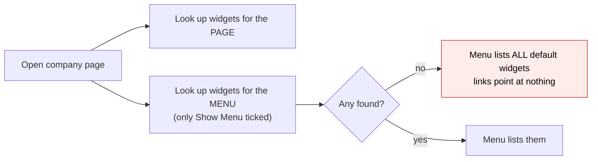
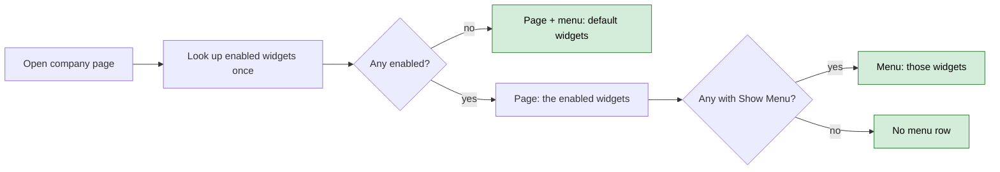
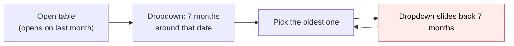
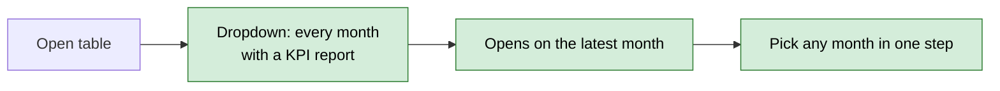
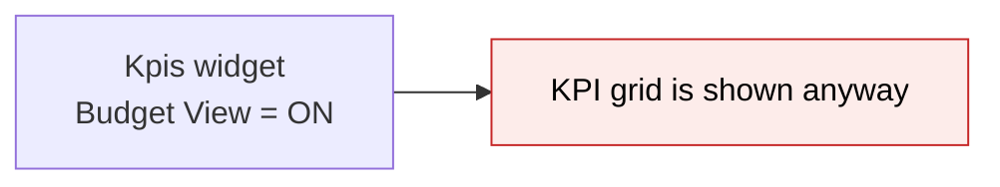
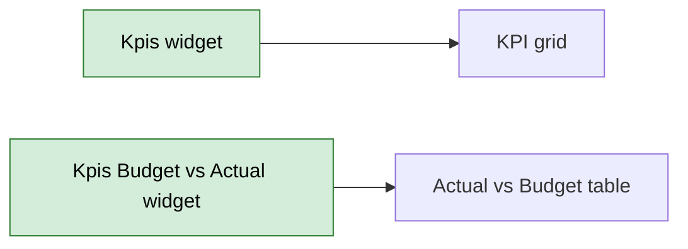
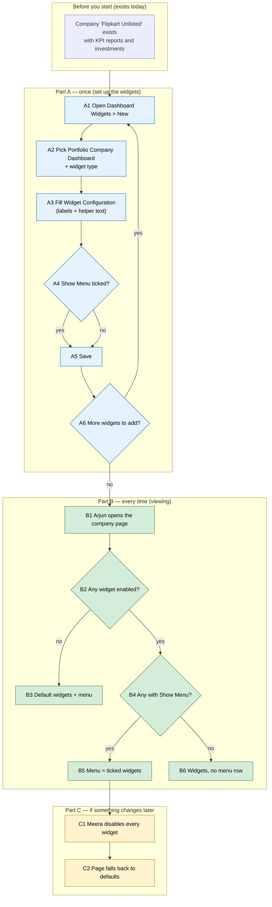

# Fix Portfolio Dashboard Widgets — Proposal

> **Audience:** Business team, product, QA, support — non-technical.
> **Companion document:** [Design](design.md)
> **New to this? Start with the [Workflow Journey](#workflow-journey)** — every action, in order, from start to the outcome.

> **Planning phase — no code changes.** This document proposes and explains the change. Do not
> edit application code while writing it; implementation happens later, in the tasks phase.

---

## Why

A QA review of the **Portfolio Dashboard Widgets** (the widgets a fund manager arranges on a portfolio company's page) found seven problems: the page menu misbehaves when only some widgets are on, the KPI Performance Table hides older months, and several widget settings either do nothing, are mislabelled, or accept input that makes no sense. Together they make the widget setup screen unreliable and hard to trust — an admin cannot tell which settings really work.

## What Changes

Seven fixes, all on the Portfolio Company Dashboard setup and display (item 1 also applies to the other dashboards that share the same menu):

1. **Menu follows the widgets you switch on.** Today, if you switch off "Show Menu" on your only enabled widget, the menu suddenly lists every default widget — and none of its links work. After the fix the page and the menu follow three simple rules (below).
2. **KPI Performance Table lists the months that actually have data**, newest first, and opens on the latest one. The dead "Chart" setting is removed.
3. **KPI Budget vs Actual:** the two category settings get names that say what each does.
4. **Key KPIs:** the "Kpis" setting (which never had any effect) is removed.
5. **Kpis widget:** the "Budget View", "Show table" and "Show chart" settings (none of which worked in this widget) are removed — the Actual-vs-Budget table is the separate Kpis Budget vs Actual widget; "Compound" is renamed **Data-only view** and gets a one-line explanation; "No Actions" (which hid the toolbar whatever its value) is replaced by **Show action buttons**, OFF by default. The Kpis Budget vs Actual widget keeps only **Default category**: its comma-separated Categories setting did not fill the filter dropdown and stopped applying once Filter was clicked.
6. **Documents widget:** the "Entity" setting (which was always ignored) is removed; "Owner" and "Folder" are renamed **Owner ID** and **Folder ID** and accept whole numbers only (no more letter "e").
7. **Portfolio Investments:** "Group by column" becomes a pick-list of the columns the grid really has, and it works whether or not AG Grid is switched on.

**The three menu rules (item 1):**

| What is set up for the dashboard | Page shows | Menu shows |
|---|---|---|
| No widget is enabled | the default widgets | the default widgets |
| Some widgets enabled, none with "Show Menu" ticked | the enabled widgets | **no menu row** (this also hides the Reports drop-down and layout selector — an accepted limitation) |
| Some widgets enabled with "Show Menu" ticked | the enabled widgets | only the ticked widgets |

No existing setting is renamed in the saved data; only what the form shows changes. Settings that never worked are removed from the form. Values already saved for them are ignored when rendering (they already were) and are cleared by a one-off script outside this change; until it runs, a stale key shows in that widget's edit form as an ordinary field.

### Flow Diagram

**Flow 1 — what the page and the menu show**

*Before:* the menu is looked up separately from the page, so "no widget has Show Menu" looks like "nothing configured".



*After:* one lookup; the menu is that same list narrowed to the ticked widgets.



**Flow 2 — choosing a month on the KPI Performance Table**

*Before:* the dropdown only offers 7 months counted back from whatever is selected, so reaching an old month means clicking back again and again.



*After:* the dropdown is the list of months the company has KPI reports for.



**Flow 3 — "Budget View" on the Kpis widget**

*Before:* switching "Budget View" on had no visible effect — the KPI grid still appeared.



*After:* the setting is removed. The Kpis widget is the KPI grid; the Actual-vs-Budget table comes from the separate Kpis Budget vs Actual widget.



---

## Workflow Journey

One worked example: Meera, a fund admin, sets up the company page for **Flipkart Unlisted** so that Arjun, an analyst, can read it. It touches the menu rules (1), the Kpis widget (5) and Portfolio Investments (7); the other fixes are visible in the same screens.

### Who is involved

| Person | Role | What they do in the journey |
|---|---|---|
| Meera | Fund admin (company admin of the fund manager) | Creates and edits dashboard widgets under **Dashboard Widgets** |
| Arjun | Analyst at the same fund manager | Opens the Flipkart Unlisted company page and uses the menu |

### The journey on one page



### Before you start

| Needed | Why | Where it comes from |
|---|---|---|
| A portfolio company with KPI reports | The Kpis, Performance Table and Budget widgets need data | Existing KPI uploads |
| Portfolio investments for the company | Portfolio Investments widget | Existing investments |
| Access to **Dashboard Widgets** | Only fund admins edit widgets | Existing role |

### Part A — once (set up the widgets)

| Step | Who | Where | Action | What the system does | What you see |
|---|---|---|---|---|---|
| A1 | Meera | Dashboard Widgets › New | Picks **Portfolio Company Dashboard**, widget type **Kpis** | Loads the Kpis settings | Settings with plain labels; **Data-only view** and **Show action buttons** each have a one-line explanation |
| A2 | Meera | Widget Configuration | Sets **Show action buttons = ON** | Stores the choice | Nothing else changes yet |
| A3 | Meera | Display Settings | Ticks **Enabled** and **Show Menu**, saves | Saves the widget | Widget appears in the list |
| A4 | Meera | Dashboard Widgets › New | Adds **Portfolio Investments** | Loads its settings | **Group by column** is a pick-list (e.g. "Instrument Name", "Fund Name") |
| A5 | Meera | Widget Configuration | Chooses **Fund Name** with AG Grid left on **Default** | Stores the grouping | — |
| A6 | Meera | Display Settings | Ticks **Enabled**, unticks **Show Menu**, saves | Saves | Widget appears in the list |

### Part B — every time (viewing)

| Step | Who | Where | Action | What the system does | What you see |
|---|---|---|---|---|---|
| B1 | Arjun | Company page | Opens Flipkart Unlisted | Looks up the enabled widgets once | Kpis (KPI grid) and Portfolio Investments (grouped by fund) |
| B2 | Arjun | Top menu | Clicks **Kpis** | Scrolls to that widget | Menu lists only **Kpis** (Show Menu ticked); Portfolio Investments is on the page but not in the menu |
| B3 | Arjun | KPI Performance Table | Opens the month dropdown | Reads the months that have reports | Every month with data, newest first; opens on the latest |

### Part C — if something changes later

| Step | Who | Where | Action | What the system does | What you see |
|---|---|---|---|---|---|
| C1 | Meera | Dashboard Widgets › list | Unticks **Enabled** on every widget | Saves each | All show "No" under Enabled |
| C2 | Arjun | Company page | Reloads | No widget is enabled, so defaults are used | The default widgets and their menu (same as a company that was never configured) |

### What you see

Dashboard Widgets form, Kpis widget (after the fix):

```
 Widget Configuration
 Data-only view            [ ON  v ]   ON = grouped by category, data only (chart picking is off).
                                   OFF = full table with a "plot this KPI" checkbox per row.
 Show action buttons   [ OFF v ]   ON = shows the toolbar above the table (filters, charts, settings).
 Categories            [ Income Statement, Balance Sheet ]   (comma-separated)
```

Portfolio Investments widget (after the fix):

```
 Ag                    [ Default v ]
 Group by column       [ Fund Name        v ]   <- pick from the grid's own columns
                         Instrument Name
                         Fund Name
                         Portfolio Company Name ...
```

Company page menu, three cases (company "Flipkart Unlisted"):

```
 No widget enabled        : [Valuations] [Fund Ratios] [Kpis] [Data Card] ...   (defaults)
 Enabled, none Show Menu  : (no menu row)   Kpis table ... Portfolio Investments ...
 Enabled + Show Menu      : [Kpis]          Kpis table ... Portfolio Investments ...
```

### What goes wrong

Meera enables only the **Kpis** widget and unticks **Show Menu**. *Before the fix:* the menu bar lists Valuations, Fund Ratios, Data Card, … and clicking any of them does nothing, because those widgets are not on the page. *After the fix:* the page shows the Kpis widget and the menu row is not drawn. To get links, Meera ticks **Show Menu** on the widgets she wants listed.

### Summary: the minimum actions

| # | Action | Who | How often |
|---|---|---|---|
| 1 | Add each widget and fill its settings | Meera | Once per widget |
| 2 | Tick **Enabled**; tick **Show Menu** only for widgets that should be in the menu | Meera | Once per widget |
| 3 | Open the company page | Arjun | Every time |

---

## User Stories

### US-1: The menu matches what is on the page

**As a** fund admin,
**I want** the page menu to list only widgets that are on the page,
**So that** every menu link works and "Show Menu" does what its name says.

**Acceptance criteria:**
- With no enabled widget, the page and the menu show the default widgets.
- With enabled widgets but none ticked "Show Menu", the page shows the enabled widgets and **no menu row is drawn** (the Reports drop-down and layout selector are in that row and go with it — see FAQ).
- With "Show Menu" ticked on some, the menu lists exactly those widgets, in position order.
- Every menu link scrolls to a widget that is on the page.
- The same holds on every dashboard that has this menu (Portfolio Company, Fund, Investor, multi-portfolio, LP company page).

### US-2: Reach any KPI month quickly

**As an** analyst,
**I want** the KPI Performance Table's month dropdown to list every month with a report,
**So that** I reach an old month in one click.

**Acceptance criteria:**
- The dropdown lists each month-end that has a KPI report for the company, newest first.
- The table opens on the latest month with a report (not "last month" blindly).
- If the company has no KPI report at all, the page says so and shows no dropdown choices.
- The "Chart" setting no longer appears in this widget's settings.

### US-3: Understand the Budget vs Actual category settings

**As a** fund admin,
**I want** one clearly named category setting,
**So that** I know what it does.

**Acceptance criteria:**
- The form shows only **Default category**, with one line of help; the filter dropdown lists all the company's KPI categories.
- A saved Categories value is cleared by the clean-up script.

### US-4: Key KPIs has no confusing setting

**As a** fund admin,
**I want** the Key KPIs widget not to offer a "Kpis" box,
**So that** I am not asked for something that has no effect.

**Acceptance criteria:**
- The Key KPIs settings show no "Kpis" field.
- The widget still shows the KPIs flagged "show in report" for the company.

### US-5: Kpis widget settings that work

**As a** fund admin,
**I want** each Kpis setting to do what it says,
**So that** I can build the view I want.

**Acceptance criteria:**
- The Kpis widget shows the KPI grid; there is no "Budget View" setting (use the Kpis Budget vs Actual widget for the Actual-vs-Budget table).
- "Show table" and "Show chart" no longer appear.
- **Data-only view** (formerly "Compound") and **Show action buttons** (replaces "No Actions", OFF by default) each show a one-line explanation under the field.
- Existing widgets with Compound saved keep behaving exactly as before.

### US-6: Documents widget takes sensible IDs

**As a** fund admin,
**I want** the Documents widget to ask only for settings that apply and to accept only whole numbers for IDs,
**So that** I cannot enter an invalid ID.

**Acceptance criteria:**
- No "Entity" field.
- Fields read **Owner ID** and **Folder ID**; they refuse letters including "e", signs and decimals.
- The widget can still point at any folder by Folder ID.

### US-7: Group portfolio investments by a real column

**As a** fund admin,
**I want** to choose "Group by column" from a list,
**So that** I do not have to know internal column names.

**Acceptance criteria:**
- The field is a pick-list of the columns the Portfolio Investments grid has, shown with their on-screen names.
- A grouping that is chosen takes effect whether AG Grid is set to ON, OFF or Default.
- A previously saved value (including a comma-separated list) is kept and shown; nothing is lost on re-save.

---

## UI Behavior

### Dashboard Widgets form — Widget Configuration section

```
┌──────────────────────────────────────────────────────────────┐
│  Widget Configuration                                          │
│                                                                │
│  Folder name           [ e.g. My Documents        ]            │
│  Owner type            [ Default            v ]                │
│  Owner ID              [ 123                  ]  whole number  │
│  Folder ID             [ 123                  ]  whole number  │
│  Include sub folders   [ Default            v ]                │
│  ...                                                           │
│  (no "Entity" field)                                           │
└──────────────────────────────────────────────────────────────┘
```

**Behavior notes:**
- A field's name and its one-line help come from one place, so the same wording shows for every widget that has the setting.
- Whole-number fields ignore the keys e, E, +, - and the decimal point as the user types; pasting text with those characters leaves only the digits.
- Settings removed by this change are no longer offered on new widgets; stale values on existing widgets are cleared by a one-off script outside this change.
- The Raw Metadata box (Advanced) is unchanged and still accepts anything, including a comma-separated "Group by column".

### Company page menu

**Behavior notes:**
- When no widget is ticked "Show Menu" the whole menu row is not drawn (rule 2 in the table above). The Reports drop-down and the layout selector sit in that row, so they disappear too — an accepted limitation of this change. The company logo, title and sector heading above the row stay.

### KPI Performance Table

**Behavior notes:**
- Picking a month reloads only the table.
- When the chosen month has no report (a typed or old link), the page offers the nearest months that do have data.

---

## What This Feature Does NOT Cover

| Excluded | Covered In |
|---|---|
| A folder picker (choose by folder name instead of ID) for the Documents widget | Later change |
| Choosing several "Group by" columns from the pick-list (still possible through Raw Metadata) | Later change |
| An in-widget switch between KPI grid and Budget table | Not planned — use two Kpis widgets, or the "Kpis Budget vs Actual" widget |
| Showing multiple Budget-mode widgets on the same page | Existing limitation, unchanged |
| The KPI Performance Table's "chart" feature (removed, not built) | Not planned |
| LP-facing widget versions | Unchanged |
| Keeping the Reports drop-down / layout selector when the menu row is hidden | Accepted limitation, not planned |

---

## Validation Rules

| Field | Rule | Default |
|---|---|---|
| Owner ID, Folder ID (Documents) | Whole number, 1 or more; no letters, signs or decimals | empty |
| Group by column (Portfolio Investments) | One of the grid's columns; a previously saved value is kept as an extra choice | empty (no grouping) |
| Default category (Budget vs Actual) | One category name | empty |

---

## Behavior Rules

| Scenario | What User Sees |
|---|---|
| No widget enabled for the dashboard | Default widgets on the page and in the menu |
| Enabled widgets, none with Show Menu | The widgets; no menu row (the Reports drop-down and layout selector are not shown either) |
| Enabled widgets, some with Show Menu | The widgets; menu lists only the ticked ones |
| Enabled widgets but all hidden by tag filtering | Empty page as today (defaults are only for "none enabled") |
| Kpis widget | KPI grid (the Actual-vs-Budget table is the Kpis Budget vs Actual widget) |
| Performance Table, company has KPI reports | Dropdown of all report months, latest selected |
| Performance Table, company has none | "No KPI report found" and no month choices |
| Portfolio Investments, Group by column chosen, AG Grid OFF | Grid is shown grouped (grouping needs the AG grid, so it is used) |
| Old widget still has `kpis`, `chart`, `show_table`, `show_chart`, `budget_view`, `no_actions`, `categories` (Budget vs Actual) or `entity_id` saved | Ignored when rendered; the field shows in the edit form until the one-off clean-up script removes the value |
| Documents Owner ID / Folder ID entered with a letter | Letter is not accepted |

---

## Resolved Design Decisions

| # | Decision | Resolution |
|---|---|---|
| 1 | Default widgets when all are disabled? | Yes — "no widget enabled" means defaults, on page and menu |
| 2 | Menu when widgets are enabled but none has Show Menu? | No menu row at all; widgets still shown |
| 3 | Settings that never worked (`chart` on Performance Table, `kpis` on Key KPIs, `show_table` / `show_chart` on Kpis; `budget_view` on Kpis is removed as redundant) | Remove from the form; do not implement |
| 4 | Budget View on the Kpis widget? | Remove the setting. The Kpis widget is the KPI grid; the Actual-vs-Budget table is the Kpis Budget vs Actual widget. Old `budget_view` values are ignored |
| 5 | Rename "Compound"? | Label becomes **Data-only view**; saved key stays `compound` so nothing breaks. See FAQ on what ON means |
| 6 | Documents Entity field? | Remove (always overridden by the company) |
| 7 | Documents Owner / Folder fields? | Keep, relabel **Owner ID** / **Folder ID**, whole numbers only (Folder ID lets a widget show any folder) |
| 8 | Group by column choices? | The grid's own columns with their on-screen names — no separately maintained list |
| 9 | Group by with AG Grid OFF? | A chosen group column makes the widget use the AG grid, because grouping only exists there |
| 10 | Folder picker by name | Follow-up change |
| 11 | Reports drop-down and layout selector when no widget has Show Menu? | Hidden with the rest of the menu row — accepted limitation (rare edge case; a bare row would look odd) |

---

## Capabilities

### New Capabilities

- `ui/dashboard-widgets`: how dashboard widgets are resolved, shown and listed in the page menu, and how the widget setup form labels, explains and validates settings, plus the specific behaviour of the KPI Performance Table, Kpis, Budget vs Actual, Key KPIs, Documents and Portfolio Investments widgets.

### Modified Capabilities

None. There is no existing spec for dashboard widgets (the in-flight change `lp-folio-portfolio-dashboard` has its own LP rules, which this change must keep working).

---

## Impact

- **Company page and other dashboards' menu bar** — fund, investor, multi-portfolio and LP company pages share it.
- **Dashboard Widgets setup form** — labels, helper text, removed settings, whole-number fields.
- **KPI Performance Table, Kpis, Key KPIs, Documents, Portfolio Investments widgets.**
- **Tests** — the existing dashboard-widget setup scenarios are extended; new scenarios cover the menu rules, month list, the Kpis grid and grouping.
- No database change, no data migration, no change to notifications or billing.

---

## Benefits

1. Every menu link works, and "Show Menu" behaves as its name says.
2. Any KPI month is one click away; no more repeated clicking back.
3. Every setting on the form either works or is gone — admins stop trying settings that do nothing.
4. Clear names and one-line help for the settings that were confusing.
5. IDs cannot be mistyped with letters; the group-by choice cannot be misspelt.

---

## FAQ

| Question | Answer |
|---|---|
| Will existing dashboards look different? | Only where they hit a bug: a page with enabled widgets but none ticked "Show Menu" loses its (previously broken) row of default widget links. Everything else renders as before. |
| What if every widget is disabled? | The default widgets are shown, as for a company that was never configured. |
| What does **Data-only view** ON mean? | It is the old "Compound" setting: ON groups KPIs by category and shows data only (chart picking is off); OFF shows the full table with a "plot this KPI" checkbox per row. The helper text says this next to the field. |
| Why are the Reports drop-down and layout selector missing on a page where no widget has Show Menu? | They sit in the menu row, which is not drawn when no widget has Show Menu. Accepted limitation (rare, and a row with nothing but those would look odd). Tick Show Menu on at least one widget to get the row. Separately, they only ever exist when reports are tagged for the dashboard (Reports) or the entity has more than one layout (selector). |
| Do saved widgets need updating? | Nearly never. Removed settings were already ignored. The one visible case is a Kpis widget saved with Budget View ON: it showed the grid before and still does. If the table is wanted, add a Kpis Budget vs Actual widget. |
| Can I still have both the KPI grid and the Budget table on one page? | Yes — add a Kpis widget and a Kpis Budget vs Actual widget. |
| Why can't I type "e" in Owner ID / Folder ID? | They are whole-number IDs. A name-based folder picker is planned separately. |
| Does this affect LPs? | LP-facing widget versions are unchanged. The shared menu rule applies to the LP company page too. |
| Where do the Group by column names come from? | From the Portfolio Investments grid's own columns, so the names match what users see in the grid; changing a column name there changes it here. |

See [design.md](design.md) for how.

---

## Design Principle for the Next Phase

Keep it DRY and simple. Risks to handle head-on:

- **One lookup for page and menu** (item 1) — replace the two lookups with one; do not add a second fallback.
- **One place for labels, help text, removed settings and pick-lists** (items 2–7) — a single small table next to the existing widget definitions, read by the setup form, rather than one-off edits per widget.
- **Budget View (item 5)** — remove the setting; the existing Kpis Budget vs Actual widget already shows the table, so no second budget path is kept.
- **Group by column (item 7)** — reuse the grid's own column list; no new list to maintain.
- **Menu row hidden entirely** (item 1, rule 2) — this also removes the Reports drop-down and layout selector; accepted. Design must keep the logo, title and sector heading that share the same bar.
