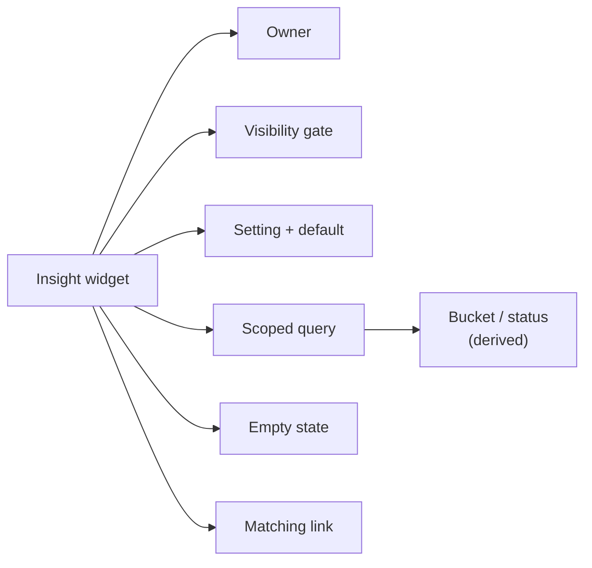
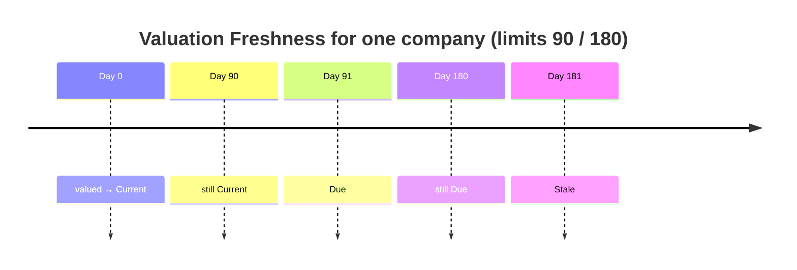
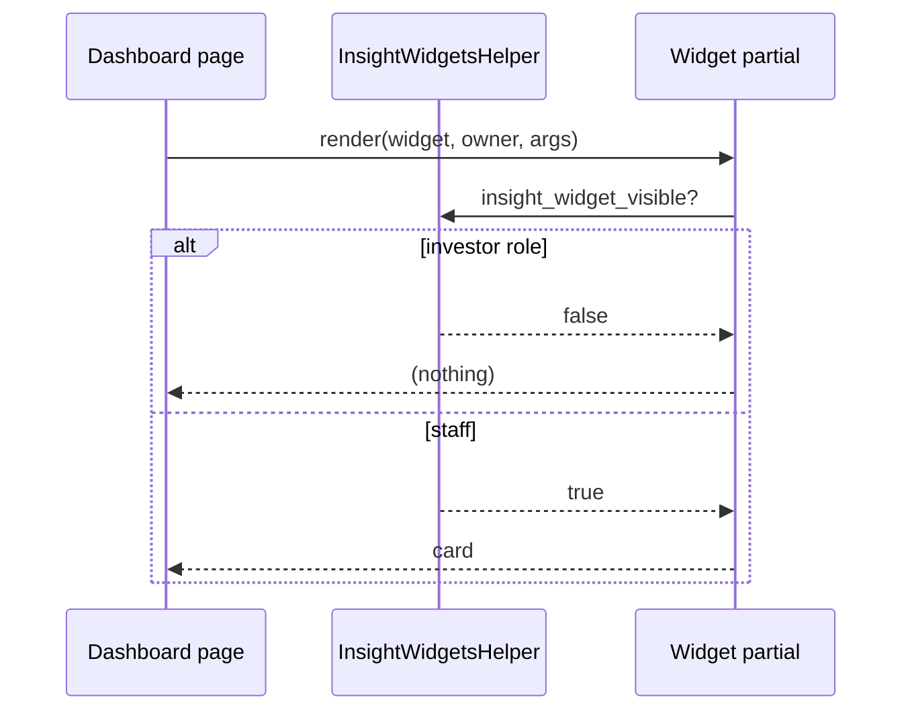
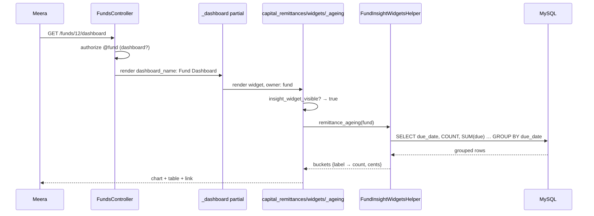
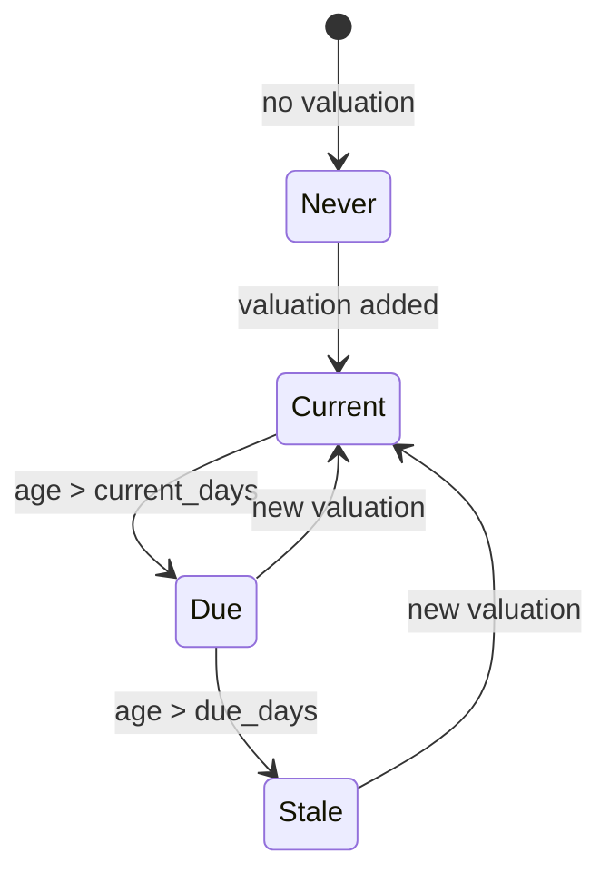
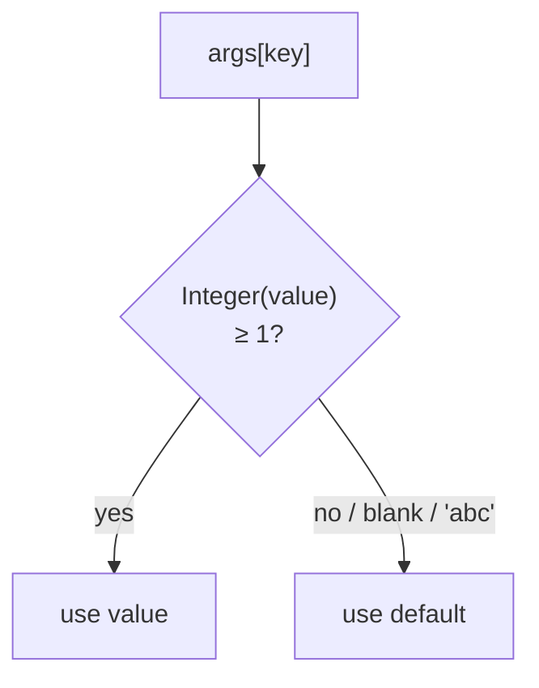

# Dashboard Insight Widgets — Design

> **Audience:** Engineers. **Companions:** [Proposal](proposal.md) · [Business rules](business-rules.md) · [Spec](specs/ui/dashboard-insight-widgets/spec.md) · [LLD](lld.md)

## Contents

- [1. The idea](#1-the-idea)
  - [What this adds](#what-this-adds)
  - [The idea in one picture](#the-idea-in-one-picture)
  - [Key concepts](#key-concepts)
  - [Walkthrough: one example, start to finish](#walkthrough-one-example-start-to-finish)
  - [Key ideas](#key-ideas)
  - [FAQ](#faq)
- [2. The same picture with real names](#2-the-same-picture-with-real-names)
  - [Picture](#picture)
  - [What each box does](#what-each-box-does)
  - [One run, end to end](#one-run-end-to-end)
  - [Lifecycles](#lifecycles)
  - [What users see](#what-users-see)
  - [Design decisions](#design-decisions)
  - [FAQ](#faq-1)
- [3. One card per box](#3-one-card-per-box)
  - [① Widget catalogue](#-widget-catalogue)
  - [② Dashboard page](#-dashboard-page)
  - [③ Visibility gate and ④ Settings reader](#-visibility-gate-and--settings-reader)
  - [⑤ Scoped query](#-scoped-query)
  - [⑥ Widget card](#-widget-card)
  - [⑦ Linked list](#-linked-list)
- [4. Reference](#4-reference)
  - [Class diagram](#class-diagram)
  - [Data model and schema changes](#data-model-and-schema-changes)
  - [Component contracts](#component-contracts)
  - [Notifications](#notifications)
  - [Cross-cutting concerns](#cross-cutting-concerns)
  - [Architecture and design patterns](#architecture-and-design-patterns)
  - [Security](#security)
  - [Worked examples](#worked-examples)
  - [Testing](#testing)
  - [Risks and open questions](#risks-and-open-questions)
  - [FAQ](#faq-2)

---

## 1. The idea

### What this adds

- 17 read-only widgets on the existing configurable dashboards. Each one answers a "what changed / what is stale /
  what is overdue / what is stuck" question.
- Each widget follows the existing pattern: a catalogue entry in `DashboardWidget::*_WIDGETS`, a partial wrapped in
  `WidgetCardComponent`, and a helper that runs the query. This is the pattern of `capital_calls/widgets/*` and
  `capital_call_dashboard_helper.rb`.
- One shared helper adds what all 17 need: hide from LPs, read settings with defaults, and show an empty state.

### The idea in one picture

```mermaid
flowchart LR
    A["① Widget catalogue<br/>which widgets exist,<br/>their settings + help"] -->|enabled widget| B["② Dashboard page<br/>renders each enabled<br/>widget for its owner"]
    B -->|widget + owner| C["③ Visibility gate<br/>internal staff only;<br/>module / agent present"]
    C -->|allowed| D["④ Settings reader<br/>values or defaults"]
    D -->|settings| E["⑤ Scoped query<br/>grouped SQL over rows<br/>the viewer may open"]
    E -->|rows or none| F["⑥ Widget card<br/>chart · table · counts<br/>or empty sentence"]
    F -->|click| G["⑦ Linked list<br/>existing index,<br/>same filter"]
```



### Key concepts



| Concept | What it is, in one line | Example from the walkthrough | Stored in |
|---|---|---|---|
| Insight widget | One of the 17 new widget types | Remittance Ageing | `dashboard_widgets` row (existing table) |
| Owner | The record the dashboard is about | Growth Fund I | `uri_params` / `owner` local |
| Visibility gate | The rule that hides a widget from LPs and when a module is missing | Lena sees nothing | Code (`InsightWidgetsHelper`) |
| Setting + default | A value from the widget's metadata, or its default | `days` → 90 | `dashboard_widgets.metadata` |
| Scoped query | Grouped SQL over the rows the viewer may open | Open remittances of the fund | Read only |
| Bucket / status | A label worked out at render time, never saved | "31–60 days", "Stale" | Not stored |
| Empty state | The one sentence shown when nothing matches | "No unpaid remittances in this fund." | Code |
| Matching link | A link to an existing list, filtered so it shows exactly the rows counted | "View open remittances" | Code |

#### Derived buckets and statuses

- **What:** labels worked out on every render from dates and amounts. None is stored, so none can go stale.
- **Kinds:**

| Widget | Label set | Basis | Example |
|---|---|---|---|
| Remittance Ageing | Not yet due · 0–30 · 31–60 · 61–90 · Over 90 | today − `capital_calls.due_date` | due 15 Sep, today 30 Sep → 15 → 0–30 |
| Valuation Freshness | Current · Due · Stale · Never | today − MAX(`valuations.valuation_date`) | 92 days, limits 90/180 → Due |
| KPI Threshold Watch | Red · Amber · Below threshold · Above threshold | `kpis.rag_status`, `percentage_change` vs mapping | change 5 < lower 10 → Below |
| Hedge Expiries | "N days" · "Expired N days ago" | `expiry_date` − today | 15 days |
| Stuck Workflows | "N days" | today − `current_step_since` | 15 days |

- **Not covered:** nothing is written back. Changing a limit setting changes the labels on the next render.
- **Rules:** a boundary day belongs to the lower bucket (30 → 0–30, 90 → Current). Due today counts as overdue (0–30),
  matching `CapitalRemittance#set_status`. A future valuation date is Current.



#### Visibility gate

- **What:** a widget body renders only if all of these hold:
  - the viewer is not acting as an investor, **and**
  - the widget's own prerequisite holds (KPI module for the KPI widgets, a visible portco agent for Monitoring Status).
- **Why:** some dashboard URLs are reachable by investor-role users (`FundPolicy#dashboard?` allows LPs when
  `show_portfolios` is on). The 17 widgets show internal data.
- **Not covered:** LP layouts. Those are already blocked by `LP_SAFE_WIDGET_NAMES`, and the new names are left out of it.



### Walkthrough: one example, start to finish

Setup: Demo Capital, today 30 Sep 2026. Growth Fund I has four open remittances (business-rules H14). Meera is fund
manager. Lena is an LP.

| # | When | What happens | Behind the scenes | Result |
|---|---|---|---|---|
| 1 | Once | Meera adds Remittance Ageing to Fund Dashboard | ① offers it; saved as a `dashboard_widgets` row | **Widget enabled** |
| 2 | Monday | Meera opens Growth Fund I › Dashboard | ② renders it with owner = fund; ③ passes; ④ no settings | Gate passed |
| 3 | Same | Widget groups the remittances | ⑤ one grouped query over `capital_remittances ⋈ capital_calls`, status Pending/Overdue | 4 rows in 4 buckets |
| 4 | Same | Card shows chart + table | ⑥ Not yet due ₹10 L · 0–30 ₹20 L · 31–60 ₹5 L · 61–90 ₹0 · Over 90 ₹2 L | **Total ₹37 L** |
| 5 | Same | Meera clicks "View open remittances" | ⑦ remittances index, fund + status in Pending/Overdue | Same 4 rows |
| 6 | Mistake | Meera sets `{days: 0}` on Hedge Expiries | ④ 0 is not ≥ 1, so the default 90 is used | Same as row 4 for other widgets; Hedge Expiries uses 90 |
| 7 | Stall | Lena requests the fund dashboard URL | ③ investor role → nothing rendered | **Hidden** |

```
Growth Fund I › Dashboard (Meera, 30/09/2026)
┌ Remittance Ageing ⓘ ────────────────────────────┐
│ Not yet due 1 ₹10,00,000 │ 0–30 1 ₹20,00,000     │
│ 31–60 1 ₹5,00,000 │ 61–90 0 ₹0 │ Over 90 1 ₹2,00,000 │
│                         [View open remittances]  │
└──────────────────────────────────────────────────┘
```

What to notice:
- The four rows are counted with one query, whatever the fund's size.
- The linked list uses the same status filter as the count, so the numbers match (E37).
- Lena gets nothing from the widget, even through a direct URL.

### Key ideas

| Idea | In one line | Card |
|---|---|---|
| Catalogue entry only | The existing registration + metadata form, with labelled settings | [①](#-widget-catalogue) |
| One shared gate | Investor role never sees a body | [③④](#-visibility-gate-and--settings-reader) |
| Fixed query budget | Grouped SQL per widget, no per-row queries | [⑤](#-scoped-query) |
| Reuse markup | WidgetCardComponent, chartkick + `chart_theme_color`, `tasks/_stats` cards | [⑥](#-widget-card) |
| Counts = lists | Every number links to a list filtered the same way | [⑦](#-linked-list) |

### FAQ

| Question | Answer |
|---|---|
| Why not one big "insights" widget? | Each dashboard has its own owner and audience. Separate widgets can be enabled, ordered and tagged per dashboard, like every other widget. |
| Why not store the buckets? | They depend on today and on the settings. Computing them at render time is cheap with grouped SQL, and they cannot go stale. |
| Why hide rather than refuse for LPs? | The page is legitimately reachable by LPs for other widgets. Only these widgets are internal. |

---

## 2. The same picture with real names

### Picture

```mermaid
flowchart LR
    A["① DashboardWidget::*_WIDGETS<br/>+ INSIGHT_FIELD_HINTS + WIDGET_HELP<br/><i>registers the 20 placements</i>"] -->|"dashboard_widgets row<br/>(enabled)"| B["② dashboard_widgets/_dashboard<br/>multi_portfolio_dashboard<br/><i>renders path with locals</i>"]
    B -->|"widget, args,<br/>owner, uri_params"| C["③ InsightWidgetsHelper<br/>#insight_widget_visible?<br/><i>investor role → nil</i>"]
    C -->|true| D["④ InsightWidgetsHelper<br/>#insight_int_arg / _str_ / _choice_<br/><i>settings or defaults</i>"]
    D -->|"Integer / String"| E["⑤ Kpi / Portfolio / Fund /<br/>InvestorOps / OpsInsightWidgetsHelper<br/><i>policy_scope + grouped SQL</i>"]
    E -->|"Hash / Array"| F["⑥ widget partials +<br/>WidgetCardComponent<br/><i>chartkick, table, stat cards</i>"]
    F -->|"href with q"| G["⑦ existing indexes<br/>tasks · capital_remittances ·<br/>investor_kycs · documents"]
    click A "#-widget-catalogue"
    click B "#-dashboard-page"
    click C "#-visibility-gate-and--settings-reader"
    click D "#-visibility-gate-and--settings-reader"
    click E "#-scoped-query"
    click F "#-widget-card"
    click G "#-linked-list"
    classDef new fill:#d4edda,stroke:#2e7d32,color:#000
    classDef mod fill:#fff3cd,stroke:#b8860b,color:#000
    classDef reuse fill:#eeeeee,stroke:#777,color:#000
    class A mod
    class B,G reuse
    class C,D,E,F new
```



### What each box does

| # | Box | Real parts | What it does | When it runs | What it decides | Details |
|---|---|---|---|---|---|---|
| ① | Widget catalogue | `DashboardWidget` constants | Offers the 20 placements, labels settings | Form + render | Which partial path | [card](#-widget-catalogue) |
| ② | Dashboard page | `dashboard_widgets/_dashboard`, `investors/multi_portfolio_dashboard` | Renders enabled widgets with locals | Page load | Owner / locals | [card](#-dashboard-page) |
| ③ | Visibility gate | `InsightWidgetsHelper#insight_widget_visible?`, `policy(KpiReport).index?`, `policy(agent).show?` | Hides from investors / missing module | Each render | Render or not | [card](#-visibility-gate-and--settings-reader) |
| ④ | Settings reader | `insight_int_arg`, `insight_str_arg`, `insight_choice_arg` | Settings or defaults | Each render | Values used | [card](#-visibility-gate-and--settings-reader) |
| ⑤ | Scoped query | 5 helper modules | Grouped SQL over permitted rows | Each render | Rows, buckets | [card](#-scoped-query) |
| ⑥ | Widget card | 17 partials | Chart / table / cards / empty state | Each render | Layout | [card](#-widget-card) |
| ⑦ | Linked list | Existing index actions | Shows the counted rows | On click | — | [card](#-linked-list) |

### One run, end to end



### Lifecycles

- No stored status is added or changed.
- Derived labels: see [Derived buckets and statuses](#derived-buckets-and-statuses).



(Derived at render time from `valuations.valuation_date`; nothing is persisted.)

### What users see

| At a glance | |
|---|---|
| New screens | None |
| Changed screens | 7 dashboards gain optional cards |
| Messages | Empty-state sentences, in [business-rules](business-rules.md) |

Main journey (Ops Dashboard):

```
┌ Ops Dashboard ───────────────────────────────────────────────────────┐
│ ┌ Needs Attention ⓘ ① ─────────────────────────────────────────────┐ │
│ │ [3 Overdue tasks] [2 KYCs to verify] [4 Overdue remittances] ②   │ │
│ │ [1 Open e-signs]                                                   │ │
│ └────────────────────────────────────────────────────────────────────┘ │
│ ┌ Overdue Tasks by Assignee ⓘ ③ ┐ ┌ Stuck Workflows ⓘ ④ ───────────┐ │
│ │ Meera ███ 3                    │ │ Call 3 · Approve notice · 15 d │ │
│ │ Unassigned ██ 2                │ │                                │ │
│ └────────────────────────────────┘ └────────────────────────────────┘ │
└───────────────────────────────────────────────────────────────────────┘
```

| Step | The user… | They see |
|---|---|---|
| ① | hovers ⓘ | "Work that is stuck right now. Each card opens the list it counts" |
| ② | clicks "Overdue remittances" | Remittances index with the same 4 rows |
| ③ | reads the bars | Who is behind |
| ④ | clicks a row | The record with its journey panel |

**Screen standards**

| Screen | Kind | Copies | Breadcrumbs | Tabs | Turbo | Stats cards (= grid totals) | Filter + search | Actions | Help | Full width |
|---|---|---|---|---|---|---|---|---|---|---|
| Each new widget | Dashboard card | `capital_calls/widgets/_collection_status` (card) + `capital_call_dashboard_helper` (chart) | Page's own | — | Rendered inline in the dashboard frame | Needs Attention / Freshness counts = linked list rows | — (settings instead) | Links to lists | Title ⓘ from `WIDGET_HELP`; setting hints; empty state | Per widget size (Medium / XL) |
| Needs Attention cards | Stat cards | `tasks/_stats` (`stat-card-accent`, counters) | — | — | — | Count = link rows (H21) | — | Card is the link | ⓘ | XL |
| Widget tables | Compact table | `capital_remittances/widgets/delinquent_investors` table classes (named in each partial) | — | — | — | Totals row = sum of rows | — | Row links | — | — |

### Design decisions

| # | Decision | Why, in one line |
|---|---|---|
| D1 | Widgets are partials + helpers on the existing catalogue | Same pattern as the 38 Fund Dashboard widgets |
| D2 | One shared `InsightWidgetsHelper` | One visibility rule and one settings rule for 17 widgets |
| D3 | Hide for investor role in the partial | Some dashboard URLs are reachable by LPs |
| D4 | Bucket in Ruby over grouped dates | Portable (SQLite tests, MySQL prod), still one query |
| D5 | Needs Attention shows only filters its lists support | Count must equal linked rows |
| D6 | Monitoring Status reuses `portfolio_company_dashboard/_report_detail` | No second rendering of agent JSON |
| D7 | KPI Threshold Watch reuses `kpi_percentage_class`'s threshold rule | One threshold rule everywhere |
| D8 | Investment Timeline totals `entity_currency_amount_cents` | Funds hold the same company in INR and USD |
| D9 | Widgets live in the pack of their data | Pack boundaries; `funds` depends on `core` |
| D10 | Not LP-safe | LP versions need LP partials (later) |

#### D1 — Partials + helpers on the existing catalogue
- **Problem:** 17 new cards must be placeable, configurable and orderable like every other card.
- **Decision:** a `DashboardWidget.new(...)` entry per placement, plus a partial and a helper method.
- **Why:** no new tables, controllers or routes. The form, positions, tags and menu all work unchanged.
- **Not chosen:** a new "insights" page, which would duplicate the dashboard framework.
- **Where:** `DashboardWidget::*_WIDGETS`.

#### D2 — Shared helper
- **Problem:** 17 widgets each need "hide from LPs", "read `top_n` or default 5" and "empty sentence".
- **Decision:** `InsightWidgetsHelper` with `insight_widget_visible?`, `insight_int_arg`, `insight_str_arg`, `insight_choice_arg`,
  `insight_empty_state`, `insight_money`.
- **Why:** one rule per concern. E1/E2/X2 are proved once.
- **Not chosen:** a ViewComponent base class, which needs two callers of a shape and none exists yet.
- **Where:** `app/packs/core/base/helpers/insight_widgets_helper.rb`.

#### D3 — Hide for investor role
- **Problem:** `FundPolicy#dashboard?` lets permissioned LPs open fund dashboards when `show_portfolios` is on.
  `dashboard_name` is a free param.
- **Decision:** each partial returns early unless `insight_widget_visible?`.
- **Why:** it closes the path for these widgets without changing who may open the page.
- **Not chosen:** restricting `dashboard_name` per role in the controller, which would change existing behaviour and is out of scope.
- **Where:** first line of every partial.

#### D4 — Bucket in Ruby over grouped dates
- **Problem:** `DATEDIFF` is MySQL-only, and tests run on SQLite.
- **Decision:** `GROUP BY capital_calls.due_date` (or MAX per company) in SQL, then map each date to a bucket in Ruby.
- **Why:** one query, portable. The number of groups is bounded by the distinct dates (calls), not the remittances.
- **Not chosen:** a `CASE WHEN due_date >= ?` expression, which is also portable but harder to read.
- **Where:** `FundInsightWidgetsHelper`, `PortfolioInsightWidgetsHelper`.

#### D5 — Needs Attention filters
- **Problem:** "approvals awaiting response" and "e-sign open > 7 days" cannot be expressed on the approvals or
  documents lists, so a card would show a number its list cannot reproduce.
- **Decision:** four cards whose filters are allowlisted Ransack attributes on their lists.
- **Why:** stats cards must equal grid totals.
- **Not chosen:** adding ransackers to Approval/Document, which changes existing models and needs approval.
- **Where:** `InvestorOpsInsightWidgetsHelper#needs_attention_cards`.

#### D6 — Reuse the agent report detail
- **Problem:** the portco agent's JSON (`kpi_issues`, `document_issues`, `valuation_issues`) already has a renderer.
- **Decision:** Monitoring Status renders `portfolio_company_dashboard/report_detail`.
- **Why:** DRY. The same badges and wording as the AI dashboard.
- **Not chosen:** a new compact renderer, which would duplicate the parsing.
- **Where:** `investors/widgets/_monitoring_status`.

#### D7 — One threshold rule
- **Problem:** the KPI grid colours changes against `lower_threshold`/`upper_threshold`. A second rule would disagree with it.
- **Decision:** the same comparison as `KpisHelper#kpi_percentage_class` (positive thresholds only, strict inequality).
- **Why:** spec `startups/kpi-change-direction` already defines it.
- **Not chosen:** the RAG thresholds alone, which are too sparse (78 of 6,213 KPIs in the demo firm).
- **Where:** `KpiInsightWidgetsHelper`.

#### D8 — Firm currency for the timeline
- **Problem:** Zeta Foods is held by an INR fund and a USD fund.
- **Decision:** sum `portfolio_investments.entity_currency_amount_cents`, shown in the firm's currency.
- **Why:** the column is populated on every row (248 of 248 in the demo firm).
- **Not chosen:** one chart per currency, which is noisy and hard to compare.
- **Where:** `CompanyInsightWidgetsHelper`.

#### D9 — Pack placement
- **Problem:** Needs Attention and Investor Pending Actions read funds data (remittances).
- **Decision:** they live in `funds/funds`. Core-only widgets (tasks, workflows) live in `core/base`.
- **Why:** `funds` depends on `core`, never the reverse.
- **Not chosen:** putting them all in `core/base`, which would break the dependency direction.
- **Where:** see LLD file map.

#### D10 — Not LP-safe
- **Problem:** an LP layout shows the company dashboard to LPs.
- **Decision:** leave all 17 widgets out of `LP_SAFE_WIDGET_NAMES`.
- **Why:** an LP version needs Actual-only, LP-fund-only data (`LP_WIDGET_PARTIALS`).
- **Not chosen:** marking KPI Movers LP-safe now, because it has no LP partial yet.
- **Where:** `DashboardWidget::LP_SAFE_WIDGET_NAMES` (unchanged).

#### Changed during the build

| Log # | What changed | Why |
|---|---|---|
| B1–B16 | Display format, empty states, module gates and edge rules settled during the build | See [lld.md › Changed during the build](lld.md#changed-during-the-build) |

No decision D1–D10 was reversed.

### FAQ

| Question | Answer |
|---|---|
| Does any existing screen change? | No. Only the catalogue gains entries. |
| What about entities with nothing configured? | They see the full catalogue (existing H17/E1 rule), new widgets included. FM Landing only defaults its first 4, so Needs Attention needs enabling there. |
| Why not use policy_scope everywhere? | Owner widgets read rows of an owner the controller already authorized (as the 38 existing fund widgets do). Cross-record widgets (Ops, Investor, KPI, Timeline) use `policy_scope`. |

---

## 3. One card per box

### ① Widget catalogue

- **What:** 20 `DashboardWidget.new` entries, `INSIGHT_FIELD_HINTS` (label + hint + integer flag per setting) merged
  into `METADATA_FIELD_HINTS`, and a `WIDGET_HELP` sentence per widget for the ⓘ.

| Owns | Reads / receives | Produces |
|---|---|---|
| Names, paths, sizes, `metadata_help`, hints | — | Form options, partial path |

- Names are ≤ 30 characters (validation).
- Needs Attention is placed 5th on FM Landing, so the 4-widget default is unchanged.

**Worked examples:** [§1 H1, H2, X1](business-rules.md#1-rules-every-widget-follows--phase-1)

| Question | Answer |
|---|---|
| Why `integer: true` on counts? | The form then refuses letters and decimals, as for Documents' Folder ID. |

### ② Dashboard page

- **What:** unchanged renderers. The Fund, Portfolio, Portfolio Company, Investor and Ops dashboards pass `owner` and
  `uri_params` (`dashboard_widgets/_dashboard`). The Aggregated dashboard passes `investors` and `funds`
  (`multi_portfolio_dashboard`).

| Owns | Reads / receives | Produces |
|---|---|---|
| Nothing new | `dashboard_widgets(...)` | `render path, widget:, args:, owner:, uri_params:` |

**Worked examples:** H10 (Aggregated locals), H20 (FM landing).

| Question | Answer |
|---|---|
| Why does Valuation Freshness branch on locals? | Same partial on two dashboards: `owner` (fund) on Portfolio, `investors` on Aggregated. |

### ③ Visibility gate and ④ Settings reader

| Owns | Reads / receives | Produces |
|---|---|---|
| Hide rule, default rule | `current_user`, `args` | boolean, typed values |



- Extra gates per widget: KPI widgets need `policy(KpiReport).index?` (E8). Monitoring Status needs the firm's
  PortfolioCompanyAgent and `policy(agent).show?` (X4).

**Worked examples:** E1, E2, X2, X9, E8, X4.

| Question | Answer |
|---|---|
| Why not validate settings on save? | Existing widgets accept free metadata. Defaults at render keep old rows working and never error. |

### ⑤ Scoped query

| Widget | Helper | Scope | Query shape |
|---|---|---|---|
| KPI Movers / Threshold Watch | `KpiInsightWidgetsHelper` | `policy_scope(KpiReport)` for the company | latest report id (1), its KPIs with needed columns (1), mappings (1) |
| Peer KPI Comparison | same | `policy_scope(KpiReport)`, companies on the page | latest report per company (1), KPIs (1), mappings (1) |
| Monitoring Status | `CompanyInsightWidgetsHelper` | firm's agent, owner = company | agent (1), latest report (1) |
| Investment Timeline | same | `policy_scope(PortfolioInvestment)` | pluck date, qty sign, cents (1) → bucket in Ruby |
| Ownership Trend | same | company's `shareholder_positions` | GROUP BY date, category SUM % (1) |
| Valuation Freshness | `PortfolioInsightWidgetsHelper` | fund holdings / page companies | held ids (1), MAX(valuation_date) per company (1), names (1) |
| Winners & Losers | same | fund APIs | GROUP BY company SUM gain (1) |
| Sector Exposure | same | fund APIs ⋈ investors | GROUP BY sector SUM (1) |
| Remittance Ageing | `FundInsightWidgetsHelper` | fund remittances | GROUP BY due_date COUNT, SUM due (1) |
| NAV per Unit Trend | same | fund approved NAVs | latest date (1), pluck class, date, nav (1) |
| Hedge Expiries | same | fund open contracts | ordered select (1) |
| Investor Pending Actions | `InvestorOpsInsightWidgetsHelper` | `policy_scope` per model, investor | count + top 5 per section (≤ 8) |
| Side-letter Obligations | same | `policy_scope(SideLetterObligation)` | ordered select with preloads (≤ 3) |
| Needs Attention | same | `policy_scope` per model | one COUNT per card (5) |
| Overdue Tasks by Assignee | `OpsInsightWidgetsHelper` | `policy_scope(tasks)` | GROUP BY assignee (1), names (1) |
| Stuck Workflows | same | `policy_scope(WorkflowInstance)` | ordered select + preload (≤ 3) |

**Worked examples:** every H/E row in §2–§7 and isolation rows X3, X5–X7, X10, X11.

| Question | Answer |
|---|---|
| Why not `includes(:capital_remittances)`? | CLAUDE.md large-table rules: never materialize remittances. Only grouped results reach Ruby. |

### ⑥ Widget card

- **What:** each partial starts with the gate, wraps in `WidgetCardComponent`, and renders a chart (chartkick +
  `chart_theme_color`), a compact table, stat cards, or `insight_empty_state`.
- Dates use `l(...)`, money uses `insight_money` (owner currency), and percentages are shown as stored.

| Owns | Reads / receives | Produces |
|---|---|---|
| Markup | helper results | HTML |

**Worked examples:** all empty-state rows (E7, E11, E13, E17, E19, E27, E30, E38, E41, E44, E49, E58, E60, X8).

| Question | Answer |
|---|---|
| Why no new CSS? | The existing card, table and stat-card classes cover all of it. |

### ⑦ Linked list

| Card | Target | Filter (same as the count) |
|---|---|---|
| Overdue tasks | `tasks_path` | `completed eq false`, `due_date lt today` |
| KYCs to verify | `investor_kycs_path` | `verified eq false`, `submission_status eq completed` |
| Overdue remittances | `capital_remittances_path` | `status eq Overdue` |
| Open e-signs | `documents_path` | `esign_status in ESIGN_ACTIVE_STATUSES` |
| Remittance Ageing link | `capital_remittances_path(fund_id:)` | `status in [Pending, Overdue]` |

**Worked examples:** H21, E37.

| Question | Answer |
|---|---|
| What if a list ignores a filter? | Ransack ignores unknown conditions, so every attribute used here is checked against the model's `ransackable_attributes` in the LLD. |

---

## 4. Reference

### Class diagram

```mermaid
classDiagram
    namespace core_base {
        class InsightWidgetsHelper {
            <<helper>>
            +insight_widget_visible?()
            +insight_int_arg(args, key, default)
            +insight_str_arg(args, key, default)
            +insight_choice_arg(args, key, choices, default)
            +insight_empty_state(message)
            +insight_money(cents, currency)
        }
        class OpsInsightWidgetsHelper {
            <<helper>>
            +overdue_tasks_by_assignee(top_n)
            +stuck_workflows(days, limit)
        }
        class DashboardWidget {
            <<model, modified>>
            +INSIGHT_FIELD_HINTS
            +WIDGET_HELP
        }
    }
    namespace startups_kpis {
        class KpiInsightWidgetsHelper {
            <<helper>>
            +kpi_movers(company, args)
            +kpi_threshold_watch(company, args)
            +peer_kpi_comparison(companies, args)
        }
    }
    namespace core_investors {
        class CompanyInsightWidgetsHelper {
            <<helper>>
            +investment_timeline(company, period)
            +ownership_trend(company)
            +monitoring_status_report(company)
        }
    }
    namespace funds {
        class PortfolioInsightWidgetsHelper {
            <<helper>>
            +valuation_freshness(company_ids, args)
            +winners_losers(fund, top_n)
            +sector_exposure(fund, measure)
        }
        class FundInsightWidgetsHelper {
            <<helper>>
            +remittance_ageing(fund)
            +nav_per_unit_trend(fund, months)
            +hedge_expiries(fund, days)
        }
        class InvestorOpsInsightWidgetsHelper {
            <<helper>>
            +investor_pending_actions(investor, args)
            +side_letter_obligations_due(investor, days)
            +needs_attention_cards
        }
    }
    InsightWidgetsHelper <.. KpiInsightWidgetsHelper
    InsightWidgetsHelper <.. CompanyInsightWidgetsHelper
    InsightWidgetsHelper <.. PortfolioInsightWidgetsHelper
    InsightWidgetsHelper <.. FundInsightWidgetsHelper
    InsightWidgetsHelper <.. InvestorOpsInsightWidgetsHelper
    InsightWidgetsHelper <.. OpsInsightWidgetsHelper
```



(Exact method signatures are in [lld.md](lld.md); this diagram is the shape.)

### Data model and schema changes

N/A — no tables or columns change. The widgets read `kpis`, `kpi_reports`, `investor_kpi_mappings`, `valuations`,
`portfolio_investments`, `aggregate_portfolio_investments`, `shareholder_positions`, `support_agent_reports`,
`capital_remittances`, `capital_calls`, `fund_navs`, `derivative_contracts`, `investor_kycs`, `approval_responses`,
`approvals`, `documents`, `side_letter_obligations`, `side_letters`, `capital_commitments`, `tasks` and
`workflow_instances`. New settings live in the existing `dashboard_widgets.metadata`.

### Component contracts

| From → To | Contract | Direction rule |
|---|---|---|
| ① → ② | `DashboardWidget` with `path` | Catalogue never queries data |
| ② → ③ | `render path, widget:, args:, owner:, uri_params:` (+ `investors:, funds:` on Aggregated) | Page never knows widget internals |
| ③ → ④ | boolean | Gate first, always |
| ④ → ⑤ | typed settings | Helpers never read raw metadata |
| ⑤ → ⑥ | plain Hash / Array of rows | No relations leave a helper unloaded into loops |
| ⑥ → ⑦ | `href` with the count's own filter | Same predicate as the count |

### Notifications

None — considered for both audiences:
- **Investors:** the widgets are hidden from them, and nothing is sent to them.
- **Internal users:** the widgets only read. Alerts for the same conditions already exist (overdue remittance
  reminders, KYC reminders, e-sign reminders, side-letter reminder days, derivative `expiry_reminded_at`). Nothing is
  added, changed or suppressed.

### Cross-cutting concerns

- **Transactions and queries:** N/A — read only.
- **Exception handling and monitoring:** N/A — no jobs. A widget with bad metadata renders defaults (`metadata_args`
  already logs non-literal metadata).
- **Performance — Query budget:**

| Page / frame / job | Rows | Queries budget, independent of rows | Preloads / grouped queries | Per-row lookups avoided |
|---|---|---|---|---|
| KPI Movers | ≤ top_n | 3 | latest report, KPIs (select cols), mappings by name | mapping per KPI |
| KPI Threshold Watch | KPIs of one report | 3 | same | same |
| Monitoring Status | 1 | 2 | — | — |
| Investment Timeline | periods | 1 | pluck | — |
| Ownership Trend | dates × groups | 1 | GROUP BY | — |
| Valuation Freshness | ≤ limit | 3 | MAX per company, names | valuation per company |
| Winners & Losers | ≤ 2 × top_n | 2 | GROUP BY, names | — |
| Sector Exposure | sectors | 1 | GROUP BY join | — |
| Peer KPI Comparison | companies | 3 | latest per company, KPIs, mappings | per company report |
| Remittance Ageing | 5 buckets | 1 | GROUP BY due_date | — |
| NAV per Unit Trend | points | 2 | pluck | — |
| Hedge Expiries | contracts | 1 | — | — |
| Investor Pending Actions | ≤ 4 × 5 | ≤ 8 | preload fund, call | fund per row |
| Side-letter Obligations | ≤ limit | ≤ 3 | preload commitment → investor, fund | per row |
| Needs Attention | 5 | 5 | COUNT | — |
| Overdue Tasks by Assignee | ≤ top_n + 1 | 2 | GROUP BY, names | user per bar |
| Stuck Workflows | ≤ limit | ≤ 3 | preload workflowable, template | per row |

  Rule: nothing inside a row loop queries. Phase gates run the features with `PROSOPITE=1`.

### Architecture and design patterns

| Pattern | How this design applies it | Existing example reused | Where |
|---|---|---|---|
| 1 Pack boundaries | Widgets in their data's pack; `funds` → `core` only | `capital_calls/widgets/*` | D9 |
| 2 Thin controllers | No controller changes | `FundsController#dashboard` | ② |
| 3 Single responsibility | One helper module per data area; one method per widget | `CapitalCallDashboardHelper` | ⑤ |
| 4 Reuse before you add | `WidgetCardComponent`, `chart_theme_color`, `tasks/_stats` markup, `_report_detail`, `display_kpi`, `kpi_percentage_class`, `money_to_currency`, `ransack_query_params` | — | ⑥ |
| 5 Configuration as data | Per-widget `metadata` settings with defaults | `metadata_args`, `METADATA_FIELD_HINTS` | ④ |
| 6 Explicit state machines | Not needed — no stored status | — | — |
| 7 Append-only audit | Not needed — read only | — | — |
| 8 Background work | Not needed — grouped SQL is fast | — | — |
| 9 Notifications | Not needed — see Notifications | — | — |
| 10 UI | Partials + existing ViewComponent; no new CSS/JS | `WidgetCardComponent` | ⑥ |
| 11 Queries and data | Grouped SQL, policy_scope, allowlisted Ransack filters for links, large-table rules | `owner_remittances` | ⑤ ⑦ |
| 12 AI | Not needed — reads the agent's stored report only | `_report_detail` | D6 |
| 13 Rollout | Opt-in per entity via Settings › Widgets; wave 1 + wave 2 together, phased by feature file (tasks.md) | — | tasks.md |
| 14 YAGNI / DRY | One shared helper; no base component until there is a second shape | — | D2 |

### Security

| Item | How this design meets it | Where | Test |
|---|---|---|---|
| 1 Authorization (Pundit) | No new actions. Owner pages are already authorized. Cross-record queries use `policy_scope` | ⑤ | X3, X6, X10, X11 |
| 2 Tenant isolation | Every query is bound to the owner or `policy_scope` of the user's entity. The agent is looked up by `current_user.entity_id` | ⑤ | X3, X5, X7 |
| 3 Mass assignment | No new params | — | — |
| 4 No code from data | Settings parsed with `Integer(...)`, string choices from allowlists; no `send`/`constantize` | ④ | E1, E2 |
| 5 Injection | Bound params only; Ransack link attributes are in each model's allowlist; no `html_safe` on data | ⑤ ⑦ | H21, E37 |
| 6 Background jobs | N/A — none | — | — |
| 7 Files and documents | Only counts and names of documents; no file URLs | ⑤ | H19 |
| 8 AI / LLM | Reads stored agent output; no LLM call | D6 | H5 |
| 9 Webhooks, tokens, links | Links are app paths built with route helpers | ⑦ | H21 |
| 10 Rate limiting and cost | Fixed query budget per widget | Query budget | PROSOPITE gate |
| 11 Audit and logging | Nothing changes, so nothing to audit; no PII logged | — | — |
| 12 Verification | Brakeman clean; isolation features in `features/security/` | — | `dashboard_insight_*_isolation.feature` |
| LP exposure | Hidden for investor role; not LP-safe | ③ D3 D10 | X1, X2, X9 |

### Worked examples

98 rows (24 H, 63 E, 11 X) across 10 feature files, so they live in [business-rules.md](business-rules.md):
- §1 common (H1–H2, E1–E2, X1–X3)
- §2 company monitoring (H3–H6, E3–E14, X4–X5)
- §3 company holdings (H7–H8, E15–E19, X6)
- §4 fund portfolio (H9–H13, E20–E32, X7–X8)
- §5 fund capital (H14–H16, E33–E44, X9)
- §6 investor (H17–H18, E45–E53, X10)
- §7 ops (H19–H24, E54–E63, X11)

### Testing

- Cucumber only. 10 feature files (listed in business-rules Coverage). Shared steps reused: `today is`,
  `the {string} widget on the {string} has settings {string}`, `I open the company dashboard of {string}`.
  New step files: one per group.
- Traceability: every scenario carries `# <ID> — <kind>: …`, and helper code comments name the IDs they implement.

### Risks and open questions

- **Risk:** new widgets appear unasked on entities with nothing configured (A10). → **Mitigation:** an existing rule,
  documented. Easy to exclude if the user prefers.
- **Risk:** an LP reaches an internal widget via URL. → **Mitigation:** the gate in every partial, plus X2/X9 tests.
- **Risk:** MySQL-only SQL errors hidden by SQLite tests. → **Mitigation:** every query is run against dev MySQL
  (entity 157) during the build.
- **Open (for the user):** whether to build LP Pending Actions (privacy review), and whether any widget should
  become LP-safe.

### FAQ

| Question | Answer |
|---|---|
| Can this slow dashboards? | Each widget runs a fixed 1–8 queries regardless of data size. |
| Is anything persisted? | Only the `dashboard_widgets` rows users create. |
| What if the portco agent's JSON shape changes? | Monitoring Status renders the same partial as the AI dashboard, so both change together. |
