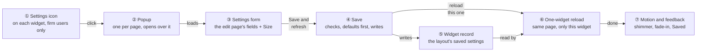
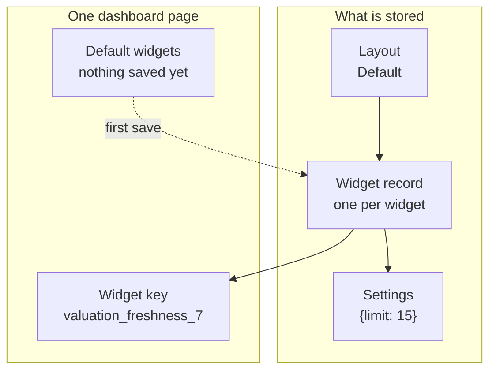
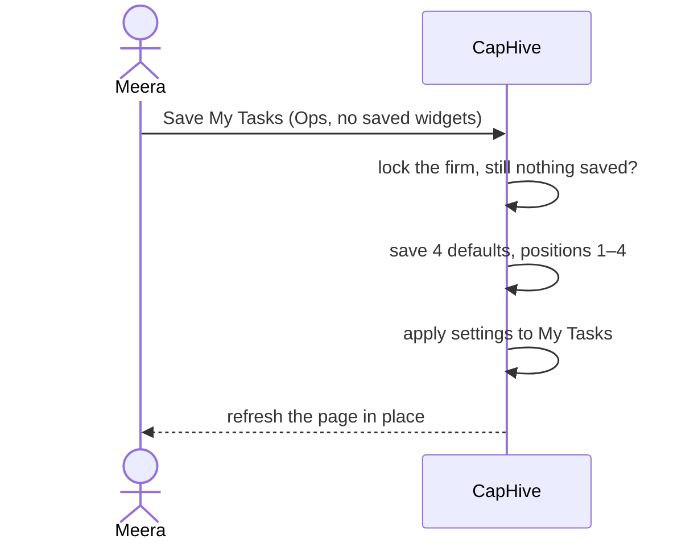
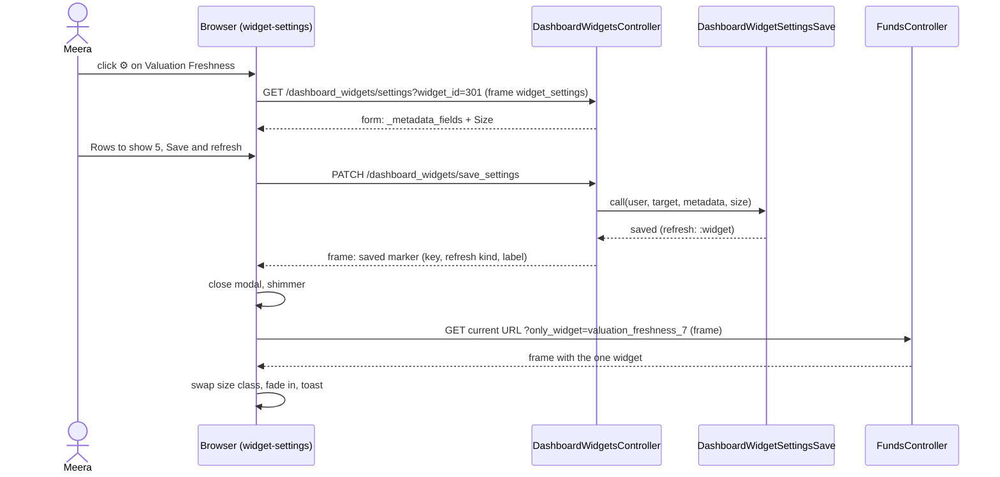
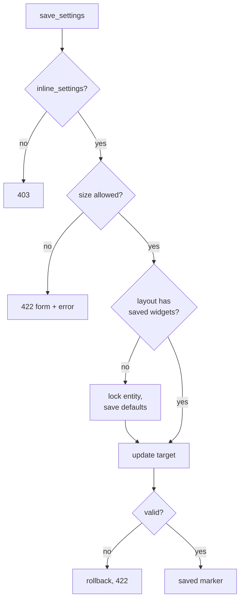
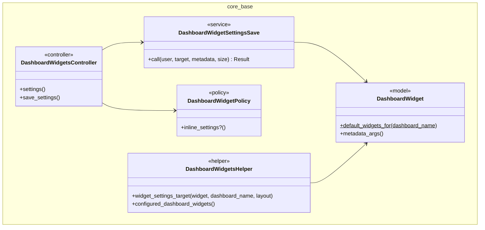

# Widget settings in place — Design

> **Audience:** Engineering team.
> **Companion documents:** [Proposal](proposal.md) · [Spec](specs/ui/dashboard-widgets/spec.md) · [LLD](lld.md)

> **Planning phase — no code changes.** This document explains HOW the proposal will be built.

> **Zoom one picture.** Part 1 draws the idea in plain words, Part 2 redraws the same picture with real
> names, Part 3 has one card per box, Part 4 is reference. ①–⑦ mean the same box everywhere.

---

## Contents

- [1. The idea](#1-the-idea)
  - [What this adds](#what-this-adds)
  - [The idea in one picture](#the-idea-in-one-picture)
  - [Key concepts](#key-concepts)
  - [Walkthrough: one example, start to finish](#walkthrough-one-example-start-to-finish)
  - [Key ideas](#key-ideas)
- [2. The same picture with real names](#2-the-same-picture-with-real-names)
  - [Picture](#picture)
  - [What each box does](#what-each-box-does)
  - [One run, end to end](#one-run-end-to-end)
  - [Lifecycles](#lifecycles)
  - [What users see](#what-users-see)
  - [Design decisions](#design-decisions)
- [3. One card per box](#3-one-card-per-box)
  - [① Settings icon](#-settings-icon)
  - [② Popup](#-popup)
  - [③ Settings form](#-settings-form)
  - [④ Save](#-save)
  - [⑤ Widget record](#-widget-record)
  - [⑥ One-widget reload](#-one-widget-reload)
  - [⑦ Motion and feedback](#-motion-and-feedback)
- [4. Reference](#4-reference)
  - [Class diagram](#class-diagram)
  - [Data model and schema changes](#data-model-and-schema-changes)
  - [Component contracts](#component-contracts)
  - [Notifications](#notifications)
  - [Cross-cutting concerns](#cross-cutting-concerns)
  - [Worked examples](#worked-examples)
  - [Testing](#testing)
  - [Risks and open questions](#risks-and-open-questions)

---

## 1. The idea

### What this adds

- A settings icon on every widget of a fund-manager dashboard opens a popup with the widget's existing
  settings fields; saving reloads only that widget in place.
- It follows the app's Hotwire pattern for in-page editing: a turbo frame loads the form into a Bootstrap
  modal, the form posts back into the frame, and a Stimulus controller reacts to the result.
- No new storage: the popup edits the same `dashboard_widgets` row the widget edit page edits.

### The idea in one picture



### Key concepts

**How the concepts fit together**



- A layout holds the firm's saved widgets for one dashboard; each widget record holds its settings.
- A page shows either the saved widgets or, when none is saved, the default widgets.
- Each widget on a page has a key, used to reload exactly that widget.

**Glossary**

| Concept | What it is, in one line | Example | Stored in |
|---|---|---|---|
| Dashboard | A page that shows widgets | Portfolio Dashboard of Fund 1 | `dashboard_widgets.dashboard_name` |
| Layout | A named set of widgets for a dashboard, shared by the firm | Default | `dashboard_widgets.name` |
| Widget record | One saved widget of a layout | Valuation Freshness, position 7 | `dashboard_widgets` row |
| Settings | The values a widget reads | `{current_days: 90, limit: 15}` | `dashboard_widgets.metadata` |
| Size | How much of the row the widget takes | XL | `dashboard_widgets.size` |
| Default widgets | The catalogue set shown when a layout has no saved widget | Ops Dashboard's 4 | Not stored (`DashboardWidget::WIDGETS`) |
| Widget key | The widget's id on the page: name + position | `valuation_freshness_7` | Not stored (rendered) |
| Inline settings | Permission to use the icon and popup | Meera yes, Asha no | Not stored (`DashboardWidgetPolicy`) |
| Saving the defaults | Writing every default widget as a record on the first save | 4 rows for Ops | `dashboard_widgets` rows |
| One-widget reload | Re-fetching the page with `only_widget` so only one widget renders | `?only_widget=valuation_freshness_7` | Not stored |

#### Saving the defaults

- **What:** on a layout with no saved widget, the first save writes every widget the page shows, then applies
  the change.
- **Why:** a layout with one saved widget shows only its saved widgets (existing rule) — saving one alone would
  hide the rest.

| Trigger | What it does | Example |
|---|---|---|
| First save on a dashboard showing defaults | Saves the shown set in order, then the change | Ops Dashboard: 4 rows |
| Save on a dashboard already set up | Updates the one record | Valuation Freshness only |
| FM / LP / Ops landing pages | The shown set is the first 4 of the catalogue | FM Landing: 4 rows, not 5 |

**What it does NOT cover:** choosing a subset, reordering, LP layouts (they never show defaults).



**Rules**
- Runs inside one transaction that first locks the firm's entity row, so two first saves cannot both write
  the defaults.
- A refused change rolls the defaults back too — nothing is half-saved.

#### One-widget reload

- **What:** the page's own URL is fetched again as a turbo-frame request with `only_widget=<key>`; the dashboard
  renders just that widget into its frame.
- **Why:** every dashboard builds its own context (the fund, the company, the Aggregated filters); re-using the
  page's own action keeps it right without re-building it per dashboard.
- **Not covered:** the first save on defaults — keys change (positions are assigned), so the whole page
  refreshes instead, keeping the scroll position.

### Walkthrough: one example, start to finish

Meera (Demo Capital employee) opens Fund 1 › Portfolio tab. Valuation Freshness (position 7, settings
`{limit: 15}`) shows 10 companies. Legend: ● = where we are now (waiting on this, not done yet), ✓ = done.

| # | When | What happens | Behind the scenes | Result |
|---|---|---|---|---|
| 1 | 10:00 | Meera points at Valuation Freshness | the settings icon (①) fades in | ✓&nbsp;Icon&nbsp;shown<br>**●&nbsp;Open&nbsp;popup** |
| 2 | 10:00 | She clicks it | the popup (②) loads the settings form (③) into its frame | ✓&nbsp;Icon&nbsp;shown<br>✓&nbsp;Open&nbsp;popup<br>**●&nbsp;Change&nbsp;settings** |
| 3 | 10:01 | She sets Rows to show 5 and Size Medium, clicks Save and refresh | save (④) checks and writes the widget record (⑤) | ✓&nbsp;Change&nbsp;settings<br>**●&nbsp;Reload&nbsp;widget** |
| 4 | 10:01 | The popup closes; the widget shimmers | one-widget reload (⑥) fetches `?only_widget=valuation_freshness_7` | **●&nbsp;Reload&nbsp;widget** |
| 5 | 10:01 | The widget fades in, half width, 5 rows; "Valuation Freshness updated" | motion and feedback (⑦) | ✓&nbsp;Reload&nbsp;widget<br>✓&nbsp;Saved |
| 6 | 10:02 | Mistake: she types an expression into Advanced › raw settings and saves | save (④) refuses it; the popup (②) stays open with the reason | **●&nbsp;Change&nbsp;settings** |
| 7 | 10:03 | Stall: the reload request fails (server restart) | ⑥ shows "Could not refresh — reload the page" in the widget | ✓&nbsp;Saved<br>**●&nbsp;Reload&nbsp;widget** |
| 8 | 10:05 | Meera opens the Ops Dashboard (never set up), changes My Tasks | save (④) saves the 4 defaults, then the change; the page refreshes | ✓&nbsp;Saved<br>✓&nbsp;Page&nbsp;refreshed |

```
┌ Valuation Freshness ⓘ ───────────────┐  ┌ Sector Exposure ⓘ ───── ⚙ ┐
│ ░░░░░░░░ shimmer while reloading ░░░ │  │ …                         │
└──────────────────────────────────────┘  └───────────────────────────┘
                                   ╭───────────────────────────────╮
                                   │ ✓ Valuation Freshness updated │
                                   ╰───────────────────────────────╯
```

**What to notice**
- The popup edits the same record as the edit page — no second settings store.
- Only one widget reloads; context comes from the page's own URL.
- The first save on defaults is one transaction and a full in-place refresh.
- A refused save leaves the page untouched.

### Key ideas

| # | Idea | In one line | Card |
|---|---|---|---|
| 1 | Same fields as the edit page | The popup renders `_metadata_fields` unchanged | [③](#-settings-form) |
| 2 | Narrow save | One action, only `metadata` and `size`, one service | [④](#-save) |
| 3 | Defaults saved once | Entity lock + transaction on the first save | [④](#-save) |
| 4 | Reload through the page's URL | `only_widget` filters the dashboard loop | [⑥](#-one-widget-reload) |
| 5 | Quiet motion | CSS transitions, none with reduced motion | [⑦](#-motion-and-feedback) |

**FAQ**

| Question | Answer |
|---|---|
| Why not reuse the existing `update` action? | It permits `entity_id`, `owner_id`, `dashboard_name` and more; the popup needs only `metadata` and `size`, and must also handle default widgets that have no record. See D2. |
| Why not re-render the widget from the save response? | The save request has none of the page's context (fund, company, filters); the page's own URL has it. See D4. |
| Does the widget edit page change? | No. |

---

## 2. The same picture with real names

### Picture

```mermaid
flowchart LR
    I["① dashboard_widgets/_settings_button<br/><i>icon + link, gated by inline_settings?</i>"]
    P["② dashboard_widgets/_settings_modal<br/><i>Bootstrap modal + turbo frame</i>"]
    F["③ DashboardWidgetsController#settings<br/><i>renders _metadata_fields + Size</i>"]
    S["④ #save_settings → DashboardWidgetSettingsSave<br/><i>defaults first, metadata + size</i>"]
    W["⑤ dashboard_widgets row<br/><i>metadata, size (existing)</i>"]
    R["⑥ only_widget in _dashboard loops<br/><i>turbo frame per widget</i>"]
    M["⑦ widget_settings_controller.js + scss<br/><i>shimmer, fade, toast</i>"]
    I -- "GET settings" --> P
    P -- "frame load" --> F
    F -- "PATCH<br/>save_settings" --> S
    S -- "update!" --> W
    S -- "saved marker" --> R
    W -- "metadata_args" --> R
    R -- "frame-load" --> M
    click I "#-settings-icon"
    click P "#-popup"
    click F "#-settings-form"
    click S "#-save"
    click W "#-widget-record"
    click R "#-one-widget-reload"
    click M "#-motion-and-feedback"
    classDef new fill:#d4edda,stroke:#2e7d32,color:#000
    classDef mod fill:#fff3cd,stroke:#856404,color:#000
    classDef reused fill:#eeeeee,stroke:#616161,color:#000
    class I,P,M new
    class F,S,R mod
    class W reused
```



### What each box does

| # | Box | Real parts | What it does | When it runs | What it decides | Details |
|---|---|---|---|---|---|---|
| ① | Settings icon | `_settings_button`, `DashboardWidgetPolicy#inline_settings?` | Draws the icon with the settings URL | Page render | Show or hide | [card ①](#-settings-icon) |
| ② | Popup | `_settings_modal`, `widget-settings` Stimulus | Opens the modal, hosts the frame | Click | — | [card ②](#-popup) |
| ③ | Settings form | `#settings`, `settings.html.erb`, `_metadata_fields` | Renders fields + Size | GET | Saved or default widget | [card ③](#-settings-form) |
| ④ | Save | `#save_settings`, `DashboardWidgetSettingsSave` | Saves defaults if needed, then settings | PATCH | Saved / refused / refresh kind | [card ④](#-save) |
| ⑤ | Widget record | `DashboardWidget` | Holds settings | — | — | [card ⑤](#-widget-record) |
| ⑥ | One-widget reload | `_dashboard.html.erb`, `multi_portfolio_dashboard.html.erb` | Renders one widget for `only_widget` | Frame request | Which widget | [card ⑥](#-one-widget-reload) |
| ⑦ | Motion and feedback | `widget_settings_controller.js`, `widget_settings.scss` | Animates and confirms | Client | Animate or not | [card ⑦](#-motion-and-feedback) |

### One run, end to end



### Lifecycles

N/A — no stored or derived status; a widget record is simply updated.

### What users see

| At a glance | |
|---|---|
| New | Settings icon on every widget; settings popup; saved toast |
| Changed | Nothing on the widget edit page or Widgets list |

Main journey: see the proposal's [Workflow Journey](proposal.md#workflow-journey) and the mock
`scratchpad/widget_settings_mock.html` (reviewed with the user before approval).

**Screen standards**

| Screen | Kind | Copies | Breadcrumbs | Tabs (lazy pills) | Turbo | Stats cards | Filter + search | Actions | Help | Full width |
|---|---|---|---|---|---|---|---|---|---|---|
| Settings icon | Card control | `WidgetCardComponent` header ⓘ icon | — | — | — | — | — | — | Tooltip | — |
| Settings popup | Modal form | Field markup of `dashboard_widgets/_form` Widget Configuration; modal shell of `modal_controller.js` users | — | — | Frame `widget_settings`; save posts into it | — | — | Cancel · Save and refresh | Title ⓘ note, field hints (existing), empty "no settings" line | Modal lg |
| Saved toast | Toast | Bootstrap 5 toast | — | — | — | — | — | — | — | — |

### Design decisions

| # | Decision | Why, in one line |
|---|---|---|
| D1 | One icon partial in the two dashboard loops | Covers all 97 widget types, including the 15 with their own card |
| D2 | New `settings` / `save_settings` actions, narrow params | Handles default widgets and keeps mass-assignment tight |
| D3 | Defaults saved inside the save, under an entity lock | Nothing disappears; no duplicate defaults |
| D4 | Reload via the page URL + `only_widget` | The page already knows its context |
| D5 | Full in-place refresh after saving defaults | Keys change when positions are assigned |
| D6 | New predicate `DashboardWidgetPolicy#inline_settings?` | Adds the investor-role refusal without changing `update?` |
| D7 | CSS motion with reduced-motion fallback, BS5 toast | Slick, no new library |

#### D1. One icon partial in the two dashboard loops

- **Problem:** most widget partials use `WidgetCardComponent`, but 15 of the 97 draw their own card (Fund Stats, Company Charts…); an
  icon in the component would miss those.
- **Decision:** the loops in `_dashboard.html.erb` and `investors/multi_portfolio_dashboard.html.erb` render
  `dashboard_widgets/_settings_button` inside each `.dashboard-widget-container`, absolutely positioned at the
  top-right.
- **Why:** one place, every widget, no change to 97 partials.
- **Not chosen:** a `settings_url:` option on `WidgetCardComponent` — misses 15 widgets.
- **Where:** `_settings_button`, the two loops.

#### D2. New `settings` / `save_settings` actions, narrow params

- **Problem:** default widgets have no record, so `edit`/`update` cannot serve them; `update` also permits
  `entity_id`, `owner_id`, `dashboard_name`, `widget_name`.
- **Decision:** `GET /dashboard_widgets/settings` and `PATCH /dashboard_widgets/save_settings` (collection
  routes) take either `widget_id` or (`dashboard_name`, `layout`, `widget_name`); strong params permit only
  `metadata` and `size`.
- **Why:** one pair of actions for both cases; nothing else can be changed from the popup.
- **Not chosen:** posting to `create` for defaults and `update` for saved — two flows, wider params.
- **Where:** `DashboardWidgetsController`, `config/routes`.

#### D3. Defaults saved inside the save, under an entity lock

- **Problem:** two people saving on an un-set-up dashboard at the same moment could both write the defaults.
- **Decision:** `DashboardWidgetSettingsSave` runs in a transaction, locks the firm's `entities` row, re-checks
  that the layout still has no saved widget, writes `DashboardWidget.default_widgets_for(dashboard_name)` with
  positions 1..n, then updates the target.
- **Why:** serialises first saves per firm; any refusal rolls everything back.
- **Not chosen:** a unique index on (entity, dashboard, layout, widget) — layouts may legitimately hold the
  same widget twice (different tags), so the index would be wrong.
- **Where:** `DashboardWidgetSettingsSave`; `DashboardWidget.default_widgets_for` (the landing-page "first 4"
  rule moves here from `DashboardWidgetsHelper#configured_dashboard_widgets`, which then calls it).

#### D4. Reload via the page URL + `only_widget`

- **Problem:** the fund, company, investor and Aggregated filters are built by each page's controller.
- **Decision:** each widget is wrapped in `turbo_frame_tag "dashboard_widget_#{key}"`; after a save the
  Stimulus controller sets that frame's `src` to `location.href` + `only_widget=<key>`; both loops skip every
  other widget when `only_widget` is present.
- **Why:** zero per-dashboard code; the page action rebuilds its own context.
- **Not chosen:** a widget render endpoint taking owner/filters — needs per-dashboard context code (the
  Aggregated page alone builds `@investors` and `@funds` from filters).
- **Where:** the two loops; `widget_settings_controller.js`.

#### D5. Full in-place refresh after saving defaults

- **Problem:** default widgets render with catalogue positions (some nil); after saving, keys change.
- **Decision:** the saved marker says `refresh: page`; the controller stores `scrollY`, calls
  `Turbo.visit(location.href, { action: "replace" })` and restores the scroll on `turbo:load`.
- **Why:** correct and simple for a once-per-dashboard event.
- **Not chosen:** mapping old keys to new — fragile for a rare case.
- **Where:** `widget_settings_controller.js`.

#### D6. New predicate `DashboardWidgetPolicy#inline_settings?`

- **Problem:** `update?` is `belongs_to_entity?` — a firm user switched to the investor role still passes.
- **Decision:** `inline_settings?` = `update?` and not `user.curr_role_investor?`; for a default widget it is
  checked on an unsaved `DashboardWidget.new(entity_id: user.entity_id, …)`.
- **Why:** the rule lives in the policy; `update?` (the edit page) is unchanged.
- **Not chosen:** a view-only check — a direct request would bypass it.
- **Where:** `DashboardWidgetPolicy`.

#### D7. CSS motion with reduced-motion fallback, BS5 toast

- **Problem:** the user asked for a slick, modern feel; the app's `_success_toast` is the older BS4 markup.
- **Decision:** `widget_settings.scss` holds four short transitions (icon fade, modal rise, shimmer, highlight
  ring) in Bootstrap variables, all disabled under `prefers-reduced-motion: reduce`; the controller shows a
  Bootstrap 5 toast it builds itself.
- **Why:** no library, theme colours only, accessible.
- **Not chosen:** animate.css or a JS animation library — new dependency for four effects.
- **Where:** `widget_settings.scss`, `widget_settings_controller.js`.

#### Changed during the build

| Log # | What changed | Why |
|---|---|---|
| B1 | The popup became a right-side panel (Bootstrap offcanvas, 480px) with a light header, one compact column of fields that scrolls and a pinned footer | User review: the centred modal overflowed the screen and looked heavy |
| B2 | Panel fields (compact mode of `_metadata_fields`, panel only): an icon per kind of setting and an ⓘ tooltip carrying the hint; a one-line tip "Leave a setting empty…"; header note shortened to one line with the full text in a tooltip | User review: no icons, tooltips or guidance |
| B3 | Footer: icon link to the full page, text Cancel, small pill "Save" (tooltip "Save, then reload this widget in place") | User review: buttons too large and blocky |
| B4 | Panel tooltips are created inside the panel (`data-bs-container`) | The theme's offcanvas z-index (105555) hid body-level tooltips |
| B5 | Panel width is `width: 480px; max-width: 100vw` (no CSS `min()`) | The app's Sass compiler evaluates `min()` and fails on px vs vw |
| B6 | The settings icon floats on the card's top-right corner instead of inside its header | It covered widgets' own header buttons (e.g. the portfolio report grid) |
| B7 | Esc closes the panel wherever focus is | Bootstrap's Esc only works with focus inside the panel |
| B8 | An unknown dashboard / widget name answers with the app's not-found redirect (302), not 404 | The app's global RecordNotFound handling; still refused, nothing saved (X6) |
| B9 | Dashboard widget cards holding the portfolio AG grid get their card padding back | Existing scaffolds.scss rule removed it for the full-page grid; on dashboards the grid ran edge to edge |

**FAQ**

| Question | Answer |
|---|---|
| Does `only_widget` let anyone render a widget they could not see? | No — it only narrows the same page action, with its own policy checks. |
| Why a collection route rather than `/dashboard_widgets/:id/settings`? | Default widgets have no id; one pair of routes serves both. |
| Why not a unique index to stop duplicate defaults? | Layouts can hold the same widget twice with different tags. See D3. |

---

## 3. One card per box

### ① Settings icon

- A small link at the top-right of each widget container, drawn by `dashboard_widgets/_settings_button`.

| Owns | Reads / receives | Produces |
|---|---|---|
| Icon markup, visibility | Widget (record or default), dashboard name, layout, `lp_context` | Link to `settings_dashboard_widgets_path(...)` targeting frame `widget_settings` |

- Rendered only when `policy(target).inline_settings?` and not `lp_context`; the policy result is computed once
  per page (same user, same entity) and reused for every widget.
- Saved widget → `widget_id=<id>`; default widget → `dashboard_name`, `layout`, `widget_name`.
- `aria-label="Change <widget> settings"`, tooltip "Change this widget's settings".

**Worked examples:** H1, H7, X1, X3

**FAQ**

| Question | Answer |
|---|---|
| Does it clash with chart menus at the top-right of some cards? | The icon sits in the card header line; chart menus sit inside the body. |
| Touch screens? | Shown at reduced contrast, always. |

### ② Popup

- One modal per dashboard page (`_settings_modal`), containing `turbo_frame_tag "widget_settings"`.

| Owns | Reads / receives | Produces |
|---|---|---|
| Modal shell, open/close | Frame loads | Shown/hidden modal |

- `widget-settings` controller opens the modal on `turbo:frame-load` of `widget_settings`, clears the frame on
  hide, returns focus to the icon.
- Esc, ✕ and Cancel close without a request.

**Worked examples:** H2, E1, E2

**FAQ**

| Question | Answer |
|---|---|
| Two dashboards on one page (FM home)? | One modal per page; rendered once by the first dashboard partial. |

### ③ Settings form

- `DashboardWidgetsController#settings` loads the target and renders `dashboard_widgets/settings.html.erb` inside
  the `widget_settings` frame.

| Owns | Reads / receives | Produces |
|---|---|---|
| Form layout, shared-settings note | Target widget, `metadata_help_hash`, `METADATA_FIELD_HINTS` | Form posting to `save_settings` |

- Reuses `dashboard_widgets/_metadata_fields` and the `metadata-form` Stimulus controller as-is (hidden
  `metadata` input filled by the controller).
- Adds Size (`XL, Large, Medium, Small, XS`, as on the edit form) and the note naming layout and dashboard.
- A widget whose `metadata_help_hash` is empty shows "This widget has no settings of its own" and Size.
- Load: saved → `policy_scope(DashboardWidget).find(widget_id)`; default → catalogue lookup by
  `DashboardWidget::WIDGETS[dashboard_name]` + `widget_name` (allowlist, 404 otherwise).

**Worked examples:** H2, H8, E9, X2, X6

**FAQ**

| Question | Answer |
|---|---|
| Why not render the whole edit form? | It carries dashboard, widget type, tags and display flags — not what the popup is for. |

### ④ Save

- `DashboardWidgetsController#save_settings` → `DashboardWidgetSettingsSave.call(user:, target:, metadata:, size:)`.

| Owns | Reads / receives | Produces |
|---|---|---|
| Defaults-first rule, size allowlist | `metadata`, `size`, target | Saved widget + refresh kind (`widget` / `page`), or errors |



- Transaction; `Entity.lock.find(user.entity_id)` only when defaults may be written.
- Metadata is checked by the existing `metadata_must_be_literal` validation.
- Response on success: the frame body is a saved marker element carrying `key`, `refresh`, `label`.

**Worked examples:** H3, H4, H5, E3, E4, E5, E6, X4, X5, X7

**FAQ**

| Question | Answer |
|---|---|
| Is the change audited? | As today on the edit page: no audit of widget settings. See Risks. |

### ⑤ Widget record

- Existing `DashboardWidget`; no schema change. `metadata_args` already parses the stored literal safely.

| Owns | Reads / receives | Produces |
|---|---|---|
| `metadata`, `size` | Save | Settings for render |

**Worked examples:** H3

**FAQ**

| Question | Answer |
|---|---|
| Any new column? | No. |

### ⑥ One-widget reload

- Both dashboard loops wrap each widget in `turbo_frame_tag "dashboard_widget_#{key}"` and render only the widget
  whose key equals `params[:only_widget]` when present.

| Owns | Reads / receives | Produces |
|---|---|---|
| Frame per widget, `only_widget` filter | Page params | One widget frame |

- The frame carries `data-widget-size-class` so the controller can update the container's column class.
- Known cost: frame requests render the app layout (`ApplicationController` sets `layout 'modernize'`), as all
  turbo frames do today; only one widget's queries run.

**Worked examples:** H3, H4, H6, E8

**FAQ**

| Question | Answer |
|---|---|
| What if the key no longer exists (someone else removed it)? | The frame comes back empty; the controller does a full in-place refresh. |

### ⑦ Motion and feedback

- `widget_settings_controller.js` and `widget_settings.scss`.

| Owns | Reads / receives | Produces |
|---|---|---|
| Animations, toast, scroll restore | Saved marker, frame-load events | Visual feedback |

| Effect | Duration | Reduced motion |
|---|---|---|
| Icon fade-in on hover/focus | 150 ms | Instant |
| Modal fade-and-rise | 200 ms | Bootstrap fade off |
| Shimmer while reloading | until load | Static muted overlay |
| Highlight ring (primary, 25 %) | 1 s | None |
| Toast | 3 s | Shown, no slide |

**Worked examples:** H3, E7

**FAQ**

| Question | Answer |
|---|---|
| Colours? | Bootstrap variables only (`--bs-primary-rgb`, `--bs-tertiary-bg`). |

---

## 4. Reference

### Class diagram



### Data model and schema changes

N/A — no table or column changes; `dashboard_widgets.metadata` and `.size` are reused.

### Component contracts

| From → To | Contract | Direction rule |
|---|---|---|
| ① → ② | `GET settings_dashboard_widgets_path(widget_id: \| dashboard_name:, layout:, widget_name:)`, `data-turbo-frame="widget_settings"` | View → controller |
| ② → ③ | Frame `widget_settings` HTML | Controller → view |
| ③ → ④ | `PATCH save_settings` with `dashboard_widget[metadata, size]` + target identity | Form → controller |
| ④ → ⑤ | `update!(metadata:, size:)` in a transaction | Service → model |
| ④ → ⑥ | Saved marker `data-key`, `data-refresh` (`widget`/`page`), `data-label` | Controller → Stimulus |
| ⑤ → ⑥ | `metadata_args` at render | Model → view |
| ⑥ → ⑦ | `turbo:frame-load` on `dashboard_widget_<key>` | Turbo → Stimulus |

### Notifications

- **Investors:** nothing is sent — LPs never use this feature and no LP-facing record changes.
- **Internal users:** nothing is sent — a widget setting is a display preference of the firm's layout, like the
  edit page today, which also sends nothing.

| Notification | Trigger | Recipients | Channel | Customisable | Default | Sent once? |
|---|---|---|---|---|---|---|
| (none) | — | — | — | — | — | — |

### Cross-cutting concerns

#### Transactions and queries

- `DashboardWidgetSettingsSave`: one transaction; entity row lock only when defaults may be written.
- No large tables touched.

#### Exception handling and monitoring

- Validation failures → 422 form with messages. Unexpected errors → standard error page in the frame and the
  existing exception notifier; the page stays usable.

#### Architecture and design patterns

| # | Pattern | How this design applies it | Existing example reused | Where |
|---|---|---|---|---|
| 1 | Pack boundaries | All new code in `core/base` (dashboard widgets' pack); the Aggregated view (core/investors) calls the core/base partial | `_dashboard` partial already shared | ①⑥ |
| 2 | Thin controllers | Controller authorizes, loads, renders; the save is a service `.call` | Other `*Save` services | ④ |
| 3 | Single responsibility | Icon, form, save, reload, motion are separate units | — | all |
| 4 | Reuse before you add | `_metadata_fields`, `metadata-form`, `metadata_must_be_literal`, policy, Bootstrap modal | Widget edit form | ③④ |
| 5 | Configuration as data | Settings stay in `dashboard_widgets.metadata` | Existing | ⑤ |
| 6 | Explicit state machines | Not needed — no status | — | — |
| 7 | Append-only audit | Not needed — display preference (see Risks) | — | — |
| 8 | Background work | Not needed — one small write | — | — |
| 9 | Notifications | Not needed — see Notifications | — | — |
| 10 | UI | Turbo frames + one Stimulus controller; Bootstrap modal/toast; one small scss for motion | `modal_controller.js` | ②⑥⑦ |
| 11 | Queries and data | No per-widget queries for the icon (policy once per page) | — | ① |
| 12 | AI | Not needed | — | — |
| 13 | Rollout | Ships for all firms; no flag (additive UI) | — | — |
| 14 | YAGNI / DRY | No preview, no per-user settings, no new form | — | — |

#### Performance

| Page / frame / job | Rows shown or processed | Queries (budget, independent of rows) | Preloads / grouped queries | Per-row lookups avoided |
|---|---|---|---|---|
| Any dashboard (icons) | 4–20 widgets | +1 (policy result once) | Policy memoised per page | No policy call per widget |
| Settings frame | 1 widget | ≤ 4 | — | — |
| save_settings | 1 widget (+ up to ~20 defaults once) | ≤ 6 + one insert per default | — | — |
| One-widget reload | 1 widget | page action's own + that widget's | — | Other widgets not rendered |

- Every phase gate runs the features with `PROSOPITE=1` and fixes N+1s in this change's code.

#### Security

| # | Item | How this design meets it | Where | Test |
|---|---|---|---|---|
| 1 | Authorization | `settings` and `save_settings` call `authorize target, :inline_settings?`; saved targets loaded through `policy_scope(DashboardWidget)` | Controller, policy | X1, X2 |
| 2 | Tenant isolation | Defaults created with `entity_id: current_user.entity_id`; saved targets scoped by policy_scope | ④ | X2 |
| 3 | Mass assignment | `params.require(:dashboard_widget).permit(:metadata, :size)` only | ④ | X7 |
| 4 | No code from data | Metadata stays a literal (`metadata_must_be_literal`, `metadata_args` never evaluates); dashboard/widget names looked up in `DashboardWidget::WIDGETS` (allowlist), no `constantize` | ③④⑤ | X4, X6 |
| 5 | Injection | No SQL built from params; `only_widget` compared to rendered keys only | ⑥ | E8 |
| 6 | Background jobs | N/A — none | — | — |
| 7 | Files and documents | N/A — none | — | — |
| 8 | AI / LLM | N/A — none | — | — |
| 9 | Webhooks, tokens, links | `location.href` used only for the same-origin frame src; no redirect from params | ⑥⑦ | — |
| 10 | Rate limiting and cost | One small write per click; button disabled while saving | ④⑦ | E6 |
| 11 | Audit and logging | Not audited, same as the edit page (Risks) | — | — |
| 12 | Verification | Brakeman clean; `features/security/dashboard_widget_inline_settings_isolation.feature` (other firm refused, investor role refused, direct request refused) | — | X1, X2, X3 |

### Worked examples

**Shared setup**

| Record | Name | Key data |
|---|---|---|
| Firm | Demo Capital | INR |
| Firm | Other Capital | has a saved Portfolio Dashboard widget |
| User | Meera | Demo Capital employee, company_admin |
| User | Asha | LP of Demo Capital (investor role) |
| Fund | Growth Fund I | 3 held companies |
| Widget | Valuation Freshness | Portfolio Dashboard, Default, position 7, `{limit: 15}`, XL |
| Dashboard | Ops Dashboard | no saved widgets (4 defaults) |

#### Happy Path

| # | Scenario | Given | When | Then | Spec scenario | Feature |
|---|---|---|---|---|---|---|
| H1 | Icon on every widget | Meera on the Portfolio tab of Growth Fund I | She points at each widget | Each shows the settings icon | A firm user sees the icon | `features/core/dashboard_widget_inline_settings.feature` |
| H2 | Popup shows current values | Valuation Freshness `{current_days: 90, due_days: 180, limit: 15}`, XL | She clicks its icon | Popup "Valuation Freshness settings" with 90, 180, 15, XL and the shared-settings note | Popup shows current values | `features/core/dashboard_widget_inline_settings.feature` |
| H3 | Save reloads only that widget | H2 | Rows to show 2, Save and refresh | Popup closes; the widget lists 2 rows and "Showing 2 of 3"; Sector Exposure is not reloaded (a marker put on it before saving is still there); toast "Valuation Freshness updated" | Only the changed widget reloads | `features/core/dashboard_widget_inline_settings_refresh.feature` |
| H4 | Size change in the same refresh | H2 | Size Medium, Save and refresh | Container has `col-md-6`; record size Medium | Only the changed widget reloads | `features/core/dashboard_widget_inline_settings_refresh.feature` |
| H5 | First save on defaults | Ops Dashboard with no saved widgets | Meera saves My Tasks with a setting | 4 rows saved, positions 1–4 in catalogue order; My Tasks has the setting; page shows the same 4 widgets | Ops Dashboard defaults are kept | `features/core/dashboard_widget_inline_settings_refresh.feature` |
| H6 | Aggregated dashboard keeps its filters | Aggregated Portfolio Dashboard filtered to one company | Meera saves Valuation Freshness `{limit: 1}` | The reloaded widget lists only that filtered company | Only the changed widget reloads | `features/core/dashboard_widget_inline_settings_refresh.feature` |
| H7 | Own-card widget gets the icon | Fund Dashboard with Fund Stats (draws its own card) | Meera points at it, clicks the icon | Popup opens for Fund Stats | A firm user sees the icon | `features/core/dashboard_widget_inline_settings.feature` |
| H8 | Widget without settings | A widget whose catalogue entry has no settings | Meera opens its popup | "This widget has no settings of its own" and Size only | Popup shows current values | `features/core/dashboard_widget_inline_settings.feature` |

#### Edge Cases

| # | Scenario | Given | When | Then | Spec scenario | Feature |
|---|---|---|---|---|---|---|
| E1 | Cancel changes nothing | H2 | Rows to show 5, Cancel | Popup closes; record still `{limit: 15}` | Cancel changes nothing | `features/core/dashboard_widget_inline_settings.feature` |
| E2 | ✕ changes nothing | H2 | Rows to show 5, ✕ | Same as E1 | Cancel changes nothing | `features/core/dashboard_widget_inline_settings.feature` |
| E3 | Blank setting falls back | `{limit: 15}` | Clear Rows to show, save | Record has no `limit`; widget uses its default 15 | Only the changed widget reloads | `features/core/dashboard_widget_inline_settings_refresh.feature` |
| E4 | FM Landing saves only what it shows | FM Landing showing the first 4 defaults | Meera saves one of them | Exactly 4 rows saved, not the whole catalogue | Ops Dashboard defaults are kept | `features/core/dashboard_widget_inline_settings.feature` |
| E5 | Second save adds no rows | Ops Dashboard after H5 | Meera saves My Tasks again | Still 4 rows | Ops Dashboard defaults are kept | `features/core/dashboard_widget_inline_settings.feature` |
| E6 | Two first saves write defaults once | Ops Dashboard with no saved widgets | Two saves for different widgets in a row (direct requests) | 4 rows in all; both changes applied | Ops Dashboard defaults are kept | `features/core/dashboard_widget_inline_settings.feature` |
| E7 | Reduced motion | Browser emulating `prefers-reduced-motion: reduce` | Meera saves a change | Widget refreshes with the change; no highlight animation class applied | Reduced motion | `features/core/dashboard_widget_inline_settings_refresh.feature` |
| E8 | Unknown `only_widget` key | — | Request the page with `only_widget=nope` | No widget rendered; no error | Only the changed widget reloads | `features/core/dashboard_widget_inline_settings_refresh.feature` |
| E9 | Saved key not in the catalogue hints is kept | Widget `{limit: 15, legacy_key: 'x'}` | Meera saves Rows to show 5 | Record `{limit: 5, legacy_key: 'x'}` | Popup shows current values | `features/core/dashboard_widget_inline_settings.feature` |

#### Error Cases

| # | Scenario | Given | When | Then (what the user sees, who is alerted) | Spec scenario | Feature |
|---|---|---|---|---|---|---|
| X1 | Investor role: no icon, request refused | Meera switched to the investor role | She opens the Portfolio tab; then requests the settings URL directly | No icons; request refused | An LP never sees the icon | `features/security/dashboard_widget_inline_settings_isolation.feature` |
| X2 | Another firm's widget refused | Other Capital's widget id | Meera requests its settings and posts a save | Both refused; Other Capital's record unchanged | Another firm's widget is refused | `features/security/dashboard_widget_inline_settings_isolation.feature` |
| X3 | LP company dashboard has no icon | LP layout on the LP company dashboard | Asha opens it | No settings icon | An LP never sees the icon | `features/security/dashboard_widget_inline_settings_isolation.feature` |
| X4 | Expression refused | H2 | Raw metadata `{limit: exit}` posted | 422; popup shows the reason; record unchanged | A setting that is not a plain value is refused | `features/core/dashboard_widget_inline_settings.feature` |
| X5 | Unknown size refused | H2 | Size "Huge" posted directly | 422 "Size is not one of XL, Large, Medium, Small, XS"; unchanged | A setting that is not a plain value is refused | `features/core/dashboard_widget_inline_settings.feature` |
| X6 | Unknown dashboard or widget name refused | — | Settings request for `dashboard_name=Nope` | 404; nothing saved | Another firm's widget is refused | `features/security/dashboard_widget_inline_settings_isolation.feature` |
| X7 | Extra params ignored | H2 | Save posts `entity_id` of Other Capital and `widget_name` "Notes" | Record keeps its entity and widget name; only metadata/size change | Another firm's widget is refused | `features/security/dashboard_widget_inline_settings_isolation.feature` |

### Testing

- Cucumber only: phase 1 — `features/core/dashboard_widget_inline_settings.feature` (H1, H2, H7, H8, E1, E2, E4–E6,
  E9, X4, X5) and `features/security/dashboard_widget_inline_settings_isolation.feature` (X1–X3, X6, X7); phase 2 —
  `features/core/dashboard_widget_inline_settings_refresh.feature` (H3–H6, E3, E7, E8); new step file
  `dashboard_widget_inline_settings_steps.rb`, reusing the dashboard insight steps for setup.
- Every scenario carries `# <ID> — …`; code comments name the IDs of the paths they implement.

### Risks and open questions

- **Risk:** widget settings are not audited (same as the edit page) → mitigation: out of scope; record as a
  follow-up if the firm wants a history.
- **Risk:** a frame reload renders the full app layout → mitigation: same as every frame today; only one
  widget's queries run.
- **Risk:** some own-card widgets put controls at their top-right → mitigation: the overlay sits in the header
  line with a small offset; UI review checks all 15.

| # | Open question | Current thinking | Status |
|---|---|---|---|
| 1 | Audit history of widget settings | Not now | Deferred |

**FAQ**

| Question | Answer |
|---|---|
| Where do I start reviewing? | D2 (actions and params) and D3 (defaults under a lock). |
| What is the riskiest part? | The first save on defaults (D3, D5) — covered by H5, E4–E6. |
