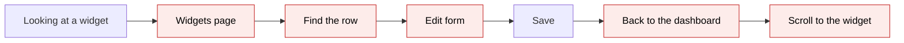
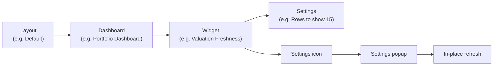
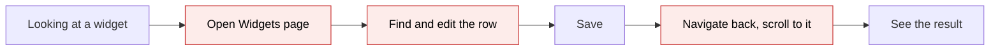
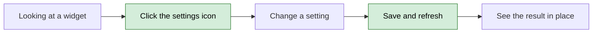
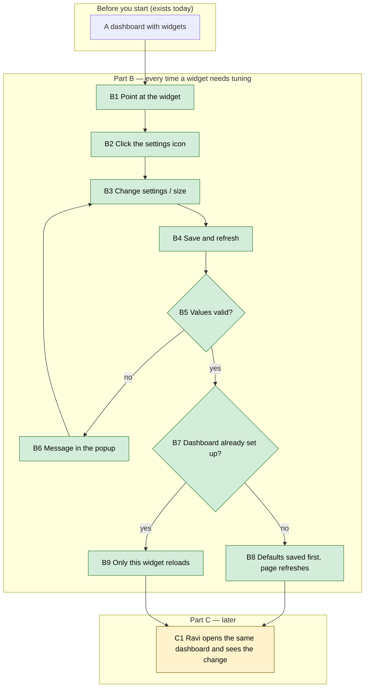

# Widget settings in place — Proposal

> **Audience:** Business team, product, QA, support — non-technical.
> **Companion document:** [Design](design.md)
> **New to this? Start with the [Workflow Journey](#workflow-journey)** — every action, in order, from start to the outcome.

> **Planning phase — no code changes.** This document proposes and explains the change. Do not
> edit application code while writing it; implementation happens later, in the tasks phase.

---

## Why

- Changing what a dashboard widget shows (rows to show, a day limit, which KPI) takes five steps today: open
  Widgets, find the row, Edit, Save, go back to the dashboard and scroll to the widget again.
- People tune a widget by looking at it ("show 10 rows, not 15"), so leaving the dashboard breaks the thought —
  and many never find the Widgets page at all.
- The 17 new insight widgets each have settings (day limits, top-N, KPI name), which makes this round trip
  more common.



## What Changes

- Every widget on a fund-manager dashboard gets a small **settings icon** at the top-right of its card.
- The icon opens a **settings popup** right there, with the same labelled fields as the widget's edit page,
  plus its size.
- **Save and refresh** saves the settings and reloads **only that widget**, in place; the rest of the page and
  the scroll position stay as they were.
- The feel is modern and quiet: the icon fades in when you point at a widget, the popup slides up, the widget
  shimmers while it reloads, then fades in with a short highlight and a small "Saved" message.
- No LP ever sees the icon; LP layouts are unchanged.
- The Widgets page and the edit form stay exactly as they are.

### Key concepts



| Concept | What it means for you | Example |
|---|---|---|
| Widget | One card on a dashboard | Valuation Freshness on the fund Portfolio tab |
| Settings | The choices a widget reads | Current up to 90 days, Rows to show 15 |
| Layout | A named set of widgets for a dashboard, shared by the firm | "Default" |
| Default widgets | What a dashboard shows before anyone has chosen its widgets | All Portfolio Dashboard widgets |
| Settings icon | The small sliders icon at a widget's top-right | ⚙ on Valuation Freshness |
| Settings popup | The panel that opens over the page with the widget's settings | "Valuation Freshness settings" |
| In-place refresh | Only the changed widget reloads; nothing else moves | The table redraws with 10 rows |

**Settings are shared, not personal**
- What: a widget's settings belong to the firm's layout, not to one person.
- Why: that is how dashboards work today; the popup changes the same record the edit page changes.
- Not covered: personal, per-user settings.
- Example: Meera sets Rows to show 10; Ravi, on the same Default layout, also sees 10 rows. The popup says so.

**Default widgets become saved widgets on the first save**
- What: a dashboard nobody has set up shows its defaults. The first save from a popup saves the whole set the
  page is showing, then the change.
- Why: once a dashboard has saved widgets it shows only those — saving one alone would hide the others.
- Not covered: choosing which defaults to keep (use the Widgets page for that).
- Example: the Ops Dashboard shows 4 default widgets; Meera changes "My Tasks"; all 4 are saved, in the same
  order, and the page looks the same — with her change.

### Flow Diagram

Changing a widget's settings — before:



After:



---

## Workflow Journey

### Who is involved

| Person | Role | What they do in the journey |
|---|---|---|
| Meera | Fund manager staff (Demo Capital employee) | Tunes widgets on the dashboards she uses |
| Ravi | Another Demo Capital employee | Sees Meera's change on the same layout |
| Asha | An LP of Demo Capital | Never sees the icon |

### The journey on one page



### Before you start

| Needed | Why | Where it comes from |
|---|---|---|
| A fund-manager login of the firm | Only the firm's own users may change its widgets | Existing users |
| A dashboard with at least one widget | Something to tune | Any fund, company, investor, ops or home dashboard |

### Part B — every time

| Step | Who | Where | Action | What the system does | What you see |
|---|---|---|---|---|---|
| B1 | Meera | Fund 1 › Portfolio tab | Points at Valuation Freshness | — | The settings icon fades in at the card's top-right |
| B2 | Meera | Valuation Freshness › settings icon | Clicks it | Loads the widget's settings | The popup slides up: "Valuation Freshness settings", fields filled with today's values, a note "Changes apply to everyone in your firm who uses the Default layout of the Portfolio Dashboard" |
| B3 | Meera | Popup | Sets Rows to show 15 → 5 | — | The field shows 5 |
| B4 | Meera | Popup › Save and refresh | Clicks | Saves; the button shows a spinner | — |
| B5 | system | — | Checks the values | Refuses values that are not plain settings | — |
| B9 | system | Portfolio tab | — | Reloads only Valuation Freshness | The popup closes, the widget shimmers, then fades back with 5 rows and a short highlight; "Valuation Freshness updated" appears at the bottom-right for 3 seconds |
| B8 | system | Ops Dashboard (never set up) | — | Saves the 4 default widgets, then the change | The page refreshes in place; same widgets, same order, with the change |

### Part C — later

| Step | Who | Where | Action | What the system does | What you see |
|---|---|---|---|---|---|
| C1 | Ravi | Fund 1 › Portfolio tab | Opens it | Reads the same layout | Valuation Freshness with 5 rows |

### What you see

```
┌ Valuation Freshness ⓘ ─────────────────────────────────────── ⚙ ┐   ← ⚙ fades in on hover
│ How old each company's latest valuation is. Current: up to 90 days…│
│ Company        Last valuation   Age                 Status         │
│ APT            31/12/2022       3 years 10 months   Stale          │
│ …                                                                  │
└────────────────────────────────────────────────────────────────────┘

        ┌ ⚙ Valuation Freshness settings ───────────────────── ✕ ┐
        │ ⓘ Changes apply to everyone in your firm who uses the  │
        │   Default layout of the Portfolio Dashboard.           │
        │ Current up to (days) [ 90 ]   Due up to (days) [ 180 ] │
        │ Rows to show         [  5 ]   Size [ XL ▾ ]            │
        │ Open the full widget page      [Cancel] [Save and refresh]│
        └────────────────────────────────────────────────────────┘
```

### What goes wrong

- Meera types `abc` into a text setting that must be a plain value, e.g. `{limit: exit}` through the raw field.
- The save is refused; the popup stays open with "Settings could not be read: use plain values only" under
  the fields; nothing changes on the page.
- She corrects the value and saves again.

### Summary: the minimum actions

| # | Action | Who | How often |
|---|---|---|---|
| 1 | Click the settings icon | Meera | Every time she tunes a widget |
| 2 | Change a value | Meera | Every time |
| 3 | Save and refresh | Meera | Every time |

---

## User Stories

### US-1: Tune a widget without leaving the dashboard

**As a** fund-manager user, **I want** to open a widget's settings on the dashboard, **so that** I can tune it
while I look at it.

**Acceptance criteria:**
- Every widget on the dashboard has a settings icon at its top-right, shown on hover and keyboard focus.
- The popup lists the same fields, labels and helper text as the widget's edit page, plus Size.
- Cancel or ✕ closes it with no change.

### US-2: See the result at once

**As a** fund-manager user, **I want** only the changed widget to reload, **so that** I keep my place.

**Acceptance criteria:**
- After Save and refresh, the popup closes and only that widget reloads with the new settings.
- The page does not scroll and the other widgets do not reload.
- A size change takes effect in the same refresh.
- A "<widget> updated" message shows for about 3 seconds.

### US-3: Nothing disappears on a dashboard nobody set up

**As a** fund-manager user, **I want** my first change on a dashboard showing defaults to keep every widget,
**so that** the dashboard does not suddenly empty.

**Acceptance criteria:**
- The first save saves every widget the page shows, in the same order, then the change.
- The page then refreshes in place and shows the same widgets.

### US-4: LPs and outsiders never get the icon

**As a** firm, **I want** only my own staff to change my widgets, **so that** LPs cannot change what is shown.

**Acceptance criteria:**
- No settings icon for a user acting as an investor, on LP layouts or on the LP company dashboard.
- Opening a settings popup address for another firm's widget is refused.

---

## UI Behavior

### Widget card

**Behavior notes:**
- Icon: sliders icon, muted; fades in (about 150 ms) when the pointer or keyboard focus enters the widget;
  always visible, at lower contrast, on touch screens.
- Tooltip: "Change this widget's settings".
- Widgets that draw their own card get the same icon in the same corner.

### Settings popup

**Behavior notes:**
- Opens with a short fade-and-rise (about 200 ms); the page behind dims.
- Title "<widget name> settings"; the shared-settings note; the fields; Size; a link "Open the full widget
  page"; Cancel and Save and refresh.
- A widget with no settings of its own shows "This widget has no settings of its own" and Size only.
- Save and refresh shows a spinner and is disabled while saving.
- On a refused save the popup stays open and shows the message under the fields.

### In-place refresh

**Behavior notes:**
- The widget shows a soft shimmer while it reloads, then fades in with a highlight ring in the theme's primary
  colour for about a second.
- People who ask their system for reduced motion get no animation — the same steps, instantly.

---

## What This Feature Does NOT Cover

| Excluded | Covered In |
|---|---|
| Personal (per-user) widget settings | Not planned |
| Adding, removing or reordering widgets from the dashboard | Widgets page |
| Previewing settings without saving | Not in this version |
| LP layouts and the LP company dashboard | Widgets page (unchanged) |

---

## Validation Rules

| Field | Rule | Default |
|---|---|---|
| Any setting | Plain values only (numbers, text, true/false, lists) | The widget's own default when left blank |
| Whole-number settings | Digits only, 1 or more | The widget's default |
| Size | One of the sizes the widget offers | The widget's current size |

---

## Behavior Rules

| Scenario | What User Sees |
|---|---|
| Save with valid values | Popup closes; only that widget reloads with the change; "updated" message |
| Save with a value that is not plain | Popup stays open with the message; nothing changes |
| Cancel / ✕ / Esc | Popup closes; nothing changes |
| First save on a dashboard showing defaults | All shown widgets saved, then the change; page refreshes in place |
| User acting as an investor | No icon anywhere |
| LP company dashboard | No icon |
| Another firm's widget address | Refused |
| Reduced-motion setting on | Same behaviour, no animation |

---

## Resolved Design Decisions

| # | Decision | Resolution |
|---|---|---|
| 1 | Dashboard showing defaults | First save saves the whole set shown, then the change (approved) |
| 2 | Who gets the icon | Whoever may edit widgets today: the firm's own users; never investors or LP layouts (approved) |
| 3 | Preview without saving | Not in this version (approved) |
| 4 | Look and feel | Quiet animations in theme colours; none with reduced motion (user request) |

---

## Capabilities

### New Capabilities

_(none)_

### Modified Capabilities

- `ui/dashboard-widgets`: adds in-place widget settings (icon, popup, save and in-place refresh, first-save
  of defaults, access).

---

## Impact

- Every fund-manager dashboard: fund, portfolio, aggregated portfolio, portfolio company, investor, ops and
  the home page.
- The widget edit page and Widgets list: unchanged.
- No new data is stored; no data migration.

---

## Benefits

1. Tuning a widget takes 3 clicks instead of about 7 and a page change.
2. You see the result of a setting where you are looking.
3. Staff who never found the Widgets page can now shape their dashboards.

---

## FAQ

| Question | Answer |
|---|---|
| Who can use this? | The firm's own staff who may already edit widgets. Never LPs. |
| Does my change affect colleagues? | Yes — settings belong to the layout; the popup says so. |
| What happens to existing data? | Nothing changes until someone saves. |
| Does this send notifications? | No. |
| Can I undo a change? | Open the popup again and set the old value; the change history of the widget is kept as today. |
| What if two people save at once? | The later save wins, as on the edit page today. |

---

## Design Principle for the Next Phase

- Reuse the edit page's settings fields and the existing save and permission check; no second settings form.
- Risk: refreshing one widget needs the same page context (the fund, the company, the Aggregated filters) —
  the design must get it from the page itself, not rebuild it per dashboard.
- Risk: the first save on a dashboard showing defaults — keep it one step in the existing save, not a new flow.
- Animations in CSS with a reduced-motion fallback; no new JavaScript library.
