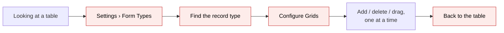
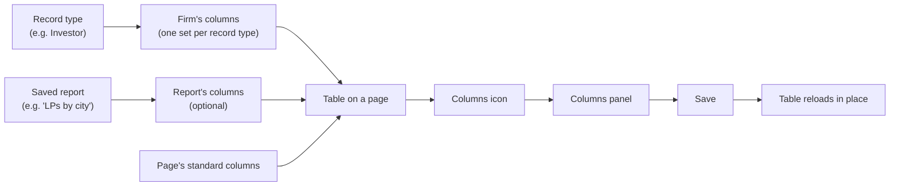
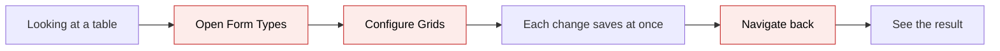
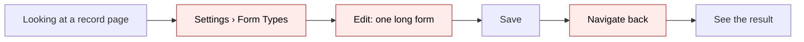
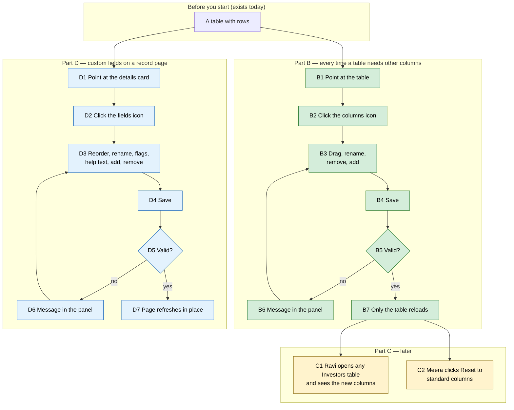

# Table columns and custom fields in place — Proposal

> **Audience:** Business team, product, QA, support — non-technical.
> **Companion document:** [Design](design.md)
> **New to this? Start with the [Workflow Journey](#workflow-journey)** — every action, in order, from start to the outcome.

> **Planning phase — no code changes.** This document proposes and explains the change. Do not
> edit application code while writing it; implementation happens later, in the tasks phase.

---

## Why

- Choosing which columns a table shows (Investors, Capital Commitments, Remittances…) takes a detour today:
  Settings › Form Types › find the record type › Configure Grids › add / delete / drag, one change at a time,
  then back to the table to see the result.
- People choose columns while looking at the table ("I need PAN here, not City"); the detour breaks that, and
  many users never find Configure Grids at all.
- Each change on Configure Grids saves at once, so there is no "try, look, cancel".
- Custom fields shown on a record's page (Investor, Capital Commitment, KYC…) have the same detour: Settings ›
  Form Types › Edit, one long form with ~60 settings per field, to rename a field or add one.
- The dashboard widgets just got the same fix (settings in a side panel, reload in place) and users liked it.



## What Changes

- Every customisable table gets a **columns button** (▥), always visible, right next to the table's search box
  (at the table's top-right when the page has no search box). Changed 2026-11-07 from a hover-only icon.
- The icon opens a **columns panel** that slides in from the right, in the same look as the widget settings
  panel.
- In the panel you **reorder** (drag), **rename** a heading, **remove** a column and **add** one from a
  searchable list — nothing is saved until **Save**.
- **Save** stores the whole set at once and reloads **only that table**; search, sort and page stay as they were.
- The record type's **form type is created automatically** the first time someone saves columns for it.
- **Configure Grids shows the same column list as the panel** (approved 2026-11-07): the panel also edits each
  column's data type and alignment, a derived field's key, and adds derived fields. The full Configure Grids page
  keeps its address and its buttons (Form Types list and page, Report page and card) and now shows that same list
  embedded in the page, with **Show / Edit / Delete** on each saved column as today. Only the old separate "add
  column" and "add derived field" forms go — adding happens in the shared list. The panel's ↗ opens this page.
- Phase 1: the 22 standard tables. Phase 2 (added 2026-11-07): 14 hand-built list tables that today have fixed
  columns — Funds, Investments, Investment Instruments, Deal Investors, Distributions, Allocations, Approvals,
  Approval Responses, Expressions of Interest, Investment Opportunities, Investor KPI Mappings, Portfolio
  Cashflows, Secondary Sales, Users — get the same button; each keeps today's columns until a firm changes them.
  Phase 3: the 4 AG grids (Capital Commitments, Account Entries, Interests, Portfolio Investments).
- Phase 3 — **custom fields in place**: every record page that lists custom fields (36 show pages) gets a small
  **fields icon** on its details card; the same side panel lets an admin reorder, rename, mark required / read
  only / internal, edit help text, remove and add fields of that record's form type. Save stores all changes at
  once and the page refreshes in place, keeping the scroll position.

### Key concepts



| Concept | What it means for you | Example |
|---|---|---|
| Record type | The kind of row a table lists | Investor, Capital Commitment, Capital Call |
| Firm's columns | The columns your firm chose for a record type; every table of that type shows them | Investors: Name, Category, PAN, Risk rating |
| Standard columns | What a table shows before anyone chose columns; each page has its own | Investors page: Name, Category, City, Tags… |
| Report's columns | Columns saved on one saved report; used only when that report is open | "LPs by city": Name, City, Committed |
| Derived field | A column whose key is a path you type (e.g. `investor.custom_fields.rm`), added in the panel | NAV / Commitment |
| Data type / alignment | How a column's values are formatted and aligned | Decimal, right-aligned |
| Always shown | A column a page adds itself, whatever the firm chose | Fund on the all-funds Commitments list |
| Columns button | The ▥ button next to the table's search box | ▥ |
| Columns panel | The side panel where you choose the table's columns | "Investors columns" |
| Form type | The firm's settings record for a record type (custom fields and columns) | Investor form type "Default" |
| Custom field | An extra field your firm added to a record type | Risk rating on Investor |
| Fields icon | The small form symbol on a record page's details card | 🗎 |
| Fields panel | The side panel where you change the record type's custom fields | "Investor fields · Default" |
| Required / Read only / Internal | Must be filled / cannot be edited on the form / hidden from investors | Risk rating required |
| Calculation field | A custom field CapHive support sets up as a formula | Net worth (calc.) |

**Columns are the firm's, not one person's**
- What: the columns belong to the record type for the whole firm.
- Why: that is how Configure Grids works today; the panel changes the same thing.
- Not covered: personal column choices.
- Example: Meera adds PAN on Fund 1's Investors list; Ravi sees PAN on every Investors table, in every fund.
  The panel says so in its header.

**The first save keeps what you see**
- What: a table nobody configured shows its page's standard columns; the panel starts from exactly those.
- Why: saving only the one column you touched would make the others disappear.
- Not covered: picking a different starting set (use Reset).
- Example: Capital Calls shows 8 standard columns; Meera adds "Due date"; 9 columns are saved, in the order shown.

**Custom fields belong to the form type**
- What: a record's custom fields come from its form type; every record on that form type shares them.
- Why: that is how Form Types work today; the fields panel changes the same form type.
- Not covered: conditions, validation rules, steps and calculations — they stay on the full Form Types page.
- Example: Meera adds "Source of funds" on Ravi Menon's page; every investor on the Default form type gets it on
  their form and page.

**Removing a field hides it; values stay stored**
- What: removing a field deletes its definition, as the Form Types page's delete does.
- Why: the panel must not do more than the full page does.
- Not covered: deleting stored values — they stay on the records, unseen.
- Example: Meera removes "KYC due"; investor pages stop showing it; adding a field with the same name later shows
  the old values again.

**Report columns win when the report has them**
- What: when a saved report with its own columns is open, the panel edits that report's columns.
- Why: the table is showing the report's columns, so that is what you expect to change.
- Not covered: a report without its own columns — the panel then edits the firm's columns, and says so.
- Example: "LPs by city" shows Name, City, Committed; Meera removes City; only that report changes.

### Flow Diagram

Changing a table's columns — before:



After:


Changing a record type's custom fields — before:



After:


---

## Workflow Journey

### Who is involved

| Person | Role | What they do in the journey |
|---|---|---|
| Meera | Company admin at Demo Capital | Chooses the columns of the tables she uses |
| Ravi | Demo Capital employee, not an admin | Sees Meera's columns; has no icon |
| Asha | An LP of Demo Capital | Never sees the icon |

### The journey on one page



### Before you start

| Needed | Why | Where it comes from |
|---|---|---|
| A company-admin login of the firm | Only company admins may change the firm's columns (same rule as Configure Grids) | Existing users and roles |
| A table of a customisable record type | Something to change | Investors, Commitments, Remittances, Capital Calls… (22 tables) |
| Nothing else | The form type is created on the first save if missing | — |
| A record page that lists custom fields (Part D) | Something to change | Investor, Commitment, Capital Call, KYC… (36 pages) |

### Part B — every time

| Step | Who | Where | Action | What the system does | What you see |
|---|---|---|---|---|---|
| B1 | Meera | Investors | Looks at the search row | — | The ▥ button sits right of the search box |
| B2 | Meera | Investors › ▥ | Clicks it | Loads the table's columns and the list of columns that can be added | The panel slides in: "Investors columns", "Shared with everyone in your firm, on every Investors table", the 6 columns shown now, in order |
| B3 | Meera | Panel | Drags Committed above City; renames "Tags" to "Segment"; removes City; adds "Risk rating" from Custom fields | Nothing yet — only the panel changes | The list shows the new order; Risk rating flashes green at the bottom |
| B4 | Meera | Panel › Save | Clicks | Saves the whole list at once; creates the Investor form type if missing | Spinner on Save |
| B6 | system | Panel | — | Refuses an empty list | "Keep at least one column" above the list; nothing saved |
| B7 | system | Investors | — | Reloads only the table, with the search "Mumbai" still applied | The panel closes, the table shimmers, then shows Name, Category, Committed, Segment, NAV / Commitment, Risk rating; "Investors columns saved" appears at the bottom-right |

### Part C2 — from Form Types or a report

| Step | Who | Where | Action | What the system does | What you see |
|---|---|---|---|---|---|
| C3 | Meera | Settings › Form Types › Investor › Configure Grids | Clicks | Opens the full Configure Grids page | The same column list as the panel, in a card, with Show / Edit / Delete on each saved column |
| C4 | Meera | Panel › ⌄ on Committed | Sets data type Decimal, alignment right | Nothing yet | Row shows "Decimal" |
| C5 | Meera | Panel › Add derived field | Label "RM", key `custom_fields.relationship_manager`, String | Nothing yet | New row with "ƒ Derived" |
| C6 | Meera | Configure Grids › Save | Clicks | Saves the list | Toast; the page refreshes in place |
| C7 | Meera | Configure Grids › Delete on a row | Clicks, confirms | Deletes that column at once (as today) | Row gone |

### Part C — later

| Step | Who | Where | Action | What the system does | What you see |
|---|---|---|---|---|---|
| C1 | Ravi | Growth Fund I › Investors tab | Opens it | Reads the firm's Investor columns | The same 6 columns; no ▥ icon (not an admin) |
| C2 | Meera | Investors › ▥ › Reset to standard columns › Save | Clicks | Removes the firm's saved Investor columns | Each Investors table shows its own standard columns again |

### Part D — custom fields on a record page

| Step | Who | Where | Action | What the system does | What you see |
|---|---|---|---|---|---|
| D1 | Meera | Investors › Ravi Menon | Points at the details card | — | The 🗎 icon fades in on the card's corner |
| D2 | Meera | 🗎 | Clicks it | Loads the investor's form type fields | Panel: "Investor fields · Default", "Shared by every investor on the Default form type", 4 fields: Risk rating (Select, required), Relationship manager (internal), KYC due (Date), Net worth (calc., locked "Support") |
| D3 | Meera | Panel | Drags KYC due first; renames "Relationship manager" → "RM"; ⌄ on Risk rating, types help "From the onboarding review"; adds "Source of funds" (Select: Salary, Business, Inheritance) | Nothing yet | Source of funds flashes green at the bottom |
| D4 | Meera | Panel › Save | Clicks | Saves all changes at once on the Default form type | Spinner |
| D6 | system | Panel | — | Refuses a label already used by another field | "A field named Source of funds already exists" on that row; nothing saved |
| D7 | system | Ravi Menon page | — | Refreshes the page in place | Panel closes; the card shows KYC due, Risk rating, RM…; scroll position kept; toast "Investor fields saved" |
| D8 | Ravi | Investors › Acme Family Office › Edit | Opens the form | Reads the same form type | "Source of funds" select on the form |

### What you see

```
 Investors                                                    [ Search… ]
┌──────────────┬──────────┬──────────────┬─────────┬──────────────────┬──────────┬─────────┐ ▥ ← fades in
│ Name         │ Category │ Committed    │ Segment │ NAV / Commitment │ Risk     │ Actions │
├──────────────┼──────────┼──────────────┼─────────┼──────────────────┼──────────┼─────────┤
│ Ravi Menon   │ LP       │ ₹2,50,00,000 │ HNI     │ 1.12             │ Low      │  👁     │
│ Acme FO      │ LP       │ ₹10,00,00,000│ FO      │ 0.97             │ Medium   │  👁     │
└──────────────┴──────────┴──────────────┴─────────┴──────────────────┴──────────┴─────────┘

                                   ┌ ▥ Investors columns ─────────────────── ✕ ┐
                                   │ 👥 Shared with everyone in your firm,       │
                                   │    on every Investors table                 │
                                   │ 💡 Drag to reorder. Click a name to rename. │
                                   │ Shown columns ⓘ                 6 columns   │
                                   │  🔒 Name          Always shown   String     │
                                   │  ⋮⋮ Category                     String  ✕  │
                                   │  ⋮⋮ Committed                    Decimal ✕  │
                                   │  ⋮⋮ Segment       (tag_list)     String  ✕  │
                                   │  ⋮⋮ NAV / Commitment  ƒ Derived  Decimal ✕  │
                                   │  ⋮⋮ Risk rating                  String  ✕  │
                                   │ Add a column ⓘ  [ Search or pick…      ▾ ]  │
                                   │ ↺ Reset to standard columns                 │
                                   │ ↗                       Cancel  ( ✓ Save )  │
                                   └─────────────────────────────────────────────┘
```

- Clickable mocks (approved 2026-11-07):
  - columns: `/tmp/claude-1000/-home-thimmaiah-work-IRM/9bd18cc7-ce06-4e43-87e9-a9c0b02e2a48/scratchpad/grid_columns_mock.html`
  - custom fields: `/tmp/claude-1000/-home-thimmaiah-work-IRM/9bd18cc7-ce06-4e43-87e9-a9c0b02e2a48/scratchpad/form_fields_mock.html`

```
 Ravi Menon                                   🗎 ← fades in
┌──────────────────────┬──────────────────┐        ┌ 🗎 Investor fields · Default ─────────── ✕ ┐
│ Category             │ LP               │        │ 👥 Shared by every investor on Default     │
│ City                 │ Mumbai           │        │ Fields ⓘ                         5 fields  │
│ KYC due              │ 31/03/2027       │        │ ⋮⋮ KYC due        DateField  * 🔒 👁̸ ⌄ ✕   │
│ Risk rating          │ Low              │        │ ⋮⋮ Risk rating    Select     ✱ 🔒 👁̸ ⌄ ✕   │
│ RM                   │ Asha             │        │ ⋮⋮ RM             TextField  * 🔒 👁‍🗨 ⌄ ✕ │
│ Net worth (calc.)    │ ₹12,00,00,000    │        │    Net worth      ƒ Calc  🔒 Support  ⌄    │
│ Form Type            │ Default          │        │ ⋮⋮ Source of funds Select    * 🔒 👁̸ ⌄ ✕   │
└──────────────────────┴──────────────────┘        │ Add a field [Label     ] [Select ▾] [+Add] │
                                                    │ ↗                      Cancel  ( ✓ Save )  │
                                                    └────────────────────────────────────────────┘
```

### What goes wrong

- Meera removes every column and clicks Save.
- The save is refused; the panel stays open with "Keep at least one column" above the list; the table is unchanged.
- She adds Name back and saves again.
- Fields panel: Meera adds "Risk rating" again (a field with that name exists); the save is refused with
  "A field named Risk rating already exists" on the new row; she renames it "Risk rating (2026)" and saves.

### Summary: the minimum actions

| # | Action | Who | How often |
|---|---|---|---|
| 1 | Click the ▥ icon | Meera | Every time she changes a table's columns |
| 2 | Drag / rename / remove / add | Meera | Every time |
| 3 | Save | Meera | Every time |
| 4 | Click 🗎, change fields, Save | Meera | Every time a record type's fields change |

---

## User Stories

### US-1: Choose columns without leaving the table

**As a** company admin, **I want** to change a table's columns from the table itself, **so that** I choose them
while I look at the data.

**Acceptance criteria:**
- The ▥ icon appears on the table's top-right corner when the pointer is over the table.
- The panel lists the columns the table shows now, left to right, with their headings and data types.
- Drag reorders; clicking a heading renames it; ✕ removes; "Add a column" lists the record's fields, the firm's
  custom fields and related records' fields, minus those already shown.
- Cancel, ✕ and Esc close the panel and change nothing.

### US-2: See the result at once

**As a** company admin, **I want** only the table to reload after saving, **so that** I keep my search, sort and
page.

**Acceptance criteria:**
- After Save the panel closes, the table shimmers, then shows the saved columns in the saved order.
- The search box, filters, sort and page number are as before.
- "Investors columns saved" shows at the bottom-right for 3 seconds.

### US-3: Nothing disappears on a table nobody configured

**As a** company admin, **I want** my first save to keep the columns I can see, **so that** adding one column
does not hide the others.

**Acceptance criteria:**
- With no saved columns, the panel starts from the page's standard columns.
- After saving, the table shows those columns plus my change, in the same order.
- If the firm has no form type for the record type, one is created; nothing else about forms changes.

### US-4: Edit a report's own columns

**As a** company admin, **I want** the panel to edit an open report's columns when the report has its own,
**so that** I change what I am looking at.

**Acceptance criteria:**
- Header reads "Columns of report 'LPs by city'" and "Shared with everyone who opens this report".
- Saving changes only the report's columns; the firm's columns are unchanged.
- A report without its own columns: the panel edits the firm's columns, and the header says so.

### US-5: Only company admins, never LPs

**As** support, **I want** the icon shown only to people allowed to save, **so that** nobody meets a panel that
refuses them.

**Acceptance criteria:**
- Employees who are not company admins, users acting as investors and LPs see no icon.
- A direct request that bypasses the page is refused for them, and for another firm's columns.

### US-6: Change custom fields from a record page

**As a** company admin, **I want** to change a record type's custom fields from a record's page, **so that** I fix
a label or add a field while I look at the data.

**Acceptance criteria:**
- The 🗎 icon appears on the details card's corner when the pointer is over the card.
- The panel lists the record's form type fields in form order (regulatory fields left out), each with its type,
  Required / Read only / Internal toggles, help text (⌄), and ✕.
- Calculation fields are listed locked ("Support") unless the user is CapHive support.
- Add a field: label, type (Text, Number, Date, Text area, Check box, Select with options, Money in the firm's
  currency).
- Save stores everything at once; the page refreshes in place, scroll kept; toast "Investor fields saved".
- Cancel, ✕ and Esc change nothing.

### US-7: A record with no form type

**As a** company admin, **I want** the fields panel to work on a record that has no form type, **so that** I can
start adding fields from its page.

**Acceptance criteria:**
- The panel edits the firm's form type for that record type (the one new records pick), creating it if missing.
- The record is linked to that form type on save; nothing else on the record changes.

### US-8: Only company admins, never LPs (fields)

**Acceptance criteria:**
- Same audience as US-5: employees who are not company admins, users acting as investors and LPs see no icon;
  direct requests are refused, also for another firm's form type.

---

## UI Behavior

### Table

- ▥ button: outlined, the search box's height, right of the search box, always visible; on a page with no search
  box it sits at the table's top-right, still always visible.
- Tooltip: "Choose this table's columns".

### Columns panel

- Slides in from the right; 480px wide, never wider than the screen; fixed header and footer, the list scrolls.
- Header: "▥ Investors columns" and a one-line "Shared with everyone in your firm, on every Investors table"
  (full explanation in a tooltip).
- Hint line: "Drag ⋮⋮ to reorder. Click a name to rename the heading. Nothing changes until you save."
- Rows: drag handle, heading (editable in place) with the field name under it, chips: data type, "ƒ Derived",
  "🔒 Always shown" (cannot move or remove), "Not shown on this page" (kept when saving).
- "Add a column": searchable select, grouped — the record's fields, Custom fields, then one group per related
  record (e.g. "Investor KYC").
- "Reset to standard columns": empties the list to the page's standard columns and shows
  "Saving removes your firm's saved Investors columns, including derived fields".
- ⌄ on a row: data type (String, Number, Decimal, Date, HTML), alignment (left, centre, right); for a derived
  field also its key.
- "Add derived field": label, key, data type; the row shows "ƒ Derived".
- Footer: ↗ (full Configure Grids page), Cancel (text), Save (pill, spinner while saving).
- Full Configure Grids page: the same list and Add controls in a card, Save at the bottom, plus Show / Edit /
  Delete on each saved row (Delete asks first and removes the column at once, as today).
- Esc closes the panel.

### Fields panel (record pages)

- Icon: 🗎 on the corner of the card holding the custom fields; same fade-in as the columns icon. Tooltip
  "Change this record type's custom fields".
- Header: "🗎 Investor fields · Default" (form type tag) and "Shared by every investor on the Default form type".
- Rows: drag handle, label (editable in place) with the field name under it, type chip, toggles ✱ Required,
  🔒 Read only, 👁̸ Internal (on = highlighted), ⌄ help text, ✕ remove (row struck through, ↶ to keep it).
- Removing shows under the list: "Removed fields disappear from forms and pages; values already entered stay
  stored."
- Add a field: label, type, options box for Select; the new row flashes green.
- Footer: ↗ (full Form Type edit page), Cancel, Save. Esc closes.
- After Save the page refreshes in place (Turbo), scroll position kept, toast.

### Reload in place

- Only the table's own section reloads; the rest of the page does not move.
- The table shimmers while loading, then shows a short highlight; toast "Investors columns saved".
- Motion is turned off for users who ask their system for reduced motion.

---

## What This Feature Does NOT Cover

| Excluded | Covered In |
|---|---|
| Personal (per-user) column choices | Not planned |
| Column widths | Not planned |
| AG grid's own Columns side bar (per-person show/hide in the browser) | Unchanged |
| Tables that are not customisable today (no standard columns) | Not planned |
| Investor-facing (LP) tables | Never shown to LPs |

---

## Validation Rules

| Field | Rule | Default |
|---|---|---|
| Column list | At least one column | — |
| Column | Only columns offered in "Add a column", or already saved, or shown now | — |
| Heading | Up to 100 characters; blank uses the column's standard name | Standard name |
| Duplicate column | Kept once (first position) | — |
| Data type | String, Number, Decimal, Date or HTML | From the field |
| Alignment | Left, centre, right, or blank | Blank |
| Derived field | Label and key required; key up to 255 characters | — |
| Field label (fields panel) | Required for a new field; up to 254 characters | — |
| Field name | Made from the label (letters, digits, `_`); must be unique in the form type | From label |
| Field type (new) | Text, Number, Date, Text area, Check box, Select, Money | Text |
| Select options | Comma-separated, at least one option | — |
| Help text | Free text | Blank |
| Existing field's type, conditions, validation rules, step | Not changed by the panel | As stored |

---

## Behavior Rules

| Scenario | What User Sees |
|---|---|
| Firm already has saved columns | Panel lists them; Save replaces the set |
| No saved columns yet | Panel lists the page's standard columns; Save saves them with the change |
| No form type for the record type | Created on Save; no message |
| Open report has its own columns | Panel edits the report's columns |
| Open report has no columns | Panel edits the firm's columns; header says so |
| Page adds a column itself (e.g. Fund on all-funds Commitments) | Row shown "🔒 Always shown"; not saved |
| Page hides a saved column (e.g. Investor on an investor's Commitments tab) | Row shown "Not shown on this page"; kept on Save |
| Derived field | Can be moved, renamed, removed; its formula stays as set on Configure Grids |
| Someone else saved while the panel was open | Your save replaces the set; rows they deleted are skipped |
| Save clicked twice | One set saved |
| Empty list | "Keep at least one column"; nothing saved |
| Not a company admin / acting as investor / LP | No icon; direct request refused |
| Fields: record has a form type | Panel edits that form type |
| Fields: record has none | Panel edits (or creates) the firm's form type for the record type and links the record |
| Fields: calculation field, non-support user | Listed, locked |
| Fields: regulatory field | Not listed; unchanged |
| Fields: field removed | Hidden from forms/pages; stored values kept |
| Fields: duplicate name | Refused on that row; nothing saved |
| Fields: form type has no custom fields yet | "No custom fields yet — add one below" |
| Fields: someone else removed a field meanwhile | Your changes to it are skipped |
| Fields: record page shows a reporting fields list | No icon there (it lists fields chosen elsewhere) |

---

## Resolved Design Decisions

| # | Decision | Resolution |
|---|---|---|
| 1 | Form type missing | Create it automatically on the first save (user, 2026-11-07) |
| 2 | Who sees the icon | Company admins of the firm (the existing Configure Grids save rule); never users acting as investors |
| 3 | Save model | All at once, Cancel discards (unlike Configure Grids' save-each-click) |
| 4 | Report vs firm columns | The report's when it has its own; otherwise the firm's |
| 5 | Derived fields | Move / rename / remove in the panel; formulas on Configure Grids |
| 6 | Scope | Phase 1: 22 standard tables; phase 2: 4 AG grids |
| 7 | Stale report columns | Fixed: a report's column change shows at once (today it can show up to 5 days late) |
| 7a | Where the ▥ button sits | Always visible, right of the search box; table top-right when there is no search box (user, 2026-11-07) |
| 7c | Hand-built list tables | 14 lists converted (phase 2); today's columns become their standard columns; client-side search and sort kept (user, 2026-11-07) |
| 7b | Configure Grids | Same list as the panel, embedded; Show / Edit / Delete kept per row; old add forms removed; reorder endpoint kept for the report builder (user, 2026-11-07) |
| 8 | Custom fields panel on show pages | Same change, phase 3 (user, 2026-11-07) |
| 9 | Record with no form type (fields) | Edit or create the firm's form type, link the record (approved default) |
| 10 | Removing a field | Deletes the definition, values kept (approved default) |
| 11 | Existing field's type | Not changeable in the panel |
| 12 | After a fields save | Page refreshes in place, scroll kept (details cards are table rows, not frames) |

---

## Capabilities

### New Capabilities

- `ui/grid-columns-inline-settings`: choosing a table's columns from the table, in a side panel, with an in-place
  reload.
- `forms/custom-fields-inline-settings`: changing a record type's custom fields from a record's page, in the same
  side panel.

### Modified Capabilities

<!-- None: Configure Grids keeps its behaviour; no existing spec covers grid columns. -->

---

## Impact

- Every customisable table: Investors, Investor KYCs, Capital Commitments, Capital Calls, Remittances,
  Distribution Payments, Commitment Adjustments, Account Entries, Portfolio Investments, Aggregate Portfolio
  Investments, Valuations, KPI Reports, Fund Reports, Fund Ratios, Fund Formulas, Fund Unit Settings, Offers,
  Task Templates, compliance tables (duties, packs, register items, document facts); phase 2 the 4 AG grids.
- Configure Grids: unchanged screen; its list of addable columns is shared with the panel.
- Saved reports: column changes show at once.
- Record pages that list custom fields (36): investors, KYCs, commitments, capital calls, remittances,
  distributions, payments, portfolio investments, valuations, KPI reports, deals, documents, users and more.
- Form Types page: unchanged; the fields panel saves through the same form type update rules.

---

## Benefits

1. Columns are chosen in 3 clicks, next to the data, instead of a 5-screen detour.
2. Try-and-cancel: nothing is saved until Save.
3. The table reloads in place; search, sort and page are kept.
4. Works on record types with no form type yet.
5. Same panel and feel as the dashboard widget settings — nothing new to learn.

---

## FAQ

| Question | Answer |
|---|---|
| Who can use this? | Company admins of the firm — the same people who can save on Configure Grids today. |
| Does it change columns for everyone? | Yes, for the whole firm, on every table of that record type (or everyone opening that report). The panel header says so. |
| What happens to columns already set on Configure Grids? | Nothing; the panel shows and edits them. |
| Can I undo? | Open the panel and change it back, or use Reset to standard columns. |
| Are LPs affected? | No — they never see the icon, and their tables are unchanged. |
| Any emails or notifications? | None. |
| Does it change pricing or need data migration? | No. |
| Where do derived fields get created? | "Add derived field" in the panel or on Configure Grids. |
| What happened to the Configure Grids page? | Same address and buttons; it now shows the panel's list, plus Show / Edit / Delete per column. |
| Does removing a custom field delete data? | No — values stay on the records; the field just stops showing. |
| Can I change a field's type in the panel? | No — on the full Form Types page, where its consequences are visible. |
| Do investors see new fields? | Only if the field is not marked Internal and appears on a form or page they can see — same as today. |

---

## Design Principle for the Next Phase

- Reuse the widget settings panel's markup, styles and Stimulus pattern; do not build a second panel.
- Reuse the list of addable columns Configure Grids already builds — move it, don't copy it.
- Risk of complexity: knowing a page's standard columns on the server (each page picks its own). Prefer passing
  what the table shows, signed, over teaching the server every page's rules.
- Risk: a column key is read as a chain of methods on each row — the save must accept only offered or
  already-saved keys.
- Reuse the Form Types update (nested fields, duplicate-name handling, calculation guard) for the fields panel;
  do not write a second custom-field saver.
