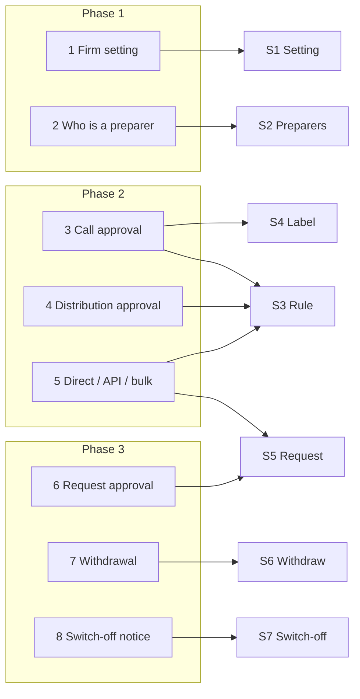

# Capital Call & Distribution Maker–Checker — Business Rules (H/E/X)

> **Audience:** Product, QA, developers. Every row becomes exactly one Cucumber scenario.
> **Companions:** [Proposal](proposal.md) · [Design](design.md) · [Specs](specs/funds/capital-call-distribution-maker-checker/spec.md)

---

## Contents

- [How to read this](#how-to-read-this)
- [Shared setup](#shared-setup)
- [1. Firm setting — Phase 1](#1-firm-setting--phase-1)
- [2. Who is a preparer — Phase 1](#2-who-is-a-preparer--phase-1)
- [3. Approving a capital call — Phase 2](#3-approving-a-capital-call--phase-2)
- [4. Approving a distribution — Phase 2](#4-approving-a-distribution--phase-2)
- [5. Direct requests, API, bulk, other firms — Phase 2](#5-direct-requests-api-bulk-other-firms--phase-2)
- [6. Request approval — Phase 3](#6-request-approval--phase-3)
- [7. Withdrawal on figure change — Phase 3](#7-withdrawal-on-figure-change--phase-3)
- [8. Switch-off notice — Phase 3](#8-switch-off-notice--phase-3)
- [Coverage](#coverage)

---

## How to read this

- **ID legend:** **H** = happy path · **E** = edge case · **X** = error (exception) case. IDs run across the whole
  file, never restart per section.
- **Spec scenario** column: `<short name>: <scenario>` in
  [the spec](specs/funds/capital-call-distribution-maker-checker/spec.md). Short names: **S1** Firm-level setting ·
  **S2** Preparers · **S3** Preparer cannot approve · **S4** Self-approval is labelled · **S5** Request approval ·
  **S6** Figure changes withdraw · **S7** Switching off is announced.
- **Feature** column (all under `features/`):
  **F1** `funds/maker_checker/maker_checker_setting.feature` ·
  **F2** `funds/maker_checker/preparers.feature` ·
  **F3** `funds/maker_checker/capital_call_approval.feature` ·
  **F4** `funds/maker_checker/capital_distribution_approval.feature` ·
  **F5** `security/maker_checker_approval.feature` ·
  **F6** `funds/maker_checker/approval_requests.feature` ·
  **F7** `funds/maker_checker/approval_withdrawal.feature`.
- Every scenario carries a comment above it: `# E12 — Edge case: …`.
- Money in INR, shown as on screen (₹5,00,00,000). Email dates as `Dec 15, 2026`. "ON" = Nilgiri's setting on.

---

## Shared setup

| Record | Name | Key data |
|---|---|---|
| Firm | Nilgiri Capital | Maker–checker **ON** unless the row says off |
| Fund | Nilgiri Growth Fund I | INR; commitments ₹20 Cr (Arun), ₹18 Cr, ₹12 Cr = ₹50 Cr |
| User | Ravi Iyer | Company admin + Approver |
| User | Meera Shah | Employee + Approver; fund access (update) |
| User | Anil Rao | Employee; fund access (update); **no** Approver role |
| User | Priya Nair | Employee + Approver; fund access (update) |
| User | Tara Bose | Employee + Approver; **no** fund access |
| User | Deepa Kumar | Approver; **inactive** |
| User | Vikram Sen | Employee; fund access **read only** |
| Support | Sunil (CapHive support) | May act as Nilgiri users |
| Call | Q4 2026 Drawdown | Created by Meera; 10% of commitments; due Dec 15, 2026 |
| Remittances | of Q4 2026 Drawdown | 10% × ₹20 Cr = ₹2 Cr · 10% × ₹18 Cr = ₹1.8 Cr · 10% × ₹12 Cr = ₹1.2 Cr → total ₹5 Cr |
| Distribution | Tea Estates Exit | Created by Meera; income ₹3 Cr → payments 40/36/24% = ₹1.2 Cr, ₹1.08 Cr, ₹0.72 Cr |
| Firm 2 | Solo Ventures | Maker–checker **OFF**; only user Sam Mehta (company admin + Approver); fund Solo Fund I |
| Firm 3 | Kaveri Partners | Kiran Das (company admin + Approver) |
| Investor | Arun (LP) | Investor user of Nilgiri Growth Fund I |
| Open-ended fund | Nilgiri Flexi Fund | Evergreen; dealing date Nov 30, 2026 |

---

## 1. Firm setting — Phase 1

### Happy path

| # | Scenario | Given | When | Then | Spec scenario | Feature |
|---|---|---|---|---|---|---|
| H1 | Admin switches it on | Nilgiri setting off | Ravi ticks the switch on the entity form and saves | Setting on; entity audit shows Ravi, false → true; "Entity was successfully updated." | S1: Company admin switches it on | F1 |

### Edge cases

| # | Scenario | Given | When | Then | Spec scenario | Feature |
|---|---|---|---|---|---|---|
| E1 | Existing firm after release | Solo Ventures existed before release | Migration runs | Setting off; Sam approves his own call as before | S1: Off by default | F1 |
| E2 | New firm after release | — | Support creates firm "Ganga Fund Advisors" | Setting off | S1: Off by default | F1 |
| E3 | Form saved without touching the switch | Nilgiri ON | Ravi edits the entity name only | Still on; no setting change in the audit | S7: Switched on or unchanged | F1 |

### Error cases

| # | Scenario | Given | When | Then | Spec scenario | Feature |
|---|---|---|---|---|---|---|
| X1 | Non-admin direct request | Nilgiri ON | Meera PATCHes the entity with the switch = 0 | "Access Denied"; still on | S1: Non-admin cannot change it | F1 |
| X2 | Other firm's admin | Nilgiri ON | Kiran PATCHes Nilgiri's entity | "Access Denied"; unchanged | S1: Non-admin cannot change it | F1 |

---

## 2. Who is a preparer — Phase 1

### Happy path

| # | Scenario | Given | When | Then | Spec scenario | Feature |
|---|---|---|---|---|---|---|
| H2 | Created on the form | — | Meera creates Q4 2026 Drawdown | Preparers: Meera | S2: Creator is a preparer | F2 |
| H3 | Created by API | — | Meera POSTs `/capital_calls.json` with a bearer token | Preparers: Meera | S2: Creator is a preparer | F2 |
| H4 | Call figures edited | Q4 by Meera | Anil changes 10% → 12% | Preparers: Meera, Anil | S2: Editor of call figures is a preparer | F2 |
| H5 | Remittance amount edited | Q4 by Meera | Anil changes ₹1.2 Cr → ₹1.25 Cr | Preparers: Meera, Anil | S2: Editor of a remittance amount is a preparer | F2 |
| H6 | Distribution payment edited | Tea Estates by Meera | Anil changes ₹0.72 Cr → ₹0.75 Cr income | Preparers: Meera, Anil | S2: Distribution payment editor is a preparer | F2 |
| H7 | Calls imported | — | Anil imports a sheet with "Q1 2027 Drawdown" | Preparers of Q1 2027: Anil | S2: Importer is a preparer | F2 |
| H8 | Remittances imported | Upload-basis call "Sep 2026 Top-up" by Meera | Anil imports 3 remittance rows | Preparers: Meera, Anil | S2: Importer is a preparer | F2 |
| H9 | Recompute fees | Q4 with a 2% fee formula | Anil clicks Recompute Fees; fees ₹10,00,000 → ₹12,00,000 | Anil is a preparer | S2: Recompute fees makes a preparer | F2 |
| H10 | Fee line edited | Q4 with a call fee line | Anil changes the fee line's end date | Anil is a preparer | S2: Editor of call figures is a preparer | F2 |
| H11 | Distribution created | — | Meera creates Tea Estates Exit | Preparers: Meera | S2: Creator is a preparer | F2 |

### Edge cases

| # | Scenario | Given | When | Then | Spec scenario | Feature |
|---|---|---|---|---|---|---|
| E4 | Name and notes | Q4 by Meera | Ravi edits name and notes | Ravi is not a preparer | S2: Non-figure edit does not make a preparer | F2 |
| E5 | Custom field and notification switch | Q4 | Ravi changes custom field "Purpose" and Send Call Notice | Ravi is not a preparer | S2: Non-figure edit does not make a preparer | F2 |
| E6 | Payment received | Q4 | Ravi records a ₹1.8 Cr payment | Ravi is not a preparer | S2: Non-figure edit does not make a preparer | F2 |
| E7 | Remittance verified | Q4 | Ravi verifies a remittance | Ravi is not a preparer | S2: Non-figure edit does not make a preparer | F2 |
| E8 | Generation recorded once | — | Meera creates Q4; 3 remittances are generated | Exactly one preparer row (Meera) | S2: Generating many remittances records the person once | F2 |
| E9 | Same person twice | Q4 | Anil edits two remittances in two requests | One row for Anil | S2: Generating many remittances records the person once | F2 |
| E10 | No acting person | Q4 | A job with no acting user changes a remittance amount | No row added | S2: No acting person records nobody | F2 |
| E11 | Support acting as a user | — | Sunil, acting as Meera, creates a call | Preparers: Sunil (the real person; Meera is not) | S2: Support acting as a user | F2 |
| E12 | Legacy call, untouched | Call created before release by Meera; no rows | Page opened | Preparers: Meera (from the audit trail) | S2: Legacy record counts its creator | F2 |
| E13 | Legacy call, edited after release | As E12 | Anil changes a remittance | Preparers: Meera, Anil | S2: Legacy record counts its creator | F2 |
| E14 | Saved with no real change | Q4 | Anil saves a remittance form without changing the amount | Anil is not a preparer | S2: Non-figure edit does not make a preparer | F2 |

### Error cases

N/A — recording a preparer never refuses a user action; the failure path of the write it rides on is unchanged
(a failed save records nobody, covered by E10's "no row" check).

---

## 3. Approving a capital call — Phase 2

### Happy path

| # | Scenario | Given | When | Then | Spec scenario | Feature |
|---|---|---|---|---|---|---|
| H12 | Checker approves | Q4 prepared by Meera | Ravi clicks Approve | Approved by Ravi; "Capital call was successfully approved." | S3: Checker approves a call | F3 |
| H13 | Preparer sees the reason | Q4 prepared by Meera | Meera opens Actions | Approve disabled, tooltip "You prepared this call, so another approver must approve it (maker–checker is on)."; Request approval shown | S3: Preparer is refused on the page | F3 |
| H14 | Setting off: self-approval labelled | Solo Ventures | Sam creates and approves a call | Approved by Sam; "Yes · by Sam Mehta (also prepared it)" | S3: Setting off keeps self-approval; S4: Labelled self-approval | F3 |
| H15 | Preparers listed | Q4: Meera created, Anil edited a remittance | Page opened | "Prepared by: Meera Shah, Anil Rao" | S4: Preparers are listed | F3 |

### Edge cases

| # | Scenario | Given | When | Then | Spec scenario | Feature |
|---|---|---|---|---|---|---|
| E15 | Admin-approver who edited | Ravi changed a remittance of Q4 | Ravi opens Actions | Approve disabled for Ravi; Priya approves | S3: Preparer is refused on the page | F3 |
| E16 | Approver who is not a preparer | Call created by Anil only | Meera approves | Approved by Meera | S3: Checker approves a call | F3 |
| E17 | Imported call | Priya imported "Q1 2027 Drawdown" | Priya opens Actions; then Ravi approves | Disabled for Priya; approved by Ravi | S3: Preparer is refused on the page | F3 |
| E18 | Approved before switching on | Q4 self-approved by Meera while off | Ravi switches ON | Q4 stays approved; Unapprove offered to Meera and Ravi | S3: Earlier approvals stay valid | F3 |
| E19 | Unapprove by a preparer | ON; Q4 approved by Ravi | Meera clicks Unapprove | Unapproved, as today | S3: Earlier approvals stay valid | F3 |
| E20 | Switched off again | ON → OFF | Meera approves her own call | Approved by Meera; labelled "also prepared it" | S3: Setting off keeps self-approval | F3 |
| E21 | Approver without fund access | Tara | Opens Q4 | "Access Denied" (unchanged) | S3: Checker approves a call | F3 |
| E22 | Validation rule blocker | A blocker rule fires on Q4 | Ravi clicks Approve | Blocked with the rule's message (unchanged) | S3: Checker approves a call | F3 |
| E23 | Unapproved notices | Q4 has generated, unapproved notices | Ravi clicks Approve | "Call not approved: There are unapproved documents for the remittances of this call. Please approve them first." | S3: Checker approves a call | F3 |
| E24 | Journey panel, ON | Full journey at Approve call | Page opened | "The call is not approved yet — it needs an approver who did not prepare it" | S3: Journey says a second approver is needed | F3 |
| E25 | Journey panel, OFF | Solo Ventures at Approve call | Page opened | "The call is not approved yet" (unchanged) | S3: Journey says a second approver is needed | F3 |
| E26 | Legacy self-created call | E12's call; ON | Meera opens Actions | Approve disabled | S2: Legacy record counts its creator; S3: Preparer is refused on the page | F3 |
| E27 | Open-ended settlement | Nilgiri Flexi Fund dealing date settles | Settlement call created | Created approved, no journey (unchanged) | S3: Unchanged paths keep working | F3 |

### Error cases

Covered in [§5](#5-direct-requests-api-bulk-other-firms--phase-2) — every refusal by a direct request lives there.

---

## 4. Approving a distribution — Phase 2

### Happy path

| # | Scenario | Given | When | Then | Spec scenario | Feature |
|---|---|---|---|---|---|---|
| H16 | Checker approves | Tea Estates prepared by Meera | Ravi clicks Approve | Approved by Ravi; Mark Payments Completed offered | S3: Distribution follows the same rule | F4 |
| H17 | Setting off: labelled | Solo Ventures | Sam creates and approves a distribution | "Yes · by Sam Mehta (also prepared it)" | S4: Labelled self-approval | F4 |

### Edge cases

| # | Scenario | Given | When | Then | Spec scenario | Feature |
|---|---|---|---|---|---|---|
| E28 | Preparer sees the reason | Tea Estates by Meera | Meera opens Actions | Disabled; "You prepared this distribution, so another approver must approve it (maker–checker is on)." | S3: Distribution follows the same rule | F4 |
| E29 | Payment editor | Ravi changed a payment's income | Ravi opens Actions; Priya approves | Disabled for Ravi; approved by Priya | S3: Distribution follows the same rule | F4 |
| E30 | Imported distribution | ON; imported distribution, not approved | Ravi marks payments completed | Works as today (no approval needed) | S3: Unchanged paths keep working | F4 |
| E31 | Open-ended redemption settlement | Nilgiri Flexi Fund redemptions settle | Settlement distribution created | Created approved (unchanged) | S3: Unchanged paths keep working | F4 |

### Error cases

Covered in [§5](#5-direct-requests-api-bulk-other-firms--phase-2).

---

## 5. Direct requests, API, bulk, other firms — Phase 2

### Happy path

N/A — this section holds refusals only; the allowed paths are H12 and H16.

### Edge cases

N/A — see the error rows; each one is a distinct bypass attempt.

### Error cases

X13–X15 need the `request_approval` action, so they are added to F5 in Phase 3; the rest land in Phase 2.

| # | Scenario | Given | When | Then | Spec scenario | Feature |
|---|---|---|---|---|---|---|
| X3 | Preparer forces the call URL | Q4 by Meera | Meera POSTs `/capital_calls/:id/approve` | "Access Denied"; Q4 unapproved | S3: Preparer is refused on a direct request | F5 |
| X4 | Preparer via API (call) | Q4 by Meera | Meera POSTs `approve.json` with a bearer token | 403 `{"error":"Access Denied"}` | S3: Preparer is refused on a direct request | F5 |
| X5 | Preparer forces the distribution URL | Tea Estates by Meera | Meera POSTs `/capital_distributions/:id/approve` | "Access Denied"; unapproved | S3: Distribution follows the same rule | F5 |
| X6 | Preparer via API (distribution) | Tea Estates by Meera | `approve.json` with a bearer token | 403 `{"error":"Access Denied"}` | S3: Preparer is refused on a direct request | F5 |
| X7 | Bulk calls with own | Q4 + Q1 2027 by Meera; "Sep 2026 Top-up" by Anil | Meera bulk-approves all three via API | Top-up approved; completion email lists "You prepared Q4 2026 Drawdown — another approver must approve it" and the same for Q1 2027 | S3: Bulk approve reports own records | F5 |
| X8 | Bulk distributions with own | Tea Estates by Meera; "Pharma Exit" by Anil | Meera bulk-approves both | Pharma Exit approved; Tea Estates listed as refused with the same message | S3: Bulk approve reports own records | F5 |
| X9 | Other firm's approver | — | Kiran POSTs approve on Q4 | "Access Denied" | S3: Preparer is refused on a direct request | F5 |
| X10 | Support self-approves via another user | Sunil (acting as Meera) created Q4 | Sunil, acting as Ravi, POSTs approve | "Access Denied" — Sunil is a preparer | S2: Support acting as a user | F5 |
| X11 | Double approve | Ravi approved Q4 | Ravi re-submits approve | "Access Denied"; approved by stays Ravi | S3: Checker approves a call | F5 |
| X12 | Mass assignment | Q4 by Meera | Meera PATCHes Q4 with `approved=1`, `approved_by_user_id=<Meera>` | Fields ignored; Q4 unapproved | S3: Preparer is refused on a direct request | F5 |
| X13 | Other firm requests approval | — | Kiran POSTs `request_approval` on Q4 | "Access Denied"; nothing sent | S5: Others are refused | F5 |
| X14 | Investor requests approval | — | Arun POSTs `request_approval` on Q4 | "Access Denied"; nothing sent | S5: Others are refused | F5 |
| X15 | Read-only employee requests approval | — | Vikram POSTs `request_approval` on Q4 | "Access Denied"; nothing sent | S5: Others are refused | F5 |

---

## 6. Request approval — Phase 3

### Happy path

| # | Scenario | Given | When | Then | Spec scenario | Feature |
|---|---|---|---|---|---|---|
| H18 | Preparer requests | Q4 by Meera | Meera clicks Request approval, sees the 3-card popup, clicks Send request | Ravi and Priya get email + bell "Q4 2026 Drawdown (Nilgiri Growth Fund I) needs your approval"; "Approval requested from Ravi Iyer and Priya Nair." | S5: Approvers are notified | F6 |
| H19 | Checker follows the link | After H18 | Ravi opens the email link | Q4 page; Approve enabled | S5: Approvers are notified | F6 |
| H20 | Distribution | Tea Estates by Meera | Meera requests approval | "Tea Estates Exit (Nilgiri Growth Fund I) needs your approval" to Ravi and Priya | S5: Approvers are notified | F6 |

### Edge cases

| # | Scenario | Given | When | Then | Spec scenario | Feature |
|---|---|---|---|---|---|---|
| E32 | Who is told | Q4: Meera created, Anil edited | Meera requests | Only Ravi and Priya — not Meera/Anil (preparers), Tara (no fund access), Deepa (inactive), Vikram (no Approver role), Arun (LP), Kiran (other firm) | S5: Approvers are notified | F6 |
| E33 | Preparer without Approver role | Q4 by Anil | Anil requests | Ravi, Meera, Priya told | S5: Approvers are notified | F6 |
| E34 | No checker | Ravi and Priya lose the Approver role | Meera requests | Nothing sent; "No one else can approve this call. Ask a company admin to give the Approver role to a colleague with access to this fund, or turn off maker–checker in Settings." | S5: No one can approve | F6 |
| E35 | Asked within the hour | Meera asked at 10:42 | Meera asks again at 11:05 | Nothing sent; "Approvers were already asked at 10:42. You can ask again after 11:42." | S5: Asked twice within an hour | F6 |
| E36 | Asked after the hour | Meera asked at 10:42 | Meera asks at 11:43 | Sent again | S5: Asked twice within an hour | F6 |
| E37 | Setting off | Solo Ventures | Sam opens Actions; then POSTs `request_approval` | No item; "Access Denied" | S5: Only for unapproved records with the setting on | F6 |
| E38 | Already approved | Q4 approved by Ravi | Meera opens Actions; then POSTs `request_approval` | No item; "Access Denied" | S5: Only for unapproved records with the setting on | F6 |
| E39 | Email content | H18 | Ravi reads the email | Names call, fund, call amount ₹5,00,00,000, due date "Dec 15, 2026", preparers, a link to Q4 | S5: Approvers are notified | F6 |
| E56 | A checker is not offered it | Q4 by Meera | Ravi opens Actions; then POSTs `request_approval` | No Request approval item (he can approve); "Access Denied" | S5: Only for unapproved records with the setting on | F6 |

### Error cases

Refusals by other firms, investors and read-only users: X13–X15 in [§5](#5-direct-requests-api-bulk-other-firms--phase-2).

---

## 7. Withdrawal on figure change — Phase 3

### Happy path

| # | Scenario | Given | When | Then | Spec scenario | Feature |
|---|---|---|---|---|---|---|
| H21 | Call figures after approval | ON; Q4 approved by Ravi | Anil changes 10% → 12% | Q4 unapproved; Anil's flash "Capital call was successfully updated. Its approval was withdrawn because the figures changed — another approver must approve it again."; journey back at Approve call with "Approval withdrawn: Anil Rao changed the figures" | S6: Remittance edited after approval | F7 |
| H22 | Remittance after approval | ON; Q4 approved | Anil changes ₹1.2 Cr → ₹1.25 Cr | Unapproved; Ravi, Priya, Meera get "Approval of Q4 2026 Drawdown was withdrawn: Anil Rao changed its figures after approval." — not Anil (he acted) or Tara (no fund access) | S6: Remittance edited after approval | F7 |
| H23 | Payment after approval | ON; Tea Estates approved | Anil changes a payment's income | Distribution unapproved; alert sent | S6: Remittance edited after approval | F7 |
| H24 | Re-approval | After H22 | Priya approves | Approved by Priya | S3: Checker approves a call | F7 |

### Edge cases

| # | Scenario | Given | When | Then | Spec scenario | Feature |
|---|---|---|---|---|---|---|
| E40 | Notes after approval | ON; Q4 approved | Ravi edits notes | Stays approved; nothing sent | S2: Non-figure edit does not make a preparer | F7 |
| E41 | Payment received | ON; Q4 approved | ₹1.8 Cr payment recorded | Stays approved | S6: Payment received keeps the approval | F7 |
| E42 | Remittance verified | ON; Q4 approved | Ravi verifies a remittance | Stays approved | S6: Payment received keeps the approval | F7 |
| E43 | New commitment | ON; Q4 approved | ₹10 Cr commitment added; a ₹1 Cr remittance is created in Q4 | Stays approved | S6: New commitment keeps the approval | F7 |
| E44 | Setting off | Solo Ventures call approved | Sam changes its percentage | Stays approved | S6: Setting off keeps today's behaviour | F7 |
| E45 | No acting person | ON; Q4 approved | A job with no acting user changes a remittance amount | Stays approved; warning logged with call id | S6: Change without an acting person keeps the approval | F7 |
| E46 | Recompute fees changes fees | ON; Q4 approved | Anil clicks Recompute Fees; fees change | Withdrawn; Anil a preparer | S6: Remittance edited after approval | F7 |
| E47 | Recompute fees, no change | ON; Q4 approved | Recompute leaves every fee the same | Stays approved | S6: Remittance edited after approval | F7 |
| E48 | Remittance deleted | ON; Q4 approved | Anil deletes the ₹1.2 Cr remittance | Withdrawn | S6: Remittance edited after approval | F7 |
| E49 | Call deleted | ON; Q4 approved | Ravi deletes Q4 | Deleted; no withdrawal alert | S6: Remittance edited after approval | F7 |
| E50 | Open-ended settlement | ON; Nilgiri Flexi settlement call | A subscription payment is added, then changed | Stays approved | S6: Open-ended settlements are exempt | F7 |
| E51 | Already notified | ON; Q4 approved and notices sent | Anil changes a remittance | Withdrawn; alert adds "Investors were already sent this call's notice; they are not told about the change." | S6: Remittance edited after approval | F7 |
| E52 | Unapproved record | ON; Q4 not approved | Anil changes a remittance | No withdrawal alert; Anil a preparer | S2: Editor of a remittance amount is a preparer | F7 |
| E53 | Distribution date | ON; Tea Estates approved | Anil changes the distribution date | Withdrawn | S6: Remittance edited after approval | F7 |

### Error cases

| # | Scenario | Given | When | Then | Spec scenario | Feature |
|---|---|---|---|---|---|---|
| X16 | Unrelated validation problem on the call | ON; Q4 approved; Q4 fails an unrelated validation (e.g. a blank due date after a data fix) | Anil changes a remittance | **Changed during the build (design C3):** Anil's change saves and Q4's approval is still withdrawn (the withdrawal skips the call's own validations), so figures and approval never disagree and the unrelated problem doesn't block him. A database error still rolls the whole change back | S6: Remittance edited after approval | F7 |

---

## 8. Switch-off notice — Phase 3

### Happy path

| # | Scenario | Given | When | Then | Spec scenario | Feature |
|---|---|---|---|---|---|---|
| H25 | Switched off | Nilgiri ON | Ravi switches off on Nov 19, 2026 | Meera, Priya, Tara get email + bell "Maker–checker for calls and distributions was turned off by Ravi Iyer on Nov 19, 2026."; Ravi, Deepa (inactive), Arun get nothing | S7: Switched off | F6 |

### Edge cases

| # | Scenario | Given | When | Then | Spec scenario | Feature |
|---|---|---|---|---|---|---|
| E54 | Switched on | Nilgiri off | Ravi switches on | Nothing sent | S7: Switched on or unchanged | F6 |
| E55 | Saved unchanged | Nilgiri ON | Ravi saves the entity form | Nothing sent | S7: Switched on or unchanged | F6 |

### Error cases

N/A — the only refusals (non-admin, other firm) are X1–X2.

---

## Coverage

| Group | H | E | X | Feature |
|---|---|---|---|---|
| 1 Firm setting | H1 | E1–E3 | X1–X2 | F1 |
| 2 Preparers | H2–H11 | E4–E14 | — | F2 |
| 3 Call approval | H12–H15 | E15–E27 | — | F3 |
| 4 Distribution approval | H16–H17 | E28–E31 | — | F4 |
| 5 Direct / API / bulk | — | — | X3–X15 | F5 |
| 6 Request approval | H18–H20 | E32–E39, E56 | — | F6 |
| 7 Withdrawal | H21–H24 | E40–E53 | X16 | F7 |
| 8 Switch-off | H25 | E54–E55 | — | F6 |
| **Total** | **25** | **56** | **16** | 7 files |

Every spec scenario appears at least once in a Spec scenario column (checked: S1 ×3, S2 ×11, S3 ×9, S4 ×2, S5 ×5,
S6 ×6, S7 ×2).
