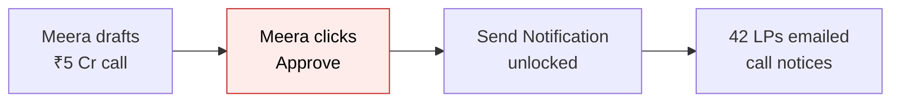
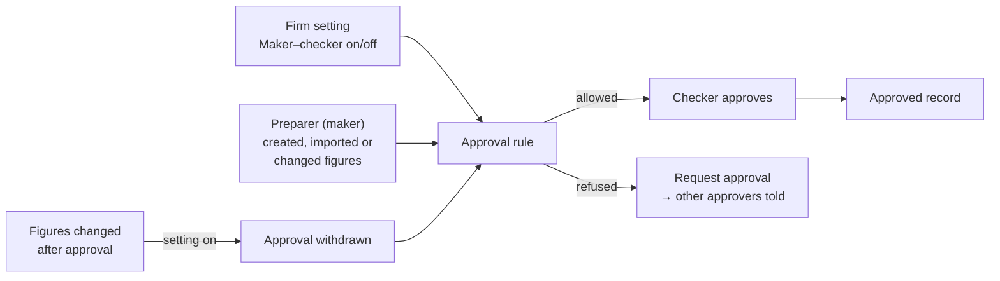
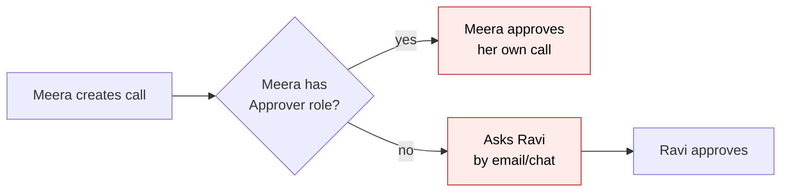
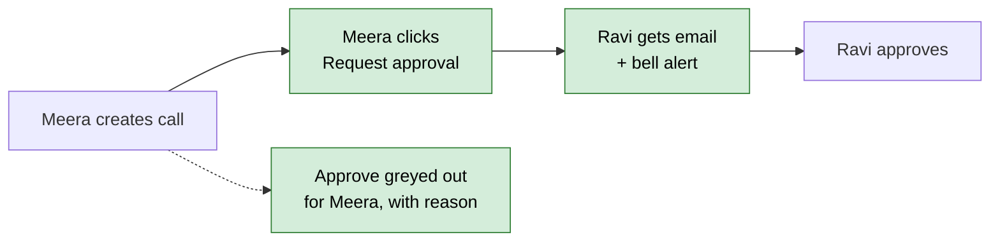
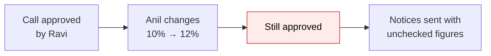
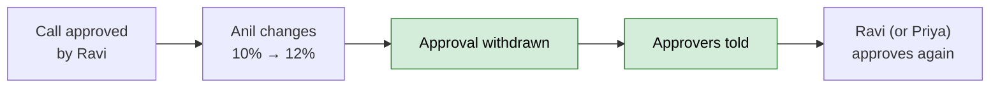
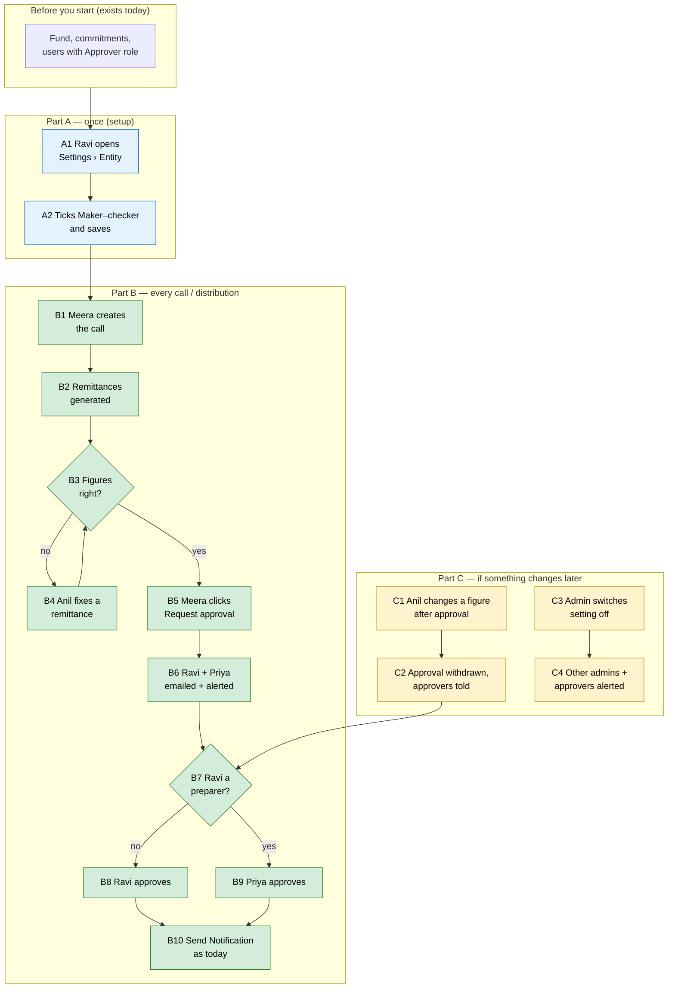

# Capital Call & Distribution Maker–Checker — Proposal

> **Audience:** Business team, product, QA, support — non-technical.
> **Companion documents:** [Design](design.md) · [Business rules (H/E/X)](business-rules.md) · [Screen mock](mocks/approve_actions.html)
> **New to this? Start with the [Workflow Journey](#workflow-journey)** — every action, in order, from start to the outcome.
> **Source finding:** M13 in [docs/security/owasp_top10_review_2026_11.md](../../../docs/security/owasp_top10_review_2026_11.md) (A06 Insecure Design).

> **Planning phase — no code changes.** This document proposes and explains the change. Do not
> edit application code while writing it; implementation happens later, in the tasks phase.

---

## Contents

- [Why](#why)
- [What Changes](#what-changes) · [Key concepts](#key-concepts) · [Flow Diagram](#flow-diagram) · [Key changes needing approval](#key-changes-needing-approval)
- [Workflow Journey](#workflow-journey)
- [User Stories](#user-stories)
- [UI Behavior](#ui-behavior)
- [What This Feature Does NOT Cover](#what-this-feature-does-not-cover)
- [Validation Rules](#validation-rules) · [Behavior Rules](#behavior-rules)
- [Resolved Design Decisions](#resolved-design-decisions)
- [Capabilities](#capabilities) · [Impact](#impact) · [Benefits](#benefits) · [FAQ](#faq)
- [Design Principle for the Next Phase](#design-principle-for-the-next-phase)

---

## Why

- **One person can prepare and approve money movements.** Today anyone with the Approver role and edit
  rights on a fund can approve a capital call or distribution — including the person who drafted it.
  A company admin can also give themselves the Approver role.
- **It happens most of the time, not occasionally.** Production copy, last 12 months:
  - 47 of 62 approved capital calls (76%) were approved by the person who created them.
  - 30 of 37 approved distributions (81%) were approved by their creator.
  - 12 of the 15 firms that approved anything self-approved at least once; 6 firms only ever self-approve.
- **Approval is the last human check before investors are asked for (or paid) money.** After approval the
  team can click *Send Notification* (calls) or *Mark Payments Completed* / *Send Payment Notification*
  (distributions). A wrong figure that only one person ever looked at reaches LPs.
- **We already do this elsewhere.** Fund Compliance requests already require "approver ≠ requester"
  — calls and distributions, which move far more money, do not.



*Today: nobody but Meera ever checked the figures.*

---

## What Changes

- **New firm setting "Maker–checker for calls and distributions"** (Settings › Entity › Approvals). Off by
  default for every firm, so nothing changes for anyone until a company admin switches it on.
- **When it is on**, the person who prepared a call or distribution cannot approve it. A second approver must.
  "Prepared" means: created it, imported it, or changed its figures — on the call/distribution itself or on any
  of its remittances / payments.
- **The Approve menu item explains itself.** A preparer sees *Approve* greyed out with the reason, plus a new
  **Request approval** item that emails and alerts the other approvers.
- **Changing figures after approval withdraws the approval** (only when the setting is on), and the approvers
  are told. The changed figures must be approved again by someone who did not change them.
- **Self-approval is labelled** when the setting is off: the call page shows "Approved by Sam Mehta (also
  prepared it)", so auditors can see it.
- **Switching the setting off alerts** the firm's other company admins and approvers.
- **Nothing already approved is touched.** Approved calls and distributions stay approved; imports and
  open-ended (evergreen) settlement records keep working exactly as today.
- **No BREAKING change** for a firm until it switches the setting on. For a firm that switches it on,
  self-approval stops — that is the intended change.

### Key concepts



| Concept | What it means for you | Example |
|---|---|---|
| Approver | A team member with the **Approver** role and edit access to the fund — unchanged from today | Ravi Iyer, CFO |
| Preparer (maker) | Anyone who created, imported or changed the figures of this call/distribution or its remittances/payments | Meera created "Q4 2026 Drawdown"; Anil changed it from 10% to 12% — both are preparers |
| Checker | An approver who is **not** a preparer of this record | Ravi, who only reviewed it |
| Maker–checker setting | Firm-wide on/off switch for the rule "a preparer cannot approve" | On for Nilgiri Capital, off for Solo Ventures |
| Self-approval | A preparer approving their own record (allowed only while the setting is off; shown on the page) | "Approved by Sam Mehta (also prepared it)" |
| Request approval | A button that tells every checker the record is waiting for them | Meera clicks it; Ravi gets an email and a bell alert |
| Approval withdrawn | When the setting is on and someone changes figures after approval, the record goes back to "not approved" | Anil edits one remittance from ₹2 Cr to ₹2.2 Cr after approval → needs approving again |
| Figures | The money and date fields that decide what LPs pay or receive | Percentage called, amount to be called, closes, call date, fees, unit prices; a remittance's call amount; a payment's income |

#### Maker–checker (two-person approval)

- **What:** the person who prepares a money movement and the person who approves it must be two different people.
- **Why:** a second pair of eyes catches wrong figures and stops one insider moving money alone.
- **What it does NOT cover:**
  - Approving generated call / distribution **notices** on the Documents screen (a separate approval).
  - **Sending** notifications, marking payments completed, allocating units — any team member with edit rights, as today.
  - **Unapprove** — still any approver (it makes things safer, not riskier).
  - Records created approved by the system (open-ended fund settlements).
- **Example:** Meera creates the ₹5 Cr "Q4 2026 Drawdown"; Ravi checks and approves it.
- **Rules:** a preparer may still edit, generate notices and request approval; only Approve is closed to them.

#### Who counts as a preparer

| Action | Makes you a preparer? | Example |
|---|---|---|
| Create the call/distribution (form or API) | Yes | Meera creates "Q4 2026 Drawdown" |
| Import calls/distributions, or their remittances/payments | Yes — the person who uploaded the file | Anil uploads the remittance sheet |
| Change a figure on the call/distribution | Yes | Percentage 10% → 12% |
| Change a remittance's call amount / fees, or a payment's income | Yes | One remittance ₹2 Cr → ₹2.2 Cr |
| Click Recompute Fees | Yes | Fees recalculated at Anil's request |
| Edit name, notes, custom fields, notification switches | No | Fix a typo in the name |
| Record a payment received / verify a remittance | No | Collected ₹1.8 Cr |
| A system job with nobody behind it | No one is recorded | Nightly job |
| A remittance created in an already-approved call because a new commitment was added | No — and the call stays approved | Late closer Kabir, ₹10 Cr |
| Changes to open-ended (evergreen) settlement records | Not tracked — they are system-approved | Nov 30 subscription settlement |

- Production check: of the 15 calls approved by someone other than the creator, 1 approver had changed a
  remittance amount first — so "creator only" would miss real cases.

### Flow Diagram

**Approving a capital call (distributions follow the same flow)**

Before:


After (setting on):


**Changing figures after approval**

Before:


After (setting on):


### Key changes needing approval

Every change to an existing model, column, screen or behaviour. New tables/classes are listed in [design.md](design.md#data-model-and-schema-changes).

| # | Existing thing | Change | Visible to users? |
|---|---|---|---|
| K1 | `entity_settings` table | **New column** `approval_maker_checker` (boolean, default off, not null) | Yes — new switch on the entity form |
| K2 | `EntityPolicy::ENTITY_SETTING_ATTRIBUTES` | Add `approval_maker_checker` (company admins can change it) | Yes |
| K3 | `EntitySetting` model | After-save hook: switching it **off** alerts other company admins + approvers | Yes (alert) |
| K4 | `CapitalCall` model | Include new preparer tracking + approval-withdraw on figure change | Indirect |
| K5 | `CapitalDistribution` model | Same as K4 | Indirect |
| K6 | `CapitalRemittance` model | Figure changes record a preparer on the parent call / withdraw its approval | Indirect |
| K7 | `CapitalDistributionPayment` model | Same as K6 for the parent distribution | Indirect |
| K8 | `CallFee`, `DistributionFee` models | Same as K6 (fee lines are figures) | Indirect |
| K9 | `CapitalCallPolicy#approve?` | Also refused for a preparer when the setting is on | Yes |
| K10 | `CapitalDistributionPolicy#approve?` | Same as K9 | Yes |
| K11 | Both policies | New `request_approval?` and `awaiting_second_approver?` | Yes |
| K12 | Routes + `CapitalCallsController`, `CapitalDistributionsController` | New member action `request_approval` (POST) | Yes |
| K13 | `capital_calls/show`, `capital_distributions/show`, `capital_calls/_show` | Greyed Approve with reason, Request approval item, "Prepared by" row, self-approval label | Yes |
| K14 | `CapitalCallsBulkActionJob`, `CapitalDistributionsBulkActionJob` | Failure reason says "You prepared … another approver must approve it" instead of "Not authorized" | Yes (bulk result email) |
| K15 | Journey checks `ApproveCall`, `ApproveDistribution` | Fail message names the second-approver need when the setting is on | Yes (journey panel) |
| K16 | Entity form `entities/_form_fields` | New "Approvals" section with the switch | Yes |
| K17 | User guides (capital calls, distributions, entity settings) | New sections + FAQs | Yes |

- No column of `capital_calls`, `capital_distributions`, `capital_remittances` or `capital_distribution_payments` changes.
- No existing approval (`approved`, `approved_by_user_id`) is rewritten.

---

## Workflow Journey

### Who is involved

| Person | Role | What they do in the journey |
|---|---|---|
| Ravi Iyer | Company admin + Approver, CFO of Nilgiri Capital | Turns the setting on; approves calls others prepared |
| Meera Shah | Employee + Approver, fund access (edit) | Prepares the call; asks for approval |
| Anil Rao | Employee, fund access (edit), no Approver role | Corrects one remittance |
| Priya Nair | Employee + Approver, fund access (edit) | Second checker |
| Sam Mehta | Company admin + Approver, the only user of Solo Ventures | Keeps the setting off and self-approves (labelled) |

### The journey on one page



### Before you start

| Needed | Why | Where it comes from |
|---|---|---|
| At least two active users with the Approver role and edit access to the fund | Someone must be left to approve | Settings › Users (company admin gives the role); Fund › Access |
| Company admin access | Only company admins change entity settings | Existing role |
| A fund with commitments | To create a call | Exists today |

### Part A — once (setup)

| Step | Who | Where | Action | What the system does | What you see |
|---|---|---|---|---|---|
| A1 | Ravi | Settings › Entity › Edit | Opens the entity form | Shows a new **Approvals** section | Switch "Require a second person to approve capital calls and distributions" (off) with ⓘ tooltip |
| A2 | Ravi | Same › Save | Ticks the switch, saves | Saves the setting; the change is recorded in the entity's audit trail with Ravi's name | "Entity was successfully updated." |

### Part B — every time

| Step | Who | Where | Action | What the system does | What you see |
|---|---|---|---|---|---|
| B1 | Meera | Fund › Capital Calls › New | Creates "Q4 2026 Drawdown", 10% of commitments | Records Meera as preparer | Call page; details card shows "Prepared by: Meera Shah" |
| B2 | — | Background | — | Generates 3 remittances (₹2 Cr + ₹1.8 Cr + ₹1.2 Cr = ₹5 Cr) | Remittances tab fills in |
| B3 | Meera | Call page | Reviews | — | — |
| B4 | Anil | Remittance › Edit | Corrects one remittance's call amount ₹1.2 Cr → ₹1.25 Cr | Records Anil as preparer | "Prepared by: Meera Shah, Anil Rao" |
| B5 | Meera | Call › Actions | Sees **Approve** greyed out ("You prepared this call, so another approver must approve it"); clicks **Request approval** | Confirm popup (Immediate Actions cards) | Popup → "Approval requested from Ravi Iyer and Priya Nair." |
| B6 | — | Email + bell | — | Emails and bell alerts to every checker (approvers with fund access who are not preparers) | Ravi: "Q4 2026 Drawdown (Nilgiri Growth Fund I) needs your approval" |
| B7–B8 | Ravi | Call › Actions › Approve | Approves | Runs today's checks (validation rules, unapproved notices); marks approved by Ravi | "Capital call was successfully approved." |
| B9 | Priya | Same | (only if Ravi were a preparer) | Same as B8 | Same |
| B10 | Meera | Call › Actions › Send Notification | Sends notices | Unchanged | Unchanged |

### What you see

```
Capital Call — Q4 2026 Drawdown                         Nilgiri Growth Fund I
┌──────────────────────────────────────────────────────────────────────────┐
│ Call Amount ₹5,00,00,000   Collected ₹0   Due ₹5,00,00,000                │
│   = ₹2,00,00,000 + ₹1,80,00,000 + ₹1,20,00,000 (3 remittances)            │
├──────────────────────────────────────────────────────────────────────────┤
│ Approved      No                                                          │
│ Prepared by   Meera Shah, Anil Rao  ⓘ                                     │
└──────────────────────────────────────────────────────────────────────────┘
 [Edit] [Delete]  [⚙ Actions ▾]
                  ├ Generate Documents
                  ├ ✓ Approve            (greyed) ⓘ "You prepared this call, so another
                  │                         approver must approve it (maker–checker is on)."
                  ├ ✉ Request approval
                  └ …
```

Meera's view. Ravi (not a preparer) sees **Approve** enabled and no "Request approval".

### What goes wrong

- **Nobody left to approve.** Nilgiri has turned the setting on, but Meera is the only active approver with access
  to the fund.
  - Meera clicks **Request approval** → "No one else can approve this call. Ask a company admin to give the
    Approver role to a colleague with access to this fund, or turn off maker–checker in Settings."
  - Fix: Ravi gives Priya the Approver role and fund access (Settings › Users; Fund › Access), then Meera
    clicks Request approval again.
- **Figures changed after approval.** Anil edits a remittance after Ravi approved → the call shows Approved: No;
  Anil's flash says "Its approval was withdrawn because the figures changed — another approver must approve it
  again"; Ravi and Priya get "Approval of Q4 2026 Drawdown was withdrawn: Anil Rao changed its figures after
  approval." Fix: Priya (not a preparer) approves again.

### Summary: the minimum actions

| # | Action | Who | How often |
|---|---|---|---|
| 1 | Switch maker–checker on | Company admin | Once |
| 2 | Prepare the call / distribution | Any team member with edit rights | Every call |
| 3 | Request approval | A preparer | Every call (optional — checkers may simply open the call) |
| 4 | Approve | An approver who did not prepare it | Every call |

---

## User Stories

### US-1: Turn on maker–checker
**As a** company admin, **I want** to require a second person to approve calls and distributions,
**so that** no single person can release a money movement alone.

**Acceptance criteria:**
- The entity edit form has an **Approvals** section with the switch "Require a second person to approve capital
  calls and distributions" and an ⓘ tooltip explaining who counts as a preparer.
- Only company admins see and can change it; it is off for every firm on release.
- Saving records who changed it, when, and from/to (entity audit trail).

### US-2: A preparer cannot approve
**As a** CFO, **I want** the person who prepared a call/distribution to be unable to approve it, **so that** every
approval is a genuine second check.

**Acceptance criteria:**
- With the setting on, a preparer sees **Approve** greyed out with the reason tooltip; the request is refused on the
  server too (direct URL, JSON API, bulk API).
- An approver who is not a preparer approves exactly as today (validation rules and notice checks unchanged).
- Bulk approve reports each refused record as "You prepared <name> — another approver must approve it".

### US-3: Ask the other approvers
**As a** preparer, **I want** to tell the approvers the call is ready, **so that** I don't chase them by email.

**Acceptance criteria:**
- **Request approval** (Actions menu) shows the Immediate Actions popup, then emails + bell-alerts every checker.
- When there is no checker, nothing is sent and the message says how to fix it.
- A second request within 1 hour is refused with "Approvers were already asked at 10:42. You can ask again after 11:42."

### US-4: Changes after approval need a new approval
**As a** CFO, **I want** an approved call whose figures change to need approving again, **so that** approval
always covers the figures LPs receive.

**Acceptance criteria:**
- Setting on: a figure change (call, distribution, remittance, payment, fee line) by a person after approval sets
  Approved back to No, records why in the journey history, and alerts approvers.
- Non-figure edits (name, notes, custom fields, notification switches), payments received and verification
  never withdraw an approval.
- Setting off: behaviour is unchanged.

### US-5: One-person firms keep working
**As** the only user of a small firm, **I want** to keep approving my own calls, **so that** my work is not blocked.

**Acceptance criteria:**
- With the setting off (the default), self-approval works as today.
- The page labels it "Approved by Sam Mehta (also prepared it)".

### US-6: Someone switches it off
**As a** company admin, **I want** to know if another admin switches maker–checker off, **so that** the control
cannot be quietly removed.

**Acceptance criteria:**
- Switching off emails + bell-alerts every other active company admin and approver: "Maker–checker for calls and
  distributions was turned off by Ravi Iyer on Nov 19, 2026."
- Switching on sends nothing.

---

## UI Behavior

### Capital call / distribution page — Actions menu

See the hand-made mock: [mocks/approve_actions.html](mocks/approve_actions.html) (three states: preparer, checker,
setting off).

```
┌ ⚙ Actions ▾ ───────────────────────────────────────────┐
│ ✓ Approve        (greyed for a preparer, tooltip says why) │
│ ✉ Request approval   (if you can't approve it; setting on) │
│ ✕ Unapprove      (approved calls; unchanged)               │
│ …                                                          │
└────────────────────────────────────────────────────────────┘
```

**Behavior notes:**
- Approve greyed = rendered as a disabled menu item with the reason tooltip, not hidden — users must see *why*.
- Request approval opens a Bootstrap confirm popup in the "Immediate Actions" card style (as the KYC Request
  Updates popup): three cards — "Approvers are emailed", "You stay a preparer", "Nothing changes on the call".
- After sending, the page reloads with the flash; no other part of the page changes.

### Request approval popup

```
┌ Request approval ─────────────────────────────────────────┐
│ ▌Immediate Actions                                         │
│ ▌The following will happen when you click Send request:    │
│ ┌──────────────────────────────────────────────────────┐  │
│ │ ✉  Ravi Iyer and Priya Nair are emailed               │  │
│ │    A bell alert and email link them to this call.     │  │
│ ├──────────────────────────────────────────────────────┤  │
│ │ 👤 You can't approve it yourself                       │  │
│ │    You prepared it: Meera Shah, Anil Rao.             │  │
│ ├──────────────────────────────────────────────────────┤  │
│ │ ✓  Nothing else changes                                │  │
│ │    The call stays unapproved; no investor is emailed. │  │
│ └──────────────────────────────────────────────────────┘  │
│                         [Cancel]   [Send request]           │
└────────────────────────────────────────────────────────────┘
```

### Details card

```
│ Approved      Yes · by Sam Mehta (also prepared it)  ⓘ │   ← setting off, self-approval
│ Prepared by   Sam Mehta                                │
```

### Entity form — Approvals section

```
Approvals
  [✓] Require a second person to approve capital calls and distributions  ⓘ
      ⓘ "Whoever created, imported or changed a call's or distribution's figures
         cannot approve it. Changing figures after approval withdraws the approval."
```

---

## What This Feature Does NOT Cover

| Excluded | Covered In |
|---|---|
| Approving generated notices on the Documents screen | Unchanged — out of scope by decision (user, 2026-11-09); no follow-up planned |
| Recording role grants (who gave whom the Approver role) | Finding M11 (separate change) |
| Requiring 2FA for approvers | Finding M8 |
| Bank-detail change controls | Finding M14 |
| Evergreen dealing date approvals | Open-ended funds — unchanged |
| Other approvals (KYC, deals, KPI reports) | Out of scope |
| Blocking the journey's "CFO sign-off" step | Journeys stay advisory (capital-call-journey spec) |
| Back-filling preparers for old records | Not needed — the record's creator (audit trail) is used |

---

## Validation Rules

| Field | Rule | Default |
|---|---|---|
| Maker–checker switch | Company admins only; on/off | Off for all firms |
| Approve (setting on) | Approver role + edit access + not a preparer + not already approved | — |
| Approve (setting off) | Approver role + edit access + not already approved (today) | — |
| Request approval | Setting on, not approved, user can edit the record, at least one checker, not asked in the last hour | — |

---

## Behavior Rules

| Scenario | What User Sees |
|---|---|
| Preparer opens Actions (setting on) | Greyed **Approve** with tooltip "You prepared this call, so another approver must approve it (maker–checker is on)." (distribution: "this distribution") |
| Preparer forces the approve URL | "Access Denied"; record unchanged |
| Preparer approves via API | HTTP 403 `{"error":"Access Denied"}` |
| Bulk approve includes own records | Result email lists "You prepared Q4 2026 Drawdown — another approver must approve it" per refused record |
| Request approval sent | "Approval requested from Ravi Iyer and Priya Nair." |
| No checker available | "No one else can approve this call. Ask a company admin to give the Approver role to a colleague with access to this fund, or turn off maker–checker in Settings." |
| Asked again within an hour | "Approvers were already asked at 10:42. You can ask again after 11:42." |
| Checker email subject / bell | "Q4 2026 Drawdown (Nilgiri Growth Fund I) needs your approval" |
| Figures changed after approval (on) | Editor's flash: "Capital call was successfully updated. Its approval was withdrawn because the figures changed — another approver must approve it again." Approvers: "Approval of Q4 2026 Drawdown was withdrawn: Anil Rao changed its figures after approval." |
| Self-approval (setting off) | Details card: "Yes · by Sam Mehta (also prepared it)" |
| New commitment added after a call was approved | The call stays approved; its new remittance needs no new approval |
| Payment received / remittance verified after approval | The call stays approved |
| Journey panel at Approve step (on) | "The call is not approved yet — it needs an approver who did not prepare it" |
| Setting switched off | Other admins/approvers: "Maker–checker for calls and distributions was turned off by Ravi Iyer on Nov 19, 2026." |

---

## Resolved Design Decisions

| # | Decision | Resolution |
|---|---|---|
| 1 | Who is a maker? | Creator, importer, and anyone who changed figures (record or its remittances/payments/fee lines) — not just the creator |
| 2 | Default for existing firms | **Off.** 12 of 15 approving firms self-approve; 5 of them have at most one approver today. On would block them overnight |
| 3 | Default for new firms | Off as well; switched on during onboarding when the firm has 2+ approvers (see Open question 1 in design) |
| 4 | One-approver fallback when on? | No — the setting itself is the one-person escape, and it is visible and alerted |
| 5 | Edits after approval | Setting on: approval withdrawn; off: unchanged. Production: 0 such edits in 12 months |
| 6 | Existing approvals | Stay valid; nothing rewritten |
| 7 | Imports | Importer is a preparer; imports never create approved records (unchanged) |
| 8 | Support staff acting as a user | The support person is the preparer and cannot approve it while acting as anyone |

---

## Capabilities

### New Capabilities

- `funds/capital-call-distribution-maker-checker`: firm setting, who counts as a preparer, the approval rule for
  capital calls and distributions, request-approval notices, withdrawal on post-approval figure changes, and the
  self-approval label.

### Modified Capabilities

- None. The journey specs (`funds/capital-call-journey`, `funds/capital-distribution-journey`) keep their
  requirements: Approve still needs the Approver role and edit rights, and journeys stay advisory. The new rule is
  an additional, separate requirement.

---

## Impact

- **Capital call page** and **capital distribution page**: Actions menu, details card.
- **Entity settings form**: new Approvals section.
- **Bulk approve (API)**: clearer refusal reasons in the completion email.
- **Journey panel**: Approve step message when the setting is on.
- **Emails / bell alerts**: three new internal notices (request, withdrawn, setting off). Investors receive nothing new.
- **Imports**: unchanged for users; the uploader is recorded as a preparer.
- **User guides**: capital calls, capital distributions, entity settings.

---

## Benefits

1. No single person can release a capital call or distribution once the firm switches the control on.
2. Approval always covers the figures LPs actually receive.
3. Preparers no longer chase approvers by email — one click tells all of them.
4. Auditors see self-approvals labelled even in firms that keep the setting off.
5. Small firms are not blocked; the control is opt-in and its removal is visible.

---

## FAQ

| Question | Answer |
|---|---|
| Will anything change for us on release day? | No. The setting is off for every firm; the only visible change is the "Prepared by" row and the self-approval label. |
| We are a two-person firm. Can we turn it on? | Yes — as long as both people have the Approver role and fund access, each approves what the other prepared. |
| I only fixed a typo in the call name. Can I still approve? | Yes. Name, notes, custom fields and notification switches don't make you a preparer. |
| I clicked Recompute Fees. Am I a preparer? | Yes — the fees (figures) changed because of your action. |
| What about calls created before release? | The person who created them (from the audit trail) counts as the preparer. Already-approved ones stay approved. |
| Our approver left. What now? | Request approval says nobody can approve; a company admin gives the Approver role to someone else, or switches the setting off (other admins are alerted). |
| Can support approve on our behalf? | Support acting as a user is subject to the same rule: whatever a support person prepared, they cannot approve while acting as any of your users. |
| Does Unapprove need two people? | No. Unapproving makes things safer; any approver can still do it. |
| Do investors see anything? | No. All new notices go only to the firm's team. |
| Does the API change? | Only for firms with the setting on: a preparer's approve request returns 403, as any refused request does. |
| How do I see who prepared a call? | The "Prepared by" row on the call/distribution page. See [design](design.md) for how it is recorded. |

---

## Design Principle for the Next Phase

- **Keep the rule in one place**: the Approve permission (policy). Every path — button, URL, JSON API, bulk — already
  asks it, so no path needs its own check.
- **Record preparers where figures change, not in each screen.** Many screens and jobs change figures (forms, imports,
  recompute fees, remittance edits); recording at each one would miss some. The design must pick one hook point and
  prove it catches every path listed in "Who counts as a preparer".
- **Risk: write volume.** Generating 5,000 remittances must not write 5,000 preparer rows — the design must dedupe per
  request/job.
- **Risk: withdrawing approvals by surprise.** The design must limit withdrawal to human-caused figure changes and
  explain it on screen and by alert.
- **Reuse:** the compliance maker–checker's notifier and recipient pattern, the KYC Request Updates popup style, the
  existing approve service (`CapitalCallApproval`) and Unapprove operation.
