# Require Two-Factor for Support and Super Users — Design

> **Audience:** engineers reviewing before code. **Companions:** [Proposal](proposal.md) ·
> [Spec](specs/identity/two-factor-authentication/spec.md) · [Business rules (H/E/X)](business-rules.md) ·
> [LLD](lld.md) · [Screen mocks](mocks/screens.html)
>
> **Source finding:** M8 in `docs/security/owasp_top10_review_2026_11.md:229`. Code cited below is the
> working tree of branch `fix/owasp-top10-2026-11` (uncommitted OWASP fixes treated as current).
>
> **Scope (user decisions, 2026-11-09):** required roles = **support** and **super**
> (`RequiredTwoFactor::REQUIRED_2FA_ROLES = %i[support super]`). Company admins of fund and investor
> firms are **not** required. The step-up turn-off applies to **every** user who has 2FA on.

## Contents

- [1. The idea](#1-the-idea)
  - [What this adds](#what-this-adds)
  - [The idea in one picture](#the-idea-in-one-picture)
  - [Key concepts](#key-concepts)
  - [Sign-in paths today (map)](#sign-in-paths-today-map)
  - [Production sizing (IN copy)](#production-sizing-in-copy)
  - [Walkthrough: one example, start to finish](#walkthrough-one-example-start-to-finish)
  - [Key ideas](#key-ideas)
  - [FAQ — Part 1](#faq--part-1)
- [2. The same picture with real names](#2-the-same-picture-with-real-names)
  - [Picture](#picture)
  - [What each box does](#what-each-box-does)
  - [One run, end to end](#one-run-end-to-end)
  - [Lifecycles](#lifecycles)
  - [What users see](#what-users-see)
  - [Design decisions](#design-decisions)
  - [Key changes needing approval](#key-changes-needing-approval)
  - [Flows that change for users (none may break)](#flows-that-change-for-users-none-may-break)
  - [FAQ — Part 2](#faq--part-2)
- [3. One card per box](#3-one-card-per-box)
  - [① Who must use 2FA](#①-who-must-use-2fa)
  - [② Sign-in gate](#②-sign-in-gate)
  - [③ Set-up screens](#③-set-up-screens)
  - [④ Other doors](#④-other-doors)
  - [⑤ Banner and Set up now](#⑤-banner-and-set-up-now)
  - [⑥ Turn-off check](#⑥-turn-off-check)
  - [⑦ Security emails](#⑦-security-emails)
  - [⑧ Ops roll-out](#⑧-ops-roll-out)
- [4. Reference](#4-reference)
  - [Class diagram](#class-diagram)
  - [Data model and schema changes](#data-model-and-schema-changes)
  - [Component contracts](#component-contracts)
  - [Notifications](#notifications)
  - [Cross-cutting concerns](#cross-cutting-concerns)
  - [Worked examples](#worked-examples)
  - [Testing](#testing)
  - [Risks and open questions](#risks-and-open-questions)
  - [FAQ — Part 4](#faq--part-4)

---

## 1. The idea

### What this adds

- A **role rule**: support and super users must have a verified two-factor method once their region's enforcement date passes. The rule is computed from one role list + one env date, never stored.
- Every sign-in door reads that rule through **one predicate**, and a required user with no method is sent through the **existing** "enabled but no method → choose a mode" enrolment (`TwoFactorDispatch` `:choose_method`, `two_factor_dispatch.rb:61-67`).
- Turning 2FA **off** becomes a step-up operation (password + current code) for **every** user — modelled on the existing `TwoFactorReset` operation and popup, guarded in the model the way phone-number changes already are (`user.rb:254-264`).

### The idea in one picture

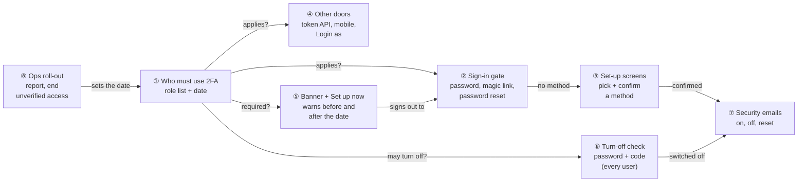

| # | Box | One line |
|---|---|---|
| ① | Who must use 2FA | "Is 2FA required / does it apply / is there a verified method?" for one user, now |
| ② | Sign-in gate | After password or magic link: sign in, ask for a code, or send to set-up |
| ③ | Set-up screens | Existing choose-a-method + confirm screens; on confirm, 2FA is switched on |
| ④ | Other doors | Token endpoint, mobile app and "Login as" ask ① the same question |
| ⑤ | Banner + Set up now | Tells support / super users the date; one click to sign out and set up |
| ⑥ | Turn-off check | Password + current code before anyone's 2FA goes off; refused for required users |
| ⑦ | Security emails | User on on/off; firm's other company admins on off / admin reset |
| ⑧ | Ops roll-out | Per-region report; after the date, end access of anyone still unverified |

### Key concepts

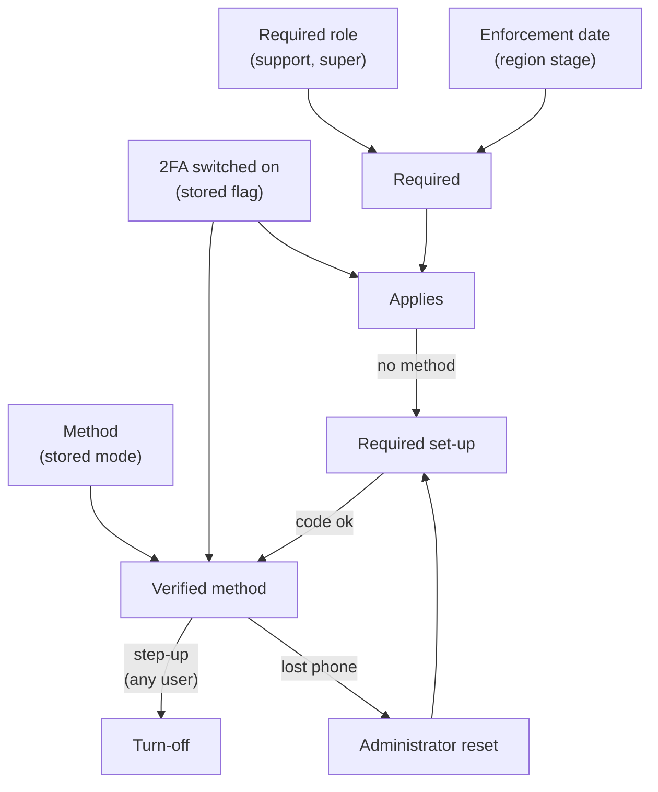

| Concept | What it is, in one line | Example from the walkthrough | Stored in |
|---|---|---|---|
| **Required role** | A role in `REQUIRED_2FA_ROLES` = support, super | Ravi (support), Sam (super) | `roles` / `users_roles` (existing); list in code |
| **Enforcement date** | Per-region date from which required roles must use 2FA | `2026-12-01` (IN and US) | env `REQUIRED_2FA_ENFORCE_FROM` (new) |
| **Region stage** | off (no date) / notice (date in future) / enforced (date reached) | 17 Nov → notice; 1 Dec → enforced | Derived from the env date + clock |
| **Switched on** | The user's stored 2FA flag | Neha: true (voluntary) | `users.two_factor_enabled` (existing) |
| **Method** | authenticator / whatsapp / sms, written only when a code verifies | Anita: authenticator | `users.two_factor_mode` (existing) |
| **Verified method** | Switched on **and** a method stored | Anita | Derived |
| **Required** | Stage is enforced **and** the user holds a required role | Ravi on 2 Dec | Derived |
| **Applies** | Switched on **or** required — every door asks this | Ravi on 2 Dec (flag still false) | Derived |
| **Voluntary 2FA** | Switched on but not required | Neha, Priya | Derived |
| **Required set-up** | The existing choose-a-mode flow, reached because 2FA applies but no method exists | Ravi on 2 Dec | Session `otp_user_id` (existing) |
| **Step-up check** | Password + current code, inside one operation, for any user turning 2FA off | Neha's turn-off | Cache counter (attempts) |
| **Administrator reset** | Existing `TwoFactorReset`: clears the method, keeps 2FA on | Anita resets Ravi | `two_factor_reset_at/_by_id` (existing) |
| **Ending unverified access** | Ops task: `forget_me!` + revoke website-made tokens of required users still unverified | Ravi on 1 Dec | `remember_created_at`, `api_tokens.revoked_at`, Doorkeeper `revoked_at` (existing) |

#### Required roles — one list

- **What:** `RequiredTwoFactor::REQUIRED_2FA_ROLES = %i[support super].freeze` — the only place the rule's roles are named.
- **Why:** the user narrowed M8's suggestion to CapHive staff; adding company admins later must be a one-line change.
- **Not covered:** company admins (fund or investor firms), approvers, employees, investors, advisors.
- **Note:** `has_cached_role?`, never `support?` — `support?` is also true while support impersonates (`user.rb:606-609`).

| User | Roles | Required after the date? |
|---|---|---|
| Ravi | support | Yes |
| Sam | super | Yes |
| Ravi switched into Sahyadri | support + company_admin | Yes (label "Support") |
| Meera | company_admin | No |
| Priya | investor | No |

#### Region stage — off, notice, enforced

- **What:** one date per deployment; the stage is worked out at each request from `Time.zone.today` (`config.time_zone = 'New Delhi'`, `application.rb:117`).
- **Why:** IN and US are independent servers; both get the **same date** (user decision), each set on its own box.
- **Not covered:** per-entity opt-out (security must not be optional per firm).

| Env value | Stage on 20 Nov 2026 | Stage on 1 Dec 2026 |
|---|---|---|
| unset / blank | off | off |
| `2026-12-01` | notice | **enforced** (from 00:00 IST) |
| `2026-11-01` | enforced | enforced |
| `2026-13-01` (unparseable) | **enforced** + error log (fail closed) | enforced |

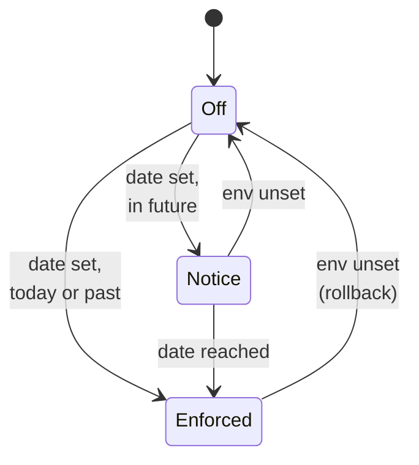

#### Required vs switched on vs applies

- **What:** three different questions; mixing them is how doors drift.
- **Why:** today every door reads `two_factor_enabled?` directly (`two_factor_dispatch.rb:42`, `tokens_controller.rb:20,52`, `mobile_sign_in.rb:43`, `passwords_controller.rb:17`).

| User | Switched on | Method | Required role | Stage | Required | Applies | Verified | Door outcome |
|---|---|---|---|---|---|---|---|---|
| Ravi, 20 Nov | false | — | support | notice | no | no | no | password only + banner |
| Ravi, 2 Dec | false | — | support | enforced | **yes** | **yes** | no | set-up |
| Anita | true | authenticator | support | enforced | yes | yes | yes | code screen |
| Meera | false | — | — (company admin) | enforced | no | no | no | password only (unchanged) |
| Neha | true | authenticator | — (company admin) | enforced | no | yes | yes | code screen (voluntary) |

#### Step-up check (every user)

- **What:** proof of the password and a current code within one request, before 2FA goes off.
- **Why:** a stolen session has neither; today the toggle needs nothing (`_form.html.erb:153-167`, `users_controller.rb:498`). It applies to voluntary 2FA too, so a company admin who opted in is protected even though not required.
- **Not covered:** method change — already step-up with password (`two_factor_reset.rb:64-73`).

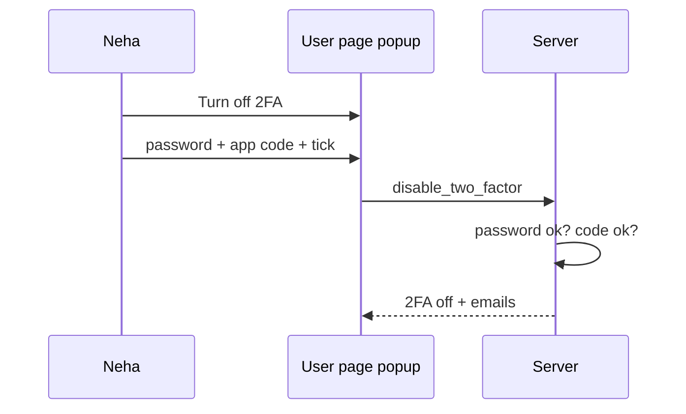

| Trigger | What it does | Example |
|---|---|---|
| Wrong password | Refuses; Devise failed attempt +1 (lock at 6, `devise.rb:191`) | 5 → 6 → locked |
| Wrong code | Refuses; step-up miss +1 (3 per 10 min) and hourly miss +1 (`two_factor_verifier.rb:166-187`) | "2 attempt(s) remaining" |
| No method stored | Password only | Lena toggled on, never enrolled |

### Sign-in paths today (map)

| # | Path | Entry (file:line) | 2FA today | After this change |
|---|---|---|---|---|
| P1 | Web password | `Users::SessionsController#create` `sessions_controller.rb:26-46` → `two_factor_challenge_path_for` `two_factor_dispatch.rb:41-90` | Only if `two_factor_enabled?` (`:42`) | If **applies**; required with no method → set-up |
| P2 | 2FA code / enrol screens | `Users::TwoFactorController` `two_factor_controller.rb:54-66, 81-241`; rules in `TwoFactorVerifier` `two_factor_verifier.rb:61-110` | TOTP, WhatsApp (TOTP code), SMS (Twilio Verify); 3 tries, 10/h lock | Same; confirm also switches the flag on for required users |
| P3 | Magic link | `UsersController#no_password_login` `users_controller.rb:198-272` (dispatch at `:250`) | Same dispatch as P1 | Same as P1 (inherits) |
| P4 | Password reset | `Users::PasswordsController#sign_in_after_reset_password?` `passwords_controller.rb:15-18` | 2FA users not auto-signed-in | Reads **applies** |
| P5 | Password token API | `Users::TokensController#sign_in` `tokens_controller.rb:15-23`; refresh `:50-55` | 403 for 2FA users after correct password | Reads **applies** |
| P6 | Bearer use | `WithAuthentication#authenticate_user!` `with_authentication.rb:35-50` | None at use (token minted after sign-in) | Unchanged |
| P7 | Named API tokens | `Users::ApiTokensController#create` `api_tokens_controller.rb:16-20` | Minted from a web session (passed P1) | Unchanged; ⑧ revokes those of still-unverified required users at the date |
| P8 | LP mobile app | `MobileSignIn.call` `mobile_sign_in.rb:22-57` (investors only `:40`) | Challenge via `TwoFactorVerifier`; no method → `finish_2fa_setup` `:46` | Reads **applies** (1 support user also holds investor) |
| P9 | App → web hand-off | `Users::MobileHandoffsController#show` `mobile_handoffs_controller.rb:14-40` | Trusts the app session | Unchanged |
| P10 | Doorkeeper / MCP OAuth | `doorkeeper.rb:8-16` (`current_user`); `McpController#authenticate_mcp!` `mcp_controller.rb:75-98` | Consent needs a web session (P1) | Unchanged; ⑧ revokes as P7 |
| P11 | Outlook / Gmail add-ins | `outlook_addin_controller.rb:53-58`; `gmail_addin_controller.rb:65-89` | Token minted from a web session | Unchanged; ⑧ revokes as P7 |
| P12 | Cross-region hand-off | `UsersController#cross_site_login` `users_controller.rb:164-196`; app: `mobile_sign_in.rb:117-140` | **None** at destination (trusts origin) | Unchanged (same date both regions; 0 multi-region support users) |
| P13 | Support "Login as" | `UsersController#login_as` `users_controller.rb:284-305`; `UserPolicy#login_as?` `user_policy.rb:116-124` | Target's 2FA skipped by design (`:293-298`) | Actor (support / super) must have a **verified** method once enforced |
| P14 | Admin console | `Admin::ApplicationController#authenticate_admin` `admin/application_controller.rb:20-22`; Doorkeeper admin `doorkeeper.rb:20-27` | Behind P1 (support / super only) | Covered by P1; can no longer switch anyone's 2FA off (`user_dashboard.rb:95`) |
| P15 | Remember-me cookie | Devise rememberable, `remember_for 2.weeks` `devise.rb:147` | Re-auth without P1 | ⑧ `forget_me!` for still-unverified required users |

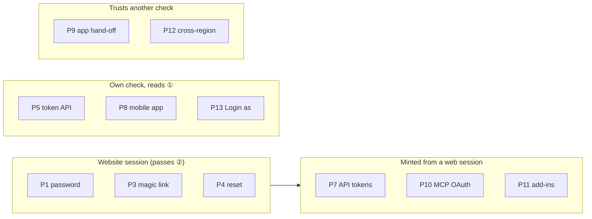

### Production sizing (IN copy)

- Read-only aggregates on the production copy (`mysql-restored` :33066, `IRM_development`; newest user 2026-11-02; 202 users with `primary_region = in`, 3 `US` → the **IN** database). No names or emails were read.

| Role | Active | 2FA on | 2FA off | Off, signed in ≤ 90 d | Signed in ≤ 30 d | With phone | WhatsApp-ready |
|---|---|---|---|---|---|---|---|
| support | 11 | 0 | **11** | 9 | 7 | 5 | 0 |
| super | 1 | 0 | **1** | 1 | 1 | 1 | 0 |
| **Distinct people** | **11** | 0 | **11** | — | — | — | — |

- Arithmetic: 11 + 1 = 12 role memberships; the 1 super user **also holds support** → **11 people** to enrol, 12 of 12 memberships without 2FA.
- 6 support users also hold company_admin (switched mappings, `support_client_mapping.rb:99`); 1 support user also holds investor (LP app, P8).
- Credentials affected: **0** live `devise_api_tokens`, `api_tokens`, `mobile_devices` or Doorkeeper tokens; **0** support/super users with a remember-me cookie in the last 30 days; **0** support users listing more than one region.
- Login as: 123 enabled mappings, 29 allow Login as, held by **2** support users.
- Phones: 6 of the 11 have no phone → **authenticator is the default path**; it is always offered (`two_factor_authenticatable.rb:28-34`).
- **Not required, for reference:** company_admin 153 active, 152 without 2FA. Only **1** active user in IN has 2FA on at all.
- **US not measured** — ⑧'s report must run there before the date.

### Walkthrough: one example, start to finish

**Setup:** IN. CapHive: Ravi (support, 2FA off, no phone), Anita (support, authenticator), Sam (super, 2FA off), Leela (company admin), Kiran (ops). Sahyadri Capital: Meera (company admin, 2FA off), Neha (company admin, voluntary authenticator), Omkar (company admin), Dev (employee, authenticator). Priya Family Office: Priya (investor, WhatsApp), Rahul and Sunita (company admins).

**Legend:** ✔ done · ✘ refused. Box numbers ①–⑧ as in the picture.

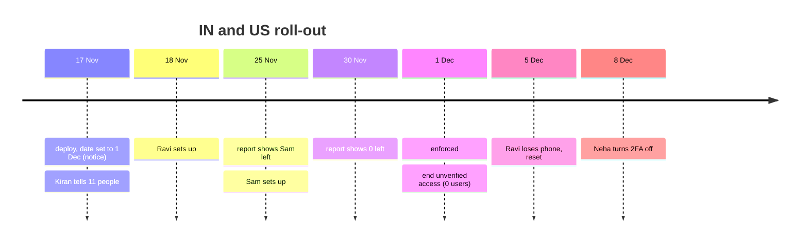

**Phase 1 — before the date**

| # | When | What happens | Behind the scenes | Result |
|---|---|---|---|---|
| 1 | 17 Nov | Deploy; Kiran runs report, sets `2026-12-01` in IN and US, restarts, messages the 11 | ⑧ report → ① stage notice | Stage: **notice**<br/>Banner: shown to 11 people |
| 2 | 18 Nov | Ravi clicks Set up now | ⑤ sets flag on, signs out → ② applies (flag) → ③ | Ravi: signed out ✔<br/>Next: **set-up** |
| 3 | 18 Nov | Ravi picks Authenticator, mistypes once, then right code | ③ "Invalid code. 2 attempt(s) remaining." then confirm | Method: **authenticator** ✔<br/>Email "turned on" ✔ |
| 4 | 25 Nov | Kiran re-runs report | ⑧ | support 0 left<br/>super **1 left** (Sam) → Kiran pings Sam; Sam sets up |
| 5 | 30 Nov | Kiran re-runs report | ⑧ | support 0 / super 0 ✔ |

**Phase 2 — the date**

| # | When | What happens | Behind the scenes | Result |
|---|---|---|---|---|
| 6 | 1 Dec 00:00 | Stage flips | ① enforced | Required: all 11 (all verified) |
| 7 | 1 Dec 09:00 | Kiran runs `end_unverified_access` | ⑧ selects required + unverified | "Would end access for 0 users" — nothing to do |
| 8 | 1 Dec | Meera (company admin, no 2FA) signs in | ② applies? no | Signed in with password (**unchanged**) |

**Phase 3 — later changes**

| # | When | What happens | Behind the scenes | Result |
|---|---|---|---|---|
| 9 | 3 Dec | Kiran gives new hire Isha support | rolify `add_role` | Isha: **required** from next sign-in → set-up |
| 10 | 5 Dec | Ravi loses phone; Anita resets | Existing `TwoFactorReset` → ⑦ Ravi + Leela | Ravi method: **cleared** (2FA stays on)<br/>Emails ✔ |
| 11 | 5 Dec | Ravi signs in | ② → ③ | Set-up with "required for your role (Support)" ✔ |
| 12 | 8 Dec | Neha: Turn off 2FA, wrong code | ⑥ miss 1/3 | ✘ "The code you entered is incorrect. 2 attempt(s) remaining." |
| 13 | 8 Dec | Neha: right code | ⑥ → ⑦ | 2FA: **off** ✔<br/>Emails: Neha, Meera, Omkar ✔ |
| 14 | 8 Dec | Anita tries a direct turn-off POST | ⑥ required | ✘ "Two-factor authentication is required for your role and cannot be turned off." |

**Snapshot — row 11, Ravi at sign-in on 5 Dec:**

```
users row (Ravi)                      ① derived                      ② decides
two_factor_enabled = true             required role = support        applies, no method
two_factor_mode    = NULL (reset)     stage         = enforced       → session[:otp_user_id] = Ravi
two_factor_reset_by_id = Anita        required      = yes            → redirect /two_factor/select_mode
roles: support                        verified      = no
```

**What to notice**

- With 11 internal people, the date itself is a non-event: the report reaches 0 before it (rows 4–7).
- Meera's sign-in never changes (row 8); Neha's voluntary 2FA is still protected by the step-up (rows 12–13).
- The reset (row 10) needed no new code: a cleared method already routes to set-up.

### Key ideas

| # | Idea | In one line | Card |
|---|---|---|---|
| 1 | One role list | `REQUIRED_2FA_ROLES = %i[support super]`; adding a role is one line | [①](#①-who-must-use-2fa) |
| 2 | One question for every door | `two_factor_applies?` replaces four direct flag reads | [②](#②-sign-in-gate), [④](#④-other-doors) |
| 3 | Reuse enrolment | Required users take the existing no-method path | [③](#③-set-up-screens) |
| 4 | Step-up to weaken, for everyone | Turn-off needs password + code; model refuses any other route | [⑥](#⑥-turn-off-check) |
| 5 | Impersonation needs the actor's factor | `login_as?` checks the support user's verified method | [④](#④-other-doors) |
| 6 | Ops measure, then end leftovers | Report until 0; after the date end access of any unverified required user | [⑧](#⑧-ops-roll-out) |

### FAQ — Part 1

| Question | Answer |
|---|---|
| Why not a `two_factor_required` column? | Role grants (`users_controller.rb:375-381`, `support_client_mapping.rb:159`, admin console) would each need to set it, and the cross-region sync would copy it. Deriving from roles has none of that and rolls back by unsetting one env var |
| Why are company admins not required? | User decision (2026-11-09). Their voluntary 2FA is protected by the step-up turn-off |
| Why is super required if it is only 1 user? | User decision (2026-11-09); super is the highest-power role. In IN the super user also holds support, so it changes nothing there |
| Can enforcement lock someone out? | No: set-up runs inside sign-in; authenticator is always offered; lost phones are the existing reset |
| Why fail closed on a bad date? | "Enforced" only means "set up at next sign-in"; "off" silently drops the control |

---

## 2. The same picture with real names

### Picture

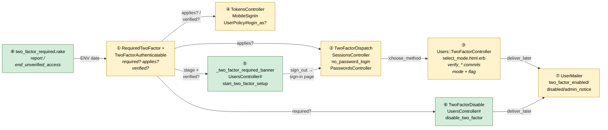

- *① answers three questions for one user; the only place the env date and `REQUIRED_2FA_ROLES` are read.*
- *② decides sign in / code / set-up after a password or link.*
- *③ the existing enrolment; confirming now also switches the flag on.*
- *④ three doors that do their own check, now asking ①.*
- *⑤ the banner and its one action (support / super only).*
- *⑥ the step-up operation and the model guard (every user).*
- *⑦ new UserMailer methods; `TwoFactorReset` gains a company-admin copy.*
- *⑧ rake tasks; the ending task dry-runs unless `EXECUTE=1`.*

### What each box does

| # | Box | Real parts | What it does | When it runs | What it decides | Details |
|---|---|---|---|---|---|---|
| ① | Who must use 2FA | `RequiredTwoFactor` (new), `TwoFactorAuthenticatable` (+4 predicates) | Reads env date + role list | Every door, banner, policy | stage; required / applies / verified | [card ①](#①-who-must-use-2fa) |
| ② | Sign-in gate | `TwoFactorDispatch`, `Users::SessionsController#create`, `UsersController#no_password_login`, `Users::PasswordsController` | Starts a challenge when 2FA applies | Password / link / reset request | sign in vs code vs set-up | [card ②](#②-sign-in-gate) |
| ③ | Set-up screens | `Users::TwoFactorController`, `two_factor/select_mode.html.erb` | Required banner; confirm writes mode (+ flag) | Pre-sign-in | method stored | [card ③](#③-set-up-screens) |
| ④ | Other doors | `Users::TokensController`, `MobileSignIn`, `UserPolicy#login_as?` | Same rule outside the web gate | Token / app / Login as request | refuse vs proceed | [card ④](#④-other-doors) |
| ⑤ | Banner + Set up now | `users/_two_factor_required_banner.html.erb`, `UsersController#start_two_factor_setup`, `UserPolicy#start_two_factor_setup?` | Shows notice / required; signs out to set up | Every page of a support / super user | shown or not | [card ⑤](#⑤-banner-and-set-up-now) |
| ⑥ | Turn-off check | `TwoFactorDisable` (new op), `UsersController#disable_two_factor` / `#send_two_factor_code`, `UserPolicy#disable_two_factor?`, `User#two_factor_disable_must_be_verified`, `users/_disable_two_factor_modal.html.erb` | Step-up then switch off | Any user's request | off vs refused | [card ⑥](#⑥-turn-off-check) |
| ⑦ | Security emails | `UserMailer#two_factor_enabled` / `#two_factor_disabled` / `#two_factor_admin_notice`, `TwoFactorReset#notify_user` | Sends after commit | After ③ ⑥ reset | recipients | [card ⑦](#⑦-security-emails) |
| ⑧ | Ops roll-out | `lib/tasks/two_factor_required.rake` | Report; end unverified access | Ops, by hand | who is counted / ended | [card ⑧](#⑧-ops-roll-out) |

### One run, end to end

Ravi (support, no method) signs in on 2 Dec and enrols.

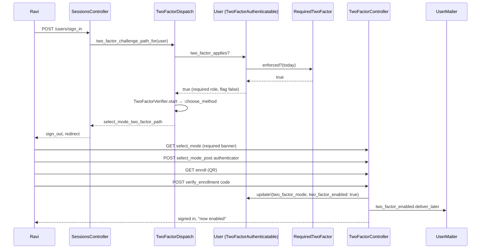

### Lifecycles

**A user's two-factor state** (stored: `two_factor_enabled`, `two_factor_mode`; derived overlay: required).

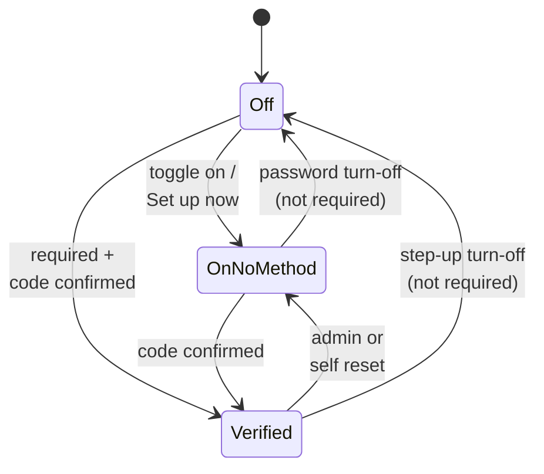

- `Off → Verified` is new: a required user with the flag off confirms a code, and ③ writes both columns.
- `Verified → Off` / `OnNoMethod → Off` are now **only** via ⑥ (or the cross-region sync) — for every user.
- Every transition is audited: `two_factor_mode` already is (`user.rb:18`); `two_factor_enabled` is added ([approval item 3](#key-changes-needing-approval)).

**Region stage** — see [Key concepts › Region stage](#region-stage--off-notice-enforced).

### What users see

| At a glance | Screen | Change | Who |
|---|---|---|---|
| ① | Every page | Amber notice / red required banner + Set up now | Support / super without a method |
| ② | Set Up Two-Factor Authentication | Info banner "required for your role" | Support / super |
| ③ | User page › Two-Factor row | "Required for your role" badge; **Turn off 2FA** | Badge: support / super. Button: anyone else with 2FA on |
| ④ | Turn-off popup | New, copies the reset popup | Anyone with 2FA on, not required |
| ⑤ | Edit profile › 2FA toggle | Read-only "On — turn it off from your user page" when on | Everyone |
| ⑥ | Emails | 2FA on, 2FA off, admin notice | Everyone |

Main journey — Neha (company admin, voluntary 2FA) turns 2FA off:

```
User page (users/show)                                   Turn-off popup
┌──────────────────────────────────────────────────┐     ┌───────────────────────────────────────┐
│ Two-Factor Authentication ⓘ  ✔ [Authenticator]   │     │ Immediate Actions                      │
│     [Change 2FA Method] ① [Turn off 2FA]          │ ──▶ │ ② red / blue / purple / grey cards     │
└──────────────────────────────────────────────────┘     │ ③ Confirm your password [........]     │
                                                         │ ④ Current code [______]                │
                                                         │ ⑤ ☐ I understand …                     │
                                                         │            [Cancel] ⑥ [Turn off 2FA]   │
                                                         └───────────────────────────────────────┘
```

| Step | The user… | They see |
|---|---|---|
| ① | clicks Turn off 2FA | popup opens |
| ② | reads the cards | what stops, emails, what is needed |
| ③ | types password | — |
| ④ | types the app code (WhatsApp / text users press **Send code** first) | "A new code is on its way. It can take a few seconds to arrive." |
| ⑤ | ticks the box | submit enabled |
| ⑥ | submits | user page + "Two-factor authentication is now off. You will sign in with just your password." |

Hand-made HTML mocks of the changed screens: [mocks/screens.html](mocks/screens.html).

**Screen standards**

| Screen | Kind | Copies | Breadcrumbs | Tabs (lazy pills) | Turbo | Stats cards | Filter + search | Actions | Help | Full width |
|---|---|---|---|---|---|---|---|---|---|---|
| Two-Factor row on user page | show row | `users/show.html.erb:111-147` (itself) | unchanged (`Users › name`) | n/a | none (buttons open modals) | n/a | n/a | buttons in the row, beside "Change 2FA Method" | existing ⓘ guide link; badge tooltip names the role | unchanged |
| Turn-off popup | modal | `users/_reset_two_factor_modal.html.erb` (action-summary cards, `action_summary_modal.scss`) | n/a | n/a | `data-turbo=false` form, as reset | n/a | n/a | Cancel / Turn off 2FA footer | cards explain; field help as `small text-muted` like reset | `modal-lg` |
| Notice / required banner | layout banner | `users/_reset_password.html.erb` (rendered `modernize.html.erb:120`, `application.html.erb:81`, `admin/application.html.erb:111`) | n/a | n/a | `button_to` POST | n/a | n/a | Set up now | text is the help | layout width |
| Required banner on set-up | auth screen alert | `two_factor/select_mode.html.erb:17-24` (`#two_factor_reset_banner`) | n/a (devise layout) | n/a | none | n/a | n/a | n/a | alert-info | devise card |
| Edit profile 2FA row | form row | `users/_form.html.erb:153-167` `.toggle-row` | unchanged | n/a | none | n/a | n/a | link to user page | `form-text` as today | FormCard |
| Emails | mailer | `user_mailer/two_factor_reset.html.erb` | n/a | n/a | n/a | n/a | n/a | n/a | n/a | n/a |

### Design decisions

| # | Decision | Why, in one line |
|---|---|---|
| D1 | Required = `REQUIRED_2FA_ROLES` (support, super) + one env date | User decision; one line to change; no column; rollback = unset env |
| D2 | One predicate `two_factor_applies?` for every door | Four direct flag reads drift otherwise |
| D3 | Reuse the no-method enrolment; flag flips on confirm | Abandoned set-up stores nothing; no new screens |
| D4 | Fail closed on an unparseable date | "Required" cannot lock out; "off" silently drops the control |
| D5 | Turn-off is a Trailblazer op + model guard, for every user | Protects voluntary 2FA too; mirrors `TwoFactorReset` and the phone guard |
| D6 | Signed-in code send reuses `TwoFactorVerifier.start`; attempts counted in cache | Same delivery rules as sign-in; no new columns |
| D7 | `login_as?` requires the actor's verified method once enforced | Authorization lives in the policy |
| D8 | No forced sign-out; ops ends unverified access after the date | No disruption; with 11 people the task normally ends 0 |
| D9 | Recovery stays the existing reset, plus a company-admin copy | Already audited, emailed and policy-gated |
| D10 | Security emails via `UserMailer#deliver_later`, not CustomNotification | Precedent `two_factor_reset`; must not be switchable per firm |
| D11 | Cross-region hand-off unchanged; same date in both regions | Spec `identity/cross-region-login` trusts the origin; 0 multi-region support users |
| D12 | Admins cannot switch another user's 2FA off | Reset covers recovery; switching off is the attack |
| D13 | No reminder emails | 11 internal people are told directly; the banner reminds |

#### D1. Required roles: one list, derived at sign-in

- **Problem:** "Ravi must use 2FA from 1 Dec" must survive role grants, removals and the cross-region sync, which copies `two_factor_enabled` (`users_sync_controller.rb:180`; excluded attrs `:6-15` do not exclude it).
- **Decision:** `RequiredTwoFactor::REQUIRED_2FA_ROLES = %i[support super].freeze`; `User#two_factor_required?` = `RequiredTwoFactor.enforced?` && `REQUIRED_2FA_ROLES.any? { has_cached_role?(_1) }`.
- **Why:**
  - User decision (2026-11-09): support and super only; company admins not required.
  - Adding company admins later = append `:company_admin` to the list (and re-run the report first).
  - Role grants (`support_client_mapping.rb:159`, admin console) take effect with no callback; unsetting the env restores today.
- **Not chosen:** a stored per-user flag set by a rolify callback; an entity setting.
- **Where:** `RequiredTwoFactor`, `TwoFactorAuthenticatable`.

#### D2. One predicate for every door

- **Problem:** four doors read `two_factor_enabled?` directly; adding "or required" to some but not all is the bypass M8 describes.
- **Decision:** `two_factor_applies?` (= enabled || required) replaces the reads at `two_factor_dispatch.rb:42`, `tokens_controller.rb:20,52`, `mobile_sign_in.rb:43`, `passwords_controller.rb:17`; `need_two_factor_authentication?` (`two_factor_authenticatable.rb:173-175`) returns it too.
- **Why:** one grep-able name.
- **Not chosen:** writing the flag at dispatch — stores a row for an abandoned attempt and survives rollback.
- **Where:** card ②, card ④.

#### D3. Reuse enrolment; the flag flips on confirm

- **Problem:** enrolment assumes the flag is already true (`two_factor_controller.rb:138-141`).
- **Decision:** `verify_enrollment` / `verify_whatsapp_enrollment` / `verify_sms_enrollment` (`:142`, `:187`, `:230`) share `commit_method!(mode)`, which also writes `two_factor_enabled: true` **only when** it is false and `two_factor_required?`.
- **Why:** no new screen; abandoned set-up writes nothing; an admin's mid-enrolment change for a non-required user is still respected.
- **Not chosen:** a separate "required enrolment" controller.
- **Where:** card ③.

#### D4. Fail closed on a bad date

- **Problem:** a typo in the env (`2026-13-01`) must not silently disable the control.
- **Decision:** unparseable → stage enforced + `Rails.logger.error` once per process.
- **Why:** enforced cannot lock anyone out (D3).
- **Not chosen:** refusing to boot — a typo becomes an outage.
- **Where:** `RequiredTwoFactor.stage`.

#### D5. Turn-off as an operation with a model guard — every user

- **Problem:** `two_factor_enabled` is a permitted param (`users_controller.rb:498`) on an action any self or company admin may call (`user_policy.rb:40-43`), and on the admin console form (`user_dashboard.rb:95`). A stolen session can remove anyone's 2FA, including a company admin's voluntary 2FA.
- **Decision:**
  - `TwoFactorDisable` Trailblazer op: `ensure_disableable` → `verify_password` → `ensure_code_attempts_left` → `verify_code` → `switch_off` → `notify`.
  - `validate :two_factor_disable_must_be_verified, on: :update` refuses true→false unless `@two_factor_disable_verified` (set only by `User#disable_two_factor_verified!`) or `@skip_two_factor_disable_verification` (set only by `skip_two_factor_disable_verification!`, called by `UsersSyncController` beside `skip_phone_change_verification!` at `:189`).
  - Applies to **every** user; only the "required → refuse" step depends on the role list.
  - `two_factor_enabled` stays permitted so turning **on** from the form keeps working.
- **Why:** identical shape to the phone guard (`user.rb:254-264, 413-441`).
- **Not chosen:** removing the param (breaks turning on); a controller param guard.
- **Where:** card ⑥.

#### D6. Code send for a signed-in user

- **Problem:** `send_sms` / `send_whatsapp` require a pre-sign-in session (`two_factor_controller.rb:319-331`).
- **Decision:** `POST /users/:id/send_two_factor_code` calls `TwoFactorVerifier.start(user)`; the code is checked with `TwoFactorVerifier.verify(user, code)`, which already detects an outstanding SMS from `OtpDelivery` (`two_factor_verifier.rb:122-128`). Step-up misses: cache key `two_factor_disable:<user_id>`, 3 per 10 min, plus `record_user_miss`.
- **Why:** same send, verify and hourly lock as sign-in and the mobile app.
- **Not chosen:** reusing `TwoFactorController` actions — they redirect a signed-in user (`:323-326`).
- **Where:** card ⑥.

#### D7. Impersonation checks the actor

- **Problem:** `login_as` skips the target's 2FA (`users_controller.rb:293-298`); a support session started before the date may be password-only.
- **Decision:** `UserPolicy#login_as?` adds `RequiredTwoFactor.enforced? ? user.two_factor_verified? : true`. `login_as?` already admits only support / super (`user_policy.rb:117`), both required roles.
- **Why:** closes sessions that began before the date; after it every new support / super session passed 2FA anyway.
- **Not chosen:** a fresh code on every Login as.
- **Where:** card ④.

#### D8. Existing sessions — no forced sign-out

- **Problem:** a support user signed in before the date never passes ②; the session slides (`expire_after: 60.minutes`, `session_store.rb:5`), remember-me lasts 2 weeks (`devise.rb:147`), and website-made tokens last 30–90 days.
- **Decision:** no sign-out; red banner + Login as refused (D7); after the date ⑧ `end_unverified_access` (dry run unless `EXECUTE=1`) calls `forget_me!` (with `expire_all_remember_me_on_sign_out = true`, `devise.rb:150`) and revokes live `ApiToken` rows (`api_token.rb:53`) and Doorkeeper tokens of required users without a verified method.
- **Why:** the user ruled out forced sign-out; with 11 people enrolled during the notice period the task normally ends 0 users (0 cookies or tokens today).
- **Not chosen:** a `before_action` that signs out unverified required users — a controller-level rule. Revisit with L8.
- **Where:** card ⑤, card ⑧.

#### D9. Recovery stays the reset

- **Problem:** "phone lost" must not mean "locked out" for required users.
- **Decision:** existing `TwoFactorReset` + `UserPolicy#reset_two_factor?` (`user_policy.rb:102-106`): self, a company admin of the same firm, or support. Adds `two_factor_admin_notice` to the firm's other company admins when the actor is not the user.
- **Why:** already audited (`two_factor_reset.rb:82-96`) and emailed (`:100-111`); a cleared method routes to set-up. CapHive has company admins (e.g. Leela) and 11 support users, so a support user always has someone to reset them.
- **Not chosen:** backup codes — removed earlier by design (`two_factor_controller.rb:51-53`).
- **Where:** card ⑦.

#### D10. Security emails through UserMailer

- **Problem:** emails about a user's own credential must always go out and must not be editable per firm.
- **Decision:** new `UserMailer` methods, `deliver_later` after commit, like `two_factor_reset` (`user_mailer.rb:63-70`).
- **Why:** `ApplicationMailer#setup_defaults` resolves from/to and sandbox; `EmailDateLocalization` formats dates.
- **Not chosen:** Noticed / CustomNotification.
- **Where:** card ⑦.

#### D11. Cross-region hand-off unchanged; same date in both regions

- **Problem:** `cross_site_login` signs in without a destination 2FA check (`users_controller.rb:164-196`); the authenticator secret is not synced (`user_sync_envelope_builder.rb:19`).
- **Decision:** no change; IN and US use the same enforcement date (user decision).
- **Why:** the hand-off spec trusts the origin; 0 support users list more than one region.
- **Not chosen:** re-challenging at the destination (no secret there).
- **Where:** [Risks](#risks-and-open-questions).

#### D12. Admins cannot switch another user's 2FA off

- **Problem:** today a company admin or support can submit `two_factor_enabled=0` for another user (`user_policy.rb:40-43` + `users_controller.rb:498`; admin console `user_dashboard.rb:95`).
- **Decision:** `disable_two_factor?` is self only and not while impersonating; the model guard refuses every other route.
- **Why:** the reset covers every legitimate admin need and keeps 2FA on.
- **Not chosen:** admin turn-off with a reason — the social-engineering path the reset popup already warns about (`_reset_two_factor_modal.html.erb:114-123`).
- **Where:** card ⑥.

#### D13. No reminder emails

- **Problem:** a reminder email + task was designed for 157 people across 57 firms.
- **Decision:** dropped. Ops messages the 11 CapHive staff directly; the in-app banner is the reminder; the report is re-run until it shows 0.
- **Why:** YAGNI for 11 internal people.
- **Not chosen:** `UserMailer#privileged_two_factor_reminder` + `remind` task.
- **Where:** card ⑧.

### Key changes needing approval

Every change to an existing model, column, policy or shared behaviour. **No migrations, no new columns.**

| # | Existing thing | Change | Why |
|---|---|---|---|
| 1 | `User` / `TwoFactorAuthenticatable` (`two_factor_authenticatable.rb`) | + `two_factor_required_role?`, `two_factor_required?`, `two_factor_applies?`, `two_factor_verified?`; `need_two_factor_authentication?` returns `two_factor_applies?` | D1, D2 |
| 2 | `User` validation (`user.rb` near `:263`) | + `two_factor_disable_must_be_verified` (on update, true→false, every user) with escapes `disable_two_factor_verified!`, `skip_two_factor_disable_verification!` | D5 — refuses the form, JSON, admin console |
| 3 | `User` audit fields (`user.rb:18`) | + `two_factor_enabled` | Off/on recorded with before→after. Overlaps M11 (`security-event-trail`); whichever lands first adds it |
| 4 | `users.two_factor_enabled` column | Meaning unchanged; now also written `true` by ③ for required users | D3 |
| 5 | `Users::TwoFactorController#verify_*` (`:142, :187, :230`) | `commit_method!`: flag for required users; enqueue "turned on" email | D3, ⑦ |
| 6 | `UserPolicy` | + `disable_two_factor?` (self), `start_two_factor_setup?` (self, required role); `login_as?` + actor-verified condition | D7, D12 |
| 7 | `TwoFactorDispatch` `:42`, `TokensController` `:20,52`, `MobileSignIn` `:43`, `PasswordsController` `:17` | `two_factor_enabled?` → `two_factor_applies?` | D2 |
| 8 | `TwoFactorReset#notify_user` (`:100-111`) | + company-admin notice when actor ≠ user | D9 |
| 9 | `UsersController` | + `disable_two_factor`, `send_two_factor_code`, `start_two_factor_setup`; `user_params` unchanged | ⑤ ⑥ |
| 10 | `users/_form.html.erb:153-167` | Toggle shown only while 2FA is off and not required | D5 |
| 11 | `users/show.html.erb:111-147, 266-273` | Badge + Turn off 2FA / Set up now buttons; render the new modal | ⑤ ⑥ |
| 12 | Layouts `modernize`, `application`, `admin/application` | Render the banner beside `_reset_password` (support / super use all three) | ⑤ |
| 13 | `UsersSyncController#build_user` (`:189`) | Also call `skip_two_factor_disable_verification!` | D5 |
| 14 | `config/initializers/rack_attack.rb` | Throttle the two new step-up POSTs | Security |
| 15 | Admin console (`UserDashboard`) | **No code change**; switching 2FA off there now shows the guard's error | D12 |
| 16 | `.env.production.in` / `.us` | New `REQUIRED_2FA_ENFORCE_FROM` (same date, set separately) | D1 |

- **Dropped with the narrower scope:** `UserMailer#privileged_two_factor_reminder` and the `remind` rake task (D13); the investor-side company-admin question; the GP/LP firm communications.
- **Narrowed, still needed:** item 6 (`start_two_factor_setup?` now support / super only), item 12 (banner only renders for support / super), item 7's mobile change (1 support user holds investor).

### Flows that change for users (none may break)

| Flow | Who | Before | After | How it stays usable |
|---|---|---|---|---|
| Web sign-in | Support / super, no 2FA, after date | Password only | Set-up first (once) | In-flow; authenticator always offered; ops gets the report to 0 before the date |
| Magic-link sign-in | Same | Link only | Set-up first | Shared dispatch; return-to page kept |
| Password reset | Same | Auto signed in | Sign-in page, then set-up | Devise's own `updated_not_active` message |
| Password token API | Same | Token | 403 `two_factor_required` | 0 tokens today; use Profile › API tokens after set-up |
| LP mobile app | Support + investor, no method | Session | `finish_2fa_setup` | Set up once on the website; 1 person |
| Login as | Support without method, after date | Allowed | Refused with message | Enrol (1 minute) |
| Turn 2FA off | **Every user** with 2FA on | Untick + save | Popup: password + code | Same page; Send code for WhatsApp / SMS |
| Turn 2FA on | Every user | Toggle | Toggle (unchanged) | — |
| Admin switches someone's 2FA off | Company admin / support / super | Possible | Refused | Reset 2FA Method (existing) |
| Lost phone | Anyone | Reset | Reset (+ firm admins emailed) | Unchanged path |
| Company admin / employee / investor sign-in | Everyone else | — | **Unchanged** | Rule does not apply |
| Cross-region switch, API tokens, MCP, add-ins, app hand-off | Anyone verified | — | Unchanged | Minted from a session that passed ② |

### FAQ — Part 2

| Question | Answer |
|---|---|
| Why not put the check in `ApplicationController`? | Authorization rules live in policies and the sign-in gate; a global `before_action` would also hit JSON, Turbo frames and the add-ins (D8) |
| Does `two_factor_applies?` add queries? | No: `has_cached_role?` reads the user's roles once per request; the env date is memoised per process |
| What if a role is removed mid-enrolment? | Required is re-read at confirm; the flag is written only if still required (D3) |
| Why keep `two_factor_enabled` permitted at all? | Turning on is safe and is today's documented path (user guide "Where to find it") |
| How would company admins be added later? | Append `:company_admin` to `REQUIRED_2FA_ROLES`, run the report, give notice; ~157 people, so restore reminders (D13) |

---

## 3. One card per box

### ① Who must use 2FA

- **What:** a tiny module that turns `ENV["REQUIRED_2FA_ENFORCE_FROM"]` into a stage and holds the role list, plus four predicates on the user.

| Owns | Reads / receives | Produces |
|---|---|---|
| Env parsing, `REQUIRED_2FA_ROLES`, stage | env, `Time.zone.today`, user's roles, `two_factor_enabled`, `two_factor_mode` | `:off` / `:notice` / `:enforced`; required / applies / verified; `enforce_from` for the banner |

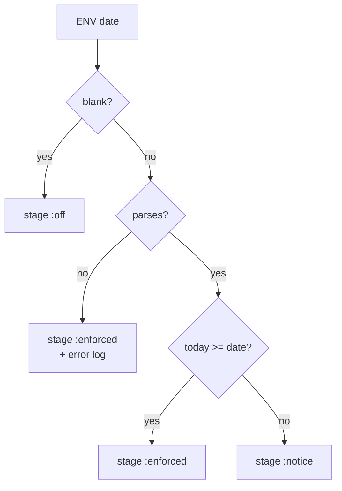

| Predicate | Definition |
|---|---|
| `two_factor_required_role?` | holds any of `REQUIRED_2FA_ROLES` (`has_cached_role?`) — banner, report; ignores stage |
| `two_factor_required?` | stage enforced && `two_factor_required_role?` |
| `two_factor_applies?` | `two_factor_enabled? \|\| two_factor_required?` |
| `two_factor_verified?` | `two_factor_enabled? && two_factor_mode.present?` |

**Worked examples:** H1, E1–E8, E12 — [business-rules §1](business-rules.md#1-who-must-use-2fa-and-the-sign-in-gate--phase-1).

**FAQ**

| Question | Answer |
|---|---|
| Why `has_cached_role?` and not `support?` | `support?` is also true while support impersonates a client (`user.rb:606-609`) |
| A support user switched into a client? | Holds support + company_admin; required, labelled "Support" |
| Is the date in UTC? | No — app time zone (`New Delhi`); 1 Dec 00:00 IST |

### ② Sign-in gate

- **What:** the existing dispatch, now asking `two_factor_applies?`.

| Owns | Reads / receives | Produces |
|---|---|---|
| The decision after password / link | user, ① | redirect to set-up, code screen, or sign-in |

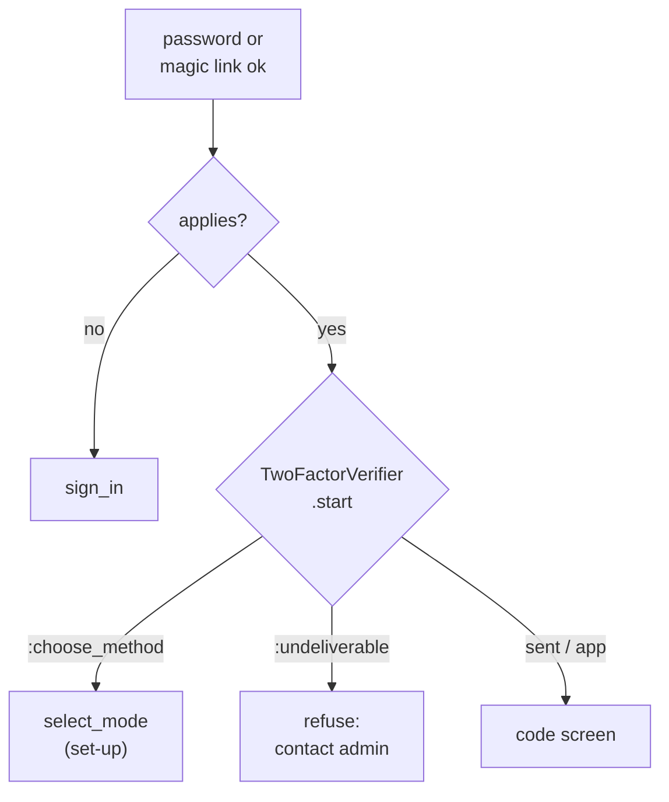

- Password reset: `sign_in_after_reset_password?` → `super && !two_factor_applies?`.
- Magic link: `session[:user_return_to]` is kept for the set-up path exactly as for the code path (`users_controller.rb:255-260`).

**Worked examples:** H1–H3, E9–E17, X1 — [business-rules §1](business-rules.md#1-who-must-use-2fa-and-the-sign-in-gate--phase-1).

**FAQ**

| Question | Answer |
|---|---|
| A required user in WhatsApp mode with no number? | Same as today: `:undeliverable` → "contact your administrator" → reset → authenticator |
| Does a company admin's sign-in change? | No — `applies?` is their own flag, as today |

### ③ Set-up screens

| Owns | Reads / receives | Produces |
|---|---|---|
| Choose / enrol / confirm | `session[:otp_user_id]`, ① | `two_factor_mode` (+ `two_factor_enabled` when required), "turned on" email |

- `select_mode.html.erb`: `alert alert-info` "Two-factor authentication is required for your role (Support). Choose a method to finish signing in." when `@user.two_factor_required?`, beside the existing reset banner (`:17-24`). Label from `RequiredTwoFactor.role_label` (support before super).
- `verify_*`: one private `commit_method!(mode)` replaces the three `update!` calls.

**Worked examples:** H2, E10, E11, E17, X1, X2 — [business-rules §1](business-rules.md#1-who-must-use-2fa-and-the-sign-in-gate--phase-1).

**FAQ**

| Question | Answer |
|---|---|
| Does `require_no_verified_method` still work? | Yes — it reads `two_factor_mode` only (`:341-346`) |
| Does the "turned on" email go to voluntary enrolments too? | Yes — every confirmed method (H2 and any user) |

### ④ Other doors

| Owns | Reads / receives | Produces |
|---|---|---|
| Token endpoint, app sign-in, Login as | ① | 403 / `finish_2fa_setup` / policy refusal |

| Door | Change | Message |
|---|---|---|
| `TokensController#sign_in` / `refuse_unbound_two_factor_refresh` | `two_factor_applies?` | existing `two_factor_required` |
| `MobileSignIn.call` | `return session_for(...) unless user.two_factor_applies?` | existing `finish_2fa_setup` |
| `UserPolicy#login_as?` | `&& (!RequiredTwoFactor.enforced? \|\| user.two_factor_verified?)` | "Set up two-factor authentication before using Login as." |

Role → access (Login as):

| Actor | Mapping allows | Actor verified | Stage | Result |
|---|---|---|---|---|
| support / super | yes | yes | any | allowed |
| support / super | yes | no | off / notice | allowed (unchanged) |
| support / super | yes | no | enforced | **refused** |
| company_admin / others | — | — | any | refused (unchanged) |

**Worked examples:** H6, E18–E20, E26, X3–X7 — [business-rules §1–2](business-rules.md#2-banner-set-up-now-login-as-and-roll-out--phase-2).

**FAQ**

| Question | Answer |
|---|---|
| Why not ask for a code at the token endpoint? | No state between two requests there (`token_sign_in_two_factor_review.md`) |
| Support user who is also an LP in the app? | After web set-up, normal app challenge (E18) |

### ⑤ Banner and Set up now

| Owns | Reads / receives | Produces |
|---|---|---|
| Banner partial; `start_two_factor_setup` | current_user, ① stage + `enforce_from` | Banner HTML; flag on + sign out |

- Shown when: signed in, `two_factor_required_role?`, not `two_factor_verified?`, stage ≠ off, `current_user.support_user_id.blank?`. Never for company admins or other roles.
- `POST /users/:id/start_two_factor_setup` → `authorize @user, :start_two_factor_setup?` (self, not impersonating, required role, not verified) → `update!(two_factor_enabled: true)` if off → `sign_out` → "Sign in again to set up two-factor authentication."
- Also offered in the user-page row for those users.

**Worked examples:** H4, H5, E21–E25, X8–X10 — [business-rules §2](business-rules.md#2-banner-set-up-now-login-as-and-roll-out--phase-2).

**FAQ**

| Question | Answer |
|---|---|
| Why sign out instead of opening set-up directly? | Enrolment must follow a fresh password; a stolen session must not enrol the attacker's app |
| How does a company admin switch 2FA on? | The existing Edit profile toggle (unchanged) |

### ⑥ Turn-off check

| Owns | Reads / receives | Produces |
|---|---|---|
| Step-up op, two actions, popup, guard | password, code, ① required | flag off (method forgotten by `clear_two_factor_method_when_disabled`, `:63-67`), audit row, ⑦ |

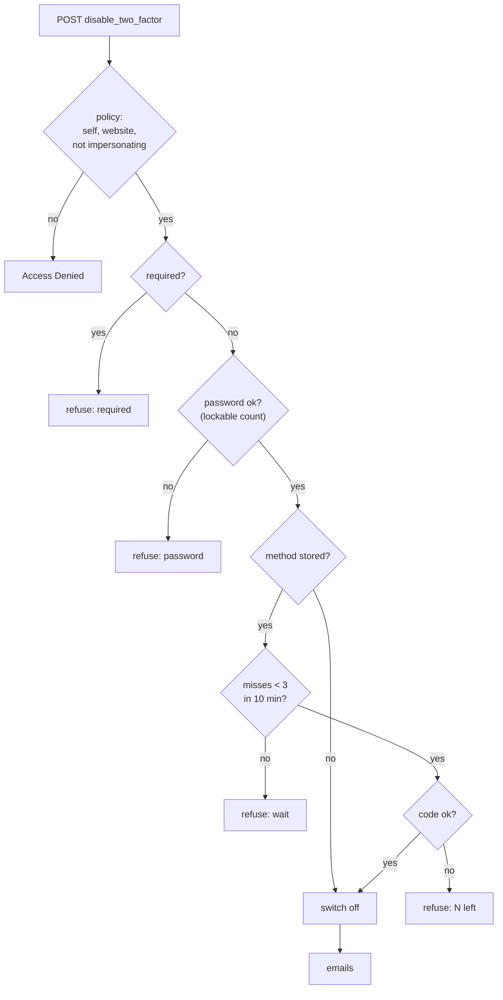

| Component | Responsibility | Transaction / idempotency |
|---|---|---|
| `UserPolicy#disable_two_factor?` | `user.id == record.id && user.support_user_id.blank? && record.two_factor_enabled?` | — |
| `UsersController#disable_two_factor` | refuse bearer tokens (as `api_tokens_controller.rb:38-44`), authorize, call op, redirect with flash | — |
| `UsersController#send_two_factor_code` | authorize same query; `TwoFactorVerifier.start`; JSON message | server-side cooldown cache key |
| `TwoFactorDisable` | steps in the diagram | single `update!`; a re-submit after success fails `ensure_disableable` |
| `User` guard | refuses true→false without an escape, for every user | per-save flag, reset in `ensure` like `apply_verified_phone_change!` |

**Worked examples:** H9, H10, E30–E38, E42, X11–X25 — [business-rules §3](business-rules.md#3-turning-two-factor-off-recovery-and-emails--phase-3).

**FAQ**

| Question | Answer |
|---|---|
| Why does this apply to users who are not required? | A stolen session must not silently remove anyone's 2FA — e.g. a company admin's voluntary 2FA (X25) |
| Why count wrong passwords toward the lock? | Otherwise the popup is an unlimited password oracle; `valid_for_authentication?` as `mobile_sign_in.rb:34` |
| Why refuse bearer tokens? | Turn-off is a website security action; API tokens cannot even list tokens (`api_tokens_controller.rb:5`) |

### ⑦ Security emails

| Owns | Reads / receives | Produces |
|---|---|---|
| Three new mailer methods; reset copy | user, actor, method, firm's company admins | Emails via `deliver_later` |

- Company-admin recipients: `User.company_admins.active.where(entity_id: user.entity_id).where.not(id: [user.id, actor.id])` — one query, same firm only.
- See [Notifications](#notifications).

**Worked examples:** H2, H9–H11, E39–E41 — [business-rules §3](business-rules.md#3-turning-two-factor-off-recovery-and-emails--phase-3).

**FAQ**

| Question | Answer |
|---|---|
| Who hears about a support user's reset? | The support user and CapHive's other company admins (e.g. Leela) |
| Fund GPs told about an LP's turn-off? | No — the LP is not their user |

### ⑧ Ops roll-out

| Owns | Reads / receives | Produces |
|---|---|---|
| `two_factor_required:report`, `two_factor_required:end_unverified_access` | DB (aggregates), env | Counts; cleared `remember_created_at`; revoked tokens |

- Both print the region (`SiteRegistry.current_code`), stage and date first. `report` is read-only; `end_unverified_access` changes nothing without `EXECUTE=1` and refuses before the date.
- `report` prints per required role: active / with / without / without signed in ≤ 90 d; distinct people; a "not required" line per other privileged role (counts only).
- Run order (IN and US, same date): report → set env (+14 days) + restart → tell the 11 people → report every few days until 0 → on the date `end_unverified_access` (dry, then `EXECUTE=1`) → report.

**Worked examples:** H7, H8, E27–E29 — [business-rules §2](business-rules.md#2-banner-set-up-now-login-as-and-roll-out--phase-2).

**FAQ**

| Question | Answer |
|---|---|
| Why no reminder email? | D13 — 11 internal people |
| Why keep `end_unverified_access` if it ends 0 users today? | It is the only thing that closes a 2-week remember-me cookie or a 90-day token of someone who missed the deadline, without a forced sign-out |

---

## 4. Reference

### Class diagram

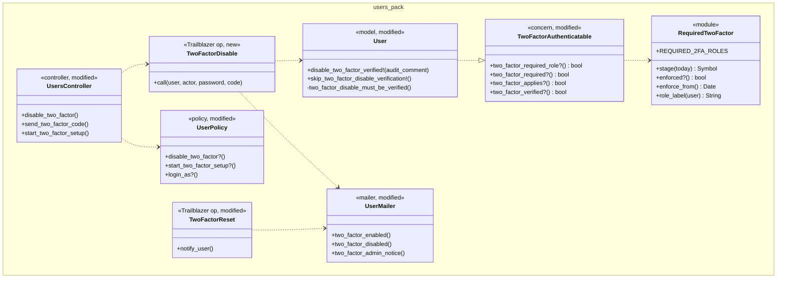

### Data model and schema changes

N/A — no table or column is added or changed. Existing columns reused: `users.two_factor_enabled`, `two_factor_mode`, `otp_secret`, `consumed_timestep`, `two_factor_reset_at`, `two_factor_reset_by_id` (`schema.rb:5342-5348`), `remember_created_at`, `failed_attempts`; `api_tokens.revoked_at`; Doorkeeper `oauth_access_tokens.revoked_at`. Model-level changes: [Key changes needing approval](#key-changes-needing-approval).

### Component contracts

| From → To | Contract | Direction rule |
|---|---|---|
| ⑧ → ① | `ENV["REQUIRED_2FA_ENFORCE_FROM"]` ISO date | ops writes; app reads |
| ① → ② | `user.two_factor_applies?` → bool | ② never reads the env or roles itself |
| ① → ④ | `two_factor_applies?`, `two_factor_verified?`, `RequiredTwoFactor.enforced?` | same |
| ① → ⑤ | `stage`, `enforce_from`, `two_factor_required_role?`, `two_factor_verified?` | read-only |
| ① → ⑥ | `two_factor_required?` | read-only |
| ⑤ → ② | `sign_out` + redirect to `new_user_session_path` | no session state carried |
| ② → ③ | `session[:otp_user_id]`, `:otp_challenge_id` (existing) | unchanged keys |
| ③ → ⑦ | `UserMailer.with(entity_id:, user_id:, mode:).two_factor_enabled.deliver_later` | after the `update!` returns |
| ⑥ → ⑦ | `.two_factor_disabled` + `.two_factor_admin_notice(event: "disabled")` | after commit |

### Notifications

| Notification | Trigger | Recipients | Channel | Customisable | Default | Sent once? |
|---|---|---|---|---|---|---|
| "Two-factor authentication was turned on for your account" | ③ method confirmed | The user (any role) | Email | No | On | Once per confirming request; a second confirm is refused (`require_no_verified_method`) |
| "Two-factor authentication was turned off for your account" | ⑥ success | The user (any role) | Email | No | On | Once per successful op; a re-submit fails `ensure_disableable` |
| "Two-factor was turned off for <name>" | ⑥ success | Other active company admins of the user's firm | Email | No | On | Same |
| "Two-factor method reset for <name>" | Existing reset, actor ≠ user | Other active company admins of the user's firm (not the actor) | Email | No | On | Once per reset |
| Existing "Your two-factor authentication method was reset" | Existing reset | The user | Email | No | On | Unchanged |
| Notice / required banner | ⑤ | Support / super user without a method | In-app | No | On while stage ≠ off | Every page until verified |

- **Investors:** on/off emails for their own account only; their GP is not told.
- **Internal (CapHive):** support / super users get the banner; CapHive's company admins get turn-off and reset copies about CapHive users. No reminder emails (D13).
- No WhatsApp messages; sign-in codes themselves are unchanged.

### Cross-cutting concerns

#### Transactions and queries

- `TwoFactorDisable#switch_off`: one `update!` on the primary, mails enqueued after it returns.
- ③ `commit_method!`: one `update!`, as today.
- ⑧ `end_unverified_access`: ids in one query, then `find_each`, each user its own writes; re-runnable.

#### Exception handling and monitoring

- `RequiredTwoFactor` logs `[two_factor] REQUIRED_2FA_ENFORCE_FROM unparseable — enforcing` once per process.
- `TwoFactorDisable` refusals log `[TwoFactorDisable] refused user_id=… reason=…` (no codes, no passwords).
- Security-event recording is M11's (`security-event-trail`).

#### Architecture and design patterns

| # | Pattern | How this design applies it | Existing example reused | Where |
|---|---|---|---|---|
| 1 | Pack boundaries | Everything in `app/packs/core/users`; layouts render a partial from that pack | `users/_reset_password` | ①–⑦ |
| 2 | Thin controllers, skinny models | Controller authorizes + calls op; op holds steps; model holds predicates + guard | `TwoFactorReset`, `UsersController#reset_two_factor` | ⑥ |
| 3 | Single responsibility | ① answers; ② routes; ⑥ switches off | `TwoFactorVerifier` | all |
| 4 | Reuse before you add | `TwoFactorVerifier.start/verify/record_user_miss`, `TwoFactorReset`, reset modal, action-summary SCSS, `Trackable`, phone-guard shape, `ApiToken#revoke!` | listed | ③ ⑥ ⑦ ⑧ |
| 5 | Configuration as data | Not used — env per region + code constant on purpose (security must not be per-firm) | — | ① |
| 6 | Explicit state machines | [User 2FA lifecycle](#lifecycles); transitions guarded in model + op; audited | `TwoFactorReset` | ⑥ |
| 7 | Append-only audit | `audited` rows for `two_factor_enabled` / `two_factor_mode` | `Trackable` (`user.rb:18`) | ⑥ ③ |
| 8 | Background work | Emails `deliver_later`; codes via existing jobs; rake for ops | `SendOtpToSmsJob`, `SendOtpToWhatsappJob` | ⑦ ⑧ |
| 9 | Notifications | `UserMailer` (security precedent), one recipient query | `UserMailer#two_factor_reset` | ⑦ |
| 10 | UI | Stimulus `reset-two-factor` extended with an optional code target; no new CSS | `reset_two_factor_controller.js` | ⑥ |
| 11 | Queries and data | Report aggregates in SQL; no per-row queries | — | ⑧ |
| 12 | AI | Not needed — no AI | — | — |
| 13 | Rollout | Env date; stage off → notice → enforced; each phase shippable | `FORMULA_SANDBOX`-style env flags | ① ⑧ |
| 14 | YAGNI / DRY | One role list; one predicate; one `commit_method!`; no reminders (D13); no columns | — | ① ③ ⑧ |

#### Performance

| Page / frame / job | Rows shown or processed | Queries (budget, independent of rows) | Preloads / grouped queries | Per-row lookups avoided |
|---|---|---|---|---|
| Any page (banner check) | 1 user | +0 (roles cached per request) | env memoised | — |
| Sign-in (② ③) | 1 user | +0 vs today | — | — |
| User page 2FA row | 1 user | +0 | — | — |
| Turn-off POST | 1 user | ≤ 6 | — | — |
| Admin-notice recipients | ≤ ~10 admins | 1 | `company_admins.where(entity_id:)` | no per-admin role query |
| `report` | ~3,500 users | 3 grouped SQL | `GROUP BY roles.name` | no Ruby iteration |
| `end_unverified_access` | ≤ 15 users | 1 id query + ≤ 3 writes / user | `find_each` | role check in SQL |

- Each phase gate runs its features with `PROSOPITE=1`.

#### Security

| # | Item | How this design meets it | Where | Test |
|---|---|---|---|---|
| 1 | Authorization | New actions `authorize`: `disable_two_factor?`, `start_two_factor_setup?`; `login_as?` gains the actor rule; no new `verify_authorized` exclusion | ④ ⑤ ⑥ `UserPolicy` | X6–X10, X16, X17, X22, X24 |
| 2 | Tenant isolation | Self-only actions; admin-notice recipients filtered by the user's own `entity_id` | ⑥ ⑦ | X17, E40 |
| 3 | Mass assignment | `two_factor_enabled` still permitted; model refuses true→false; escapes are methods | ⑥ guard | X18–X20, X25 |
| 4 | No code from data | Role labels from a constant; no `send`/`constantize` | ③ ⑤ | — |
| 5 | Injection | No SQL interpolation; names in emails escaped by ERB | ⑦ | — |
| 6 | Background jobs | Mailers take ids and reload; no access decision in jobs | ⑦ | H9 |
| 7 | Files | N/A — no uploads | — | — |
| 8 | AI | N/A — no AI | — | — |
| 9 | Tokens, links | Bearer tokens refused on the new actions; unverified required users' tokens revoked by ⑧ | ⑥ ⑧ | X21, X23, H8 |
| 10 | Rate limiting | Rack::Attack per IP + per user on the two step-up POSTs; 3 misses / 10 min; hourly 10 (`two_factor_verifier.rb:32`); Devise lock at 6 | ⑥ | X13, X14, E37 |
| 11 | Audit and logging | `two_factor_enabled` audited; `audit_comment` on turn-off; `otp`/`passw` already filtered | ⑥ | H9 |
| 12 | Verification | `features/security/two_factor_required_roles.feature` (direct requests, other firm, impersonation, bearer, stolen session); Brakeman + bundler-audit clean | all | X3–X10, X15–X25 |

### Worked examples

The H/E/X tables pass 30 rows and span four feature files, so they live in **[business-rules.md](business-rules.md)**:

- §1 Who must use 2FA and the sign-in gate (Phase 1): **H1–H3, E1–E20, X1–X5**.
- §2 Banner, Set up now, Login as and roll-out (Phase 2): **H4–H8, E21–E29, X6–X10**.
- §3 Turning two-factor off, recovery and emails (Phase 3): **H9–H11, E30–E42, X11–X25**.

### Testing

- Cucumber only. Features: `features/login/two_factor_required_roles.feature` (§1), `features/login/two_factor_required_rollout.feature` (§2), `features/login/two_factor_turn_off.feature` (§3), `features/security/two_factor_required_roles.feature` (every refusal / direct-request row).
- Reuse `two_factor_steps.rb`, `two_factor_sms_steps.rb`, `two_factor_reset_steps.rb`, `mobile_api_steps.rb`, `api_json_steps.rb`; new `two_factor_required_steps.rb` for the env date (restored + `RequiredTwoFactor.reset!` in an `After` hook) and `travel_to`.
- Traceability: every scenario has `# <ID> — <path>` above it; code comments name the IDs of the branches they implement.

### Risks and open questions

**Risks → mitigations**

- A support user misses the deadline → report re-run until 0; on the date they meet set-up at next sign-in (1 minute); Login as refused meanwhile; `end_unverified_access` ends cookies / tokens.
- Support team blocked from Login as on the date → ops gets all 11 enrolled during the notice period first.
- Unknown US numbers → run `report` on US during the notice period.
- Existing session continues past the date → red banner, Login as refused; residual ≤ 60-min idle sliding session. Closed fully when L8 lands.
- Typo in env → fails closed (D4).
- Company admins remain password-only by decision → their voluntary 2FA is at least protected (D5); adding them later is one line (D1).

| # | Open question | Current thinking (recommendation) | Status |
|---|---|---|---|
| 1 | Change the cross-region hand-off? | No; same date in IN and US (D11) | **Resolved** — no change, same date (user, 2026-11-09) |
| 2 | Include company admins of investor (LP) firms? | — | **Resolved** — No — only support users are required (user, 2026-11-09) |
| 3 | Notice length? | 14 days | **Resolved** — 14 days (user, 2026-11-09) |
| 4 | Force sign-out of unverified required sessions at the date? | No (D8) | **Resolved** — no forced sign-out (user, 2026-11-09) |
| 5 | Should super users also be required? | — | **Resolved** — Yes — support and super (user, 2026-11-09) |
| 6 | Add company admins or approvers later? | One-line change to `REQUIRED_2FA_ROLES` plus a report and notice | Deferred |

### FAQ — Part 4

| Question | Answer |
|---|---|
| Where do I start reviewing? | [Key changes needing approval](#key-changes-needing-approval), then card ⑥ (the only new operation) |
| What breaks if the env is unset? | Nothing — stage off is today's sign-in; the step-up turn-off still applies (phase 3) |
| Can the step-up ship before enforcement? | Yes — phase 3 does not depend on the date |
| How is this rolled back? | Unset the env (enforcement off). Step-up turn-off stays; reverting it is a code revert |

### Changed during the build

| Date | What | Why / who |
|---|---|---|
| 2026-11-09 | Design approved, including all 16 [Key changes needing approval](#key-changes-needing-approval) and `mocks/screens.html` | User: "go ahead with Group B" (task 0.1) |
| 2026-11-09 | Enrollment confirm (`verify_*`) redirects to `after_sign_in_path_for` instead of `root_path` | E15: a magic link's return-to page must survive a required set-up, as it does on the code path (`complete_login`) |
| 2026-11-09 | The User guard's error is on `:base`, so JSON 422 is `{"base": [msg]}` (lld said `{two_factor_enabled: [msg]}`) | The form, the admin console and the JSON then all read the sentence exactly as written, without "Two factor enabled …" prefixed |
| 2026-11-09 | Every user-facing change explains itself (user requirement, relayed mid-build): banner adds the *why* sentence, "Required since <date>" (red) and an ⓘ tooltip on how; set-up alert adds "The authenticator app works without a phone number."; turn-off popup says why password + code are asked; an administrator sees **Turn off 2FA** disabled with the tooltip "Only the user can turn off their own 2FA. Use Reset 2FA Method if they lost their phone." (E38 updated); the Login as refusal explains why and the alert carries a **Set up now** button (`flash[:two_factor_setup]`, drawn by `layouts/_alerts.html.erb` — a file outside the File Map); emails say why they were sent and what to do if it was not you | User, 2026-11-09 |
| 2026-11-09 | Tooltips are bound with the existing `scoring-tooltips` Stimulus controller (Bootstrap tooltips are opt-in, no global initializer) | Reuse; no new JS |
| 2026-11-09 | Edit profile row for a required user who has not set up yet shows the badge "Set up at next sign-in" (not "On") | The mock only covered a required user who had set up |
| 2026-11-09 | Prosopite reports the per-admin `UserMailer#two_factor_admin_notice` lookups as N+1 | Test artefact: Cucumber runs `deliver_later` inline; in production each is its own mail job. One mail per admin is deliberate (sandbox-aware `setup_defaults` per recipient) |
| 2026-11-09 | **Required from the deploy, no start date (supersedes D4, card ⑧'s banner and the notice stage).** `REQUIRED_2FA_ENFORCE_FROM`, `RequiredTwoFactor.stage` / `enforced?` / `enforce_from`, the amber/red layout banner (`users/_two_factor_required_banner`) and the end_unverified_access date guard are removed. `two_factor_required?` = holds support / super. A session from before the deploy gets **Set up now** on the user's own page and the Login as refusal; ops runs `end_unverified_access` right after the deploy. Retired examples: E1–E4, E20 (dates), E21, E23, E25 (banner), E26, E28 (before the date), E42 (turn off before the date); H4 now = Set up now on the user page | User: "We don't need this banner, and this flag, there are very few support users and we can force it on day one" |
