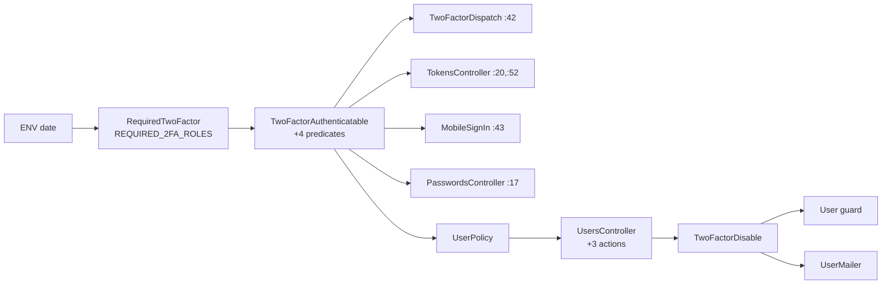

# Require Two-Factor for Support and Super Users — Low-Level Design

> Additive to [design.md](design.md); worked examples live in [business-rules.md](business-rules.md).
> All paths are under `app/packs/core/users/` unless stated.

## Contents

- [Review Summary](#review-summary)
- [File Map](#file-map)
- [Schema Detail](#schema-detail)
- [Method Contracts](#method-contracts)
- [Controllers, Params and Responses](#controllers-params-and-responses)
- [Queries and Indexes](#queries-and-indexes)
- [Transactions, Locking and Concurrency](#transactions-locking-and-concurrency)
- [Background Jobs](#background-jobs)
- [External Integrations](#external-integrations)
- [Error Mapping and Logging](#error-mapping-and-logging)
- [Security Review](#security-review)
- [Configuration and Rollout](#configuration-and-rollout)
- [Test Plumbing](#test-plumbing)
- [Pattern Conformance](#pattern-conformance)
- [Security Detail](#security-detail)
- [Project Rules Checklist](#project-rules-checklist)
- [Sign-off](#sign-off)

---

## Review Summary

- **No migration.** One env var per region, one new module, one new Trailblazer op, three new actions, three new mailer methods, one rake file (two tasks).
- **Scope (user, 2026-11-09):** `RequiredTwoFactor::REQUIRED_2FA_ROLES = %i[support super].freeze`; company admins not required; the step-up turn-off applies to every user with 2FA on.
- **Riskiest edits:** the User guard (refuses a currently-permitted write) and `login_as?` (support's daily tool).
- **Resolves** design D8 at code level: no session kill — `end_unverified_access` (remember-me + website-made tokens) only.

**Reviewer checks**
- [ ] No file outside the File Map is touched (except tests and the user guide).
- [ ] `db/schema.rb` unchanged by this change.

---

## File Map

| Boundary | File | New / Modified | Responsibility |
|---|---|---|---|
| Rule | `services/required_two_factor.rb` | New | Env parse, `REQUIRED_2FA_ROLES`, `stage`, `enforced?`, `enforce_from`, `role_label(user)`, `reset!` |
| Rule | `models/concerns/two_factor_authenticatable.rb` | Modified | `two_factor_required_role?`, `two_factor_required?`, `two_factor_applies?`, `two_factor_verified?`; `need_two_factor_authentication?` → applies |
| Model | `models/user.rb` | Modified | Guard `two_factor_disable_must_be_verified` + 2 escape methods; `two_factor_enabled` in `audit_fields` (`:18`) |
| Gate | `controllers/concerns/two_factor_dispatch.rb` | Modified | `:42` → `two_factor_applies?` |
| Gate | `controllers/users/passwords_controller.rb` | Modified | `:17` → `two_factor_applies?` |
| Set-up | `controllers/users/two_factor_controller.rb` | Modified | `commit_method!(mode)` used by the three `verify_*`; enqueue enabled email |
| Set-up | `views/users/two_factor/select_mode.html.erb` | Modified | `#two_factor_required_banner` |
| Doors | `controllers/users/tokens_controller.rb` | Modified | `:20`, `:52` → `two_factor_applies?` |
| Doors | `app/packs/core/mobile/services/mobile_sign_in.rb` | Modified | `:43` → `two_factor_applies?` |
| Doors | `policies/user_policy.rb` | Modified | `login_as?` actor rule; `disable_two_factor?`; `start_two_factor_setup?`; `login_as_refusal_message` |
| UI | `controllers/users_controller.rb` | Modified | `disable_two_factor`, `send_two_factor_code`, `start_two_factor_setup`; `login_as` refusal flash; `set_user` list |
| UI | `views/users/_two_factor_required_banner.html.erb` | New | Banner |
| UI | `views/users/_disable_two_factor_modal.html.erb` | New | Popup (copy of reset modal) |
| UI | `views/users/show.html.erb` | Modified | Badge, buttons, modal render (`:130-146`, `:266-273`) |
| UI | `views/users/_form.html.erb` | Modified | `:153-167` toggle only when off and not required |
| UI | `app/packs/core/base/views/layouts/{modernize,application,admin/application}.html.erb` | Modified | Render banner next to `_reset_password` |
| UI | `app/javascript/controllers/reset_two_factor_controller.js` | Modified | Optional `code` target; `sendCode` action |
| Op | `services/two_factor_disable.rb` | New | Step-up op |
| Op | `services/two_factor_reset.rb` | Modified | `notify_user` adds admin notice when actor ≠ user |
| Mail | `mailers/user_mailer.rb` + 3 views in `views/user_mailer/` | Modified / New | `two_factor_enabled`, `two_factor_disabled`, `two_factor_admin_notice` (no reminder mail — design D13) |
| Sync | `controllers/users_sync_controller.rb` | Modified | `:189` also `skip_two_factor_disable_verification!` |
| Ops | `lib/tasks/two_factor_required.rake` | New | `report`, `end_unverified_access` |
| Infra | `config/routes.rb` | Modified | 3 member POSTs beside `reset_two_factor` (`:80`) |
| Infra | `config/initializers/rack_attack.rb` | Modified | Throttles for the 2 step-up POSTs |
| Docs | `docs/user_guides/two_factor_authentication_user_guide.md`, `docs/modules/two_factor_auth/two_factor_authentication.md` | Modified | Disabling section, required roles, FAQs |

**Reviewer checks**
- [ ] Every new Ruby file is inside `app/packs/core/users` (or `lib/tasks`).
- [ ] `TwoFactorController` has exactly one `update!` writing `two_factor_mode` after the change.

---

## Schema Detail

N/A — no column, index or table changes. Columns read/written: `users.two_factor_enabled` (bool, not null, default false), `two_factor_mode` (string), `otp_secret`, `consumed_timestep`, `two_factor_reset_at`, `two_factor_reset_by_id`, `remember_created_at`, `failed_attempts`, `locked_at`.

**Reviewer checks**
- [ ] No migration file in the diff; `db/schema.rb` and `db/schema_test.rb` untouched by this change.

---

## Method Contracts

| Method | Arguments | Returns | Raises | Side effects | Idempotent? |
|---|---|---|---|---|---|
| `RequiredTwoFactor.enforce_from` | — | `Date` / `nil` / `:invalid` (memoised per process) | — | one `Rails.logger.error` on `:invalid` | Yes |
| `RequiredTwoFactor.stage(today = Time.zone.today)` | `Date` | `:off` \| `:notice` \| `:enforced` | — | — | Yes |
| `RequiredTwoFactor.enforced?` | — | bool | — | — | Yes |
| `RequiredTwoFactor::REQUIRED_2FA_ROLES` | — | `%i[support super]` frozen — the single place the rule's roles are named | — | — | — |
| `RequiredTwoFactor.role_label(user)` | `User` | `"Support"` / `"Super"` (first match in list order) | — | — | Yes |
| `User#two_factor_required_role?` | — | bool, `REQUIRED_2FA_ROLES.any? { has_cached_role?(_1) }` | — | — | Yes |
| `User#two_factor_required?` | — | `RequiredTwoFactor.enforced? && two_factor_required_role?` | — | — | Yes |
| `User#two_factor_applies?` | — | `two_factor_enabled? \|\| two_factor_required?` | — | — | Yes |
| `User#two_factor_verified?` | — | `two_factor_enabled? && two_factor_mode.present?` | — | — | Yes |
| `User#disable_two_factor_verified!(audit_comment:)` | String | true | `RecordInvalid` | sets `@two_factor_disable_verified` for one `update!(two_factor_enabled: false, audit_comment:)`, reset in `ensure` | No (second call fails the op's `ensure_disableable` first) |
| `User#skip_two_factor_disable_verification!` | — | true | — | instance flag for the sync save only | Yes |
| `TwoFactorDisable.call(user:, actor:, password:, code:)` | User, User, String, String | `Trailblazer::Operation::Result`; `result[:errors]`, `result[:attempts_left]` | — | password lock count; miss counters; update; 2 mail enqueues | No — see Transactions |
| `UserMailer.with(entity_id:, user_id:, mode:).two_factor_enabled` | ids, mode label | Mail | — | — | — |
| `UserMailer.with(entity_id:, user_id:, previous_mode:).two_factor_disabled` | | Mail | — | — | — |
| `UserMailer.with(entity_id:, user_id: admin_id, subject_user_id:, actor_id:, event:).two_factor_admin_notice` | `event` ∈ `disabled`, `reset` | Mail | — | — | — |

`TwoFactorDisable` steps (modelled on `two_factor_reset.rb:41-47`):

| Step | Fails with `ctx[:errors]` | Notes |
|---|---|---|
| `ensure_disableable` | "Two-factor authentication is not enabled for this user." / "Two-factor authentication is required for your role and cannot be turned off." | X15 |
| `verify_password` | "The password you entered is incorrect." | `user.valid_for_authentication? { user.valid_password?(password) }` inside `connected_to(role: :writing)` — counts toward lock (X11, X14, X25) |
| `ensure_code_attempts_left` | "Too many incorrect codes. Try again in 10 minutes." | skipped when `two_factor_mode.blank?` (E30); cache key `two_factor_disable:#{user.id}`, `MAX = TwoFactorVerifier::MAX_ATTEMPTS` (3), TTL 10 min (X13) |
| `verify_code` | "The code you entered is incorrect. N attempt(s) remaining." | `TwoFactorVerifier.verify(user, code)`; on miss `Rails.cache.increment(key, 1, expires_in: 10.minutes)` + `TwoFactorVerifier.record_user_miss(user)`; if that locks → "Your account has been locked after too many incorrect codes. We have emailed you a link to unlock it." |
| `switch_off` | — | `user.disable_two_factor_verified!(audit_comment: "Two-factor turned off by self (password + #{mode || 'no method'})")`; `Rails.cache.delete(key)` |
| `notify` | — | `two_factor_disabled` to user; `two_factor_admin_notice(event: "disabled")` to each admin |

**Reviewer checks**
- [ ] `role_label` follows `REQUIRED_2FA_ROLES` order (a switched support user reads "Support", E12).
- [ ] `TwoFactorDisable` has no role condition except `ensure_disableable`'s required check — it serves every user (H9, H10).
- [ ] `enforce_from` memo is cleared in test via a public `reset!` (used by the env step only).
- [ ] `verify_code` never runs when `ensure_code_attempts_left` failed (X13: correct code refused).

---

## Controllers, Params and Responses

| Action | Permitted params | Policy method | Success response | Failure response |
|---|---|---|---|---|
| `UsersController#disable_two_factor` (`POST /users/:id/disable_two_factor`) | `params[:password]`, `params[:otp_code]` (read directly, not mass-assigned) | `disable_two_factor?` | redirect `user_path(@user)`, notice "Two-factor authentication is now off. You will sign in with just your password." | redirect `user_path(@user)`, alert `result[:errors]`; bearer → 403 JSON `Access Denied` |
| `UsersController#send_two_factor_code` (`POST /users/:id/send_two_factor_code`) | — | `disable_two_factor?` | JSON 200 `{message: "A new code is on its way. It can take a few seconds to arrive."}`; authenticator → `{message: "Use the code shown in your authenticator app."}` | 429 `{error: "Please wait a moment before requesting another code."}`; 422 undeliverable `{error: "We can't send a verification code to your phone right now. Please contact your administrator."}`; bearer → 403 |
| `UsersController#start_two_factor_setup` (`POST /users/:id/start_two_factor_setup`) | — | `start_two_factor_setup?` | `update!(two_factor_enabled: true)` if off; `sign_out`; redirect `new_user_session_path`, notice "Sign in again to set up two-factor authentication." | `Access Denied` (X8–X10) |
| `UsersController#login_as` | unchanged | `login_as?` | unchanged | rescue `Pundit::NotAuthorizedError` in this action only: alert `policy.login_as_refusal_message` when present ("Set up two-factor authentication before using Login as."), else re-raise to `deny_access` |
| `UsersController#update` | unchanged (`two_factor_enabled` still in `scalar_fields`, `:498`) | `update?` | unchanged | guard error → `render :edit, 422` / JSON 422 `{two_factor_enabled: [msg]}` (X18, X20, X25) |
| `Admin::UsersController#update` | unchanged | `authenticate_admin` | unchanged | Administrate re-renders with the guard error (X19) |

- `set_user` before_action list gains the three actions (`users_controller.rb:11`).
- Send-code cooldown: server-side `Rails.cache.write("two_factor_disable_send:#{user.id}", 1, expires_in: OtpSmsRateLimiter.min_number_window, unless_exist: true)`; false → 429. WhatsApp uses the same key with 30 s.
- Bearer refusal copies `ApiTokensController#refuse_bearer_tokens` (`api_tokens_controller.rb:38-44`) — `skip_authorization` + 403.

**Reviewer checks**
- [ ] None of the three actions is added to `verify_authorized`'s `except:` list (`users_controller.rb:12`).
- [ ] `otp_code` and `password` appear as `[FILTERED]` in `log/test.log` (filters `otp`, `passw` already exist, `filter_parameter_logging.rb`).
- [ ] `login_as` rescue does not swallow refusals other than the 2FA one.

---

## Queries and Indexes

| Where | Query shape | Index used | Rows expected | Preload / batching |
|---|---|---|---|---|
| `two_factor_required_role?` | `has_cached_role?` on loaded `roles` | — | ≤ 5 roles | roles loaded once per request (rolify cache) |
| Admin-notice recipients | `User.company_admins.active.where(entity_id: user.entity_id).where.not(id: [user.id, actor.id]).select(:id, :entity_id)` | `users.entity_id` | ≤ 10 | one query |
| `:report` | `SELECT roles.name, COUNT(DISTINCT users.id), SUM(two_factor_enabled AND two_factor_mode IS NOT NULL AND two_factor_mode <> '') … WHERE active GROUP BY roles.name` + one distinct-users query | `users_roles` PK | ~200 | SQL aggregate only |
| `end_unverified_access` | `User.active.joins(:roles).where(roles: {name: REQUIRED_2FA_ROLES}).where("two_factor_enabled = FALSE OR two_factor_mode IS NULL OR two_factor_mode = ''").distinct.unscope(:order).pluck(:id)` then `User.where(id:).find_each`; per user `ApiToken.where(user_id:, revoked_at: nil).find_each(&:revoke!)` and `Doorkeeper::AccessToken.where(resource_owner_id:, revoked_at: nil).find_each(&:revoke)` | `roles.name`; `api_tokens.user_id`; Doorkeeper `resource_owner_id` | ≤ 15 users (0 today) | `find_each` |
| Step-up code check | `OtpDelivery.where(user_id:, channel: "sms", status: queued).exists?(created_at: 10.min.ago..)` (existing) | `[user_id, created_at]` | 1 | — |

**Reviewer checks**
- [ ] `distinct` queries `unscope(:order)` first and are run once on dev MySQL (memory: SQLite hides DISTINCT/ORDER errors).
- [ ] No `present?`/`blank?` on a relation (`IRM/RelationBlankPresent`).

---

## Transactions, Locking and Concurrency

| Operation | Transaction scope | Lock | Race it prevents | Idempotency key |
|---|---|---|---|---|
| `TwoFactorDisable#switch_off` | single `update!` | none | — | second submit fails `ensure_disableable` ("not enabled") → no second email |
| Two simultaneous turn-off submits | — | none | double email | acceptable: both may pass `ensure_disableable` before either saves → worst case two "turned off" emails; state identical |
| Step-up miss counter | `Rails.cache.increment` (atomic) | — | lost misses across servers | key per user |
| `commit_method!` (set-up) | single `update!` | none | — | `require_no_verified_method` refuses a second confirm (`two_factor_controller.rb:341-346`) |
| `end_unverified_access` | per user `forget_me!` + token revokes | none | — | re-run is harmless (cookie already invalid, tokens already revoked) |

**Reviewer checks**
- [ ] Mail enqueue happens after `update!` returns (never inside a transaction that can roll back).

---

## Background Jobs

| Job | Queue | Trigger | Retry / backoff | Discard on | Concurrency guard | Timeout |
|---|---|---|---|---|---|---|
| `ActionMailer::MailDeliveryJob` (3 new mails) | `mailers` (existing default) | `deliver_later` | ActiveJob default | `ActiveJob::DeserializationError` (record gone) | none needed | default |
| `SendOtpToSmsJob` / `SendOtpToWhatsappJob` | existing | `send_two_factor_code` via `TwoFactorVerifier.start` | existing | existing | `OtpSmsRateLimiter` (durable) | existing |

**Reviewer checks**
- [ ] Mailers take ids only (`user_id`, `actor_id`, `subject_user_id`), never objects or codes.

---

## External Integrations

| Call | Method + path | Auth | Timeouts | Rate limit handling | Error → exception |
|---|---|---|---|---|---|
| Twilio Verify (SMS send / check) | existing `TwilioSmsDelivery` / `TwilioSmsVerification` | existing credentials | existing | `OtpSmsRateLimiter` per number + per user | unchanged |
| WATI WhatsApp | existing `SendOtpToWhatsappJob` | existing | existing | new server cooldown key (30 s) | unchanged |

**Reviewer checks**
- [ ] No new external call is introduced.

---

## Error Mapping and Logging

| Exception / outcome | Raised in | Handled by | User sees | Logged / alerted |
|---|---|---|---|---|
| Guard error on `two_factor_enabled` | `User` validation | form re-render / JSON 422 / Administrate | "Two-factor authentication can only be turned off from your user page, with your password and a current code." | `[two_factor] blocked off-switch user_id=… via=update` (warn) |
| `TwoFactorDisable` failure | op step | controller alert | step message | `[TwoFactorDisable] refused user_id=… reason=<step>` (warn; no code/password) |
| Hourly miss lock | `record_user_miss` | op | locked message | existing warn (`two_factor_verifier.rb:183`) |
| Unparseable env date | `RequiredTwoFactor.enforce_from` | — | (enforced behaviour) | `error` once per process |
| `Pundit::NotAuthorizedError` on `login_as?` | policy | `login_as` rescue | "Set up two-factor authentication before using Login as." | existing `deny_access` path otherwise |

**Reviewer checks**
- [ ] No log line contains `otp_code`, a password, a phone number or an email.

---

## Security Review

| Concern | Decision |
|---|---|
| Authorization | `disable_two_factor?`: `user.id == record.id && user.support_user_id.blank? && record.two_factor_enabled?` (any role). `start_two_factor_setup?`: `user.id == record.id && user.support_user_id.blank? && record.two_factor_required_role? && !record.two_factor_verified?` (support / super only — the banner and the user-page row are its only callers). `login_as?`: existing body `&& (!RequiredTwoFactor.enforced? \|\| user.two_factor_verified?)` |
| Tenant isolation | Self-only actions need no scope; admin recipients filtered by `entity_id` of the subject user |
| Secrets | Codes never stored or logged; passwords never logged; `otp`/`passw` filtered |
| Input / output sanitisation | Names in emails via ERB escaping; role labels from a constant; banner date `l(date)` (screen locale); email dates bare `l(date)` (EmailDateLocalization) |
| Mass assignment | `two_factor_enabled` stays permitted; guard refuses true→false; escapes are methods |

**Reviewer checks**
- [ ] Banner date uses `l(RequiredTwoFactor.enforce_from)` (screen locale); email dates bare `l(...)` → `Dec 02, 2026`.
- [ ] Banner follows the screen rule: `en` shows "01/12/2026", `en-US` "12/01/2026" (QA C2).

---

## Configuration and Rollout

| Item | Value / location |
|---|---|
| Credentials / env vars | `REQUIRED_2FA_ENFORCE_FROM=YYYY-MM-DD` — the **same date** in IN and US, set on each region's box (`.env.production.in`, `.env.production.us`); unset in dev/test/staging by default |
| Feature flag | The env date (off / notice / enforced) |
| Cron / schedules | None |
| Deploy order | Code (phases 1–3, env unset) → in IN and US: `report` → set the same date (+14 d) + restart → ops messages the 11 support / super users → `report` every few days until 0 → on the date: `end_unverified_access` dry, then `EXECUTE=1` → `report` |
| Rollback | Unset env + restart → stage off (today's behaviour). Users who enrolled keep 2FA (they can turn it off with the step-up). No data cleanup |

Rake contract (`lib/tasks/two_factor_required.rake`):

| Task | Prints first | Writes without `EXECUTE=1` | With `EXECUTE=1` |
|---|---|---|---|
| `two_factor_required:report` | region code, stage, enforce date | nothing (read-only always) | — |
| `two_factor_required:end_unverified_access` | region, stage, "Would end access for N users" | nothing | `forget_me!` + revoke `ApiToken` / Doorkeeper tokens per user; "Ended access for N users"; refuses unless stage is `:enforced` ("Enforcement date YYYY-MM-DD not reached — nothing changed") |

**Reviewer checks**
- [ ] Tasks print counts only — no email, name or id lists.
- [ ] `report` lists each `REQUIRED_2FA_ROLES` role plus a "not required" line for company_admin (counts only).

---

## Test Plumbing

| Feature file | Stubs / fixtures | Factories | New step definitions |
|---|---|---|---|
| `features/login/two_factor_required_roles.feature` | env date wrapper; `travel_to`; Twilio Verify stub (existing in `two_factor_sms_steps.rb`) | `:user` with roles; existing 2FA traits | `Given the required 2FA date is "2026-12-01"`, `Given the required 2FA date is not set`, `Then I see the required set-up banner for "Support"` |
| `features/login/two_factor_required_rollout.feature` | rake invocation helper (`Rake::Task#invoke` with `EXECUTE`) | same | `When ops runs "two_factor_required:end_unverified_access" with EXECUTE`, `Then the report shows "support" with 0 without` |
| `features/login/two_factor_turn_off.feature` | TOTP code helper (existing `two_factor_steps.rb`), WhatsApp code capture | same | `When I turn off two-factor with password "…" and the current code` |
| `features/security/two_factor_required_roles.feature` | direct POST helpers (existing security steps), bearer token helper (`api_json_steps.rb`) | same | `When "Neha" posts to turn off two-factor for "Dev"` |

- Env wrapper restores the previous value and calls `RequiredTwoFactor.reset!` in an `After` hook (memory: leaked globals cause pcuc worker-only failures).
- Grep step text before adding (memory: dry-run misses ambiguous steps).

**Reviewer checks**
- [ ] Every scenario has `# <ID> — <path>` above it; IDs equal the business-rules set (78).

---

## Pattern Conformance

| Class | Pattern | Pack | Public interface | Modelled on |
|---|---|---|---|---|
| `RequiredTwoFactor` | module service | core/users | `stage`, `enforced?`, `enforce_from`, `role_label`, `REQUIRED_2FA_ROLES`, `reset!` | `SmsDeliverable.feature_enabled?` (env switch) |
| `TwoFactorDisable` | Trailblazer op | core/users | `.call(user:, actor:, password:, code:)` | `TwoFactorReset` |
| User guard | model validation + method escapes | core/users | `disable_two_factor_verified!`, `skip_two_factor_disable_verification!` | `existing_phone_change_must_be_verified` |
| Banner | partial | core/users | `render "users/two_factor_required_banner"` | `users/_reset_password` |
| Popup | partial + Stimulus | core/users | `render "users/disable_two_factor_modal", user:` | `users/_reset_two_factor_modal` |
| Mailer methods | `UserMailer` | core/users | 3 methods | `UserMailer#two_factor_reset` |
| Rake | ops task | lib/tasks | 3 tasks | memory rule: dry-run + `EXECUTE=1` |

**Reviewer checks**
- [ ] `packwerk check` clean.

---

## Security Detail

| Action / job / call | Policy method | Loaded through | Permitted params | Tenant checks | Security scenario |
|---|---|---|---|---|---|
| `POST /users/:id/disable_two_factor` | `UserPolicy#disable_two_factor?` | `set_user` (`User.find`) then authorize (self-only, so no scope needed) | `password`, `otp_code` read, not assigned | self only; not impersonating; bearer refused | X15–X17, X21, X24, X25 |
| `POST /users/:id/send_two_factor_code` | `UserPolicy#disable_two_factor?` | same | none | same | X22, X23 |
| `POST /users/:id/start_two_factor_setup` | `UserPolicy#start_two_factor_setup?` | same | none | self only; not impersonating; support / super only | X8–X10 |
| `POST /users/:id/login_as` | `UserPolicy#login_as?` (+ actor 2FA) | `User.find` (existing) | none | mapping check (existing) | X6, X7 |
| `PATCH /users/:id` (+ `.json`) | `update?` (existing) | `set_user` | unchanged | model guard | X18, X20 |
| `/admin/users/:id` | `authenticate_admin` | Administrate | dashboard attrs | model guard | X19 |
| `/users/tokens/sign_in` | — (Devise) | `find_for_authentication` | email, password | applies? after password | X3, X4 |
| `/api/mobile/v1/session` | — | `MobileSignIn` | email, password, device | applies? | X5 |
| Mail jobs | — | ids reloaded | — | recipients filtered by subject's `entity_id` | H9, E40 |
| Rack::Attack | `throttle('two_factor_step_up/ip', limit: 10, period: 60)`, `throttle('two_factor_step_up/user', limit: 5, period: 60)` keyed on session user id | — | — | — | E37 |

**Reviewer checks**
- [ ] `features/security/allowlists/*.yml` unchanged (no new CSRF exemption, no unauthenticated action).
- [ ] Brakeman: no new warnings.

---

## Project Rules Checklist

| Rule | Applies? | How it is met |
|---|---|---|
| No `blank?`/`present?` on relations; use `exists?`/`none?` | Applies | Recipient and rake queries use `pluck`/`find_each`; reviewed |
| Dedup in SQL (`distinct.pluck`), batch bulk operations (`find_each`/`in_batches`) | Applies | Rake: `distinct.unscope(:order).pluck(:id)` + `find_each` |
| Select only needed columns when loading many `account_entries`; no speculative `includes` of big associations | N/A | No ledger access |
| Screen dates via `l(...)`; emails render `Mon dd, yyyy` via `EmailDateLocalization`; no human-format `strftime` | Applies | Banner `l(date)`; emails bare `l(date)` |
| Date inputs use `f.date_field` / `date_field_tag`; JS dates via `locale_date_format.js` | N/A | No date inputs; env date is ops-set |
| Every query entity-scoped; Pundit `authorize`/`policy_scope` on every action | Applies | Three new actions authorize; admin recipients by `entity_id` |
| MCP tool surfaces changed only via the ontology YAML (run the ontology drift feature) | N/A | No MCP change |
| Cucumber only (no RSpec); `TEST_ENV_NUMBER=$RANDOM` on every run | Applies | Four features |
| `bundle exec rubocop` clean, including the `IRM/RelationBlankPresent` cop | Applies | Phase gate |
| No query inside a row loop; access checks once per request; features clean under `PROSOPITE=1` | Applies | Banner check uses cached roles; phase gates |
| Screens copy the reference screen in design.md *Screen standards*; no new CSS | Applies | Reset modal / reset-password banner / select_mode alert / toggle-row reused |

---

## Sign-off

| Reviewer | Date | Decision | Notes |
|---|---|---|---|
| | | | |
