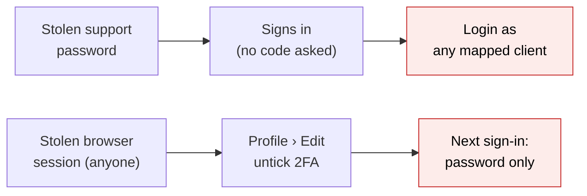
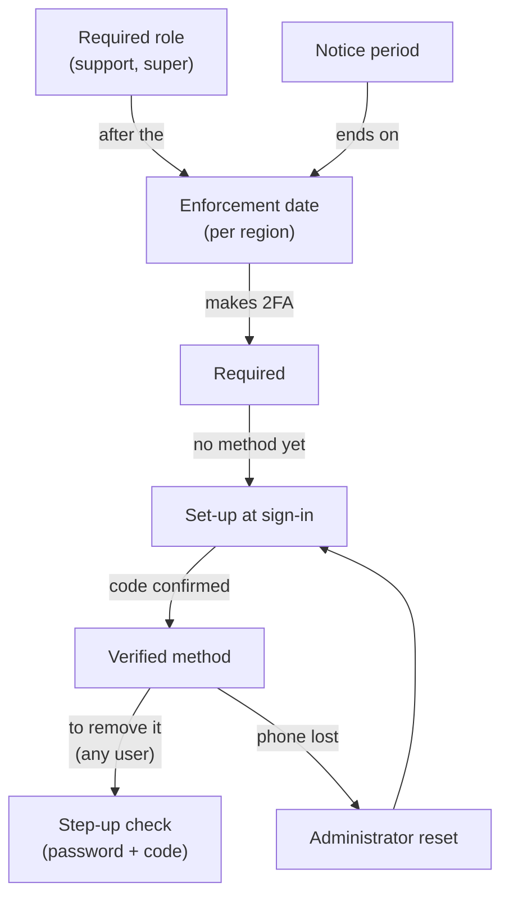
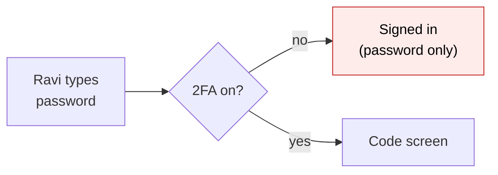
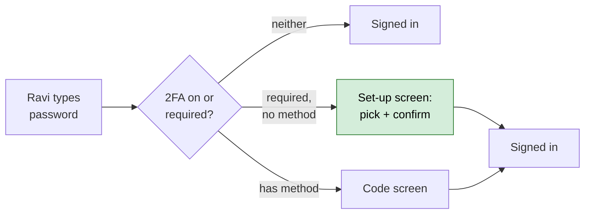
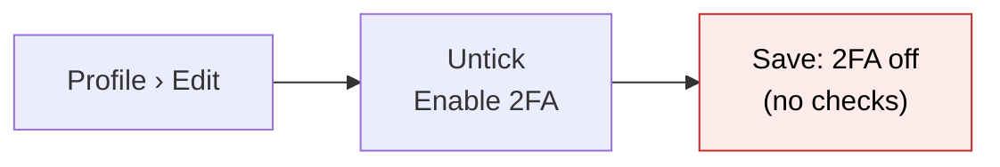
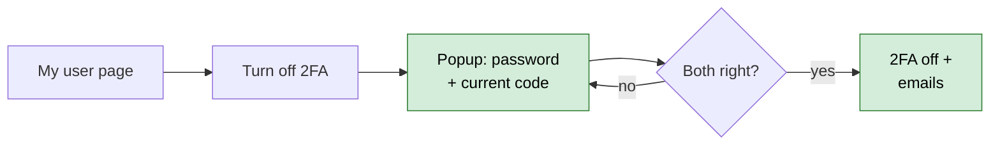
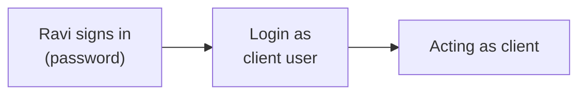
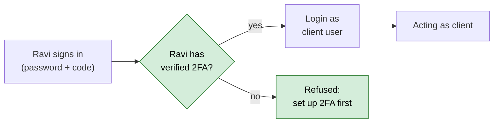
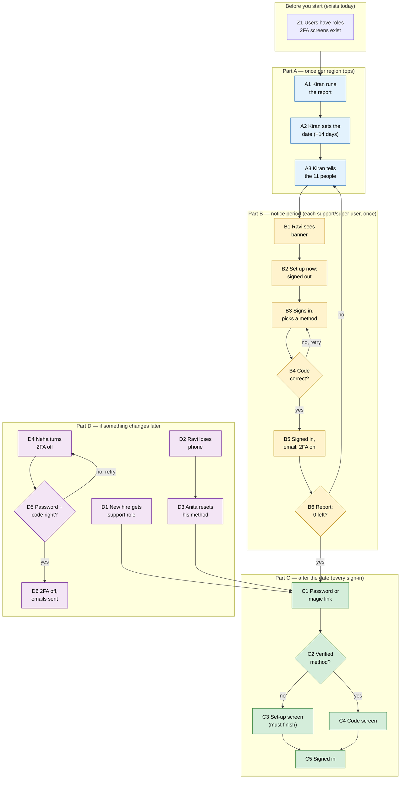

# Require Two-Factor for CapHive Support and Super Users — Proposal

> **Audience:** Business team, product, QA, support — non-technical.
> **Companion document:** [Design](design.md)
> **New to this? Start with the [Workflow Journey](#workflow-journey)** — every action, in order, from start to the outcome.

> **Planning phase — no code changes.** This document proposes and explains the change. Do not
> edit application code while writing it; implementation happens later, in the tasks phase.

> **Source:** security finding **M8** in `docs/security/owasp_top10_review_2026_11.md`
> (OWASP A07, "2FA optional for every role, and can be turned off with only a session").
> **Scope decided by the user (2026-11-09):** two-factor becomes **required for CapHive support and
> super users only**. Company admins of fund and investor firms are **not** required. Turning
> two-factor off needs a password and a current code for **every** user.

---

## Why

- **CapHive support and super accounts have no second factor.** On the production copy (IN region, users up to 2026-11-02), **all 11** active support users and the **1** super user have two-factor **off**.
- **Support can act as any mapped client with only a password.** "Login as" deliberately skips the *client's* code, so the support user's own sign-in is the only gate.
- **Anyone holding a signed-in browser can switch two-factor off** — for any user, including a company admin who switched it on voluntarily. The Edit form asks for no password and no code.
- **Why now:** support and super reach every client's data; they are the accounts an attacker wants most.



---

## What Changes

- **CapHive support and super users must use two-factor** once their region's enforcement date passes. Everyone else — company admins, employees, investors, advisors — keeps it optional, exactly as today.
- **Nobody is locked out:** a support or super user without two-factor is taken to the existing "Set Up Two-Factor Authentication" screen during sign-in. An authenticator app is always offered, so no phone number is needed.
- **A 14-day notice period comes first**, with a banner and a **Set up now** button for those users.
- **Turning two-factor off now needs your password and a current code — for every user who has it on**, whether required or voluntary (e.g. a company admin who chose it). A stolen session can no longer remove it. It can no longer be switched off from the Edit form, the API or the admin console. Support and super users cannot turn it off at all.
- **"Login as" needs the support (or super) user's own verified two-factor** once enforcement starts. The client's code is still not asked for (unchanged by design).
- **Emails:** the user is told when two-factor is switched on or off; the firm's other company admins are told when someone switches it off or has it reset by an administrator.
- **IN and US use the same start date**; each is switched on its own server.
- **BREAKING (support and super only, after the date):** password-only sign-in, the password token endpoint and the LP mobile app refuse them until they have set up two-factor. Prod check: **0** tokens or app devices belong to them today.

### What the narrower scope simplifies

- **11 people to enrol, all CapHive staff** (the 1 super user also holds the support role) — down from 157 if company admins had been included.
- **No customer is affected at sign-in.** No fund or LP firm sees a new screen, banner or email about enrolment; no client communication, no support-desk spike.
- **No reminder emails or reminder task.** Ops tells the 11 people directly; the in-app banner is the reminder.
- **Enforcement day can be a non-event.** Ops enrols all 11 during the notice period and checks the report shows **0** left before the date.
- **Remember-me and token clean-up is a safety net only:** 0 support/super users had a remember-me cookie in the last 30 days and 0 hold tokens.

### Key concepts



| Concept | What it means for you | Example |
|---|---|---|
| **Two-factor (2FA)** | After your password, a 6-digit code from your phone | Code `482 913` from Google Authenticator |
| **Method** | Where the code comes from: authenticator app, WhatsApp or text message | Ravi picks "Authenticator app" |
| **Verified method** | A method you have proven by typing one correct code | Anita's app entry |
| **Required role** | A role that must use 2FA: CapHive **support** and **super** | Ravi (support), Sam (super) |
| **Required** | 2FA cannot be skipped or turned off for you | Ravi after 1 Dec 2026 |
| **Voluntary 2FA** | 2FA you switched on yourself, without being required | Neha, a company admin |
| **Enforcement date** | The day a region starts requiring 2FA for those roles | 1 Dec 2026 (IN and US) |
| **Notice period** | The 14 days between announcing and enforcing | 17 Nov → 1 Dec |
| **Set-up at sign-in** | The existing screen that asks you to pick and confirm a method before you get in | "Set Up Two-Factor Authentication" |
| **Step-up check** | Re-proving it is you (password + current code) before turning 2FA off | Neha turns hers off |
| **Administrator reset** | An admin clears a lost method; you set a new one up at next sign-in | Anita resets Ravi's lost phone |
| **Login as** | CapHive support signing in as a client user to help them | Anita helps Dev at Sahyadri |

#### Required two-factor (support and super)

- **What:** a support or super user must have a verified method to finish signing in, once the date has passed.
- **Why:** these roles reach every client and can act as client users.
- **Not covered:** company admins, approvers, employees, investors and advisors stay optional (they can still opt in, and their 2FA is then protected by the step-up check).
- **Example:** Ravi (support) signs in on 2 Dec with no 2FA → set-up, scan a QR code, type the code → dashboard.
- **Changing the list later** (e.g. adding company admins) is a one-line change.

#### Step-up check to turn two-factor off (every user)

- **What:** the popup asks for your password and a current code before switching 2FA off.
- **Why:** a stolen session has neither, so it cannot weaken any account — required or voluntary.
- **Not covered:** changing method (the existing "Change 2FA Method" already asks for your password).
- **Example:** Neha (company admin, voluntary 2FA) types her password and authenticator code → 2FA off; she and Sahyadri's other company admins get an email.

### Flow Diagram

**Sign-in for a support or super user without two-factor (after the date).**

Before:


After:


**Turning two-factor off (every user).**

Before:


After:


**Support "Login as" (after the date).**

Before:


After:


---

## Workflow Journey

### Who is involved

| Person | Role | What they do in the journey |
|---|---|---|
| **Kiran** | CapHive ops | Runs the report, sets the date, tells the 11 people, checks 0 left |
| **Ravi** | CapHive support | Sets up 2FA; later loses his phone and gets reset |
| **Anita** | CapHive support | Already has 2FA; resets Ravi's lost method; uses Login as |
| **Sam** | CapHive super | Sets up 2FA in the notice period |
| **Neha** | Company admin, Sahyadri Capital, voluntary 2FA | Turns 2FA off with password + code |
| **Priya** | Investor (LP) with WhatsApp 2FA | Turns 2FA off with password + code |

### The journey on one page



### Before you start

| Needed | Why | Where it comes from |
|---|---|---|
| Users with support / super roles | They are who the rule applies to | Existing user roles |
| The existing 2FA set-up screens | Re-used for required set-up | Sign-in › "Set Up Two-Factor Authentication" |
| An authenticator app on a phone | Always-available method | Google / Microsoft Authenticator, Authy |
| Ops access to the region's servers | To set the date and run the report | CapHive ops runbook |

### Part A — once per region (ops)

| Step | Who | Where | Action | What the system does | What you see |
|---|---|---|---|---|---|
| A1 | Kiran | Ops console › report task | Runs the 2FA report | Counts support and super users with / without 2FA (numbers only) | support 11 of 11 without, super 1 of 1 without (11 people) |
| A2 | Kiran | Region settings | Sets the enforcement date (deploy + 14 days, same date IN and US), restarts | Notice period starts | Banner for support/super users without 2FA; nothing refused |
| A3 | Kiran | Team chat / email | Tells the 11 people | — | — |

### Part B — notice period (each support / super user, once)

| Step | Who | Where | Action | What the system does | What you see |
|---|---|---|---|---|---|
| B1 | Ravi | Any page | Reads the banner | — | Amber banner with the date and **Set up now** |
| B2 | Ravi | Banner › **Set up now** | Clicks it | Switches 2FA on for him, signs him out | "Sign in again to set up two-factor authentication." |
| B3 | Ravi | Set Up Two-Factor Authentication | Signs in, picks **Authenticator app**, scans the QR code | Shows the QR code | QR code + code box |
| B4 | Ravi | Code box | Types `482 913` | Checks the code (3 tries) | Wrong: "Invalid code. 2 attempt(s) remaining." |
| B5 | Ravi | — | Correct code | Saves the method, signs him in, emails him | "Two-factor authentication is now enabled." + email |
| B6 | Kiran | Report task | Re-runs it before the date | Counts again | support 0 without, super 0 without |

### Part C — after the date (every sign-in)

| Step | Who | Where | Action | What the system does | What you see |
|---|---|---|---|---|---|
| C1 | Ravi / Sam | Sign-in | Password, or a magic link | Checks password / link | — |
| C2 | — | — | — | Is 2FA required or on? Is there a verified method? | — |
| C3 | Anyone not set up | Set Up Two-Factor Authentication | Picks a method, types a code | Same as B3–B5 | "Two-factor authentication is required for your role (Support)." |
| C4 | Ravi (set up) | Code screen | Types today's code | Checks it | Dashboard |
| C5 | — | — | — | Signed in | "Signed in successfully." |

### Part D — if something changes later

| Step | Who | Where | Action | What the system does | What you see |
|---|---|---|---|---|---|
| D1 | Kiran | Admin console › user › roles | Gives a new hire the support role | Their next sign-in requires set-up | Their user page: "Required for your role" |
| D2 | Ravi | — | Loses his phone | — | Cannot produce a code |
| D3 | Anita | Users › Ravi › **Reset 2FA Method** | Confirms the popup | Clears Ravi's method; emails Ravi and CapHive's other company admins | "Two-factor method reset for Ravi …" |
| D4 | Neha | My user page › **Turn off 2FA** | Popup: password, authenticator code, ticks "I understand" | Checks password, then code | — |
| D5 | — | — | Wrong code | Counts the miss | "The code you entered is incorrect. 2 attempt(s) remaining." |
| D6 | Neha | — | Right code | 2FA off; emails Neha, Meera and Omkar | "Two-factor authentication is now off. You will sign in with just your password." |

### What you see

Notice-period banner (support / super user without 2FA):

```
┌──────────────────────────────────────────────────────────────────────────────┐
│ ⚠ Two-factor authentication becomes required for your role (Support)         │
│   on 01/12/2026. Set it up now — it takes about a minute.   [ Set up now ]   │
└──────────────────────────────────────────────────────────────────────────────┘
```

Report Kiran sees (A1, IN production copy, 2026-11-02):

```
Region IN · stage notice · enforce from 2026-12-01
Role      Active  With 2FA  Without  Without, signed in last 90 days
support      11        0       11        9
super         1        0        1        1
-------------------------------------------------------------
Distinct     11        0       11      (the super user also holds support)
company_admin: not required (153 active, 1 with 2FA)
```

- 11 + 1 = 12 role memberships; the super user is one of the 11 support users → **11 people**.

Turn-off popup on Neha's user page:

```
┌ Turn Off Two-Factor Authentication ─────────────────────────────── ✕ ┐
│ Immediate Actions                                                    │
│ ┌──────────────────────────────────────────────────────────────────┐ │
│ │ ⛔ Two-factor switched off: [Authenticator]                       │ │
│ │    Codes from your authenticator app will stop being asked.      │ │
│ ├──────────────────────────────────────────────────────────────────┤ │
│ │ 🔑 Sign-in will need only your password                          │ │
│ ├──────────────────────────────────────────────────────────────────┤ │
│ │ ✉ Confirmation email to neha@…; your firm's admins are told      │ │
│ └──────────────────────────────────────────────────────────────────┘ │
│ Confirm your password   [••••••••••]                                 │
│ Current code            [______]                                     │
│ ☐ I understand sign-in will no longer ask for a code.                │
│                                    [ Cancel ]  [ Turn off 2FA ]      │
└──────────────────────────────────────────────────────────────────────┘
```

### What goes wrong

- **Ravi loses his phone after the date (D2).**
  - He cannot type a code.
  - **Fix:** another support user (Anita) or a CapHive company admin uses **Reset 2FA Method**. At his next sign-in he picks a new method. Ravi and CapHive's other company admins get an email.
- **Ravi mistypes three codes during set-up (B4).**
  - "Too many failed attempts. Please sign in again." — nothing was saved; he signs in and starts again.
- **Someone has Neha's open browser but not her password.**
  - Unticking 2FA on Edit profile is refused; the popup says "The password you entered is incorrect." Neha's 2FA stays on.

### Summary: the minimum actions

| # | Action | Who | How often |
|---|---|---|---|
| 1 | Run report, set date, tell the 11 people, re-run report | Kiran (ops) | Once per region |
| 2 | Set up 2FA | Each support / super user | Once |
| 3 | Type a code at sign-in | Each support / super user | Every sign-in |
| 4 | Reset a lost method | Another support user / company admin | Only when a phone is lost |

---

## User Stories

### US-1: Support and super users must use two-factor

**As** CapHive security, **I want** support and super users to have two-factor, **so that** a leaked password alone cannot reach client data or act for clients.

**Acceptance criteria:**
- After the date, a support or super user without a verified method is taken to set-up after their password or magic link, with "Two-factor authentication is required for your role (Support)." (or "(Super)").
- They are signed in only after confirming a code.
- Before the date, nothing changes except the banner. With no date set, behaviour is exactly as today.
- Company admins and every other role: unchanged.

### US-2: No lock-out during set-up
- "Authenticator app" is always offered, even with no phone number on file (6 of the 11 have none).
- Abandoning set-up saves nothing; three wrong codes end the attempt with "Too many failed attempts. Please sign in again."

### US-3: Notice before enforcement
- From the day the date is set, a banner shows the date and **Set up now**; it is gone once set up.
- **Set up now** signs the user out with "Sign in again to set up two-factor authentication."

### US-4: Turning two-factor off needs proof (every user)
- A **Turn off 2FA** button on your own user page opens a confirmation popup (any user with 2FA on who is not required).
- WhatsApp / text-message users press **Send code**; authenticator users read their app.
- Wrong password: "The password you entered is incorrect." Wrong code: "The code you entered is incorrect. N attempt(s) remaining."
- The Edit form no longer offers unticking; it shows "On — turn it off from your user page".
- A company admin's voluntary 2FA is protected the same way.

### US-5: Support and super users cannot turn it off
- No **Turn off 2FA** button; badge "Required for your role".
- A direct request is refused: "Two-factor authentication is required for your role and cannot be turned off."

### US-6: Login as needs the support user's own two-factor
- After the date, a support user without a verified method is refused: "Set up two-factor authentication before using Login as."
- The client's own code is still not asked for.

### US-7: Lost phone recovery
- Existing **Reset 2FA Method** (another support user, or a company admin of the user's firm).
- The user and the firm's other company admins get an email naming who reset it.

### US-8: Other ways in honour the rule
- Password reset link → back to sign-in, then set-up.
- Password token endpoint: `403 two_factor_required` for a required user.
- LP mobile app: a support user who also holds the investor role (1 person) gets "finish setting up two-factor on the website".
- Tokens made on the website keep working for users with a verified method.

### US-9: Notifications
- Email to the user when 2FA is switched on (method confirmed) or off.
- Email to the firm's other company admins when someone switches it off, or has it reset by someone else.

### US-10: Ops roll-out per region
- A report task shows counts per required role (no names or emails).
- After the date, a task ends remember-me sign-ins and revokes website-made tokens of any support/super user still without 2FA (dry run first).

---

## UI Behavior

### Notice / required banner (support / super user without a verified method)

```
Notice period:
┌──────────────────────────────────────────────────────────────────────────────┐
│ ⚠ Two-factor authentication becomes required for your role (Support)         │
│   on 01/12/2026. Set it up now — it takes about a minute.   [ Set up now ]   │
└──────────────────────────────────────────────────────────────────────────────┘
After the date (a session that started before it):
┌──────────────────────────────────────────────────────────────────────────────┐
│ ⛔ Two-factor authentication is now required for your role. Set it up to     │
│   keep using CapHive. Login as is unavailable until you do.  [ Set up now ]  │
└──────────────────────────────────────────────────────────────────────────────┘
```

- Same place and look as "Please change your password at the earliest".
- Never shown to company admins or other roles, nor while support is acting as a client.

### Set-up screen (existing, one banner added)

```
┌ Set Up Two-Factor Authentication ───────────────────────────────────┐
│ ┌──────────────────────────────────────────────────────────────────┐ │
│ │ ⓘ Two-factor authentication is required for your role (Support).│ │
│ │   Choose a method to finish signing in.                          │ │
│ └──────────────────────────────────────────────────────────────────┘ │
│ (•) Authenticator app   Use Google Authenticator, Microsoft …        │
│                                              [ Continue ]            │
└──────────────────────────────────────────────────────────────────────┘
```

### User page — Two-Factor Authentication row

```
Two-Factor Authentication ⓘ   ✔  [Authenticator]  [Change 2FA Method]  [Turn off 2FA]    ← Neha (company admin, voluntary)
Two-Factor Authentication ⓘ   ✔  [Authenticator]  [Required for your role ⓘ]  [Change 2FA Method]  ← Anita (support)
Two-Factor Authentication ⓘ   ✘  [Required for your role ⓘ]  [Set up now]               ← Ravi before set-up
```

- **Turn off 2FA** only on your own page, only when 2FA is on and not required.
- Admins viewing someone else's page never see a turn-off button (only **Reset 2FA Method**).

### Edit profile — 2FA toggle

```
Enable Two-Factor Authentication     [toggle]                                ← 2FA off (unchanged)
Two-Factor Authentication            On — turn it off from your user page    ← 2FA on
Two-Factor Authentication            Required for your role (Support)        ← support / super
```

### Turn-off popup

- Mockup in [What you see](#what-you-see); built like the existing "Reset Two-Factor Method" popup.
- **Turn off 2FA** stays disabled until password, code (if a method exists) and the "I understand" box are filled.
- **Send code** (WhatsApp / text users) shows "A new code is on its way. It can take a few seconds to arrive."

---

## What This Feature Does NOT Cover

| Excluded | Covered In |
|---|---|
| Requiring 2FA for company admins, approvers, employees or investors | Not now (user decision); a one-line change later |
| Recording logins, 2FA failures and role changes as security events | M11 — `security-event-trail` |
| Alerts on brute force / repeated 2FA failures | M12 |
| Rate limit on the existing `/two_factor/send_whatsapp` | L9 |
| Checking the `session_token` cookie so logout ends copied sessions | L8 |
| Backup / recovery codes | Not planned — administrator reset is the recovery route |
| Changing the cross-region hand-off | Not planned — same date in both regions |

---

## Validation Rules

| Field | Rule | Default |
|---|---|---|
| Enforcement date (per region) | A calendar date; blank = feature off; unreadable = treated as reached | Blank (off) |
| Required roles | support, super | That list |
| Turn-off password | Must match; wrong tries count toward the normal account lock (6) | — |
| Turn-off code | Current code for the user's method; 3 wrong per 10 minutes, then "Too many incorrect codes. Try again in 10 minutes." | — |
| Turn-off acknowledgement | Must be ticked | Unticked |
| Turning 2FA off any other way | Refused: "Two-factor authentication can only be turned off from your user page, with your password and a current code." | — |

---

## Behavior Rules

| Scenario | What User Sees |
|---|---|
| Support / super, no method, after date, signs in | Set-up screen + "Two-factor authentication is required for your role (Support). Choose a method to finish signing in." |
| Support / super, no method, before date | Banner "Two-factor authentication becomes required for your role (Support) on 01/12/2026." |
| Company admin without 2FA, after date | Signed in as today; no banner |
| Support / super wants to turn 2FA off | No button; direct request: "Two-factor authentication is required for your role and cannot be turned off." |
| Any other user turns off, all correct | "Two-factor authentication is now off. You will sign in with just your password." |
| Wrong password in popup | "The password you entered is incorrect." |
| Wrong code in popup | "The code you entered is incorrect. 2 attempt(s) remaining." |
| Third wrong code in 10 minutes | "Too many incorrect codes. Try again in 10 minutes." |
| Edit form, API or admin console tries to switch 2FA off | "Two-factor authentication can only be turned off from your user page, with your password and a current code." |
| Set up now | "Sign in again to set up two-factor authentication." |
| Support without method uses Login as, after date | "Set up two-factor authentication before using Login as." |
| Password token endpoint, support / super without 2FA, after date | `403` `two_factor_required` |
| Mobile app, support + investor without method, after date | Existing `finish_2fa_setup` message |
| Method confirmed | "Two-factor authentication is now enabled." + email |

---

## Resolved Design Decisions

| # | Decision | Resolution |
|---|---|---|
| 1 | Which roles are required? | **support and super** only (user, 2026-11-09); company admins of fund and investor firms are not |
| 2 | Who does the turn-off proof apply to? | Every user with 2FA on |
| 3 | Grace period? | 14 days' notice; one date, the same for IN and US |
| 4 | No phone? | Authenticator app is always offered |
| 5 | Admin can switch someone's 2FA off? | No; admins reset the method (2FA stays on) |
| 6 | Existing sessions on the date? | Not signed out; Login as refused; remember-me and tokens ended by an ops task |
| 7 | Cross-region hand-off? | Unchanged |
| 8 | New database columns? | None |

---

## Capabilities

### New Capabilities

- `identity/two-factor-authentication`: which roles must use two-factor, how sign-in and every other door apply it, how any user turns it off, how it is recovered and announced, and how it is rolled out per region.

### Modified Capabilities

- None. `identity/cross-region-login` is unchanged.

---

## Impact

- **Sign-in** (support / super only): password sign-in, magic link, password reset, set-up screens.
- **User page and Edit profile** (every user): the Two-Factor row, a new turn-off popup, the toggle.
- **Page header** (support / super only): a banner.
- **Support "Login as"**, the admin console's user form (cannot switch 2FA off any more).
- **API / mobile:** password token endpoint and LP mobile app, for support / super only.
- **Emails:** two new user emails; company-admin copies of turn-off and admin reset.
- **Ops:** a report task and an access-ending task; one setting per region.
- **User guide:** the Two-Factor Authentication guide's Disabling section and FAQs.

---

## Benefits

1. A stolen password alone no longer opens a CapHive support or super account.
2. Clients know CapHive support must prove a second factor before acting as them.
3. A stolen browser session can no longer remove anyone's second factor.
4. Users hear about every on/off/reset on their own account; firm admins hear about weakened ones.
5. No client is disrupted: only 11 CapHive staff enrol, inside sign-in, with an always-available app option.

---

## FAQ

| Question | Answer |
|---|---|
| Who has to set up two-factor? | CapHive support and super users, from the enforcement date |
| Do company admins have to? | No. They can switch it on themselves; once on, turning it off needs password + code |
| Do investors have to? | No. Nothing changes for them except the turn-off popup |
| I have no phone number on file. | Pick "Authenticator app" |
| What happens on the date if I'm not set up? | Your next sign-in takes you through set-up first |
| I'm already signed in on the date. | You keep working; the banner turns red; Login as is refused until you set up |
| I lost my phone. | Ask another support user or a CapHive company admin to **Reset 2FA Method** |
| Can an admin switch my 2FA off? | No. They can only reset the method; 2FA stays on |
| Do our scripts / API tokens break? | Only for support / super users without 2FA (0 tokens today) |
| Does MCP / Outlook / Gmail break? | No. They connect through a website sign-in, which already asks for the code |
| Are IN and US switched together? | Yes, same date; each server is set separately |
| Is anything new stored about me? | No; changes go to the audit log |

---

## Design Principle for the Next Phase

- **One list of required roles** (`support`, `super`), in one place; every door reads it through one question.
- **Reuse the existing enrolment** — "enabled but no method" already routes to set-up.
- **Copy the reset popup and operation** for turning off; no new UI pattern.
- **Changes to the User model** (new checks, a guard on switching 2FA off, audit field) need approval before code.
