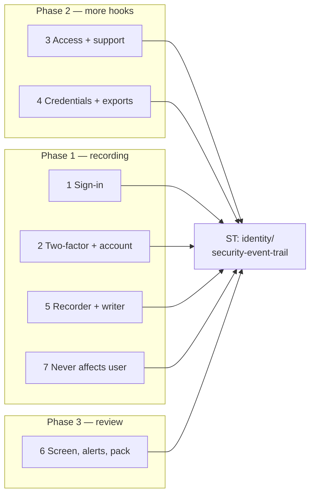
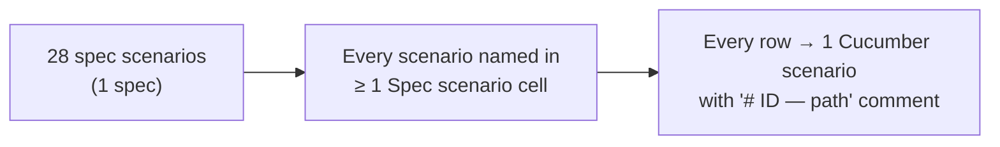

# Security Event Trail — Business Rules (H/E/X)

> **Audience:** Product, QA, developers. Every row becomes exactly one Cucumber scenario.
> **Companions:** [Proposal](proposal.md) · [Design](design.md) · [Specs](specs/identity/security-event-trail/spec.md)

---

## Contents

- [How to read this](#how-to-read-this)
- [Shared setup](#shared-setup)
- [1. Sign-in — Phase 1](#1-sign-in--phase-1)
- [2. Two-factor and account — Phase 1](#2-two-factor-and-account--phase-1)
- [3. Access and support — Phase 2](#3-access-and-support--phase-2)
- [4. Credentials and exports — Phase 2](#4-credentials-and-exports--phase-2)
- [5. Recorder and writer — Phase 1](#5-recorder-and-writer--phase-1)
- [6. Screen, alerts, pack — Phase 3](#6-screen-alerts-pack--phase-3)
- [7. Never affects the user — Phase 1](#7-never-affects-the-user--phase-1)
- [Coverage](#coverage)

---

## How to read this

- **ID legend:** **H** = happy path · **E** = edge case · **X** = error (exception) case. IDs run across the
  whole file.
- **Spec scenario** column: `ST: <scenario name>` (ST = `identity/security-event-trail`). "—" = an
  exhaustive edge with no dedicated spec scenario; it proves the requirement named in the Then.
- **Feature** column (all under `features/security/`): **SI** = `security_events_sign_in.feature`,
  **AC** = `security_events_access.feature`, **SC** = `security_events_screen.feature`,
  **TI** = `security_events_tenant_isolation.feature`.
- Every scenario carries `# E12 — Edge case: …` above it.
- Times are IST (`Asia/Kolkata`); "the event" means one `security_events` row; "alert" = admin alert
  email + bell.

---

## Shared setup

| Record | Name | Key data |
|---|---|---|
| Firm A | Golden Angels Fund | entity 18, `enable_support` on, region IN |
| Firm B | Beta Capital | entity 31 |
| Company admin | Rahul Mehta | firm A, `company_admin`, IP 103.21.4.7 |
| Company admin | Meera Iyer | firm A, `company_admin` |
| LP user | Priya Shah | firm A investor user, 2FA WhatsApp, phone ending 42 |
| Employee | Karan Shah | firm A, `employee` |
| Support | Anil Kumar | CapHive, `support`, mapping to firm A enabled, `allow_login_as` includes him |
| Super | Divya Rao | CapHive, `super` |
| Other admin | Sara Khan | firm B, `company_admin` |
| API key | "Zapier sync" | Rahul's |
| Unknown email | ghost@example.com | no user |

---

## 1. Sign-in — Phase 1

### Happy path

| # | Scenario | Given | When | Then | Spec scenario | Feature |
|---|---|---|---|---|---|---|
| H1 | Website sign-in, no 2FA | Karan, no 2FA | correct password | one `sign_in.succeeded`, door `web_password`, firm 18, IP, UA | ST: Mobile, API, link, region-switch and add-in sign-ins | SI |
| H2 | 2FA sign-in is one success | Priya, 2FA | correct password, then correct code | exactly one `sign_in.succeeded`, door `two_factor`, written after the code | ST: Two-factor user signs in | SI |
| H3 | Email link | Karan has a fresh magic link | opens it | `sign_in.succeeded`, door `magic_link` | ST: Mobile, API, link, region-switch and add-in sign-ins | SI |
| H4 | Password reset signs in | Karan, no 2FA, reset link | sets new password | `password.changed` + `sign_in.succeeded` door `password_reset` | ST: Password changed | SI |
| H5 | Mobile app | Priya on the app | password + code | `sign_in.succeeded`, door `mobile` | ST: Mobile, API, link, region-switch and add-in sign-ins | SI |
| H6 | API sign-in | Karan, no 2FA | `POST /users/tokens/sign_in` | `sign_in.succeeded`, door `api` | ST: Mobile, API, link, region-switch and add-in sign-ins | SI |
| H7 | Region switch (web) | Rahul with regions IN,US | valid cross-site link | `sign_in.succeeded`, door `cross_region` in the destination region | ST: Mobile, API, link, region-switch and add-in sign-ins | SI |
| H8 | App → website hand-off | Priya on the app | valid hand-off link | `sign_in.succeeded`, door `mobile_handoff` | ST: Mobile, API, link, region-switch and add-in sign-ins | SI |
| H9 | Outlook add-in | Rahul signed in | connects the add-in | `sign_in.succeeded`, door `mail_addin` | ST: Mobile, API, link, region-switch and add-in sign-ins | SI |
| H10 | Plain sign-out | Karan signed in | signs out | nothing recorded (user decision 2026-11-09; only a support visit's end is, H20) | ST: Sign-out | SI |

### Edge cases

| # | Scenario | Given | When | Then | Spec scenario | Feature |
|---|---|---|---|---|---|---|
| E1 | Wrong password | Karan | wrong password | `sign_in.failed` reason `invalid`, user Karan, firm 18; message unchanged | ST: Wrong password on the website | SI |
| E2 | Unknown email | ghost@example.com | any password | `sign_in.failed`, `entity_id` NULL, `user_id` NULL, `identifier_digest` = SHA-256 of the email; email not stored | ST: Unknown email | SI |
| E3 | Locked account | Karan locked | correct password | `sign_in.failed` reason `locked` | ST: Locked account | SI |
| E4 | Inactive account | Karan `active=false` | correct password | `sign_in.failed` reason `inactive` | — (proves Req 1) | SI |
| E5 | Expired session is not a failure | signed-out browser | `GET /funds` | redirected to sign-in; **no** event | — (proves Req 1) | SI |
| E6 | Password right, code never entered | Priya | correct password, closes the tab | no `sign_in.succeeded` | ST: Two-factor user signs in | SI |
| E7 | Expired email link | link older than 10 min | opens it | `sign_in.failed` door `magic_link` reason `invalid_link` | — (proves Req 1) | SI |
| E8 | Support delegation refused | Anil not in the mapping's `user_emails` | support magic link | `sign_in.failed` reason `delegation_refused`, actor Anil | — (proves Req 1) | SI |
| E9 | Mobile wrong password | Priya | wrong password on the app | `sign_in.failed` door `mobile` | ST: Mobile, API, link, region-switch and add-in sign-ins | SI |
| E10 | API sign-in by a 2FA user | Priya | `POST /users/tokens/sign_in` | refused as today; `sign_in.failed` door `api` reason `two_factor_required` | — (proves Req 1) | SI |
| E11 | Region switch rejected | expired cross-site link | opens it | `sign_in.failed` door `cross_region`, reason from `reject_handoff` | — (proves Req 1) | SI |
| E12 | MCP invalid token | revoked OAuth token | MCP request | 401 as today; `sign_in.failed` door `oauth` reason `invalid` | ST: Bearer token refused | SI |
| E13 | MCP missing token | no Authorization header | MCP request | 401 as today; **no** event | ST: Bearer token refused | SI |
| E14 | Mail add-in wrong firm | add-in token of firm B user, firm A host | request | `sign_in.failed` door `mail_addin` reason `entity_mismatch` | ST: Bearer token refused | SI |

### Error cases

| # | Scenario | Given | When | Then (what the user sees, who is alerted) | Spec scenario | Feature |
|---|---|---|---|---|---|---|
| — | No error rows | — | — | Sign-in refusals are edge cases above; recorder failures are in § 5 | — | — |

---

## 2. Two-factor and account — Phase 1

### Happy path

| # | Scenario | Given | When | Then | Spec scenario | Feature |
|---|---|---|---|---|---|---|
| H11 | Wrong code | Priya at the code page | wrong code | `two_factor.code_failed` attempt 1; message unchanged | ST: Wrong code | SI |
| H12 | Enrol authenticator | Karan with 2FA on, no method | completes enrolment | `two_factor.method_set` mode `authenticator` + `sign_in.succeeded` door `two_factor` | — (proves Req 2) | SI |
| H13 | Admin resets method | Rahul on Priya's page | Reset two-factor | `two_factor.method_reset`, actor Rahul, user Priya | ST: Admin resets a user's method | SI |
| H14 | Password changed in profile | Karan | changes password | `password.changed`, actor Karan | ST: Password changed | SI |
| H15 | Phone changed | Priya | confirms new number ending 77 | `phone.changed` details `{from: "**42", to: "**77"}` | — (proves Req 3) | SI |

### Edge cases

| # | Scenario | Given | When | Then | Spec scenario | Feature |
|---|---|---|---|---|---|---|
| E15 | Third wrong code ends challenge | Priya, 2 misses | third wrong code | `two_factor.code_failed` attempt 3, `challenge_ended: true` | ST: Wrong code | SI |
| E16 | 10 misses in an hour lock | Priya, 9 misses | 10th miss | `account.locked` reason `too_many_codes` | ST: Locked after too many codes | SI |
| E17 | 6th wrong password locks | Karan, 5 failures | 6th | `sign_in.failed` + `account.locked` reason `too_many_passwords` | ST: Locked after too many passwords | SI |
| E18 | Lock expires | Karan locked 6 min ago (`unlock_in` 5 min) | correct password | `account.unlocked` actor system + `sign_in.succeeded` | — (proves Req 3) | SI |
| E19 | 2FA switched off | Priya | turns it off on her own page with password + code (since M8 the only route; the admin console untick is refused by the model guard) | `two_factor.disabled`, Done by Priya | ST: Two-factor switched off | SI |
| E20 | Reset request, unknown email | ghost@example.com | Forgot password | `password.reset_requested`, no user, digest only; response unchanged | — (proves Req 3) | SI |
| E21 | Deactivate one user | Karan; Anil supports firm A | CapHive support (Anil) sets inactive in the admin console | `account.deactivated`, door `admin`, Done by Anil | — (proves Req 3) | SI |
| E22 | Deactivate a firm | firm B | CapHive support (Anil) deactivates the firm | exactly one `firm.deactivated` for 31, no per-user rows | ST: Firm deactivated | SI |

### Error cases

| # | Scenario | Given | When | Then (what the user sees, who is alerted) | Spec scenario | Feature |
|---|---|---|---|---|---|---|
| — | No error rows | — | — | Validation failures save nothing, so no after-commit fires (covered by E24 pattern) | — | — |

---

## 3. Access and support — Phase 2

### Happy path

| # | Scenario | Given | When | Then | Spec scenario | Feature |
|---|---|---|---|---|---|---|
| H16 | Self-grant approver | Rahul | ticks Approver on himself, Save | `role.granted` role `approver`, user = actor = Rahul | ST: Admin grants themselves approver | AC |
| H17 | Revoke approver | Rahul is approver | Meera unticks it | `role.revoked`, actor Meera | — (proves Req 4) | AC |
| H18 | Support switch on | `enable_support` off | Rahul turns it on | `support_access.enabled` from false to true | ST: Support switch turned on | AC |
| H19 | Support Login as | Anil | Login as Priya | `support.signed_in_as`, actor Anil, user Priya, firm 18 | ST: Support signs in as a user | AC |
| H20 | Support session ends | H19 | Anil signs out | `support.session_ended`, firm 18 | ST: Support session ends | AC |
| H21 | Firm switch and back | Anil | switches into firm A, then reverts | `support.firm_switched` then `support.switched_back`, firm 18 | — (proves Req 5) | AC |

### Edge cases

| # | Scenario | Given | When | Then | Spec scenario | Feature |
|---|---|---|---|---|---|---|
| E23 | Employee by import | user import with role employee | import runs | `role.granted` employee, door `system`, actor = importer; no alert | ST: Employee role granted by import | AC |
| E24 | Rolled-back grant | grant inside a transaction that raises | rollback | no event | — (proves Req 4) | AC |
| E25 | Removing a role not held | Karan not approver | Rahul saves Karan unchanged (`remove_role(:approver)` no-op) | no event | — (proves Req 4) | AC |
| E26 | Investor role via investor access | new investor access | approved | `role.granted` investor; no alert | — (proves Req 4) | AC |
| E27 | Support off for everyone | 3 users with support on | `User.disable_support_for_all` | exactly one `support_access.disabled` door `system`, no firm | — (proves Req 4) | AC |
| E28 | Actions while impersonating | H19 | Anil, as Priya, changes her phone | `phone.changed` with `impersonator_id` = Anil | — (proves Req 5) | AC |
| E29 | Support via magic link | Anil, mapping allows | support `no_password_login` for Priya | `support.signed_in_as` | ST: Support signs in as a user | AC |

### Error cases

| # | Scenario | Given | When | Then (what the user sees, who is alerted) | Spec scenario | Feature |
|---|---|---|---|---|---|---|
| X1 | Login as refused | Anil not allowed by `login_as?` | Login as Priya | "Access Denied" (the existing refusal, unchanged); no `support.signed_in_as` | — (proves Req 5) | AC |

---

## 4. Credentials and exports — Phase 2

### Happy path

| # | Scenario | Given | When | Then | Spec scenario | Feature |
|---|---|---|---|---|---|---|
| H22 | API key created | Rahul | creates "Zapier sync" | `api_token.created` name "Zapier sync"; the token string appears nowhere in the row | ST: API key created | AC |
| H23 | API key revoked | H22 | revokes it | `api_token.revoked` | — (proves Req 6) | AC |
| H24 | Mobile device revoked | Priya's phone | she signs it out from the website | `mobile_device.revoked` reason `website_sign_out` | — (proves Req 6) | AC |
| H25 | Connected app authorised | Rahul | approves an MCP client on the OAuth screen | `connected_app.authorised` app name, scopes | — (proves Req 6) | AC |
| H26 | Spreadsheet download | Rahul | downloads Capital Calls as xlsx | `data.exported` details `capital_calls#index (xlsx)` | ST: Spreadsheet download | AC |
| H27 | Folder download | Rahul | downloads a folder | `data.exported` details folder name | — (proves Req 7) | AC |

### Edge cases

| # | Scenario | Given | When | Then | Spec scenario | Feature |
|---|---|---|---|---|---|---|
| E30 | Refused xlsx | Karan lacks access | requests an xlsx | refused as today; no event | — (proves Req 7) | AC |
| E31 | Firm data dump | super | ad-hoc dump of firm A | `data.exported` details `entity_db_dump` | — (proves Req 7) | AC |
| E32 | Audit download | Rahul | downloads the Audit Trail | `data.exported` details `audits#index (xlsx)` | — (proves Req 7) | AC |

### Error cases

| # | Scenario | Given | When | Then (what the user sees, who is alerted) | Spec scenario | Feature |
|---|---|---|---|---|---|---|
| X2 | 11th live key refused | Rahul has 10 live keys | creates one more | "You already have 10 live tokens — revoke one first"; no `api_token.created` | — (proves Req 6) | AC |

---

## 5. Recorder and writer — Phase 1

### Happy path

| # | Scenario | Given | When | Then | Spec scenario | Feature |
|---|---|---|---|---|---|---|
| H28 | Queued write | Sidekiq up | Karan signs in | job enqueued; row appears once with `occurred_at` = sign-in time | — (proves Req 8) | SI |

### Edge cases

| # | Scenario | Given | When | Then | Spec scenario | Feature |
|---|---|---|---|---|---|---|
| E33 | Retry is idempotent | job ran once | same job retried | still one row; one alert at most | — (proves Req 9) | SI |
| E34 | Queue down | enqueue raises | Karan signs in | signed in normally; row inserted inline | ST: Queue down at sign-in | SI |
| E35 | Unknown kind | a hook passes `"bogus"` | record | nothing saved; warn logged; action unaffected | — (proves Req 8) | SI |
| E36 | Detail not allowlisted | `role.granted` with extra `token:` key | record | `details` holds `role` only | — (proves Req 9) | SI |
| E37 | Long user agent | 900-char UA | sign-in | `user_agent` stored at 255 chars | — (proves Req 9) | SI |

### Error cases

| # | Scenario | Given | When | Then (what the user sees, who is alerted) | Spec scenario | Feature |
|---|---|---|---|---|---|---|
| X3 | Everything down | enqueue and insert both raise | Karan signs in | signed in normally; one `[security_event]` warn line with kind, user id, IP | ST: Everything down | SI |
| X4 | Event edit attempt | a saved event | `update(kind: …)` | `ActiveRecord::ReadOnlyRecord`; row unchanged | — (proves Req 9) | SI |
| X5 | Secret never stored | any event from H1–H27 | inspect row | no password, code, token, signed id or session id in any column | — (proves Req 9) | SI |

---

## 6. Screen, alerts, pack — Phase 3

### Happy path

| # | Scenario | Given | When | Then | Spec scenario | Feature |
|---|---|---|---|---|---|---|
| H29 | Admin list | firm A and B events | Meera opens Security Events | only firm 18 rows, newest first, last 30 days | ST: Company admin sees own firm only | SC |
| H30 | Filter by group | H29 | Group = Access | role + support-switch rows only; cards recount | — (proves Req 10) | SC |
| H31 | Download | H29 | Download | flash "Your request is being processed. You will receive an email shortly."; email with xlsx of firm 18's filtered rows | ST: Download | SC |
| H32 | Approver alert | H16 | job runs | Rahul and Meera get "Approver role given to Rahul Mehta"; date `Nov 09, 2026` | ST: Admin grants themselves approver | SC |
| H33 | Support sign-in alert: bell only (changed 2026-11-09) | H19 | job runs | `support.signed_in_as` recorded; Rahul and Meera get the bell "CapHive support (Anil Kumar) signed in as Priya Shah"; **no** email (user decision: no emails on sign-in by support) | ST: Support signs in as a user | SC |
| H34 | Weekly pack | events 02–08 Nov | Mon 09 Nov 07:00 | support@caphive.com gets "[IN] Security events 02 Nov – 08 Nov 2026" xlsx with 5 sheets; "Failed sign-ins by account" counts per account per day | ST: Monday pack | SC |
| H35 | Purge | events on 08 Oct 2025 and 10 Oct 2025 | purge runs 09 Nov 2026 | the 08 Oct 2025 row removed; the 10 Oct 2025 row kept | ST: Retention | SC |

### Edge cases

| # | Scenario | Given | When | Then | Spec scenario | Feature |
|---|---|---|---|---|---|---|
| E38 | Empty state | filter matches nothing | apply | "No security events in this period. Widen the dates or clear the filter." | — (proves Req 10) | SC |
| E39 | Period over 13 months | from 01 Jan 2025 | apply | clamped to 13 months; flash says so | — (proves Req 10) | SC |
| E40 | Cards = rows | 3 failed sign-ins, 2 role rows | open | cards 3 and 2 equal the filtered rows | — (proves Req 10) | SC |
| E41 | No alert for employee | E23 | job runs | no email or bell | ST: Employee role granted by import | SC |
| E42 | Firm switch alert: bell only (changed 2026-11-09) | H21 | job runs | `support.firm_switched` recorded; one bell "CapHive support (Anil Kumar) switched into Golden Angels Fund" per admin; **no** email; the `company_admin` grant to Anil alerts nobody | — (proves Req 5) | SC |
| E43 | Purge boundary | rows at exactly 13 months and 13 months + 1 s | purge | exactly-13-months row kept; older removed | ST: Retention | SC |
| E44 | Formula-looking value in xlsx | user agent `=HYPERLINK(...)` | download | cell starts with `'` | — (proves Req 10) | SC |
| E51 | "Enable support" switch still alerts (added 2026-11-09 with the H33 change) | Rahul has support off | Rahul turns it on | `support_access.enabled` recorded; Rahul and Meera get "CapHive support access switched on for Rahul Mehta" (email + bell) | ST: Support switch turned on | SC |
| E52 | Click an Event to filter (added 2026-11-09, user request) | Priya: a sign-in and a sign-out; Karan: a sign-out; Meera filtered by account Priya | clicks "Signed out" in the grid, then the "× Signed out" chip | only Priya's sign-out, the account filter kept and Event = Signed out in the panel (and in Download); the chip brings back both of Priya's events | — (proves Req 10) | SC |
| E50 | Weekly pack with no recipient (added during apply) | `SECURITY_EVENTS_WEEKLY_TO` unset | Monday run | no email; `[security_event] weekly_pack_skipped` warning | ST: Setting missing | SC |
| E45 | Support and super scope | Anil mapped to A; Divya super | each opens the list | Anil: firm 18 only; Divya: all firms + NULL-firm rows (E2) | — (proves Req 10) | TI |

### Error cases

| # | Scenario | Given | When | Then (what the user sees, who is alerted) | Spec scenario | Feature |
|---|---|---|---|---|---|---|
| X6 | Employee refused | Karan | `GET /security_events` | "Access Denied" (the app's refusal) | ST: Employee refused | TI |
| X7 | Investor refused | Priya | `GET /security_events` | same refusal | ST: Employee refused | TI |
| X8 | Other firm by query | Sara (firm B) | `GET /security_events?q[entity_id_eq]=18` | only firm 31 rows (`entity_id` not ransackable) | ST: Company admin sees own firm only | TI |
| X9 | Download re-scoped | Sara crafts download params for firm 18 | download | xlsx holds only firm 31 rows | ST: Download | TI |
| X10 | Support without support enabled | firm A turns support off | Anil opens list | no firm 18 rows | — (proves Req 10) | TI |
| X11 | No write routes | Rahul | `DELETE /security_events/1`, `PATCH` | 404 routing error; row unchanged | — (proves Req 9) | TI |
| X12 | Firm with no active admin | firm B admin deactivated | role grant in B | row saved; no email; no error | — (proves Req 4) | SC |

---

## 7. Never affects the user — Phase 1

### Happy path

| # | Scenario | Given | When | Then | Spec scenario | Feature |
|---|---|---|---|---|---|---|
| — | No happy rows | — | — | Covered by every row above asserting the unchanged message | — | — |

### Edge cases

| # | Scenario | Given | When | Then | Spec scenario | Feature |
|---|---|---|---|---|---|---|
| E46 | Sign-in messages unchanged | E1, E3 | as there | "Invalid email or password." for both (Devise is paranoid: a locked account is not revealed) exactly as before | — (proves Req 8) | SI |
| E47 | Role save message unchanged | H16 | as there | "User was successfully updated." | — (proves Req 8) | AC |
| E48 | Login as message unchanged | H19 | as there | "Signed in as Priya Shah" | — (proves Req 8) | AC |
| E49 | Recorder raises in the Warden hook | recorder forced to raise | wrong password | same failure page and message | — (proves Req 8) | SI |

### Error cases

| # | Scenario | Given | When | Then (what the user sees, who is alerted) | Spec scenario | Feature |
|---|---|---|---|---|---|---|
| — | See X3 | — | — | — | — | — |

---

## Coverage

| Group | H | E | X | Total |
|---|---|---|---|---|
| 1 Sign-in | 10 | 14 | 0 | 24 |
| 2 Two-factor and account | 5 | 8 | 0 | 13 |
| 3 Access and support | 6 | 7 | 1 | 14 |
| 4 Credentials and exports | 6 | 3 | 1 | 10 |
| 5 Recorder and writer | 1 | 5 | 3 | 9 |
| 6 Screen, alerts, pack | 7 | 11 | 7 | 25 |
| 7 Never affects the user | 0 | 4 | 0 | 4 |
| **Total** | **35** | **52** | **12** | **99** |

- `features/security/security_events_tenant_isolation.feature` gathers every refusal row (E45, X6–X11): other firm refused, owner allowed, direct request refused.
- An edge case found during apply gets a new row here **and** a scenario, never a scenario alone.
