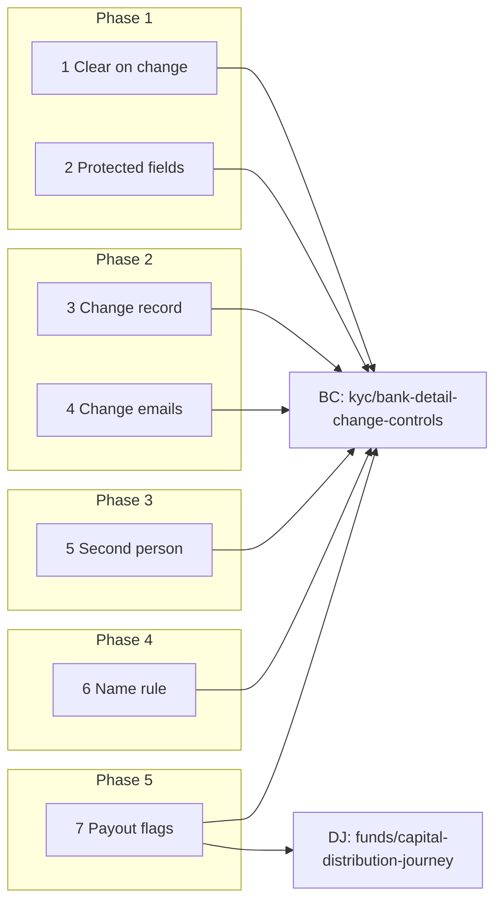
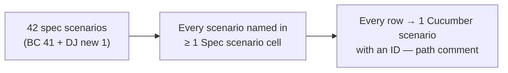

# Bank Detail Change Controls — Business Rules (H/E/X)

<!-- STYLE: bullets and diagrams, not prose. One idea per bullet; table cells a phrase each —
     longer reasoning goes in bullets under the table. -->

> **Audience:** Product, QA, developers. Every row becomes exactly one Cucumber scenario.
> **Companions:** [Proposal](proposal.md) · [Design](design.md) · [Specs](specs/)

---

## Contents

- [How to read this](#how-to-read-this)
- [Shared setup](#shared-setup)
- [1. Clear on change — Phase 1](#1-clear-on-change--phase-1)
- [2. Protected fields — Phase 1](#2-protected-fields--phase-1)
- [3. Change record and KYC page — Phase 2](#3-change-record-and-kyc-page--phase-2)
- [4. Change emails — Phase 2](#4-change-emails--phase-2)
- [5. Second person — Phase 3](#5-second-person--phase-3)
- [6. Bank check name rule — Phase 4](#6-bank-check-name-rule--phase-4)
- [7. Payout flags and journey warnings — Phase 5](#7-payout-flags-and-journey-warnings--phase-5)
- [Coverage](#coverage)

---

## How to read this

- **ID legend:** **H** = happy path · **E** = edge case · **X** = error (exception) case. IDs run across the
  whole file.
- **Spec scenario** column: `BC: <scenario>` = `kyc/bank-detail-change-controls`; `DJ: <scenario>` =
  `funds/capital-distribution-journey`.
- **Feature** column: the planned Cucumber file. Refusal rows live in `features/security/`.
- Every scenario carries a comment above it: `# E12 — Edge case: …`.
- Dates: screens use the `en` locale (`09/11/2026`); emails use `Nov 09, 2026`. "Today" is 09/11/2026.
- Bank check (penny drop) is always stubbed (`KycVerify#verify_bank`); no real provider call in tests.
- Account numbers: Anil's old account `50100012344821` (ending 4821), new `50100273107310` (ending 7310).

---

## Shared setup

| Record | Name | Key data |
|---|---|---|
| Firm (checks off) | Horizon Capital | Bank verification **off**; KYCs enabled |
| User | Meera Shah | Horizon employee; Investor KYC Update + **Approve**; KYC read |
| User | Ravi Iyer | Horizon **company admin** |
| User | Priya Nair | Horizon employee; Investor KYC Update only (no Approve) |
| Investor | Anil Kumar | Horizon investor |
| Investor contact | anil.kumar@example.in | Approved access, no tags (all topics), created 01/10/2026 |
| Investor contact | sunita.kumar@example.in | Approved access, tag "Distribution" only |
| KYC | Anil Kumar (Individual) | Verified by Ravi 01/10/2026; HDFC Bank, MG Road, Savings, 50100012344821, HDFC0001234; Bank Verified ✓ |
| KYC | Bina Shah (Individual) | Verified; no changes ever |
| KYC | Chetan Rao (Individual) | Submitted, not verified; bank fields **blank** |
| Fund / distribution | Horizon Fund I / Q3 2026 Distribution | Pays Anil Kumar ₹12,50,000 and Bina Shah ₹8,00,000; not yet emailed |
| Firm (checks on) | Kestrel Capital | Bank verification **on**; approvers Dev Menon and Asha Pillai |
| KYCs at Kestrel | A Kumar · Thimmaiah Chengappa · ABC Private Limited · Anil Sharma | Verified; each with an account and IFSC |
| Firm (one approver) | Solo Advisors | Only KYC approver: Kiran Rao (company admin); KYC Leela Menon, verified |
| Other tenant | Northwind Partners | Company admin Omar Sheikh |

---

## 1. Clear on change — Phase 1

### Happy path

| # | Scenario | Given | When | Then | Spec scenario | Feature |
|---|---|---|---|---|---|---|
| H1 | Account change clears Bank Verified (checks off) | Anil's KYC unverified by Meera | Meera changes account to 50100273107310 and saves | Bank Verified off straight after the save | BC: Cleared immediately with checks off | features/core/bank_detail_change_reset.feature |
| H2 | IFSC change clears Bank Verified | Anil's KYC unverified | Meera changes IFSC to ICIC0004567 | Bank Verified off | BC: Account number changed | features/core/bank_detail_change_reset.feature |
| H3 | Checks on: cleared, then re-checked | Kestrel KYC "A Kumar" unverified; stub returns provider match | Dev changes the account | Off right after save; ✓ again after the (stubbed) check runs | BC: Cleared immediately with checks off | features/core/bank_detail_change_reset.feature |

### Edge cases

| # | Scenario | Given | When | Then | Spec scenario | Feature |
|---|---|---|---|---|---|---|
| E1 | Form still sends the tick | Anil's KYC unverified, Bank Verified ✓ shown ticked in the form | Ravi changes account, leaves box ticked, saves | Bank Verified off | BC: Cleared even if the form sent the tick | features/core/bank_detail_change_reset.feature |
| E2 | Bank name / branch / type only | Anil's KYC unverified | Meera changes branch "MG Road" → "Indiranagar", type → Current | Bank Verified ✓ unchanged | BC: Branch name only | features/core/bank_detail_change_reset.feature |
| E3 | Same IFSC re-typed | Anil's KYC unverified | Meera saves IFSC "hdfc0001234 " | Bank Verified ✓ unchanged | BC: Same value re-typed | features/core/bank_detail_change_reset.feature |
| E4 | Full name only (checks off) | Anil's KYC unverified | Meera changes full name to "Anil K Kumar" | Bank Verified ✓ unchanged | BC: Branch name only | features/core/bank_detail_change_reset.feature |
| E5 | Document Checks fill-in | Anil's KYC unverified; a check reads 50100273107310 from the cheque | Meera clicks "Use document value" | Bank Verified off | BC: Cleared on a Document Checks fill-in | features/core/bank_detail_change_reset.feature |
| E6 | AI extraction overwrites | Anil's KYC unverified; extractor "always overwrite" with a bank rule | Extraction job writes 50100273107310 | Bank Verified off | BC: Cleared immediately with checks off | features/core/bank_detail_change_reset.feature |
| E7 | JSON API update | Anil's KYC unverified; Ravi's API token | PATCH `/investor_kycs/:id.json` with new account | 200; Bank Verified off | BC: Account number changed | features/core/bank_detail_change_reset.feature |
| E8 | Import Update Only, Verified blank | Anil's KYC unverified | Meera imports a row with the new account | Row "Success"; Bank Verified off | BC: Account number changed | features/core/bank_detail_change_reset.feature |
| E9 | Verified KYC changed through Compare CKYC/KRA save | Anil's KYC **verified** | Meera saves the compare form (id of Anil's KYC) with a new account | KYC no longer verified; Bank Verified off | BC: Import changes a verified KYC | features/core/bank_detail_change_reset.feature |
| E10 | Verified KYC changed by import | Anil's KYC **verified**, journey on | Meera imports Update Only row with IFSC ICIC0004567, Verified blank | KYC unverified; journey Verify task current, note "Bank details changed" | BC: Import changes a verified KYC | features/core/bank_detail_change_reset.feature |

### Error cases

| # | Scenario | Given | When | Then (what the user sees, who is alerted) | Spec scenario | Feature |
|---|---|---|---|---|---|---|
| X1 | Save fails validation | Anil's KYC unverified | Meera saves new account with a 21-character IFSC | Form error "Ifsc code is too long"; Bank Verified ✓ unchanged; account unchanged | BC: Account number changed | features/core/bank_detail_change_reset.feature |

---

## 2. Protected fields — Phase 1

### Happy path

| # | Scenario | Given | When | Then | Spec scenario | Feature |
|---|---|---|---|---|---|---|
| H4 | Approver ticks Bank Verified | Anil's KYC unverified, Bank Verified off, no awaiting change | Ravi ticks Bank Verified and saves | Bank Verified ✓ | BC: Second approver ticks after review | features/security/bank_detail_change_fields.feature |

### Edge cases

| # | Scenario | Given | When | Then | Spec scenario | Feature |
|---|---|---|---|---|---|---|
| E11 | Update-only employee's tick ignored | Anil's KYC unverified, Bank Verified off | Priya opens Edit | No Bank Verified box; a crafted request with `bank_verified=1` saves other fields, flag stays off | BC: Update-only employee's tick ignored | features/security/bank_detail_change_fields.feature |
| E12 | Update-only employee can't verify via API | Anil's KYC unverified | Priya PATCHes `verified: true` | 200; KYC still unverified | BC: Update-only employee's tick ignored | features/security/bank_detail_change_fields.feature |
| E13 | Approver's plain re-save keeps the tick | Anil's KYC unverified, Bank Verified ✓ | Ravi changes only the address and saves | Bank Verified ✓ | BC: Branch name only | features/security/bank_detail_change_fields.feature |

### Error cases

| # | Scenario | Given | When | Then (what the user sees, who is alerted) | Spec scenario | Feature |
|---|---|---|---|---|---|---|
| X2 | Investor forges bank result via magic link | Anil's KYC link_sent; Anil's magic link | Submit form with `bank_verification_status=Verified` and a fake response | Saved; status and response unchanged | BC: Investor sends a forged response | features/security/bank_detail_change_fields.feature |
| X3 | Investor forges via JSON API | Anil signed in (bearer token) | PATCH with `bank_verification_response` | 200; response unchanged | BC: Investor sends a forged response | features/security/bank_detail_change_fields.feature |
| X4 | Employee sends PAN result fields | Anil's KYC unverified | Meera PATCHes `pan_verification_status=Verified` | Unchanged | BC: Investor sends a forged response | features/security/bank_detail_change_fields.feature |

---

## 3. Change record and KYC page — Phase 2

### Happy path

| # | Scenario | Given | When | Then | Spec scenario | Feature |
|---|---|---|---|---|---|---|
| H5 | Fund user's change recorded | Anil's KYC unverified | Meera changes account + IFSC | Record: maker Meera (firm), source screen, 4821 → 7310, HDFC0001234 → ICIC0004567, awaiting; note "Bank details changed on 09/11/2026 by Meera Shah — account ending 4821 → 7310. Waiting for a second approver to verify." | BC: Note on the KYC page | features/core/bank_detail_change_record.feature |
| H6 | Investor's change recorded | Anil's KYC link_sent | Anil (magic link) changes account and submits | Record: maker Anil Kumar (investor), awaiting | BC: Account number changed | features/core/bank_detail_change_record.feature |

### Edge cases

| # | Scenario | Given | When | Then | Spec scenario | Feature |
|---|---|---|---|---|---|---|
| E14 | First fill | Chetan Rao's KYC, bank blank | Chetan's contact fills account and IFSC | No record, no note | BC: First fill is not a change | features/core/bank_detail_change_record.feature |
| E15 | Two changes before verify | H5 done | Meera changes account again to …9902 | First record "replaced"; new one awaiting 7310 → 9902; note shows the new one | BC: Later change replaces an awaiting one | features/core/bank_detail_change_record.feature |
| E16 | Account cleared | Anil's KYC unverified | Meera blanks the account number | Record "ending 4821 → none" | BC: Account number changed | features/core/bank_detail_change_record.feature |
| E17 | Import source | Anil's KYC unverified | Meera imports Update Only with new account | Record: source import, maker Meera | BC: Account number changed | features/core/bank_detail_change_record.feature |
| E18 | No user (job) | Anil's KYC unverified | AI extraction job with no acting user writes a new account | Record maker "System" | BC: Account number changed | features/core/bank_detail_change_record.feature |
| E19 | Investor sees no note | H5 done | Anil opens his KYC (signed in) | No change note; details as today | BC: Investor does not see the note | features/core/bank_detail_change_record.feature |
| E20 | Badge text (checks off) | H5 done | Ravi opens the KYC | Bank Verified badge "Not verified — bank details changed" | BC: Cleared immediately with checks off | features/core/bank_detail_change_record.feature |
| E21 | Audit trail keeps old values | H5 done | Ravi opens KYC Actions › Audit Trail | Old account 50100012344821 and old Bank Verified listed | BC: Note on the KYC page | features/core/bank_detail_change_record.feature |
| E22 | Existing KYCs untouched at release | Bina Shah's KYC verified before release, no records | Ravi opens Bina's KYC | No note; Verified and Bank Verified as before; no email sent | BC: Verified KYCs untouched at release | features/core/bank_detail_change_record.feature |
| E23 | No record stored with full numbers | H5 done | Inspect the stored change record | Only "4821"/"7310" held; no full account number | BC: Note on the KYC page | features/core/bank_detail_change_record.feature |

### Error cases

| # | Scenario | Given | When | Then (what the user sees, who is alerted) | Spec scenario | Feature |
|---|---|---|---|---|---|---|
| X5 | Failed save leaves no record | Anil's KYC unverified | Meera saves new account with a 21-char IFSC | Form error; no record; no email | BC: Account number changed | features/core/bank_detail_change_record.feature |

---

## 4. Change emails — Phase 2

### Happy path

| # | Scenario | Given | When | Then | Spec scenario | Feature |
|---|---|---|---|---|---|---|
| H7 | Investor emailed, masked | Anil's KYC unverified | Meera changes account + IFSC | anil.kumar@example.in gets "Your bank details with Horizon Capital were changed", "Nov 09, 2026", "ending 4821 → ending 7310", both IFSCs, "View KYC"; no full number | BC: Investor emailed with masked account | features/core/bank_detail_change_emails.feature |
| H8 | Approvers emailed, maker not | as H7 | as H7 | Ravi gets "Bank details changed for Anil Kumar — a second approver must verify" + in-app notification, naming anil.kumar@example.in; Meera gets nothing | BC: Approvers told, maker not | features/core/bank_detail_change_emails.feature |

### Edge cases

| # | Scenario | Given | When | Then | Spec scenario | Feature |
|---|---|---|---|---|---|---|
| E24 | Contact tagged Distribution only | as H7 | as H7 | sunita.kumar@example.in not emailed | BC: Investor emailed with masked account | features/core/bank_detail_change_emails.feature |
| E25 | Contact added after the change | Change saved 09/11/2026 10:00 | New contact approved 10:01, job runs 10:02 | New contact not emailed | BC: Contact added after the change is not emailed | features/core/bank_detail_change_emails.feature |
| E26 | eSign email in the same save | Anil's KYC unverified | Meera changes account and eSign emails to attacker@example.com | attacker@example.com not emailed | BC: eSign email in the KYC is not used | features/core/bank_detail_change_emails.feature |
| E27 | Investor's own change | H6 | — | Anil also gets the investor email ("If you asked for this, no action is needed") | BC: Investor-made change | features/core/bank_detail_change_emails.feature |
| E28 | Job retried | H7's job already ran | Same job runs again | Each contact still has one email; approvers one each | BC: Sent once on retry | features/core/bank_detail_change_emails.feature |
| E29 | Firm rewords the email | Horizon has a custom notification for "notify_bank_details_changed" | as H7 | Anil's email uses the custom subject/body with masked digits | BC: Investor emailed with masked account | features/core/bank_detail_change_emails.feature |
| E30 | Approver who cannot see the KYC | Horizon user Kabir (Approve, no KYC read, no fund access) | as H7 | Kabir not emailed | BC: Approvers told, maker not | features/core/bank_detail_change_emails.feature |
| E31 | Branch-only edit sends nothing | Anil's KYC unverified | Meera changes branch only | No emails | BC: Branch name only | features/core/bank_detail_change_emails.feature |

### Error cases

| # | Scenario | Given | When | Then (what the user sees, who is alerted) | Spec scenario | Feature |
|---|---|---|---|---|---|---|
| X6 | No investor contact | Anil's investor has no approved contact for KYC emails | Meera changes account | No investor email; Ravi's email says "No investor contact could be emailed — confirm the change with the investor by phone." | BC: No investor contact | features/core/bank_detail_change_emails.feature |

---

## 5. Second person — Phase 3

### Happy path

| # | Scenario | Given | When | Then | Spec scenario | Feature |
|---|---|---|---|---|---|---|
| H9 | Second approver verifies via popup | H5 (Meera's change awaiting) | Ravi clicks Verify, sees cards, clicks "Verify KYC" | "Investor kyc was successfully verified."; note "Confirmed by Ravi Iyer on 10/11/2026" | BC: Second approver verifies | features/core/bank_detail_change_second_person.feature |
| H10 | Investor-made change, any approver | H6 (Anil's change awaiting) | Meera verifies | Verified; confirmed by Meera | BC: Investor-made change | features/core/bank_detail_change_second_person.feature |
| H11 | Only approver | Solo Advisors; Kiran changes Leela's account (after UnVerify) | Kiran clicks Verify | Popup card "You are the only KYC approver at Solo Advisors — this is recorded as confirmed by the person who made the change."; confirm → verified, recorded "Only approver" | BC: One-approver firm | features/core/bank_detail_change_second_person.feature |

### Edge cases

| # | Scenario | Given | When | Then | Spec scenario | Feature |
|---|---|---|---|---|---|---|
| E32 | Maker's button greyed | H5 | Meera opens the KYC | Verify greyed; tooltip "You changed this KYC's bank details. Another KYC approver must verify it." | BC: Maker's Verify is greyed out | features/core/bank_detail_change_second_person.feature |
| E33 | Popup cards | H5 | Ravi clicks Verify | Cards "New payout account confirmed" (••••7310, ICIC0004567), "You are the second person" (Meera Shah, 09/11/2026), "Investor already told" (anil.kumar@example.in) | BC: Popup cards | features/core/bank_detail_change_second_person.feature |
| E34 | Popup shows Name needs review | Kestrel; Dev changed "A Kumar"'s account; check status "Name needs review: the bank has 'R KUMAR'" | Asha clicks Verify | Extra card "Bank check: Name needs review" | BC: Popup cards | features/core/bank_detail_change_second_person.feature |
| E35 | No awaiting change → no popup | Bina's KYC unverified, no change | Ravi clicks Verify | Verified directly, as today | BC: No change, no popup | features/core/bank_detail_change_second_person.feature |
| E36 | Maker can still UnVerify | Anil's KYC verified, no change | Meera clicks UnVerify | Unverified as today | BC: Maker can still unverify | features/core/bank_detail_change_second_person.feature |
| E37 | Bulk Verify by maker | H5 + Bina and Chetan unverified (Chetan with full details) | Meera bulk-verifies the three | Bina and Chetan verified; Anil listed "Not verified — you changed the bank details; another approver must verify" | BC: Maker's bulk Verify skips the KYC | features/core/bank_detail_change_second_person.feature |
| E38 | Second approver added later | Kiran's change on Leela awaiting | Solo adds Uma (Approve) before Kiran verifies | Kiran's Verify greyed; Uma can verify | BC: A second approver is added later | features/core/bank_detail_change_second_person.feature |
| E39 | Approver who can't see the KYC doesn't count | Horizon: Meera + Kabir (Approve, cannot see Anil's KYC); Ravi deactivated | Meera changes then clicks Verify | Only-approver card shown; confirm → recorded "Only approver" | BC: One-approver firm | features/core/bank_detail_change_second_person.feature |
| E40 | Import Verified = Yes with a change | Anil's KYC verified | Meera imports Update Only row: new account, Verified Yes | "Success with warnings" — "Bank details changed — the KYC was left unverified for another approver to verify"; KYC unverified; awaiting | BC: Update Only with Verified Yes | features/core/bank_detail_change_second_person.feature |
| E41 | Maker's later import can't verify | E40 done | Meera imports the same row again (no further change), Verified Yes | Same warning; still unverified | BC: Update Only with Verified Yes | features/core/bank_detail_change_second_person.feature |
| E42 | Second person's import confirms | E40 done | Ravi imports the row, Verified Yes | "Success"; verified; confirmed by Ravi | BC: Second approver verifies | features/core/bank_detail_change_second_person.feature |
| E43 | New KYC import unchanged | — | Meera imports a new KYC with account and Verified Yes | Verified; no record; no email | BC: New KYC import unchanged | features/core/bank_detail_change_second_person.feature |
| E44 | Maker can't tick Bank Verified, second approver can | H5 | Meera opens Edit; Ravi opens Edit | Meera: no box; Ravi: box shown and saves ✓ | BC: Second approver ticks after review | features/core/bank_detail_change_second_person.feature |
| E45 | System-made change | E18 | Meera verifies | Verified; confirmed by Meera | BC: Investor-made change | features/core/bank_detail_change_second_person.feature |
| E46 | After confirmation the maker is free | H9 done | Meera UnVerifies then Verifies (no new change) | Both work, no popup | BC: Maker can still unverify | features/core/bank_detail_change_second_person.feature |

### Error cases

| # | Scenario | Given | When | Then (what the user sees, who is alerted) | Spec scenario | Feature |
|---|---|---|---|---|---|---|
| X7 | Maker's direct request | H5 | Meera PUTs `/investor_kycs/:id/toggle_verified` | Refused: "You changed this KYC's bank details, so another KYC approver must verify it."; still unverified | BC: Maker's direct request refused | features/security/bank_detail_change_second_person.feature |
| X8 | Maker via JSON API | H5 | Meera PATCHes `verified: true` | Ignored; still unverified | BC: Maker's direct request refused | features/security/bank_detail_change_second_person.feature |
| X9 | Maker crafts Bank Verified tick | H5 | Meera PATCHes `bank_verified: 1` | Ignored; still off | BC: Update-only employee's tick ignored | features/security/bank_detail_change_second_person.feature |
| X10 | Non-approver Verify | H5 | Priya PUTs toggle_verified | Refused (not authorized), as today | BC: Maker's direct request refused | features/security/bank_detail_change_second_person.feature |
| X11 | Other firm | H5 | Omar (Northwind) opens Horizon's KYC page and PUTs toggle_verified | Both refused; no change detail shown | BC: Other firm refused | features/security/bank_detail_change_second_person.feature |
| X12 | Double click Verify | H5 | Ravi submits the popup twice | Verified once; one confirmation; second request finds no awaiting change and makes no new record | BC: Second approver verifies | features/security/bank_detail_change_second_person.feature |

---

## 6. Bank check name rule — Phase 4

> Kestrel Capital (checks on). The stub sets `verified: true`, `beneficiary_name_with_bank` and
> `fuzzy_match_result`; the change is made by Dev Menon.

### Happy path

| # | Scenario | Given | When | Then | Spec scenario | Feature |
|---|---|---|---|---|---|---|
| H12 | Provider match | Stub: "ANIL SHARMA", fuzzy true | Dev changes "Anil Sharma"'s account | Bank Verified ✓ | BC: Initial accepted | features/core/bank_detail_name_match.feature |
| H13 | Initial matches | Stub: "THIMMAIAH C", fuzzy false | Dev changes "Thimmaiah Chengappa"'s account | ✓ | BC: Initial accepted | features/core/bank_detail_name_match.feature |
| H14 | Company suffixes | Stub: "ABC PVT LTD", fuzzy false | Dev changes "ABC Private Limited"'s account | ✓ | BC: Company suffixes | features/core/bank_detail_name_match.feature |

### Edge cases

| # | Scenario | Given | When | Then | Spec scenario | Feature |
|---|---|---|---|---|---|---|
| E47 | Look-alike initial | Stub: "R KUMAR", fuzzy false | Dev changes "A Kumar"'s account | Off; "Name needs review: the bank has 'R KUMAR'" | BC: Look-alike name goes to review | features/core/bank_detail_name_match.feature |
| E48 | Surname only | Stub: "KUMAR", fuzzy false | Dev changes "A Kumar"'s account | Off; Name needs review | BC: Look-alike name goes to review | features/core/bank_detail_name_match.feature |
| E49 | Title ignored | Stub: "MR A KUMAR", fuzzy false | Dev changes "A Kumar"'s account | ✓ | BC: Initial accepted | features/core/bank_detail_name_match.feature |
| E50 | Extra middle name | Stub: "ANIL KUMAR SHARMA", fuzzy false | Dev changes "Anil Sharma"'s account | ✓ (every KYC word is in the bank name) | BC: Initial accepted | features/core/bank_detail_name_match.feature |
| E51 | Different first name | Stub: "RAMESH SHARMA", fuzzy false | Dev changes "Anil Sharma"'s account | Name needs review | BC: Look-alike name goes to review | features/core/bank_detail_name_match.feature |
| E52 | Word order swapped | Stub: "SHARMA ANIL", fuzzy false | Dev changes "Anil Sharma"'s account | ✓ | BC: Initial accepted | features/core/bank_detail_name_match.feature |
| E53 | Stale result discarded | Check for …7310 started; Dev changes to …9902 before it finishes | The first check completes | Its result is not applied; the …9902 check decides | BC: Stale result discarded | features/core/bank_detail_name_match.feature |
| E54 | Checks off: no check runs | Horizon (off) | Meera changes Anil's account | No provider call; Bank Verified stays off | BC: Cleared immediately with checks off | features/core/bank_detail_name_match.feature |
| E55 | Secondary-sale offer keeps today's rule | Kestrel offer with seller "A Kumar"; stub "R KUMAR" | Offer bank check runs | Offer bank verified as today (unchanged legacy path) | BC: Look-alike name goes to review | features/core/bank_detail_name_match.feature |
| E56 | Second approver accepts a review | E47 done | Asha checks the cheque, ticks Bank Verified | ✓; Dev cannot tick it | BC: Second approver ticks after review | features/core/bank_detail_name_match.feature |

### Error cases

| # | Scenario | Given | When | Then (what the user sees, who is alerted) | Spec scenario | Feature |
|---|---|---|---|---|---|---|
| X13 | Account not found | Stub: `verified: false`, error "Invalid account" | Dev changes "A Kumar"'s account | Off; status "Invalid account" (as today) | BC: Look-alike name goes to review | features/core/bank_detail_name_match.feature |
| X14 | Unreadable provider body | Stub returns non-JSON | Dev changes the account | Off; raw body kept as today; no error page | BC: Look-alike name goes to review | features/core/bank_detail_name_match.feature |

---

## 7. Payout flags and journey warnings — Phase 5

### Happy path

| # | Scenario | Given | When | Then | Spec scenario | Feature |
|---|---|---|---|---|---|---|
| H15 | Distribution panel warning | H5 (Anil awaiting); Q3 2026 Distribution with journey, not emailed | Ravi opens the distribution | Panel warns "1 KYC has bank details changed and not yet confirmed by a second approver" | DJ: Unconfirmed bank change warning | features/funds/bank_detail_change_payout_flags.feature |
| H16 | Readiness check flags | H5; readiness agent on the distribution | Meera runs it | Bank Details step fails: "1 investor(s) have bank details changed and not yet confirmed. Ask a second approver to verify the KYC before releasing payment." | BC: Readiness check flags it | features/funds/bank_detail_change_payout_flags.feature |
| H17 | Payments download column | H5 | Meera downloads the distribution's payments | Last column "Unconfirmed Bank Change": Anil 09/11/2026, Bina blank | BC: Download column | features/funds/bank_detail_change_payout_flags.feature |

### Edge cases

| # | Scenario | Given | When | Then | Spec scenario | Feature |
|---|---|---|---|---|---|---|
| E57 | Cleared after second-person verify | H15–H17, then H9 | Re-open / re-run / re-download | No warning; readiness KYC + bank steps pass; column blank | DJ: Unconfirmed bank change warning | features/funds/bank_detail_change_payout_flags.feature |
| E58 | Panel hidden after investors emailed | H5; distribution already emailed | Ravi opens the distribution | No panel warnings (existing rule); readiness still flags | DJ: Warnings until emailed | features/funds/bank_detail_change_payout_flags.feature |
| E59 | Existing warnings still shown | H5 + one commitment with Skip Doc Gen | Ravi opens the distribution | Both "1 commitment has Skip Doc Gen set and will not be emailed" and the bank-change warning | DJ: Warnings until emailed | features/funds/bank_detail_change_payout_flags.feature |
| E60 | Download columns keep their order | Any distribution | Download | Every existing column in its existing position; new column last | BC: Download column | features/funds/bank_detail_change_payout_flags.feature |
| E61 | KYC journey warning | H5; Anil's KYC has a journey | Ravi opens the KYC | Panel warns "Bank details changed on 09/11/2026 by Meera Shah — a different approver must verify" | BC: Journey warning shown | features/funds/bank_detail_change_payout_flags.feature |
| E62 | Other distribution panels unchanged | No awaiting changes | Open the distribution | Panel and existing journey scenarios unchanged (Panel while notices are partly approved, Panel button runs the real control, Notices not used re-run) | DJ: Unconfirmed bank change warning | features/funds/bank_detail_change_payout_flags.feature |

### Error cases

| # | Scenario | Given | When | Then (what the user sees, who is alerted) | Spec scenario | Feature |
|---|---|---|---|---|---|---|
| X15 | Bank check disabled in the agent | H5; agent `check_bank_details` = false | Run readiness | Bank step "Skipped via configuration" (as today); KYC step fails "KYC not verified" | BC: Readiness check flags it | features/funds/bank_detail_change_payout_flags.feature |

---

## Coverage

| Group | H | E | X | Total |
|---|---|---|---|---|
| 1 Clear on change | 3 | 10 | 1 | 14 |
| 2 Protected fields | 1 | 3 | 3 | 7 |
| 3 Change record | 2 | 10 | 1 | 13 |
| 4 Change emails | 2 | 8 | 1 | 11 |
| 5 Second person | 3 | 15 | 6 | 24 |
| 6 Name rule | 3 | 10 | 2 | 15 |
| 7 Payout flags | 3 | 6 | 1 | 10 |
| **Total** | **17** | **62** | **15** | **94** |

- `features/security/bank_detail_change_fields.feature` and `features/security/bank_detail_change_second_person.feature`
  gather every refusal row (forged fields, maker, non-approver, other firm, direct requests).
- The four unchanged DJ scenarios are proved by the existing distribution-journey features, re-run in the
  phase 5 gate (E62).
- An edge case found during apply gets a new row here **and** a scenario, never a scenario alone.
