# Bank Detail Change Controls — Design

<!-- STYLE: bullets and diagrams, not prose. One idea per bullet; a diagram per concept (model, lifecycle, flow); table cells a phrase each — longer reasoning goes in bullets under the table. -->

> **Audience:** Engineering team.
> **Companion documents:** [Proposal](proposal.md) · [Spec](specs/) · [Business rules](business-rules.md) · [LLD](lld.md)

> **Planning phase — no code changes.** This document explains HOW the proposal will be built.
> Do not edit application code while writing it; implementation happens later, in the tasks phase.

> **Design, not code.** Real class, method, table and path names sit inside diagrams and tables.

> **Zoom one picture.** Part 1 draws the picture in plain words, Part 2 redraws it with real names, Part 3
> has one card per box (same numbers), Part 4 is reference. ①–⑧ mean the same box everywhere.

> **Code read for this design** (branch `fix/owasp-top10-2026-11`, uncommitted security fixes treated as
> current): `investor_kyc_concern.rb:16-26`, `verify_bank_job.rb:1-87`, `investor_kyc_policy.rb:97-110,141-143,
> 165-171,177-179,206-210,253-255`, `investor_kycs_controller.rb:240-266,318-331,468-492,495-543,545-572,
> 609-628,805-818`, `investor_kyc_action.rb:5-11,13-35,42-60,81-84,106-111`, `investor_kyc_update.rb:1-10`,
> `import_investor_kyc.rb:13-117`, `doc_checks/kyc.rb:9-23,122-127,159-161`, `kyc_doc_extractor_agent.rb:76-151`,
> `investor_kycs_bulk_action_job.rb:1-46`, `investor_kyc.rb:240,303-340,363-374,456-475`,
> `distribution_readiness_agent.rb:112-135,273-300`, `capital_distribution_warnings.rb:14-46`,
> `capital_distribution_payments/index.xlsx.axlsx:8-33`, `application_job.rb:9-37`, `import_util.rb:154-166,235-252`,
> `investor_kycs/_show.html.erb:68-115`, `_bank_verification.html.erb`, `_form.html.erb:237-277`,
> `show.html.erb:62-80`, `_request_updates_modal.html.erb`; for payout custom fields (2026-11-09):
> `form_custom_field.rb` (columns, scopes, validations), `form_custom_field_policy.rb`, `form_type_policy.rb:57-62`,
> `form_types_controller.rb:83-100,207-210`, `form_type.rb:34-44` (`calculation_change_allowed?`),
> `form_custom_field.rb:28-36` (`vr_*` per-key setters) and `:170-191` (`validation_rules_consistent`),
> `with_custom_field.rb:326-347` (rule readers),
> `form_type_fields_save.rb` (FLAGS, Calculation lock), `form_type_fields/_row.html.erb`,
> `form_types/_form_custom_fields.html.erb:150-180`, `with_custom_field.rb:52-56`, `kyc_doc_extractor_agent.rb:172-180`,
> `doc_checks/kyc.rb:96-106`.

---

## Contents

- [1. The idea](#1-the-idea)
  - [What this adds](#what-this-adds)
  - [The idea in one picture](#the-idea-in-one-picture)
  - [Key concepts](#key-concepts)
  - [Walkthrough: one example, start to finish](#walkthrough-one-example-start-to-finish)
  - [Key ideas](#key-ideas)
- [2. The same picture with real names](#2-the-same-picture-with-real-names)
  - [Picture](#picture)
  - [What each box does](#what-each-box-does)
  - [One run, end to end](#one-run-end-to-end)
  - [Lifecycles](#lifecycles)
  - [What users see](#what-users-see)
  - [Key changes needing approval](#key-changes-needing-approval)
  - [Design decisions](#design-decisions)
- [3. One card per box](#3-one-card-per-box)
  - [① Ways a KYC is saved](#①-ways-a-kyc-is-saved)
  - [② Change guard](#②-change-guard)
  - [③ Change record](#③-change-record)
  - [④ Change emails](#④-change-emails)
  - [⑤ Bank check](#⑤-bank-check)
  - [⑥ Verify gate](#⑥-verify-gate)
  - [⑦ KYC page](#⑦-kyc-page)
  - [⑧ Payout flags](#⑧-payout-flags)
  - [⑨ Payout field marks](#⑨-payout-field-marks)
- [4. Reference](#4-reference)
  - [Class diagram](#class-diagram)
  - [Data model and schema changes](#data-model-and-schema-changes)
  - [Component contracts](#component-contracts)
  - [Notifications](#notifications)
  - [Cross-cutting concerns](#cross-cutting-concerns)
  - [Worked examples](#worked-examples)
  - [Testing](#testing)
  - [Production sizing](#production-sizing)
  - [Risks and open questions](#risks-and-open-questions)

---

## 1. The idea

### What this adds

- One **change guard** on the KYC model's save spots a change of account number or IFSC on *every* write
  path, clears Bank Verified (and unverifies a verified KYC) in that same save, and writes a **change record**.
- The record drives everything else: two emails (investor + approvers), a **second-person** rule on the
  existing Verify action, a note on the KYC page, and flags where distributions are paid.
- **Payout custom fields (SWIFT / IBAN):** a firm marks text custom fields on its KYC forms as payout fields
  (config as data, ⑨). The guard treats a marked field exactly like the account number — same reset, record,
  emails, second person and payout flags.
- Patterns followed: model concern + `after_commit` job (as `InvestorKyc#notify_kyc`), Pundit predicates on
  `InvestorKycPolicy`, `InvestorKycNotifier` emails, Request Updates "Immediate Actions" popup, journey
  readiness warnings (`WorkflowChecks::InvestorKycWarnings`).

### The idea in one picture

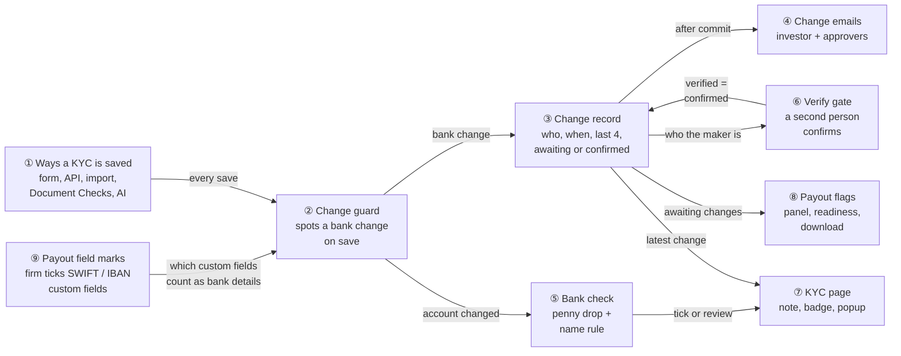

### Key concepts

**How the concepts fit together**

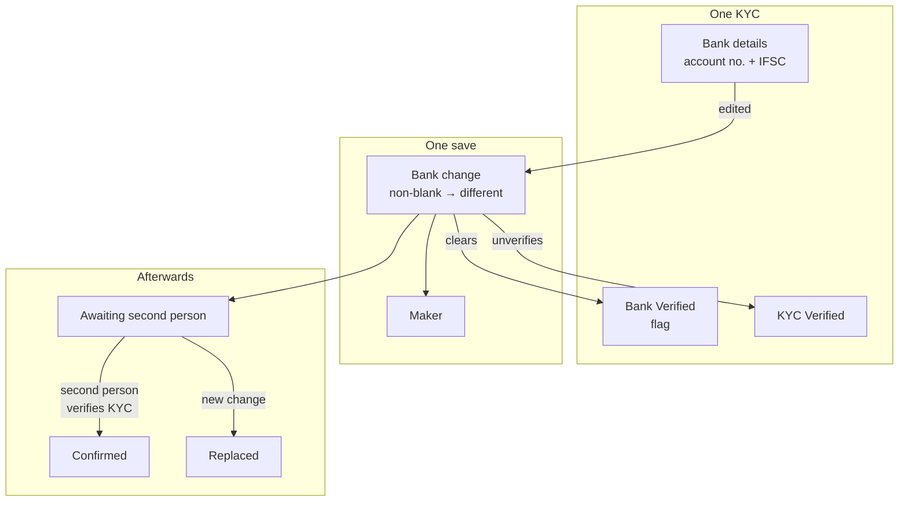

- **Top:** the three things on a KYC this change touches — its bank details and two flags.
- **Middle:** a save that changes bank details is a bank change, made by one maker.
- **Bottom:** each bank change waits for a second person, then is confirmed or replaced.

**Glossary**

| Concept | What it is, in one line | Example | Stored in |
|---|---|---|---|
| Bank details | The fields a payout is routed by: account no. + IFSC, plus the firm's marked payout custom fields | 50100012344821 / HDFC0001234 / SWIFT EBILAEADXXX | `investor_kycs.bank_account_number`, `.ifsc_code`, `.json_fields[<marked key>]` |
| Payout field | A text custom field on a KYC form that the firm marked as bank details | Horizon's "SWIFT Code", "IBAN" | `form_custom_fields.validation_rules["payout_field"]` (existing json column) |
| Bank code / account identifier | The two kinds of payout field: shown in full (like IFSC) vs last 4 only (like the account no.) | SWIFT = bank code; IBAN = account identifier | `{"payout_field": "code"}` / `{"payout_field": "account"}` |
| Descriptive bank fields | Bank name, branch, account type — not used to route money | HDFC Bank / MG Road / Savings | `investor_kycs.bank_name`, `.bank_branch`, `.bank_account_type` |
| Bank change | A save of an existing KYC changing account no., IFSC or a payout field from non-blank to a different value (spaces, case ignored) | 4821 → 7310; SWIFT EBILAEADXXX → NBADAEAAXXX | Row in `bank_detail_changes` |
| First fill | Bank details entered where they were blank | Chetan's first submission | Not stored |
| Bank Verified | Flag: the *current* account passed the bank check or a person's review | ✓ | `investor_kycs.bank_verified` |
| KYC Verified | The KYC as a whole signed off by an approver | Verified by Ravi | `investor_kycs.verified`, `submission_status = "verified"` |
| Maker | Who made the bank change: a firm user, an investor user, or System | Meera Shah | `bank_detail_changes.changed_by_id`, `changed_by_side` |
| Source | How the change was made | screen, api, import, document_checks, ai_extraction, other | `bank_detail_changes.source` |
| KYC approver | User for whom `InvestorKycPolicy#kyc_approver?` holds (Investor KYC Approve flag or company admin, and can see the KYC) | Meera, Ravi | Derived (user flags + roles) |
| Second person | A KYC approver who is not the maker | Ravi | Derived |
| Awaiting | A change no second person has confirmed | "Waiting for a second approver" | `bank_detail_changes.status = "awaiting"` |
| Confirmed | A second person (or the only approver) verified the KYC after the change | Confirmed by Ravi | `status = "confirmed"`, `confirmed_by_id`, `confirmed_at` |
| Replaced | An awaiting change overtaken by a newer bank change | 4821 → 9902 replaced by 9902 → 7310 | `status = "replaced"` |
| Only approver | The firm has no KYC approver other than the maker who can see the KYC | Kiran at Solo Advisors | `bank_detail_changes.only_approver` |
| Bank check (penny drop) | Digio bank-account verification returning the name the bank holds | "ANIL KUMAR", fuzzy match true | `investor_kycs.bank_verification_response` |
| Name needs review | Bank check found the account but the name only partly matches | "Name needs review: the bank has 'R KUMAR'" | `investor_kycs.bank_verification_status` |
| Change emails | Investor email + approver email for one change | — | Noticed rows; `investor_notified_at`, `approvers_notified_at` |
| Unconfirmed bank change | An awaiting change on a KYC being paid | Anil in Q3 2026 Distribution | Derived from `status = "awaiting"` |

#### Bank change and the change guard

- **What:** the rule that decides, on every KYC save, whether the bank details changed — and what happens in
  that same save.
- **Why:** 5 write paths exist and two of them (Document Checks, AI extraction) skip the KYC operations; a
  rule anywhere else would miss them. Today the reset happens in a job up to 120 s later, or never.

| Trigger | What it does | Example |
|---|---|---|
| Account no. or IFSC changes (any value → different) | Bank Verified off, check status/response cleared | Save 7310 over 4821 |
| …and old value was non-blank | Also: bank change record, emails | 4821 → 7310 |
| …and KYC was verified | Also: KYC unverified (`submission_status` → `completed`) | Import on a verified KYC |
| First fill | Only Bank Verified off (it already is) | Chetan |
| Descriptive fields / full name only | Nothing new (audit trail as today) | Branch "MG Road" → "Indiranagar" |
| A **marked** payout custom field changes | Same as account no. / IFSC above (every row) | Farah's SWIFT EBILAEADXXX → NBADAEAAXXX |
| An **unmarked** custom field changes | Nothing new (audit trail as today) | Intermediary Bank Name edited |

**What it does NOT cover:** unmarked custom fields (even ones named SWIFT), File custom fields (cancelled cheque),
secondary-sale offers/interests, `update_columns` writes (none touch bank fields today; `FormCustomField#change_name`
moves a `json_fields` key with `update_column` but never changes a value).

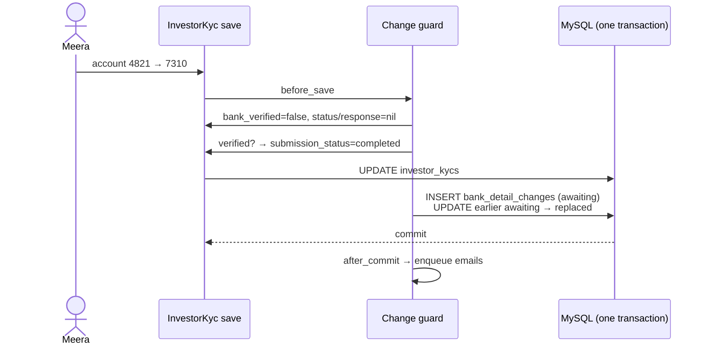

**Rules**
- The flag clear wins over any `bank_verified` value sent in the same save.
- A failed save (validation, exception) rolls back the record with the KYC — no orphan record, no email.
- The guard never raises into a save; a failure to enqueue emails is logged and alerted (see Exceptions).

#### Second person (maker–checker)

- **What:** while a change is awaiting, its maker cannot move the KYC to Verified, nor tick Bank Verified.
- **Why:** M14 — one approver could unverify, edit and re-verify alone (`investor_kyc_policy.rb:141-143`
  gates Verify on the approve flag only; `:206-210` lets the same person edit once unverified).

| Who verifies | Maker | Allowed? | Recorded as |
|---|---|---|---|
| Ravi (approver) | Meera (firm) | Yes | Confirmed by Ravi |
| Meera | Meera | No (greyed / refused) | — |
| Meera | Anil (investor) | Yes | Confirmed by Meera |
| Meera | System (AI job, no user) | Yes | Confirmed by Meera |
| Kiran | Kiran, no other approver who can see the KYC | Yes, after warning card | Confirmed by Kiran, only approver |

**What it does NOT cover:** UnVerify (anyone with approve may unverify), Request Updates, PAN/address edits,
KYCs nobody ever verifies (their control is the investor email), import Verified = Yes rows with no bank change.

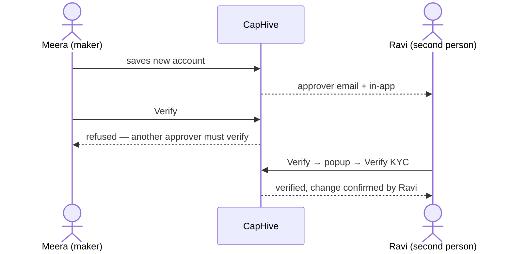

**Rules**
- Confirmation is the existing Verify (`InvestorKycsController#toggle_verified`, bulk verify, import
  Verified = Yes, API `verified: true`) done by a permitted person — no new approval object.
- A newer bank change replaces the awaiting one; its maker is the one that counts.
- Only-approver is computed at the moment of Verify (adding an approver later re-blocks the maker).

#### Name needs review

- **What:** the third outcome of the bank check besides pass and fail.
- **Why:** `verify_bank_job.rb:76-82` passes on any single shared word; a strict rule alone would fail 19
  genuine accounts on the production copy (see [Production sizing](#production-sizing)).

| Bank returns | KYC name | Outcome | Why |
|---|---|---|---|
| fuzzy_match_result true | any | Pass | Provider's own match |
| "THIMMAIAH C" | Thimmaiah Chengappa | Pass | every bank word or initial matches |
| "ANIL KUMAR SHARMA" | Anil Sharma | Pass | every KYC word is in the bank name |
| "R KUMAR" | A Kumar | Name needs review | initial R ≠ A |
| "KUMAR" | Anil Kumar | Name needs review | one-word side needs both sides single-word |
| verified false | — | Fail, provider error | as today |

**What it does NOT cover:** offers and interests (they keep the old rule; follow-up), firms with checks off.

**Rules**
- Review leaves Bank Verified off; a KYC approver who is not the maker may tick it after checking proof.
- No second paid check is run for a review.

### Walkthrough: one example, start to finish

Horizon Capital (bank verification off) pays its Q3 2026 Distribution next week. Anil Kumar's KYC was
verified on 01/10/2026 with HDFC ••••4821. Meera Shah (approver) receives Anil's new ICICI account by email
and updates the KYC. Ravi Iyer (company admin) is the other approver.

Legend: ✓ done · ● we are here: waiting on this, not done yet · ○ not started · ↺ replaced · ✗ off.

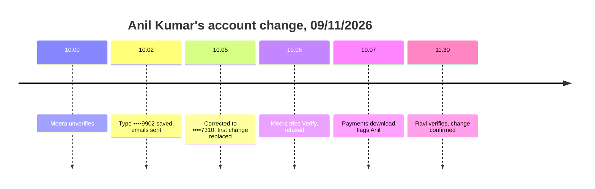

**Phase 1 — the change**

| # | When | What happens | Behind the scenes | Result&nbsp;(after&nbsp;the&nbsp;step)&nbsp;&nbsp;&nbsp;&nbsp;&nbsp;&nbsp; |
|---|---|---|---|---|
| 1 | 10:00 | Meera clicks UnVerify | The verify gate (⑥) allows UnVerify for any approver; nothing else changes | Bank&nbsp;Verified&nbsp;✓<br>KYC&nbsp;Verified&nbsp;✗<br>No&nbsp;bank&nbsp;change |
| 2 | 10:02 | Meera saves account 50100273109902 (typo) and IFSC ICIC0004567 | The change guard (②) clears Bank Verified and writes change record (③) A: 4821 → 9902, awaiting; after commit the change emails (④) are queued | Bank&nbsp;Verified&nbsp;✗<br>Tell&nbsp;investor&nbsp;○<br>**Second‑person&nbsp;verify&nbsp;●**&nbsp;(A) |
| 3 | 10:03 | Emails go out | Change emails (④) claim record A, email anil.kumar@example.in and Ravi | Tell&nbsp;investor&nbsp;✓&nbsp;(A)<br>**Second‑person&nbsp;verify&nbsp;●**&nbsp;(A) |
| 4 | 10:05 | Meera spots the typo, saves ••••7310 | Change guard (②) sees 9902 → 7310: record A ↺ replaced, record B awaiting; new emails (④) | Record&nbsp;A&nbsp;↺<br>Tell&nbsp;investor&nbsp;✓&nbsp;(B)<br>**Second‑person&nbsp;verify&nbsp;●**&nbsp;(B) |

**Phase 2 — stall**

| # | When | What happens | Behind the scenes | Result |
|---|---|---|---|---|
| 5 | 10:06 | Meera hovers Verify; then tries the URL | The verify gate (⑥) reads record B's maker = Meera, another approver exists → greyed; direct PUT refused | Same&nbsp;as&nbsp;row&nbsp;4 |
| 6 | 10:07 | Ops downloads Q3 payments | Payout flags (⑧) look up awaiting records once; Anil's row gets 09/11/2026 | Same&nbsp;as&nbsp;row&nbsp;4 |

**Phase 3 — confirmation**

| # | When | What happens | Behind the scenes | Result |
|---|---|---|---|---|
| 7 | 11:30 | Ravi clicks Verify, reads the cards, clicks Verify KYC | Verify gate (⑥) passes; the KYC page popup (⑦) listed ••••7310, Meera, anil.kumar@example.in; record (③) B confirmed by Ravi | Bank&nbsp;Verified&nbsp;✗&nbsp;(checks&nbsp;off)<br>KYC&nbsp;Verified&nbsp;✓<br>Second‑person&nbsp;verify&nbsp;✓ |
| 8 | 11:31 | Ops re-opens the distribution | Payout flags (⑧) find no awaiting record | Same&nbsp;as&nbsp;row&nbsp;7 |

Snapshot at row 5 (Meera's view):

```
KYCs › Anil Kumar › Anil Kumar
[Edit] [Delete] [✓ Verify ░░ greyed] [Request Updates] [KYC Actions ▾]
                 └ "You changed this KYC's bank details. Another KYC approver must verify it."
┌ Contact & Banking ────────────────────────────────────────────────────┐
│ ⚠ Bank details changed on 09/11/2026 by Meera Shah — account ending   │
│   9902 → 7310. Waiting for a second approver to verify.               │
│ ACCOUNT NO 50100273107310   IFSC ICIC0004567                          │
│ BANK VERIFIED [Not verified — bank details changed]                   │
└───────────────────────────────────────────────────────────────────────┘
```

**What to notice**
- The flag cleared in the **same save** (row 2) — no 120 s window, and it works with checks off.
- A typo fix is just another change: the first record is replaced, not deleted (row 4) — the history stays.
- The investor was told twice, once per change — at the address he already had.
- The second-person step is the **existing Verify** with a popup, not a new screen (row 7).
- Bank Verified stays off at Horizon (checks off) until an approver ticks it — the KYC can still be verified.

### Key ideas

| # | Idea | In one line | Card |
|---|---|---|---|
| 1 | One guard on save | Every write path is covered because the rule sits in the model's save | [②](#②-change-guard) |
| 2 | Record, not columns | A small history table holds maker, masked digits, state and email stamps | [③](#③-change-record) |
| 3 | Verify is the approval | Second person = Verify by someone other than the maker | [⑥](#⑥-verify-gate) |
| 4 | Tell the owner | Investor emailed at pre-existing contacts, last 4 only | [④](#④-change-emails) |
| 5 | Review, don't reject | Partial name match → a person decides | [⑤](#⑤-bank-check) |
| 6 | Flag where money moves | Panel, readiness and download show awaiting changes | [⑧](#⑧-payout-flags) |
| 7 | The firm says which custom fields route money | A mark on the field definition pulls SWIFT / IBAN under ②–⑧ | [⑨](#⑨-payout-field-marks) |

**FAQ**

| Question | Answer |
|---|---|
| Why not a new "approve bank change" screen? | Verify already means "an approver signed off this KYC"; payouts already trust it (`distribution_readiness_agent.rb:129`). A second screen would let a KYC be verified with an unapproved account |
| Why also unverify a verified KYC? | Import and the Compare CKYC/KRA save change a verified KYC without UnVerify (`investor_kyc_policy.rb:177-179` doesn't check `verified`); the readiness check keys on `verified` |
| Does anything block users? | Only the maker's Verify / Bank Verified tick. Everyone else works as today |
| Why not reset on full-name changes? | Name changes don't move money; with checks on, `validate_bank` already re-runs the check on a name change (`investor_kyc_concern.rb:17`) |
| Is there a setup step? | Only for firms that keep SWIFT / IBAN in custom fields: those fields are marked once (⑨) — by the firm's admin, or by support with the firm's agreement. Everything else needs no setup; no backfill |

---

## 2. The same picture with real names

### Picture

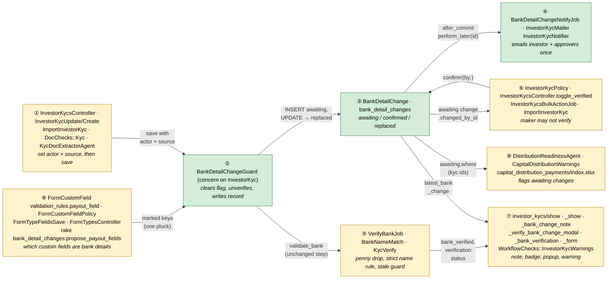

Colour = footprint: **green** new, **amber** modified, **grey** reused unchanged. Exact files are in
[lld.md File Map](lld.md#file-map).

### What each box does

| # | Box | Real parts | What it does | When it runs | What it decides | Details |
|---|---|---|---|---|---|---|
| ① | Ways a KYC is saved | `InvestorKycsController`, `InvestorKycUpdate/Create`, `InvestorKycUpserter`, `ImportInvestorKyc`, `DocChecks::Kyc.save_details!`, `KycDocExtractorAgent` | Tag the save with actor + source | Request / import job / agent job | Nothing new | [card ① →](#①-ways-a-kyc-is-saved) |
| ② | Change guard | `BankDetailChangeGuard` (`before_save`, `after_save`, `after_commit`) | Clear flag, unverify, write record, queue emails | Inside every `InvestorKyc` save | Is this a bank change (account, IFSC or a marked custom field)? | [card ② →](#②-change-guard) |
| ③ | Change record | `BankDetailChange`, `bank_detail_changes` | Holds maker, masked digits, state, email stamps | Written by ②, confirmed by ⑥ | Awaiting / confirmed / replaced | [card ③ →](#③-change-record) |
| ④ | Change emails | `BankDetailChangeNotifyJob`, `InvestorKycMailer#notify_bank_details_changed/#notify_bank_change_review`, `InvestorKycNotifier` | Email investor contacts + approvers, once | Job after commit | Who receives | [card ④ →](#④-change-emails) |
| ⑤ | Bank check | `VerifyBankJob`, `BankNameMatch`, `KycVerify#verify_bank`, `InvestorKycConcern#validate_bank` | Penny drop, name rule, discard stale result | Job ≤ 120 s after save (checks on) | Pass / review / fail | [card ⑤ →](#⑤-bank-check) |
| ⑥ | Verify gate | `InvestorKycPolicy#kyc_approver?/#toggle_verified?/#confirm_bank_details?/#bank_change_maker_blocked?/#permitted_attributes`, controller, bulk job, import | Refuse maker; confirm on Verify | Each Verify / save | Who may verify / tick | [card ⑥ →](#⑥-verify-gate) |
| ⑦ | KYC page | `show.html.erb`, `_show`, new `_bank_change_note`, new `_verify_bank_change_modal`, `_bank_verification`, `_form`, `InvestorKycWarnings` | Show note, badge, popup, journey warning | Page render | What each user sees | [card ⑦ →](#⑦-kyc-page) |
| ⑧ | Payout flags | `DistributionReadinessAgent#verify_bank_details`, `CapitalDistributionWarnings#bank_change_warning`, payments `index.xlsx.axlsx` | Flag awaiting changes on paid KYCs | Agent run / panel render / download | Flag or not | [card ⑧ →](#⑧-payout-flags) |
| ⑨ | Payout field marks | `form_custom_fields.validation_rules["payout_field"]` (existing json), `FormCustomField#payout_field` + validation, `FormCustomFieldPolicy#mark_payout_field?/#unmark_payout_field?`, `FormTypeFieldsSave`, `FormTypesController#update`, `FormCustomFieldsController`, rake task | Store which KYC custom fields are payout fields, and of which kind | Admin saves the side panel / Form Types › Edit; support runs the rake | Who may mark / unmark; is the field markable | [card ⑨ →](#⑨-payout-field-marks) |

### One run, end to end

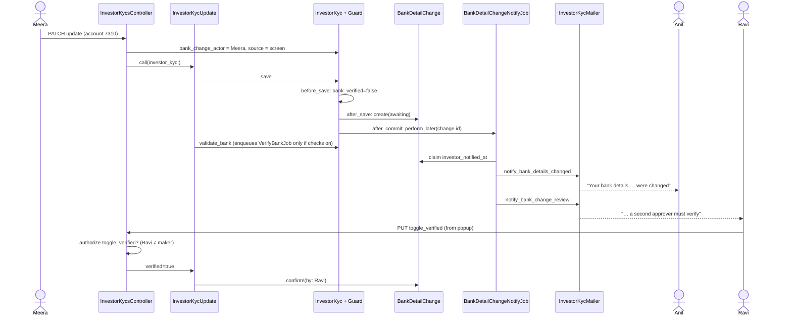

### Lifecycles

**Bank change record** (stored, `bank_detail_changes.status`)

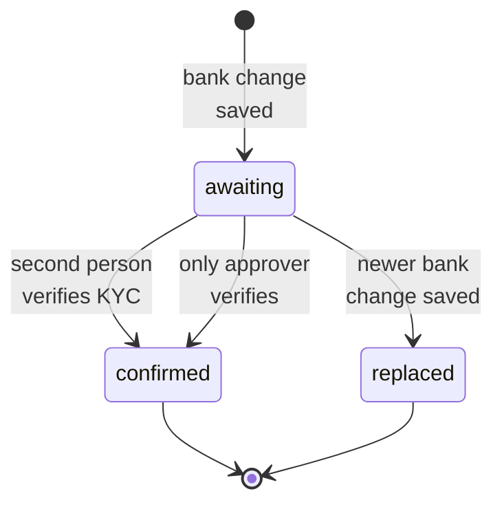

**Bank Verified** (stored `bank_verified` + `bank_verification_status`; "review" is derived from the status prefix)

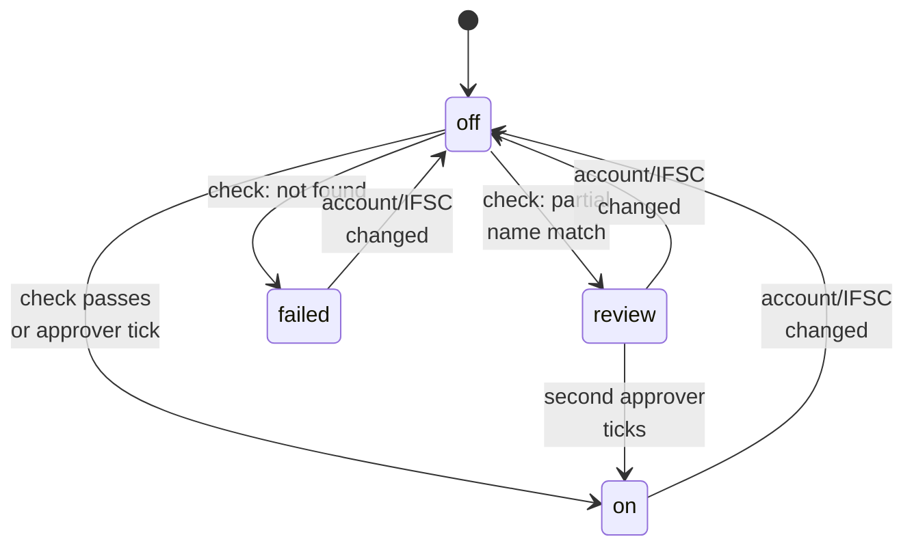

**KYC submission status** (stored; only the new transition shown in bold note)

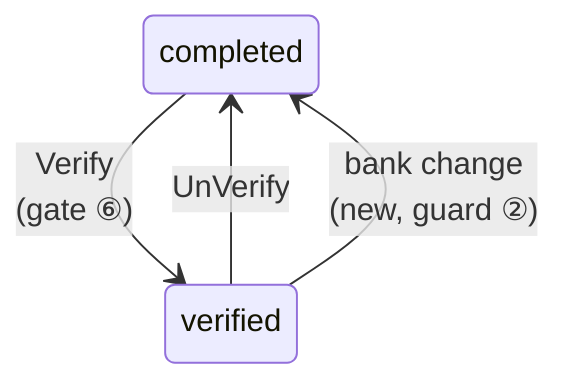

### What users see

**At a glance**

| Where in CapHive | Today | After this change | Who sees it |
|---|---|---|---|
| KYC page › Contact & Banking | Bank Verified badge only | + amber note while awaiting; grey "Confirmed by …" after | Firm users who can see the KYC |
| KYC page › Verify | Verifies at once | Popup when a change awaits; greyed for the maker | KYC approvers |
| KYC edit › Bank step | Bank Verified box for all firm users | Box only for approvers allowed to tick | Firm users |
| KYC list › Bulk Verify | "Not authorized" for non-approvers | + maker skip message | KYC approvers |
| KYC journey panel | 4 warnings | + bank change warning | Firm users |
| Import results | Success | "Success with warnings" for bank-change rows | Importer |
| Emails | none | Investor + approver emails | Investor contacts, approvers |
| Distribution panel / readiness / download | Missing-account checks | + unconfirmed change flags | Firm users |
| Custom fields side panel (record page) | Required / Read only / Internal flags | + payout icon per text field on KYC forms; "Payout field" select in the row's details; marked rows locked for non-support | Company admins, support |
| Form Types › Edit (KYC forms) | Required / Read only / Show in Filter switches | + "Payout field" select (No / Bank code / Account identifier) on text fields | Company admins, support |

**Main everyday journey — Ravi confirms a change**

```
┌ KYC page (show) ─────────────────────────────────────────────────────────────┐
│ KYCs › Anil Kumar › Anil Kumar                                               │
│ [Edit] [Delete] [✓ Verify]① [Request Updates] [KYC Actions ▾]                │
│ ┌ Contact & Banking ──────────────────────────────────────────────────────┐  │
│ │ ⚠ Bank details changed on 09/11/2026 by Meera Shah … ②  [Audit trail]③ │  │
│ │ ACCOUNT NO 50100273107310  IFSC ICIC0004567  BANK VERIFIED [Not …]④     │  │
│ └─────────────────────────────────────────────────────────────────────────┘  │
└──────────────────────────────────────────────────────────────────────────────┘
          ① opens ┌ Verify KYC — Anil Kumar ─────────────── ✕ ┐
                  │ ▍Immediate Actions                         │
                  │ [bank] New payout account confirmed  ⑤     │
                  │ [user] You are the second person     ⑥     │
                  │ [mail] Investor already told         ⑦     │
                  │                  [Cancel] [Verify KYC] ⑧   │
                  └────────────────────────────────────────────┘
```

| Step | The user… | They see |
|---|---|---|
| 1 | Opens Anil's KYC | ② amber note, ④ badge "Not verified — bank details changed" |
| 2 | Clicks ③ Audit trail (optional) | Old full account number and who changed it (existing tab) |
| 3 | Clicks ① Verify | Popup with ⑤ ••••7310 / ICIC0004567, ⑥ "Meera Shah made this change on 09/11/2026", ⑦ "anil.kumar@example.in was emailed on 09/11/2026" |
| 4 | Clicks ⑧ Verify KYC | Flash "Investor kyc was successfully verified."; note turns grey "Confirmed by Ravi Iyer on 10/11/2026" |

Mocks (hand-made, copying the real markup): [mocks/kyc_show_bank_change.html](mocks/kyc_show_bank_change.html) ·
[mocks/verify_bank_change_modal.html](mocks/verify_bank_change_modal.html).

**Screen standards**

| Screen | Kind | Copies | Breadcrumbs | Tabs (lazy pills) | Turbo (frames / streams per action) | Stats cards (= grid totals) | Filter + search | Actions (header + Actions dropdown) | Help (title ⓘ intro, field tooltips, empty state, What's next) | Full width |
|---|---|---|---|---|---|---|---|---|---|---|
| KYC page (Contact & Banking note, badge) | show (changed) | `investor_kycs/show` + `_show` "Contact & Banking" card (`card shadow-sm border-0 mb-4`) | Unchanged: KYCs › investor › KYC | Unchanged (existing tabs) | Full reload after Verify (whole page state changes, as today) | n/a | n/a | Verify stays in the header row; no new dropdown item | Note links "Audit trail"; badge tooltip explains the state | Unchanged (`ToggleCard`) |
| Verify popup | modal (new) | `investor_kycs/_request_updates_modal` (Immediate Actions cards, Bootstrap modal) | n/a | n/a | Form POST → redirect (as toggle_verified today) | n/a | n/a | Cancel (outline-danger) + Verify KYC (outline-success) | Cards say what happens; ≤ 4 cards | n/a |
| KYC edit, bank step | form (changed) | `investor_kycs/_form` step 2 (unchanged layout) | Unchanged | n/a | Unchanged | n/a | n/a | Unchanged | Bank Verified box gets a field tooltip "Tick only after checking proof of the current account" | Unchanged |
| KYC journey panel | panel (changed) | `workflow_instances/_journey_panel` warnings list | n/a | n/a | Existing live updates | n/a | n/a | n/a | Warning text names maker and date | n/a |
| Distribution journey panel | panel (changed) | `workflow_instances/_journey_panel` warnings | n/a | n/a | Existing | n/a | n/a | n/a | Warning text | n/a |
| Custom fields side panel (KYC forms) | panel (changed) | `form_type_fields/_row.html.erb` flag buttons + details row; locked chip as for Calculation | n/a | n/a | Existing panel save (`FormTypeFieldsController#save` → saved marker) | n/a | n/a | n/a | Flag tooltip "Payout field: a change needs a second approver"; locked chip tooltip "Payout fields are unmarked by CapHive support" | n/a |
| Form Types › Edit field card | form (changed) | `form_types/_form_custom_fields.html.erb:150-180` flag block (ios-toggle rows with a muted one-line explanation) | Unchanged | n/a | Unchanged (full form save) | n/a | n/a | Unchanged | Muted line "A change to this field is treated like a bank account change: a second approver must verify." | Unchanged |

- Verify is a full-page action today (`button_to … toggle_verified`, `show.html.erb:66-71`); it stays a redirect.
- Help text is a tooltip; the amber note is a coloured box only because something needs attention.
- One icon per concept: `ti-building-bank` (account), `ti-user-check` (second person), `ti-mail` (investor told),
  `ti-alert-triangle` (review / only approver). Badges `bg-*-subtle text-*` with success/info/danger/secondary.

### Key changes needing approval

Every change to an existing model, column, permission, export or behaviour. Nothing is built before approval.

| # | Existing thing | Change | Why | Who notices |
|---|---|---|---|---|
| K1 | `InvestorKyc` model | Include new `BankDetailChangeGuard` (before/after save + after_commit); `has_many :bank_detail_changes`; `attr_accessor :bank_change_actor, :bank_change_source` | One place every write path passes | Nobody directly |
| K2 | `investor_kycs.bank_verified` semantics | Forced false in any save that changes `bank_account_number` or `ifsc_code`; `bank_verification_status/response` cleared in the same save | Close the stale-✓ window (M14) | 40 checks-off firms (687 ✓ today stay until next change) |
| K3 | `investor_kycs.submission_status` / `verified` | A bank change on a verified KYC sets `completed` (verified false via `sync_boolean_fields_from_status`) | Payout checks key on `verified` | Import and Compare CKYC/KRA users |
| K4 | `InvestorKycPolicy#toggle_verified?` | Direction-aware: verifying refused for the maker of an awaiting change (unless only approver); new `kyc_approver?` takes over the approver test for `generate_new_aml_report?`, `override_aml_status?` and the Audit Trail menu item | Second person | Makers |
| K5 | `InvestorKycPolicy#permitted_attributes` | Drop `bank_verification_response`, `bank_verification_status`, `pan_verification_response`, `pan_verification_status` for everyone; `verified` and `bank_verified` only when `toggle_verified?` / `confirm_bank_details?` hold for the record (today: any employee) | Mass assignment (M14) and maker bypass via API | Employees without Approve (API `verified`, form Bank Verified box) |
| K6 | `InvestorKycsController#investor_kyc_params` | Use `policy(@investor_kyc \|\| InvestorKyc)` (record policy) instead of `policy(InvestorKyc)` | K5 needs the record | Nobody |
| K7 | `InvestorKycsController#toggle_verified` + `show.html.erb` | Specific refusal message; popup when a change awaits; greyed button for maker | UX of K4 | Approvers |
| K8 | `InvestorKycsBulkActionJob` | Maker-specific skip message for "verify" | UX of K4 | Makers using bulk |
| K9 | `ImportInvestorKyc#save_kyc` | Bank-change rows never verify; `warn_row`; source "import" | Import bypass | Importers ("Success with warnings") |
| K10 | `VerifyBankJob` | KYCs use `BankNameMatch` (strict + review); result applied only if account/IFSC unchanged (row lock); Offer/Interest keep the old rule | Name rule + race | 2 checks-on firms (~3% of checks → review) |
| K11 | `InvestorKycAction#journey_hook` | Note "Bank details changed" when the save was a bank change on a verified KYC | Journey says why it moved back | Journey users |
| K12 | `DocChecks::Kyc.save_details!`, `KycDocExtractorAgent#extract_and_populate` | Set `bank_change_source` before save (one line each) | Record says where it came from | Nobody |
| K13 | `InvestorKycMailer` | Two new methods + views; listed in the custom-notification dropdown | Emails | Investors, approvers |
| K14 | `WorkflowChecks::InvestorKycWarnings`, `WorkflowChecks::CapitalDistributionWarnings` | One new warning each | Flags | Journey users |
| K15 | `DistributionReadinessAgent#verify_bank_details` | Also fails for KYCs with an awaiting change | Payout flag | Ops running the agent |
| K16 | `capital_distribution_payments/index.xlsx.axlsx` | New last column "Unconfirmed Bank Change" | Payout flag | Anyone with macros reading by position past the last column (none expected) |
| K17 | Views `_show`, `_bank_verification`, `_form` | Note partial, badge text, Bank Verified box condition | UI | Firm users |
| K18 | New table `bank_detail_changes` | Additive; includes `changed_custom_fields` (json) for payout custom fields | History, maker, email stamps | — |
| K19 | **`FormCustomField#validation_rules_consistent` (existing model validation)** | **Allow the key `payout_field` in `validation_rules` for `TextField` only, values `"code"` / `"account"`**; add virtual attribute `payout_field` reading/writing that key. No column, no migration | The firm's mark lives in the existing json (D17) — `payout_field` is not a validation rule; the code comment says so | Nobody until a field is marked; a TextArea or other type sending the key gets the existing "contains invalid keys" error |
| K20 | `FormCustomField` model | Validation `payout_field_allowed`: the mark only on `TextField`s of KYC form types (`IndividualKyc`, `NonIndividualKyc`, `InvestorKyc`) — needed because `validation_rules_consistent` returns early for types with no rule keys (Select, Radio…); class method `payout_keys_for(form_type_ids)` (Ruby filter) | Keeps marks meaningful | Admins sending a bad mark |
| K21 | `FormCustomFieldPolicy` | New `mark_payout_field?` (parent `FormTypePolicy#update?` — company admin — or support), `unmark_payout_field?` (support only); `permitted_attributes` adds `payout_field` only when `mark_payout_field?`; `destroy?` refuses a marked field unless support | Who may mark (D18) | Company admins (cannot unmark), `enable_form_types` users (cannot mark) |
| K22 | `FormTypesController#update` + `form_type_params`, `FormType` | Permit `payout_field` in nested attributes; new `FormType.payout_field_change_allowed?(user, fields, form_type)` beside `calculation_change_allowed?` — refuses an unmark or `_destroy` of a stored marked field unless support | Same guard shape as C2 | Company admins |
| K23 | `FormTypeFieldsSave` + `form_type_fields/_row.html.erb` | `payout_field` joins the panel's flags (KYC forms, text fields); a marked field is locked (no unmark, no remove) for non-support, like Calculation (X16 there) | Side panel is where admins edit fields | Company admins |
| K24 | `form_types/_form_custom_fields.html.erb`, `form_custom_fields/_form.html.erb` | Dedicated "Payout field" select on KYC text fields (not among the `vr_*` rule inputs), shown only when `mark_payout_field?` | UI for the mark | Company admins |
| K25 | `BankDetailChangeGuard` (new, K1) reads `json_fields` | Compares `attribute_in_database(:json_fields)` vs `json_fields` for the marked keys of the KYC's form type | One rule location | Nobody directly |
| K26 | New rake `bank_detail_changes:propose_payout_fields` | Dry run lists candidate SWIFT/BIC/IBAN/routing/sort code/ABA text fields per firm; `EXECUTE=1 FIRM_ID=` marks them | Rollout for 10 firms (Production sizing) | Support |

### Design decisions

**At a glance**

| # | Decision | Why, in one line |
|---|---|---|
| D1 | Bank details = account number + IFSC | They are what the payout file uses |
| D2 | The rule sits in a model concern on save | Two write paths skip the operations |
| D3 | A bank change unverifies a verified KYC | Import / Compare CKYC/KRA change verified KYCs directly |
| D4 | Verify is the second-person step | Payouts already trust `verified`; no new screen |
| D5 | Maker = explicit actor, else `Current.user`, else System | Magic-link users have no `Current.user` |
| D6 | New `bank_detail_changes` table, not columns on `investor_kycs` | Additive, keeps history and email stamps |
| D7 | Only-approver fallback is automatic and recorded | 17 of 43 KYC firms have ≤ 1 approver; must not break |
| D8 | Investor email to contacts that existed before the change | An insider can edit the KYC's own email fields in the same save |
| D9 | One job per change, claimed by timestamp | Retries never double-email |
| D10 | Name rule: provider, else strict words/initials, else review — KYCs only | Stops "R KUMAR", keeps genuine LPs |
| D11 | Check result applied only if the account is unchanged | Stale job must not tick a newer account |
| D12 | `verified` / `bank_verified` only from approvers (record-level policy) | Closes the maker's API bypass |
| D13 | Verification result fields never user-writable | M14 mass assignment |
| D14 | Flag at payout, never block | Payment release stays human; existing data unaffected |
| D15 | New `kyc_approver?`; `toggle_verified?` direction-aware | Don't hide AML / audit trail from makers |
| D16 | No backfill at release | Existing verified KYCs stay as they are |
| D17 | Payout custom fields = key `payout_field` in the existing `validation_rules` JSON (two kinds) | Config as data without changing an existing table; per-key writes never wipe it |
| D18 | Mark = company admin or support; unmark / delete a marked field = support only | Unmarking is the loosening direction; same lock as Calculation fields |
| D19 | Change record keeps custom values by kind: bank code in full, account identifier last 4 | Matches IFSC (full) / account (last 4); SWIFT last 4 is meaningless ("DXXX") |
| D20 | Rollout: a dry-run rake proposes the 16 existing fields; support marks with the firm's consent; nothing retroactive | Firms already holding SWIFT/IBAN are covered from day one without a data change |

#### D1. Bank details = account number + IFSC

- **Problem:** "bank details" could mean five columns plus custom fields; emailing for a branch-name typo is noise.
- **Decision:** `BankDetailChangeGuard::PAYOUT_FIELDS = %w[bank_account_number ifsc_code]`, **plus** the KYC form's
  custom fields marked as payout fields (D17, decided by the user 2026-11-09 — open question 1).
- **Why:**
  - The payments download sends exactly these (`index.xlsx.axlsx:28`) and the readiness check tests only the account (`distribution_readiness_agent.rb:286`).
  - Name/branch/type changes can't redirect money; the audit trail keeps them.
- **Not chosen:** all five fields — 3,339 name/branch edits in 2024 audits would each email investors.
- **Where:** `BankDetailChangeGuard`.

#### D2. The rule sits in a model concern on save

- **Problem:** `DocChecks::Kyc.save_details!` (`doc_checks/kyc.rb:122-127`) and `KycDocExtractorAgent` (`:150`) call `save` directly, skipping `InvestorKycUpdate`.
- **Decision:** `BankDetailChangeGuard` on `InvestorKyc`: `before_save :guard_bank_details`, `after_save :record_bank_change`, `after_commit :notify_bank_change`.
- **Why:**
  - Every path calls `save`; none uses `update_columns` on bank fields.
  - Same transaction as the KYC update → no orphan or missing record.
- **Not chosen:** an operation step in `InvestorKycAction` — misses two paths; a DB trigger — can't know the maker.
- **Where:** `app/packs/core/investor_kycs/models/concerns/bank_detail_change_guard.rb`.

#### D3. A bank change unverifies a verified KYC

- **Problem:** `compare_kyc_datas?` (`investor_kyc_policy.rb:177-179`) and imports change a verified KYC without UnVerify; it stays verified with a new account.
- **Decision:** guard sets `submission_status = "completed"`, `verified_by_id = nil` when a bank change is saved and the KYC was verified or is being verified in the same save; `sync_boolean_fields_from_status` (`investor_kyc.rb:363-374`) flips `verified`.
- **Why:**
  - Same state UnVerify produces (`investor_kycs_controller.rb:609-616`), so journeys and scopes already understand it.
  - Gives the second person something to do (Verify).
- **Not chosen:** refusing the save — would break imports and Document Checks mid-run.
- **Where:** `BankDetailChangeGuard#guard_bank_details`; `InvestorKycAction#journey_hook` note.

#### D4. Verify is the second-person step

- **Problem:** a separate approval object duplicates "who signed this KYC off".
- **Decision:** confirmation = a permitted `verified` false → true transition; the guard's `after_save` confirms the awaiting record with `Current.user`/actor.
- **Why:**
  - One gate for single, bulk, import and API verify.
  - Payout code already reads `verified` (`distribution_readiness_agent.rb:129`).
- **Not chosen:** a journey sign-off task — only KYCs with a journey would be covered; a "Confirm bank change" button — two meanings of "approved".
- **Where:** `InvestorKycPolicy#toggle_verified?`, `BankDetailChangeGuard#confirm_bank_change`, `BankDetailChange#confirm!`.

#### D5. Maker = explicit actor, else `Current.user`, else System

- **Problem:** the guard runs in a model; magic-link saves have no `Current.user` (`with_authentication.rb:256` sets it from the session only).
- **Decision:** controllers set `investor_kyc.bank_change_actor = current_user || @signed_id_user`; jobs rely on `Current.user` restored by `ApplicationJob` (`application_job.rb:9-37`); otherwise nil = System. Side = `investor` when the actor's entity ≠ KYC entity or actor is the signed-id user, `fund` otherwise.
- **Why:** imports and agent jobs already carry the enqueuing user (audits show fund-side import batches).
- **Not chosen:** `Audited.store` only (journey_actor) — empty for magic links.
- **Where:** `InvestorKycsController` (update, create, assign_kyc_data, compare_kyc_datas, toggle_verified), `BankDetailChangeGuard#bank_change_maker`.

#### D6. New table, not columns on `investor_kycs`

- **Problem:** need maker, masked old/new, state, confirmer, email stamps and history.
- **Decision:** `bank_detail_changes` (see [schema](#data-model-and-schema-changes)).
- **Why:** additive (no change to the 9.8k-row KYC table's columns); history of replaced changes; idempotency stamps.
- **Not chosen:** `investor_kycs.bank_details_changed_by_id/at` — loses history, needs 3+ columns on an existing model.
- **Where:** `BankDetailChange`.

#### D7. Only-approver fallback is automatic and recorded

- **Problem:** on the production copy 10 of 43 firms with KYCs have exactly one KYC approver and 7 have none counted; a hard block would stop them verifying after any bank change.
- **Decision:** the maker is blocked only if another active KYC approver of the firm can see the KYC (`InvestorKycPolicy#other_kyc_approver?`); otherwise Verify shows the only-approver card and the record stores `only_approver = true`.
- **Why:** nothing breaks; the investor email is the compensating control; adding an approver re-blocks.
- **Not chosen:** an entity setting switched by CapHive support — one more knob, and 17 firms would need support tickets on day one. See [open question 2](#risks-and-open-questions).
- **Where:** `InvestorKycPolicy#bank_change_maker_blocked?`, `#other_kyc_approver?`.

#### D8. Investor email to contacts that existed before the change

- **Problem:** the KYC's `esign_emails` can be edited in the same save; a contact can be added minutes before.
- **Decision:** recipients = `investor.notification_users(kyc, with_tag: "KYC")` whose approved `InvestorAccess` on that investor has `created_at < change.created_at`; never KYC fields.
- **Why:** reuses the KYC email recipient rule (`request_updates`, `investor_kycs_controller.rb:560`) plus one pluck.
- **Not chosen:** a 24-hour cool-off on contacts — new investors' first change would go nowhere; emailing `esign_emails` — attacker-controlled.
- **Where:** `BankDetailChangeNotifyJob#investor_recipients`.

#### D9. One job per change, claimed by timestamp

- **Problem:** Sidekiq retries could double-email.
- **Decision:** `BankDetailChangeNotifyJob(change_id)` claims with a conditional update on `investor_notified_at IS NULL` / `approvers_notified_at IS NULL` before delivering.
- **Why:** at-most-once per audience; `deliver_later` per user is a cheap enqueue.
- **Not chosen:** at-least-once with dedupe on Noticed rows — more queries per recipient.
- **Where:** `BankDetailChangeNotifyJob`.

#### D10. Name rule — KYCs only

- **Problem:** `verify_bank_job.rb:79-82` passes on any one shared word.
- **Decision:** `BankNameMatch.call(kyc_name:, bank_name:, provider_match:)` → `:match` / `:review`; used for `InvestorKyc` records; `Offer`/`Interest` keep `check_details` as is.
- **Why:** 579 + 9 of 607 historic passes still pass; 19 go to review; look-alikes stop.
- **Not chosen:** raising the fuzzy threshold — the provider already returns its own boolean; Offer/Interest in scope — no manual tick exists for them (1 bank-verified offer in production), so review would strand sellers.
- **Where:** `app/packs/core/investor_kycs/services/bank_name_match.rb`, `VerifyBankJob#check_details`.

#### D11. Stale check result discarded

- **Problem:** `VerifyBankJob` loads the KYC, calls the provider (seconds), then saves; a newer account saved meanwhile would get `bank_verified = true` (`verify_bank_job.rb:22-28`).
- **Decision:** remember the account/IFSC sent; save inside `record.with_lock` only if they still match after reload; else log and drop.
- **Why:** row lock is short (no HTTP inside it).
- **Not chosen:** a version column — another existing-model change.
- **Where:** `VerifyBankJob#perform`.

#### D12. `verified` / `bank_verified` only from approvers

- **Problem:** `permitted_attributes` (`investor_kyc_policy.rb:108`) accepts `verified` and `bank_verified` from any employee — a maker could PATCH `verified: true`.
- **Decision:** add `verified` only if `toggle_verified?` and `bank_verified` only if `confirm_bank_details?` for the record; class-level (create) uses the user's approve flag.
- **Why:** policy is the one place; the form already hides fields per user.
- **Not chosen:** blocking only the maker — leaves non-approvers verifying via API, the same bypass shape. See [open question 3](#risks-and-open-questions).
- **Where:** `InvestorKycPolicy#permitted_attributes`, `InvestorKycsController#investor_kyc_params`.

#### D13. Verification result fields never user-writable

- **Problem:** `investor_kyc_policy.rb:104-106` permits `bank_verification_response/status` and `pan_verification_*` for everyone, investors included.
- **Decision:** remove all four; only `VerifyBankJob` / `VerifyPanJob` write them. No view posts them (checked `_form.html.erb`).
- **Why:** an investor could make a bad account look checked.
- **Not chosen:** keeping them for support — support can re-run the check (bulk "Bank verification").
- **Where:** `InvestorKycPolicy#permitted_attributes`.

#### D14. Flag at payout, never block

- **Problem:** blocking payments on `bank_verified` would stop 1,015 KYCs paid in the last 12 months with Verified ✓ but Bank Verified off.
- **Decision:** flag only awaiting changes: readiness step fails, journey warning, download column.
- **Why:** no awaiting records exist at release → zero effect on today's distributions.
- **Not chosen:** requiring `bank_verified` before payout — breaks 40 checks-off firms.
- **Where:** card ⑧.

#### D15. New `kyc_approver?`; `toggle_verified?` direction-aware

- **Problem:** `toggle_verified?` also gates AML buttons (`investor_kyc_policy.rb:165-171`) and the Audit Trail menu (`show.html.erb:108`); blocking it for the maker would hide those.
- **Decision:** `kyc_approver?` = today's rule; those three callers switch to it; `toggle_verified?` = `kyc_approver? && (record.verified || !bank_change_maker_blocked?)`.
- **Why:** UnVerify (record verified) stays allowed; bulk ACTIONS map keeps working per direction.
- **Not chosen:** a separate `verify?` action — the route is one toggle.
- **Where:** `InvestorKycPolicy`.

#### D16. No backfill

- **Problem:** 54 KYCs show Bank Verified ✓ while their stored provider response says not verified (manual ticks or stale).
- **Decision:** leave all existing data; rules apply from the next save.
- **Why:** "existing verified KYCs stay as they are"; a backfill would email nobody but flip flags firms rely on.
- **Not chosen:** a one-off reset task — see [open question 4](#risks-and-open-questions).
- **Where:** release notes only.

#### D17. Payout custom fields = a key in the field's existing `validation_rules` JSON

- **Problem:** 10 firms keep SWIFT (2 also IBAN) in KYC custom fields (`json_fields`); a change there redirects a
  foreign payout exactly like an account change, yet the guard only knew two columns. Field names differ per firm
  (`swift_code`, `beneficiary_swift_code`, `investor_fund_bank_account_swift_code`), so a hard-coded key list fails.
- **Decision (user, 2026-11-09):** store the mark in the **existing** json column `form_custom_fields.validation_rules`
  as `{"payout_field": "code"}` (bank code, shown in full) or `{"payout_field": "account"}` (account identifier,
  last 4 only); key absent = not a payout field. `FormCustomField` gets a virtual attribute `payout_field` /
  `payout_field=` that reads and writes only that key. **No new column, no migration.**
- **Why `validation_rules`:**
  - Structured JSON, written **per key** by the `vr_*` setters (`form_custom_field.rb:28-36`) — saving a field's
    min length, pattern or format never wipes the payout key, and no other code assigns the whole hash (only
    `lp_crm_custom_fields.rake`, which creates new fields).
  - No free-text box: the editors only expose the `vr_*` inputs; `payout_field` is not in `VALIDATION_RULE_KEYS`,
    so no `vr_payout_field` input exists and only the dedicated control (card ⑨) writes it.
  - Every reader asks for named keys (`with_custom_field.rb:333-347`, `_text_field.html.erb:16`), so an extra key
    changes no validation or rendering.
  - Production: the 16 candidate fields have **no** rules today (0 of 16), so marking them merges into an empty hash.
- **The one code change on an existing model:** `FormCustomField#validation_rules_consistent`
  (`form_custom_field.rb:170-191`) rejects keys not allowed for the field type. It must allow `payout_field` for
  **TextField only** (TextArea keeps `text_keys`), with value `"code"` or `"account"`.
  - Honest note: `payout_field` is **not** a validation rule. It sits in `validation_rules` because that is the only
    structured, per-key JSON on a field definition. The planned code comment says so and points here.
  - Not to be confused with the separate *Validation Rules engine* (`app/packs/core/validation_rules`) — unrelated.
- **Not chosen:**
  - A new column `form_custom_fields.payout_field` — declined by the user: it changes an existing table.
  - `meta_data` — means something different per field type (options, currency, number format, Calculation Ruby,
    "skill: true" tags); **7 KYC TextFields in production already hold leftover choice lists there**; and Form Types
    › Edit exposes it as a free "Meta data" text box anyone editing the form could clear, silently unmarking.
  - `validation_rules["format"]` (`ifsc` exists) — couples routing to input format; a firm may not set a format.
  - Name matching (`/swift|iban/`) at runtime — misses `beneficiary_account_no`, catches the check box
    `swift_code_in_case_of_foreign_bank_account`; used only to *propose* marks (D20).
  - One kind only — SWIFT's last 4 is usually "DXXX"/"AXXX" (useless to an investor) while IBAN embeds the account
    number and must stay masked.
- **Reading marks:** the guard loads the KYC form type's `TextField`s (`pluck(:name, :label, :validation_rules)`,
  at most a few hundred rows) and filters in Ruby. SQL on the key is avoided: MySQL `JSON_EXTRACT` returns a
  JSON-quoted `"code"` (needs `->>`/`JSON_UNQUOTE`) while the SQLite test schema's `json_extract` returns plain
  `code`. Where SQL is unavoidable (the rake proposal), only `json_extract(validation_rules, '$.payout_field') IS
  NULL / IS NOT NULL` is used — it behaves the same on both.
- **Where:** `FormCustomField#payout_field`, `#validation_rules_consistent`, `#payout_field_allowed`,
  `BankDetailChangeGuard#marked_payout_keys`, card ⑨.

#### D18. Who may mark and unmark

- **Problem:** after an unmark, a firm admin who is also a KYC approver could change the SWIFT alone; deleting the
  field definition has the same effect.
- **Decision:** `FormCustomFieldPolicy#mark_payout_field?` = `new_policy(record.form_type).update?` (company admin
  of the form type's firm) or support; `#unmark_payout_field?` = `support?`; `#destroy?` refuses a marked field
  unless support. The three writers ask the policy: Form Types › Edit (via `FormType.payout_field_change_allowed?`,
  same shape as `calculation_change_allowed?`), the side panel (`FormTypeFieldsSave`, same lock as Calculation),
  Form Custom Fields new/edit (`permitted_attributes`).
- **Why:**
  - Marking only tightens → anyone who may edit the form type may do it.
  - Unmarking loosens → the existing "CapHive support only" lock used for Calculation fields (C2, X16 there).
  - Custom field import (`ImportFormCustomField`, `FormType.save_cf_from_import`) never writes `validation_rules` —
    imported fields start unmarked. Form type *clone* (support-only, M25) copies the hash, mark included.
- **Not chosen:** emailing approvers on unmark — one more notification for a rare event; letting company admins
  unmark — reopens the one-person path.
- **Where:** `FormCustomFieldPolicy`, `FormType.payout_field_change_allowed?`, `FormTypeFieldsSave#existing_attrs`.

#### D19. Custom values in the change record by kind

- **Problem:** the record must show what changed without becoming a second store of payout identifiers (E23).
- **Decision:** `bank_detail_changes.changed_custom_fields` (json array): one entry per changed marked key —
  `key`, `label` (at change time), `kind`, `old`, `new`; `old`/`new` are the full value for `code`, `last 4` for
  `account`, `nil` for blank. Emails, note and popup render these strings only.
- **Why:** same split as the columns (`old_ifsc` full, `old_account_last4`); the label is frozen so a later rename
  doesn't rewrite history; the full old value still lives in the KYC's audit trail (`json_fields` is audited).
- **Not chosen:** full old/new values for every kind — IBANs are account numbers (PII); a child table — one save
  changes ≤ 3 marked fields today.
- **Where:** `BankDetailChange`, `BankDetailChangeGuard#record_bank_change`.

#### D20. Rollout of existing SWIFT / IBAN fields

- **Problem:** 16 text fields in 10 firms already hold 165 SWIFT/IBAN values; unmarked, they stay outside the rules.
- **Decision:** `bin/rails bank_detail_changes:propose_payout_fields` — dry run by default: per firm, each KYC text
  field whose name or label matches `swift|bic|iban|routing|sort code|aba` (word match), the proposed kind
  (IBAN → account, others → code) and the filled-value count (a count, never values). `EXECUTE=1 FIRM_ID=<id>`
  marks the listed fields through the model (validations run). Support runs it after the firm's company admin
  agrees in the ticket; the admin can equally tick them in the side panel.
- **Why:** firms keep control of their configuration (a mark changes who may verify); no KYC row is touched, so
  nothing is retro-unverified and no email is sent (E65, E79).
- **Not chosen:** auto-marking in a migration — changes firm configuration without consent; marking at runtime by
  name — D17.
- **Where:** `lib/tasks/bank_detail_changes.rake`.

**FAQ**

| Question | Answer |
|---|---|
| Why does the confirmation live in the guard and not the controller? | Bulk, import and API verify too; the guard sees every `verified` false → true save |
| What if Verify and a bank change arrive in one save? | Guard forces unverified (D3) — a change can never be self-confirmed in its own save |
| Why record `only_approver`? | Auditors can list self-confirmed changes; support can nudge firms to add an approver |
| Could the maker remove the other approver to get the fallback? | Yes, but user permission edits are audited (`User` Trackable `extended_permissions`), the investor is still emailed, and the record says only approver |
| Could an admin unmark SWIFT, change it alone, and mark it again? | No — unmarking (or deleting the marked field) is CapHive support only (D18) |
| Why not run the penny drop after a SWIFT change? | The bank check proves the Indian account + IFSC only; it would re-tick Bank Verified for an unchecked SWIFT (E74). A second approver ticks it after checking proof |

---

## 3. One card per box

> Same order and numbers as the picture.

### ① Ways a KYC is saved

Every write path that can change `bank_account_number` / `ifsc_code`, and what it must pass to the guard.

| Owns | Reads / receives | Produces |
|---|---|---|
| Setting `bank_change_actor` / `bank_change_source` | Request user, signed-id user, `Current.user` | A KYC save |

| Path | Code (read) | Through `InvestorKycUpdate/Create`? | Can hit a verified KYC? | Actor | Source |
|---|---|---|---|---|---|
| KYC form / JSON API update | `investor_kycs_controller.rb:495-543` | Yes | No (`update?` needs `!verified`, `investor_kyc_policy.rb:206-210`) | `current_user` or `@signed_id_user` | screen / api (by format) |
| KYC create, create-and-send | `:240-266`, `:440-466` | Create | No (new) | `current_user` | screen / api |
| Compare CKYC/KRA save | `:318-331` → `InvestorKycUpserter` (`investor_kyc_upserter.rb:13-30`) | Yes | **Yes** (`compare_kyc_datas?` doesn't check `verified`) | `current_user` | screen |
| Assign CKYC/KRA data | `:468-492`, `investor_kyc.rb:456-459` | Yes | — | `current_user` | — (writes name/address only, never bank) |
| Import (investor KYC) | `import_investor_kyc.rb:61-117` (bank `:94-98`, Verified `:72-83`) | Yes | **Yes** (Update Only) | `Current.user` (importer, restored by `ApplicationJob`) | import |
| Client onboarding | client-onboarding skill → import API | via import | Creates only | importer | import |
| Document Checks "Use document value" | `doc_checks/kyc.rb:122-127` (`save!(validate: false)`) | **No** | No (`can_edit?` = `update?`, `:159-161`) | `Current.user` | document_checks |
| AI extraction | `kyc_doc_extractor_agent.rb:76-151` (`save` at `:150`) | **No** | No (doc-first only) | `Current.user` or nil | ai_extraction |
| Toggle verified / bulk verify | `investor_kycs_controller.rb:609-628`, `investor_kycs_bulk_action_job.rb:28-46` | Yes | — (no bank write) | `current_user` / `Current.user` | — |
| CKYC/KRA fetch | `:368-438` | — | — | — | creates `KycData` only |
| MCP tools | `app/packs/ai/mcp_server/ontology/` | — | — | — | no KYC write tools exist |
| KYC journey | `investor_kyc_action.rb:42-60` | — | — | — | reacts to saves; writes no bank fields |
| `VerifyBankJob` | `verify_bank_job.rb:25` | No | — | — | writes flag/status/response only |

**Build notes**
- Controllers set the actor right after `assign_attributes` (update) or `new` (create, compare).
- Default source when unset: `other` (never blocks a save).

**Worked examples:** E5–E10, E17–E18 ([business-rules § 1](business-rules.md#1-clear-on-change--phase-1), [§ 3](business-rules.md#3-change-record-and-kyc-page--phase-2)).

**FAQ**

| Question | Answer |
|---|---|
| Is the LP mobile app a path? | It uses the same JSON `update` route; covered by the first row |
| Why set source in DocChecks/AI if the guard works anyway? | Only for the record's "how it was made" label |

### ② Change guard

`BankDetailChangeGuard` — a concern on `InvestorKyc`: decides, inside the save, whether bank details changed and
applies D1–D4.

| Owns | Reads / receives | Produces |
|---|---|---|
| The bank-change rule, flag clear, unverify, confirm-on-verify | Dirty values of `bank_account_number`, `ifsc_code`, marked keys of `json_fields`, `bank_verified`, `submission_status`; actor/source; marked keys from ⑨ | `investor_kycs` writes; `bank_detail_changes` rows; enqueued job |

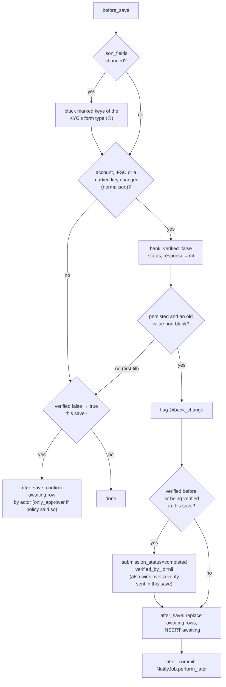

| Responsibility | Transaction | Retry / idempotency |
|---|---|---|
| Flag clear + unverify | Same UPDATE as the KYC | n/a |
| Insert / replace record | Same transaction (`after_save`) | Rolls back with the KYC |
| Confirm on verify | Same transaction | Only rows with `status = awaiting`; second request finds none (X12) |
| Enqueue emails | `after_commit` | Job claims stamps (card ④) |

**Worked examples:** H1–H3, E1–E10, X1, H5, E14–E16, X5, X12, H19, E64–E74 ([§ 8](business-rules.md#8-payout-custom-fields-swift--iban--phase-6), [§ 1](business-rules.md#1-clear-on-change--phase-1), [§ 3](business-rules.md#3-change-record-and-kyc-page--phase-2), [§ 5](business-rules.md#5-second-person--phase-3)).

**FAQ**

| Question | Answer |
|---|---|
| Why normalise (strip, upcase) before comparing? | E3: re-typed IFSC must not email the investor (E70: same for SWIFT) |
| How is a custom field change seen? | `attribute_in_database(:json_fields)` (re-parsed from the stored JSON) vs `json_fields`, for the marked keys only — works for whole-hash assignment (form, import, Document Checks) and in-place writes (AI extraction `json_fields[k] = v` + `json_fields_will_change!`) |
| Which form's marks count? | The KYC's `form_type_id` before and after the save (usually one id) — one `pluck(:name, :label, :validation_rules)` of its TextFields, filtered in Ruby |
| Does the guard decide who may verify? | No — the policy (⑥) does; the guard only records who did |
| What about `full_name` changes? | Not a payout field (D1); `validate_bank` still re-runs the check when checks are on |

### ③ Change record

`BankDetailChange` — one row per bank change. Written once; only `status`, confirmation and email stamps move
forward. Schema: [Part 4](#data-model-and-schema-changes).

| Owns | Reads / receives | Produces |
|---|---|---|
| `bank_detail_changes` | Guard inserts; `confirm!`, `replace!`; job stamps | `awaiting` scope, `latest_bank_change`, masked display strings |

- `Trackable` (audited) on the model, so every status move has who/when.
- `entity_id` copied from the KYC, `attr_readonly`.
- Display helpers return "ending 4821" / "none"; full numbers never stored (E23).
- `changed_custom_fields` (D19): `[{key: "swift_code", label: "SWIFT Code", kind: "code", old: "EBILAEADXXX", new: "NBADAEAAXXX"}]`
  or `{… kind: "account", old: "3456", new: "8901"}`; `custom_field_lines` renders "SWIFT Code EBILAEADXXX → NBADAEAAXXX"
  / "IBAN ending 3456 → ending 8901".

**Worked examples:** H5, H6, E14–E23, X5 ([§ 3](business-rules.md#3-change-record-and-kyc-page--phase-2)).

**FAQ**

| Question | Answer |
|---|---|
| Why keep replaced rows? | Typos and reversals stay visible; the investor was emailed about them |
| Why store IFSC in full? | IFSC is a public branch code, not secret |
| Coordination with `encrypt-investor-pii-at-rest`? | Last-4 strings stay plain; the guard compares through the model, so encrypted attributes work unchanged |

### ④ Change emails

`BankDetailChangeNotifyJob` sends the two emails for one change through `InvestorKycNotifier` / `InvestorKycMailer`.

| Owns | Reads / receives | Produces |
|---|---|---|
| Recipient rules, once-only stamps | `change_id`; KYC, investor accesses, firm users | Noticed notifications + emails; `investor_notified_at`, `investor_recipient_ids`, `approvers_notified_at` |

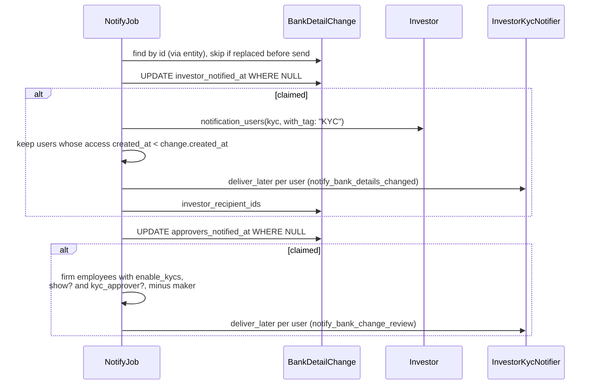

- Investor email always sent when contacts exist — including a replaced change's own email if it ran before replacement.
- `InvestorKycMailer#set_kyc` gains no magic link for these methods (link goes to the KYC page; signed-in view).
- Email shows `l(change.created_at)` → `Nov 09, 2026` (EmailDateLocalization).
- Both emails list one line per changed item: account, IFSC, then each `changed_custom_fields` entry by label (H20).

**Worked examples:** H7, H8, E24–E31, X6 ([§ 4](business-rules.md#4-change-emails--phase-2)).

**FAQ**

| Question | Answer |
|---|---|
| Why not reuse `notify_kyc`? | It emails every firm user who can see the KYC; this one is approvers only, minus the maker |
| Is the investor email sent if the change is replaced before the job runs? | Yes if it was already claimed; a not-yet-claimed replaced change is skipped — the newer change's email covers it |
| Can a firm turn it off? | No; it can reword it (CustomNotification `notify_bank_details_changed`) |

### ⑤ Bank check

Today's penny drop, with the name rule replaced for KYCs and a stale-result guard.

| Owns | Reads / receives | Produces |
|---|---|---|
| `BankNameMatch`, the stale check | Provider JSON (`verified`, `beneficiary_name_with_bank`, `fuzzy_match_result`) | `bank_verified`, `bank_verification_status`, `bank_verification_response` |

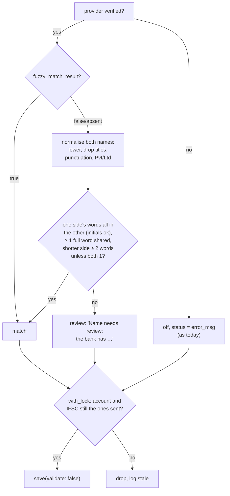

- The 0–120 s delay (`VerifyBankJob::DELAY_SECONDS`) stays; the flag is already off (②), so the window is harmless.
- Offers / interests: `VerifyBankJob#check_details` unchanged for them (D10); the stale guard applies to all.
- Titles list: mr, mrs, ms, miss, dr, shri, smt, sri, m/s, kum, master. Suffix map: private→pvt, limited→ltd.

**Worked examples:** H3, H12–H14, E47–E56, X13–X14 ([§ 6](business-rules.md#6-bank-check-name-rule--phase-4)).

**FAQ**

| Question | Answer |
|---|---|
| Why trust `fuzzy_match_result` at any score? | All 579 historic true results scored ≥ 71; the old `> 50` test never bit |
| Why not reject review cases? | 19 of 607 historic passes are partial matches, most plausibly genuine (father's name, initials) |
| What does review cost? | Nothing paid; a person ticks Bank Verified |

### ⑥ Verify gate

Who may verify, and the confirmation that follows.

| Owns | Reads / receives | Produces |
|---|---|---|
| `kyc_approver?`, `toggle_verified?`, `confirm_bank_details?`, `bank_change_maker_blocked?`, `other_kyc_approver?`, `permitted_attributes` | `record.awaiting_bank_change`, user flags/roles | Allow / refuse; specific messages |

**Role → access**

| Role | Verify (no change awaiting) | Verify (awaiting, they're the maker) | Verify (awaiting, not maker) | Tick Bank Verified | Send `verified` / `bank_verified` via API | UnVerify |
|---|---|---|---|---|---|---|
| Company admin | ✓ | ✗ greyed (✓ if only approver) | ✓ popup | ✓ unless blocked maker | ✓ unless blocked maker | ✓ |
| Employee with Approve | ✓ | ✗ greyed (✓ if only approver) | ✓ popup | ✓ unless blocked maker | ✓ unless blocked maker | ✓ |
| Employee, Update only | ✗ | ✗ | ✗ | ✗ (box hidden) | ignored | ✗ |
| Investor / advisor / magic link | ✗ | ✗ | ✗ | ✗ | ignored | ✗ |
| Other firm | ✗ (`belongs_to_entity?`) | ✗ | ✗ | ✗ | ✗ | ✗ |

- Entity scoping: every predicate starts from `permissioned_employee?` → `belongs_to_entity?(user, record)` (`application_policy.rb:162-177`).

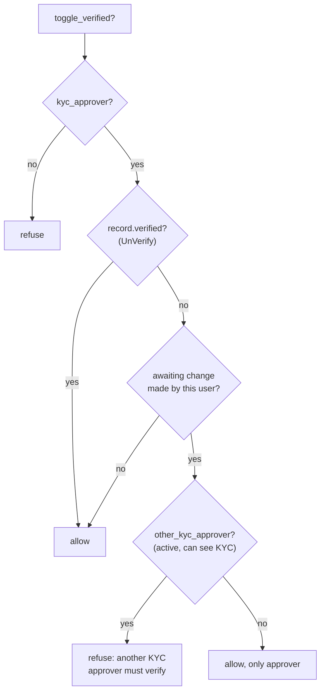

**Routes** (no new routes)

| Verb and path | Action | Does | Responds with |
|---|---|---|---|
| `PUT /investor_kycs/:id/toggle_verified` | `toggle_verified` | Verify / UnVerify; popup form posts here | Redirect + flash; refusal flash text from `bank_change_maker_blocked?` |
| `PATCH /investor_kycs/:id(.json)` | `update` | Saves; `verified`/`bank_verified` filtered by policy | As today |
| `POST /investor_kycs/bulk_actions` | bulk job | "verify" uses `toggle_verified?` per KYC | Error list with maker message |

**Secondary journeys**
- Import (K9): `ImportInvestorKyc#save_kyc` asks the guard whether this row is a bank change before applying Verified = Yes, and asks `InvestorKycPolicy.new(import_upload.user, kyc).bank_change_maker_blocked?` for rows without a change (E41).

**Worked examples:** H9–H11, E32–E46, X7–X12, H4, E11–E13, X2–X4 ([§ 5](business-rules.md#5-second-person--phase-3), [§ 2](business-rules.md#2-protected-fields--phase-1)).

**FAQ**

| Question | Answer |
|---|---|
| Why "can see the KYC" in `other_kyc_approver?` | An approver with no fund access can't open the KYC (E39); counting them would strand the maker |
| Is the query cost per page? | Only when the viewer is the maker of an awaiting change (short-circuit) |
| Does a support user count? | Yes, if switched in as an approver who can see the KYC |

### ⑦ KYC page

| Owns | Reads / receives | Produces |
|---|---|---|
| `_bank_change_note`, `_verify_bank_change_modal`, badge text, form box, journey warning | `latest_bank_change` (one query, includes `changed_by`, `confirmed_by`), policy predicates | HTML |

**Build notes**
- `show.html.erb:62-71`: when `toggle_verified?` and an awaiting change exists → button opens `#verifyBankChangeModal`
  (`data-bs-toggle="modal"`), modal form `button_to toggle_verified_investor_kyc_path`; when the user is a blocked
  maker → `<button disabled>` wrapped in a tooltip span; otherwise unchanged `button_to`.
- `_show.html.erb` Contact & Banking card: render `_bank_change_note` at the top of `card-body` (`alert alert-warning`
  while awaiting; `text-muted small` line after confirmation). Hidden when `current_user` is nil or investor.
- `_bank_verification.html.erb`: "Not verified — bank details changed" when `!bank_verified` and awaiting change exists;
  "Name needs review…" already flows through `bank_verification_status`.
- `_form.html.erb:272-277`: show the box only if `policy(investor_kyc).confirm_bank_details?`; add tooltip.
- `InvestorKycWarnings#bank_change_warning`: "Bank details changed on <l(date)> by <maker> — a different approver must verify".

**Worked examples:** E19–E22, E32–E35, E44, E61 ([§ 3](business-rules.md#3-change-record-and-kyc-page--phase-2), [§ 5](business-rules.md#5-second-person--phase-3), [§ 7](business-rules.md#7-payout-flags-and-journey-warnings--phase-5)).

**FAQ**

| Question | Answer |
|---|---|
| Why a full reload after Verify? | Header buttons, journey, note and badge all change; same as today |
| Why not show the note to investors? | They get the email; the note names firm staff |

### ⑧ Payout flags

| Owns | Reads / receives | Produces |
|---|---|---|
| Three flags | `BankDetailChange.awaiting` for the paid KYC ids | Agent step result, panel warning, download column |

| Reader of bank details | Code (read) | Pays money? | Change |
|---|---|---|---|
| Payments download | `capital_distribution_payments/index.xlsx.axlsx:8,28` | Yes (ops pay from it) | Last column "Unconfirmed Bank Change" |
| Readiness agent | `distribution_readiness_agent.rb:273-300` (+ KYC step `:112-135`) | Gate before payment | Fails for awaiting changes |
| Distribution journey warnings | `capital_distribution_warnings.rb:40-46` | Gate before email/payment | New warning |
| Payment JSON | `_capital_distribution_payment.json.jbuilder:37-38` | API read | Unchanged (D14, keep scope small) |
| Commitments / fund exports | `capital_commitments/index.xlsx.axlsx:38`, `fund_xl.rb:23` | No (reference) | Unchanged |
| Foreign remittances dashboard | `funds/dashboard/foreign_remittances.html.erb:53` | No (inbound) | Unchanged |
| Secondary sale payments | `secondary_sales/payments.*` (offer/interest bank fields) | Yes, separate data | Out of scope |

- Each reader does one grouped query: `BankDetailChange.awaiting.where(investor_kyc_id: …).group(:investor_kyc_id).maximum(:created_at)`.

**Worked examples:** H15–H17, E57–E62, X15 ([§ 7](business-rules.md#7-payout-flags-and-journey-warnings--phase-5)).

**FAQ**

| Question | Answer |
|---|---|
| Why not block the "Mark payments completed" action? | D14 — flags only; ops may have already paid offline |
| Why keep the warning rule "until emailed"? | It is the existing spec rule; the readiness check and download cover later moments |

### ⑨ Payout field marks

Which KYC custom fields count as bank details. Config as data on the field definition; read by the guard (②).

| Owns | Reads / receives | Produces |
|---|---|---|
| `validation_rules["payout_field"]` on the field definition, the mark/unmark rule, the rollout rake | Side panel / Form Types saves, the acting user, support's rake run | Marked keys for ② |

**Flow — Ravi marks SWIFT, Meera changes it, Ravi confirms**

```mermaid
sequenceDiagram
    actor R as Ravi (company admin)
    participant SP as Side panel<br/>FormTypeFieldsSave
    participant FCF as FormCustomField
    actor M as Meera (approver)
    participant K as InvestorKyc + Guard ②
    participant BDC as BankDetailChange ③
    participant J as NotifyJob ④
    actor F as Farah Ali (investor)
    R->>SP: SWIFT Code → Bank code, IBAN → Account identifier
    SP->>SP: FormCustomFieldPolicy#mark_payout_field? (company admin)
    SP->>FCF: validation_rules["payout_field"] = "code" / "account"<br/>(other rule keys untouched; KYC text field only)
    Note over FCF,K: No KYC touched, no email (E65)
    M->>K: SWIFT EBILAEADXXX → NBADAEAAXXX, Save
    K->>FCF: pluck marked keys of Farah's form type
    K->>K: bank_verified = false (verified KYC → completed)
    K->>BDC: INSERT awaiting, changed_custom_fields [SWIFT Code full]
    K->>J: after_commit perform_later
    J-->>F: "Your bank details … were changed" (SWIFT Code line)
    J-->>R: approver email
    M->>K: Verify → refused (maker, ⑥)
    R->>K: Verify via popup → confirmed by Ravi
```

**Mark lifecycle** (stored, `form_custom_fields.validation_rules["payout_field"]`; `none` = key absent)

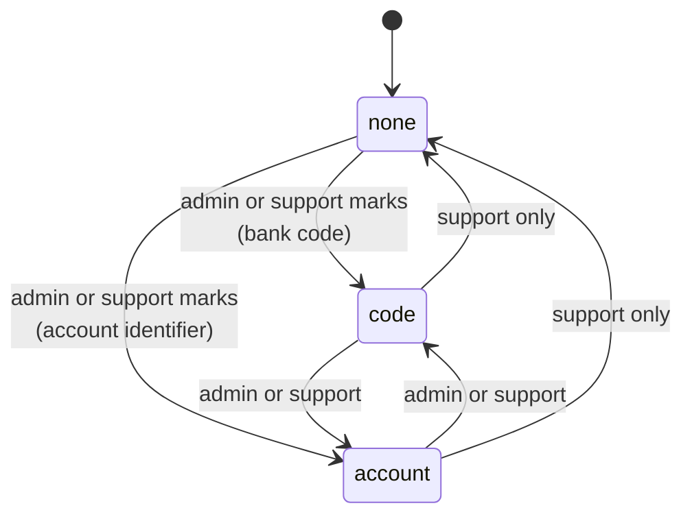

- Switching between the two kinds keeps the field marked, so a company admin may do it (it changes display only).

**Who may do what**

| Action | Company admin (Ravi) | `enable_form_types` user, not admin (Priya) | KYC approver only (Meera) | CapHive support (Sam) | Other firm (Omar) |
|---|---|---|---|---|---|
| See the mark | ✓ | ✓ (Form Custom Fields show) | ✗ (no Form Types access) | ✓ | ✗ |
| Mark (none → code/account) | ✓ | ✗ (param dropped) | ✗ | ✓ | ✗ |
| Switch kind | ✓ | ✗ | ✗ | ✓ | ✗ |
| Unmark / delete a marked field | ✗ "Payout fields can only be unmarked by CapHive support." | ✗ | ✗ | ✓ | ✗ |

**Where it is edited**

| Screen (reference) | Control | Shown when | Refusal |
|---|---|---|---|
| Record page › custom fields icon › side panel (`form_type_fields/_row.html.erb`) | Flag button `ti-building-bank` "Payout field: a change needs a second approver"; kind select in the row's details | KYC form type, `TextField`, `mark_payout_field?` | Marked row for non-support: flag on + locked chip "Support", no ✕ |
| Form Types › Edit field card (`form_types/_form_custom_fields.html.erb:150-180`) | Dedicated select "Payout field": No / Bank code (shown in full) / Account identifier (last 4 only) — in the flags block, **not** among the Validation inputs | Same | Base error "Payout fields can only be unmarked by CapHive support." |
| Form Custom Fields › New / Edit (`form_custom_fields/_form.html.erb`) | Same select | Same | Param dropped (not permitted) |
| Custom field import | — (column not in the template) | — | Imported fields start unmarked |

**Worked example — the rollout at one firm (counts from the production copy, entity 3103)**

- Rake dry run lists 2 fields on its Non-Individual form: `swift_code` → code (8 filled), `iban_code` → account (6 filled);
  `swift_code_in_case_of_foreign_bank_account` on its `InvestorKyc` form is a **CheckBox** → not listed.
- Support posts the list in the ticket; the firm's admin agrees; support re-runs with `EXECUTE=1 FIRM_ID=3103`.
- Result: 2 fields marked; 0 KYCs changed; 0 emails. The next edit of any of those 14 values follows §1–§5.

**Worked examples:** H18, E65–E67, E77–E80, X16–X20 ([§ 8](business-rules.md#8-payout-custom-fields-swift--iban--phase-6)).

**FAQ**

| Question | Answer |
|---|---|
| Why does a non-validation flag live in `validation_rules`? | It is the only structured, per-key JSON on a field; a column was declined and `meta_data` is a free text box with per-type meaning (D17) |
| Why only text fields? | All 16 real SWIFT/IBAN fields are `TextField`; a check box or select can't hold a payout identifier; numbers lose leading zeros |
| Why only KYC forms? | The guard lives on `InvestorKyc`; a mark on an Investor or Offer form would promise a control that doesn't exist |
| Does marking re-check or unverify anyone? | No (E65). Rules apply to saves after the mark |
| What if the firm renames the field's label? | The key is unchanged, so it stays marked; past records keep the label they were saved with |
| Is the mark per firm or per form? | Per form type: firm 841 has SWIFT on both its Individual and Non-Individual forms — both are proposed, each marked (E67) |

---

## 4. Reference

### Class diagram

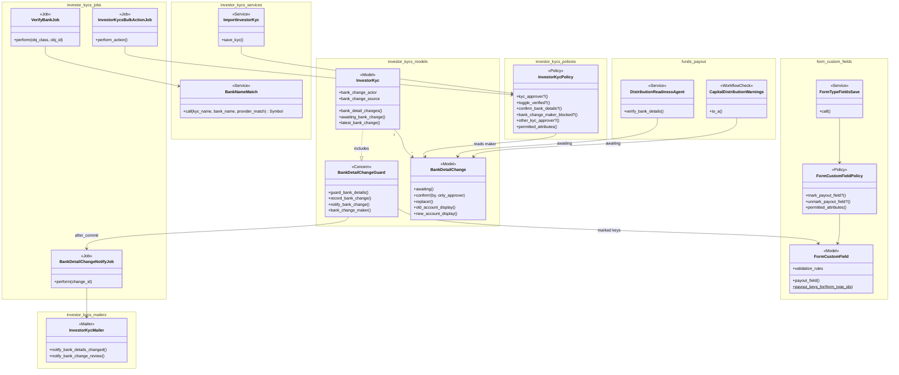

### Data model and schema changes

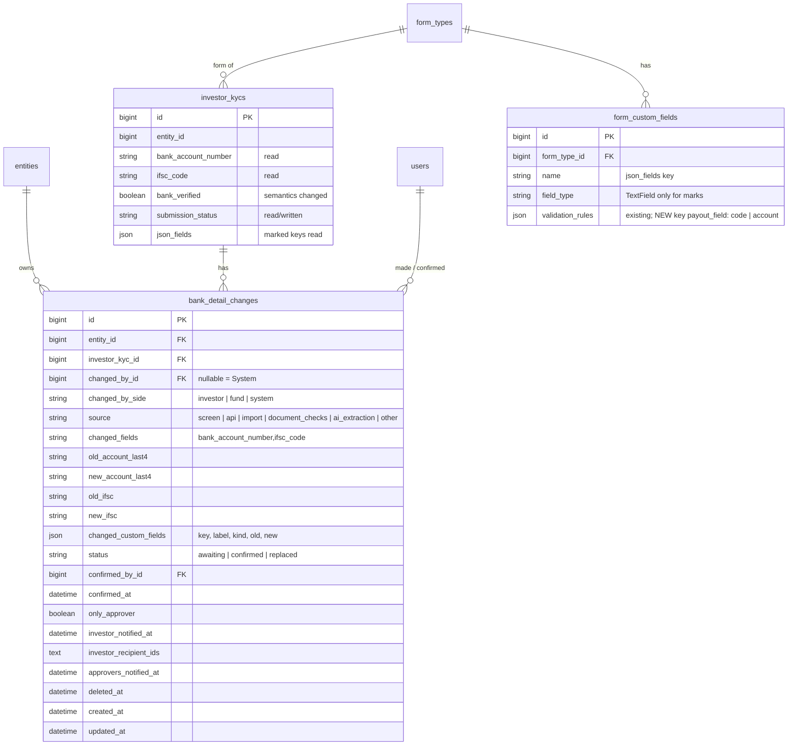

**Indexes:** `[investor_kyc_id, status]`; `[entity_id, status]`; FKs `changed_by_id`, `confirmed_by_id`.

**Schema changes**

**`bank_detail_changes`** (new): one row per bank change, so the maker, the masked before/after, the
second-person state and the once-only email stamps live in one append-mostly place.

| Column / index | What changed | Why it's needed |
|---|---|---|
| `entity_id` | Added, bigint, not null, FK | Tenant scope for every query and the policy |
| `investor_kyc_id` | Added, bigint, not null, FK | Which KYC changed |
| `changed_by_id` | Added, bigint, null, FK users | The maker; null = System |
| `changed_by_side` | Added, string(10), not null | Investor-made changes may be confirmed by any approver |
| `source` | Added, string(20), not null, default "other" | "How it was made" on the note and in audits |
| `changed_fields` | Added, string(100) | Account, IFSC or both — drives the email wording |
| `old_account_last4` / `new_account_last4` | Added, string(4), null | Masked display; null = blank |
| `old_ifsc` / `new_ifsc` | Added, string(20), null | Shown in full (public code); matches `investor_kycs.ifsc_code` limit |
| `changed_custom_fields` | Added, json, null (created in Phase 2, written from Phase 6) | Changed payout custom fields: key, label, kind, old/new (full for code, last 4 for account) — D19 |
| `status` | Added, string(12), not null, default "awaiting" | Lifecycle |
| `confirmed_by_id` / `confirmed_at` | Added, bigint FK / datetime, null | Who confirmed, when |
| `only_approver` | Added, boolean, not null, default false | Marks self-confirmed changes |
| `investor_notified_at` | Added, datetime, null | Once-only claim for the investor email |
| `investor_recipient_ids` | Added, text (serialized Array), null | Popup/approver email show who was told |
| `approvers_notified_at` | Added, datetime, null | Once-only claim for the approver email |
| `deleted_at` | Added, datetime, null | `Trackable` includes `acts_as_paranoid` |
| `[investor_kyc_id, status]` | New index | "awaiting change for this KYC" on every KYC page and policy check |
| `[entity_id, status]` | New index | Payout flag lookups per firm |

**`form_custom_fields`** (existing): **no schema change.** The mark is a new key in the existing json column.

| Column / key | What changed | Why it's needed |
|---|---|---|
| `validation_rules["payout_field"]` | New key allowed (TextField only): `"code"` / `"account"`; absent = not a payout field | The firm's mark (D17). Allowing it is a change to an existing model's validation (K19) |

**Changes to existing models:** see [Key changes needing approval](#key-changes-needing-approval) — no column on an
existing table changes; K19 lets `FormCustomField#validation_rules_consistent` accept the `payout_field` key; K2/K3
change the *meaning* of `bank_verified` and when `submission_status` moves.

### Component contracts

| From → To | Contract | Direction rule |
|---|---|---|
| ① → ② | `investor_kyc.bank_change_actor = user`, `.bank_change_source = "import"`, then `save` | Callers never write `bank_detail_changes` themselves |
| ② → ③ | `BankDetailChange.create!(…)`, `awaiting.where(kyc).update_all(status: "replaced")`, `confirm!(by:, only_approver:)` | Only the guard creates/replaces/confirms |
| ② → ⑤ | Unchanged `InvestorKycConcern#validate_bank` step enqueues `VerifyBankJob` | Guard never calls the provider |
| ③ → ④ | `BankDetailChangeNotifyJob.perform_later(change.id)` after commit | Job reloads by id, scoped through the KYC's entity |
| ③ → ⑥ | `kyc.awaiting_bank_change&.changed_by_id` | Policy reads, never writes |
| ⑥ → ③ | A permitted verify save → guard `confirm!` | Confirmation only via a KYC save |
| ⑤ → ⑦ | `bank_verified`, `bank_verification_status` columns | Status text is the display contract ("Name needs review: …") |
| ③ → ⑦ | `kyc.latest_bank_change` (includes users) | One query per page |
| ③ → ⑧ | `BankDetailChange.awaiting.where(investor_kyc_id: ids).group(:investor_kyc_id).maximum(:created_at)` | One grouped query per reader |
| ⑨ → ② | `FormCustomField.payout_keys_for(form_type_ids)` → `where(form_type_id:, field_type: "TextField").pluck(:name, :label, :validation_rules)`, filtered in Ruby | Guard reads marks; never writes them. Only when `json_fields` changed |

### Notifications

| Notification | Trigger | Recipients | Channel | Customisable | Default | Sent once? |
|---|---|---|---|---|---|---|
| **Your bank details with <firm> were changed** (`InvestorKycMailer#notify_bank_details_changed`) | Bank change committed | Investor's approved contacts subscribed to "KYC" (or untagged), incl. advisors approved for the KYC (`Investor#notification_users(kyc, with_tag: "KYC")`), whose access was created before the change; never `esign_emails` | Email + in-app (InvestorKycNotifier) | Yes — CustomNotification wording; cannot be disabled | On, always | Yes — `investor_notified_at` claim |
| **Bank details changed for <KYC> — a second approver must verify** (`#notify_bank_change_review`) | Same | Firm employees with `enable_kycs`, `InvestorKycPolicy#show?` and `kyc_approver?`, minus the maker; advisors with a staff grant who pass the same | Email + in-app | No (internal) | On | Yes — `approvers_notified_at` claim |
| KYC updated / submitted (existing) | Investor save / submit | Unchanged | Email + in-app | Unchanged | Unchanged | Unchanged |
| Request updates (existing) | Unchanged | Unchanged | — | — | — | — |
| Suppressed | none | — | — | — | — | — |

- First fill, descriptive-field edits, unmarked custom field edits, marking a field and confirmations send nothing new.
- A payout custom field change uses the same two emails; its lines read "SWIFT Code EBILAEADXXX → NBADAEAAXXX" / "IBAN ending 3456 → ending 8901".
- The investor email to an investor-made change reads "If you asked for this, no action is needed."

### Cross-cutting concerns

#### Transactions and queries

- KYC update + record insert/replace/confirm: one transaction (`save`). Emails after commit.
- `VerifyBankJob` save: `with_lock` on the KYC row, after the HTTP call.
- Notify job: two single-row conditional UPDATEs (claims), then reads; no transaction around `deliver_later`.

#### Exception handling and monitoring

| Failure | Who is alerted | Channel | Detail |
|---|---|---|---|
| `after_commit` enqueue fails | Dev team | ExceptionNotifier (existing `notify_exception`) | KYC id, change id; investor email may be missing → approvers see "Investor emailed: —" on the note |
| Notify job raises | Dev team | Sidekiq retry + ExceptionNotifier | Claims prevent duplicates on retry; an unclaimed audience retries |
| Stale check dropped | Nobody (expected) | Rails log info | KYC id, checked vs current last 4 |
| Provider error | As today | Status on KYC | — |

#### Architecture and design patterns

| # | Pattern | How this design applies it | Existing example reused | Where |
|---|---|---|---|---|
| 1 | Pack boundaries | All new code in `app/packs/core/investor_kycs`; funds pack reads `BankDetailChange` via a scope (public model) | `funds` already reads `InvestorKyc` | ②③④⑤⑥ in core/investor_kycs; ⑧ in funds/ai |
| 2 | Thin controllers, skinny models | Controller only sets actor/source and renders; rule in a concern; emails in a job | `InvestorKycAction` steps | ①② |
| 3 | Single responsibility | Guard (detect), record (store), job (tell), `BankNameMatch` (compare), policy (allow) | — | ②–⑥ |
| 4 | Reuse before you add | `Trackable`, `InvestorKycNotifier`, `notification_users`, `warn_row`, Request Updates modal, journey warnings, `ApplicationJob` actor, side panel flags + Calculation lock, `calculation_change_allowed?` shape | Listed | all |
| 5 | Configuration as data | The payout mark (`validation_rules["payout_field"]`) decides which custom fields are bank details (D17); no per-firm on/off knob (D7); CustomNotification for wording | `FormCustomField` flags (`required`, `internal`, `filter_in_search`), `CustomNotification` | ④⑨ |
| 6 | Explicit state machines | `status` awaiting → confirmed/replaced only via `confirm!`/`replace!` | `submission_status` enum | ③ |
| 7 | Append-only audit records | Rows never deleted or re-pointed; only forward status moves, audited | `Trackable` | ③ |
| 8 | Background work | Emails in `BankDetailChangeNotifyJob` (idempotent claims); penny drop stays a job | `NotifyKycJob` | ④⑤ |
| 9 | Notifications | Noticed `InvestorKycNotifier`; investor email via CustomNotification; one job decides recipients | `request_updates` loop | ④ |
| 10 | UI | Server-rendered partials, Bootstrap modal, tooltips; no new CSS or Stimulus | `_request_updates_modal` | ⑦ |
| 11 | Queries and data | One grouped query per reader; indexes on `[investor_kyc_id, status]`; no large-table touch | — | ⑧ |
| 12 | AI | Not needed — AI extraction only sets `source`; no AI decisions here | — | ① |
| 13 | Rollout | All firms at once, no flag; 5 phases each shippable; no backfill | — | tasks |
| 14 | YAGNI / DRY | No approval model, no setting, no new route | — | — |

#### Performance

- Volume: ~7 bank changes / month (80 in the last 12 months); 6,940 live KYCs; 5,363 unpaid payments.
- Guard: in-memory dirty checks; one INSERT (+ one UPDATE when replacing) only on a bank change; +1 `pluck` of
  marked keys only in saves where `json_fields` changed (and only when the KYC has a form type).
- No large-table work (`account_entries`, `audits` untouched beyond normal `audited` writes).

**Query budget**

| Page / frame / job | Rows shown or processed | Queries (budget, independent of rows) | Preloads / grouped queries | Per-row lookups avoided |
|---|---|---|---|---|
| KYC show (note, badge, button) | 1 KYC | +1 (latest change incl. users); +≤ 1 + n_approvers (≤ 10) only when viewer is a blocked-maker candidate | `bank_detail_changes.includes(:changed_by, :confirmed_by).order(id: :desc).first` memoised on the KYC | Policy reuses the memoised change |
| Verify popup | 1 | 0 extra (same memo); recipient emails: 1 `User.where(id:)` | — | — |
| Bulk Verify job | N KYCs | +1 per KYC (awaiting change) — existing per-row policy pattern | Could preload awaiting map once: 1 grouped query | Use `awaiting.where(investor_kyc_id: ids)` map |
| Notify job | 1 change, ≤ 30 recipients | ≤ 8 | `notification_users` already `includes(user: %i[roles entity])`; access created_at via one pluck | Per-user `show?` as in `notify_kyc` (bounded by firm staff) |
| Payments download | up to ~5k rows | +1 | grouped `maximum(:created_at)` hash | Hash lookup per row |
| Readiness agent bank step | N payments | +1 | awaiting KYC id set | Set lookup |
| Distribution warning | — | +1 count | subquery on payments' KYC ids | — |
| Import row | 1 | +1 (awaiting change); +1 marked-keys pluck when the row writes custom fields | Memoise marked keys per form type for the import run | Per-row pluck avoided by the memo |
| Side panel / Form Types save | ≤ 200 fields | +1 (`exists?` stored marked ids for the unmark check) | — | — |

- Each phase gate runs its features with `PROSOPITE=1` and fixes N+1s in this change's code.

#### Security

| # | Item | How this design meets it | Where | Test |
|---|---|---|---|---|
| 1 | Authorization | No new actions; `toggle_verified` already `authorize`s via `set_investor_kyc`; new predicates in `InvestorKycPolicy` only; import and bulk call the same policy | ⑥ | X7, X10, E37, E41 |
| 2 | Tenant isolation | `bank_detail_changes.entity_id` = KYC's, `attr_readonly`; policy starts at `belongs_to_entity?`; job reloads change → KYC → entity; recipients only from KYC's investor / entity | ③④⑥ | X11 |
| 3 | Mass assignment | Remove `bank_/pan_verification_status/response`; `verified`/`bank_verified` per record policy; `bank_change_actor/source` are not params | ⑥ | X2–X4, E11–E12, X8–X9 |
| 4 | No code from data | No `constantize`/`send` added; `source` is an allowlisted string set in code | ①③ | — |
| 5 | Injection | Name matching is pure Ruby string work; all output escaped in ERB; no `html_safe` on names | ⑤⑦ | E47 |
| 6 | Background jobs | Notify job takes an id, reloads through the entity, skips deleted KYCs; `VerifyBankJob` lock + compare | ④⑤ | E28, E53 |
| 7 | Files and documents | Not needed — no uploads | — | — |
| 8 | AI / LLM | AI extraction writes are covered by the guard like any save; AI never confirms | ①② | E6, E18 |
| 9 | Webhooks, tokens, links | Emails link to the KYC page (sign-in), no magic link | ④ | H7 |
| 10 | Rate limiting and cost | No new paid calls; review does not re-run the penny drop | ⑤ | E56 |
| 11 | Audit and logging | `Trackable` on `BankDetailChange`; KYC audits keep old values; last 4 only in emails/logs; `filter_parameter_logging` already filters account numbers | ③④ | E21, E23 |
| 12 | Verification | Brakeman + bundler-audit in each gate; refusal scenarios in `features/security/bank_detail_change_*.feature` and `bank_detail_payout_fields.feature` | all | X2–X4, X7–X12, X16–X20 |
| 13 | Payout marks (authorization) | Mark = `FormCustomFieldPolicy#mark_payout_field?` (parent form type `update?`); unmark/delete = support; every writer asks the policy; not a `vr_*` input, not in the custom-field import template | ⑨ | X16–X18, X20 |
| 14 | Custom-field PII | Change record stores account-kind values as last 4; logs never print custom values; full old value only in the existing KYC audit | ③④ | H20, E69 |

### Worked examples

Every H/E/X row — shared setup, happy path, edge and error cases, with their spec scenario and feature — lives in
[business-rules.md](business-rules.md) (H1–H21, E1–E80, X1–X20; 121 rows across 10 feature files). The cards above
cite the IDs; the QA checklist and tasks reuse them.

### Testing

- Cucumber only. Stub `KycVerify#verify_bank` with named responses (`bank_response` helper in
  `features/step_definitions/kyc_verification.rb` extended with name/fuzzy parameters).
- Reuse `investor_kyc.rb`, `investor_kyc_journey_steps.rb`, import steps; new `bank_detail_change_steps.rb` for
  record/email/popup assertions.
- Traceability: every scenario has `# <ID> — <path>` above it; code comments name the IDs of the branches they implement.

### Production sizing

Read-only aggregates on the production copy (`IRM_development` @ 33066, latest audit 2026-11-05). No PII printed.

| Question | Answer |
|---|---|
| Live KYCs | 6,940 (Bank Verified ✓ 1,364; KYC verified 6,225) |
| Firms with bank verification on / off (that have KYCs) | 2 on (1,543 KYCs, 677 ✓) · 40 off (5,396 KYCs, **687 ✓** — manual or stale) |
| KYCs ✓ whose stored provider response says not verified | 54 |
| Account/IFSC changes from a non-blank value | 2024: 522 · 2025: 255 · 2026: 66 · last 12 months: **80 across 10 firms** |
| …of which single edits / bulk (≥ 10 same user-day) | 177 single · 121 in 2–9 batches · 545 in 14 bulk batches (imports) |
| …by side (2026) | 38 fund side · 28 investor side |
| Firms by KYC-approver count | 0: 7 · 1: 10 · 2: 3 · 3–5: 15 · 6+: 8 |
| Distribution payments last 12 months | 12,146 in 11 firms, to 1,314 KYCs (1,015 verified but not Bank Verified) |
| Unpaid payments now | 5,363 |
| Name rule on 607 historic penny-drop passes | 579 provider match · 9 strict words · **19 (3.1%) → review** · 0 rejected |
| Custom fields that look like bank data | SWIFT (8 firms with values), IBAN (2), cancelled cheque upload (29) |
| KYC custom field definitions matching `swift\|iban\|bic\|routing\|sort code\|aba` (2026-11-09) | 17: **14 SWIFT text + 2 IBAN text** (proposed) + 1 SWIFT *check box* (not proposed); none for BIC, routing, sort code, ABA |
| …firms / form types | 10 firms (entity ids 19, 69, 451, 841, 844, 3103, 5632, 6301, 7366, 7643) · 14 KYC form types (11 Non-Individual, 2 Individual — firms 19 and 841 mark both — and 1 legacy `InvestorKyc`) |
| …KYCs with a value filled | SWIFT 158 · IBAN 7 (165 values; 8 firms have ≥ 1, entities 7366 / 7643 have none yet) |
| …changes from a non-blank value (KYC audits) | 2024: 9 (2 firms) · 2025: 1 · 2026: 3 · last 12 months: **4 in 2 firms** |
| Where the mark is stored | Existing `validation_rules` json — the 16 candidates hold **no** rules today (0 of 16); `meta_data` rejected partly because **7** KYC TextFields already carry leftover choice lists there (D17) |
| Who marks at rollout | Rake dry run → support ticket → firm admin agrees → `EXECUTE=1 FIRM_ID=` (D20) |
| Secondaries using bank check | 65 offers / 3 interests with responses; 1 offer ✓ |

### Risks and open questions

- Makers in one-approver firms can self-confirm → recorded `only_approver`, investor emailed, queryable for audit.
- A maker could strip the other approver's flag first → user permission edits are audited; investor still emailed.
- Investor contact added just before the change → only contacts created *before* the change are emailed; approvers see the recipient list.
- Approvers who can't see a KYC don't count → the maker may get the only-approver path in firms with fund-restricted approvers (E39); recorded.
- 19 historic partial matches would now need a person → ~3% of checks, only in 2 firms.
- Import users relying on Verified = Yes with bank edits → "Success with warnings" text names the next step.
- A firm never marks its SWIFT field → SWIFT edits stay audit-only; mitigated by the rollout proposal (D20) and the
  release note to the 10 firms' admins.
- Bulk "Bank verification" re-run after a SWIFT-only change re-ticks Bank Verified from the Indian account check →
  KYC Verified still needs the second person (the payout flags key on the awaiting record, not on the ✓).
- A firm keeps a payout identifier in a non-text field → not markable (validation); support converts the field.
- Future code that assigns `validation_rules` wholesale would drop the mark → today only per-key `vr_*` setters
  write it; the D17 code comment warns, and E80 (editing a marked field's rules keeps the mark) guards it in Cucumber.

| # | Open question | Current thinking (recommended) | Status |
|---|---|---|---|
| 1 | Should SWIFT / IBAN custom fields (8 / 2 firms) count as bank details? | **Yes — in this change** (user, 2026-11-09). A firm marks custom fields as payout fields (config as data, D17–D20, card ⑨); a change to a marked field follows the same reset / second-person / email rules | Decided — design extended 2026-11-09 |
| 2 | One-approver firms: automatic fallback (D7) or a support-only entity setting (as M13 may adopt)? | **A — automatic fallback** (D7): the only approver may verify after a warning card; recorded as "Confirmed by …, only approver"; the investor is always emailed | Decided by user 2026-11-09 |
| 3 | Restrict `verified`/`bank_verified` params to approvers for everyone (D12), or only block the maker? | **Restrict for everyone** (D12) | Decided by user 2026-11-09 |
| 4 | Reset the 54 KYCs whose ✓ contradicts the stored provider response? | **No** (D16); support sends each firm its list | Decided by user 2026-11-09 |
| 5 | Should descriptive bank fields (name/branch/type) also email the investor? | **No** (D1) | Decided by user 2026-11-09 |

**FAQ**

| Question | Answer |
|---|---|
| Where do I start reviewing? | [Key changes needing approval](#key-changes-needing-approval), then card ② and ⑥ |
| What ships first? | Phase 1 (flag clear + protected fields) — no schema, closes the stale ✓ and the forged fields |
| Does M13 (capital call maker–checker) share code? | No shared code; same idea. Keep wording ("second approver") consistent |
| What if `security-event-trail` lands first? | Add a `bank_details_changed` event in the guard's `after_commit`; no design change |
