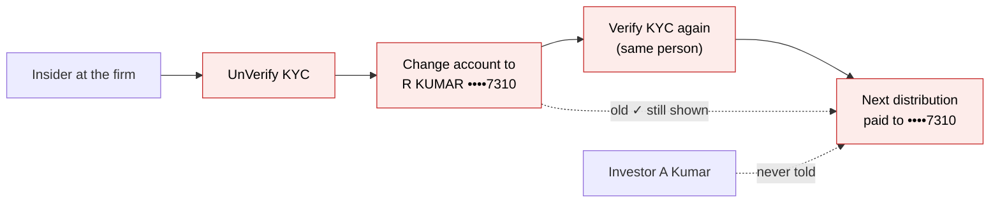
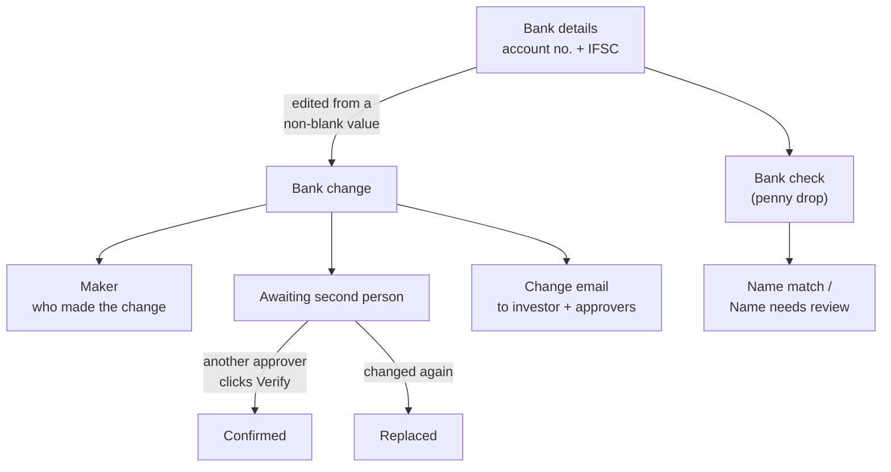
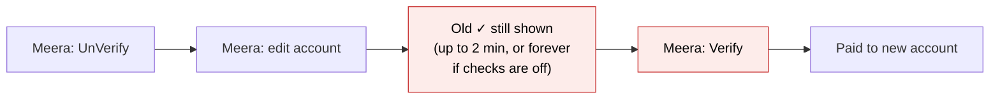
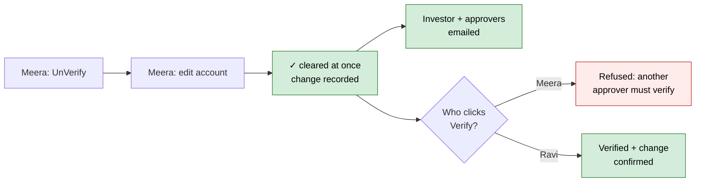
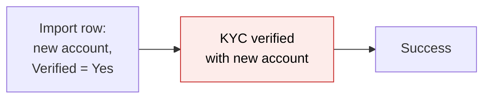
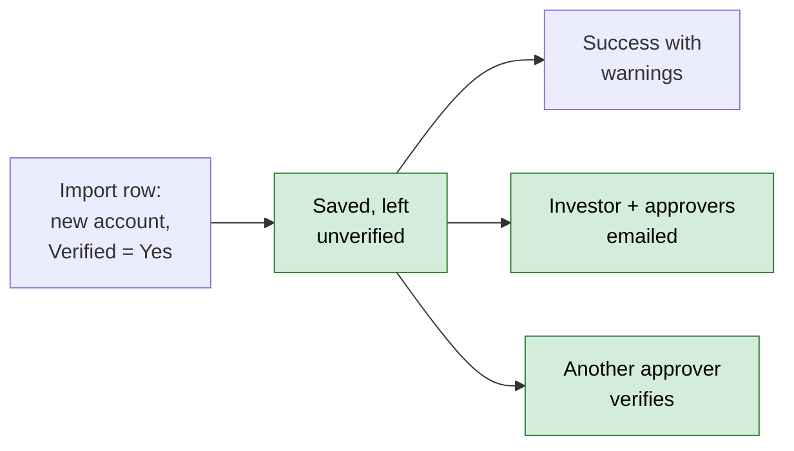
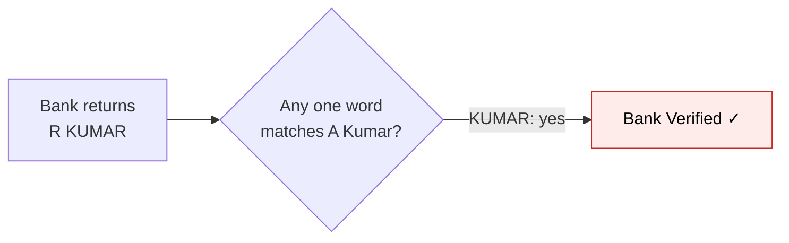
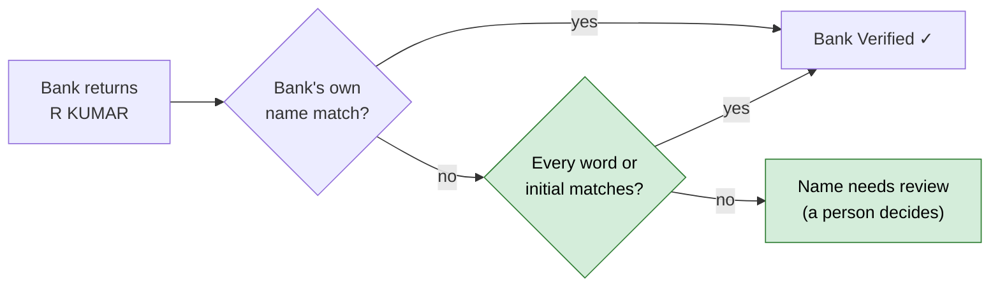
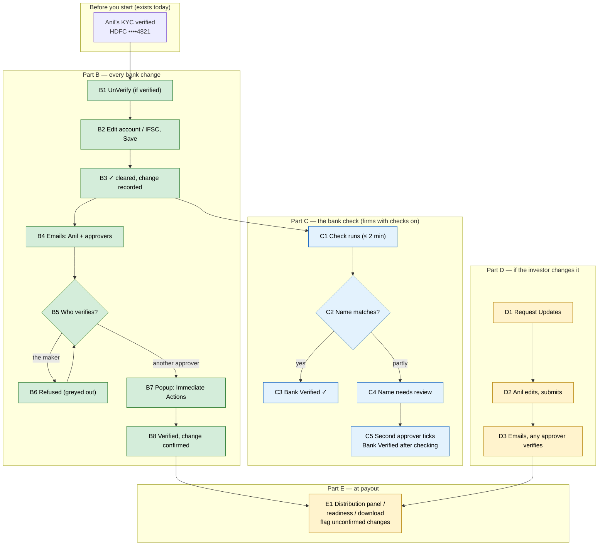

# Bank Detail Change Controls — Proposal

<!-- STYLE: bullets and diagrams, not prose. One idea per bullet; a diagram per concept (model, lifecycle, flow); table cells a phrase each — longer reasoning goes in bullets under the table. -->

> **Audience:** Business team, product, QA, support — non-technical.
> **Companion document:** [Design](design.md) · [Business rules](business-rules.md)
> **New to this? Start with the [Workflow Journey](#workflow-journey)** — every action, in order, from start to the outcome.

> **Planning phase — no code changes.** This document proposes and explains the change. Do not
> edit application code while writing it; implementation happens later, in the tasks phase.

> **Source:** security finding **M14** (A06 Insecure Design) in
> [docs/security/owasp_top10_review_2026_11.md](../../../docs/security/owasp_top10_review_2026_11.md).

---

## Why

- **A changed bank account keeps the old "Bank Verified" tick.** When an investor's account number or IFSC
  changes, the old ✓ stays on screen until a background check runs up to 2 minutes later — and for the 40
  firms that have bank verification switched off, it never runs, so the ✓ stays for good.
- **One person can redirect a payout alone.** A KYC approver can UnVerify, change the account, and Verify
  again, with nobody else involved. An import row can change the account and mark the KYC verified in one go.
- **The investor is never told.** No email goes to the investor when their payout account changes.
- **The name check is too loose.** The bank check accepts an account if *any one word* of the name matches
  ("R KUMAR" passes for investor "A Kumar").
- **Why now:** distributions paid 12,146 payments to 1,314 KYCs in the last 12 months; 80 account/IFSC
  changes happened on existing KYCs in that time, across 10 firms. Any one of them could have been a
  redirected payout with no trace in front of the investor.



---

## What Changes

- **The ✓ is cleared the moment the account changes.** Changing the account number or IFSC clears "Bank
  Verified" in the same save, on every path (screen, import, API, AI extraction, Document Checks).
- **A verified KYC goes back to "not verified"** when its account changes — exactly as if someone clicked
  UnVerify — so distribution checks see it.
- **A second person must verify.** The person who changed the bank details cannot verify that KYC (or tick
  Bank Verified). Any other KYC approver can. A change the investor made themselves is verified as today.
- **The investor is emailed** at the contacts they already had, with the last 4 digits of the old and new
  account. The firm's other KYC approvers are emailed too.
- **Stricter name check** (firms with bank verification on): the bank's name must match the investor's name
  word for word (initials allowed). Anything less becomes "Name needs review" for a person — not a rejection.
- **Payouts see unconfirmed changes:** the distribution payments download, the distribution readiness check
  and the distribution's journey panel all flag a bank change nobody has confirmed yet.
- **Investors can no longer send the verification result fields** (bank/PAN verification status and
  response) — only the background check writes them.
- **BREAKING (fund users):** the person who changed a KYC's bank details can no longer verify it. Firms
  with only one KYC approver keep working: that person can still verify, after a warning, and it is recorded.
- **BREAKING (fund users):** only KYC approvers (Investor KYC Approve, or company admin) can tick
  "Bank Verified" or send `verified` through the API. Other employees' ticks are ignored.
- **BREAKING (imports):** an "Update Only" import row that changes an existing account number or IFSC leaves
  the KYC unverified ("Success with warnings"), even with Verified = Yes.

### Key concepts



| Concept | What it means for you | Example |
|---|---|---|
| **Bank details** | The two fields money is sent to: account number and IFSC (routing code) | ••••4821 / HDFC0001234 |
| **Bank change** | Account number or IFSC changed from a value that was already filled in | ••••4821 → ••••7310 |
| **First fill** | Bank details entered where none existed — not a bank change | Investor fills a new KYC |
| **Maker** | The person (or investor) whose save made the bank change | Meera Shah |
| **KYC approver** | A user who may click Verify on a KYC (Investor KYC Approve permission, or company admin) | Meera, Ravi |
| **Second person** | A KYC approver who is not the maker | Ravi Iyer |
| **Awaiting second person** | A bank change no second person has confirmed yet | "Waiting for a second approver" |
| **Confirmed** | A second person verified the KYC after the change | Confirmed by Ravi, 10/11/2026 |
| **Only approver** | The firm has no KYC approver other than the maker | Solo Advisors (Kiran only) |
| **Bank check (penny drop)** | The paid check that sends ₹1 to the account and reads back the name the bank holds | Bank returns "ANIL KUMAR" |
| **Name needs review** | The bank's name was close but not an exact word match, so a person decides | Bank "R KUMAR" vs "A Kumar" |
| **Change email** | The email telling the investor (and the firm's approvers) about a bank change | "Your bank details … were changed" |

#### Second person (maker–checker)

- **What:** the person who changed the bank details cannot be the one who verifies them.
- **Why:** today one approver can redirect a payout alone; two people must now agree.
- **Does NOT cover:** first fill (new KYCs), bank name / branch / account type edits, unverifying, PAN or
  address changes, and KYCs that are never verified (the email is their control).
- **Example:** Meera changes Anil Kumar's account → Verify is greyed out for Meera → Ravi clicks Verify.
- **Exception:** a firm with no other KYC approver — the maker may verify after a warning; it is recorded
  as "Only approver".

#### Name needs review

- **What:** the bank check found the account, but the bank's name only partly matches the investor's.
- **Why:** "any one word matches" let "R KUMAR" pass for "A Kumar"; a strict rule alone would reject genuine
  investors whose bank adds a father's name.
- **Does NOT cover:** firms with bank verification off (no bank check runs there).
- **Example:** bank returns "ANIL KUMAR SHARMA" for "Anil Sharma" → Name needs review → Ravi checks the
  cancelled cheque and ticks Bank Verified.
- **Sizing (production copy):** of 607 accounts the old rule accepted, 579 match on the bank's own
  check, 9 more on the strict word rule, and **19 (3.1%) would land in "Name needs review"** — none rejected.

### Flow Diagram

**1. A fund user changes the bank details of a verified KYC**

Before:



After:



**2. An "Update Only" import changes an account**

Before:



After:



**3. The bank check reads back the name**

Before:



After:



---

## Workflow Journey

### Who is involved

| Person | Role | What they do in the journey |
|---|---|---|
| Anil Kumar | Investor (LP) at Horizon Capital, contact anil.kumar@example.in | Gets the change email; may change his own details when asked |
| Meera Shah | Horizon Capital ops, KYC approver | Makes the bank change (maker) |
| Ravi Iyer | Horizon Capital compliance head, KYC approver | Verifies as the second person |
| Priya Nair | Horizon Capital ops, Investor KYC Update only (not Approve) | Edits KYCs; can no longer tick Bank Verified |
| Kiran Rao | Only KYC approver at Solo Advisors | The "only approver" exception |

### The journey on one page



- There is no Part A: nothing to switch on. The rules apply to every firm from release.

### Before you start

| Needed | Why | Where it comes from |
|---|---|---|
| Two KYC approvers | So someone other than the maker can verify | Users › edit user › Investor KYC Approve (or company admin) |
| Investor contacts with KYC emails | Who the change email goes to | Investor › Users (approved, KYC tag or no tags) |
| Bank verification setting (optional) | Decides whether the bank check runs | Entity settings › Bank verification (CapHive support) |

### Part B — every bank change (fund user)

| Step | Who | Where | Action | What the system does | What you see |
|---|---|---|---|---|---|
| B1 | Meera | KYC page › UnVerify | Unverifies Anil's KYC | As today | "Investor kyc was successfully unverified." |
| B2 | Meera | KYC page › Edit › Bank step | Changes account to 50100273107310, IFSC ICIC0004567, Save | Same save clears Bank Verified, records the change | "Investor kyc was successfully saved." |
| B3 | — | KYC page | — | — | Contact & Banking shows amber note: "Bank details changed on 09/11/2026 by Meera Shah — account ending 4821 → 7310. Waiting for a second approver to verify." Bank Verified badge: "Not verified — bank details changed" |
| B4 | — | Email | — | Emails Anil's contacts and Horizon's approvers (not Meera) | Anil: "Your bank details with Horizon Capital were changed" |
| B5 | Meera | KYC page › Verify | Hovers Verify | Button greyed out | Tooltip: "You changed this KYC's bank details. Another KYC approver must verify it." |
| B6 | Meera | Direct request / bulk Verify | Tries anyway | Refused | "You changed this KYC's bank details, so another KYC approver must verify it." |
| B7 | Ravi | KYC page › Verify | Clicks Verify | Opens the confirm popup | Immediate Actions cards (see What you see) |
| B8 | Ravi | Popup › Verify KYC | Confirms | KYC verified; change marked confirmed by Ravi | "Investor kyc was successfully verified." Note becomes "Confirmed by Ravi Iyer on 10/11/2026" |

### Part C — the bank check (firms with bank verification on)

| Step | Who | Where | Action | What the system does | What you see |
|---|---|---|---|---|---|
| C1 | — | Background | — | Bank check runs within 2 minutes, as today | Badge "Pending Verification" |
| C2 | — | Background | — | Compares the bank's name with "Anil Kumar" | — |
| C3 | — | KYC page | — | Bank says "ANIL KUMAR" → match | Badge "Verified" |
| C4 | — | KYC page | — | Bank says "ANIL KUMAR SHARMA" → partial | Badge "Name needs review: the bank has 'ANIL KUMAR SHARMA'" |
| C5 | Ravi | KYC page › Edit › Bank Verified | Checks the cancelled cheque, ticks Bank Verified, Save | Records Ravi's tick | Badge "Verified" |

### Part D — the investor changes their own account

| Step | Who | Where | Action | What the system does | What you see |
|---|---|---|---|---|---|
| D1 | Meera | KYC page › UnVerify, then Request Updates | Asks Anil to update | As today | "Update request sent to investor with a fresh link." |
| D2 | Anil | Email link › KYC form | Changes account, Submit | Records the change with Anil as maker | "KYC submitted. The fund team has been notified." |
| D3 | Meera or Ravi | KYC page › Verify | Verifies | Any approver is a second person (Anil made the change) | "Investor kyc was successfully verified." Anil got the change email too |

### Part E — at payout

| Step | Who | Where | Action | What the system does | What you see |
|---|---|---|---|---|---|
| E1 | Meera | Distribution page › journey panel | Opens distribution | Counts KYCs with unconfirmed changes | "1 KYC has bank details changed and not yet confirmed by a second approver" |
| E2 | Meera | Support agents › Distribution readiness | Runs it | Bank step fails for unconfirmed changes | "1 investor(s) have bank details changed and not yet confirmed. Ask a second approver to verify the KYC before releasing payment." |
| E3 | Meera | Distribution › Payments › Download | Downloads | New last column | "Unconfirmed Bank Change" = 09/11/2026 for Anil, blank for others |

### What you see

KYC page, Contact & Banking card, after B2:

```
┌ Contact & Banking ───────────────────────────────────────────────────────────┐
│ ⚠ Bank details changed on 09/11/2026 by Meera Shah — account ending          │
│   4821 → 7310. Waiting for a second approver to verify.                      │
│   Investor contacts emailed: anil.kumar@example.in (09/11/2026)              │
│                                                                              │
│ BANK NAME   ICICI Bank            BRANCH NAME   Indiranagar                  │
│ ACCOUNT NO  50100273107310        IFSC          ICIC0004567                  │
│ BANK VERIFIED  [Not verified — bank details changed]                         │
└──────────────────────────────────────────────────────────────────────────────┘
```

Ravi's Verify popup (Request Updates "Immediate Actions" style):

```
┌ Verify KYC — Anil Kumar ──────────────────────────────────────────────── ✕ ┐
│ ▍Immediate Actions                                                          │
│ ▍The following will happen when you click Verify KYC:                       │
│ ┌──────────────────────────────────────────────────────────────────────────┐ │
│ │ (bank) New payout account confirmed                                      │ │
│ │        Distributions go to ICICI ••••7310 (IFSC ICIC0004567).            │ │
│ ├──────────────────────────────────────────────────────────────────────────┤ │
│ │ (user) You are the second person                                         │ │
│ │        Meera Shah made this change on 09/11/2026.                        │ │
│ ├──────────────────────────────────────────────────────────────────────────┤ │
│ │ (mail) Investor already told                                             │ │
│ │        anil.kumar@example.in was emailed on 09/11/2026. No new email.    │ │
│ ├──────────────────────────────────────────────────────────────────────────┤ │
│ │ (alert) Bank check: Name needs review   ← only when it applies           │ │
│ │        The bank has "ANIL KUMAR SHARMA". Bank Verified stays off.        │ │
│ └──────────────────────────────────────────────────────────────────────────┘ │
│                                         [Cancel]   [Verify KYC]              │
└─────────────────────────────────────────────────────────────────────────────┘
```

Anil's email:

```
Subject: Your bank details with Horizon Capital were changed

Dear Anil Kumar,
The bank account Horizon Capital will use for your distributions was changed
on Nov 09, 2026 by Meera Shah (Horizon Capital).

  Account   ending 4821  →  ending 7310
  IFSC      HDFC0001234  →  ICIC0004567

If you asked for this, no action is needed.
If you did not, contact Horizon Capital immediately — before the next payout.
[View KYC]
```

### What goes wrong

- **Meera tries to verify her own change.** Verify is greyed out with the tooltip; a direct request or bulk
  Verify is refused with "You changed this KYC's bank details, so another KYC approver must verify it."
  **Fix:** Ravi verifies.
- **Solo Advisors has only Kiran.** Kiran's Verify is not greyed out; the popup adds an amber card "You are
  the only KYC approver at Solo Advisors — this is recorded as confirmed by the person who made the
  change." **Fix:** none needed; the investor email is the check. Adding a second approver removes it.
- **The investor has no contact to email.** The approvers' email says "No investor contact could be
  emailed — confirm the change with the investor by phone." **Fix:** add an investor user, then verify.

### Summary: the minimum actions

| # | Action | Who | How often |
|---|---|---|---|
| 1 | Change bank details (as today) | Maker (fund user or investor) | Each change |
| 2 | Verify the KYC | A second KYC approver | Each change (≈ 7 a month across all firms today) |
| 3 | Tick Bank Verified after checking proof | A second KYC approver | Only for "Name needs review" (≈ 3% of checks) |

---

## User Stories

### US-1: Bank Verified clears on change

**As a** fund operations user, **I want** the Bank Verified tick to clear as soon as an account changes,
**so that** nobody pays an unverified account believing it is verified.

**Acceptance criteria:**
- Saving a new account number or IFSC on an existing KYC shows Bank Verified as "Not verified — bank details
  changed" immediately after the save, on every firm.
- Applies to the KYC form, API, import, Document Checks "Use document value" and AI extraction. (CKYC/KRA data
  never writes bank fields, so it is not a path.)
- Changing only bank name, branch or account type does not clear the tick.
- First fill (no account before) behaves as today.

### US-2: Second person verifies

**As a** compliance head, **I want** a different approver to verify after a bank change,
**so that** no single insider can redirect a payout.

**Acceptance criteria:**
- The maker's Verify button is greyed out with the tooltip text; single Verify, bulk Verify, API
  `verified: true` and import Verified = Yes by the maker are all refused or ignored.
- Any other KYC approver can verify; the change shows "Confirmed by <name> on <date>".
- A change made by the investor can be verified by any approver.
- In a firm with no other approver, the maker can verify after the "only approver" card.

### US-3: Investor is told

**As an** investor, **I want** an email whenever my payout account changes, **so that** I can stop a
change I did not ask for.

**Acceptance criteria:**
- Sent to my approved contacts with KYC emails (or all topics) who already had access before the change.
- Never sent to an address typed into the KYC in the same save (e.g. eSign emails).
- Shows only the last 4 digits of the old and new account, both IFSCs, who changed it and when
  (`Nov 09, 2026`).
- Sent once per change, also when I made the change myself.

### US-4: Approvers are told

**As a** KYC approver, **I want** an email and in-app alert when someone else changes bank details,
**so that** I know a second-person verify is waiting.

**Acceptance criteria:**
- Sent to the firm's KYC approvers who can see the KYC, except the maker.
- Says whether the investor email went out and to whom.

### US-5: Fair name check

**As a** fund operations user, **I want** partial name matches sent to a person, not passed or rejected,
**so that** genuine investors aren't blocked and look-alike names aren't waved through.

**Acceptance criteria:**
- Bank's own match → Verified. Every word or initial matching → Verified. Otherwise "Name needs review: the
  bank has '<name>'".
- A second approver can tick Bank Verified after review; the maker cannot.

### US-6: Payouts see unconfirmed changes

**As a** fund operations user paying a distribution, **I want** unconfirmed bank changes flagged where I
pay, **so that** I hold those payments.

**Acceptance criteria:**
- Distribution journey panel warning, readiness check failure and payments download column, as in Part E.
- Existing payments, verified KYCs and distributions without changes look exactly as today.

### US-7: Verification fields can't be forged

**As a** security reviewer, **I want** verification status/response fields written only by the check,
**so that** an investor can't make a bad account look checked.

**Acceptance criteria:**
- Bank/PAN verification status and response sent by any user are ignored.
- Bank Verified and Verified sent by a non-approver are ignored.

---

## UI Behavior

### KYC page — header buttons

```
┌──────────────────────────────────────────────────────────────────────────────┐
│ KYCs › Anil Kumar › Anil Kumar                                               │
│ [Edit] [Delete] [✓ Verify (greyed, ⓘ)] [Request Updates] [KYC Actions ▾]    │
└──────────────────────────────────────────────────────────────────────────────┘
```

**Behavior notes:**
- Verify is greyed (not hidden) only for the maker while a change is awaiting; tooltip explains why.
- For everyone else, Verify opens the Immediate Actions popup when a change is awaiting; otherwise it
  verifies directly, as today.
- UnVerify is unchanged for everyone, including the maker.

### KYC page — Contact & Banking card

- Amber note while awaiting (see What you see); grey line "Confirmed by Ravi Iyer on 10/11/2026" after.
- Note links to the Audit Trail tab for the full history.
- The note is hidden from investors; they see their details as today.

### KYC edit — Bank step

- "Bank Verified" checkbox shown only to users allowed to tick it (KYC approvers who are not the maker).

### Bulk actions — KYC list

- Bulk Verify skips the maker's KYCs and lists them: "Not verified — you changed the bank details; another
  approver must verify".

---

## What This Feature Does NOT Cover

| Excluded | Covered In |
|---|---|
| Bank fields held in custom fields (SWIFT in 8 firms, IBAN in 2) | Open question 1 |
| Bank name / branch / account type edits | Audit trail only (they don't route money) |
| Secondary-sale seller/buyer bank details (offers, interests) | Follow-up change |
| Import Verified = Yes by users without Approve, when bank details didn't change | Follow-up (M14 scope is bank changes) |
| Encrypting account numbers at rest | `encrypt-investor-pii-at-rest` change |
| Maker–checker on capital call / distribution approval | `capital-call-distribution-maker-checker` (M13) |
| Holding or blocking a payment automatically | Flags only; payment release stays a person's decision |

---

## Validation Rules

| Field | Rule | Default |
|---|---|---|
| Account number, IFSC | A change from non-blank → different value is a bank change (spaces and letter case ignored) | — |
| Bank Verified | Forced off in the save that changes account/IFSC, whatever was sent | off after change |
| Bank Verified (tick) | Accepted only from a KYC approver who is not the maker of an awaiting change | ignored otherwise |
| Verified | Accepted only from a KYC approver; refused for the maker of an awaiting change | ignored / refused |
| Bank/PAN verification status and response | Never accepted from a user | ignored |

---

## Behavior Rules

| Scenario | What User Sees |
|---|---|
| Maker hovers Verify | "You changed this KYC's bank details. Another KYC approver must verify it." |
| Maker verifies by direct request / API | "You changed this KYC's bank details, so another KYC approver must verify it." |
| Bulk Verify by maker | Error list: "Not verified — you changed the bank details; another approver must verify" |
| Import row changes account, Verified = Yes | "Success with warnings" — "Bank details changed — the KYC was left unverified for another approver to verify" |
| Bank Verified badge after change, check off | "Not verified — bank details changed" |
| Bank check partial name | "Name needs review: the bank has 'R KUMAR'" |
| Only approver opens popup | "You are the only KYC approver at Solo Advisors — this is recorded as confirmed by the person who made the change." |
| No investor contact | Approvers' email: "No investor contact could be emailed — confirm the change with the investor by phone." |
| Distribution panel | "1 KYC has bank details changed and not yet confirmed by a second approver" |
| Readiness check | "1 investor(s) have bank details changed and not yet confirmed. Ask a second approver to verify the KYC before releasing payment." |
| Payments download | Last column "Unconfirmed Bank Change": change date or blank |

---

## Resolved Design Decisions

| # | Decision | Resolution |
|---|---|---|
| 1 | Which fields are "bank details"? | Account number + IFSC (what the payout file uses). Name/branch/type are audited only |
| 2 | Clear Bank Verified when? | In the same save, on every path; old value kept in the audit trail |
| 3 | What does the second person do? | Clicks the existing Verify — no new approval screen |
| 4 | Firms with one approver? | Allowed, with a warning card, recorded as "Only approver"; investor email is the check |
| 5 | Name rule | Bank's own match, else strict word/initial match, else "Name needs review" (person decides) |
| 6 | Who gets the investor email? | Approved KYC contacts who had access before the change; never addresses in the KYC itself |
| 7 | Block payouts automatically? | No — flag in the panel, readiness check and download |
| 8 | Existing data | Untouched; no backfill. Rules apply to changes after release |

---

## Capabilities

### New Capabilities

- `kyc/bank-detail-change-controls`: clearing Bank Verified on change, the change record, second-person
  verification, change emails, the name check, protected verification fields, and payout flags.

### Modified Capabilities

- `funds/capital-distribution-journey`: the journey panel's readiness warnings gain "bank details changed
  and not yet confirmed".

---

## Impact

- KYC page, KYC edit form (bank step), KYC list bulk actions, KYC import.
- KYC emails (two new emails) and in-app notifications.
- Bank verification background check and its name rule.
- Distribution page journey panel, Distribution readiness support agent, distribution payments download.
- KYC API (fields it accepts).
- A new history table for bank changes (see design).

---

## Benefits

1. A payout account cannot be changed and approved by one insider.
2. The investor hears about every account change within minutes, at an address they already had.
3. "Bank Verified" means the *current* account was checked — never a stale ✓.
4. Genuine investors with partial name matches go to a person instead of being rejected.
5. Ops sees unconfirmed changes where they pay.

---

## FAQ

| Question | Answer |
|---|---|
| Do existing verified KYCs change at release? | No. Nothing is reset or backfilled; rules apply to the next change |
| Can investors still update their bank details? | Yes, exactly as today (Request Updates → form). They also get the email |
| Will firms with bank verification off notice? | Yes: Bank Verified now clears on change, and they need a second approver to verify |
| What if the firm has one approver? | They can still verify, after a warning; it's recorded |
| Is a payment ever blocked? | Not automatically. The readiness check reports "blocked" and the panel warns; releasing payment stays a person's call |
| Does the email show the full account number? | No — last 4 digits only |
| Can the firm turn the investor email off? | No. They can reword it (custom notification), not disable it |
| Does fixing a typo in the branch name email the investor? | No — only account number or IFSC changes |
| What does a "Name needs review" cost? | Nothing extra: no second bank check is run; a person decides |
| Does this affect imports for new KYCs? | No. Only "Update Only" rows that change an existing account |
| How is it tested? | Cucumber features per phase — see [business-rules.md](business-rules.md) |

---

## Design Principle for the Next Phase

- **Reuse the Verify button** as the second-person step — no new approval screen or workflow.
- **One rule location:** the "clear on change" rule must sit where *every* write path passes (several paths
  skip the KYC operations: Document Checks, AI extraction). Design must show that single place.
- **Who is the maker** must be known for jobs, imports and magic links — reuse how the KYC journey already
  finds its actor.
- **Risk of complexity:** "only approver" detection and the investor-contact filter — keep each to one
  query, no per-user loops.
- **Key changes needing approval** are listed in design.md (existing models, permissions, import
  behaviour, exports) — nothing is built until they are approved.
