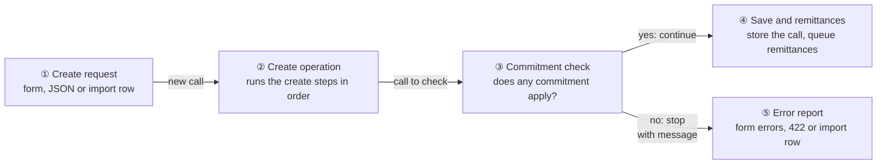
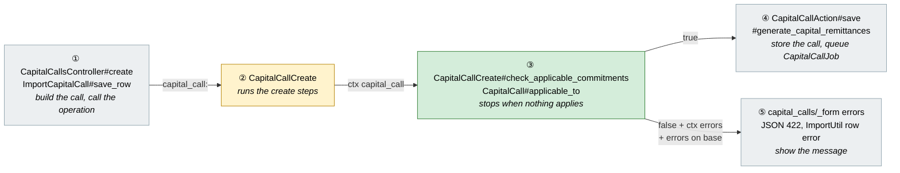
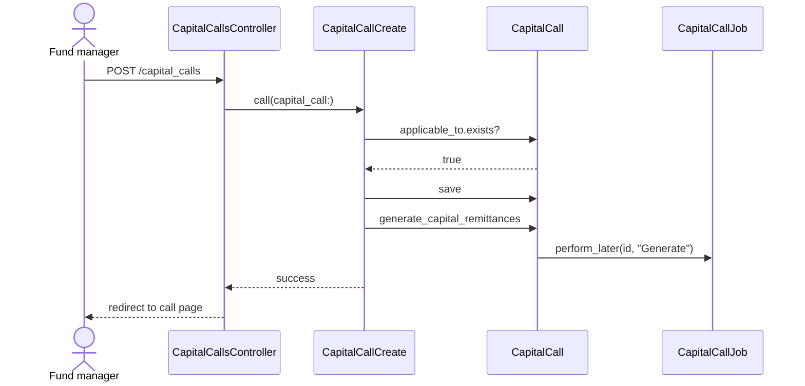
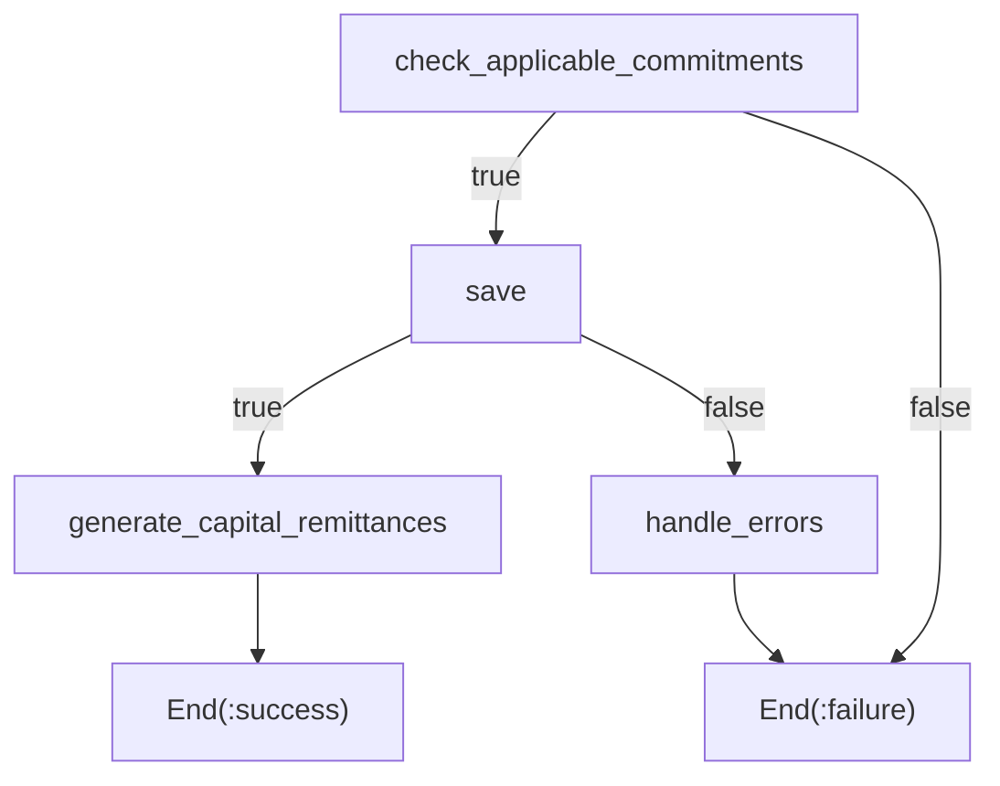
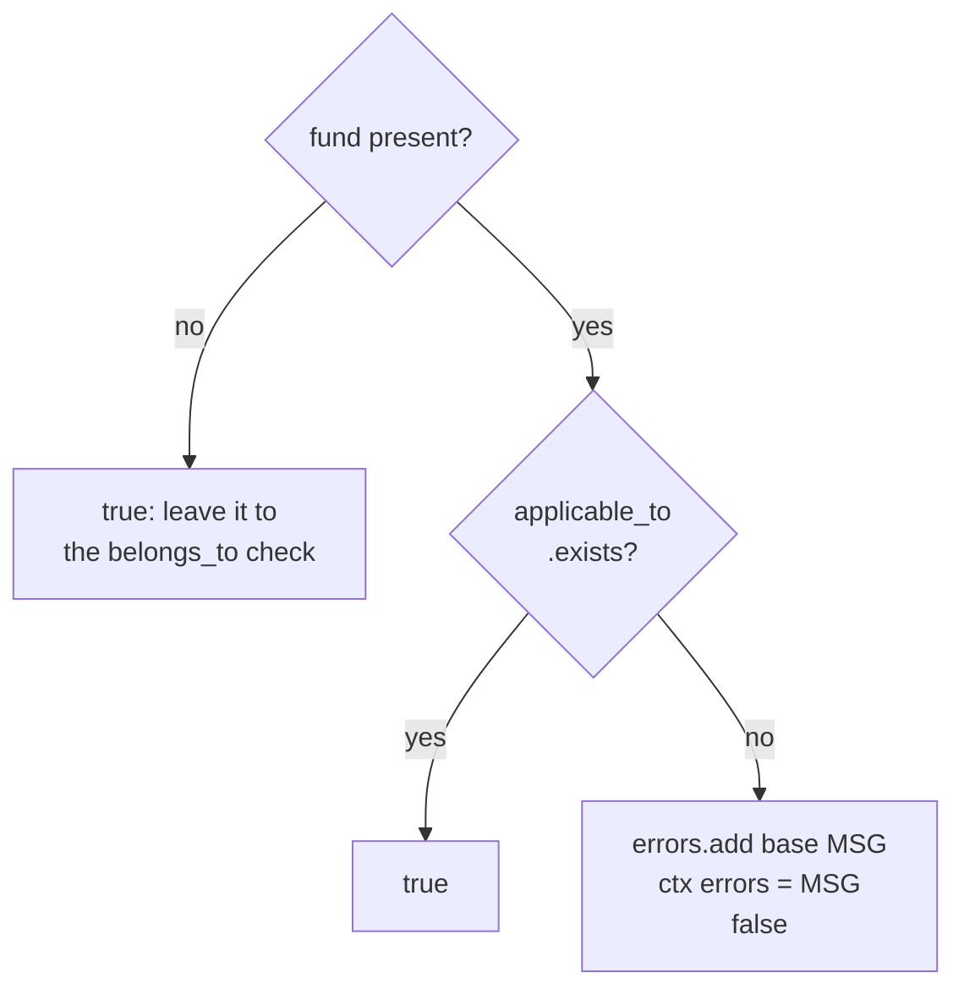
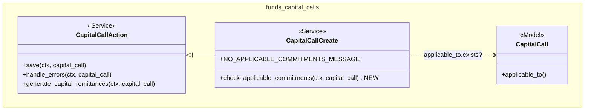

# Block Capital Calls Without Commitments — Design

> **Audience:** Engineering team.
> **Companion documents:** [Proposal](proposal.md) · [Spec](specs/)

> **Planning phase — no code changes.** This document explains HOW the proposal will be built.
> Do not edit application code while writing it; implementation happens later, in the tasks phase.

---

## Contents

- [1. The idea](#1-the-idea)
  - [What this adds](#what-this-adds)
  - [The idea in one picture](#the-idea-in-one-picture)
  - [Walkthrough: one example, start to finish](#walkthrough-one-example-start-to-finish)
  - [Key ideas](#key-ideas)
- [2. The same picture with real names](#2-the-same-picture-with-real-names)
  - [Picture](#picture)
  - [What each box does](#what-each-box-does)
  - [One run, end to end](#one-run-end-to-end)
  - [Lifecycles](#lifecycles)
  - [What users see](#what-users-see)
  - [Design decisions](#design-decisions)
- [3. One card per box](#3-one-card-per-box)
  - [① Create request](#①-create-request)
  - [② Create operation](#②-create-operation)
  - [③ Commitment check](#③-commitment-check)
  - [④ Save and remittances](#④-save-and-remittances)
  - [⑤ Error report](#⑤-error-report)
- [4. Reference](#4-reference)
  - [Class diagram](#class-diagram)
  - [Data model and schema changes](#data-model-and-schema-changes)
  - [Component contracts](#component-contracts)
  - [Cross-cutting concerns](#cross-cutting-concerns)
  - [Worked examples](#worked-examples)
  - [Testing](#testing)
  - [Risks and open questions](#risks-and-open-questions)

---

## 1. The idea

### What this adds

A single guard step at the front of the existing capital call create operation. Before the call is
saved, the step asks the model which commitments the call applies to, using the same lookup the
remittance generator already uses. If none apply, the step stops the operation with an error on the
call. It follows the existing Trailblazer pattern used by `CapitalCallCreate`, where a failed step ends
the operation and the caller renders the call's errors. The form, the JSON endpoint and the importer
already go through that operation, so all three get the rule.

### The idea in one picture



### Walkthrough: one example, start to finish

**Setup.** Priya is a company admin at Urban Capital. "SAAS Fund" has two investors with commitments
in "First Close" only. Nobody has committed to "Second Close" yet.

**Legend.** ✓ = passed · ✗ = stopped here · ○ = not reached.

| # | When | What happens | Behind the scenes | Result |
|---|---|---|---|---|
| 1 | Mon 10:00 | Priya opens New Call, picks Applicable To = "Second Close", 10%, and clicks Save | The form posts to the controller, the create request (①), which hands the call to the create operation (②) | ✓&nbsp;Create&nbsp;request<br>**● Commitment&nbsp;check** |
| 2 | Mon 10:00 | The form comes back with "No commitments in this fund apply to this call…" | The commitment check (③) finds no commitment in "Second Close" and stops. The error report (⑤) re-renders the form with the error | ✓&nbsp;Create&nbsp;request<br>✗&nbsp;Commitment&nbsp;check<br>○&nbsp;Save&nbsp;and&nbsp;remittances<br>**✗ Error&nbsp;report shown** |
| 3 | Mon 10:01 | Priya changes Applicable To to "First Close" and saves | The check (③) finds two commitments. Save and remittances (④) stores the call and queues `CapitalCallJob` | ✓&nbsp;Create&nbsp;request<br>✓&nbsp;Commitment&nbsp;check<br>**✓ Save&nbsp;and&nbsp;remittances** |
| 4 | Mon 11:00 | Priya imports a call file for "SAAS Fund". Row 1 calls "All" closes; row 2 calls "Second Close" | Each row runs the create operation (②). Row 2 fails at the check (③) and the importer writes the message on that row of the import report (⑤) | Row&nbsp;1:&nbsp;✓&nbsp;Created<br>Row&nbsp;2:&nbsp;**✗&nbsp;Failed with message** |

Snapshot at walkthrough row 2:

```
┌────────────────────────────────────────────────────────────┐
│ 1 error prohibited this capital call from being saved:     │
│  • No commitments in this fund apply to this call. Add     │
│    commitments for the selected fund closes before         │
│    creating a capital call.                                │
├────────────────────────────────────────────────────────────┤
│ Name           [ Call 2           ]                        │
│ Applicable To  [ Second Close ▾   ]   ← Priya fixes this   │
└────────────────────────────────────────────────────────────┘
```

**What to notice**
- The check runs before anything is saved, so a refused call leaves nothing behind.
- "Applies to" is the same lookup the remittance job uses (`applicable_to`), so the check and the job
  can never disagree.
- One step in the shared operation covers the form, JSON and the importer.
- Edits use a different operation (`CapitalCallUpdate`) and are untouched.

### Key ideas

| # | Idea | In one line | Card |
|---|---|---|---|
| 1 | Guard in the create operation | A new first step in `CapitalCallCreate`, not a model validation | [②](#②-create-operation) |
| 2 | Reuse `applicable_to` | "Applies" means exactly what the remittance generator already uses | [③](#③-commitment-check) |
| 3 | Error on `:base` | The message lands where each caller already shows `capital_call.errors` | [⑤](#⑤-error-report) |
| 4 | Create only | Update and direct model saves don't run this step | [②](#②-create-operation) |

**FAQ**

| Question | Answer |
|---|---|
| Why not a model validation? | A model validation would also run on direct `save`/`create!` calls. Many Cucumber setups do that on funds with no commitments, and those would break for no product reason. The request is about *creating* through the app, which always goes through `CapitalCallCreate`. |
| Does this block users from opening the form? | No. The New Call button and form are unchanged; only Save is refused. |
| Is there a race if a commitment is deleted right after the check? | Possible but harmless: the call is saved and the remittance job finds nothing, which is exactly today's behaviour. No lock is warranted. |

---

## 2. The same picture with real names

### Picture



Colour = footprint: **green** new, **amber** modified, **grey** reused unchanged. Exact files are in
[lld.md File Map](lld.md#file-map).

### What each box does

| # | Box | Real parts | What it does | When it runs | What it decides | Details |
|---|---|---|---|---|---|---|
| ① | Create request | `CapitalCallsController#create`, `ImportCapitalCall#save_row` | Builds an unsaved `CapitalCall` and calls `CapitalCallCreate` | Web request; import job per row | Nothing new | [card ① →](#①-create-request) |
| ② | Create operation | `CapitalCallCreate < CapitalCallAction` | Runs the check, then save, then remittance generation | Inside ① | Order of steps; check failure ends the operation | [card ② →](#②-create-operation) |
| ③ | Commitment check | `CapitalCallCreate#check_applicable_commitments`, `CapitalCall#applicable_to` | Asks whether any commitment applies; on none, adds the error and fails | Before `save` | Whether the call may be created | [card ③ →](#③-commitment-check) |
| ④ | Save and remittances | `CapitalCallAction#save`, `#handle_errors`, `#generate_capital_remittances` | Unchanged | After ③ passes | Unchanged | [card ④ →](#④-save-and-remittances) |
| ⑤ | Error report | `capital_calls/_form.html.erb` error list, controller JSON branch, `ImportCapitalCall` `raise result["errors"]` | Shows the message | When ② fails | Nothing new | [card ⑤ →](#⑤-error-report) |

### One run, end to end



### Lifecycles

N/A — no stored or derived status is added or changed; a refused call is never persisted.

### What users see

| Where in CapHive | Today | After this change | Who sees it |
|---|---|---|---|
| Fund → Calls → New Call → Save | Empty call saved | Form re-shown with the error | Users who can create calls |
| Fund → Calls → Upload (call import) | Row creates an empty call | Row fails with the error in the import report | Users who import calls |
| `POST /capital_calls.json` | 201 with an empty call | 422 with the error | API clients |

The form journey and message are in the [proposal](proposal.md#ui-behavior). Nothing in the view
changes: the form's existing error list already prints every `capital_call.errors` entry.

### Design decisions

1. **Guard step in `CapitalCallCreate`, not a model validation.** Alternative: `validate ..., on: :create`
   on `CapitalCall`. Rejected because it would also fire on direct `FactoryBot.create(:capital_call)` and
   other raw saves (≈15 step files create calls on funds that may have no commitments), widening the rule
   beyond "creating a call" through the app and causing unrelated test churn.
2. **Reuse `CapitalCall#applicable_to`.** Alternative: a new query on fund closes. Rejected: it would
   duplicate the "All" / nil / named-close logic and could drift from what `CapitalCallJob#generate` uses.
3. **Error on `:base` and set `ctx[:errors]` in the step itself.** Alternative: let `handle_errors` build
   the message. Rejected: `handle_errors` calls `capital_call.valid?`, which clears errors and would erase
   the message, then report success. The new step ends the operation directly via
   `Output(:failure) => End(:failure)`.
4. **Use `exists?`, not `count`.** Stops at the first matching row; the check is one indexed query.
5. **No UI change to the New Call button.** The user chose server-side errors only.

**FAQ**

| Question | Answer |
|---|---|
| Why not put the step in `CapitalCallAction` so all actions share it? | `CapitalCallAction` is the base for update and approve too. The rule is for create only. |
| Does the importer need code changes? | No. It already calls `CapitalCallCreate` and raises `result["errors"]`, which becomes the row's error. |
| Why does the message mention fund closes even when the fund has no commitments at all? | One message covers both cases and tells the user exactly what to add. |

---

## 3. One card per box

> Same order and numbers as the picture.

### ① Create request

The callers that build a new call and run the create operation. They are unchanged.

| Owns | Reads / receives | Produces |
|---|---|---|
| Building the unsaved `CapitalCall` | Form params / JSON params / import row | `CapitalCallCreate.call(capital_call:[, import_upload:])` |

| Verb and path | Action | Does | Responds with |
|---|---|---|---|
| `POST /capital_calls` | `CapitalCallsController#create` | `authorize`, then `CapitalCallCreate` | 302 to call page, or 422 rendering `:new` |
| `POST /capital_calls.json` | same | same | 201 `show`, or 422 `capital_call.errors` |
| Import upload (`CapitalCall`) | `ImportCapitalCall#save_row` | per row, `CapitalCallCreate` | row marked success or error |

Access is unchanged: `CapitalCallPolicy#create?` and the fund's `entity_id` scope already apply before the
operation runs.

**Worked examples:** H1, H2, X1, X4, X5

**FAQ**

| Question | Answer |
|---|---|
| Does the admin `capital_calls_controller` create calls? | Not through `CapitalCallCreate`; it is out of scope, like any direct model save. |

### ② Create operation

`CapitalCallCreate` gains one step, placed first, wired so its failure ends the operation.

| Owns | Reads / receives | Produces |
|---|---|---|
| Step order of a create | `ctx[:capital_call]`, optional `ctx[:import_upload]` | Success, or failure with `ctx[:errors]` |



| Component | Transaction | Queue / retry | Idempotency |
|---|---|---|---|
| `CapitalCallCreate` | None added; the check is a read before `save` | — | Re-running with the same input gives the same answer |

**Worked examples:** H1, X1

**FAQ**

| Question | Answer |
|---|---|
| Why first, not after `save`? | After `save` the call row exists and journey auto-launch callbacks may have run; we'd have to roll back. Checking first means nothing is written. |
| What does `CapitalCallUpdate` do? | Unchanged. It doesn't include this step (spec: rule applies only on create). |

### ③ Commitment check

A new private step method on `CapitalCallCreate`.

| Owns | Reads / receives | Produces |
|---|---|---|
| The rule and its message | `capital_call.fund`, `capital_call.fund_closes`, via `applicable_to` | `true`; or `false` + `errors.add(:base, MSG)` + `ctx[:errors]` |



`applicable_to` returns all fund commitments when `fund_closes` is nil or includes "All", and otherwise
commitments whose `fund_close` is in `fund_closes`. Upload calls take the same path: their `fund_closes`
is usually nil, so the check becomes "does the fund have any commitment". The message is a frozen
constant on `CapitalCallCreate` so tests and the spec share one string.

**Worked examples:** H1, H2, H3, E1, E2, X1, X2, X3

**FAQ**

| Question | Answer |
|---|---|
| Are soft-deleted commitments counted? | No. `fund.capital_commitments` is Paranoia-scoped, same as the remittance job. |
| Are zero-amount commitments counted? | Yes, as the proposal decided. `applicable_to` doesn't filter on amount. |

### ④ Save and remittances

Unchanged: `save`, `handle_errors` and `generate_capital_remittances` run exactly as before when ③ passes.

| Owns | Reads / receives | Produces |
|---|---|---|
| Persisting and queueing | `capital_call` | Saved call; `CapitalCallJob` queued (or run inline for imports) |

**Worked examples:** H1, H3

**FAQ**

| Question | Answer |
|---|---|
| Can `handle_errors` now hide the new message? | No. A failed check bypasses `save` and `handle_errors` entirely. |

### ⑤ Error report

The existing ways each caller shows a failed create. Unchanged.

| Owns | Reads / receives | Produces |
|---|---|---|
| Showing the message | `capital_call.errors` / `result["errors"]` | Form error list; JSON 422 body `{"base": [MSG]}`; import row error |

**Worked examples:** X1, X4, X5

**FAQ**

| Question | Answer |
|---|---|
| Is the message translated? | No. Capital call errors in this pack are English strings; this follows suit. |

---

## 4. Reference

### Class diagram



### Data model and schema changes

N/A — no tables or columns change.

### Component contracts

| From → To | Contract | Direction rule |
|---|---|---|
| ① → ② | `CapitalCallCreate.call(capital_call:, import_upload: nil)` | Callers never call the step directly |
| ② → ③ | step receives `ctx`, `capital_call:` | Runs before any write |
| ③ → ④ | returns `true` | Only path to `save` |
| ③ → ⑤ | returns `false`; `capital_call.errors[:base]` and `ctx[:errors]` hold the message | Ends the operation (`End(:failure)`) |

### Cross-cutting concerns

#### Transactions and queries

One `SELECT 1 … LIMIT 1` on `capital_commitments` filtered by `fund_id` (and `fund_close IN (...)`)
per create. No N+1; no write before the check.

#### Exception handling and monitoring

N/A — a refused create is an expected user error, shown inline; no alert or `Noticed` notification.

#### Performance and security

- Performance: one indexed existence query per created call; imports add one per row.
- Security: no new input. Tenant scope comes from `capital_call.fund`, which the controller authorizes
  and the importer resolves within `import_upload.entity`.

### Worked examples

**ID legend:** **H** = Happy path · **E** = Edge case · **X** = Error (exception) case.

**Shared setup:**

| Record | Name | Key data |
|---|---|---|
| Entity | Urban | `entity_type=Investment Fund` |
| User | company_admin | can create calls |
| Fund | SAAS Fund | 2 investors, commitments in "First Close" only |
| Fund | Empty Fund | no commitments |

#### Happy Path

| # | Scenario | Given | When | Then | Spec scenario | Feature |
|---|---|---|---|---|---|---|
| H1 | Call for all closes | SAAS Fund | Create call, closes "All", 10% | Call saved, 2 remittances | Call for all closes on a fund with commitments | `capital_call_requires_commitments.feature` |
| H2 | Upload call with commitments | SAAS Fund | Create call, basis "Upload" | Call saved | Upload-basis call on a fund with commitments | same |
| H3 | Mixed closes | SAAS Fund | Create call, closes "First Close, Second Close" | Call saved, remittances only for First Close commitments | One of several selected closes has commitments | same |

#### Edge Cases

| # | Scenario | Given | When | Then | Spec scenario | Feature |
|---|---|---|---|---|---|---|
| E1 | Edit to empty close | SAAS Fund with an existing call for "First Close" | Edit call, closes "Second Close" | Edit saved | Editing an existing call is unaffected | same |
| E2 | Close with no commitments | SAAS Fund | Create call, closes "Second Close" | Not saved; message shown | Selected fund close has no commitments | same |

#### Error Cases

| # | Scenario | Given | When | Then (what the user sees, who is alerted) | Spec scenario | Feature |
|---|---|---|---|---|---|---|
| X1 | Form on empty fund | Empty Fund | Submit New Call form | Form re-shown with entered name; error list shows message; no call | Fund with no commitments; Form keeps the user's input | same |
| X2 | Upload on empty fund | Empty Fund | Create call, basis "Upload" | Not saved; message shown | Upload-basis call on a fund with no commitments | same |
| X3 | Operation refuses empty fund | Empty Fund | `CapitalCallCreate.call` | Failure; `CapitalCall.count` unchanged; no `CapitalCallJob` queued | Fund with no commitments | same |
| X4 | JSON create on empty fund | Empty Fund | `POST /capital_calls.json` | 422; body contains message | JSON create is refused | same |
| X5 | Import with one bad row | SAAS Fund | Import `capital_calls_no_commitments.xlsx`: row 1 closes "All", row 2 closes "Second Close" | Row 2 fails with message in the import result; row 1's call created | Import row fails and others continue | same |

### Testing

Cucumber only. New `features/fund/capital_call_requires_commitments.feature` with steps in a new
`features/step_definitions/capital_call_requires_commitments_steps.rb`. Reuse `there is a fund … for the
entity`, `there are capital commitments of … from each investor`, `I get the error …` and
`the capital call should fail with error …`. Then re-run `features/fund/capital_call*.feature` and
`features/fund/fund_import.feature` for regressions.

### Risks and open questions

- Existing scenarios create calls through the form/importer before adding commitments → re-run the capital
  call and import features; fix any setup by adding commitments first (the import scenarios already
  import commitments before calls).
- Onboarding teams import calls before commitments → called out as **BREAKING** in the proposal; the row
  message says what to do.
- `CapitalCallCreate` is built with Trailblazer step wiring; a wrong `Output` would let the failure fall
  into `handle_errors` and be reported as success → X3 asserts failure and no new call.

No open questions.

**FAQ**

| Question | Answer |
|---|---|
| Where do I start reviewing? | `CapitalCallCreate` (one new step and a constant), then the feature file. |
| Is there anything to migrate? | No. Existing calls are untouched. |
